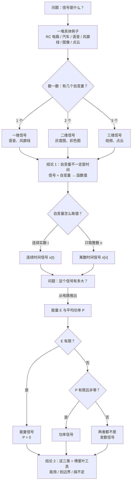
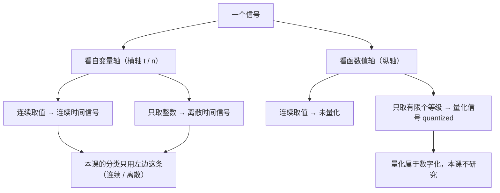
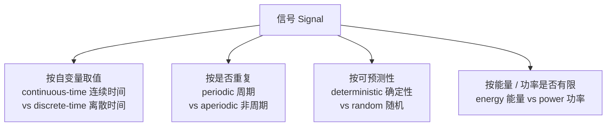
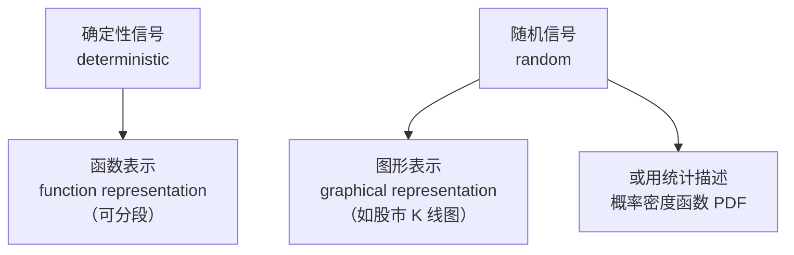
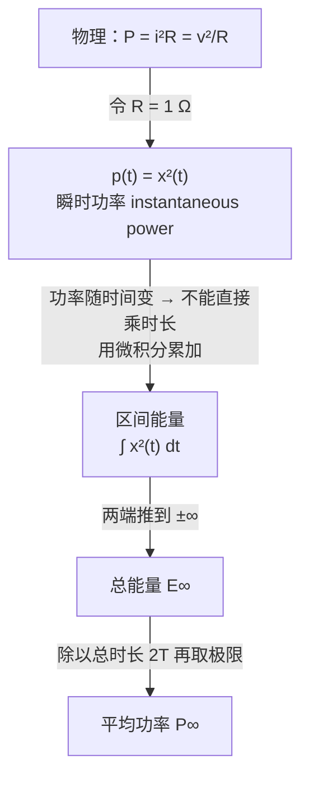
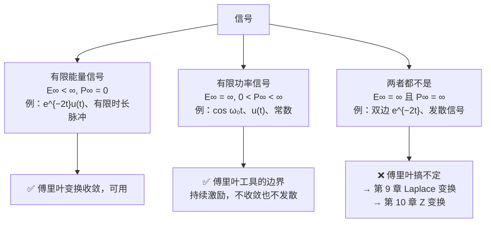

# 1.1 连续时间与离散时间信号 Continuous-time and Discrete-time Signals

> [!abstract] 这一讲的任务
> 上一讲（绪论）我们把整门课的地图画出来了，但地图上还没有任何一个具体的点。
> 这一讲要做的第一件事，是回答一个最朴素的问题：**信号到底是什么？**
> 答案会很短——信号就是**一个或多个自变量的函数**——但这句话里藏着两个坑：
> **自变量不一定非得是时间**，以及**"连续/离散"说的只是自变量那条轴**。
> 第二件事，是给信号加上一把能拿来做判断的尺子：**能量与功率**。
> 这把尺子量出的三类信号，正好划出了后面傅里叶工具的适用边界。

> [!info] 怎么读这份讲义
> 建议按顺序读：每个概念都是被"逼"出来的——先摆例子、再让你猜、猜错了才引出定义。
> 正文里的 `> [!question]` 是真的在问你，答案在后面几段，不要跳。
> 篇末的「这一讲的三句话」用来复习；每节后紧跟的例题和判断是考试的原型。
>
> **「拓展」图例**：标有 **（拓展）** 或 **【拓展】** 的内容，是课堂上没有展开讲、
> 由教材与通行讲法延伸补充的部分。复习优先级：先吃透未标注的主干（考试考点集中在这里）。
>
> **一句话勘误**：讲义的讲解顺序与页码编号做了重排，有一处原始笔误（离散周期那道题里的口诀）
> 已在对应小节点名。



---

## 0. 开场：一段"对了"的录音

先听一段 0.4 秒的语音。说话的人只说了两个汉字：**"对了"**。

如果我们把这段时间里空气压强的起伏画出来，会得到一条上下抖动的曲线：前面一小段几乎贴着零（还没开口），
中间突然抖得很密（元音），最后又慢慢落回零。这条曲线就是**语音信号** $x(t)$——注意名字里的
那个 $t$ 是**时间**，而曲线的**高度**是**声压 acoustic pressure**。

现在问一个问题：我们记录的到底是什么？

你可能会说"记录了这句话"。但这句话本身是听不见摸不着的，我们真正记下来的，
是**话筒膜片被空气推来推去时，每一瞬间的压强大小**。换句话说：

> [!important] 信号的第一个身份
> **信号是一个函数：它把自变量的每一个取值，映射到一个函数值。**
> 语音信号的函数值是**声压**，自变量是**时间**。
>
> 你刚才做的事情——把"一段声音"翻译成"一条随某个量变化的曲线"——就是这门课接下来
> 每一章都要做的事。因为只有变成函数，我们才能求导、积分、做变换。

但"自变量是时间"这件事，马上就会出问题。往下看。

---

## 1. 什么是信号：七个例子（p.3–10）

这一节的例子看似东一句西一句，其实都在悄悄回答同一个问题：**自变量可以是什么？**

### 1.1 一个 RC 电路：哪些量是信号？

![[C1-RC电路示例.png]]

一个电压源 $v_s$、一个电阻 $R$、一个电容 $C$，串成一个回路，回路里有电流 $i$。

| 符号 Symbol | 含义 | 是不是信号 |
|---|---|---|
| $V_s(t)$ | **源电压 Source voltage** | ✅ 是 |
| $V_c(t)$ | **电容电压 Capacitor voltage** | ✅ 是 |
| $i(t)$ | **电流 Electric current** | ✅ 是 |
| $R,\ C$ | 电阻、电容 | ❌ **不是**——它们是**常数 (constant)** |

它们都在随时间变化，而 $R$、$C$ 不随时间变化，所以它们不是信号。

> [!important] 判据
> **随自变量变化的量才叫信号；不变化的参数是系统自身的属性。**
>
> 这个区分看着简单，但在写系统方程、判断线性 / 时不变时是关键——比如 $y(t)=t\,x(t)$ 里那个 $t$
> 是"随时间变化的增益"，就会导致时变（见 [[C1.6 系统的基本性质]]）。

> [!note] 这个例子后面还会出现
> 在 **1.5.1 Example 1.8** 它会被写成微分方程
> $$\frac{dv_c(t)}{dt}+\frac{1}{RC}v_c(t)=\frac{1}{RC}v_s(t)$$
> 这里先只把它当作"信号从哪里来"的例子：$v_s(t)$ 是**输入信号 (input signal)**，
> $v_c(t)$ 是**输出信号 (output signal)**，电路本身是**系统 (system)**。

### 1.2 一辆汽车：三个量构成一个系统

![[C1-汽车受力示例.png]]

| 符号 Symbol | 含义 |
|---|---|
| $f$ | 发动机提供的**驱动力 Force from engine** |
| $\rho V$ | **阻尼摩擦力 Retarding frictional force**（正比于速度，$\rho$ 为摩擦系数） |
| $V$ | **速度 Velocity** |

**这三个量都是信号，而"整辆车"就是那个系统**（the whole car is a system）。
也就是说：**输入 = 发动机的力，输出 = 车速，车本身 = 把输入变成输出的系统**——
这是"系统 = 信号到信号的映射"（见 [[C1.5 连续时间与离散时间系统]]）的第一个直观例子。

> [!note] 数学上与 RC 电路同构（拓展）
> 由牛顿第二定律：$m\dfrac{dV(t)}{dt}=f(t)-\rho V(t)$，即
> $$m\frac{dV(t)}{dt}+\rho V(t)=f(t)$$
> 与 RC 电路的方程**形式完全一样**（都是一阶线性常系数微分方程）。
> **这正是"信号与系统"的威力所在**：电路、力学、经济、生物系统，只要数学模型同构，
> 就可以用同一套工具分析。

### 1.3 语音信号：记录的是声压，不是"声音"

![[C1-语音信号波形.png]]

- 自变量：**时间 (time)**；函数值：**声压 (acoustic pressure)**。
- 图中标注了 200 msec 的时间尺度，并把波形按音素切分标注（sh / oul / d、w / e、ch / a、a / se）。

完整的物理链条是这样的：


> [!important] 记录的到底是什么
> 不是"声音"这个抽象概念，而是**大气压强随时间变化的这个函数**。
> 说话时声带振动，带动旁边空气振动，我们记录下来的就是这个空气压强的函数。

> [!note] 波形与音素的对应（拓展）
> **元音 (vowel)** 段呈现明显周期性（声带振动），**辅音 (consonant)** 段更接近噪声（如 sh、ch）。
> 这是语音识别中"分帧 + 提取频谱特征"的物理依据。

### 1.4 垂直风廓线：自变量第一次不是时间

![[C1-垂直风廓线.png]]

- **Annual average vertical wind profile as a function of height**（年平均垂直风廓线，是**高度**的函数）。
- 横轴 Height (feet) 0–1600，纵轴 Speed (knots) 0–26：**高度越高，风速越大**——
  站在山顶会觉得风特别强，就是因为海拔高。

> [!important] 关键认识
> **自变量不一定是时间！** 这里自变量是**空间高度**。
> "信号"的定义是"**携带信息的、随某个自变量变化的量**"，而不是"随时间变化的量"。

到这里，"自变量是时间"这个假设已经被打破了。紧接着图像会把自变量个数也变成 2 个。

### 1.5 图像：自变量突然变成两个

![[C1-灰度图与二值图.png]]

- **A monochromatic picture can be represented by brightness as a function of two spatial variables.**
  单色图像可用**亮度 (brightness)** 表示，它是**两个空间变量 (two spatial variables)** 的函数。
- $x,y$ 表示以左上角为原点的坐标系的坐标——也就是**像素点的位置**。
- **灰度图 Grayscale**：函数取值 **0 ~ 255**，0 = Black（黑，即 00000000），255 = White（白，即 11111111）。
- **二值图 Binary Image**：函数的取值 **0 ~ 1**，0 = Black，1 = White。上图为标准 $16\times16$ 的二值图
  （那个 $16\times16$ 的点阵画的是一个电话听筒）。

> [!note] 图像的三种基本类型
> | 类型 | 函数值范围 | 说明 |
> |---|---|---|
> | **Binary image 二值图** | **0 或 1** | 最简单的一种，0 = 黑，1 = 白 |
> | **Monochromatic image 灰度图** | **0 ~ 255（8 bit）** | 用 8 bits 表示，可分辨 **256 种不同亮度** |
> | **Color image 彩色图** | 三个通道各 0 ~ 255 | RGB 三通道叠加，见下一条 |
>
> 图像 = **二维信号 (2-D signal)**。**8-bit 灰度**即 $2^8=256$ 级。
> 对 AI 而言：一张灰度图就是一个 $H\times W$ 的矩阵；卷积核在其上滑动做的正是本课第 2 章的
> **二维卷积**（严格说 CNN 做的是不翻转核的"相关"运算，见 [[C2.1 离散时间LTI系统与卷积和]] 第 9 节）。

![[C1-彩色图像RGB三通道.png]]

$$
I(x,y)=\begin{bmatrix} I_R(x,y)\\ I_G(x,y)\\ I_B(x,y)\end{bmatrix}
$$

一张彩图 = 红 R + 绿 G + 蓝 B 三张灰度图的叠加，三个通道、二维信号
（**Three channels, two dimensional signal**）。

### 1.6 视频与点云：三维信号

- **FPS (Frames Per Second)**：帧率。原稿这一页写的是 **25 fps**；
  **但帧率没有定值**，30 fps 同样常被引用，实际标准里 24 / 25 / 30 / 60 fps 都常见
  （电影 24、PAL 制 25、NTSC 制 30）。课堂上举的是"一秒记录 30 个画面"，
  而**帧率本身就是视频信号在时间轴上的采样率**——这正是采样定理在时间维的体现。
- **A monochrome video（黑白视频）**：**1 channel, 3 dimensional signal**（1 通道、三维信号）
- **A color video（彩色视频）**：**3 channels, 3 dimensional signal**（3 通道、三维信号）

![[C1-超声成像与LiDAR点云.png]]

| 对象 | 数学表示 | 说明 |
|---|---|---|
| **Ultrasound reflection Imaging**（超声反射成像） | $I(x,y,d)$ | 三维空间成像，$d$ 为深度 (depth) |
| **LiDAR → 3D Point Cloud**（激光雷达 → 三维点云） | $I(x,y,d)$ | 自动驾驶的主要三维感知数据 |
| **Four dimensional color ultrasound imaging**（四维彩超） | $V(x,y,d,t)$ | 三维空间 + 时间 = 四维 |

> [!important] 深度 $d$ 是怎么测出来的：主动感知
> | | 可见光相机 | 雷达 / 超声 / 激光雷达 |
> |---|---|---|
> | 方式 | **被动**——太阳光照上去、反射回来 | **主动**——设备自己发射信号，再接收回波 |
> | 能否测距 | 单目本身不能直接测距 | **能**——由**发射到接收的时间差**算出距离 |
>
> ```mermaid
> flowchart LR
>     A["设备主动发射信号<br/>激光 / 毫米波 / 超声"] --> B["信号打到物体上"]
>     B --> C["回波返回接收器"]
>     C --> D["计算时间差<br/>→ 距离 distance / 深度 depth d"]
> ```
>
> **一句话点破两种自动驾驶路线**：纯视觉方案（比如特斯拉）只用可见光相机，是被动成像——
> 太阳照上去、弹回来的光，本身就带着距离信息不足的毛病；而带激光雷达、
> 毫米波雷达、超声波雷达的方案（华为、小米这类新能源车）是**主动**发射，
> 一发射一弹回就多了一个**时间差**，距离 $d$ 直接就算出来了。
> 最早的倒车雷达用的就是超声——它们都是**可见光之外的那些波**，眼睛看不见，但照样是信号。
>
> 超声检测同理——医生正是靠它知道"病灶在多深的位置、有多大"。
> 这与 [[L01 绪论 Introduction]] 里讲自动驾驶传感器时是同一件事。

### 1.7 数一数自变量：维度 Dimension 与通道 Channel

七组例子摆完，现在回答那个一直没被点破的问题：**"几维信号"里的"维"到底数什么？**

> [!important] 唯一的判据
> $$\boxed{\ \textbf{维度 dimension} = \textbf{独立自变量 (independent variable) 的个数}\ }$$
> $$\boxed{\ \textbf{通道 channel} = \textbf{函数值的分量个数}\ }$$
> **The dimension depends on the number of its independent variable.**

#### 最容易答错的一题

课堂上问到"彩色图像信号是几维信号"时，脱口而出的答案往往是"三维"，**正确答案是"二维"**。

- 彩色图像 $I(x,y)=[I_R,I_G,I_B]^T$ 的**自变量只有 $x,y$ 两个** → **2 维**；
- RGB 是**函数值的三个分量** → **3 个通道 (channels)**；
- **通道不增加维度。**

**同类陷阱：立体声音频。** 戴耳机时左耳和右耳听到的声音不一样（这边鼓、那边锣），
那是因为音频文件有 **two channels**——但它**在维度上仍然是一维的**（自变量只有时间 $t$），
只是**有两个通道**。

#### 完整对照表

| 信号 | 数学表示 | 维度 | 通道 |
|---|---|---|---|
| 语音 / 音频（单声道） | $x(t)$ | **1 维** | 1 |
| 立体声音频 | $x(t)$ | **1 维** | **2** |
| 灰度图 / 二值图 | $I(x,y)$ | **2 维** | 1 |
| 彩色图像 | $I(x,y)$ | **2 维** | **3** |
| 黑白视频 | $V(x,y,t)$ | **3 维** | 1 |
| 彩色视频 | $V(x,y,t)$ | **3 维** | **3** |
| 点云 / 三维超声 | $I(x,y,d)$ | **3 维** | 1 |
| 四维彩超 / 3D 动画 | $V(x,y,d,t)$ | **4 维** | 1 或 3 |

> [!note] 三维信号除了视频还有什么？
> **点云 point cloud**：激光雷达 / 超声成像得到的 $I(x,y,d)$，其中 **$d$ = 深度 depth**。
> 这是**真正的空间三维**（不是"两维 + 时间"）。
> 而 **3D 动画其实是四维信号**——它比 3D 多了一个时间轴。

> [!warning] 现实中没有五维信号；"7D 影院"的 D 不是维度
> **现实里的信号顶多到 4 维**（三维空间 + 时间）。想看五维信号，那已经是"盗梦空间"里的平行时空了。
>
> 游乐园的"7D 影院"里那个 "D"：
> - **不是信号的 dimension，更接近 channel（通道）的概念**；
> - 座椅晃动、喷水、吹风……这些是**额外的感官通道**，不是新的自变量；
> - 日常用语里这两个概念是**混用**的，科学定义里不是。
>
> **答题时必须用科学定义：维度只数自变量。**

> [!tip] 与深度学习的记号对应（拓展）
> 这与张量形状 `(C, H, W)` / `(C, T, H, W)` 的记法完全对应：**$C$ 是通道，其余是维度。**

---

## 2. 连续时间与离散时间（p.11–12）

维度讲完，回到时间轴。这里有一组全课通用的记号，也是后面所有公式的"标点符号"。

### 2.1 两套记号：圆括号与方括号

![[C1-连续时间信号.png]]

![[C1-离散时间信号-股票指数.png]]

- **连续时间信号**记作 $x(t)$，用**圆括号 ( )**；自变量 $t$ 取**连续实数**，**任意一点都有函数值**。
- **离散时间信号**记作 $x[n]$，用**方括号 [ ]**；**$x[n]$: $n$ is an integer**（$n$ 是整数）。
- 典型例子：**股票指数 (stock market index)**——大盘指数**一天一个**，自然是离散的
  （图为 Jan. 5, 1929 – Jan. 4, 1930 的指数）。

![[C1-连续与离散信号对比.png]]

同一个波形，两种身份：左边每个 $t$ 都有值，右边只有整数点上才有值。

> [!warning] 记号约定（全书通用，务必记牢）
> - **$x(t)$ 圆括号** → 连续时间 (continuous-time)，$t\in\mathbb{R}$
> - **$x[n]$ 方括号** → 离散时间 (discrete-time)，$n\in\mathbb{Z}$
>
> 离散时间信号在图上画成**杆状图 (stem plot)**——只有整数点有值，
> 点与点之间**没有定义**（不是 0，是"不存在"）。
>
> 这门课统一用这套规范；但**很多试卷和课本不规范、可能都用圆括号**，
> 看别的资料时要靠上下文判断。

### 2.2 从连续到离散：采样做了什么


以手机录音为例：每隔 0.01 秒记录一个点，第一个点是 $x[1]$，第二个点是 $x[2]$……
**把时间戳拿掉之后，它就成了一个序列**。

> [!important] $x[n]$ 里的 $n$ 不是时间
> 它是**第几个样本点的序号**——时间信息已经被"归一化"掉了（隐含在采样间隔里）。
> **这就是为什么 $n$ 必须是整数。**

> [!note] 信号的三段进化：连续 → 离散 → 数字
> $$\text{连续信号 continuous}\ \longrightarrow\ \text{离散信号 discrete}\ \longrightarrow\ \text{数字信号 digital}$$
> **数字信号之前先是离散信号**，两者不是一回事：
>
> - **离散化**：只在自变量（时间）轴上取点 → **采样 sampling**
> - **数字化**：再把每个点的**取值**也变成有限个等级 → **量化 quantization**（见下）
>
> **本课研究的是"连续 vs 离散"这一层，不研究量化。**

### 2.3 量化信号：一道用来检验判据的题

> [!question] 停一下，先自己想想
> 给一个信号：**横轴 $t$ 上任意一点都有函数值**（不是杆状图），
> 但**函数值只取整数 1, 2, 3, 4…**（呈阶梯状）。
>
> **问：这是连续时间信号还是离散时间信号？**

先别往下看，用刚才的判据自己判一遍。

> [!important] 答案与判据
> **它仍然是连续时间信号 (continuous-time signal)。**
>
> **本课的"连续 / 离散"只看自变量轴，不看函数值轴。**
> - 这个信号的 $t$ **可以取任意值、处处有定义** → **连续时间**。
> - 它的**函数值被限制成整数**，这叫另一件事：**量化 (quantization)**，
>   得到的是**量化信号 (quantized signal)**。



#### 为什么要量化

- **量化（Quantization）**：在幅度（取值）上离散化——把采样得到的值，
  四舍五入到有限个"格子"里，纵轴从连续变离散。比如记录气温的时候只记录整数气温。
  注意和采样的区别——**采样是离散采集自变量，量化是离散化函数值**。
- 再举一例：记录人耳听到的声音，把**最小的（听不见的）声音记作 0**，
  把**最大的声音记作某个上限**，中间**分成若干等级**。
- **为什么要这么做**：**为了数字化、为了计算机能处理**。计算机只能用 0/1 序列存储，
  所以量化等级数一般取 **$2^n$**——比如 $2^8=256$ 级（**8 bit**），正好对应灰度图 0~255。

> [!tip] 顺带一问：为什么电子计算机是 0/1，而量子计算不是？
> - **电子只有两个状态**：激活态 / 未激活态 → 所以一个比特只能是 **0 或 1**。
> - **量子不一样**：光量子等有**自旋 (spin)**，有左旋、右旋之分 → 状态不止两个，
>   所以量子计算**不是 0/1 的二值体系**。
> - **0/1 是电子时代的产物**，量子时代的计算方式会完全不同。

> [!warning] 必须分清的三个词
> | 概念 | 作用在哪个轴 | 结果 |
> |---|---|---|
> | **采样 Sampling** | **自变量轴（时间）** | 连续时间 → 离散时间 |
> | **量化 Quantization** | **函数值轴（幅度）** | 连续取值 → 有限等级 |
> | **编码 Coding** | — | 把量化等级写成 0/1 码字 |
>
> **采样 + 量化 + 编码 = 数字化 (digitization)。本课只研究采样这一层。**

---

## 3. 信号的三种分类（p.11–12）

> [!important] 三组分类
> **Signals can be classified as continuous-time or discrete-time, periodic or aperiodic, deterministic or random signals.**
> 信号可分为：**连续时间 / 离散时间**、**周期 / 非周期**、**确定性 / 随机**。
> 最后再加上第四组，也是这一节的重头戏：**有限能量 / 有限功率**。



### 3.1 确定性信号与随机信号

| | **确定性信号 Deterministic** | **随机信号 Random** |
|---|---|---|
| 能否写出函数 | **能**——可以用数学函数精确描述 | **不能**——任一时刻的取值无法事先确定 |
| 典型例子 | $\sin$、$\cos$ 这类可写成公式的信号 | **股市指数**；社会学、人文学科的各种记录数据 |
| 怎么描述它 | 直接给函数式 | 只能描述其**分布**——**概率密度函数 (PDF)**：高斯分布、泊松分布、指数分布…… |
| 常用表示方式 | **函数表示 Function Representation** | **图形表示 Graphical Representation** |

**随机信号只能描述分布，不能给出某一个时间点上的确定取值**——只能刻画整体的趋势。
这一条正好解释了下面 3.3 节两种表示方式的分工。

> [!note] 与概率统计课的衔接（拓展）
> 随机信号那一套（分布、概率密度函数）**正是概率论与数理统计课的内容**。
> **本课主要研究确定性信号**；随机信号的系统分析属于后续的"随机信号处理"课程。

### 3.2 周期与非周期（详细判据见 [[C1.2 自变量的变换]]）

周期信号的定义本身没什么新东西：**信号就是函数**，所以它就是高中数学里的周期函数——
存在正数 $T$，使得对**所有** $t$ 都有 $x(t)=x(t+T)$；对离散情形则是存在正整数 $N$，
使得对所有 $n$ 都有 $x[n]=x[n+N]$。不满足的就是**非周期信号 aperiodic signal**。

真正要小心的地方只有一处：**离散情形的 $N$ 必须是正整数**。这一条会在
[[C1.2 自变量的变换]] 里被反复用到，并且会逼出一个"$\dfrac{\omega_0}{2\pi}$ 必须是有理数"的判据。

> [!warning] 周期信号在考试里的地位
> **周期的 / 非周期的**是这门课最关键的两个点之一——后面傅里叶级数整套工具
> 都是为周期信号准备的。判断一个离散信号有没有周期性，远没有连续情形那么直接。

### 3.3 信号的两种表示

#### (1) 函数表示 Function Representation

$$x(t)=\cos\omega_0 t \qquad\qquad x(t)=e^{\,j\omega_0 t}$$

函数可以是**线性的、非线性的、甚至分段的**——不一定是单个解析式，可能是分段的好几个函数
（比如阶梯波每一段是一个常数值）。

#### (2) 图形表示 Graphical Representation

前面所有的波形图、图像、点云都是图形表示。



**能写公式的就写公式，写不出公式的就画图或给分布。**

> [!note] 两种表示的分工（拓展，从做题角度）
> **函数表示**便于代数运算与推导；**图形表示**便于直观理解变换
> （时移、时反、尺度变换在图上一眼看得出）。
> 考试中"画出 $x(6-2t)$ 的波形"这类题（见 [[C1.2 自变量的变换]]），
> 就是要求在两种表示之间自由切换。

---

## 4. 信号有多大：能量与功率（p.14–20）

### 4.1 这两个定义不是凭空规定的

前三节我们一直在说"信号是什么"。现在换一个问题：**这个信号有多大？**

比如一段语音和一段噪声，谁"更强"？直觉会说"看振幅"。但振幅随时间变化，
一会儿大一会儿小，怎么比较？我们需要一个**数字**。这个数字的定义，
是从物理上最简单的一个电路里**衍生出来**的，不是谁拍脑袋规定的。

**第一步：功率来自物理。**
取一个最简单的电路：一个电压源 $v(t)$ 接一个电阻 $R=1\,\Omega$，电流为 $i(t)$。
物理课学过的功率公式：

$$p(t)=v(t)\cdot i(t)=\frac{1}{R}v^{2}(t)=R\cdot i^{2}(t)$$

**令 $R=1\,\Omega$**（归一化电阻 normalized resistance），此时 $v(t)=i(t)$——
**整个电路里其实只有一个信号**，统一记作 $x(t)$：

$$\boxed{\ p(t)=i^{2}(t)=v^{2}(t)=x^{2}(t)\ }$$

即 **信号的功率 = 信号的平方**。

> [!note] 为什么可以令 $R=1\,\Omega$？
> 因为信号处理关心的是**信号本身**，不是具体电路。取 $R=1\,\Omega$ 后，"功率"就统一定义为 $x^2(t)$，
> 与信号的物理身份（电压？电流？声压？）无关。
> 这叫做 **归一化功率 (normalized power)**，是一种约定，不是物理事实。

**第二步：这个功率随时间变化 → 所以叫"瞬时功率"。**
$p(t)$ 是 $t$ 的函数，因此称为 **instantaneous power（瞬时功率）**。

**第三步：能量 = 功率对时间累加。**
物理上"做功 = 功率 × 时长"，但这里功率**是变化的**，不能直接乘，必须**累加**——
这就用到**微积分**：在极短的时间内可以认为功率是常数 → 微元 $p(t)\,dt$ → 积分。



### 4.2 连续时间的能量与功率

| 量 Quantity | 公式 |
|---|---|
| **瞬时功率 Instantaneous power** | $p(t)=x^2(t)$ |
| **区间 $t_1\le t\le t_2$ 上的能量 Energy** | $\displaystyle\int_{t_1}^{t_2}p(t)\,dt=\int_{t_1}^{t_2}v^{2}(t)\,dt=\int_{t_1}^{t_2}x^{2}(t)\,dt$ |
| **总能量 Total Energy** | $\displaystyle E_{\infty}=\lim_{T\to\infty}\int_{-T}^{T}x^{2}(t)\,dt$ |
| **平均功率 Average Power** | $\displaystyle P_{\infty}=\lim_{T\to\infty}\frac{1}{2T}\int_{-T}^{T}x^{2}(t)\,dt$ |

> [!note] 为什么积分要从 $-\infty$ 到 $+\infty$（负时间存在吗）
> - **工程里没有负时间**——实际做实验时，开始的那一刻就是 0 时刻，时间往后算。
> - **但数学上一个完整的表达是有负时间的**——相对于"当前时刻"，历史就是负时间。
>
> 所以总能量定义成两端都推向无穷。**遇到只在 $t\ge0$ 有定义的信号（带 $u(t)$ 的），
> 负半轴自然贡献 0，不影响。**

> [!important] 平均功率就是"总做功 ÷ 总时长"
> $$\text{平均功率}=\frac{\text{总做功}}{\text{总时长}}=\frac{\displaystyle\int_{-T}^{T}x^2(t)\,dt}{2T}$$
> 区间 $[-T,T]$ 的**长度是 $2T$**，所以分母是 $2T$；再让 $T\to\infty$ 就得到 $P_\infty$。
> **记住这个来源，就再也不会写错分母。**

> [!tip] 对复信号的推广（拓展，后续章节要用）
> 若 $x(t)$ 为**复信号 (complex-valued)**，上式中的 $x^2$ 必须换成 $|x|^2$：
> $$E_\infty=\lim_{T\to\infty}\int_{-T}^{T}|x(t)|^{2}dt,\qquad P_\infty=\lim_{T\to\infty}\frac{1}{2T}\int_{-T}^{T}|x(t)|^{2}dt$$
> 因为能量必须是**非负实数**，而 $x^2$ 对复数可能是负的。

### 4.3 离散时间的能量与功率

| 量 Quantity | 公式 |
|---|---|
| **瞬时功率 Instantaneous power** | $p[n]=x^{2}[n]$ |
| **区间 $n_1\le n\le n_2$ 上的能量** | $\displaystyle E=\sum_{n=n_1}^{n_2}x^{2}[n]$ |
| **总能量 Total Energy** | $\displaystyle E_{\infty}=\sum_{n=-\infty}^{\infty}x^{2}[n]$ |
| **平均功率 Average Power** | $\displaystyle P_{\infty}=\lim_{N\to\infty}\frac{1}{2N+1}\sum_{n=-N}^{N}x^{2}[n]$ |

> [!warning] 分母为什么是 $2N+1$ 而不是 $2N$？
> **① 为什么是 $2N+1$：** 离散求和是**闭区间**，把 $-N$ 和 $N$ 两个端点**都算进去了**，
> 所以共 $N-(-N)+1=2N+1$ **个点**。
> 连续那边积分算的**不是端点个数而是区间长度**——长度就是 $2T$。
>
> **⇒ 离散数点个数，连续量长度。**
>
> **② 但计算上加不加这个 1 无所谓：** 因为
> $$\lim_{N\to\infty}\frac{S_N}{2N+1}=\lim_{N\to\infty}\frac{S_N}{2N}$$
> 极限对常数项不敏感。**写公式时要严格写 $2N+1$，但算极限时不必纠结。**

> [!tip] 微积分的本质：连续与离散是同一件事的两种写法
> **微积分其实就是"连续"的一种离散化表达**——本质上是把一个**求和符号变成了积分符号**。
> 二者是**平行**的概念：
>
> | 连续 | 离散 |
> |---|---|
> | 积分 $\int$ | 求和 $\sum$ |
> | 微分 $\dfrac{d}{dt}$ | 差分 $x[n]-x[n-1]$ |
> | 冲激 $\delta(t)$ | 单位样值 $\delta[n]$（已讲授，见 1.4 节） |
> | 卷积积分 | 卷积和（已讲授，见 [[C2.2 连续时间LTI系统与卷积积分]]、[[C2.1 离散时间LTI系统与卷积和]]） |
>
> 这是理解本课"连续 / 离散并行讲"的钥匙。

### 4.4 两类信号的定义与三个结论

> [!important] 定义
> **有限能量信号 Finite Energy Signal**（此时 $P\to 0$）：
> $$E=\int_{-\infty}^{+\infty}x^{2}(t)\,dt<+\infty \qquad\text{或}\qquad E=\sum_{n=-\infty}^{+\infty}x^{2}[n]<+\infty$$
>
> **有限功率信号 Finite Power Signal**（此时 $E\to\infty$）：
> $$P=\lim_{T\to\infty}\frac{1}{2T}\int_{-T}^{T}x^{2}(t)\,dt<+\infty \qquad\text{或}\qquad P=\lim_{N\to\infty}\frac{1}{2N+1}\sum_{n=-N}^{N}x^{2}[n]<+\infty$$

#### 四条例题：判别方法的标准示范

> [!example] 例 1：$x(t)=\cos(\omega_0 t)$ —— **功率信号**
> 1. 能量要把信号**取平方** → $\cos^2\omega_0 t$，平方后**没有负值了**（相当于把负半部分"翻上去"）。
> 2. 再**积分**——**积分就是求面积**。
> 3. 这个不断振荡、永不衰减的波形，面积一路累加 → **$E_\infty=\infty$**。
> 4. 但**平均功率**：因为它是**周期信号**，**在一个周期上算能量除以该周期长度**，
>    结果与整个信号的平均功率**相同** → 得到**有限值** $\frac12$。
>
> **⇒ 无穷能量、有限功率 ⇒ 功率信号。**
>
> 这个技巧值得记住：**周期信号求平均功率，只需在一个周期上算**，不必真的取极限。
> 复算：$P=\dfrac{1}{2\pi/\omega_0}\displaystyle\int_0^{2\pi/\omega_0}\cos^2\omega_0t\,dt=\frac12$。

> [!example] 例 2：有限时长的矩形波（如 $-2\le t\le 2$ 上取值 1，其余为 0）—— **能量信号**
> 平方后仍是那个矩形，**积分 = 有限面积** → $E_\infty<\infty$ ⇒ **能量信号**。

> [!example] 例 3：$x(t)=e^{-2t}u(t)$（单边衰减指数）—— **能量信号**
> - 因为有 $u(t)$，$t<0$ 部分**全是 0**。
> - 平方后是 $e^{-4t}$，从 0 积到 $\infty$：
> $$E_\infty=\int_0^\infty e^{-4t}\,dt=\frac14<\infty$$
> - 直观上：这块面积**比同底同高的三角形还小**，右侧迅速衰减趋于 0，**面积是有限的**。
>
> **⇒ 能量信号。**（这道题的积分原稿留作练习，结果就是 $\frac14$。）

> [!example] 例 4：$x(t)=e^{-2t}$，$t$ 从 $-\infty$ 到 $+\infty$（**双边**，没有 $u(t)$）—— **两者都不是**
> 这个信号**左边"开着大口"**：
> - 当 $t\to-\infty$ 时 $e^{-2t}\to+\infty$，是**指数增长**的。
> - **能量**：平方后再积分 → **无穷大**。
> - **平均功率**：分子是**指数增长**的积分，分母只是**线性**的 $2T$。
>   **指数增长远快于线性增长** → 极限仍是**无穷大**。
>
> **⇒ $E_\infty=\infty$ 且 $P_\infty=\infty$ ⇒ 既不是能量信号，也不是功率信号。**

![[C1-三类信号-能量功率.png]]

三类信号放在一起看：左边是短暂的脉冲（面积有限，能量信号）；
中间是永不衰减的余弦（能量无穷，但平均下来功率是 $\frac12$）；
右边是双边指数（左边指数爆炸，能量和功率都是无穷）。

> [!warning] 例 3 vs 例 4：只差一个 $u(t)$
> 这正是下面随堂测 Q2 与 Q3 考的那个点。
> **看到指数信号，第一件事永远是确认它是单边还是双边。**

#### 三条必须掌握的性质

> [!important] 性质一：有限能量 ⇒ 平均功率必为 0
> $$P_\infty=\lim_{T\to\infty}\frac{E_\infty}{2T}=\frac{\text{有限值}}{\infty}=0$$
> **有限值除以无穷长的时间，结果一定是 0。**
> （判断题原型："有限能量信号的平均功率一定是 0"——**正确**。）

> [!important] 性质二：「有限功率信号」有一个隐含条件 $P_\infty\neq 0$
> $$\boxed{\ \textbf{有限功率信号：}\ 0<P_\infty<\infty\ }$$
>
> **为什么要加这个条件？** 否则能量信号（$P_\infty=0$）也满足"功率有限"，两类就重叠了。
> 课堂上这一条是**被特意强调**的：有限功率的定义里那个"非零"，是隐含条件，不是废话。

> [!important] 性质三：两类信号没有交集
> - 设某信号的平均功率 $P_\infty$ 是**非零有限值**；
> - 那么它在 $[-T,T]$ 上的能量约为 $P_\infty\times 2T$；
> - 时间长度 $2T\to\infty$，非零的 $P_\infty$ 乘以无穷长时间 → **$E_\infty=\infty$**。
>
> **⇒ 非零有限功率的信号，总能量必定无穷 ⇒ 它一定不是能量信号。两类互斥。**

#### 但这不是二分类——还有第三类

本节其他分类都是二分类，唯独这一组不是：

| 分类 | 是不是二分类 |
|---|---|
| 确定性 / 随机 | ✅ 是（除了随机就是确定） |
| 周期 / 非周期 | ✅ 是 |
| 连续时间 / 离散时间 | ✅ 是 |
| **有限能量 / 有限功率** | ❌ **不是**——**还有"两者都不是"的第三类** |

> [!important] 三类信号的判别流程（拓展：归纳整理）
> ```mermaid
> flowchart TD
>     X["给定信号 x(t) 或 x[n]"] --> Q1{"E 有限?"}
>     Q1 -- "是" --> A["能量信号 Energy Signal<br/>E &lt; ∞ , P = 0<br/>典型：脉冲、衰减指数（单边）"]
>     Q1 -- "否 (E = ∞)" --> Q2{"P 有限且非零?"}
>     Q2 -- "是" --> B["功率信号 Power Signal<br/>E = ∞ , 0 &lt; P &lt; ∞<br/>典型：周期信号、常数、阶跃"]
>     Q2 -- "否 (P = ∞)" --> C["既非能量信号也非功率信号<br/>典型：发散信号如 e^t, t·u(t)"]
> ```
>
> - **上下有界周期信号一定是功率信号**（能量随时间无限累积，但每周期平均功率固定）。
> - **持续时间有限且幅度有限的信号一定是能量信号**。
> - **发散信号**（如 $e^{-t}$ 在 $t\to-\infty$ 时爆炸）两者都不是。

### 4.5 随堂测（p.18–20，含绿色标答）

> [!question] Q1. Signal $x(t)=\cos(\omega_0 t)$ is
> A. A finite energy signal
> **B. A finite power signal ✅**
> C. Neither a finite energy signal nor a finite power signal
> D. Not only finite energy but also finite power
>
> **解析**：余弦是周期信号，在整个时间轴上永不衰减 ⇒ $E_\infty=\infty$。
> 平均功率 $P_\infty=\lim_{T\to\infty}\frac{1}{2T}\int_{-T}^{T}\cos^{2}\omega_0 t\,dt=\frac{1}{2}$
> （利用 $\cos^2\theta=\frac{1+\cos2\theta}{2}$，交流项平均为 0）。
> 有限非零功率 ⇒ **功率信号**。即上面的**例 1**。

> [!question] Q2. Signal $x(t)=e^{-t}$ is
> A. A finite energy signal
> B. A finite power signal
> **C. Neither a finite energy signal nor a finite power signal ✅**
> D. Not only finite energy but also finite power
>
> **解析**：注意**没有 $u(t)$**，所以 $t$ 从 $-\infty$ 到 $+\infty$ 全都存在。
> 当 $t\to-\infty$ 时 $e^{-t}\to+\infty$，爆炸式增长。
> $E_\infty=\int_{-\infty}^{\infty}e^{-2t}dt=\infty$；
> $P_\infty=\lim_{T\to\infty}\frac{1}{2T}\int_{-T}^{T}e^{-2t}dt=\lim_{T\to\infty}\frac{e^{2T}-e^{-2T}}{4T}=\infty$。
> **两者都无限 ⇒ 既非能量信号也非功率信号。** 即上面的**例 4**。

> [!question] Q3. Signal $x(t)=e^{-t}u(t)$ is
> **A. A finite energy signal ✅**
> B. A finite power signal
> C. Neither a finite energy signal nor a finite power signal
> D. Not only finite energy but also finite power
>
> **解析**：$u(t)$ 是单位阶跃信号，$t>0$ 时取值 1，$t<0$ 时取值 0。
> 它把信号截断为**单边 (right-sided)**，只在 $t\ge0$ 存在。
> $$E_\infty=\int_{0}^{\infty}e^{-2t}dt=\left[-\tfrac{1}{2}e^{-2t}\right]_0^{\infty}=\frac{1}{2}<\infty$$
> 有限能量 ⇒ **能量信号**，且 $P_\infty=0$。即上面的**例 3**。

> [!warning] Q2 vs Q3 是本节最经典的陷阱
> 差别只在一个 $u(t)$。**看到指数信号，第一件事是确认它是双边还是单边。**
> 这一组题也**被布置成了作业**，跟 $u(t)$ 的定义一起给你——所以下面马上把 $u(t)$ 补上。

---

## 5. 补一件工具：单位阶跃信号 $u(t)$

作业里出现了 $e^{-t}u(t)$，而 $u(t)$ 本身要到 [[C1.4 单位冲激与单位阶跃函数]]
才正式展开，这里先把定义给出来，够用就行。

> [!important] 定义
> $$u(t)=\begin{cases}1, & t>0\\ 0, & t<0\end{cases}
> \qquad\qquad
> u[n]=\begin{cases}1, & n\ge 0\\ 0, & n<0\end{cases}$$
>
> 中文叫**单位阶跃信号 unit step**，"step"就是**跳变**的意思：$t$ 从负穿到正，
> 函数值从 0 跳到 1，画出来就是左边的平地、右边的一根水平线。

它在这里的唯一作用是**"切一刀"**：

$$\underbrace{e^{-t}}_{\text{双边，左右都开口}}\ \times\ \underbrace{u(t)}_{\text{左边归零}}\ =\ \underbrace{e^{-t}u(t)}_{\text{单边，只留 } t>0}$$

乘法一做完，$t<0$ 那半边的指数增长被整体清零，信号从"两者都不是"变成了**能量信号**。
这就是 Q2 与 Q3 的区别——**一个 $u(t)$ 决定了一个信号能不能用傅里叶变换**。

> [!warning] 易错点
> **加 $u(t)$ 只能砍掉一半，救不了本身就在增长的信号。**
> 例如 $x(t)=e^{2t}u(t)$：虽然也截成了单边，但 $t>0$ 时它指数增长，
> 总能量 $E_\infty=\int_0^\infty e^{4t}dt=\infty$ 仍然是无穷大——见下一节。

---

## 6. 为什么要这样给信号分类？——傅里叶的适用边界（p.14）

这个分类不是随手做的，**它和后面的傅里叶变换有直接关系**：

**这个分类划出的正是傅里叶工具的适用边界。**



| 信号类别 | 傅里叶能不能用 | 原因 |
|---|---|---|
| **有限能量信号** | ✅ **可以** | 其傅里叶变换**收敛** |
| **有限功率信号** | ✅ **可以（边界）** | 这类是**持续激励信号**——**既不收敛也不发散**，一直保持同样幅度的波动。**傅里叶工具的可用边界就到这里** |
| **两者都不是（发散）** | ❌ **不行** | 傅里叶变换处理不了，**无法分析它的频谱** → 要用 Laplace / Z 变换 |

> [!warning] 一个容易忽略的反例
> 即使把发散指数**截成单边**——
> $$x(t)=e^{2t}u(t)\quad(t>0\ \text{时指数增长})$$
> **总能量仍然是无穷大**，所以**傅里叶变换照样不行，但拉普拉斯变换可以**（第 9 章）。
> **加 $u(t)$ 只能砍掉一半，救不了本身发散的信号。**

> [!tip] 一句话记住
> **这个分类不是为了分类而分类，而是在回答："我手上这个信号，能不能用傅里叶？"**
> 这也呼应了 [[L01 绪论 Introduction]] 里"为什么学完傅里叶还要学 Laplace 和 Z 变换"。
> 第九、十两章的两把新工具，位置就是在这里留出来的。

---

## 这一讲的三句话

> [!important] 三句话
> 1. **信号就是一个或多个自变量的函数**——自变量可以是时间、高度、两个空间坐标；
>    **维度只数自变量的个数，通道数的是函数值的分量**，两者不能混。
> 2. **"连续 / 离散"只看自变量那条轴**：$t$ 取实数就是 $x(t)$，$n$ 取整数就是 $x[n]$；
>    函数值被切成有限等级叫**量化**，是另一条轴上的事，本课不研究。
> 3. **能量与功率是从 $R=1\,\Omega$ 的电路推出来的**：$p=x^2$、$E=\int x^2dt$、
>    $P=\frac{1}{2T}\int x^2dt$（离散分母 $2N+1$）。据此信号分成**能量信号 / 功率信号 /
>    两者都不是**三类——**这三类的分界，就是傅里叶工具能用到哪里为止。**

> [!tip] 速查表
> | 项目 | 连续 | 离散 |
> |---|---|---|
> | 记号 | $x(t)$，$t\in\mathbb{R}$ | $x[n]$，$n\in\mathbb{Z}$ |
> | 瞬时功率 | $p(t)=x^2(t)$ | $p[n]=x^2[n]$ |
> | 总能量 | $\int_{-\infty}^{\infty}x^2dt$ | $\sum_{n=-\infty}^{\infty}x^2[n]$ |
> | 平均功率 | $\lim\limits_{T\to\infty}\frac{1}{2T}\int_{-T}^{T}x^2dt$ | $\lim\limits_{N\to\infty}\frac{1}{2N+1}\sum_{n=-N}^{N}x^2[n]$ |
> | 能量信号 | $E<\infty$，$P=0$ | 同 |
> | 功率信号 | $E=\infty$，$0<P<\infty$ | 同 |
> | 判据一句话 | 上下有界周期 → 功率；有限时长有界 → 能量；发散 → 都不是 | 同 |
> | 维度 / 通道 | 自变量个数 / 函数值分量个数 | 同 |

> [!tip] 下一讲预告
> 信号有了名字、有了大小，接下来的问题是：**把它在时间轴上动一动，会变成什么？**
> 平移、翻转、伸缩这三种"自变量变换"看着像高中内容，但一旦把它们**组合**起来
> （比如 $x(6-2t)$），十个人里有八个会做错——而且错的地方恰恰暴露了
> "自变量变换"这个概念到底指什么。下一讲我们把这两种做法都走一遍。

---

## 相关笔记 Related Notes

- 相关：[[C1.4 单位冲激与单位阶跃函数]]（$u(t)$ 与 $\delta(t)$ 的完整定义）、

- 上一讲：[[L01 绪论 Introduction]]
- 下一讲：[[C1.2 自变量的变换]]
- 返回：[[信号与系统 MOC]]
