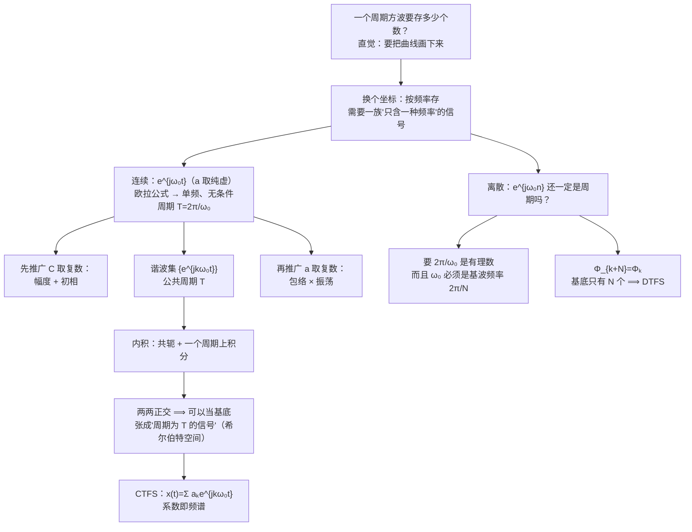
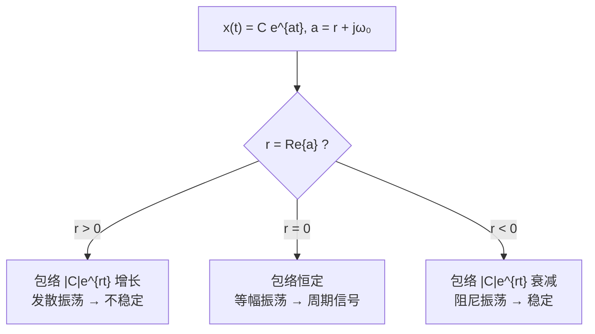

# 1.3 指数信号与正弦信号（基本信号）Exponential and Sinusoidal Signals (Basic Signals)

> [!abstract] 这一讲的任务
> 前两讲我们学会了"看"信号：分类、能量与功率、以及自变量的三种变换。
> 这一讲开始学"**拆**"信号——要拆，先得有"原子"。这一讲立起的是**频域的原子**：复指数 $e^{\,j\omega_0 t}$、$e^{\,j\omega_0 n}$，
> 每一个只含一种频率。拆完之后，一个周期信号就不再是一条画不完的曲线，而是一张**频率清单**（频谱）。
> 这也是为什么指数信号被单独拎出来放在第一章——它是第 3 章傅里叶级数的全部地基。

> [!info] 怎么读这份讲义
> 主线是"连续走一遍、离散再走一遍"，两遍的结论**几乎处处对应、唯独在周期性上分岔**——那个分岔点就是本篇最该看仔细的地方（第 11 节）。
> 标有 **（拓展）** 的段落是课堂没有展开、由教材与通行讲法补上来的部分：本篇现有四处——
> 时间常数 τ 与 RC（第 3 节）、拉普拉斯极点与稳定（第 5 节）、
> 周期合成取最小公倍数（第 13 节）、连续与离散的包络对照表（第 14 节，属归纳整理）。
> （第 8 节原先标着"$a_k$ 怎么从 $x(t)$ 里挑出来"，**第 11 节课已在课堂上把这条推导完整讲了一遍，该标记已退役**。）
> 一处看图时的坑先说明：$x[n]=\cos(8\pi n/31)$ 这张图在低分辨率下那个 **8** 很容易被看成一个 **3**，函数式以 $8\pi n/31$ 为准（$2\pi/\omega_0=31/4$ 才自洽）。



---

## 0. 开场：一个方波，到底要存多少个数？

假设你要把一段周期方波"存起来"，要求是：**存下来的东西能完全复原这条曲线**。

最直接的做法是采样：在时间轴上密密麻麻打点。可方波有跳变，点打得再密，跳变处也总是不对；真要完全准确，得存**无穷多个点**。你会觉得这不像个办法。

再想一个完全不同的存法。你有没有注意过音响上的**均衡器 (equalizer)**？整整一首歌，它只用十来根推子就描述完了——每根推子只管一件事：**某个频率上的分量有多强**。音乐这么复杂的东西，用"频率清单"竟然描述得下来。

于是问题来了：**周期信号是不是也能存成一张频率清单？** 如果可以，那么
- 这张清单要有多少项？（有限还是无限）
- "某个频率上分量有多强"这件事，怎么严格算出来？
- 更根本的：**凭什么是频率？** 凭什么一个方波能拆成"一堆不同频率的东西"的叠加？

要回答最后这一问，我们需要找到一族"**只含一种频率**"的信号当**原子 (basis signal)**——就像三维空间里用 $\vec i,\vec j,\vec k$ 当基底一样：任何向量都能写成它们的加权和，权重就是坐标。

**你刚才做的，就是一次完整的"找基底"。** 这一讲要找的原子是**复指数**；下一讲要找的是时域的原子——**单位冲激**。

---

## 1. 先把这一讲的定位说清楚：两个基底信号

> [!important] 全课的逻辑主线：两族"原子"
> 1.3 和 1.4 讲的其实是**同一件事的两半**：
>
> | 节 | 信号 | 身份 |
> |---|---|---|
> | **1.3** | 复指数 $e^{\,j\omega_0 t}$ / $e^{\,j\omega_0 n}$ | **频域 (frequency domain) 的基底信号** |
> | **1.4** | 单位冲激 $\delta(t)$ / $\delta[n]$ | **时域 (time domain) 的基底信号** |
>
> 把这两个"最简单的原子"先立起来，后面所有的分解——傅里叶级数、傅里叶变换、卷积——都是把任意信号写成这两族原子的加权和。
> 课堂上的原话很直白："为什么第一章要讲指数信号、把指数信号单独拿出来放在第一章讲？**这都是给后面做铺垫**。"

> [!note] 另一种回答：特征函数视角
> 除了"基底"这个角度，复指数还有一个同样根本的身份：
> **$e^{st}$（连续）和 $z^n$（离散）是 LTI 系统的特征函数 (eigenfunction)** ——
> 复指数信号送进任何 LTI 系统，出来的还是**同频率的复指数**，只是被乘上一个复常数：
> $$e^{\,st}\ \longrightarrow\ H(s)\,e^{\,st}$$
> 于是"把任意信号分解成复指数的叠加"不仅是坐标变换，更把**卷积变成了乘法**。
> 这条线索已经在第 3 章正式展开（见 [[C3.1 复指数是LTI系统的特征函数]]），这里只把它和"基底"并列记住。

---

## 2. $e$ 是从哪里来的？—— 自然增长的极限

回顾一下高中就认识的那个函数。**信号就是函数**，所以指数信号就是指数函数：
连续的时域指数函数写作 $Ce^{at}$，离散的指数序列写作 $C\alpha^{n}$。

在往下讲之前，先回答一个被跳过很多年的问题：**为什么连续端的底数偏偏是 $e$？** 为什么不是 $2^{t}$、$3^t$？

> [!example] 复利故事：为什么连续增长的底数只能是 $e$
> 很久以前有个地主放高利贷，借出去 1 两银子，一年收 100% 的利息。那么：
>
> - **一年结算一次**：年底要还 $1\times(1+1)=2$ 两。
> - **半年结算一次**（利滚利）：年中先滚成 $1.5$，把它当新本金，年底 $=\left(1+\frac12\right)^2=\frac94=2.25$ 两。
> - **一年结算 12 次**：$\left(1+\frac{1}{12}\right)^{12}\approx 2.613$ 两。
> - **一年结算 365 次**：$\left(1+\frac{1}{365}\right)^{365}\approx 2.7146$ 两。
>
> 结算越频繁，拿到的越多。那它会不会长到无穷？**不会**——高数里的极限告诉我们：
> $$\boxed{\ \lim_{n\to\infty}\left(1+\frac1n\right)^{n}=e\approx 2.71828\ }$$
> **$e$ 就是"把一年切成无穷多段、每一瞬间都在滚利"的那个极限值**，称为**自然增长的极限**。
> 细胞分裂、种群繁殖这类"增量正比于现有量"的过程，增长的上限都收敛到它。
> （课堂上还补了一句：如果利率是 200%，结果就是 $e$ 的某个倍数——**底数仍然是 $e$，变的只是系数**。）

> [!important] 这个故事真正要说的是"连续"这两个字
> 把结算周期切成无穷小 ⇒ **时间从一格一格地跳，变成了流淌**。所以：
> - **连续时间的指数信号写成 $Ce^{at}$，底数必须是自然底数 $e$** —— 它描述的就是一个连续滚动的过程；
> - **离散时间的指数序列写成 $C\alpha^{n}$，底数 $\alpha$ 可以是任意实数**（$2^n$、$(1/2)^n$、$(3/4)^n$）—— 没有 $e$，因为 $n$ 本来就是一格一格跳的整数。
>
> $$\text{连续：}x(t)=C\,e^{at}\qquad\qquad\text{离散：}x[n]=C\,\alpha^{n}$$
> **表达式上有没有那个 $e$，是连续与离散从最开始就分道扬镳的地方。** 课堂原话："我们从最开始学数学的时候，连续的和离散的就分开了。"

> [!important] 连续与离散：两条平行的路，最后在复频域会合
> 这门课从头到尾都是"连续讲一遍、离散再讲一遍"，原因就在这里。课堂上甚至直接翻着目录说："第三、第四章就是前一半连续、后一半离散。"
>
> | 章 | 连续时间 | 离散时间 |
> |---|---|---|
> | Ch.3 | **CTFS** 连续时间傅里叶级数 | **DTFS** 离散时间傅里叶级数 |
> | Ch.4 / Ch.5 | **CTFT** 连续时间傅里叶变换 | **DTFT** 离散时间傅里叶变换 |
> | Ch.9 / Ch.10 | **拉普拉斯变换 Laplace Transform** | **Z 变换 Z-Transform** |
>
> 两条路各走各的，**最终统一在复频域 (complex frequency domain) 上**：
> 高中只在实指数上打转，到拉氏 / Z 变换时把指数推广到整个复平面，两套体系才在数学上合成一件事。

---

## 3. 连续时间 A：实指数信号 Real Exponential Signals（p.35）

> [!important] 定义
> $$x(t)=C\,e^{at},\qquad (C,\ a \text{ are real value})$$

![[C1-连续实指数信号-增长与衰减.png]]

> [!note] 两种形态 Two types of behavior
> 取 $C$ 为常数（比如 $C=1$），只看 $a$：
>
> | 条件 | 行为 | 中文 |
> |---|---|---|
> | **$a>0$** | **growing / increasing** | 指数增长 |
> | **$a<0$** | **decaying** | 指数衰减 |
>
> （$a=0$ 时退化为常数 $x(t)=C$。）
> 两图的纵轴截距都是 $C$，即 $x(0)=C$。实指数刻画的就是自然界里"指数级变化"的那一类过程——
> 课堂上说这一支"司空见惯，就是高中那个指数增长、指数衰减"。

> [!tip] 物理来源：一阶系统的自然响应（**拓展**）
> 这类信号是**一阶系统自然响应**的通解：RC 电路放电 $v_c(t)=V_0e^{-t/RC}$、放射性衰变、人口自然增长，都是 $Ce^{at}$。
> $\tau=1/|a|$ 称为**时间常数 (time constant)**，是衰减到 $1/e\approx36.8\%$ 所需的时间。
> （"自然界的指数过程"课堂上讲过，但 $RC$ 与时间常数这一层是教材延伸，所以标出来。）

---

## 4. 连续时间 B：周期复指数与正弦信号（p.36）

> [!important] 先迈出第一步：把实值推广到复值
> 这门课**不在实数轴上讨论问题**——傅里叶级数、傅里叶变换全都建立在复数域上。
> 所以要把 $x(t)=Ce^{at}$ 推广到**复指数信号 complex exponential**：$C$ 和 $a$ 允许取复数。
> 推广是分步走的，先看最简单的一步：**$C$ 仍取实数 1，$a$ 取纯虚数 (purely imaginary)**，即 $a=j\omega_0$。

> [!important] 三种写法（原式）
> $$\text{(1) } x(t)=e^{\,j\omega_0 t}\qquad\text{(2) } x(t)=A\cos(\omega_0 t+\phi)\qquad\text{(3) } x(t)=e^{\,jk\omega_0 t}$$
> （3）里的 $k$ 是个整数：$e^{jk\omega_0 t}$ 相比 $e^{j\omega_0 t}$，是**周期缩短为 $1/k$** 的那一支。
> （1）（2）是同一个信号的两种写法，靠下面的欧拉公式互推。

> [!important] 欧拉公式 Euler's Relation
> ==$$e^{\,j\omega_0 t}=\cos\omega_0 t+j\sin\omega_0 t$$==
> 展开之后可以看到：**实部 $\cos\omega_0 t$ 与虚部 $\sin\omega_0 t$ 频率完全相同，只差 $\pi/2$ 的相位**。
> 也就是说，整个信号里**只含一种频率成分**——这是"单频"两个字的全部含义。

![[Pasted image 20260907111040.png]]

> [!important] 单频信号 Single-frequency Signal
> 因为它只含一种频率，所以叫**单频信号 (single-frequency signal)**。
> 这正是它能当"频域基底"的原因：
> 白光可以分解成不同颜色的光；一个周期信号可以分解成许多不同频率的正弦波；
> 而**频率上最基本、不可再分的信号，就是只有一种频率成分的这一个**。
> 课堂原话："在频率上最最基本的就是一种频率成分，就一个——这叫单频。"

> [!important] 周期性：连续端毫无争议
> $$x(t)=x(t+T),\qquad \boxed{T=\frac{2\pi}{\omega_0}}\quad\Rightarrow\quad x(t)\ \text{是周期的}$$
> 连续时间的复指数**无条件是周期信号**（$\omega_0\ne0$），周期就是 $2\pi/\omega_0$。
> —— 这一点到了离散时间就不成立了，见第 11 节。

> [!note] $T=2\pi/\omega_0$ 是怎么来的
> 要求 $e^{j\omega_0(t+T)}=e^{j\omega_0 t}$，即 $e^{j\omega_0 T}=1$。
> 复指数等于 1 的充要条件是**指数为 $2\pi$ 的整数倍**：$\omega_0 T=2\pi m$。
> 取最小正解 $m=1$，得**基波周期** $T=2\pi/\omega_0$。

### 4.1 再推广一步：$C$ 也取复数

> [!example] 一个具体例子
> 若 $C=\dfrac{\sqrt2}{2}(1+j)$、$a=j\omega_0$，信号就是
> $$x(t)=\frac{\sqrt2}{2}(1+j)\,e^{\,j\omega_0 t}$$
> 把 $C$ 写成极坐标：$\dfrac{\sqrt2}{2}(1+j)=1\cdot e^{\,j\pi/4}$，于是
> $$x(t)=e^{\,j\pi/4}\,e^{\,j\omega_0 t}=e^{\,j(\omega_0 t+\pi/4)}$$

> [!important] 一般结论：$C$ 干了两件事
> **任何一个确定的复数，都能在复平面上找到它对应的模与幅角**；模为 1 的复数就落在**单位圆 (unit circle)** 上，只贡献一个相位。
> 所以 $C$ 取复数时，信号总可以写成
> $$x(t)=|C|\;e^{\,j(\omega_0 t+\theta)}$$
> 也就是说，**复数 $C$ 只干两件事**：
> 1. **缩放幅度**（由 $|C|$ 决定）；
> 2. **旋转初始相位**（由 $\theta$ 决定），等价于把信号在时间轴上整体平移了 $-\theta/\omega_0$。
>
> 再展开成实部虚部，就成了**带初相的余弦 / 正弦**：
> $$x(t)=|C|\cos(\omega_0 t+\theta)+j\,|C|\sin(\omega_0 t+\theta)$$
> 频率没变，仍是单频信号；变的只是幅度和初相。

> [!note] 一个直观图像：旋转的向量
> $e^{j\omega_0 t}$ 本身就是一个**从 $t=0$ 时指向实轴正方向、以角速度 $\omega_0$ 逆时针旋转的单位向量**。
> 乘上 $C=|C|e^{j\theta}$ 之后，这个向量变成：$t=0$ 时就已经转过角度 $\theta$（初相位），长度变成 $|C|$，然后继续以同样的角速度旋转。
> 记住这个画面，第 4 章讲"频谱的相位"时它还会回来。

### 4.2 单位 The units

> [!important] 四个量各是什么单位
> | 量 | 单位 |
> |---|---|
> | $t$ | **seconds**（秒 s） |
> | $\phi$ | **radians**（弧度 rad） |
> | $\omega_0$ | **radians per second**（弧度每秒 rad/s） |
> | $f_0$ | **cycles per second (Hz)**（周每秒，赫兹） |
>
> $$\boxed{\ \omega_0=2\pi f_0\ }$$

> [!warning] 易混：$\omega$ 与 $f$
> - $f_0$ 是"每秒转多少**圈**"，$\omega_0$ 是"每秒转多少**弧度**"，一圈 $=2\pi$ 弧度，所以 $\omega_0=2\pi f_0$。
>   课堂上用的画面很具体：**车轮一秒转一圈就是 1 Hz，而一圈是 $2\pi$ 弧度**，于是角频率就是 $2\pi f$。
> - 周期 $T=\dfrac{1}{f_0}=\dfrac{2\pi}{\omega_0}$。
> - 全书公式基本用 $\omega$（省去大量 $2\pi$），但工程上标频谱图常用 $f$（Hz）。**换算时别丢 $2\pi$。**
> - 这一组关系在 [[C1.1 连续时间与离散时间信号]] 讲频率时就已经交代过，这里只是收进"单位"这张表里。

---

## 5. 连续时间 C：一般复指数信号 General Complex Exponential Signals（p.37–38）

### 5.1 复数的两套坐标系

> [!important] 两套坐标说清楚
> | 表示 | 形式 | 名称 |
> |---|---|---|
> | 实部 + 虚部 | $z=a+jb$ | **Rectangular form** 直角坐标 / 笛卡尔坐标 |
> | 幅度 + 相位 | $z=r\,e^{\,j\theta}$ | **Polar form** 极坐标 |
>
> 复平面上任取一点，既可以用横纵坐标 $(a,b)$ 描述，也可以用"到原点的距离 $r$ + 与实轴夹角 $\theta$"描述。
> **欧拉公式 $r e^{j\theta}=r\cos\theta+jr\sin\theta$ 就是这两套坐标系之间来回切换的桥梁。**
>
> 复变函数这门课研究的正是"同一个函数在两套坐标体系下表达式如何变化"；
> 到第 9、10 章讲拉普拉斯变换、Z 变换时会大量用到。

### 5.2 $C$ 和 $a$ 都取复数

> [!important] 定义
> $$x(t)=C\,e^{at},\qquad (C,\ a \text{ are both complex value})$$
> 其中
> $$C=|C|\,e^{\,j\theta}\quad\text{(Polar form 极坐标形式)}$$
> $$a=r+j\omega_0\quad\text{(Rectangular form 直角坐标形式)}$$

> [!tip] 为什么 $C$ 用极坐标、$a$ 用直角坐标？
> 看这个信号的形状：$a$ 本来就**待在指数上**，它自带一个 $e$；而 $C$ 是乘在前面的，**没有 $e$**。
> - 给 $C$ 用极坐标 $|C|e^{j\theta}$，等于**给它也补上一个 $e$**；
> - 给 $a$ 用直角坐标 $r+j\omega_0$，是为了把"实部管衰减、虚部管振荡"拆开。
>
> 这样一来整个信号就变成**清一色的 $e$ 的连乘**，可以直接合并同类项、再用欧拉公式一次性展开。
> **这不是硬性规定，是为了让式子能合并。**

**推导（原步骤）：**

$$
\begin{aligned}
x(t)&=|C|\,e^{\,j\theta}\,e^{\,rt}\,e^{\,j\omega_0 t}\\[4pt]
&=|C|\,e^{\,rt}\,e^{\,j(\omega_0 t+\theta)}\\[4pt]
&=\underbrace{|C|\,e^{\,rt}\cos(\omega_0 t+\theta)}_{\text{实部 Real part}}\;+\;j\underbrace{|C|\,e^{\,rt}\sin(\omega_0 t+\theta)}_{\text{虚部 Imaginary part}}
\end{aligned}
$$

第二步把两个带 $t$ 的指数合并（都在指数上、都含 $t$），第三步对纯虚指数用欧拉公式展开。
**实部和虚部的形式是一样的：都有一个实指数乘上一个三角函数。**

> [!important] 结构：包络 × 振荡
> 实部与虚部有**完全相同的结构**：
> $$\underbrace{|C|\,e^{\,rt}}_{\text{包络 envelope}}\times\underbrace{\cos(\omega_0 t+\theta)\ \text{或}\ \sin(\omega_0 t+\theta)}_{\text{振荡 oscillation}}$$
>
> - **三角函数部分**在 $-1$ 与 $+1$ 之间稳定循环，贡献信号的**振荡**；
> - **实指数部分 $|C|e^{rt}$** 贡献信号的**趋势 (trend)**，也就是**包络线 (envelope)**。
>
> 当三角函数取到 $\pm1$ 时，信号恰好落在包络线 $\pm|C|e^{rt}$ 上 —— 这就是画图时先画包络、再在包络内画振荡的依据。
> 课堂上把这两个角色讲成一句话：**"实指数决定趋势（包络），三角函数决定周期性振荡。"**

![[C1-一般复指数信号波形-r正负.png]]

> [!important] 两种情形的结论（原稿原文）
> **For $r>0$, both the real part and the imaginary part correspond to sinusoidal signals multiplied by a growing exponential.**
> $r>0$ 时，实部与虚部都是**正弦信号乘以增长的指数**。
>
> **For $r<0$, they correspond to sinusoidal signals multiplied by a decaying exponential.**
> $r<0$ 时，对应**正弦信号乘以衰减的指数**。

> [!note] 如何读这两张图
> 图中的**虚线 $\pm|C|e^{rt}$ 是包络 (envelope)**，实线在包络之间振荡。
> - $r>0$：包络张开 → **振荡着发散 (growing oscillation)**，系统不稳定；
> - $r<0$：包络收缩 → **振荡着收敛 / 阻尼振荡 (damped oscillation)**，系统稳定；
> - $r=0$：包络是水平线 → 等幅振荡（即第 4 节的纯周期情形）。
>
> 课堂上的说法是："$r>0$ 就震荡着发散掉了，$r<0$ 就震荡着收敛了。"

> [!note] 与拉普拉斯变换的关系（**拓展**）
> **这就是第 9 章拉普拉斯变换里"极点位置决定系统行为"的原型**：$a=r+j\omega_0$ 就是 $s$ 平面上的一个点，
> **$r=\mathrm{Re}\{s\}<0$ 稳定，$>0$ 发散，$=0$ 临界**。
> （课堂只说到"两套体系最终在复频域统一"，这套"极点—稳定"语言属于第 9 章，这里先记着。）



> [!tip] 三步走的推广路线，回头看一遍
> ```mermaid
> flowchart LR
>     A["① C=1, a 纯虚<br/>e^{jω₀t}<br/>单频、等幅"] --> B["② C 复数, a 纯虚<br/>|C|e^{j(ω₀t+θ)}<br/>加了幅度与初相"]
>     B --> C["③ C, a 都是复数<br/>|C|e^{rt}e^{j(ω₀t+θ)}<br/>包络 × 振荡"]
> ```
> **真正与后面章节密切相关的是 ①**（纯虚指数、单频、做基底）；③ 是顺带把最一般的情形拆解清楚。
> 课堂原话："跟后面密切相关的其实是纯虚的那一部分，这个是顺带把更一般的复指数拆解一下。"

---

## 6. 谐波集合：一族"成谐波关系"的信号（p.36）

$$
\boxed{\ \Phi_k(t)=e^{\,jk\omega_0 t}=e^{\,jk(2\pi/T)t},\qquad k=0,\pm1,\pm2,\cdots\ }
$$

> [!important] 这个信号集有什么特征
> 把 $k$ 取遍**所有整数**，得到的这一族信号称为**信号集 (signal set)**。
>
> - $k=1$ 的成员周期恰为 $T$；
> - $k=2$ 的成员周期是 $T/2$，但 $T$ 仍是它的周期（在两倍的时间尺度上走了两圈）；
> - $k=K$ 的成员周期是 $T/K$，$T$ 也仍是它的周期。
>
> 所以 **$T$ 是整个信号集的公共周期 (common period)**，而且是最大的那个公共周期。
> 集合里**每一个成员都是以 $T$ 为周期的信号**。

> [!important] 基波与谐波 Fundamental and Harmonics
> - $k=1$ 的成员 $e^{\,j\omega_0 t}$ 叫**基波 (fundamental)**，$\omega_0$ 叫**基波频率 (fundamental frequency)**，$T=2\pi/\omega_0$ 叫**基波周期**。
> - $k=2,3,\dots$ 的成员叫**二次谐波、三次谐波 (2nd / 3rd harmonic)**。
>
> "Harmonic"就是"谐次"的意思，所以整族叫 **harmonically related signals（成谐波关系的信号集）**。
> 这正是 [[L01 绪论 Introduction]] 里方波分解图的来源：**先用基波近似原周期波形，再逐次叠加二倍、三倍频率的谐波做微调**——
> 课堂上明确回指了第一节课那张图："前面有一个模拟原来周期的，后面的那些微调的是两倍的三倍频率，那就叫它的谐波信号。"

> [!note] 这一族信号的地位
> 谐波集合是一个**无穷维基底**（必要条件：基底两两正交），它张成一个"周期为 $T$ 的信号空间"，
> 里面任何一个信号都可以写成这族信号的线性组合。
> 第 3 章的**傅里叶级数**就是把任意周期信号写成这一族信号的线性组合：
> $$x(t)=\sum_{k=-\infty}^{+\infty}a_k\Phi_k(t)=\sum_{k=-\infty}^{+\infty}a_k e^{\,jk\omega_0 t}$$
> 参见 [[L01 绪论 Introduction]] 第 8 节。

![[Pasted image 20260907112156.png]]![[Pasted image 20260907112211.png]]

---

## 7. 正交性：为什么谐波集配当"基底"（p.36、p.39）

> [!important] 先回忆线性代数里的基底
> 三维欧氏空间取
> $$\vec{i}=(1,0,0)^{\mathsf T},\quad \vec{j}=(0,1,0)^{\mathsf T},\quad \vec{k}=(0,0,1)^{\mathsf T}$$
> 任意向量都能写成 $x\vec i+y\vec j+z\vec k$ —— **基底的加权和 (weighted sum)**，权重就是坐标。
> 基底张成 (span) 的空间就是整个三维空间。
>
> **基底的必要条件：任意两个成员正交。**
> 正交用**内积 (inner product)** 定义，实向量的内积是**转置相乘**：
> $$\vec i^{\,\mathsf T}\vec j=1\cdot0+0\cdot1+0\cdot0=0\ \checkmark$$
> 课堂上真的在黑板上把 $i^{\mathsf T}j=0$、$j^{\mathsf T}k=0$、$i^{\mathsf T}k=0$ 一个个乘开算过——
> "任意两个做内积都是零，它自己和自己就非零，跟我们向量空间里那组基底是不是一样的？"

> [!important] 复信号的内积：转置要换成共轭
> 谐波集里的每个成员用欧拉公式一展开都有实部和虚部，**是复信号**。
> 复空间里与"转置"对应的运算是**共轭 (conjugate)**，记作 $\overline{(\cdot)}$ 或 $(\cdot)^*$。
> 而且信号是"无穷多个分量的向量"，求和要换成**在一个公共周期上求积分**：
>
> $$\boxed{\ \langle \Phi_k,\Phi_l\rangle=\int_{T}e^{\,jk\omega_0 t}\;\overline{e^{\,jl\omega_0 t}}\;dt=\int_{T}e^{\,j(k-l)\omega_0 t}\,dt\ }$$
>
> **对照记忆**：三维向量是"对应分量相乘再求和"；信号是"对应时刻相乘再积分"。**积分就是连续版的求和。**

> [!important] 计算这个内积
> **情形一：$k=l$。**
> 共轭把指数上的符号翻成负号，两项相乘得 $e^{\,j0}=1$：
> $$\int_{T}1\,dt=T\ \ (\neq 0)$$
>
> **情形二：$k\ne l$。**
> 此时 $k-l$ 是一个**非零整数**，$e^{\,j(k-l)\omega_0 t}$ 仍是这个信号集里的某一个成员，**仍以 $T$ 为周期**。
> 它的实部虚部都是均值为零的正弦振荡，在**整整一个周期 $T$** 上积分，正面积与负面积恰好抵消（积分就是求面积）：
> $$\int_{T}e^{\,j(k-l)\omega_0 t}\,dt=0$$
>
> 合起来：
> $$\boxed{\ \int_{T}e^{\,jk\omega_0 t}e^{-jl\omega_0 t}\,dt=\begin{cases}T, & k=l\\[2pt] 0, & k\neq l\end{cases}\ }$$

> [!important] 结论：谐波集是一组正交基底
> 任意两个不同成员内积为 0，自己与自己内积非零 —— 与 $\vec i,\vec j,\vec k$ 的情形**完全一样**，只是把求和换成了积分。
> 所以谐波集可以当基底，**它张成的信号空间就是"所有周期为 $T$ 的信号"**：
> 周期为 $T$ 的方波、三角波、锯齿波……只要周期是 $T$，都落在这个空间里，因而都能写成这组基底的加权和。
> 课堂上先让人猜了一下："它张成的信号空间是什么样的？"——答案就是"凡是周期为大 $T$ 的信号"。

> [!note] 这个空间叫希尔伯特空间 Hilbert Space
> 与三维欧氏空间只有 3 个基底不同，谐波集的 $k$ 取遍全部整数，
> **这是一个无穷维 (infinite dimension) 的正交空间**，数学上称为**希尔伯特空间 (Hilbert Space)**。
> 它不是欧氏空间，更抽象、维度更高。
> 具体的测度论、内积空间细节本课不要求，**能用线性代数的直觉理解"正交 → 基底 → 加权和"这条链条即可**。
> 课堂原话："数学上这种更抽象的东西不要求大家，你能够根据线性代数理解这个事情就好了。"

---

## 8. 第二种信号分解：连续时间傅里叶级数 CTFS

> [!important] 分解式
> 只要 $x(t)$ 的周期是 $T$，它就落在上面那组基底张成的空间里，于是可以展开成
> $$\boxed{\ x(t)=\sum_{k=-\infty}^{+\infty}a_k\,e^{\,jk\omega_0 t}\ ,\qquad \omega_0=\frac{2\pi}{T}\ }$$
> 这就是**连续时间傅里叶级数 CTFS (Continuous-Time Fourier Series)**，第 3 章的第一个概念。
> 课堂上的定位很清楚："这就是我要铺垫的东西——为什么今天要讲指数信号？就是要讲这个。"

> [!important] 式子里每个符号的含义
> | 符号 | 含义 |
> |---|---|
> | $e^{\,jk\omega_0 t}$ | **基底信号**：第 $k$ 次谐波，单频 |
> | $k\omega_0$ | 第 $k$ 次谐波的频率；$\omega_0=2\pi/T$ 是**基波频率** |
> | $a_k$ | **加权系数**：信号在第 $k$ 个基底上的"投影" |
> | $k$ 的范围 | $-\infty\to+\infty$，**取遍所有频率**（无穷维基底） |
>
> **一组 $\{a_k\}$ 就是这个信号的频谱 (spectrum)** —— 时域波形与频域谱是同一个信号的两种坐标表示。
> 这与线性代数中"向量在一组基下的坐标"是同一个含义，唯一的区别是**这里的基底有无穷多个**。
> 课堂上描述频谱的用词很形象："每一个 $k$ 在频谱上就是**一根单独的火柴**"，$a_0,a_1,a_2,\dots$ 就是每根火柴的高度。

> [!note] 系数 $a_k$ 是怎么"挑"出来的
> 系数不是凭空规定的，而是正交性带来的必然结果。把分解式两边同乘 $e^{-jk\omega_0 t}$，再在一个周期 $T$ 上积分：
> 除了 $k$ 那一项，其余全部因为正交性变成 0，于是
> $$a_k=\frac{1}{T}\int_{T}x(t)\,e^{-jk\omega_0 t}\,dt$$
> 这就跟"求一个向量在正交基下的坐标"完全一样——**把信号和某个基向量做内积，就能单独抠出那个方向上的分量**。
> 这条分析式已在第 3 章作为 CTFS 的分析公式正式给出（[[C3.2 连续时间傅里叶级数]]，第 11 节课把推导完整讲了一遍）；这里先把它和"投影"的画面绑在一起记住。

> [!tip] 把这条线串起来
> ```mermaid
> flowchart LR
>     A["单频信号<br/>e^{jω₀t}"] --> B["谐波集<br/>{e^{jkω₀t}}"]
>     B --> C["两两正交<br/>∫_T = T 或 0"]
>     C --> D["无穷维正交基底<br/>希尔伯特空间"]
>     D --> E["张成：所有周期为 T 的信号"]
>     E --> F["CTFS<br/>x(t)=Σ aₖe^{jkω₀t}"]
>     F --> G["{aₖ} = 频谱"]
> ```
> 回头再看 [[L01 绪论 Introduction]] 里方波分解成正弦叠加的那张图，就不再是"看起来像"，而是有严格的基底与投影含义了。
> 一个周期信号**按频率拆**成无穷多个单频成分的加权和——这就是"信号的第二种分解"，也是频域的坐标。

---

## 9. 离散时间 A：实指数序列的四种形态（p.40）

> [!important] 复指数序列 Complex Exponential (sequence)
> $$x[n]=C\,\alpha^{n}\qquad\text{或}\qquad x[n]=C\,e^{\beta n}$$
> 两者关系：$\alpha=e^{\beta}$。
>
> 离散时间**通常不用 $e$ 那种写法**——按第 2 节的说法，离散端本来就没有"连续滚动"的含义，写成 $C\alpha^n$ 才自然。

> [!note] 原稿的 Note（原文）
> **It is often more convenient to express the discrete-time complex exponential sequence in the form of $x[n]=C\alpha^{n}$, although $x[n]=Ce^{\beta n}$ is more analogous to the form of the continuous-time exponential.**
>
> 用 $C\alpha^n$ 形式**更方便计算**（幂运算直观），用 $Ce^{\beta n}$ 形式**更贴近连续时间的写法**（便于类比）。

### 9.1 $C=1$ 时的四种形态

$$x[n]=C\,\alpha^{n}$$

![[C1-离散实指数信号-四种形态.png]]

> [!important] Four types of behavior
> 取 $C=1$，只看 $\alpha$：
>
> | 图 | 条件 | 行为 |
> |---|---|---|
> | (a) | $\alpha>1$ | 单调**增长**（$2^n$、$3^n$） |
> | (b) | $0<\alpha<1$ | 单调**衰减**（$(1/2)^n$、$(3/4)^n$） |
> | (c) | $-1<\alpha<0$ | **正负交替**、幅度衰减 |
> | (d) | $\alpha<-1$ | **正负交替**、幅度增长 |
>
> 原稿强调：**If $\alpha<0$, the sign of $x[n]$ alternates.**（$\alpha<0$ 时符号逐点交替）
> 原因很直接：底数为负时，$n$ 取偶数结果为正、取奇数结果为负。
> **实的离散指数序列只有这 4 种行为 (four types of behavior)，没有第五种。**

> [!tip] 记忆方法：拆成"模"和"符号"两件事
> $$\alpha^n=|\alpha|^n\cdot(\operatorname{sgn}\alpha)^n$$
> - **$|\alpha|$ 决定幅度**：$>1$ 增长，$<1$ 衰减；
> - **$\alpha$ 的符号决定是否交替**：负数 ⇒ $(-1)^n$ ⇒ 逐点变号。
>
> 对比连续情形：$e^{at}$ 永远不会变号，**"交替"是离散世界独有的现象**（因为 $n$ 只取整数）。
> 这条对比要记住：连续端只有"增长/衰减"两种，离散端一下子多出两种"交替"形态。

---

## 10. 离散时间 B：正弦序列与复指数序列（p.41）

![[C1-离散正弦序列三例.png]]

> [!important] 定义
> **复指数 Complex exponential：**
> $$x[n]=e^{\,j\omega_0 n}=\cos\omega_0 n+j\sin\omega_0 n$$
> **正弦序列 Sinusoidal signal：**
> $$x[n]=\cos(\omega_0 n+\phi)$$
>
> 这是离散端**真正的重点**——纯虚的这一支，将来要拿来做基底。

> [!example] 三个例子 Three Examples（原稿三张图）
>
> | 图 | 序列 | 说明 |
> |---|---|---|
> | (a) | $x[n]=\cos(2\pi n/12)$ | $\omega_0=\pi/6$，$2\pi/\omega_0=12$ 有理 ⇒ **周期，$N=12$** |
> | (b) | $x[n]=\cos(8\pi n/31)$ | $\omega_0=8\pi/31$，$2\pi/\omega_0=31/4$ 有理 ⇒ **周期，$N=31$**（$m=4$ 圈） |
> | (c) | $x[n]=\cos(n/6)$ | $2\pi/\omega_0=12\pi$ **无理** ⇒ **非周期！** |
>
> （看 (b) 那条式子时留神：低分辨率下 $8\pi n/31$ 会被看成 $3\pi n/31$。以 $8\pi n/31$ 为准——
> 只有它才给出 $2\pi/\omega_0=31/4$ 这个既约分数，从而 $N=31$。）

> [!warning] (c) 是本节最重要的反直觉例子
> $\cos(n/6)$ 的**包络**看起来像正弦波，但它**不是周期序列**——没有任何正整数 $N$ 使 $\cos((n+N)/6)=\cos(n/6)$ 对所有 $n$ 成立。
> 连续信号 $\cos(t/6)$ 当然是周期的（$T=12\pi$），但 $12\pi$ 不是整数，离散采样点永远对不齐。
> **先记住这个"看起来周期、实际不是"的例子，第 11 节把判据推出来之后再回来结账。**

---

## 11. 离散复指数的周期性质 Periodicity Properties（p.42）

> [!important] 问题提出
> **Continuous-time:** $e^{\,j\omega_0 t}$，$T=2\pi/\omega_0$ ✔（**一定周期，毫无疑问**）
> **Discrete-time:** $e^{\,j\omega_0 n}$，$N=?$（**需要条件**）
>
> 两个信号只差 $t$ 与 $n$ 一个字母，行为却截然不同——这是本节全部内容的出发点。

### 11.1 推导：周期条件

$$
\text{By definition:}\quad e^{\,j\omega_0 n}=e^{\,j\omega_0 (n+N)}
$$
$$
\text{thus:}\quad e^{\,j\omega_0 N}=1\quad\text{or}\quad \omega_0 N=2\pi m
$$
$$
\text{So:}\quad \frac{N}{m}=\frac{2\pi}{\omega_0}
$$

> [!note] 这条结论在第 1 章更早的地方就已经推过
> 课本把它放在 1.3.3，但判断离散周期性绕不开它，所以在 [[C1.2 自变量的变换]] 的"周期信号"一节里就已经用到。
> 完整推导（含"复指数何时等于 1"的复习，以及 $\cos\frac{3\pi n}{4}$ 的周期是 8 而不是 $\frac83$ 这个常见错误）
> 见 [[C1.2 自变量的变换]] 的「离散周期性条件」一小节，此处不重复。

> [!important] 周期性条件 Condition of periodicity
> $$\boxed{\ \frac{2\pi}{\omega_0}\ \text{必须是有理数 (rational)}\ }$$
> 此时若 $\dfrac{2\pi}{\omega_0}=\dfrac{N}{m}$（$N,m$ 为互质正整数），则**基波周期为 $N$**，$m$ 是这 $N$ 个采样点内转过的整圈数。

> [!question] 原稿留的问题：$x[n]=\cos(n/6)$ ???
> **解答**：此时 $\omega_0=\dfrac16$，$\dfrac{2\pi}{\omega_0}=12\pi$。
> $\pi$ 是**无理数**，$12\pi$ 不可能写成两个整数之比 ⇒ **$x[n]=\cos(n/6)$ 不是周期序列**。
> 这就是第 10 节图 (c) 的答案。

> [!note] 为什么离散和连续差这么多？
> 连续时间只要求"存在正**实数** $T$"，实数是稠密的，**总能找到**；
> 离散时间要求"存在正**整数** $N$，整数是离散的，**未必找得到**。
> 几何上：$e^{j\omega_0 n}$ 是单位圆上以角步长 $\omega_0$ 跳跃的点；只有当"若干步刚好走完整数圈"时才会回到起点。

### 11.2 关键辨析：写在 $\omega_0$ 位置上的，必须是**基波**频率

> [!warning] 一个极易出错的地方（课堂专门停下来讲）
> 比较两个信号：
> $$x_1[n]=e^{\,j\frac{\pi}{4}n}\qquad\qquad x_2[n]=e^{\,j\frac{3\pi}{4}n}$$
>
> - $x_1$：$\omega_0=\dfrac{\pi}{4}$ 没有问题，$\dfrac{2\pi}{\omega_0}=8$，**基波周期 $N=8$**。
> - $x_2$：$\dfrac{2\pi}{3\pi/4}=\dfrac83$ —— **但周期必须是正整数，$\dfrac83$ 不是**。
>   取它的 3 倍（把 $\frac83$ 约到最简分数的分子 8）：**基波周期 $N=8$**。
>
> 于是关键结论来了：**$x_2$ 的基波周期也是 8，所以 $x_2$ 的基波频率同样是 $\dfrac{2\pi}{8}=\dfrac{\pi}{4}$，而不是 $\dfrac{3\pi}{4}$。**
> $\dfrac{3\pi}{4}$ 是 $\dfrac{\pi}{4}$ 的 3 倍 ⇒ **$x_2$ 是 $x_1$ 的三次谐波信号**。

![[C1-离散复指数-基波频率与周期.png]]

> [!note] 这张图在说什么
> 左边两个单位圆都把 $n=0,1,\dots,8$ 这九个时刻画了出来：
> $\omega_0=\pi/4$ 时，每一步转 $\pi/4$，**八步刚好转一圈**；
> $\omega_0=3\pi/4$ 时，每一步转 $3\pi/4$，走的点顺序不同（跳着走），但**八步之后同样回到起点**——
> 两族序列的周期都是 8。右边把两条序列画在一起：波形不同（一个是另一个的三次谐波），**但重复的节拍完全一样**。

> [!important] 记住这条对应关系
> $$\textbf{基波频率}\ \omega_0=\frac{2\pi}{\textbf{基波周期}\ N}$$
> **基波频率一定是"$2\pi$ 除以基波周期"，二者必须成对出现。**
> 考试问"这个信号的 fundamental frequency 是多少"，绝不能把式子里 $n$ 前面的系数直接抄下来当答案，
> **必须先求出基波周期 $N$（正整数！），再回算 $\omega_0=2\pi/N$。**
> 课堂上把这条讲得很重："这个 $\omega_0$ 必须是**基频**的，不是 $\frac{3\pi}{4}$ 那种。"
>
> 后文凡是写 $e^{jk\omega_0 n}$ 的地方，**这个 $\omega_0$ 一律指基波频率**，即 $2\pi/\omega_0=N$ 为整数。

### 11.3 顺带结清一笔账：离散频率以 $2\pi$ 为周期

> [!important] 频率的可分辨范围只有一圈
> $$e^{\,j(\omega_0+2\pi)n}=e^{\,j\omega_0 n}e^{\,j2\pi n}=e^{\,j\omega_0 n}\qquad(n\ \text{为整数})$$
> 所以**频率 $\omega_0$ 与 $\omega_0+2\pi$ 是同一个信号**；离散频率只在长度为 $2\pi$ 的区间内互不相同，
> 通常取 $[0,2\pi)$ 或 $[-\pi,\pi)$，**$\omega_0=\pi$ 是"最高频率"**。
>
> 原因还是那一条：$e^{j\omega_0 n}$ 的本质是"每走一步转过角度 $\omega_0$"。**角度超过 $2\pi$ 就绕回来了**，
> 而连续时间里"转得多快"是看得见的——这就是离散与连续在频率上的本质差别。
> 详见 [[C1.2 自变量的变换]] 的"周期性质"。

![[C1-离散频率的2π周期性.png]]

> [!warning] 注意这是三件不同的事，别混（考试爱考）
> 1. **频率以 $2\pi$ 为周期**（关于 $\omega_0$）—— 永远成立，是上面 $e^{j2\pi n}=1$ 的直接推论；
> 2. **谐波集以 $N$ 为周期**（关于下标 $k$）—— 导致基底只有 $N$ 维，见第 12 节；
> 3. **序列本身是否为周期序列**（关于 $n$）—— 需要 $2\pi/\omega_0$ 有理，即第 11.1 节的条件。
>
> 三者同源（都来自"$n$ 是整数"），但说的是不同的对象。
> 顺带一句工程接口：正因为频率只有一圈、基只有 $N$ 个，离散傅里叶变换才能用**矩阵**在有限步里算完（DFT/FFT），
> 而连续的傅里叶变换理论上要处理无穷多项。

---

## 12. 离散谐波集只有 $N$ 个成员 → DTFS（p.43）

把离散复指数也做成一个信号集：$\Phi_k[n]=e^{\,jk\omega_0 n}$，$\omega_0=2\pi/N$。
它与连续端的谐波集有一个**本质区别**。

> [!important] 连续端：任意两个成员都不同
> 取 $\Phi_K(t)=e^{\,jK\omega_0 t}$ 与 $\Phi_L(t)=e^{\,jL\omega_0 t}$，只要 $K\ne L$，
> 频率 $K\omega_0\ne L\omega_0$，**振荡快慢就不一样，一定是两个完全不同的信号**。
> $k$ 越大振荡越快，**无穷无尽，永不重复** ⇒ 无穷维基底。

> [!important] 离散端：每隔 $N$ 个就重复一次
> 取 $L=K+N$：
> $$\Phi_{K+N}[n]=e^{\,j(K+N)\omega_0 n}=e^{\,jK\omega_0 n}\cdot e^{\,jN\omega_0 n}$$
> 而 $\omega_0=\dfrac{2\pi}{N}$，所以 $N\omega_0=2\pi$，于是
> $$e^{\,jN\omega_0 n}=e^{\,j2\pi n}=1\qquad(n\ \text{为整数})$$
> （$e^{j0},e^{j2\pi},e^{j4\pi},\dots$ 在复平面上都是同一个点，都等于常数 1。）
>
> 因此
> $$\boxed{\ \Phi_{k+N}[n]=\Phi_{k}[n]\ }$$
> **$k$ 往后数 $N$ 个，就跟原来的成员一模一样了。**

> [!important] 直接后果：离散基底是有限维的
> - 两个"不同的 $k$"给出**同一个信号** ⇒ 它们不再正交；
> - 所以离散谐波集里**只有 $N$ 个互不相同的成员**，通常取 $k=0,1,\dots,N-1$ 或 $k=1,2,\dots,N$；
> - **离散基底是 $N$ 维的有限维基底，不是无穷维。**
>
> **根源在哪？** 就在 $e^{j2\pi n}=1$ 这一步——它成立是因为 **$n$ 是整数**。
> 连续端对应的是 $e^{j2\pi t/T\cdot(\cdot)}$，$t$ 是连续变量，**取不到"恒等于 1"这个性质**，所以不会重复。
> 课堂原话："离散的基底不是无穷维的，它有一个重复，大 $N$ 个就重复了。"

![[Pasted image 20260907115956.png]]

### 12.1 离散的正交性

> [!important] 内积：积分换成一个周期上的求和
> 连续端对 $t$ 积分，离散端对 $n$ **在一个公共周期 $N$ 上求和**（集合里每个成员都以 $N$ 为周期）：
> $$\sum_{n=\langle N\rangle}e^{\,jk\omega_0 n}\,e^{-jr\omega_0 n}=\begin{cases}N, & k=r\\[2pt]0, & k\neq r\end{cases}$$
>
> **唯一的区别**：连续端 $k,l$ 可以任意取；**离散端 $k,r$ 必须取在同一个周期内**（$0\sim N-1$ 或 $1\sim N$）。
> 否则取 $r=k+N$ 时两者是同一个信号，谈不上正交。

> [!important] 结论
> $$\Phi_k[n]=e^{\,jk\omega_0 n},\qquad k\ \text{取满一个周期}$$
> 是一组**$N$ 维的正交基底**，张成的空间是**所有周期为 $N$ 的离散信号**。

### 12.2 第二种信号分解（离散版）：DTFS

> [!important] 分解式
> $$\boxed{\ x[n]=\sum_{k=\langle N\rangle}a_k\,e^{\,jk\omega_0 n}\ ,\qquad \omega_0=\frac{2\pi}{N}\ }$$
> 这就是**离散时间傅里叶级数 DTFS (Discrete-Time Fourier Series)**。

> [!important] CTFS 与 DTFS：只差一处，但这一处很关键
> | | **CTFS** | **DTFS** |
> |---|---|---|
> | 分解对象 | 周期为 $T$ 的连续信号 | 周期为 $N$ 的离散信号 |
> | 基底 | $e^{\,jk\omega_0 t}$ | $e^{\,jk\omega_0 n}$ |
> | 基底维数 | **无穷维**（希尔伯特空间） | **$N$ 维**（有限维） |
> | $k$ 的范围 | $k=-\infty\to+\infty$，取遍所有频率 | $k$ **只取满一个周期**（$0\sim N-1$） |
> | 加权系数 | $a_k$ | $a_k$ |
>
> 其余含义完全一致：基底信号的加权和，$\{a_k\}$ 就是频谱。
> 课堂上的总结就一句："**第三章我们就讲两个东西：CTFS 和 DTFS**；第四章 CTFT，第五章 DTFT。"

![[Pasted image 20260907120023.png]]

> [!tip] 第 3–5 章的地图
> ```mermaid
> flowchart LR
>     C3["Ch.3<br/>周期信号"] --> A["CTFS<br/>连续 · 周期"]
>     C3 --> B["DTFS<br/>离散 · 周期"]
>     C4["Ch.4"] --> D["CTFT<br/>连续 · 非周期"]
>     C5["Ch.5"] --> E["DTFT<br/>离散 · 非周期"]
> ```
> **第 1 章之所以要把指数信号单拎出来讲，就是为了给第 3 章做铺垫**——没有"基底 + 正交 + 加权和"这套语言，傅里叶级数只是一个突然冒出来的公式。

---

## 13. 判周期的三步法，与一道随堂测

> [!tip] 判周期的三步法（考试必用）
> ```mermaid
> flowchart TD
>     A["给定 x[n] = cos(ω₀n+φ) 或 e^{jω₀n}"] --> B["算 2π/ω₀"]
>     B --> C{"是有理数?"}
>     C -- "否" --> D["非周期 aperiodic"]
>     C -- "是" --> E["约分成最简分数 N/m"]
>     E --> F["基波周期 = N（分子）"]
> ```
> **例 1**：$\cos(\pi n/4)$ → $2\pi/\omega_0=8$ → $N=8$。
> **例 2**：$\cos(8\pi n/31)$ → $2\pi/\omega_0=2\pi\cdot\frac{31}{8\pi}=\frac{31}{4}$ → $N=31,\ m=4$。
> **例 3**：$\cos(n)$ → $2\pi/1=2\pi$ 无理 → 非周期。
>
> **两个信号相加或相乘时**：各自周期 $N_1,N_2$，合成周期为 **$\mathrm{lcm}(N_1,N_2)$**（最小公倍数）；只要有一个非周期，整体通常非周期。
> **【拓展】** 这条"取最小公倍数"的合成规则课堂上没有单独讲（课堂只讲了单个序列怎么判），是教材与通行讲法的补充；
> 不过下面的随堂测 D 恰好要用到它，所以放在这里。

> [!question] 随堂测（p.45，多选题 1 分）：Please select all the periodic signals listed below.
> **A.** $x(t)=3\cos\left(4t+\dfrac{\pi}{3}\right)$
> **B.** $x(t)=\displaystyle\sum_{n=-\infty}^{\infty}e^{-(2t-n)}u(2t-n)$
> **C.** $x[n]=\cos\left(\dfrac{n}{8}-\pi\right)$
> **D.** $x[n]=\cos\left(\dfrac{\pi}{2}n\right)\cos\left(\dfrac{\pi}{4}n\right)$
>
> **答案：A、B、D 正确，C 错**（原稿用绿色高亮标出 A、B、D）。
>
> **A ✅**：连续正弦，$\omega_0=4$，$T=\dfrac{2\pi}{4}=\dfrac{\pi}{2}$。**连续正弦永远周期**。
>
> **B ✅**：这是把 $g(\tau)=e^{-\tau}u(\tau)$ 沿 $\tau=2t$ 轴每隔 1 个单位复制一份再叠加，是**周期延拓 (periodic extension)**。
> 把 $t$ 换成 $t+\frac12$：$2(t+\frac12)-n=2t-(n-1)$，求和指标平移一位而求和范围不变 ⇒ 和不变。
> 故 $x(t+\frac12)=x(t)$，**周期 $T=\dfrac12$**。
>
> **C ❌**：$\omega_0=\dfrac18$，$\dfrac{2\pi}{\omega_0}=16\pi$ **无理** ⇒ **非周期**。
> （常数相位 $-\pi$ 不影响周期性判断。）
>
> **D ✅**：先用积化和差
> $$\cos\frac{\pi n}{2}\cos\frac{\pi n}{4}=\frac12\left[\cos\frac{3\pi n}{4}+\cos\frac{\pi n}{4}\right]$$
> 第一项：$\dfrac{2\pi}{3\pi/4}=\dfrac83$ 是有理数 ⇒ 约简后 $N_1=8$；第二项：$\dfrac{2\pi}{\pi/4}=8$ ⇒ $N_2=8$。
> $N=\mathrm{lcm}(8,8)=\mathbf{8}$ ⇒ **周期序列**。

> [!warning] 这道题的三个考点
> 1. **连续正弦一定周期，离散正弦不一定**（A 对 vs C 错）。
> 2. **周期延拓构造出来的信号是周期的**，要会用"指标平移"验证（B）。
> 3. **乘积信号先化成和**再分别判周期，最后取 **lcm**（D）。
>
> 顺带注意 D 的第一项：$\dfrac{2\pi}{3\pi/4}=\dfrac83$ 不是整数，所以 $\dfrac{3\pi}{4}$ 不是基波频率，$N_1$ 要取 $\dfrac83$ 的 3 倍 = 8 —— 正是第 11.2 节"基波频率必须对应基波周期"那条辨析。

---

## 14. 离散时间 C：一般复指数序列（p.43–44）

> [!important] 定义与展开
> $$x[n]=C\,\alpha^{n}$$
> 其中**两个都用极坐标形式 (polar form)**：
> $$C=|C|\,e^{\,j\theta},\qquad \alpha=|\alpha|\,e^{\,j\omega_0}$$
> 则
> $$x[n]=|C|\,|\alpha|^{n}\cos(\omega_0 n+\theta)\;+\;j\,|C|\,|\alpha|^{n}\sin(\omega_0 n+\theta)$$

> [!tip] 离散端为什么 $C$ 和 $\alpha$ **都**用极坐标？
> 与连续端对照就清楚了：
> - 连续：$C\,e^{at}$ —— $a$ 待在指数上，**自带 $e$**，所以只给 $C$ 补 $e$（$C$ 用极坐标，$a$ 用直角坐标）；
> - 离散：$C\,\alpha^{n}$ —— $C$ 和 $\alpha$ **两个都没有 $e$**，所以**两个都要用极坐标补上 $e$**。
>
> 补完之后同样可以合并、同样用欧拉公式展开，**得到与连续端一模一样的结构**。

![[C1-离散复指数-模大于小于1.png]]

> [!important] 结论（原稿原文）
> - **For $|\alpha|=1$, the real and imaginary parts are both sinusoidal sequences.**（等幅正弦序列）
> - **For $|\alpha|>1$, sinusoidal sequences multiplied by a growing exponential.**（增长包络）
> - **For $|\alpha|<1$, they are sinusoidal sequences multiplied by a decaying exponential.**（衰减包络）
>
> 结构与连续端完全一致：**一个实指数包络（趋势）乘以一个振荡（频率成分）**。
> $|\alpha|^n$ 这一项决定包络，$\cos/\sin(\omega_0 n+\theta)$ 这一项决定振荡。

> [!note] 与连续情形的对照表（**拓展：归纳整理**）
> | | 连续时间 $Ce^{at}$，$a=r+j\omega_0$ | 离散时间 $C\alpha^n$，$\alpha=\lvert\alpha\rvert e^{j\omega_0}$ |
> |---|---|---|
> | 判据看什么 | **$r$ 的正负**（相对 0） | **$\lvert\alpha\rvert$ 与 1 的大小**（相对 1） |
> | 等幅振荡 | $r=0$ | $\lvert\alpha\rvert=1$ |
> | 增长 | $r>0$ | $\lvert\alpha\rvert>1$ |
> | 衰减 | $r<0$ | $\lvert\alpha\rvert<1$ |
>
> **临界线不同**：连续是 $s$ 平面的**虚轴**（$\mathrm{Re}\{s\}=0$），离散是 $z$ 平面的**单位圆**（$|z|=1$）。
> 这个对应关系在第 9、10 章（拉氏变换 vs Z 变换）会正式建立：$z=e^{sT}$。
> 这张表是把两端的结论并排整理出来的，课堂上是"连续一遍、离散一遍"分别讲的，所以标成归纳整理。

---

## 这一讲的三句话

> [!important] 记住三句
> 1. **连续端用 $e$、离散端用 $\alpha$，这不是记法差异，而是"连续滚利"与"整数步跳"的区别**；
>    复指数 $e^{j\omega_0 t}$、$e^{j\omega_0 n}$ 是**频域的原子**——只含一种频率，所以叫单频信号。
> 2. **连续复指数无条件周期（$T=2\pi/\omega_0$）；离散复指数要 $2\pi/\omega_0$ 是有理数才周期**，
>    而且写在下标前的 $\omega_0$ **必须是基波频率 $2\pi/N$**（$\frac{3\pi}{4}$ 那种要换算），频率还只在 $2\pi$ 长度内互不相同。
> 3. **谐波集两两正交，所以能当基底**：连续端张成"周期为 $T$ 的信号"（无穷维、希尔伯特空间）→ **CTFS**；
>    离散端因为 $\Phi_{k+N}=\Phi_k$ 只有 $N$ 个成员 → **DTFS**。这就是第 3 章的全部入口。

> [!tip] 速查表
> | 想要什么 | 用哪一条 |
> |---|---|
> | 连续复指数的周期 | $T=\dfrac{2\pi}{\omega_0}$（无条件） |
> | 离散序列是否周期 | $2\pi/\omega_0$ 有理；写成最简分数 $\dfrac{N}{m}$ 后基波周期 $=N$ |
> | 离散的基波频率 | $\omega_0=\dfrac{2\pi}{N}$（$N$ 是基波周期，必须是正整数） |
> | 离散频率的取值范围 | 只看一个 $2\pi$ 区间，$[0,2\pi)$ 或 $[-\pi,\pi)$，$\omega_0=\pi$ 最高 |
> | 正交性 | 连续 $\int_T e^{jk\omega_0t}e^{-jl\omega_0t}dt=T$ 或 $0$；离散 $\sum_{\langle N\rangle}=N$ 或 $0$（$k,l$ 须取在同一周期内） |
> | 单位换算 | $\omega_0=2\pi f_0$，$T=\dfrac{1}{f_0}=\dfrac{2\pi}{\omega_0}$ |
> | 一般复指数 | $\lvert C\rvert e^{rt}\times$ 振荡（连续）；$\lvert C\rvert\lvert\alpha\rvert^n\times$ 振荡（离散） |

> [!tip] 下一讲预告
> 频域的原子造好了：$e^{jk\omega_0 t}$、$e^{jk\omega_0 n}$，一个周期信号从此有了"频率清单"。
> 但还有一半没做：**时域的原子是什么？** 下一讲请出**单位冲激** $\delta(t)$ 与**单位阶跃** $u(t)$——
> 那是"把信号按时刻拆开"的那一族基底，也是第 2 章卷积的起点。
> 预告一个悬念：离散的 $\delta[n]$ 平淡无奇，可到了连续时间，"高度无穷、宽度为零、面积为一"这个怪物会让整个数学都不好写。

---

## 相关笔记 Related Notes

- 相关：[[L01 绪论 Introduction]]（傅里叶级数三种形式、方波分解图）
- 相关：[[C3.1 复指数是LTI系统的特征函数]]（复指数的另一个身份）

- 上一讲：[[C1.2 自变量的变换]]（离散周期性条件的完整推导在这里）
- 下一讲：[[C1.4 单位冲激与单位阶跃函数]]（时域的基底信号）
- 返回：[[信号与系统 MOC]]
