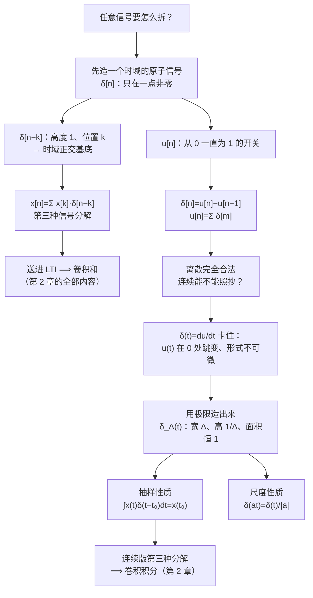
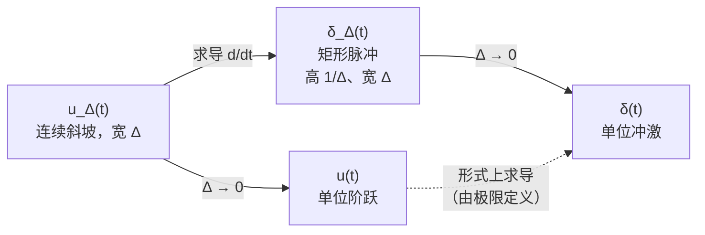

# 1.4 单位冲激与单位阶跃函数 The Unit Impulse and Unit Step Functions

> [!abstract] 这一讲的任务
> 上一讲立起的是**频域的基底**——复指数：每一个只含一种频率，一个周期信号可以拆成它们的加权和。
> 这一讲立起**时域的基底**——单位冲激：每一个只在一个时刻上非零，任何信号都能拆成移位冲激的加权和。
> 顺手把**单位阶跃** $u(t)$、$u[n]$ 与 $\delta$ 的互推关系办完。第一章的信号部分到这里收尾，
> 下一讲开始讲系统，而 $\delta$ 正是"系统"那一半的钥匙。

> [!info] 怎么读这份讲义
> 顺序是**先离散、后连续**：离散的 $\delta[n]$ 在 $n=0$ 处就是一个普通的 $1$，直觉完全可靠；
> 等把抽样、分解、互推都看熟了，再去看连续那个"高度无穷、宽度为零、面积为一"的家伙。
> 标有 **（拓展）** 的段落是课堂没有展开、由教材与通行讲法补上来的部分——本篇只有两处，第 7 节与第 9 节。
> 一处勘误先点出来：示例里 $t=2$ 那个断点往下跳的是**两个单位**，冲激强度是 $-2$ 而不是 $-1$（第 10 节）。



---

## 0. 开场：在一间空教室里拍一下手

假设你站在一间空教室里，拍一下手，用手机录下来。你听到的不是"啪"的一声就完了——后面还拖着一串回声。把这段录音画出来，就是一条**先冲上去、再一步步衰减、中间还夹着几个小尖**的曲线。

有人告诉你一个很省事的做法：**不用知道这间教室的墙、椅子、天花板长什么样，只要存下这一条"拍手响应"曲线，就能算出这间教室对任何声音的响应。** 放音乐、说话、敲桌子，统统能算出来。

你大概会立刻反驳：凭什么？拍手是拍手，音乐是音乐，形状完全不一样，凭什么一条拍手响应就能顶所有情况？

——**因为拍手可以被"拼"出任何声音。** 把一段音乐切成无数个极短的瞬间，每个瞬间都可看成一个"小拍手"，高度等于那一刻的响度；把这一串小拍手的响应叠起来（系统是线性的，叠加就有效），就是完整的输出。

要把这件事说清楚，必须先回答一个更基本的问题：**能不能找到一个"最小的信号原子"，它只在一个时刻上有值、别处全是零？** 找到它，任何一个信号就都能写成"一堆移位原子"的加权和——这正是我们这一讲要做的事，也是第 2 章卷积的全部前提。

在离散的序列上，这个原子平凡得让人失望：**在某个位置上放一根高度为 1 的杆**。在连续时间上，同样的想法会撞上一堵墙，那堵墙就是这一讲后半段的主角。

---

## 1. 先看清这一讲在全局中的位置（p.46）

> [!important] 两个基底：一个管频率，一个管时刻
> 1.3 和 1.4 讲的是同一件事的两半：
>
> | 节 | 信号 | 身份 | 长相 |
> |---|---|---|---|
> | **1.3** | 复指数 $e^{\,j\omega_0 t}$ / $e^{\,j\omega_0 n}$ | **频域 (frequency domain) 的基底** | 频谱上的**一根火柴**（只有一个频率） |
> | **1.4** | 单位冲激 $\delta(t)$ / $\delta[n]$ | **时域 (time domain) 的基底** | 时间轴上的**一根火柴**（只有一个时刻有值） |
>
> 频谱上，每一个 $k$ 对应一根谱线；时间轴上，每一个 $k$ 对应一根杆。**一个是把信号按频率拆，一个是把信号按时刻拆。**

> [!important] 为什么时域基底这么要命：第 2 章的种子埋在这里
> 把 $x[n]=\sum_k x[k]\,\delta[n-k]$ 送进一个 LTI 系统 $\mathcal{T}$：
> - 由**线性**：$y[n]=\sum_k x[k]\,\mathcal{T}\{\delta[n-k]\}$——每一项单独送进去再乘权重；
> - 由**时不变**：$\mathcal{T}\{\delta[n-k]\}=h[n-k]$，$h$ 是系统对**一个**冲激的响应（**冲激响应 impulse response**）。
>
> 两句话一合：
> $$\boxed{\ y[n]=\sum_{k=-\infty}^{\infty}x[k]\,h[n-k]=x[n]*h[n]\ }$$
> 这就是**卷积和**。也就是说：**只要知道系统对一根火柴的响应，就知道它对所有输入的响应。**
> 这就是开场那个"拍手响应能顶所有声音"的说法在数学上的样子。连续时间完全平行，积分号替代求和号即可。

---

## 2. 离散时间单位脉冲 $\delta[n]$（p.46）

> [!important] 定义：单位脉冲 / 单位样值 Unit Sample (Impulse)
> $$\delta[n]=\begin{cases}0, & n\neq 0\\[2pt] 1, & n=0\end{cases}$$

![[C1-单位脉冲序列.png]]

读图：除了 $n=0$ 这一点取 $1$，其余所有整数点都取 $0$ —— 画出来就是**孤零零的一根火柴**。这是时域里最简单、不可再分的信号：它只在一个时刻上有值。

> [!note] 课堂先说清一件事：中文叫法
> 同一个英文单词 **impulse**，离散和连续的中文习惯叫法不同：
> - **离散**：单位**脉冲**（也叫**单位样值 unit sample**，两者同义）；
> - **连续**：单位**冲击**。
>
> 以后笔记里出现"冲激"一律指连续的 $\delta(t)$，"脉冲"指离散的 $\delta[n]$，不再每次解释。

> [!important] 与连续冲激的根本差别（先把这条记住）
> 离散冲激 $\delta[n]$ 是一个**完全正常的、有限值的序列**：$n=0$ 处取 $1$，别处取 $0$，没有任何数学困难，
> $\delta[0]=1$ 就是一个普通的数。
> 连续的 $\delta(t)$ 完全不同：它在 $t=0$ 处取值"$\infty$"，**不是普通函数**，而是**广义函数 (generalized function / distribution)**。
> 这一讲之所以从离散讲起，就是因为**离散的直觉完全可靠**，可以拿来给连续当拐杖。

### 移位冲激：把这根火柴挪到别处

> [!important] 用自变量的时移把火柴搬家
> $$\delta[n-1]:\ \text{只在}\ n=1\ \text{处取 }1\qquad\qquad \delta[n-2]:\ \text{只在}\ n=2\ \text{处取 }1$$
> 一般地，$\delta[n-k]$ 就是**把这根单位高度的火柴放到 $n=k$ 的位置上**。
>
> 这里用的正是 [[C1.2 自变量的变换]] 里的**时移 (time shift)**：$n\to n-k$ 表示右移 $k$ 个单位。
> 所以 $\delta[n-k]$ 携带的正好是两个信息：**高度 = 1（单位 unit）**、**位置 = $k$（the position）**。

> [!important] 这一族移位冲激，就是时域的正交基底
> $$\{\dots,\ \delta[n+1],\ \delta[n],\ \delta[n-1],\ \delta[n-2],\ \dots\}$$
> 每一个都"只有一个位置是 1，其余全是 0"，任意两个的非零位置不重合 ⇒ **两两正交**。
>
> 这和线性代数里 $(1,0,0),(0,1,0),(0,0,1)$ 那组基底是**同一件事**：
> "只有第 $k$ 个分量是 1、其余是 0"的向量 ↔ "只在 $n=k$ 处是 1"的序列。
> 与 1.3 的频域基底对照着看：那里每个基底是频谱上的一根火柴，这里每个基底是时间轴上的一根火柴。

---

## 3. 单位阶跃序列 $u[n]$（p.47）

> [!important] 定义
> $$u[n]=\begin{cases}0, & n<0\\[2pt] 1, & n\ge 0\end{cases}$$

![[C1-单位阶跃序列.png]]

> [!warning] 注意 $n=0$ 处：这里没有争议
> 离散阶跃在 $n=0$ 处**明确定义为 1**（条件是 $n\ge0$），课堂原话是"$u[0]=1$，有固定的值"。
> 连续情形的 $u(0)$ 则没有定义——这是两者第一个重要差别，第 6 节会讲。

> [!tip] $u[n]$ 的用法：一个"从某点起一直开着"的开关
> 它本身没什么复杂度，价值在于**当开关用**：乘上去就把信号截断、或者把某个表达式"限定在 $n\ge0$"。
> 后面几乎所有单边序列（$a^n u[n]$、$n\,u[n]$）都是靠它写出来的。

---

## 4. $\delta[n]$ 与 $u[n]$ 的互推：差分与求和（p.47）

> [!important] 三个关系式（原式）
> **一阶差分 First difference：**
> $$\boxed{\ \delta[n]=u[n]-u[n-1]\ }$$
>
> **滑动求和 Running sum：**
> $$\boxed{\ u[n]=\sum_{m=-\infty}^{n}\delta[m]\ }$$
>
> **等价写法（换元 $k=n-m$）：**
> $$\boxed{\ u[n]=\sum_{k=0}^{\infty}\delta[n-k]\ }$$


> [!note] 三个式子各自验证一遍
> - **差分**：$n>0$ 时 $u[n]=u[n-1]=1$，差为 0；$n=0$ 时 $u[0]=1,\ u[-1]=0$，差为 1；$n<0$ 时两者皆 0。✔
> - **求和**：把 $\delta[m]$ 从 $-\infty$ 加到 $n$。若 $n\ge0$，求和范围包含 $m=0$，和为 1；若 $n<0$，不包含 $m=0$，和为 0。✔
> - **第三式**：$\sum_{k\ge0}\delta[n-k]$ 中只有 $k=n$ 那一项非零，而 $k\ge0$ 要求 $n\ge0$。✔
>
> 课堂上的说法很直白：**差分 ↔ 求和，就是离散世界里的微分 ↔ 积分。** 这句话第 8 节要正式兑现。
> 第二式与第三式的区别只是"对求和变量 $m$ 求和"与"对位移 $k$ 求和"两种视角，后者在推卷积时更常用。

> [!tip] 换元小窍门：一个换元把三个式子串起来
> 从 $\delta[n]=u[n]-u[n-1]$ 出发，把 $n$ 换成 $n-m$ 再对 $m$ 从 $-\infty$ 到 $n$ 求和，第二式直接得到第三式——不用背三个。
>
> 顺带记一条**后面会用到的差别**：**求和没有方向**，从左加到右和从右加到左结果一样，
> 所以换元后上下限颠倒写（$\sum_{m=-\infty}^{n}$）毫无影响。
> 但**积分有方向**：$\int_a^b=-\int_b^a$，交换上下限会多出负号。这条差别在第 12 节证 $\delta(at)$ 时还要用一次。

---

## 5. 第三种信号分解：把序列拆成一根根火柴（p.48）

![[C1-单位脉冲的抽样性质-离散.png]]

### 先看一个具体例子

> [!example] 三根火柴的信号
> 设 $x[n]$ 只在三个点上非零：
> $$x[0]=2,\qquad x[1]=1,\qquad x[2]=1,\qquad \text{其余全为 }0$$
>
> 把它按位置拆成三份：
>
> | 分量 | 位置 | 高度 | 写成基底的形式 |
> |---|---|---|---|
> | 第一根 | $n=0$ | 2 | $2\,\delta[n]$ |
> | 第二根 | $n=1$ | 1 | $1\cdot\delta[n-1]$ |
> | 第三根 | $n=2$ | 1 | $1\cdot\delta[n-2]$ |
>
> 三者相加就还原了原信号：
> $$x[n]=2\,\delta[n]+1\cdot\delta[n-1]+1\cdot\delta[n-2]$$
>
> **读法**：每一项都是"**高度 × 位置**"——系数给高度，$\delta[n-k]$ 里的 $k$ 给位置。
> 这就是**基底信号的加权和**，加权系数正是信号在各点上的取值（课堂上就是拿红、蓝、绿三支笔把这三根分别画出来再叠加的）。

### 一般形式

> [!important] 第三种信号分解 Signal Decomposition（时域）
> $$\boxed{\ x[n]=\sum_{k=-\infty}^{+\infty}x[k]\,\delta[n-k]\ }$$
> 读法：**把序列 $x$ 拆成一根一根的杆，第 $k$ 根杆的高度是 $x[k]$，位置在 $n=k$。**

> [!warning] 关键辨析：求和号里的 $x[k]$ 不是信号，是一个数
> 这是这个式子最容易糊涂的地方，课堂上专门停下来强调过。
>
> - **信号 (signal) 是函数**，必须有**自变量**。这个式子里自变量是 $n$，它跑遍整条整数轴。
> - **$k$ 在求和里是取定的**（每一项固定一个 $k$）。所以 **$x[k]$ 是一个 value（数值）**，是信号在 $k$ 点上的取值，**它只是权重**。
> - **真正的信号是 $\delta[n-k]$**：$n$ 是自变量，$k$ 只标出这根火柴的位置。
>
> 一句话：**$x[k]$ 管高度，$\delta[n-k]$ 管位置、而且它才是那个"信号"。**
> 拿上面的例子对照：$x[0]=2$ 是"2"这个数，$\delta[n]$ 才是那根信号。

> [!important] 三种信号分解，到这里凑齐了
> | # | 名称 | 域 | 分解式 | 基本成分 |
> |---|---|---|---|---|
> | ① | **奇偶分解** | 时域 | $x=x_e+x_o$ | 偶函数、奇函数（只分两份，很粗） |
> | ② | **傅里叶分解** CTFS / DTFS | **频域** | $x(t)=\sum_k a_k e^{jk\omega_0 t}$ | 复指数（单频信号） |
> | ③ | **冲激分解** | **时域** | $x[n]=\sum_k x[k]\delta[n-k]$ | 移位冲激（一根根火柴） |
>
> ① 见 [[C1.2 自变量的变换]]，② 见 [[C1.3 指数信号与正弦信号]]，③ 就是这里。
> **②③ 是一对**：一个把信号按**频率**拆开，一个把信号按**时刻**拆开——正是时域与频域两套坐标。

### 抽样性质 Sampling Property（p.48）

> [!important] 取值（抽样）式
> $$x[n]\,\delta[n]=x[0]\,\delta[n]$$
> $$x[n]\,\delta[n-n_0]=x[n_0]\,\delta[n-n_0]$$
>
> 移位后的单位脉冲序列可以**"抽取"信号在 $n=n_0$ 处的值**。
> 道理很简单：$\delta[n-n_0]$ 只在 $n=n_0$ 处非零，$x[n]$ 的其他取值根本用不上，于是可以把 $x[n_0]$ 当常数提出来。

> [!warning] 课堂反复强调：两边都是信号，不是数值
> $$\underbrace{x[n]\,\delta[n-n_0]}_{\text{信号：只在 }n_0\text{ 处非零，其余全为 }0}\quad\ne\quad\underbrace{x[n_0]}_{\text{数值：一个常数}}$$
>
> 课堂原话是："这是个**错误的表达式**，大家好像一眼觉得没问题……"——因为两边看起来都"只剩 $n_0$ 那一个点"。
>
> - **左边**是**信号**：它是 $n$ 的函数，只在 $n=n_0$ 处取值 $x[n_0]$，**其他点全是 0**。
> - **右边 $x[n_0]$**（不带 $\delta$）是**数值**：$n_0$ 已取定，它是一个常数。把它当信号画出来，是**每个点都等于 $x[n_0]$ 的常数信号**，跟左边完全是两码事。
> - 正确写法必须**保留冲激这一项**：$x[n_0]\,\delta[n-n_0]$——它才同时携带"**位置在 $n_0$、高度为 $x[n_0]$**"两个信息。
>
> 特例（$n_0=0$）：$x[n]\delta[n]=x[0]\delta[n]$。**别写成 $x[n]\delta[n]=x[0]$**——那是一个数，不是信号。
> 一句话：**信号是函数，必须带着自变量 $n$；一旦写成 $x[n_0]$，你就已经从"信号"掉到"数值"了。**

> [!tip] 两个式子别混
> - $x[n]\delta[n-n_0]=x[n_0]\delta[n-n_0]$ —— 结果**还是一个序列**（在 $n_0$ 处高度为 $x[n_0]$ 的一根杆）。
> - $\sum_n x[n]\delta[n-n_0]=x[n_0]$ —— **求和之后**才得到一个数。
>
> 连续情形同理：$x(t)\delta(t-t_0)$ 是冲激，$\int x(t)\delta(t-t_0)dt$ 才是数。这条"乘出来是信号、积出来才是数"的分界，第 11 节还要再讲一遍。

---

## 6. 连续时间单位阶跃 $u(t)$（p.49）

> [!important] 定义
> $$u(t)=\begin{cases}0, & t<0\\[2pt] 1, & t>0\end{cases}$$

![[C1-连续单位阶跃函数.png]]

> [!warning] 定义式里没有给 $t=0$ 赋值，这是故意的
> $u(t)$ 在 $t=0$ 处**不连续 (discontinuous)**：左极限 $\lim_{t\to0^-}u(t)=0$，右极限 $\lim_{t\to0^+}u(t)=1$，**两者不相等**，所以 **$u(0)$ 没有定义 (no value)**。
> 课堂上的原话是："数学上把这种函数叫间断了，它是从 $0$ 跳变 (jump) 到 $1$ 的。"
>
> 顺带一提：取 0、取 1、取 $1/2$ 都不影响任何积分结果，不同教材写法不同，**不影响做题**。

> [!warning] 连续与离散的第一个根本差别：$u(0)$ 到底等不等于 1？
> - **离散** $u[0]=1$：明确写在定义里（$n\ge0$ 取 1），**有固定取值，没有争议**。
> - **连续** $u(0)$：**没有定义**，因为左右极限不相等。
>
> 这个"跳变"正是下一节 $\delta(t)=du/dt$ 的来源——**断点上有导数，导出来就是冲激**。

> [!tip] $u(t)$ 最常用的身份：一把"截断刀"
> 讲能量/功率分类时（[[C1.1 连续时间与离散时间信号]]）$u(t)$ 就已经提前登场，因为作业里要用。它最常见的用途是**把双边信号截成单边**：
> $$e^{-t}\ \xrightarrow{\ \times\,u(t)\ }\ e^{-t}u(t)$$
> 效果一目了然：$e^{-t}$ 本来在整个时间轴上都有定义，乘上 $u(t)$ 之后 **$t<0$ 那一半整个变成 0**，只剩右半边。
>
> **后果很关键**：双边的 $e^{-t}$ 因为左侧指数爆炸，是"既非能量也非功率信号"；乘上 $u(t)$ 之后就成了**有限能量信号**。
> 这正是 [[C1.1 连续时间与离散时间信号]] 里例 3 与例 4、随堂测 Q2 与 Q3 的全部差别。

---

## 7. 连续时间单位冲激 $\delta(t)$（p.50）

> [!important] 定义
> $$\delta(t)=\begin{cases}0, & t\neq 0\\[2pt] \infty, & t=0\end{cases}\qquad\text{and}\qquad \int_{-\infty}^{+\infty}\delta(t)\,dt=1$$

![[C1-连续单位冲激函数.png]]

> [!warning] 图上箭头旁的 "1" 是什么意思？
> **不是高度，是面积（强度 strength）**。
> $\delta(t)$ 的高度是无穷大，画不出来，所以约定用**箭头**表示冲激，箭头旁标注的数字表示**冲激的面积**。
> 例如 $3\delta(t-2)$ 就画成在 $t=2$ 处标着 "3" 的箭头。课堂上把这个"单位 (unit)"解释得很直白：
> **"unit" 原本指信号值是 1，可 $\delta(t)$ 的值是无穷，所以对它来说"单位"改由面积定义**——$\int\delta(t)dt=1$。
> 而积分就是面积，这是理解 $\delta$ 一切性质的钥匙。

> [!note] 课堂讲法：奇异信号与狄拉克函数
> 这类"高度无穷大、宽度为 0、面积却为 1"的信号，数学上很怪异，专门有个名字：
> - **奇异信号 (singularity)**：怪就怪在它是断的，又在单点上取无穷值；
> - 描述它的函数叫**狄拉克函数 (Dirac delta function)**——这就是 $\delta(t)$ 的正式名称。
>
> 课堂上还强调它的物理形象：**它是一个"转瞬即逝"的瞬时信号**——一瞬间完成、总效果（面积）为 1 的冲击。
> 这也是它叫"冲激"的原因。

> [!note] 补充讲解：$\delta(t)$ 严格来说不是"函数"（拓展）
> 没有任何普通函数能满足"处处为 0、单点为 $\infty$、积分为 1"（勒贝格意义下单点集测度为 0，积分必为 0）。
> $\delta(t)$ 是**广义函数 / 分布 (distribution)**，它只在"**被积分**"时才有意义：$\delta$ 的全部信息就是"它作用在测试函数上、取出该点的函数值"。
> 工程上不必纠结这一点，但要知道**所有关于 $\delta$ 的运算最终都要落到积分里去理解**。

> [!important] 它是偶函数
> $$\delta(-t)=\delta(t)$$
> 直观上，$\delta_\Delta(t)$ 那根窄矩形无论从左边还是右边压向原点，极限都是同一个冲激（第 9 节的极限模型会把这个说法坐实）。
> 这条性质在第 12 节讲尺度性质时直接派上用场。

---

## 8. $\delta(t)$ 与 $u(t)$ 的互推（p.51）

> [!important] 两个关系式（Example 1.7）
> **一阶导数 First derivative：**
> $$\boxed{\ \delta(t)=\frac{du(t)}{dt}\ }\qquad\text{（原稿标注：To be interpreted，需作解释）}$$
>
> **滑动积分 Running integral：**
> $$\boxed{\ u(t)=\int_{-\infty}^{t}\delta(\tau)\,d\tau\ }$$

> [!warning] 原稿点出的困难
> **Since $u(t)$ is discontinuous at $t=0$ and consequently is formally not differentiable.**
> 由于 $u(t)$ 在 $t=0$ 处不连续，**形式上它是不可微的**。
> 所以 $\delta(t)=du/dt$ 这个式子需要用**极限过程**重新解释——这正是第 9 节要做的事。

> [!note] 为什么离散是差分、连续是导数：把导数定义离散化（课堂推导）
> 两边的对应关系是：**求和 ↔ 积分**，**差分 ↔ 微分**。为什么会这样？把导数定义按"采样"走一遍就看到了。
>
> 导数定义（取前向差商）：
> $$\frac{df(x)}{dx}=\lim_{\Delta x\to 0}\frac{f(x+\Delta x)-f(x)}{\Delta x}$$
> **连续采样之后就是离散**：采样的过程把时间戳丢掉了，相当于**归一化**——相邻样本的间隔就取成最小单位 $\Delta x=1$，于是
> $$\frac{f(x+\Delta x)-f(x)}{\Delta x}\ \xrightarrow{\ \Delta x=1\ }\ f(n+1)-f(n)$$
> 这正是**一阶差分 (first difference)**！
> 所以**一阶差分就是一阶导数在离散世界的化身**；求和对应积分也同理（积分就是把一块块小矩形面积叠起来，课堂原话："积分就是面积"）。
>
> 关键差别在 $\Delta x$：离散样本的间隔**没有"趋于 0"的自由**（它就是 1），所以离散的 $\delta[n]=u[n]-u[n-1]$ 完全合法，
> 而连续的 $\delta(t)=du/dt$ 必须借助极限才能定义。课堂上说，这一条到第 2 章讲积分时还会再回来。

> [!note] 狄拉克函数漂亮在哪：断点上也能求导
> 数学上**间断的函数不可微**，$u(t)$ 在 $t=0$ 处跳变，本来不能求导。
> 狄拉克函数的引入恰恰弥补了这一点：**断点上的导数就是一个冲激**——跳变的位置就是冲激的位置，跳变的幅度就是冲激的强度。
> 这就是"奇异函数"这个名字真正的价值，也是 $\delta(t)=du/dt$ 的直观含义。

> [!warning] 课堂高频易错：running integral 的内部变量
> $u(t)=\int_{-\infty}^{t}\delta(\tau)\,d\tau$ 是**最常见的写错点**，把它和离散的 running sum 并排看：
>
> $$\underbrace{u[n]=\sum_{m=-\infty}^{n}\delta[m]}_{\text{running sum}}\quad\longleftrightarrow\quad\underbrace{u(t)=\int_{-\infty}^{t}\delta(\tau)\,d\tau}_{\text{running integral}}$$
>
> - **$\tau$（离散对应 $m$）是内部积分变量**：它在一个区间里取遍所有值之后就**消失了**，结果里跟 $\tau$ 毫无关系。
> - **结果只由积分上下限决定**：积出来是 **$t$ 的函数**——$t$ 出现在上限里，$\tau$ 不在。
> - 所以**上限写 $t$、被积变量写 $\tau$**。写成 $\int_{-\infty}^{t}\delta(t)\,dt$ 是错的（$t$ 一会儿当上限、一会儿当被积变量，符号打架）。
>
> 离散的 running sum 完全平行：$m$ 是内部求和变量，求和之后 $m$ 消失，结果是 $n$ 的函数。**把这一对放一起记，两边都不会写错。**
> 求导的逆运算是积分，所以这两个式子互为逆运算，不必再证。

---

## 9. 用极限把 $\delta(t)$ 造出来（p.52、p.54）

> [!important] 撞墙的那一步：$\delta(t)=du(t)/dt$ 到底怎么算？
> 直接对 $u(t)$ 求导：左边恒为 0、右边恒为 1，"导数"在 $t=0$ 处无从下手。**这条路堵死了。**
> 换一个思路：**不去求 $u$ 的导数，先造一个光滑的替身 $u_\Delta(t)$，对替身求导，再让 $\Delta\to0$。**

### 9.1 从斜坡到矩形：一个极限过程

![[C1-冲激函数的极限构造.png]]

> [!important] 构造四步
> 1. **让 $u_\Delta(t)$ 逼近 $u(t)$**：取一个**连续**的斜坡——$t<0$ 时为 0，$0\le t\le\Delta$ 时从 0 线性升到 1，$t>\Delta$ 时恒为 1。
>    相当于给跳变加了一个**上升时间 (rising time)** $\Delta$。
> 2. **令 $\Delta\to0$**：过渡时间缩到零，斜坡的极限就是 $u(t)$——**跳变回来了**。
> 3. **对替身求导**：斜坡段的斜率是"高 ÷ 宽 $=\dfrac{1}{\Delta}$"，其余处为 0，于是
>    $$\delta_\Delta(t)=\frac{du_\Delta(t)}{dt}=\begin{cases}\dfrac{1}{\Delta}, & 0\le t\le\Delta\\[4pt]0, & \text{otherwise}\end{cases}$$
>    这是一个**高度 $1/\Delta$、宽度 $\Delta$ 的矩形脉冲**。
> 4. **再取极限**：$\displaystyle\lim_{\Delta\to0}\delta_\Delta(t)=\delta(t)$。宽度趋于 0、高度趋于无穷，**它就是一个冲激**。



> [!important] 全部关键就在"面积"
> $$\text{面积}=\frac{1}{\Delta}\times\Delta=1\qquad(\text{与 }\Delta\text{ 无关})$$
> 所以极限过程**保住了"面积为 1"这个本质属性**，而高度趋于无穷只是副产品。
> 这也是把 $\delta$ 的一切做得下去的原因：**$\delta$ 的身份由面积定义，与高度、形状都无关。**

> [!note] 课堂的"物理直觉"版本
> 别把它想得太抽象：**面积恒为 1、宽度 $\Delta\to0$、高度 $\to\infty$**，它就是一个"**转瞬即逝的瞬时信号**"——
> 一个瞬间完成的、总效果（面积）为 1 的冲击。课堂原话是："这个信号是瞬间的、转瞬即逝的。"
> $\delta_\Delta(t)$ 对 $u(t)$ 的逼近，正是把"瞬间跳变"理解成"过渡时间 $\Delta\to0$ 的斜坡"的极限。

### 9.2 形状可以换：三种近似（p.54）

![[C1-冲激函数的三种近似.png]]

> [!important] 三种常见的 $\delta_\Delta(t)$
> **① 右侧矩形（最常用）：**
> $$\delta_\Delta(t)=\begin{cases}\dfrac{1}{\Delta}, & 0\le t\le\Delta\\[6pt] 0, & \text{otherwise}\end{cases}$$
>
> **② 居中矩形**：宽度 $\Delta$，从 $-\dfrac{\Delta}{2}$ 到 $\dfrac{\Delta}{2}$，高度 $\dfrac{1}{\Delta}$。
>
> **③ 三角形**：底从 $-\Delta$ 到 $\Delta$，峰高 $\dfrac{1}{\Delta}$。
>
> 三者都满足 $\displaystyle\lim_{\Delta\to0}\delta_\Delta(t)=\delta(t)$。面积各自核对：矩形 $\frac1\Delta\cdot\Delta=1$；三角形 $\frac12\cdot2\Delta\cdot\frac1\Delta=1$。

> [!note] 为什么形状可以任意？（拓展）
> 因为定义只关心两件事：**(a) 极限下宽度趋于 0；(b) 面积恒为 1**。形状无关紧要——
> 高斯函数 $\frac{1}{\sqrt{2\pi}\sigma}e^{-t^2/2\sigma^2}$、$\mathrm{sinc}$ 函数等等都可以当 $\delta$ 的近似，
> 数学上称为 **$\delta$ 序列 / nascent delta function**。这条只是把"面积说了算"再强调一次，考试不涉及具体形状。

---

## 10. 课堂例题：带断点信号的导数

> [!example] 一个"往上跳两步、再往下跳两步"的台阶信号
> 设 $x(t)$ 为分段常数信号：$t<0$ 时 $x=0$，$0<t<1$ 时 $x=1$，$1<t<2$ 时 $x=2$，$t>2$ 时 $x=0$。
> 用极限观点（或"断点上求导"）求 $x'(t)$。
>
> **解**：平坦段上导数为 0，只需看三处跳变——**跳变的位置就是冲激的位置，跳变的幅度就是冲激的强度**：
>
> | 跳变点 | 跳变 | 贡献 |
> |---|---|---|
> | $t=0$ | $0\to1$，向上跳 1 | $+\delta(t)$ |
> | $t=1$ | $1\to2$，向上跳 1 | $+\delta(t-1)$ |
> | $t=2$ | $2\to0$，**向下跳 2** | $-2\,\delta(t-2)$ |
>
> $$x'(t)=\delta(t)+\delta(t-1)-2\,\delta(t-2)$$
>
> **两个易错点**：
> - 向下跳是**负**冲激：从 2 跳到 0，改变量是 $-2$，不是 $+2$。
> - **$t=2$ 处是 $-2\delta$ 而不是 $-\delta$**：跳变幅度按"跳了几步"算——**单位阶跃一个 unit 就是跳一个单位**，这里一步跳了两个单位，系数就是 2。
>
> （这道题课堂上还当场纠了一次错：一开始只在 $t=2$ 写了 $-\delta(t-2)$，随后补上系数 2。**"往下跳两步"是这道题唯一的坑。**）

![[C1-分段常数信号的导数.png]]

> [!question] 追问：分段函数的导数，为什么写成了三个冲激「相加」？
> 很自然的疑惑：$x(t)$ 是分段定义的，那 $x'(t)$ 不是也该分段写吗？怎么直接加成一行了？
>
> **解释一：求和式本身就是分段结果的紧凑写法。**
> 冲激有个关键性质——$\delta(t-t_0)$ 在 $t\ne t_0$ 处**全等于 0**。所以三项相加时，任何时刻最多只有一项非零，其余全为 0。
> 把这行加法摊开读，就是
>
> $$x'(t)=\begin{cases}\delta(t) & t=0\\ 0 & 0<t<1\\ \delta(t-1) & t=1\\ 0 & 1<t<2\\ -2\,\delta(t-2) & t=2\\ 0 & t>2\end{cases}$$
>
> 这正是分段表示——只不过"平坦段导数为 0"的那几段写出来全是废话，于是只保留非零的三项、用加号串成一行。**加号在这里起的是「拼接」作用，不是「叠加」作用。**
>
> **解释二：原信号本来就是加出来的，求导只是逐项求导。**
> 更本质的看法：$x(t)$ 根本不必分段定义，它可以直接写成阶跃函数的线性组合
> $$x(t)=u(t)+u(t-1)-2u(t-2)$$
> 验算：$t<0$ 三项全 0；$0<t<1$ 只有第一项生效得 1；$1<t<2$ 前两项生效得 2；$t>2$ 时 $1+1-2=0$，与原定义完全吻合。
> 而求导是**线性运算**，可以逐项做，只需一条基本事实 $u'(t)=\delta(t)$：
> $$x'(t)=u'(t)+u'(t-1)-2u'(t-2)=\delta(t)+\delta(t-1)-2\,\delta(t-2)$$
> 这条路径上根本没有"分段"这一步。
>
> **这就是把 $\delta(t)=du/dt$ 推广到任意分段常数信号**：断点位置 → 冲激位置（$t-t_0$），跳变幅度 → 冲激强度（系数）。

> [!tip] 一个贯穿全课的习惯：能写成加法的，就别写成分段
> 分段表示与求和表示是同一个函数的两种写法。对"处处为 0、只在孤立点有值"的对象，求和写法更紧凑，
> 也**更便于后面做卷积和傅里叶变换**（每项单独变换再相加即可）。
> 整门课都在往这个方向推——因为 LTI 系统对加法是"透明"的（叠加性成立），对分段则不是。

---

## 11. 冲激的抽样性质 Sampling Property（p.53）

> [!important] 三个式子
> $$x(t)\,\delta(t)=x(0)\,\delta(t)$$
> $$x(t)\,\delta(t-t_0)=x(t_0)\,\delta(t-t_0)$$
> $$\boxed{\ \int_{-\infty}^{+\infty}x(t)\,\delta(t-t_0)\,dt=x(t_0)\ }$$

![[C1-冲激的抽样性质-面积解释.png]]

> [!note] 这张图怎么读：面积解释
> 图中把 $x(t)\delta_\Delta(t)$ 画成一个宽 $\Delta$、高约 $\dfrac{1}{\Delta}x(0)$ 的窄条（阴影部分）。
> 在 $[0,\Delta]$ 这段极窄区间里 $x(t)$ 几乎不变，可以近似成常数 $x(0)$，于是
> $$x(t)\delta_\Delta(t)\approx x(0)\delta_\Delta(t)$$
> 阴影面积 $=\dfrac{1}{\Delta}x(0)\times\Delta=x(0)$，**与 $\Delta$ 无关**。令 $\Delta\to0$ 就得到抽样性质。
> 课堂上把这一步讲成"点对点相乘"：$\delta_\Delta$ 在非零点上全是 0，和任何有限值相乘都是 0，**乘完只剩一个窄条**；窄条的强度（面积）就是这个点的函数值。

> [!warning] 前两式是"信号"，第三式才是"数值"
> 连续版和离散版的辨析完全平行：
> $$x(t)\delta(t-t_0)=\underbrace{x(t_0)\,\delta(t-t_0)}_{\text{信号：只在 }t_0\text{ 处的一个冲激}}\qquad\ne\qquad\underbrace{x(t_0)}_{\text{数值}}$$
> - 前两式：两边都是**信号**（$t$ 的函数）——$\delta(t-t_0)$ 在 $t\ne t_0$ 处全是 0，把 $x(t)$ 其他点的值全部"灭掉"，只剩 $t_0$ 处一个冲激。
> - 冲激的**强度**（面积）是 $x(t_0)$：把 $x(t)$ 看成"由 0 跳到 $x(t_0)$"，冲激就按跳变值 $x(t_0)$ 标。
> - 第三式 $\int x(t)\delta(t-t_0)dt=x(t_0)$：**积分是对 $t$ 积的，积完 $t$ 消失，结果是一个 value**。用代换 $t'=t-t_0$ 立刻回到定义式 $\int\delta=1$，再提出常数 $x(t_0)$ 即得。
>
> **一句话：乘出来的是信号，积出来的才是数。**

> [!important] 抽样性质的口诀
> **"$\delta$ 遇到积分，就把它压在的那一点的函数值取出来。"**
> $$\int x(t)\delta(t-t_0)dt=x(t_0)$$
> 前两式只是"**把系数提到括号外**"：既然 $\delta(t-t_0)$ 只在 $t=t_0$ 处不为零，$x(t)$ 的其他取值根本用不上。

> [!important] 连续版的第三种信号分解
> 把上式反过来读，就是**连续信号的冲激分解**：
> $$x(t)=\int_{-\infty}^{+\infty}x(\tau)\,\delta(t-\tau)\,d\tau$$
> 与离散版 $x[n]=\sum_k x[k]\delta[n-k]$ 完全对应——**求和换成积分，$x(\tau)$ 同样是权重（一个数），$\delta(t-\tau)$ 才是那个信号。**
> 它送进 LTI 系统就得到**卷积积分** $y(t)=\int x(\tau)h(t-\tau)d\tau$。开场那个"拍手响应能顶所有声音"的说法，到这里就完全落地了。

> [!warning] 使用抽样性质的两个前提
> 1. **冲激的位置必须落在积分区间内**，否则积分为 **0**（第 13 节的例题就考这一条）。
> 2. **$x(t)$ 在 $t_0$ 处必须连续**，否则 $x(t_0)$ 无定义。

---

## 12. 尺度性质：$\delta(at)=\dfrac{1}{|a|}\delta(t)$（p.55）

> [!important] 结论
> $$\boxed{\ \delta(at)=\frac{1}{|a|}\,\delta(t)\ }$$
>
> 课堂上特意说明过它的身份：这是**课本正文里没有展开、课堂上额外补出来的一条结论**（原稿把它标成粉色块）。
> 结论要记牢，证明过程了解思路即可——课堂原话："证明不重要，结论重要。"

![[C1-冲激尺度性质的面积变化.png]]

**思路一（矩形挤压直觉）：**
先看普通信号：$x(t)\to x(2t)$ 是**时间轴上的压缩 (compress)**，宽度减半。
可 $\delta(t)$ 本来就没有宽度，再挤会怎样？用极限模型来看：$\delta_\Delta(t)$ 是宽 $\Delta$、高 $1/\Delta$ 的矩形，那么 $\delta_\Delta(at)$ 呢？
宽度被压成 $\dfrac{\Delta}{|a|}$，**高度不变**，于是

$$\text{面积}=\frac{\Delta}{|a|}\times\frac{1}{\Delta}=\frac{1}{|a|}$$

再令 $\Delta\to0$：宽度趋于 0、高度趋于无穷——**它仍然是一个冲激**，只是面积不再是 1，而是 $\dfrac{1}{|a|}$。
冲激的大小只看面积，所以 $\delta(at)=\dfrac{1}{|a|}\delta(t)$。
（用 $\delta_\Delta(2t)$ 走一遍：宽 $\Delta/2$、高 $1/\Delta$，面积恒为 $1/2$ ⇒ 结果是 $\frac12\delta(t)$。）

**思路二（严格证明）：**

$$
\int_{-\infty}^{+\infty}\delta(at)\,dt \xlongequal{\ \tau=at\ } \int_{-\infty}^{+\infty}\delta(\tau)\,d\!\left(\frac{\tau}{a}\right)
$$

$$
\text{If } a>0:\quad \int_{-\infty}^{+\infty}\delta(\tau)\,d\!\left(\frac{\tau}{a}\right)=\frac{1}{a}\int_{-\infty}^{+\infty}\delta(\tau)\,d\tau=\frac{1}{a}
$$

$$
\text{If } a<0:\quad \int_{-\infty}^{+\infty}\delta(\tau)\,d\!\left(\frac{\tau}{a}\right)=\frac{1}{a}\int_{+\infty}^{-\infty}\delta(\tau)\,d\tau=-\frac{1}{a}\int_{-\infty}^{+\infty}\delta(\tau)\,d\tau=-\frac{1}{a}
$$

$$
\Rightarrow\quad \int_{-\infty}^{+\infty}\delta(at)\,dt=\frac{1}{|a|}
$$

> [!warning] $a<0$ 时为什么积分限要翻转？
> 换元 $\tau=at$：当 $a<0$ 时，$t:-\infty\to+\infty$ 对应 $\tau:+\infty\to-\infty$，**上下限互换**，因此多出一个负号；
> 它和 $\frac1a$ 自带的负号抵消，得到 $-\frac1a=\frac{1}{|a|}>0$。
> **面积必须为正**，这就是结果里出现绝对值的原因。

> [!warning] 为什么积分交换上下限会变号，而求和不会？
> 课堂把这两个操作特意对比过一次（第 4 节的换元就用到过"求和可换序"）：
> - **求和没有方向**：从左加到右和从右加到左结果相同；
> - **积分有方向（带面积符号）**：$\int_a^b=-\int_b^a$，交换上下限会多一个负号。
>
> 高数里这条规则的这一处"落地"，正是上面 $a<0$ 时负号与绝对值（$|a|=-a$）的来源。

> [!note] 另一种记法：$\delta$ 是偶函数
> 不用每次都纠结符号：先写 $\delta(at)=\dfrac{1}{|a|}\delta(t)$，再补一条
> $$\delta(-t)=\delta(t)\qquad\text{（冲激是偶函数 / 偶信号）}$$
> 例如 $\delta(-2t)$：$a=-2$，先得 $\frac12\delta(t)$；由偶函数性质 $\delta(-t)=\delta(t)$ 也可以直接换号。
> 综合记忆：**尺度变换永远产生正的 $1/|a|$；负号的意义只是"先翻转再缩放"，而冲激翻转后还是它自己。**

> [!tip] 常用推论（做题第一步）
> $$\delta(at-t_0)=\delta\!\left[a\!\left(t-\frac{t_0}{a}\right)\right]=\frac{1}{|a|}\,\delta\!\left(t-\frac{t_0}{a}\right)$$
> **永远先把 $\delta$ 的括号化成 $\delta(t-t_1)$ 的标准形式**，同时把系数 $\frac{1}{|a|}$ 提出来。

---

## 13. 考试题型：含冲激的积分（课堂明说一般占 2 分）

> [!important] 这类题的标准三步
> ```mermaid
> flowchart TD
>     A["看到 ∫ f(t)·δ(at+b) dt"] --> B["第1步：化标准形式<br/>δ(at+b) = (1/|a|)·δ(t + b/a)"]
>     B --> C["第2步：定位冲激点 t₁ = −b/a"]
>     C --> D{"t₁ 是否落在积分区间内?"}
>     D -- "否" --> E["结果 = 0"]
>     D -- "是" --> F["结果 = (1/|a|)·f(t₁)"]
> ```

> [!example] 例题 1：$\displaystyle\int_{-\infty}^{+\infty}(2t^2+3t)\,\delta\!\left(\frac12 t-2\right)dt=\ ?$
> **解**：先把 $\frac12 t-2$ 化成 $a(t-t_1)$ 的形式：
> $$\delta\!\left(\frac12 t-2\right)=\delta\!\left[\frac12\,(t-4)\right]\ \xrightarrow{\ \delta(at)=\tfrac{1}{|a|}\delta(t)\ }\ 2\,\delta(t-4)$$
> 于是积分变成 $2\displaystyle\int_{-\infty}^{+\infty}(2t^2+3t)\delta(t-4)\,dt$，由抽样性质（$t_0=4$ 在区间内）：
> $$=2\cdot\bigl(2\cdot 16+3\cdot 4\bigr)=2\cdot 44=88$$
>
> 课堂上的演示顺序：
> 1. 把 $t-4$ 整体看成 $t'$，用 $\delta(at)=\frac{1}{|a|}\delta(t)$ 把 $\delta(\frac12 t')$ 换成 $2\delta(t')$；
> 2. 系数 2 提到积分号外；
> 3. 剩下就是标准抽样 $\int f(t)\delta(t-4)dt=f(4)$。

> [!example] 例题 2（把积分区间改成 $[-3,3]$）：$\displaystyle\int_{-3}^{3}(2t^2+3t)\,\delta\!\left(\frac12 t-2\right)dt=\ ?$
> **解**：化标准形式的结果不变，被积函数 $=2(2t^2+3t)\,\delta(t-4)$。
> 但冲激位置在 $t=4$，而积分区间是 $[-3,3]$——**冲激不在积分区间内**。
> 冲激没有宽度，区间没盖住它就积不到任何面积 ⇒ **结果 = 0**。
>
> 若从 $3$ 积到 $5$，区间盖住了 $t=4$ ⇒ 结果仍是 $88$。
> **结论：含冲激的积分，先看积分区间包不包含冲激的位置。**
>
> 这道题就是原稿上的**[填空 1]**（1 分，p.56）。陷阱是：不检查位置、直接代入 $t=4$ 算得 $88$。

> [!question] 随堂作业（原稿**[填空 2]**，1 分）：$\displaystyle\int_{-\infty}^{+\infty}(t+4)\,\delta(-2t+4)\,dt=\ ?$
> 注意两点：**$a=-2$ 是负数（要取绝对值）**，且冲激先化成标准形式。
> $$\delta(-2t+4)=\delta\!\left[-2(t-2)\right]=\frac{1}{|-2|}\,\delta(t-2)=\frac12\,\delta(t-2)$$
> 冲激位置 $t=2$，落在 $(-\infty,+\infty)$ 内：
> $$\int_{-\infty}^{+\infty}(t+4)\cdot\frac12\,\delta(t-2)\,dt=\frac12\cdot(2+4)=3$$
>
> **两个易错点**：① 忘记 $\frac{1}{|a|}$ 因子（会得 6）；② 用了 $\frac{1}{a}=-\frac12$ 而不是 $\frac{1}{|a|}$（会得 $-3$）。
> 课堂上再三提醒："**这个是负的，跟刚刚那题不一样**"——**系数带负号是这道题的考点**，但解法完全相同。

> [!tip] 再练一道：$\displaystyle\int_{-\infty}^{\infty}t^2\,\delta(3t-6)\,dt$
> $$\delta(3t-6)=\delta[3(t-2)]=\frac13\delta(t-2)$$
> 冲激点 $t=2$ 在区间内，结果 $=\dfrac13\cdot 2^2=\dfrac43$。

> [!note] 课堂定位
> 含冲激的积分是考试**爱考、一般占 2 分**的题型：一道给完整区间（或区间没盖住冲激，答案为 0），
> 一道给**负系数**变式。第四节课留的两道作业就对应上面这两道填空。

---

## 14. 连续与离散的对照总表

| | 离散时间 Discrete-time | 连续时间 Continuous-time |
|---|---|---|
| **冲激** | $\delta[n]=\begin{cases}1,&n=0\\0,&n\ne0\end{cases}$（**普通序列**） | $\delta(t)$：$t\ne0$ 为 0，$t=0$ 为 $\infty$，$\int\delta=1$（**广义函数**） |
| **阶跃** | $u[n]=\begin{cases}1,&n\ge0\\0,&n<0\end{cases}$（$u[0]=1$） | $u(t)=\begin{cases}1,&t>0\\0,&t<0\end{cases}$（$t=0$ 未定义） |
| **冲激 ← 阶跃** | $\delta[n]=u[n]-u[n-1]$（一阶差分） | $\delta(t)=\dfrac{du(t)}{dt}$（需极限解释） |
| **阶跃 ← 冲激** | $u[n]=\sum_{m=-\infty}^{n}\delta[m]$（滑动求和） | $u(t)=\int_{-\infty}^{t}\delta(\tau)\,d\tau$（滑动积分） |
| **分解** | $x[n]=\sum_k x[k]\delta[n-k]$ | $x(t)=\int x(\tau)\delta(t-\tau)\,d\tau$ |
| **抽样** | $\sum_n x[n]\delta[n-n_0]=x[n_0]$ | $\int x(t)\delta(t-t_0)\,dt=x(t_0)$ |
| **尺度** | （$n$ 为整数，一般不做尺度变换） | $\delta(at)=\dfrac{1}{\lvert a\rvert}\delta(t)$ |
| **对称性** | 无对应 | $\delta(-t)=\delta(t)$（偶函数），可与尺度性质配合使用 |

> [!warning] 一个重要的不对称
> **离散冲激没有尺度性质**（$\delta[an]$ 一般无意义，因为 $n$ 必须是整数），而且 $\delta[0]=1$ 是个**普通的数**；
> 连续冲激的"值"是无穷，只有面积有意义。
> **这是连续与离散最大的概念差异之一，考试常问："$\delta[0]$ 等于多少？$\delta(0)$ 等于多少？"**
> 答案：$\delta[0]=1$；$\delta(0)$ 形式上是 $\infty$、没有有限值，连续冲激只在积分意义下才定义。

---

## 这一讲的三句话

> [!important] 记住三句
> 1. **时域的基底是移位冲激**：$\delta[n-k]$ 只携带"高度 + 位置"两个信息，两两正交，
>    于是任意信号都能写成 $x[n]=\sum_k x[k]\delta[n-k]$——**系数 $x[k]$ 是数，$\delta[n-k]$ 才是信号**。
> 2. **阶跃与冲激互为差分/积分**：离散 $\delta[n]=u[n]-u[n-1]$（差分 ↔ 微分，完全合法）；
>    连续 $\delta(t)=du/dt$（$u$ 在 0 处跳变、形式不可微，必须用"斜坡取极限"来定义）。**求和可以换序，积分不行。**
> 3. **冲激的两个性质是做题与后续章节的两把钥匙**：抽样性质 $\int x(t)\delta(t-t_0)dt=x(t_0)$（含冲激积分的必考题型，先看区间盖不盖住冲激点），
>    尺度性质 $\delta(at)=\frac{1}{|a|}\delta(t)$。而 $\delta$ 送进 LTI 就得到卷积——第 2 章从这里开始。

> [!tip] 速查表
> | 想要什么 | 用哪一条 |
> |---|---|
> | 离散冲激与阶跃互推 | $\delta[n]=u[n]-u[n-1]$；$u[n]=\sum_{m=-\infty}^{n}\delta[m]=\sum_{k=0}^{\infty}\delta[n-k]$ |
> | 连续冲激与阶跃互推 | $\delta(t)=\dfrac{du(t)}{dt}$（极限解释）；$u(t)=\int_{-\infty}^{t}\delta(\tau)d\tau$ |
> | 化简 $\delta(at-t_0)$ | $=\dfrac{1}{\lvert a\rvert}\delta\!\left(t-\dfrac{t_0}{a}\right)$，再看冲激点是否在积分区间内 |
> | 带断点信号求导 | 断点位置 → 冲激位置，跳变幅度 → 冲激强度（向下跳取负） |
> | 信号 vs 数值 | 乘 $\delta$ 出来是**信号**；对 $\delta$ 积分出来才是**数** |

> [!tip] 下一讲预告
> 信号的两种"原子"都齐了：频域用 $e^{jk\omega_0 t}$，时域用 $\delta(t-k)$。
> 下一讲进入 [[C1.5 连续时间与离散时间系统]]——先把"系统"这个盒子（输入输出关系）与三种互联方式（级联、并联、反馈）说清楚，
> 再讲记忆性、可逆性、因果性、稳定性，最后请出这学期真正的主角：**LTI 系统**。
> 到那时，本讲埋下的 $\delta$ 会立刻兑现：**LTI 系统的全部行为，都写在它的冲激响应 $h$ 里。**

---

## 相关笔记 Related Notes

- 相关：[[C1.2 自变量的变换]]（第一种信号分解：奇偶分解）
- 相关：[[C2.7 奇异函数]]（冲激偶、逐次积分与微分：本讲内容的延伸）

- 上一讲：[[C1.3 指数信号与正弦信号]]（频域的基底信号）
- 下一讲：[[C1.5 连续时间与离散时间系统]]
- 返回：[[信号与系统 MOC]]
