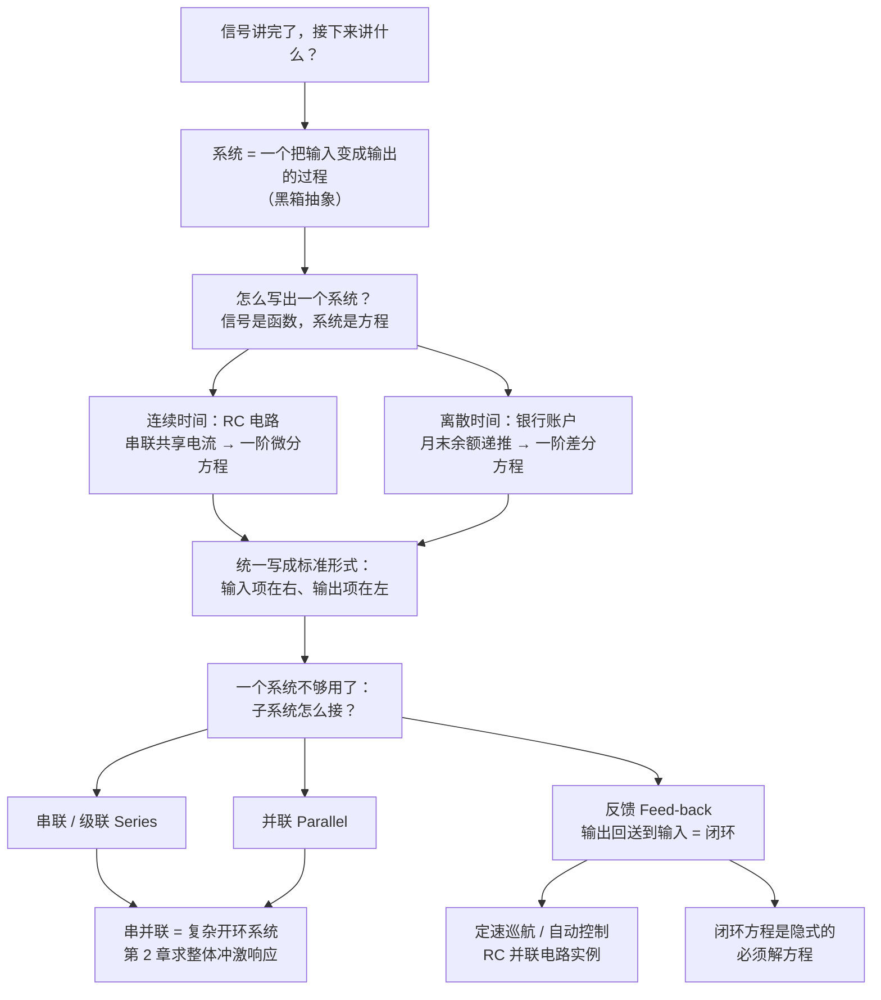
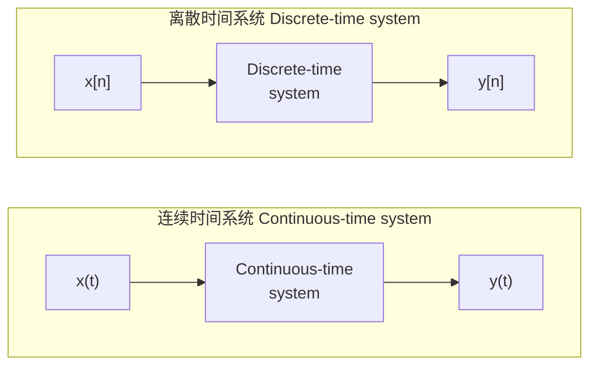
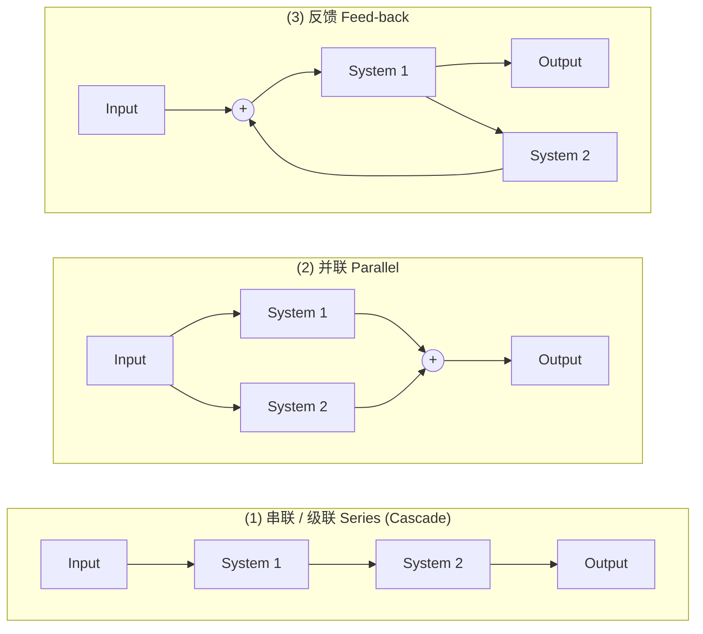
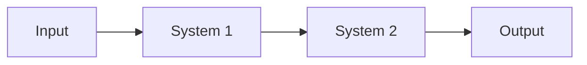
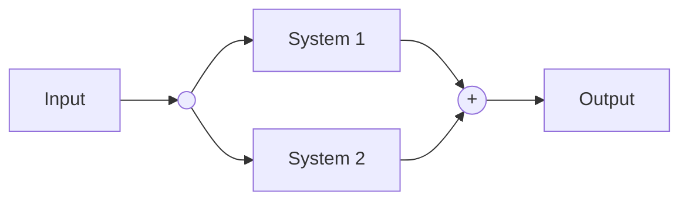
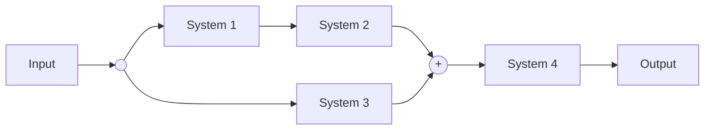
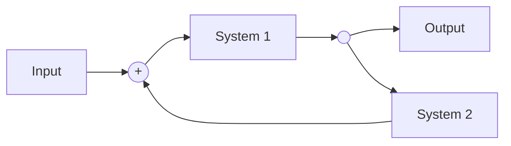
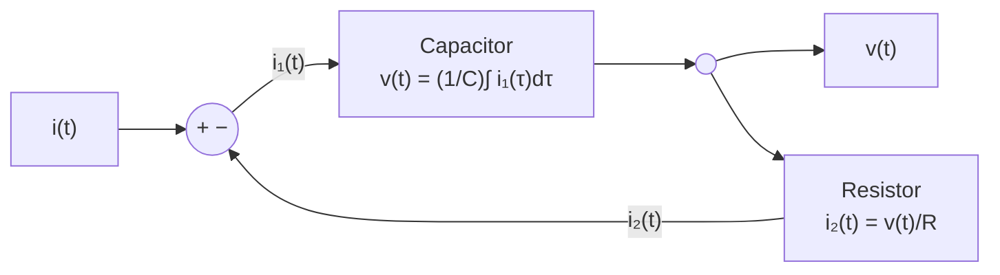

# 1.5 连续时间与离散时间系统 Continuous-time and Discrete-time Systems

> [!abstract] 这一讲的任务
> 前一讲把"信号"讲完了：冲激、阶跃，以及把任意信号拆成一堆移位冲激的那条分解式。这一讲换到课程名里的另一半——**系统 (system)**。
> 我们要解决三件事：系统到底是什么（是"盒子"还是"方程"）？怎么把一个真实对象写成数学式子？以及**好几个系统接在一起时，整体算什么**。
> 三种接法（串联、并联、反馈）会一直用到第 2 章求整体冲激响应，也会在第 2 章之后反复出现。

> [!info] 怎么读这份讲义
> 阅读顺序就是这一讲的推进顺序：先立起"系统 = 把 $x$ 变成 $y$ 的过程"这个抽象，再用 RC 电路（连续时间）和银行账户（离散时间）把它落地，最后讲三种互联并把反馈讲透。
> 标有 **（拓展）** 或 **【拓展】** 的内容，是**课堂上没有展开讲、由教材与通行讲法延伸补充**的部分；复习时先掌握未标注的主干内容。
> 一处记号提醒：p.60 上写的 $v_s(t)\sim v_c(t)$ 里的 $\sim$ 表示"这两个量构成一对输入输出"，**不是"约等于"**，下面会按这个意思用。

---

## 0. 开场：帮朋友算一笔"复利账"

朋友刚工作，来问你一个问题：

> "我每个月发了工资先存 3000 块，账户月息 1%。存满 5 年，我账上有多少钱？"

第一反应多半是这样算的：$3000\times 60=18$ 万，再加点利息，凑个 20 万。**这个估算错在哪？** 错在它把 60 次存钱看成了 60 笔互不相干的死钱。真实情况是：这个月的利息会留在账上，下个月又跟着生利息——**钱在账户里自己滚**。

所以正确的写法只能是一句递推：

$$
y[n]=\underbrace{y[n-1]}_{\text{上月末余额}}+\underbrace{0.01\,y[n-1]}_{\text{这一个月的利息}}+\underbrace{x[n]}_{\text{本月新存}}
$$

其中 $y[n]$ 是第 $n$ 个月末的余额，$x[n]$ 是第 $n$ 个月的新存入。想算第 60 个月，就得从第 1 个月一路推上去；想直接算，就得去解这个递推关系（那是后面章节的事）。

现在回头看，你刚才其实做了三件事：

1. 认定这里"有一个东西"**吃进** $x[n]$、**吐出** $y[n]$——这就是**系统**；
2. 承认它的行为能用**一个方程**描述——系统不是信号，是信号之间的关系式；
3. 这个关系里出现了 $y[n-1]$，也就是**已经过去了的东西**——所以这个系统"记得"历史。

把第三步换个场景：把一个电压源接到电容上，电容两端的电压同样是"一点点攒起来"的。**同一个数学结构，一边是钱，一边是电。** 这就是本讲要讲的东西。

---

## 1. 系统是什么：两个定义，两副眼镜（p.59）

> [!important] 两个定义（原文）
> **(1) Interconnection of Components, device, subsystem.（Broadest sense）**
> 系统是**元件、器件、子系统的互联**（最宽泛的意义）。
>
> **(2) A process in which signals can be transformed or result in other signals.**
> 系统是一个**把信号变换成其他信号的过程**。

这两个定义不是互相竞争，而是**两副眼镜**：

- 定义 (1) 是**结构视角 (structural view)**：系统"由什么搭成"——电阻、电容、放大器、代码模块。
- 定义 (2) 是**功能视角 (functional view)**：系统是"输入信号 → 输出信号"的**映射 (mapping)**。

> [!important] 这门课只用第二副眼镜
> 我们不关心盒子里面怎么搭的，只关心它把 $x$ 变成什么样的 $y$。这种**黑箱 (black box)** 抽象正是同一套数学能同时描述电路、机械、经济系统和神经网络的原因。

这一节的引入只有一句话，很朴素：**系统就是一个盒子**——有一个输入端口，有一个输出端口，这就是一个系统。接进去的是连续时间信号、出来的也是连续时间信号，就叫**连续时间系统 (continuous-time system)**；进出都是离散时间信号，就叫**离散时间系统 (discrete-time system)**。

现实里的对照：

| | 连续时间系统 | 离散时间系统 |
|---|---|---|
| 例子 | **电路**（电流驱动，物理形态最"连续"） | **计算机 / CPU / 数码相机**、程序里的数组 |
| 你每天在做的 | 模电 | 数电、MATLAB / Python 里的序列处理 |

在 MATLAB 里读进来的信号**全是序列**：第一个点、第二个点……甚至是矩阵、张量，**现代信号处理几乎全是离散的**；而最物理的形态（电路）是连续的。你们专业学的**数电 vs 模电**，差别就在这里。

> [!tip] 一句话分清"信号"和"系统"
> - **信号 (signal) 是一个函数**——$x(t)$ 就是 $t$ 的函数，你把 $t$ 代进去就得到值；
> - **系统 (system) 是一个方程**——描述的是**两个信号之间的关系**。
>
> 比如 $y[n]=y[n-1]+0.01y[n-1]+x[n]$，它**不是一个信号**，而是 $x$ 与 $y$ 这两个信号之间的关系式。习惯上输入用 $x$、输出用 $y$。
>
> **书写习惯**：把系统方程整理成"**输入项全在右边、输出项全在左边**"的标准形式（尤其对线性时不变系统）。两种写法完全等价，只是标准形式便于判读——上面的银行方程整理一下就变成 $y[n]-1.01y[n-1]=x[n]$。

> [!question] 停一下，先自己想想
> 拿 $y(t)=x(t)+1$ 来说：它是系统吗？谁是输入、谁是输出？它跟 $y(t)=x(t)$ 是"同一个系统差一点"吗？

（答案在 §3 的末尾回收：常数项 1 会在 [[C1.6 系统的基本性质]] 1.6.6 被判成"非线性系统"，它有个专门的名字叫**增量线性**。）

---

## 2. 把系统画出来：表示法（p.59）

> [!important] 记号
> **连续时间系统：**
> $$x(t)\ \xrightarrow{\quad L\quad}\ y(t)$$
> **离散时间系统：**
> $$x[n]\ \xrightarrow{\quad L\quad}\ y[n]$$
>
> 中间那个 $L$ 是系统所实现的**算子 (operator)**（这里写作 $L$，其他教材常写 $\mathcal{T}\{\cdot\}$ 或 $H\{\cdot\}$，含义相同）。

框图表示：

> [!warning] 箭头方向的含义
> 框图中的箭头表示**信号流向 (signal flow)**，不是"等号"。
> $x\to y$ 意味着"$y$ 由 $x$ 决定"；反过来一般不成立——只有当系统**可逆**时，才能从输出唯一地反推输入（见 [[C1.6 系统的基本性质]] 1.6.2）。

---

## 3. 1.5.1 两个例子：一个连续的、一个离散的（p.60–61）

抽象定义讲完了，现在必须落地两个**能算出数来**的例子，一个连续、一个离散。你会看到它们长得像一对双胞胎。

### 3.1 连续时间：RC 电路（Example 1.8）

![[C1.5-RC电路与系统框图.png]]

题目要求把**电源电压 $v_s(t)$ 与电容电压 $v_c(t)$** 之间的关系写出来。

**建模过程：**

电阻和电容在这条回路上是**串联 (series interconnected)** 的，所以流过它们的是**同一个电流** $i(t)$。这个"共享电流"是整道题的关键：

1. 电阻两端的电压是 $v_s(t)-v_c(t)$（总电压减掉电容上分掉的那部分），由欧姆定律
   $$i(t)=\frac{v_s(t)-v_c(t)}{R}$$
2. 电容的伏安关系是"电流等于电容乘电压的变化率"：
   $$i(t)=C\,\frac{dv_c(t)}{dt}$$
3. 两式相等（因为就是同一个电流）：
   $$\frac{v_s(t)-v_c(t)}{R}=C\,\frac{dv_c(t)}{dt}$$
4. 两边同除以 $RC$、移项，得到

$$
\boxed{\ \frac{dv_c(t)}{dt}+\frac{1}{RC}\,v_c(t)=\frac{1}{RC}\,v_s(t)\ }
$$

5. **写成系统的标准形式**：输入是 $v_s(t)$、输出是 $v_c(t)$。把所有与输入相关的项放到**右手边**、与输出相关的项放到**左手边**，再按惯例把输入记作 $x(t)$、输出记作 $y(t)$：

$$
\frac{dy(t)}{dt}+\frac{1}{RC}\,y(t)=\frac{1}{RC}\,x(t)
$$

这就是这个系统的表达——**用一个方程描述输入与输出之间的关系**。

> [!important] 它是什么类型的方程
> 这是一个**一阶线性常系数微分方程 (first-order linear constant-coefficient differential equation，LCCDE)**。
> **时间常数 $\tau=RC$** 刻画了这个系统的"钝"的程度：$RC$ 越大，电容充放电越慢、系统响应越迟钝。电路里的"延时""惯性""来不及跟上"，在数学上都长这个样子。

> [!note] 一般形式与两把"变换"钥匙（拓展）
> 课堂上把结论收在一句话上：连续时间 LTI 系统 ⇔ 常系数微分方程。这里把一般形式补全——**连续时间 LTI 系统的绝大多数工程模型都是 LCCDE**：
> $$\sum_{k=0}^{N}a_k\frac{d^k y(t)}{dt^k}=\sum_{k=0}^{M}b_k\frac{d^k x(t)}{dt^k}$$
> 离散情形完全平行：
> $$\sum_{k=0}^{N}a_k\,y[n-k]=\sum_{k=0}^{M}b_k\,x[n-k]$$
> 而第 9 章的**拉普拉斯变换**会把微分方程变成代数方程、第 10 章的 **Z 变换**会把差分方程变成代数方程——"换域"的全部价值就在这里。

### 3.2 离散时间：银行账户余额（Example 1.10）

> [!example] 题设（原文）
> **A simple model for the balance in a bank account from month to month:**
>
> | 符号 | 含义 |
> |---|---|
> | $y[n]$ | **balance at the end of $n$th month**（第 $n$ 月月末余额） |
> | $x[n]$ | **net deposit**（当月净存入） |
> | $1\%$ | **interest each month**（月利率 1%） |

**建模：**

$$
y[n]=y[n-1]+1\%\cdot y[n-1]+x[n]
$$

把它整理成标准形式（输出在左、输入在右）：

$$
\boxed{\ y[n]-1.01\,y[n-1]=x[n]\ }
$$

> [!note] 这个式子在说什么
> 本月末余额 = 上月余额（本金）+ 上月余额在这个月产生的利息 + 本月新存入
> $$y[n]=\underbrace{y[n-1]}_{\text{本金}}+\underbrace{0.01\,y[n-1]}_{\text{利息}}+\underbrace{x[n]}_{\text{新存入}}=1.01\,y[n-1]+x[n]$$
>
> 这是**一阶线性常系数差分方程 (first-order linear constant-coefficient difference equation)**——连续情形 LCCDE 的离散对应物。

课堂上是这么引入的：**每个月发工资后存入一部分**，第 $n$ 个月的新存入是 $x[n]$，第 $n$ 个月月底的账户总额是 $y[n]$，$n$ 就是月份编号。账户有利息（"虽然很少"，课上假设月息 1%）。与上面 "net deposit" 的版本是同一个模型、两种讲法，结论一致。

> [!example] 把递推式一代一代算下去：回到开场那笔账
> 每月存 3000、月息 1%，按 $y[n]=1.01y[n-1]+x[n]$ 一代一代算，到第 60 个月是 **245 009**，而"3000 乘 60"这种不算复利的算法只有 180 000——差的 65 009 全是"利息生出来的利息"。
> 右图是把同一个递推式换个输入：只存 12 个月就停，第 12 个月末是 38 048；之后新存入变成 0，余额却仍在涨（第 60 个月 61 341）。**输入停了，输出没有马上停**——这就是"记忆"最直观的样子。

![[C1.5-银行账户余额迭代.png]]

> [!tip] 两个例子并排看
> | | RC 电路 | 银行账户 |
> |---|---|---|
> | 类型 | 连续时间 | 离散时间 |
> | 方程 | 微分方程 $\dfrac{dv_c}{dt}+\dfrac{1}{RC}v_c=\dfrac{1}{RC}v_s$ | 差分方程 $y[n]-1.01y[n-1]=x[n]$ |
> | 阶数 | 一阶 | 一阶 |
> | 输出依赖 | 当前值 + 当前的变化率 | 当前输入 + 前一时刻的输出 |
> | 求解工具 | 拉普拉斯变换（第 9 章） | Z 变换（第 10 章） |
>
> **两者的数学结构完全平行**——这就是本课始终把连续与离散并排讲的原因。
> 但有一处**关键差别**：RC 电路的输出 $v_c$ 只跟"当前的变化率"打交道，而银行账户的输出 $y[n]$ 明确地用到了 $y[n-1]$——也就是**上一个月的自己**。这种"用到过去"的性质叫**记忆 (memory)**，是下一讲 1.6.1 的主角。

> [!question] 回到 §1 留下的小问题
> $y(t)=x(t)+1$ 是系统吗？是——$x$ 是输入、$y$ 是输出，它照样是一个"把信号变换成信号的过程"。
> 但它不是一个**线性**系统：输入全为 0 时输出是 1 而不是 0，齐次性不成立。判据和名字（增量线性 incrementally linear）见 [[C1.6 系统的基本性质]] 1.6.6。

---

## 4. 1.5.2 系统的互联：三种基本接法（p.62–65）

一个再复杂的系统也是由子系统搭出来的。地球可以拆到物种、再拆到个体；**神经网络再大规模，拆到底也不过是那几种运算层**。所以只要掌握**三种基本连接方式**，就能搭出任意复杂的结构。

### 4.1 (1) 串联 / 级联 Series (Cascade)

第一个子系统的输出直接作为第二个子系统的输入，首尾相接。中文里 **series / cascade / 级联 / 串联**是同一个意思（和"傅里叶级数 Fourier series"里的 series 也是同一个词）。

> [!warning] 串联的软肋
> 中间任何一环出问题，整个系统就废了：子系统 1 不工作就没有输出，子系统 2 随之没有输入，信号链断在那里。
> **串联系统是"一条链"，没有旁路。**

> [!note] LTI 下串联就是卷积（拓展）
> 课堂上只点了"这种复杂结构第 2 章会出题"，没有给公式。先把结论放在这里备用：若两个子系统都是 LTI，则整体的**单位冲激响应**是两者卷积
> $$h(t)=h_1(t)*h_2(t)$$
> 而且 **LTI 上级联次序可以交换**：$h_1*h_2=h_2*h_1$。注意这个交换律**只对 LTI 成立**，非线性或时变系统不能随意换序。详见 [[C2.1 离散时间LTI系统与卷积和]] 与 [[C2.3 LTI系统的性质]]。

### 4.2 (2) 并联 Parallel

同一个输入同时送进多个子系统，各子系统的输出**相加**得到总输出。

> [!note] 课堂联想：并行计算
> parallel 就是"并行"。课上把并联结构直接接到**并行计算**上：再复杂的运算，拆成好多个子系统同时算（GPU 加速、分布式计算），每个负责一小部分，最后把结果加起来——这就是并联的思想。
> 这条思路对你们做 AI 的人是日常：一个大的前向计算拆到很多张卡上，本质就是并联。

> [!note] LTI 下并联就是相加（拓展）
> 与串联那条对应：LTI 情形下并联的整体冲激响应是**相加**
> $$h(t)=h_1(t)+h_2(t)$$
> **串联对应卷积，并联对应相加**——复杂框图化简就是反复用这两条规则。

### 4.3 串并联 Series-Parallel

两种接法组合起来就能搭复杂系统——**串并联电路就是最典型的例子**。

> [!tip] 这类结构的整体冲激响应
> $$h=\bigl(h_1*h_2+h_3\bigr)*h_4$$
> 先看并联合并、再整体走一遍串联——本质就是在反复用"串联卷积、并联相加"。

> [!warning] 考试提示
> **由串联、并联组合出的复杂开环结构，第 2 章会出题**（求整体冲激响应）；环状的反馈结构题目相对少一些。对应的题型见 [[C2.3 LTI系统的性质]] 的随堂测。

### 4.4 (3) 反馈互联 Feed-back

反馈连接乍看像并联（都是上下两条支路），但**本质不同**：

> [!important] 反馈的关键特征
> **输出被送回来影响输入**，形成**闭环 (closed loop)**。
> 具体地：子系统 1 的输出就是整个系统的输出，它又被送进子系统 2；子系统 2 的输出再**加回**子系统 1 的输入端（图里那个加号）。于是子系统 1 的输入由两部分组成：外部输入 + 反馈回来的输出。
>
> 这与串联、并联的**开环 (open loop)** 结构本质不同：反馈系统的方程是**隐式的**（输出出现在等式两边），必须解方程才能得到输入输出关系。

> [!note] 课堂例子：定速巡航
> 反馈就是**闭环系统**，所有的自动控制电路都是这种结构。课上用**汽车定速巡航**举例：
> 系统持续监测车速（输出），车速太大了 → 控制器减油门 → 车速降下来 → 再监测……输出的结果被重新送回输入端，成为输入的一部分。
>
> 把反馈框图里的**子系统 2 看成整个系统的控制器**：它监测系统的状态（输出），再调整进入子系统 1 的输入。所以 feedback 在**自动控制 (auto control)** 里用得非常多。

> [!important] 开环 vs 闭环：一句话分界
> - **开环**：信号一直朝一个方向走，**输出受输入影响，但输入不受输出影响**——没有"回来的路径"，所以**开环做不了控制**。
> - **闭环**：有一条从输出回到输入的路径，于是系统可以"看着结果改自己"。

> [!tip] 开环 = 神经网络里的"前向"
> 开环系统就是 forward（前向）的结构：神经网络里的 **FFN / MLP（前馈网络）** 正是这样，一层层只往前推。而 **RNN 带环**，是闭环结构——它的稳定性问题见 [[C1.6 系统的基本性质]] 1.6.4。

### 4.5 反馈互联实例：电流源驱动的 RC 并联电路（p.65）

课堂对这个例子处理得很快，定性理解即可，但它把"反馈"从框图落到了真实的电路上。

![[C1-反馈互联实例-RC并联电路.png]]

> [!example] 电路与方程
> 电流源提供 $i(t)$，在节点处分成流入电容的 $i_1(t)$ 与流入电阻的 $i_2(t)$；两个元件并**联**，所以它们共享同一个电压 $v(t)$。
> - **电容**（当作一个子系统）：$\displaystyle v(t)=\frac{1}{C}\int_{-\infty}^{t}i_1(\tau)\,d\tau$
> - **电阻**（当作另一个子系统）：$\displaystyle i_2(t)=\frac{v(t)}{R}$
> - 节点电流：$i_1(t)=i(t)-i_2(t)$

对应的反馈框图：

> [!important] 原句
> **$v(t)$ can be viewed as the output of the capacitor or the input to the resistor.**
> $v(t)$ 既可以看作**电容（子系统）的输出**，也可以看作**电阻（子系统）的输入**。
>
> 这句话是理解整个框图的关键：同一个物理量在不同子系统的视角下扮演不同角色，这正是"系统互联"这个抽象的意义所在。
> 求和点标的是 "$+$" 和 "$-$"：$i_1=i-i_2$，反馈回来的是**减号**，所以是**负反馈 (negative feedback)**。

> [!note] 把框图还原成方程
> 由 $i_1=i-i_2$、$i_2=v/R$、$v=\frac1C\int i_1$，对 $v$ 求导：
> $$C\frac{dv}{dt}=i_1=i-\frac{v}{R}\ \Longrightarrow\ \frac{dv(t)}{dt}+\frac{1}{RC}v(t)=\frac{1}{C}i(t)$$
> 又回到了与 Example 1.8 **同构的一阶微分方程**——同一类系统，只是输入从电压换成了电流。
>
> 定性地看：两端电压 $v(t)$ 的变化会改变流过电阻的电流 $i_2$，$i_2$ 又被从总电流里**减掉**，剩下的才流进电容。输出通过电阻"绕回来"影响了输入，这就是反馈。**框图与方程是同一个系统的两种表示，可以互相转换。**
>
> 课上对这个例子的原话是"不重要，定性理解即可"——但"输出回送、求和点带减号"这个结构本身值得记住。

---

## 5. 三种互联方式对照

| 互联方式 | 结构 | LTI 整体冲激响应 | 特点 |
|---|---|---|---|
| **串联 Series / Cascade** | 首尾相接 | $h=h_1*h_2$ | 开环；LTI 时可换序；一环坏则整链断 |
| **并联 Parallel** | 同输入、输出相加 | $h=h_1+h_2$ | 开环；对应并行 / 分布式计算 |
| **串并联 Series-Parallel** | 串、并组合 | 反复用上面两条规则 | 开环；**第 2 章出题的主力** |
| **反馈 Feed-back** | 输出回送到输入端 | 需解方程（闭环公式） | **闭环**；控制系统的基础；方程是隐式的 |

---

## 6. 伏笔：这个系统"记得"多久？

回到银行账户 $y[n]=1.01y[n-1]+x[n]$。它这一月的余额依赖上一月的余额，上一月的又依赖上上月的……**一层层迭代下去，当前余额其实和这个月之前每一个月存进去的钱都有关。**

也就是说：**系统会保留过去的信息**——这叫**有记忆 (with memory)**。相对地，一个只有电阻的电路 $v(t)=Ri(t)$，此刻电压只由此刻电流决定，**无记忆 (memoryless)**。

这条线索是下一讲的第一把尺子（1.6.1）。下一讲会给出六个性质的完整定义和判别方法，并把它们收拢到本课唯一的研究对象上：

> [!question] 带着这个问题翻页
> 如果账户的递推式改写成 $y[n]=1.01y[n-1]$（不再有新存入），它还有记忆吗？如果改成 $y[n]=1.01y[n+1]$（用"下个月"的余额），它还是因果的吗？

---

## 这一讲的三句话

1. **信号是函数，系统是方程。** 系统的全部内容就是"输入信号与输出信号之间的关系式"；这门课只从功能视角看它，把内部一律当黑箱。
2. **连续时间用微分方程、离散时间用差分方程**，并且一律整理成"输入项在右、输出项在左"的标准形式。
3. **任意复杂的系统都由三种接法搭成**：串联（卷积）、并联（相加）、反馈（闭环，方程变隐式、必须解）；**只有闭环才能做控制**。

> [!tip] 速查表
> | 名称 | 连续时间 | 离散时间 |
> |---|---|---|
> | 系统表示 | $x(t)\xrightarrow{L}y(t)$ | $x[n]\xrightarrow{L}y[n]$ |
> | RC 电路（串联） | $\dfrac{dv_c}{dt}+\dfrac{1}{RC}v_c=\dfrac{1}{RC}v_s$ | — |
> | 银行账户 | — | $y[n]-1.01y[n-1]=x[n]$ |
> | 串联合成（LTI） | $h=h_1*h_2$ | $h=h_1*h_2$ |
> | 并联合成（LTI） | $h=h_1+h_2$ | $h=h_1+h_2$ |
> | 反馈 | 闭环，方程隐式 | 闭环，方程隐式 |

> [!tip] 下一讲预告
> [[C1.6 系统的基本性质]]：六把尺子——**记忆性、可逆性、因果性、稳定性、时不变性、线性**。
> 我们会用"判别三步法 / 四步法"把它们变成可以机械执行的检验，并在最后把**线性 + 时不变 = LTI** 框出来：那是第 2 章到第 10 章唯一的研究对象。

---

## 相关笔记 Related Notes

- 相关：[[C2.1 离散时间LTI系统与卷积和]]（串联 = 卷积）、[[C2.3 LTI系统的性质]]（互联结构的代数性质）、[[C1.1 连续时间与离散时间信号]]（同一个 RC 电路的信号视角）
- 上一讲：[[C1.4 单位冲激与单位阶跃函数]]
- 下一讲：[[C1.6 系统的基本性质]]
- 返回：[[信号与系统 MOC]]
