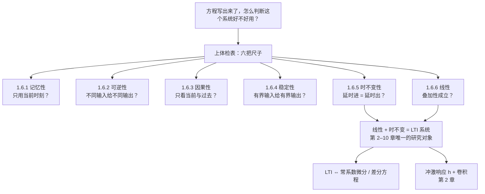
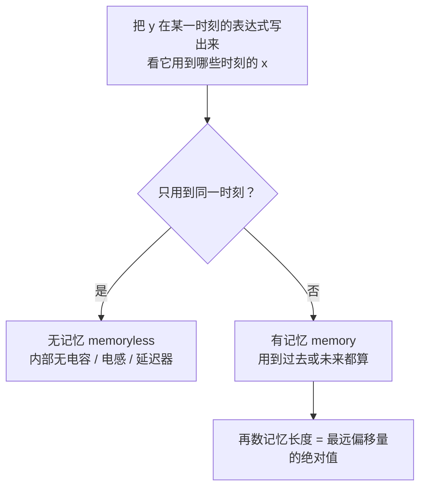
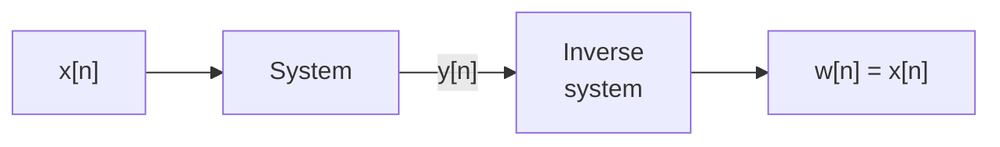
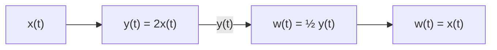
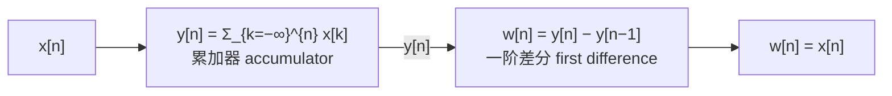
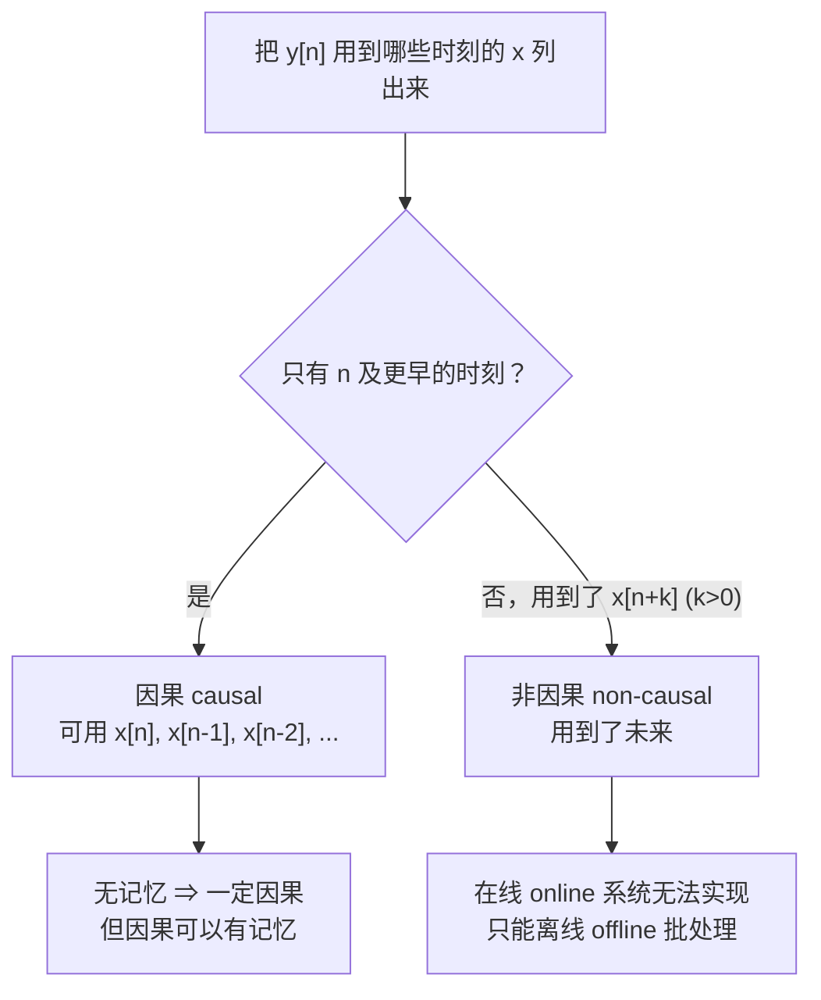
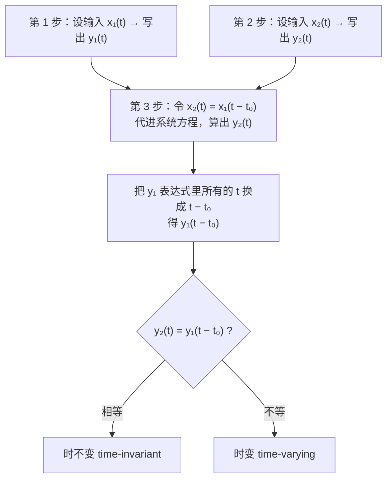
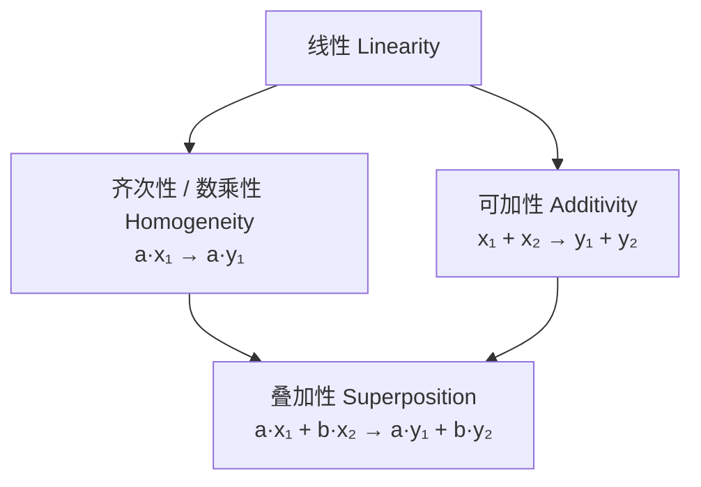
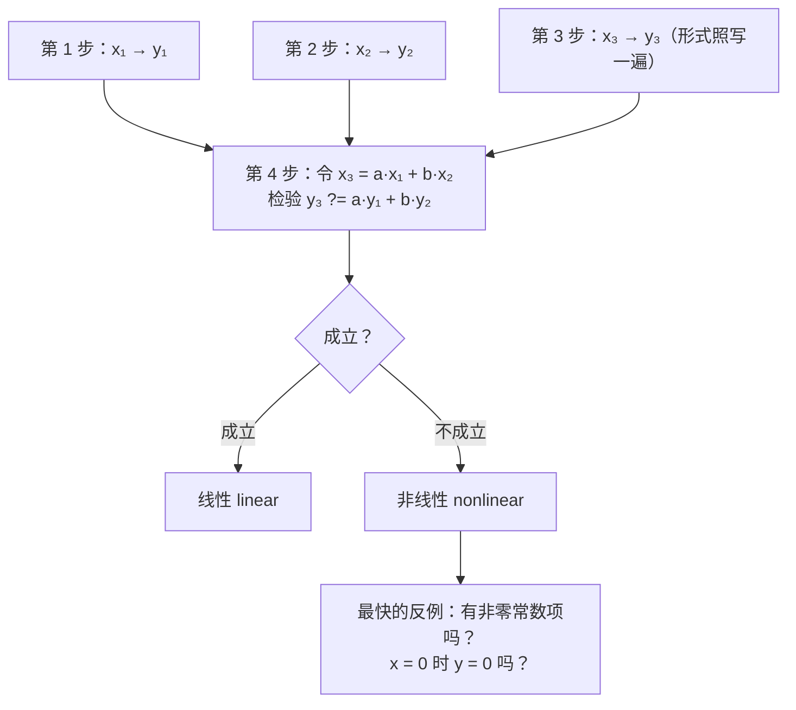
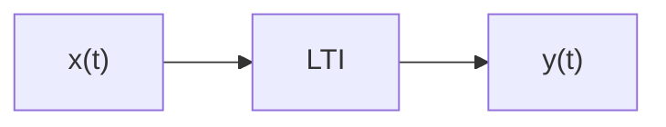

# 1.6 系统的基本性质 Basic System Properties

> [!abstract] 这一讲的任务
> 上一讲把系统写成了方程。可是方程长得千奇百怪：$y[n]=2x[n]+3$、$y(t)=x(\sin t)$、$y[n]=x[n]x[n-2]$……怎么知道它们各自是好用的还是难缠的？
> 这一讲拿出**六把尺子**：**记忆性、可逆性、因果性、稳定性、时不变性、线性**。每一把都给定义、给判别方法、给反例。
> 最后两把尺子合起来，框定了这门课后面九章唯一的研究对象——**LTI 系统**。

> [!info] 怎么读这份讲义
> 六个性质**彼此独立**，谁也不能从谁推出来——"线性就时不变""无记忆就稳定"这类直觉全都是错的，四种组合都真实存在。所以建议按顺序读，每读完一个性质就做一次判别练习。
> 标有 **（拓展）** 或 **【拓展】** 的内容，是**课堂上没有展开讲、由教材与通行讲法延伸补充**的部分；复习时先吃透未标注的主干，考试考点集中在主干里。
> **一句话勘误**：p.66 无记忆系统的特征印作 "No capacitor, no conductor, no delayer"；按上下文（储能元件）这里的 conductor 应为 **inductor（电感）**。本讲按"电容、电感、延迟器"讲，详见 1.6.1。

---

## 0. 开场：给一台功放做体检

你在一家做音频的硬件公司实习。桌上有一台功放，老板指着它问了你三个问题，要求当场回答：

1. 它会不会**提前**放出你还没说出口的声音？（有没有"预知"能力）
2. 把两个不同的输入送进去，它会不会给出**同一个**输出？（信息有没有被抹掉）
3. 音量调大一点，它会不会**自激振荡、发散、烧掉**？

这三个问题听着玄，其实对应的正是三把尺子：**因果性、可逆性、稳定性**。

老板接着追问了两句更"刁"的：

4. 你今天测出来的特性，**明天还算数吗**？换个时间开机，同一个输入还给同一个输出吗？
5. 它对小信号的行为，和对大信号的行为，是**同一种行为**吗？

这两句对应的是**时不变性**和**线性**。

一个系统能不能用，就看它在这六个问题上交不交得了差。你刚才列出的这张问题清单，就是一次完整的**系统分类**——下面把这六把尺子一把一把地掰开。

---

## 1. 1.6.1 有记忆与无记忆系统 Systems with and without Memory

> [!important] 定义（原文）
> **Memoryless System: Its output at a given time is dependent only on the input at the same time.**
> **无记忆系统**：某时刻的输出**只**取决于**同一时刻**的输入。
>
> **Note: A system with memory means that it retains or stores information about input values at times other than the current time.**
> **有记忆系统**：会**保留或存储**当前时刻以外的输入信息。

> [!important] 判别特征
> **No capacitor, no conductor, no delayer.**
> 无记忆系统内部**没有电容、没有电感、没有延迟器**——这三样正是"储能 / 存储"元件。
>
> （**勘误**：这里原稿印的是 conductor（导体）。按上下文——列的都是储能元件——应为 **inductor（电感）**。导体（一根理想导线）本身也不储能，但和"电容、延迟器"并列时说不通。）

中文表述照抄课堂的说法更顺口：**当前时刻的输出只取决于当前时刻的输入**，就是无记忆系统——没有任何延迟，**马上反应**。

### 例子对照

| 无记忆系统 Memoryless | 有记忆系统 With memory |
|---|---|
| $y[n]=C\,x[n]$ | $y[n]=x[n-1]$，$y[n]=x[n+1]$ |
| $v(t)=R\,i(t)$（电阻） | $\displaystyle y[n]=\sum_{k=-\infty}^{n}x[k]\ \Longleftrightarrow\ y[n]=y[n-1]+x[n]$（累加器） |
| | $\displaystyle y(t)=\frac{1}{C}\int_{-\infty}^{t}x(\tau)\,d\tau\ \Longleftrightarrow\ \frac{dy(t)}{dt}=\frac{1}{C}x(t)$（电容） |

> [!note] 逐个看清楚
> - **电阻 $v=Ri$ 无记忆**：此刻电压只由此刻电流决定。一个只有一个电阻的电路，就是最标准的无记忆系统——瞬间反应。
> - **电容有记忆**：电压是电流的积分，取决于**全部历史**。课堂上讲得很形象：开关一合上，电流一直往里灌、一直累加，电容电压是**一点一点攒起来**的，充放电是个缓慢过程——所以它有储能、有记忆效应。
> - **延迟器 $y[n]=x[n-1]$ 有记忆**：它必须"记住"上一时刻的输入。
> - **$y[n]=x[n+1]$ 也有记忆**——它用到了**未来**的输入，同样不是"同一时刻"。
>
> **注意**：记忆性只问"是否只用当前时刻"，**不问用的是过去还是未来**。过去/未来是因果性的事。

> [!important] 课堂表述：银行账户的记忆藏在哪里
> 银行账户 $y[n]=1.01y[n-1]+x[n]$ 里，$y[n]$ 不只和 $x[n]$ 有关，还和 $y[n-1]$ 有关；而 $y[n-1]$ 又和 $x[n-1]$、$y[n-2]$ 有关……**一层层迭代下去，当前余额其实和这个月之前每一个月存进去的钱都有关**。
> 这个"迭代链条"正是理解记忆的关键：**递归形式把历史一层层藏在了 $y[n-1]$ 里。**
>
> 累加器的两种写法也是在说同一件事：$y[n]=\sum_{k\le n}x[k]$（直接形式）与 $y[n]=y[n-1]+x[n]$（递归形式）等价，后者更省计算，也更清楚地显示出"记忆"存在何处。

### 记忆长度

> [!important] 记忆长度怎么数
> 系统输出 $y(t_0)$ 或 $y[n_0]$ 在某一时刻的取值，依赖于输入信号**多长时间范围**内的取值；这个范围的大小就是**记忆长度**。
>
> 具体算法：**记忆长度 = 求出 $y$ 在时刻 $n$ 的值时，所需输入相对当前时刻的"偏移量的最大值"。**
> - 只用到 $x[n]$ → 记忆长度 0（无记忆）
> - 用到 $x[n],\ x[n-1]$ → 记忆长度 1
> - 只用到 $x[n-2]$ → 记忆长度 **2**（看的是"**最远**用到多久之前"，不是"用到了几个时刻"）
> - $y(t)=\int_{-\infty}^{t}x(\tau)d\tau$ → 依赖全部历史 → **无限记忆**

| 系统 | 是否有记忆 | 说明 |
|---|---|---|
| $y(t)=x(t)^2$ | 无记忆 | 只用当前时刻的值 |
| $y[n]=x[n]+x[n-1]$ | 有记忆 | 用到了 $n-1$ 时刻的值；记忆长度 1 |
| $y(t)=x(t-5)$ | 有记忆（纯延时） | 只用到**一个**过去时刻，但仍算有记忆；记忆长度 5 |
| $y(t)=\int_{-\infty}^{t}x(\tau)d\tau$ | 无限记忆 | 依赖全部历史 |

> [!warning] 判定小技巧
> 判断有无记忆时，代入一个具体的 $t_0$ 或 $n_0$，看等式右边出现的自变量是否**只有** $t_0$（或 $n_0$）本身。只要出现了其他时刻——**哪怕只差一点点，比如 $t-\epsilon$**——就是有记忆系统。

> [!note] "用到未来"为什么也算有记忆
> $y[n]=x[n+1]$ 依赖的是**未来**的输入，严格说那不叫"记忆"，而是**预测**。但分类上仍把它归入有记忆系统——这是**广义的记忆**。
> 所以分类规则很宽：**只和当前时刻有关的叫无记忆，其余一律叫有记忆。**

> [!example] 记忆长度的真实例子：麦克风里的回声
> 你在教室里对着麦克风说话。麦克风收到的不只是嘴里直线传过来的那一路声音 $x[n]$——声音还会打到墙上、天花板上再弹回来。近处的墙弹回来快、衰减小；远处的墙弹回来慢、衰减大。所以麦克风真正采到的是
> $$y[n]=\sum_{k=0}^{K}a_k\,x[n-k]$$
> 每一个 $a_kx[n-k]$ 就是一条回声路径：**延迟 $k$ 个样本、衰减到 $a_k$ 倍**。
> 音频采样率动辄 44.1 kHz，样本间隔极短。课上给的数量级是"**k 从 0 可能到 1024**，可能有上千个抽头"——验算一下：$1024/44100=23.2$ ms，对应声音多走 $23.2\text{ ms}\times343\text{ m/s}\approx 8$ m。所以"上千个抽头"对应的是**音乐厅 / 大空间**级别的混响；普通小房间是几十到几百个抽头。这个 $K$ 就是这个系统的**记忆长度**，它由**房间尺寸和反射路径**决定。音乐厅设计要控制的正是这些反射系数和反射路径。
> 现实中的系统（声学空间、带环路的发射机电路）往往有非常长的记忆——**只要是带环路的，信号就会一直在里面兜**。

![[C1.6-回声与记忆长度.png]]

> [!question] 停一下，先自己想想
> $y[n]=x[n+1]$ 有记忆吗？因果吗？

（答案就在下一节：**有记忆**（用了非当前时刻的输入），**非因果**（用的是未来）。记忆性不问过去/未来，因果性才问。）

---

## 2. 1.6.2 可逆性与逆系统 Invertibility and Inverse Systems

> [!important] 定义（原文）
> **(1) A system is said to be invertible, if distinct inputs lead to distinct outputs (one to one correspondence).**
> 若**不同的输入产生不同的输出**（一一对应），则称系统**可逆 (invertible)**。
>
> **(2) If a system is invertible, then an inverse system exists, and when the inverse system cascaded with the original system, it will yield an output equal to the input.**
> 若系统可逆，则存在**逆系统 (inverse system)**；逆系统与原系统**级联 (cascaded)** 后，输出等于输入。

> [!important] 逆系统串联后得到什么：恒等系统 Identical System
> 系统与它的逆系统串联，整体效果是**什么都没做**：
> $$y(t)=x(t)$$
> 输入什么样、输出就什么样，这种系统叫**恒等系统 (identical system)**。
> 所以"可逆"的正式说法是：If the system is invertible, then we can find its inverse system; when it is **series interconnected** with the original system, the overall system is an **identical system**.
> 逆系统常记作 $S_{inv}$，有时更简单地记作 $S_i$。

### 可逆系统的例子

**例 (b)（连续时间）：**

**例 (c)（离散时间）：累加器与其逆——差分器**

> [!note] 累加器与差分器为什么互逆
> 累加器 $y[n]=\sum_{k=-\infty}^{n}x[k]$ 把 $x[n]$ 加到了第 $n$ 时刻、把 $x[n-1]$ 加到了第 $n-1$ 时刻……所以
> $$y[n]-y[n-1]=\Bigl(\sum_{k\le n}x[k]\Bigr)-\Bigl(\sum_{k\le n-1}x[k]\Bigr)=x[n]$$
> 差出来的正是最后一个时刻的输入。这与**积分与微分互逆**、$\delta[n]$ 与 $u[n]$ 通过求和/差分互推是同一件事（见 [[C1.4 单位冲激与单位阶跃函数]]）。

> [!example] 两个可逆例子的直观含义
> - $y(t)=2x(t)$ 就是一个**扬声器 / 放大器**：把信号放大两倍。它的逆系统就是再衰减一半，$w(t)=\frac12y(t)$。
> - **累加器 ↔ 差分器**：累加器可逆，逆系统是一阶差分器 $w[n]=y[n]-y[n-1]$。
>
> **考试提示**：「**累加器是否可逆？若可逆，写出它的逆系统**」是课上点名、很可能会考的例子。结论：**可逆，逆系统是一阶差分器。**

### 不可逆系统的例子

$$y[n]=0 \qquad\qquad y(t)=x^{2}(t)$$

> [!warning] 为什么不可逆
> - **$y[n]=0$**：任何输入 $x_1[n],x_2[n],x_3[n],\dots$ 都映射到同一个输出 0。用课堂的说法——信号到这里被"**拦住 / 关掉**"了，**信息全部丢失**。从输出 0 往回推，**根本不知道输入是谁**。
> - **$y(t)=x^2(t)$**：输入 $x(t)$ 与输入 $-x(t)$ 给出同一个输出 $x^2(t)$，**负号被平方吃掉了**。从输出往回推有**两个可行解**，不唯一。
>
> **判别不可逆的标准手法：找出两个不同的输入，让它们产生完全相同的输出。** 找到一组反例即可。（这也正是"可逆"要求**一对一映射**的另一面：推回去必须唯一。）

> [!tip] 类比：函数与反函数
> 什么样的函数有反函数？**一一映射（one-to-one）** 的函数——高中就学过这个条件。系统完全一样：
> 可逆系统必须能**从输出唯一确定输入**；推回去不唯一，就不可逆。

> [!question] Q2（单选，随堂测原题）Consider the discrete-time system $y[n]=x[n]\,x[n-2]$, is this system invertible?
> A. Invertible
> **B. Noninvertible（正确答案）**
>
> **解析**：找反例即可。
> 取 $x_a[n]\equiv 1$（全 1 序列）与 $x_b[n]=(-1)^n$：
> - $x_a$：$y[n]=1\cdot1=1$（全 1）
> - $x_b$：$y[n]=(-1)^n\cdot(-1)^{n-2}=(-1)^{2n-2}=1$（也是全 1）
>
> **两个不同输入给出完全相同的输出** ⇒ 不满足一一对应 ⇒ **不可逆**。
> 更直接的理由：$y$ 是两个样本的**乘积**，无法从乘积唯一分解出两个因子的符号；而且只要某处 $x[n]=0$，相邻的信息就被一起抹掉了。

**【拓展】** 上面这道随堂测原题课堂上没有逐题讲解，解析是补充的。

---

## 3. 1.6.3 因果性 Causality

> [!important] 定义（原文）
> **A system is causal if the output at any time depends only on values of the input at the present time and in the past. (Non-anticipative)**
> 若任意时刻的输出**只取决于当前及过去**的输入，则系统是**因果的 (causal)**。（又称**非超前的 non-anticipative**）

### "因果"这两个字从哪来

**因 = 输入 input，果 = 输出 output。** 因在前、果在后：没有输入就不会有输出，输出不能超前于它的输入——你做了坏事才承担后果，顺序不能倒过来。

以扬声器为例：它必须先采到你的声音，才能放大出来。$y[n]$ 若依赖 $x[n+1]$，就意味着你**还没说出口**的那个音，扬声器此刻就已经放出来了——不可能。

所以累加器 $y[n]=\sum_{k=-\infty}^{n}x[k]$ 是**因果**的（只用到 $x[n],x[n-1],x[n-2],\dots$）；只要把求和上限改成 $n+1$，立刻变成非因果。

### 例子对照

| **Causal 因果** | **Non-causal 非因果** |
|---|---|
| $y[n]=x[n]-x[n-1]$ | $y[n]=x[n]-x[n+1]$（用到未来 $x[n+1]$） |
| $y[n]=x[n]$ | $\displaystyle y[n]=\frac{1}{2M+1}\sum_{k=-M}^{+M}x[n-k]$（滑动平均，$k<0$ 时用到未来） |

> [!important] 一条必背的推论
> **Memoryless systems are causal.** ——**无记忆系统一定是因果的**（只用当前时刻，当然没用未来）。
> 反之不成立：**因果系统可以有记忆**，例如 $y[n]=x[n-1]$。

> [!important] 初始松弛条件 Condition of initial rest
> **For a causal system, if $x(t)=0$ for $t<t_0$, there must be $y(t)=0$ for $t<t_0$.**
> 对因果系统，若输入在 $t<t_0$ 时恒为 0，则输出在 $t<t_0$ 时也必须恒为 0。
>
> **直白地说**：$t_0$ 之前系统放在那里没人动它（开关没合上），它就不会自己冒出输出。**没有输入就没有输出**——这就是因果性的数学表述。
> 所以这条也叫**因果性条件**：一个系统满足初始松弛条件，基本上就等于说它是因果的。

### 在线（online）必须因果，离线（offline）可以不因果

> [!important] 课堂反复强调的一条
> **任何在线运行 (online) 的系统**——电路、流水线、实时控制器，甚至社会学里建模出来的在线系统——**一定是因果的**。
> 非因果系统并不是不存在，而是只能**离线 (offline)** 使用：一批数据全部拿到手（过去和"未来"都在手里）再做批处理。

> [!note] 为什么"滑动平均"是非因果的
> $$y[n]=\frac{1}{2M+1}\sum_{k=-M}^{+M}x[n-k]=\frac{1}{2M+1}\bigl(x[n+M]+\cdots+x[n]+\cdots+x[n-M]\bigr)$$
> 求和里包含 $x[n+M],\dots,x[n+1]$——**未来的样本**。

> [!example] 典型例子：三点滑动平均（取 $M=1$）
> $$y[n]=\frac13\bigl(x[n-1]+x[n]+x[n+1]\bigr)$$
> 它用到了未来的 $x[n+1]$，**非因果**，但非常有用：
> - **信号预处理中的去噪 (denoising)**：记录到的信号围绕真实波形上下抖动（零均值噪声）。做三点平均时，左边偏小、右边偏大，一拉就平了，曲线被**平滑 (smoothing)** 了。
> - **画训练曲线**：神经网络训练时的 MSE loss（$\frac1N\sum(\hat y_i-y_i)^2$）曲线往往抖动很大，做一次滑动平均就会好看很多。$M$ 取得越大，平滑越强。
>
> 这里有一句要紧的话：**这只是"数据展示上的处理"**。抖动大的根源是前端噪声，真正该做的是**在前端做好去噪**；后端平滑只能让它好看，不能让它变准。

![[C1.6-滑动平均与去噪.png]]

> [!question] 课堂判断题（当场答的那种）
> 1. *Memoryless system must be causal.* ——**对**。无记忆只与 $x[n]$ 有关，自然没用到未来。
> 2. *Identical system is a memory system?* ——**错**。恒等系统 $y[n]=x[n]$ 是**无记忆**的，同时也是**因果**的。

> [!question] Q1（多选，随堂测原题）Which of the following systems are **causal**?
> A. $y[n]=x[-n]$
> **B.** $y(t)=x(t)\cos(t+1)$
> **C.** $y[n]=x[n]\,x[n-2]$
> D. $y(t)=x(\sin(t))$
>
> **逐项解析：**
>
> **A ❌**：$y[n]=x[-n]$。取 $n=-5$：$y[-5]=x[5]$，用到了**未来**样本 ⇒ 非因果。
> （只有 $n\ge0$ 那半边才是"看过去"，$n<0$ 时看的是未来。）
>
> **B ✅**：$y(t)=x(t)\cos(t+1)$。虽然乘了一个含 $t$ 的函数（这使它**时变**），但 $y(t)$ 只用到 $x(t)$ 的**当前值** ⇒ **因果**（而且**无记忆**）。
> **别被 $\cos(t+1)$ 里的 "$+1$" 骗到**——那是系统自身的确定性函数，不是输入的未来值。
>
> **C ✅**：$y[n]=x[n]x[n-2]$，只用到当前与 2 步之前 ⇒ **因果**（有记忆，而且非线性）。
>
> **D ❌**：$y(t)=x(\sin t)$。因果要求对**所有** $t$ 都有 $\sin t\le t$。
> 取 $t=-\dfrac{\pi}{2}\approx-1.571$：$y\!\left(-\dfrac\pi2\right)=x(-1)$，而 $-1>-1.571$ ⇒ **用到了未来时刻的输入** ⇒ **非因果**。
> （$t\ge0$ 时确实有 $\sin t\le t$，所以只看正半轴会误判——**必须检查负半轴**。）

**【拓展】** 这道随堂测原题课堂上没有讲解，上面的逐项解析是补充的。

---

## 4. 1.6.4 稳定性 Stability

> [!important] 定义（原文）
> **A stable system is one in which small inputs lead to responses that do not diverge.**
> **稳定系统**是指：小的输入不会导致发散的响应。
>
> **Bounded input lead to bounded output（有界输入 → 有界输出）：**
> $$\text{if } |x(t)|<M,\ \text{then } |y(t)|<N$$

> [!note] 这就是 BIBO 稳定
> 上面这个判据的标准名称是 **BIBO 稳定 (Bounded-Input Bounded-Output stability)**。四个字母分别是 bounded、input、bounded、output。
> 两个关键点：**$M$ 和 $N$ 都必须是有限常数**，而且要求对**任何**有界输入都成立。
> 所以要**证明不稳定，只要找出一个**有界输入让输出无界就够了（例如对累加器输入 $x[n]=u[n]$，输出 $y[n]=n+1\to\infty$）。
>
> 课堂上还专门说明过：数学上稳定性有很多种更精细的定义——渐近稳定、一致渐近稳定、平方意义下的稳定……它们刻画的稳定"程度"和收敛速度各不相同。**工程上用 BIBO 就够了。**

![[C1.6-BIBO稳定性对比.png]]

> [!example] 工程直觉：摩天大楼为什么允许晃
> 高楼设计时都有一个**抗风等级**（比如抗 15 级、17 级台风）。风力在设计范围内（**有界输入**），楼就能稳稳站住、摆动有限（**有界输出**）——这就是 BIBO 稳定。超过设计等级的风把楼吹倒，不属于工程质量问题。
> 台风天深圳、珠海的高楼明显摆动、虎门大桥桥面起伏，都是**允许范围内的有界摆动**。广州塔（小蛮腰）、上海的摩天楼里装有**阻尼器**（巨大的水箱或摆钟），大风让楼偏过去时，阻尼器反方向作用，让振荡慢慢衰减下来而不是发散——它的重量、体积决定了大楼能抗多少级风。**阻尼器就是为稳定性而设计的。**

> [!important] 稳定性没有商量余地
> 因果性只对在线系统是硬约束；**稳定性对任何系统都是硬约束**——工业系统、控制系统、包括神经网络，都必须稳定（除非你就是想让它爆炸）。
> **课堂延伸到 AI：RNN 的梯度爆炸**。RNN 带环路，训练时梯度要沿环路回传。如果某处信号有跳变（像 [[C1.4 单位冲激与单位阶跃函数]] 里的阶跃那样断开），跳变点的导数是无穷大；梯度回传回去，输入端就成了无穷大，输出也随之无穷大——BIBO 稳定性就保证不了了，这就是**梯度爆炸**。
> 所以 RNN 里**激活函数的选择必须谨慎**，有些能用、有些不能用。

### 例子 Examples（拓展）

课堂讲稳定性用的是摩天大楼和阻尼器；下面这两个例子属于教材里同位置的补充，课堂上没有展开。

![[C1-汽车受力示例.png]]

- **Motion of automobile（汽车运动）**：**稳定**。驱动力 $f$ 让它前进，摩擦力 $\rho V$ 随速度增大而增大、方向相反，构成**负反馈**；速度最终收敛到 $f/\rho$ 这个有限值（解出来是 $V(t)=\frac{f}{\rho}\bigl(1-e^{-\rho t/m}\bigr)$）。有界的驱动力 → 有界的速度。
- **Stable pendulum（单摆）**：**稳定**。重力把摆拉回竖直位置，偏离会衰减。

![[C1-单摆与倒立摆.png]]

> [!example] Example 1.13：单摆 vs 倒立摆
> | 符号 | 含义 |
> |---|---|
> | $x(t)$ | **applied force**（外加力） |
> | $y(t)$ | **angular deviation from the vertical**（相对竖直方向的角偏离） |
>
> **(a) Stable pendulum（单摆，稳定）**：重力把摆拉回竖直位置，偏离会衰减。
>
> **(b) Inverted pendulum（倒立摆，不稳定）**：原文 **The effect of the gravity is apply a force that tends to increase the deviation from the vertical.**
> 重力施加的力**趋于增大**相对竖直方向的偏离——正反馈，微小扰动就会被放大，最后倒下。

> [!tip] 稳定 / 不稳定的直观判据
> 看**扰动之后系统的自发倾向**：**拉回**平衡点 ⇒ 稳定；**推离**平衡点 ⇒ 不稳定。
> 倒立摆之所以是控制领域的经典 benchmark（Segway、火箭垂直回收、双足机器人），正因为它**本质不稳定，必须靠反馈控制才能站住**。
>
> （有同学会问"那它到底算稳定还是不稳定"——判据里的"稳定"说的是**开环**、不加控制的系统；加上控制器以后整个闭环可以变稳定，那是另一回事。）

---

## 5. 1.6.5 时不变性 Time Invariance

> [!important] 定义（原文）
> **A system is time invariant if the behavior and characteristics of the system are fixed over time.**
> 若系统的**行为和特性不随时间改变**，则称系统**时不变**。
>
> **Time-invariant system (continuous time)：**
> $$\text{If } x(t)\to y(t),\ \text{then } x(t-t_0)\to y(t-t_0)$$
>
> **Otherwise, the system is time-varying（否则称为时变系统）。**

课堂的直白说法：**输入只是晚了一点给，输出也就是晚一点出来，波形不变。** 时不变 = "今天做实验和明天做实验，结果只差一个时间平移"。

![[C1-时不变性图示.png]]

> [!note] 这张图怎么读
> 左列：输入 $x(t)$ → 输出 $y(t)$。
> 右列：输入延迟成 $x(t-t_0)$ → 输出**恰好也只是延迟** $y(t-t_0)$，**形状完全不变**。
> 注意上下两行的时间轴位置——右边一列的两条曲线都整体右移了同一个 $t_0$。

### 判别方法 How to determine whether a system is time invariant or not?

> [!important] 三步法 Steps
> 1. 求 $x_1(t)\to y_1(t)$
> 2. 求 $x_2(t)\to y_2(t)$
> 3. **令 $x_2(t)=x_1(t-t_0)$**，用**变量代换 (variable substitution)** 求出 $y_1(t-t_0)$，
>    然后检查 **$y_2(t)$ 是否等于 $y_1(t-t_0)$**。

> [!tip] 这是"黄金方法"，一步都不能省
> 以后判断时不变性，直接按三步写，**一步都不要落**——省一步就容易写错。整个过程是纯形式化的：
> 1. $x_1(t)\to y_1(t)$；2. $x_2(t)\to y_2(t)$；3. 令 $x_2(t)=x_1(t-t_0)$，比较 $y_2(t)$ 与 $y_1(t-t_0)$。
> 相等 ⇒ 时不变（time-invariant），不等 ⇒ 时变（time-varying）。

> [!warning] 第 3 步是关键，也最容易做错
> **$y_1(t-t_0)$ 怎么求**：把 $y_1$ **表达式里所有的 $t$**（包括显式出现的 $t$，不只是 $x$ 括号里的）统统换成 $t-t_0$。
> **$y_2(t)$ 怎么求**：把 $x_2(t)=x_1(t-t_0)$ 代进系统方程，**系统方程里显式的 $t$ 保持不变**。
> 两者的差别正好暴露"系统参数是否随时间变化"。

### 课堂例题：四个系统

> [!example] (a) $y(t)=t\,x(t)$ ——时变
> $y_1(t)=t\,x_1(t)$，$y_2(t)=t\,x_2(t)$。令 $x_2(t)=x_1(t-t_0)$：
> $$y_2(t)=t\,x_1(t-t_0),\qquad y_1(t-t_0)=(t-t_0)\,x_1(t-t_0)$$
> 两者不等 ⇒ **时变**。$y_2$ 不是 $y_1$ 的延迟版本。（与下面 Example 1 的 $(n+1)x[n]$ 同型。）

> [!example] (b) $y(t)=\sin[x(t)]$ ——时不变
> $y_1(t)=\sin[x_1(t)]$，$y_2(t)=\sin[x_2(t)]=\sin[x_1(t-t_0)]$；
> $y_1(t-t_0)=\sin[x_1(t-t_0)]$。**完全一样** ⇒ **时不变**。
> 第一眼很难判断，按三步法走就清楚了。

> [!example] (c) $y(t)=x(\sin t)$ ——时变（作业题，和 (b) 长得很像）
> $y_1(t)=x_1(\sin t)$，$y_2(t)=x_2(\sin t)$。
> **课堂讲法**：把 $\sin t$ 整体看成一个变量 $\tau$。由 $x_2(\tau)=x_1(\tau-t_0)$，得
> $$y_2(t)=x_2(\sin t)=x_1(\sin t-t_0)$$
> 而 $y_1(t-t_0)$ 只需把 $y_1$ 表达式里的 $t$ 换成 $t-t_0$：
> $$y_1(t-t_0)=x_1\big(\sin(t-t_0)\big)$$
> 一个 $t_0$ 在 $\sin$ 外面，一个在 $\sin$ 里面，不等 ⇒ **时变**。

> [!example] (d) $y(t)=x(-t)$ ——时变（最容易凭感觉判错）
> 第一感觉：就差一个负号，好像没什么变化。但 $y_2(t)=x_2(-t)=x_1(-t-t_0)$（把 $x_2(t)=x_1(t-t_0)$ 里的自变量整体换成 $-t$），
> 而 $y_1(t-t_0)=x_1\big(-(t-t_0)\big)=x_1(-t+t_0)$。$-t-t_0\ne-t+t_0$ ⇒ **时变**。
> 课上特别提示：这个例子的第一感觉会出错，所以必须老实按三步法写。

> [!important] 考试口径
> **"$y=\sin[x(t)]$ 是非线性、时不变系统；$y=x(\sin t)$ 是线性、时变系统"**——两个长得很像的系统结论正好相反，是作业和考试的高频对照题。

### Example 1：$y[n]=(n+1)\,x[n]$（拓展：原题未在课上展开，课上讲了同型题）

$$
x[n]=x_1[n]\ \longrightarrow\ y_1[n]=(n+1)x_1[n]
$$
$$
x[n]=x_2[n]\ \longrightarrow\ y_2[n]=(n+1)x_2[n]
$$

令 $x_2[n]=x_1[n-n_0]$，则

$$
y_2[n]=(n+1)\,x_1[n-n_0]
$$

而用变量代换（把 $y_1$ 中的 $n$ 换成 $n-n_0$）：

$$
y_1[n-n_0]=(n-n_0+1)\,x_1[n-n_0]\ \neq\ y_2[n]
$$

> [!important] 结论：**So, the system is time-varying.（时变）**
> 差别在系数：$y_2$ 的系数是 $(n+1)$，$y_1[n-n_0]$ 的系数是 $(n-n_0+1)$。
> **根源**：系统方程里有一个显式的 $n$（时变增益），输入延迟时这个增益**不会跟着延迟**。
>
> **口诀：系统方程里显式出现自变量 $t$ 或 $n$（作为系数），基本就是时变系统。**

### Example 2：$y(t)=x(-t)$（拓展：原题未在课上展开，课上讲了同型题）

$$
x(t)=x_1(t)\ \longrightarrow\ y_1(t)=x_1(-t)
$$
$$
x(t)=x_2(t)\ \longrightarrow\ y_2(t)=x_2(-t)
$$

令 $x_2(t)=x_1(t-t_0)$。**这一步特别标注过**：

$$
\boxed{\ x_2(-t)=x_1(-t-t_0)\ }
$$

所以

$$
y_2(t)=x_2(-t)=x_1(-t-t_0)
$$

而变量代换给出：

$$
y_1(t-t_0)=x_1\bigl[-(t-t_0)\bigr]=x_1(t_0-t)\ \neq\ y_2(t)
$$

> [!important] 结论：**So, the system is time-varying.（时变）**
> $x_1(-t-t_0)$ 与 $x_1(t_0-t)$ 一般不等（前者是 $-t-t_0$，后者是 $-t+t_0$）。

> [!warning] Example 2 的关键一步：$x_2(-t)=x_1(-t-t_0)$ 是怎么来的
> 已知 $x_2(t)=x_1(t-t_0)$，这是一个**函数等式**，对任意自变量都成立。
> 把自变量整体换成 $-t$：$x_2(-t)=x_1\bigl((-t)-t_0\bigr)=x_1(-t-t_0)$。
> **易错**：很多人写成 $x_1(-t+t_0)$，那是把 $t_0$ 也跟着变号了——错。
> **时间反转系统一定是时变的**，因为"翻转的中心"固定在 $t=0$，不随输入平移。

### 一个必须说清楚的细节：Step 2 和 Step 3 代换的到底是谁的自变量

> [!question] 疑问
> 以 $y(t)=x(\sin t)$ 为例，用三步法判断时不变性时，为什么 Step 2 不是直接把 $t$ 换成 $t-t_0$，而是把 $\sin(t)$ 减去 $t_0$？

> [!note] Step 2 的关键：代换的是 $x_2(\cdot)$ 的自变量，不是裸的 $t$
> 系统规则是：$T[x](t)=x(\sin t)$，也就是"取输入信号在 $\sin t$ 这个位置的值"。
>
> $x_2$ 的定义是 $x_2(u)=x_1(u-t_0)$，对**任意**自变量 $u$ 都成立——不管你往 $x_2$ 括号里塞什么，$x_2$ 的作用永远是"把塞进去的东西减掉 $t_0$，再交给 $x_1$"。
>
> 系统要求算的是 $x_2(\sin t)$，也就是把 $u$ **整体替换**成 $\sin t$：
> $$x_2\big(\sin t\big)=x_1\big(\sin t-t_0\big)$$
>
> 这跟普通函数复合 $f(u)=u^2\Rightarrow f(\sin t)=(\sin t)^2$ 是同一种操作，没有特殊之处。
>
> 另一种说法（课堂讲法）：把整个 $\sin t$ 记作 $\tau$，那么 $x_2(\tau)=x_1(\tau-t_0)$，再把 $\tau$ 换回 $\sin t$ 就得到 $x_1(\sin t-t_0)$。两种说法是同一件事。

> [!note] Step 3 的关键：代换的是 $y_1(\cdot)$ 的自变量，也就是裸的 $t$
> Step 1 算出的是现成表达式 $y_1(t)=x_1(\sin t)$，这里 $t$ 就是 $y_1$ 的自变量。
> Step 3 求 $y_1$ 在 $t-t_0$ 处的值，把 $y_1(t)$ 表达式里所有的 $t$ 整体替换成 $t-t_0$：
> $$y_1(t-t_0)=x_1\big(\sin(t-t_0)\big)$$

> [!important] 两者的本质区别：减 $t_0$ 的动作发生在 $\sin(\cdot)$ 里面还是外面
> $$x_2(\sin t)=x_1\big(\underbrace{\sin t-t_0}_{\text{先算 }\sin t\text{，再减 }t_0}\big)\quad\text{（Step 2：先延时输入，再过系统）}$$
> $$y_1(t-t_0)=x_1\big(\underbrace{\sin(t-t_0)}_{\text{先算 }t-t_0\text{，再取 }\sin}\big)\quad\text{（Step 3：先过系统，再延时输出）}$$
>
> 因为 $\sin(\cdot)$ 是非线性函数，一般 $\sin t-t_0\ne\sin(t-t_0)$（代一组数：$t_0=\pi/2,\ t=0$ 时，左边 $=0-\pi/2\approx-1.571$，右边 $=\sin(-1.571)=-1$），两条路径结果不同 ⇒ **系统时变**。

> [!tip] 一句话总结
> 代换的对象取决于"**谁的自变量**"：Step 2 里 $x_2(\cdot)$ 的自变量是 $\sin t$（不是 $t$），所以延时 $-t_0$ 加在 $\sin t$ 上；Step 3 里 $y_1(\cdot)$ 的自变量就是裸的 $t$，所以延时 $-t_0$ 加在 $t$ 上。
> 两条路径都是"整体代换"，只是代换的位置不同——这个位置差异正是暴露系统时变性的根源。

> [!tip] 速判技巧：对时间轴本身动手脚的系统，几乎必然时变（拓展：归纳整理）
> 凡是对 $t$ **本身**做变换（压缩、拉伸、翻转、非线性映射，如 $x(2t)$、$x(-t)$、$x(t^2)$、$x(\sin t)$）之后再去索引 $x(\cdot)$，几乎必然**时变**。
> 而对 $x(t)$ 的**输出值**做变换（不管多复杂的非线性函数，如 $\sin(x(t))$、$x(t)^2$、$e^{x(t)}$），只要 $t$ 本身没被单独动过手脚，通常仍是**时不变**的。
>
> （这是归纳出来的判读经验，用来"预判"很方便，但**答题仍要老实写三步法**。）

> [!question] Q3（多选，随堂测原题）Which of the following systems are **time-invariant**?
> A. $y(t)=\sin[x(t)]$
> B. $y(t)=\cos t\cdot x(t)$
> C. $y(t)=4x^{2}(t)+3x(t)$
> D. $y[n]=2n\cdot x[n]$
>
> **逐项解析（用三步法）：**
>
> **A ✅**：$y_2(t)=\sin[x_1(t-t_0)]$；$y_1(t-t_0)=\sin[x_1(t-t_0)]$ ⇒ 相等 ⇒ **时不变**（但**非线性**，因为 $\sin$ 不满足叠加）。
>
> **B ❌**：$y_2(t)=\cos t\cdot x_1(t-t_0)$；$y_1(t-t_0)=\cos(t-t_0)\cdot x_1(t-t_0)$ ⇒ **不等** ⇒ **时变**。
> 系统方程里有**显式的 $t$**（增益 $\cos t$ 随时间变化）。
>
> **C ✅**：$y_2(t)=4x_1^2(t-t_0)+3x_1(t-t_0)$；$y_1(t-t_0)$ 同样 ⇒ 相等 ⇒ **时不变**（但非线性，因平方项）。
>
> **D ❌**：$y_2[n]=2n\,x_1[n-n_0]$；$y_1[n-n_0]=2(n-n_0)x_1[n-n_0]$ ⇒ 不等 ⇒ **时变**。与上面 Example 1 同型。
>
> **正确选项：A、C。**

**【拓展】** 这道随堂测原题课堂上没有讲解，上面的逐项解析是补充的。

---

## 6. 1.6.6 线性 Linearity

> [!important] 定义（原文）
> **A linear system is a system that possesses the important property of superposition (i.e., weighted sum).**
> **线性系统**具有**叠加性 (superposition)**（即加权和）性质。

设 $x_1(t)\to y_1(t)$，$x_2(t)\to y_2(t)$，则线性要求：

| 性质 | 数学表述 |
|---|---|
| **齐次性 Homogeneity (Scaling)** | $a\,x_1(t)\ \longrightarrow\ a\,y_1(t)$ |
| **可加性 Additivity** | $x_1(t)+x_2(t)\ \longrightarrow\ y_1(t)+y_2(t)$ |
| **叠加性 Superposition（合起来）** | $\boxed{a\,x_1(t)+b\,x_2(t)\ \longrightarrow\ a\,y_1(t)+b\,y_2(t)}$ |

> [!note] 原文 Note
> **A similar definition holds in discrete time case.**（离散时间有完全相同的定义。）

> [!tip] 线性的一个必要条件：零输入 ⇒ 零输出
> 由齐次性取 $a=0$：$0\cdot x_1\to 0\cdot y_1$，即 **$x=0$ 必须给出 $y=0$**。
> 所以**任何含有非零常数项的系统（如 $y[n]=2x[n]+3$）都不是线性系统**——它叫**增量线性 (incrementally linear)**。这正是下面随堂测第 4 题 C 选项的考点，也是本讲开头 $y(t)=x(t)+1$ 那个问题的答案。

### 判别方法与例题 How to determine whether a system is linear or not?

> [!important] 四步法（一次同时验证可加性与齐次性）
> 线性包含两部分：**可加性 additivity** 与**齐次性 / 数乘性 homogeneity**。分开证两次太麻烦，合成四步：
> 1. $x_1(t)\to y_1(t)$
> 2. $x_2(t)\to y_2(t)$
> 3. $x_3(t)\to y_3(t)$（形式上照写一遍）
> 4. 令 $x_3(t)=a\,x_1(t)+b\,x_2(t)$，检验 **$y_3(t)=a\,y_1(t)+b\,y_2(t)$** 是否成立。成立 ⇒ 线性；不成立 ⇒ 非线性。
>
> **时不变是三步法，线性是四步法。**

> [!example] (a) $y(t)=\sin[x(t)]$ ——非线性
> $y_3=\sin[x_3(t)]=\sin[a\,x_1(t)+b\,x_2(t)]$，而 $a\,y_1+b\,y_2=a\sin[x_1(t)]+b\sin[x_2(t)]$。
> 正弦里的加号不能拆开（和差公式也不是这样拆的）⇒ 不等 ⇒ **非线性**。
> 结合时不变性的结论：**$\sin[x(t)]$ 是非线性时不变系统。**

> [!example] (b) $y(t)=x(\sin t)$ ——线性（反直觉）
> $x_3(t)=a\,x_1(t)+b\,x_2(t)$ 这个等式对任意自变量成立，把 $t$ 换成 $\sin t$：
> $$y_3(t)=x_3(\sin t)=a\,x_1(\sin t)+b\,x_2(\sin t)=a\,y_1(t)+b\,y_2(t)$$
> ⇒ **线性**。第一眼看过去很"匪夷所思"——凭直觉很难相信它是线性的，**除非做大量的练习才能建立感觉**。
> 结合前面：**$x(\sin t)$ 是线性时变系统。**

> [!example] (c) $y(t)=\dfrac{dx(t)}{dt}+2x(t)$ ——线性，而且时不变
> $$y_3=x_3'+2x_3=(a\,x_1'+b\,x_2')+2(a\,x_1+b\,x_2)=a(x_1'+2x_1)+b(x_2'+2x_2)=a\,y_1+b\,y_2$$
> 求导本身是线性运算（满足线性性质），所以系数能分到每一项上 ⇒ **线性**。**时不变性课后自己用三步法证**（三步比四步简单）。
> 这个系统**既线性又时不变**——它就是我们下面要讲的 **LTI 系统**。

#### Example 1：$y(t)=t^{2}x(t)$（拓展：原题未在课上展开，课上用四步法讲了同型题）

**1. 可加性 Additivity：**
$$x_1(t)\to y_1(t)=t^2x_1(t),\qquad x_2(t)\to y_2(t)=t^2x_2(t)$$
$$x_1(t)+x_2(t)\to y(t)=t^2\bigl[x_1(t)+x_2(t)\bigr]=y_1(t)+y_2(t)\ ✔$$

**2. 齐次性 Scaling / homogeneity：**
$$x_1(t)\to y_1(t)=t^2x_1(t)$$
$$K\,x_1(t)\to y(t)=t^2\,K\,x_1(t)=K\,y_1(t)\ ✔$$

> [!important] 结论：**So, the system is linear.（线性）** 但同时 **Time-varying（时变）**
> 因为系统方程里有显式的 $t^2$（时变增益）。
> **线性 ≠ 时不变，两者是独立的两把尺子。**

#### Example 2：$y(t)=4\dfrac{dx(t)}{dt}$（拓展：原题未在课上展开，与课上例 (c) 同型）

**1. 可加性：**
$$x_1\to y_1=4\frac{dx_1}{dt},\qquad x_2\to y_2=4\frac{dx_2}{dt}$$
$$x_1+x_2\to 4\frac{d[x_1(t)+x_2(t)]}{dt}=4\frac{dx_1}{dt}+4\frac{dx_2}{dt}=y_1+y_2\ ✔$$

**2. 齐次性：**
$$K x_1\to 4\frac{d\,[K x_1(t)]}{dt}=K\cdot 4\frac{dx_1}{dt}=K y_1\ ✔$$

> [!important] 结论：**So, the system is linear.（线性）** 且是 **Time invariant（时不变）**
> 因为求导算子不含显式的 $t$。**这是一个 LTI 系统。**

> [!tip] 两个例子的对照价值（拓展：归纳整理）
> | 系统 | 线性？ | 时不变？ |
> |---|---|---|
> | $y(t)=t^2x(t)$ | ✔ 线性 | ✘ 时变 |
> | $y(t)=4\,dx/dt$ | ✔ 线性 | ✔ 时不变 → **LTI** |
>
> 说明**四种组合都存在**：线性时不变、线性时变、非线性时不变、非线性时变。

> [!question] Q4（多选，随堂测原题）Which of the following systems are **linear**?
> A. $y(t)=t\,x(t)$
> B. $y(t)=x^{2}(t)$
> C. $y[n]=2x[n]+3$
> D. $y(t)=x(\sin(t))$
>
> **逐项解析：**
>
> **A ✅**：$a x_1+b x_2\to t(ax_1+bx_2)=a(tx_1)+b(tx_2)=ay_1+by_2$ ⇒ **线性**（但时变，与 Example 1 同型）。
>
> **B ❌**：$(ax_1)^2=a^2x_1^2\ne a\,x_1^2$（除非 $a=0$ 或 $1$）⇒ **齐次性不成立** ⇒ 非线性。
>
> **C ❌**：常数项 3 破坏线性。检验：$x=0$ 时 $y=3\ne 0$，违反"零输入零输出"。
> 具体地：$a x_1+b x_2\to 2(ax_1+bx_2)+3$，而 $ay_1+by_2=2ax_1+2bx_2+3(a+b)$，只有 $a+b=1$ 时才相等 ⇒ 不是线性，是**增量线性 (incrementally linear)**。
>
> **D ✅**：自变量代换是**线性运算**：$a x_1(\sin t)+b x_2(\sin t)$ 恰为 $ay_1+by_2$ ⇒ **线性**（但时变、非因果，见 Q1 D）。
>
> **正确选项：A、D。**

> [!important] 四道随堂测合起来的启示
> **六条性质彼此独立**：一个系统可以是"线性但时变"（Q4 A）、"时不变但非线性"（Q3 A、C）、"因果但非线性"（Q1 C）、"线性但非因果"（Q4 D）。
> **做题时必须一条一条单独检验，不能靠直觉打包判断。**

> [!todo] 作业提醒
> 这一讲后面留了作业：**判断因果性、判断稳定性、以及可逆性（一对一）**——课上明确布置过。判性质的三步法 / 四步法就是作业的标准写法，务必一步不省。

---

## 7. 线性时不变系统 Linear Time-Invariant (LTI) System

> [!important] 原文
> **The properties of Linear and Time-invariant system can be interpreted mathematically as:**

$$
x(t-t_0)\ \longrightarrow\ y(t-t_0)
$$
$$
\boxed{\ a\,x(t)+b\,x(t-t_0)\ \longrightarrow\ a\,y(t)+b\,y(t-t_0)\ }
$$

> [!important] 这个式子为什么是全课的核心
> 它说的是：**LTI 系统对"平移"和"加权"这两种操作是"透明"的**。
> 于是只要知道系统对**一个**冲激的响应 $h$，就能推出它对**任意**输入的响应：
> $$x[n]=\sum_k x[k]\delta[n-k]\ \xrightarrow{\ \text{LTI}\ }\ y[n]=\sum_k x[k]h[n-k]=x[n]*h[n]$$
> $$x(t)=\int x(\tau)\delta(t-\tau)d\tau\ \xrightarrow{\ \text{LTI}\ }\ y(t)=\int x(\tau)h(t-\tau)d\tau=x(t)*h(t)$$
> **这就是第 2 章。** 冲激分解的来源见 [[C1.4 单位冲激与单位阶跃函数]] 的抽样性质，卷积的算法见 [[C2.1 离散时间LTI系统与卷积和]] 与 [[C2.2 连续时间LTI系统与卷积积分]]。
>
> 也正因如此，**后面九章全部只研究 LTI 系统**：只有 LTI 才能用"冲激响应 + 卷积"完整刻画，才能用**傅里叶 / 拉普拉斯 / Z 变换**把卷积变成乘法。这条"换域"的主线从第 4 章一直铺到第 10 章。

> [!important] LTI 系统长什么样：常系数微分 / 差分方程
> 课堂上最后一句话就是这件事："**一般就是线性时不变系统，把它建模——连续的是常系数微分方程，离散的就是常系数差分方程。**"
> - **连续时间 LTI 系统** ⇔ **常系数微分方程**（例如 $y(t)=x'(t)+2x(t)$、RC 电路方程）；
> - **离散时间 LTI 系统** ⇔ **常系数差分方程**（例如银行账户 $y[n]-1.01y[n-1]=x[n]$）。
>
> 还要记住这件事：**高数里学的常系数微分方程，本质上就是在学线性时不变系统的输入输出关系**——当时觉得枯燥，现在知道它有物理对应了。第 2 章的研究对象就是这一类系统，详见 [[C2.4 微分方程与连续时间系统求解]]、[[C2.5 差分方程与离散时间系统求解]]。

---

## 这一讲的三句话

1. **六把尺子彼此独立。** 记忆性、可逆性、因果性、稳定性、时不变性、线性，谁也不能从谁推出来；"线性但时变""时不变但非线性""因果但不稳定"都真实存在，必须一条一条单独检验。
2. **判别有固定套路。** 时不变用**三步法**，线性用**四步法**，一步都不能省；而要否定一个性质（不可逆、不稳定、非因果），只需要**找到一个反例**。
3. **线性 + 时不变 = LTI，而 LTI ⇔ 常系数微分 / 差分方程。** 从第 2 章起到第 10 章，全课只研究这一个对象——因为它能被一条冲激响应 $h$ 完整刻画。

> [!tip] 速查表：六大性质（拓展：归纳整理）
> | 性质 | 定义要点 | 判别关键 | 典型反例 |
> |---|---|---|---|
> | **记忆性 Memory** | 输出只依赖同一时刻输入 ⇒ 无记忆 | 表达式里是否只有 $x[n]$ / $x(t)$ | $y[n]=x[n-1]$ 有记忆 |
> | **可逆性 Invertibility** | 不同输入 ⇒ 不同输出（一一对应） | 能否找到两个不同输入给出相同输出 | $y=x^2$、$y[n]=0$ 不可逆 |
> | **因果性 Causality** | 输出只依赖当前与过去输入 | 是否用到 $x[n+k]$（$k>0$） | $y[n]=x[n+1]$ 非因果 |
> | **稳定性 Stability** | 有界输入 ⇒ 有界输出（BIBO） | 找一个有界输入使输出无界 | 累加器对 $u[n]$ 输出发散 |
> | **时不变性 Time Invariance** | $x(t-t_0)\to y(t-t_0)$ | 三步法；方程里有显式 $t$/$n$ 多半时变 | $y[n]=nx[n]$、$y(t)=x(-t)$ 时变 |
> | **线性 Linearity** | $ax_1+bx_2\to ay_1+by_2$ | 四步法；零输入是否零输出 | $y=x^2$、$y=2x+3$ 非线性 |
>
> 高频对照：$y=\sin[x(t)]$ **非线性、时不变**（且因果，因为用的是 $x(t)$ 的当前值）；$y=x(\sin t)$ **线性、时变、非因果**。两个长得像，结论正好相反。

> [!tip] 下一讲预告
> 第 2 章 **Linear Time-Invariant Systems**：把这里留下的两条线接起来——"任意信号能拆成一堆移位冲激" + "LTI 对平移和加权透明" ⇒ **卷积**。
> 一个系统只需要一条**单位冲激响应 $h$** 就能被完全刻画；再往后（第 4–10 章）我们还会把卷积在频域变成乘法。

---

## 相关笔记 Related Notes

- 相关：[[C1.4 单位冲激与单位阶跃函数]]（冲激分解 → 卷积）、[[C1.5 连续时间与离散时间系统]]（系统方程、三种互联、反馈闭环）、[[C2.3 LTI系统的性质]]（四条性质在 LTI 下各塌成一条关于 $h$ 的条件）、[[C2.7 奇异函数]]
- 上一讲：[[C1.5 连续时间与离散时间系统]]
- 下一讲：[[C2.1 离散时间LTI系统与卷积和]]
- 返回：[[信号与系统 MOC]]
