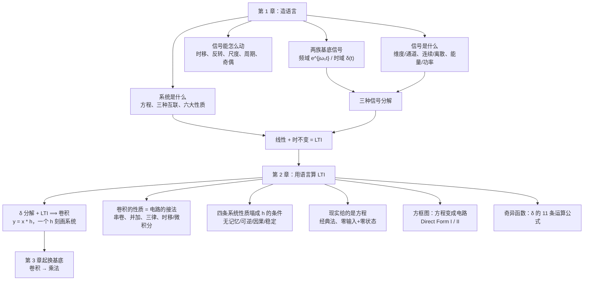

# C1–2 信号、系统与卷积 · 复习提纲

> [!abstract] 怎么用这份提纲
> 全篇按「骨架 → 逐节知识点 → 公式表 → 易错点 → 题型」排列，**只保留决定对错的那几步**，推导回指分章原篇。
> 标记：**考点** = 课上点名会考；**易错** = 作业/随堂测踩过的坑；**【了解】** = 课堂点到但不深究；⚠️ = 最容易走错的那一步。
> 建议三遍读：① 只看 §0 骨架与各节粗体；② 逐节过公式与判据；③ 考前只看 §10 易错点、§11 题型、§12 速查。
> **开卷考试**请直接用精简版 [[C1–2 开卷速查（精简版）]]（压到约三分之一，只留判据、公式、标准结果与丢分点）。

---

## 0. 骨架：这两章到底在搭什么

### 0.1 一张结构图

### 0.2 三条总纲

1. **第 1 章负责造语言**：给信号起名字、量大小、动时间轴、立两族「原子」（频域复指数、时域冲激），再把研究对象收窄成 LTI；第 2 章只用这门语言算 LTI。
2. **一个 LTI 系统就是一条 $h$**：$h$ 完全刻画系统；方程、方框图、$h$、频率响应、系统函数都只是它的不同写法（后面章节逐层补上）。
3. **时域用冲激作基底得到卷积，频域用复指数作基底得到频谱**：两条路在第 3–5 章的卷积定理处合流——**时域卷积变成频域乘法**。

### 0.3 贯穿两章的「三种信号分解」

| # | 名称 | 域 | 分解式 | 基本成分 | 出处 |
|---|---|---|---|---|---|
| ① | **奇偶分解** | 时域 | $x=x_e+x_o$ | 偶函数、奇函数（只分两份） | C1.2 |
| ② | **傅里叶分解** CTFS / DTFS | **频域** | $x(t)=\sum_k a_k e^{jk\omega_0 t}$ | 复指数（单频） | C1.3 → 第 3 章 |
| ③ | **冲激分解** | **时域** | $x[n]=\sum_k x[k]\delta[n-k]$ | 移位冲激（一根根火柴） | C1.4 → 第 2 章卷积 |

> ② 按**频率**拆、③ 按**时刻**拆，是同一个信号的两套坐标；第 2 章走完 ③，第 3 章走 ②。

---

## 1. 信号：描述与分类（C1.1）

### 1.1 信号的定义与「维度 / 通道」

- **信号 = 一个或多个自变量的函数**；函数值可以是电压、声压、亮度、速度……
- **维度 = 独立自变量的个数**；**通道 = 函数值分量的个数**。⚠️ **通道不增加维度**。

| 信号 | 表示 | 维度 | 通道 |
|---|---|---|---|
| 单声道语音 | $x(t)$ | 1 | 1 |
| 立体声 | $x(t)$ | 1 | **2** |
| 灰度图 / 二值图 | $I(x,y)$ | 2 | 1 |
| 彩色图 | $I(x,y)$ | **2**（不是 3） | 3 |
| 黑白视频 | $V(x,y,t)$ | 3 | 1 |
| 彩色视频 | $V(x,y,t)$ | 3 | 3 |
| 点云 / 三维超声 | $I(x,y,d)$ | 3 | 1 |
| 四维彩超 / 3D 动画 | $V(x,y,d,t)$ | 4 | 1 或 3 |

- 自变量**不一定是时间**：垂直风廓线（自变量是高度）、图像（两个空间坐标）。
- 现实信号最多 4 维（三维空间 + 时间）；「7D 影院」的 D 更接近 **channel**，不是 dimension。
- 【了解】二维卷积在图像上的对应（CNN 做的是不翻转核的相关，见 C2.1 §9）。

### 1.2 连续 / 离散，以及「采样 ≠ 量化」

| 概念 | 作用在哪个轴 | 结果 |
|---|---|---|
| **采样 Sampling** | **自变量轴（时间）** | 连续时间 → 离散时间 |
| **量化 Quantization** | **函数值轴（幅度）** | 连续取值 → 有限等级（一般 $2^n$ 级，如 8 bit = 256） |
| **编码 Coding** | — | 量化等级写成 0/1 码字 |

- **判据只有一条：连续 / 离散只看自变量那条轴**，函数值怎么取都不影响判断。
  → 「横轴处处有值、纵轴只取整数」的阶梯信号，仍是**连续时间信号**（只是量化信号）。
- 记号：$x(t)$ 圆括号、$t\in\mathbb{R}$；$x[n]$ 方括号、$n\in\mathbb{Z}$；离散画成**杆状图**，点与点之间**没有定义**（不是 0）。
- **$x[n]$ 里的 $n$ 不是时间**，是第几个样本的序号（时间信息被归一化掉了）→ 所以 $n$ 必须整数。
- 序列 → 数字信号：**采样 + 量化 + 编码 = 数字化**；本课只研究采样这一层。

### 1.3 三组分类

| 分类 | 是否二分类 | 要点 |
|---|---|---|
| 连续时间 / 离散时间 | ✅ | 只看自变量轴 |
| 周期 / 非周期 | ✅ | 判据见 §2.4 |
| 确定性 / 随机 | ✅ | 随机信号只能给**分布（PDF）**，本课主要研究确定性信号 |
| **有限能量 / 有限功率** | ❌ **有第三类「都不是」** | 见 §1.4 |

- 两种表示：**函数表示**（可分段）便于运算；**图形表示**便于直观理解变换。

### 1.4 能量与功率（**核心**）

**来源**：取 $R=1\,\Omega$ 归一化，$p(t)=v^2(t)=i^2(t)=x^2(t)$ —— 功率就是信号的平方。

| 量 | 连续 | 离散 |
|---|---|---|
| 瞬时功率 | $p(t)=x^2(t)$ | $p[n]=x^2[n]$ |
| 区间能量 | $\int_{t_1}^{t_2}x^2(t)dt$ | $\sum_{n=n_1}^{n_2}x^2[n]$ |
| **总能量** | $E_\infty=\lim\limits_{T\to\infty}\int_{-T}^{T}x^2(t)dt$ | $E_\infty=\sum\limits_{n=-\infty}^{\infty}x^2[n]$ |
| **平均功率** | $P_\infty=\lim\limits_{T\to\infty}\dfrac{1}{2T}\int_{-T}^{T}x^2(t)dt$ | $P_\infty=\lim\limits_{N\to\infty}\dfrac{1}{2N+1}\sum\limits_{n=-N}^{N}x^2[n]$ |

- **为什么分母是 $2T$ 与 $2N+1$**：连续量**区间长度**；离散数**点数**（闭区间把 $-N,N$ 都算进去）。极限里那个 1 可忽略，但写公式要严格。
- 复信号一律换成 $|x|^2$（能量必须非负实数）。
- **周期信号求平均功率只需在一个周期上算**（$P=\frac{1}{T_0}\int_{T_0}x^2dt$），不必真取极限。

**三类判别（顺序不能反）**

| 类别 | 条件 | 典型 | 傅里叶能不能用 |
|---|---|---|---|
| **能量信号** | $E<\infty$（于是 $P=0$） | 有限时长脉冲、$e^{-2t}u(t)$、$e^{-t}u(t)$ | ✅ 收敛 |
| **功率信号** | $E=\infty$ 且 $0<P<\infty$ | $\cos\omega_0t$、$u(t)$、常数 | ✅ 边界（持续激励） |
| **都不是** | $E=\infty$ 且 $P=\infty$ | 双边 $e^{-2t}$、$e^{t}$、$t\,u(t)$ | ❌ 需要 Laplace / Z |

![[C1-三类信号-能量功率.png]]
*左：有限能量（有限脉冲，$E=2$）；中：有限功率（$\cos\omega_0t$，$P=\frac12$）；右：两者都不是（双边 $e^{-2t}$，指数爆炸）。*

**三条性质**

1. $E<\infty\Rightarrow P=0$（有限值 ÷ 无穷长）。
2. 「有限功率信号」隐含 **$P\ne0$**，否则与能量信号重叠。
3. 两类**互斥**：$0<P<\infty\Rightarrow E=\infty$。

**快判口语**：上下有界周期 → 功率；有限时长且有界 → 能量；发散 → 都不是。

> [!warning] 三个必踩的坑
> - **$e^{-t}$ 与 $e^{-t}u(t)$ 只差一个 $u(t)$，结论相反**（前者爆炸 → 都不是；后者 $E=\frac12$ → 能量信号）。看到指数先问：单边还是双边？
> - **加 $u(t)$ 救不了本身发散的信号**：$e^{2t}u(t)$ 仍然 $E=\infty$（拉普拉斯才能处理）。
> - **算出 $E$ 有限就锁定「能量信号」**，不要再多写一句「功率也有限」——$P=0$ 是推论，不是第二种性质（作业错题）。

---

## 2. 自变量的变换与周期性（C1.2）

### 2.1 三种基本变换

| 变换 | 连续 | 离散 | 口诀 |
|---|---|---|---|
| **时移** | $x(t-t_0)$ 右移 = **延迟**；$x(t+t_0)$ 左移 = **超前** | $x[n-n_0]$ / $x[n+n_0]$ | **减号右移、加号左移** |
| **反转** | $x(-t)$，绕 $t=0$ **竖线**镜像 | $x[-n]$ | 不是绕原点旋转 |
| **尺度** | $x(at)$：$a>1$ **压缩**、$0<a<1$ **拉伸** | 离散尺度 = **内插零**（第 3 章） | **括号里乘几，波形窄几倍** |

- 判据只有一句：**看括号里的 $t$ 被换成了什么**。
- 尺度变换的物理：倍速播放 $x(2t)$ 变快**且变调**——频域对应 $x(at)\leftrightarrow\frac{1}{|a|}X(\frac{j\omega}{a})$（第 4 章），**时域窄 ⇔ 频域宽**。

### 2.2 组合变换 $x(at+b)$（**高频考点**）

两条**都正确**的路径，但**平移量不能混用**：

| 路径 | 顺序 | 平移量 | 例：$x(6-2t)=x[-2(t-3)]$ |
|---|---|---|---|
| **路径一** | 先尺度 → 反转 → 平移 | 平移量 $=\lvert b\rvert/\lvert a\rvert$ | 压缩 2 倍 → 反转 → **右移 3** |
| **路径二** | 先平移 → 反转 → 尺度 | 平移量 $=\lvert b\rvert$ | **左移 6** → 反转 → 压缩 2 倍 |

- 关键动作：**先把括号写成 $x[a(t-t_0)]$ 的标准形式**，才能读出位移量。
- 考试用路径一（快），理解用路径二（稳）。
- 关键点验算：原图 $x(t)$ 在 $t=0$ 的值，新波形应在 $at+b=0$ 处取到。

> [!example] 两个必会题
> - $x(6-2t)$：两条路径各走一遍（图见下），关键点都落在 $1.5,\,3,\,4$。
> - $x(4-3t)$：路径一读出右移 $4/3$；路径二读出左移 4。**两个数都对，但配错步骤就错**。
> - 判断题「$x(5-2t)$ 可由 $x(-2t)$ 左移 5 得到」→ **错**：应右移 $5/2$。

![[C1-例题x(6-2t)-解法一.png]]
*解法一：压缩 2 倍 → 反转 → 右移 3（位移量 $6/2$）；解法二反着做（左移 6 → 反转 → 压缩），结果同一条波形。*

### 2.3 「动横轴」还是「动纵轴」

| 写法 | 是什么 |
|---|---|
| $x(t-t_0)$ | 自变量变换（时移） |
| $x(t)-t_0$ | 两个信号相减（$t_0$ 是常数信号） |
| $x(2t)$ | 自变量变换（尺度） |
| $2x(t)$ | 信号取值改变（乘常数） |
| $\frac{dx}{dt}$、$\int x\,dt$ | 纵轴上的运算，不是自变量变换 |

- 对照练习（七个操作里挑）：**时移、反转、尺度**是自变量变换；**相加、相乘、微分、积分**作用在函数值上，不是。

### 2.4 周期性与离散判据（**高频考点**）

| | 连续 | 离散 |
|---|---|---|
| 定义 | $\exists T>0,\ x(t)=x(t+T)$ | $\exists N\in\mathbb{Z}^+,\ x[n]=x[n+N]$ |
| 基波周期 | 最小正 $T_0$（常数信号无基波周期） | $N=1$（常数序列） |
| 周期条件 | **任意 $T>0$ 都行** | $\dfrac{\omega_0}{2\pi}$ **必须是有理数** |

**离散判据推导**：设 $x[n]=e^{j\omega_0 n}$，要求 $e^{j\omega_0(n+N)}=e^{j\omega_0 n}\Rightarrow e^{j\omega_0 N}=1\Rightarrow \omega_0N=2k\pi\Rightarrow \dfrac{\omega_0}{2\pi}=\dfrac{k}{N}$。

> [!important] 求基波周期的两条等价说法（**别混**）
> - 看 $\dfrac{\omega_0}{2\pi}=\dfrac{k}{N}$ 取**分母** $N$；
> - 看 $\dfrac{2\pi}{\omega_0}=\dfrac{N}{k}$（最简分数）取**分子** $N$。
>
> 例：$\cos\frac{3\pi n}{4}$ → $\frac{2\pi}{\omega_0}=\frac83$ → $N=8$（不是 $\frac83$，$N$ 必须整数）。
> **速判**：$\omega_0$ 带 $\pi$ 的通常周期（$\pi$ 约掉），不带 $\pi$ 的通常非周期（$\pi$ 留在分母，必为无理数）。

![[C1-离散复指数-基波频率与周期.png]]
*$\omega_0=\frac{\pi}{4}$ 与 $\frac{3\pi}{4}$：步长不同、走点顺序不同，但**八步都回到起点** ⇒ 基波周期同为 8。*

> [!warning] 基波频率陷阱（课上专门停下来讲）
> $\frac{3\pi}{4}$ **不是** $e^{j3\pi n/4}$ 的基波频率：它的基波周期也是 8，所以**基波频率是 $\frac{2\pi}{8}=\frac{\pi}{4}$**，而 $\frac{3\pi}{4}=3\cdot\frac{\pi}{4}$ 说明它是**三次谐波**。
> **考试问 fundamental frequency，绝不能直接抄 $n$ 前的系数**，必须先求 $N$ 再算 $\omega_0=2\pi/N$。

**离散频率以 $2\pi$ 为周期**：$e^{j(\omega_0+2\pi)n}=e^{j\omega_0 n}$；只在长度 $2\pi$ 内互不相同，取 $[0,2\pi)$ 或 $[-\pi,\pi)$；**$\omega_0=\pi$（即 $(-1)^n$）是最高频**，再快就折回（混叠，第 7 章）。

> [!warning] 三件不同的事（考试爱考）
> 1. **频率以 $2\pi$ 为周期**（关于 $\omega_0$）——永远成立；
> 2. **谐波集以 $N$ 为周期**（关于下标 $k$）——导致基底只有 $N$ 个（DTFS）；
> 3. **序列本身是否周期**（关于 $n$）——需要 $\frac{2\pi}{\omega_0}$ 有理。

**合成周期**：各分量周期 $N_1,N_2$ → 合成周期 $\mathrm{lcm}(N_1,N_2)$；只要有一个非周期，整体通常非周期。

> [!example] 判周期三步法
> ① 算 $2\pi/\omega_0$；② 是否有理；③ 化最简分数取分子（或 $\omega_0/2\pi$ 取分母）。
> 乘积信号先**积化和差**再分别判，最后取 lcm。
> 四个常考判断（先问「是不是周期」，再求 $T$ / $N$）：
> - $3\cos(4t+\pi/3)$ ✅ 连续正弦必周期，$T=\pi/2$；
> - $\sum_n e^{-(2t-n)}u(2t-n)$ ✅ 周期延拓，$T=1/2$（令 $t\to t+1/2$，求和指标平移一位而范围不变）；
> - $\cos(n/8-\pi)$ ❌ $2\pi/\omega_0=16\pi$ 无理（常数相位 $-\pi$ 不影响）；
> - $\cos\frac{\pi n}{2}\cos\frac{\pi n}{4}$ ✅ 先积化和差成两项（$N_1=N_2=8$），$N=\mathrm{lcm}(8,8)=8$。

### 2.5 奇偶分解（第一种分解）

$$\mathcal{Ev}\{x\}=\frac12[x(t)+x(-t)],\qquad \mathcal{Od}\{x\}=\frac12[x(t)-x(-t)]$$

- 偶：$x(-t)=x(t)$（关于纵轴对称）；奇：$x(-t)=-x(t)$（关于原点对称，**必有 $x(0)=0$**）。
- **任何（实）信号都能唯一分解**为偶 + 奇；三行验证即存在性证明。
- 复信号版本用共轭对称分量 $x_e=\frac12[x(t)+x^*(-t)]$（第 3–4 章用）。
- $u[n]$ 的分解：$\mathcal{Ev}\{u[n]\}=1$（$n=0$）、$\frac12$（$n\ne0$）；$\mathcal{Od}\{u[n]\}=0$（$n=0$）、$\pm\frac12$。**原点是不成对的点，最容易算错。**

![[C1-奇偶信号与奇偶分解.png]]
*左：偶、奇信号样板；右：$u[n]$ 的奇偶分解（注意 $n=0$ 处）。*

---

## 3. 两族基本信号：频域与时刻的「原子」（C1.3 + C1.4）

### 3.1 频域基底：复指数与正弦

#### (1) 为什么底数是 $e$

- 复利极限 $\lim_{n\to\infty}(1+\frac1n)^n=e$：**连续滚动增长的极限**。
- 所以 **连续用 $Ce^{at}$（底数必须是 $e$），离散用 $C\alpha^n$（底数任意实数）**——这是连续/离散最早分岔的地方。
- 平行体系：Ch3 CTFS/DTFS、Ch4-5 CTFT/DTFT、Ch9-10 Laplace / Z，最终在**复频域**统一。

#### (2) 连续实指数与一般复指数

- $x(t)=Ce^{at}$（$C,a$ 实）：$a>0$ 增长、$a<0$ 衰减；$x(0)=C$；时间常数 $\tau=1/|a|$（衰减到 $1/e\approx36.8\%$）。
- $x(t)=e^{j\omega_0 t}$：**欧拉公式** $=\cos\omega_0t+j\sin\omega_0t$；实部虚部同频、只差 $\pi/2$ ⇒ **单频信号**（频域基底的资格）。
- 连续复指数**无条件周期**，$T=2\pi/\omega_0$（要 $e^{j\omega_0T}=1$）。
- 单位：$\omega_0=2\pi f_0$（rad/s vs Hz），$T=1/f_0=2\pi/\omega_0$。**换算别丢 $2\pi$**。
- $C=|C|e^{j\theta}$ 只干两件事：**缩放幅度**、**旋转初相位**（等价于整体平移 $-\theta/\omega_0$）。

**一般复指数（$C,a$ 都复）**：$C=|C|e^{j\theta}$（极坐标）、$a=r+j\omega_0$（直角坐标）——之所以这样选，是为了让整式变成清一色 $e$ 的连乘。

$$x(t)=|C|e^{rt}e^{j(\omega_0t+\theta)}=\underbrace{|C|e^{rt}}_{\text{包络}}\times\underbrace{\cos/\sin(\omega_0t+\theta)}_{\text{振荡}}$$

![[C1-一般复指数信号波形-r正负.png]]
*虚线 $\pm|C|e^{rt}$ 是包络：$r>0$ 振荡着发散，$r<0$ 阻尼振荡，$r=0$ 等幅（即纯周期）。*

#### (3) 离散实指数四形态

| $\alpha$ | 行为 |
|---|---|
| $\alpha>1$ | 单调增长 |
| $0<\alpha<1$ | 单调衰减 |
| $-1<\alpha<0$ | **正负交替**、幅度衰减 |
| $\alpha<-1$ | **正负交替**、幅度增长 |

![[C1-离散实指数信号-四种形态.png]]
*拆成 $|\alpha|^n\cdot(\operatorname{sgn}\alpha)^n$：模管幅度、符号管交替；「交替」是离散独有。*

#### (4) 离散复指数与周期判据

- $x[n]=e^{j\omega_0n}=\cos\omega_0 n+j\sin\omega_0n$；一般复指数 $C\alpha^n$ 中 $C,\alpha$ **都用极坐标**（两个都没有 $e$）。
- $x[n]=|C||\alpha|^n\cos(\omega_0n+\theta)+\dots$：$|\alpha|=1$ 等幅、$>1$ 增长包络、$<1$ 衰减包络。
- 周期判据：$\frac{2\pi}{\omega_0}$ 有理；写成最简 $\frac{N}{m}$ 后 $N$ 为基波周期，$m$ 是这 $N$ 个点内转过的圈数。
- 三个标准例：$\cos\frac{2\pi n}{12}$（$N=12$）、$\cos\frac{8\pi n}{31}$（$N=31$）、$\cos\frac{n}{6}$（**非周期**，$12\pi$ 无理）。
- **连续 s 平面 vs 离散 z 平面**：$r$ 相对 $0$ ↔ $|\alpha|$ 相对 $1$；虚轴 ↔ 单位圆；桥是 $r=e^{sT}$（第 9、10 章）。

#### (5) 谐波集与正交性 → CTFS / DTFS 入口

- 谐波集 $\Phi_k(t)=e^{jk\omega_0t}=e^{jk(2\pi/T)t}$，$k\in\mathbb{Z}$；**公共周期 $T$**；$k=1$ 基波，$k\ge2$ 谐波。
- 复内积要**取共轭**，求和换成**一个周期上积分**：
$$\int_T e^{jk\omega_0t}e^{-jl\omega_0t}dt=\begin{cases}T,&k=l\\0,&k\ne l\end{cases}$$
- ⇒ 两两正交 ⇒ 可当**无穷维基底**，张成「所有周期为 $T$ 的信号」（希尔伯特空间）。
- **CTFS**：$x(t)=\sum_{k=-\infty}^{\infty}a_ke^{jk\omega_0t}$，$\{a_k\}$ 即**频谱**（每根火柴的高度）；分析式 $a_k=\frac1T\int_T x(t)e^{-jk\omega_0t}dt$（内积投影）。
- 离散端：$\Phi_{k+N}[n]=\Phi_k[n]$（因为 $e^{j2\pi n}=1$）⇒ **只有 $N$ 个互不相同的成员** ⇒ **有限维基底**，$k$ 只取满一个周期；正交性 $\sum_{\langle N\rangle}=N$ 或 0（$k,r$ 必须在同一周期内）。
- **DTFS**：$x[n]=\sum_{k=\langle N\rangle}a_ke^{jk\omega_0n}$，$\omega_0=2\pi/N$。

| | CTFS | DTFS |
|---|---|---|
| 对象 | 周期 $T$ 连续 | 周期 $N$ 离散 |
| 基底维数 | **无穷维** | **$N$ 维** |
| $k$ 范围 | $-\infty\to+\infty$ | 只取满一个周期 |
| 正交性和 | $T$ 或 0（积分） | $N$ 或 0（求和） |

### 3.2 时域基底：单位冲激与单位阶跃

#### (1) 离散：$\delta[n]$ 与 $u[n]$

$$\delta[n]=\begin{cases}1,&n=0\\0,&n\ne0\end{cases}\qquad u[n]=\begin{cases}1,&n\ge0\\0,&n<0\end{cases}$$

- $\delta[n]$ 是**完全正常的有限值序列**（$\delta[0]=1$），与连续 $\delta(t)$ 的「广义函数」性质截然不同。
- 互推三式：$\delta[n]=u[n]-u[n-1]$（一阶差分）；$u[n]=\sum_{m=-\infty}^{n}\delta[m]$（滑动求和）$=\sum_{k=0}^{\infty}\delta[n-k]$。
- $\Rightarrow$ **差分 ↔ 微分，求和 ↔ 积分**。
- 移位冲激族 $\{\delta[n-k]\}$ **两两正交**，是时域的正交基底（对应线性代数里的 $(1,0,0),(0,1,0),\dots$）。
- **第三种分解**：$x[n]=\sum_k x[k]\delta[n-k]$，$x[k]$ 管高度（**是数**），$\delta[n-k]$ 管位置（**是信号**）。
- 抽样性质：$x[n]\delta[n-n_0]=x[n_0]\delta[n-n_0]$。**⚠️ 不等于 $x[n_0]$**——左边是信号，右边是数值。

#### (2) 连续：$u(t)$ 与 $\delta(t)$

$$u(t)=\begin{cases}1,&t>0\\0,&t<0\end{cases}\qquad \delta(t)=\begin{cases}0,&t\ne0\\\infty,&t=0\end{cases},\quad \int_{-\infty}^{\infty}\delta(t)dt=1$$

- **$u(0)$ 没有定义**（左右极限不等），而 **$u[0]=1$ 有定义** —— 连续与离散的第一个根本差别。
- $\delta(t)$ 的「单位」由**面积**定义（箭头旁标的是面积/强度，不是高度）；正式名 **狄拉克函数 / 奇异信号 / 广义函数（分布）**，只在积分意义下有意义。
- **$\delta(-t)=\delta(t)$**（偶函数）。
- 互推：$\delta(t)=\frac{du(t)}{dt}$（**形式上 $u$ 不可微，需极限解释**）；$u(t)=\int_{-\infty}^{t}\delta(\tau)d\tau$（**上限写 $t$、积分变量写 $\tau$**，最常见的写错点）。
- **极限构造**：连续斜坡 $u_\Delta$（上升时间 $\Delta$）→ 求导得高 $1/\Delta$、宽 $\Delta$ 的矩形 $\delta_\Delta$ → $\Delta\to0$ 得 $\delta$。**面积恒为 1** 是全部关键（$1/\Delta\times\Delta=1$）。
- 三种近似都行：右矩形、居中矩形、三角（底 $2\Delta$、高 $1/\Delta$）——**形状无关，面积为准**。

![[C1-冲激函数的极限构造.png]]
*$u_\Delta$ 求导得 $\delta_\Delta$，再 $\Delta\to0$；宽度→0、高度→∞，面积恒为 1。*

#### (3) 断点求导（**考点**）

- 规则：**跳变位置 → 冲激位置；跳变幅度 → 冲激强度（向下跳取负）**。
- 例：$x=0\to1\to2\to0$（跳 1、跳 1、跳 **2**）⇒ $x'(t)=\delta(t)+\delta(t-1)-2\delta(t-2)$。**「往下跳两步」是唯一的坑。**
- 等价写法：$x(t)=u(t)+u(t-1)-2u(t-2)$，逐项求导即得。
- **能写成加法就别写分段**：求和写法便于后续卷积与变换。

![[C1-分段常数信号的导数.png]]

#### (4) 抽样性质（连续）

$$x(t)\delta(t)=x(0)\delta(t),\qquad x(t)\delta(t-t_0)=x(t_0)\delta(t-t_0),\qquad \int x(t)\delta(t-t_0)dt=x(t_0)$$

- 前两式结果仍是**信号**；第三式（积分后）才是**数值**。口诀：**乘出来是信号，积出来才是数**。
- 连续版冲激分解：$x(t)=\int x(\tau)\delta(t-\tau)d\tau$（$x(\tau)$ 是权重，$\delta$ 是基底）。
- 两个使用前提：**冲激落在积分区间内**（否则为 0）；**$x$ 在 $t_0$ 连续**。

#### (5) 尺度性质与含冲激积分（**2 分题**）

$$\delta(at)=\frac{1}{|a|}\delta(t),\qquad \delta(at-t_0)=\frac{1}{|a|}\delta\!\left(t-\frac{t_0}{a}\right)$$

- 为什么有 $1/|a|$：横轴压缩使面积也被压缩；$a<0$ 时换元上下限翻转多一个负号，与 $1/a$ 的负号抵消 ⇒ 绝对值。**面积不可能为负**。
- **含冲激积分三步**：① 化标准形式 $\delta(t-t_1)$ 并提出 $1/|a|$；② 定位 $t_1=-b/a$；③ 看 $t_1$ 是否在区间内 → 不在则 0，在则 $\frac{1}{|a|}f(t_1)$。

| 例题 | 关键 | 答案 |
|---|---|---|
| $\int(2t^2+3t)\delta(\frac12t-2)dt$ | $\delta(\frac12(t-4))=2\delta(t-4)$ | $2\times44=88$ |
| 同上，区间改 $[-3,3]$ | 冲激在 $t=4$，区间没盖住 | **0** |
| $\int(t+4)\delta(-2t+4)dt$ | $a=-2$ 取绝对值，$\frac12\delta(t-2)$ | $\frac12\times6=3$ |
| $\int t^2\delta(3t-6)dt$ | $\frac13\delta(t-2)$ | $4/3$ |

> **易错**：① 忘 $1/|a|$（得 6）；② 用 $1/a=-\frac12$（得 $-3$）；③ 不检查区间直接代（该 0 却得 88）。

#### (6) 连续 / 离散对照总表

| | 离散 | 连续 |
|---|---|---|
| 冲激 | $\delta[n]$（普通序列） | $\delta(t)$（广义函数） |
| 阶跃 | $u[0]=1$ | $u(0)$ 无定义 |
| 冲激←阶跃 | 一阶差分 | 导数（需极限解释） |
| 阶跃←冲激 | 滑动求和 | 滑动积分 |
| 分解 | $\sum_k x[k]\delta[n-k]$ | $\int x(\tau)\delta(t-\tau)d\tau$ |
| 抽样 | $\sum_n x[n]\delta[n-n_0]=x[n_0]$ | $\int x(t)\delta(t-t_0)dt=x(t_0)$ |
| 尺度 | **没有尺度性质**（$\delta[an]=\delta[n]$） | $\delta(at)=\delta(t)/\lvert a\rvert$ |

> **必背问答**：$\delta[0]=1$；$\delta(0)$ 形式上是 $\infty$、没有有限值。

---

## 4. 系统与六大性质（C1.5 + C1.6）

### 4.1 系统是什么

| 视角 | 定义 | 用途 |
|---|---|---|
| **结构**（最宽泛） | 元件、器件、子系统的**互联** | 电路怎么搭 |
| **功能**（本课只用这个） | 把信号变换成其他信号的**过程**（映射） | 黑箱：只看 $x\to y$ |

- **信号是函数，系统是方程**（两个信号之间的关系式）。
- 记号：$x(t)\xrightarrow{L}y(t)$；$L$ 是算子；框图的箭头是**信号流向**，不是等号。
- **标准形式：输入项在右、输出项在左**（尤其 LTI）。
- 连续：$x(t)=Ce^{at}$ 之外，工程模型是 **LCCDE**；离散：**常系数差分方程**；求解靠第 9/10 章的 Laplace / Z。
- 两个样板例：
  - **RC 电路**（串联共享电流）：$i=\frac{v_s-v_c}{R}=C\frac{dv_c}{dt}$ ⇒ $\frac{dv_c}{dt}+\frac{1}{RC}v_c=\frac{1}{RC}v_s$，一阶 LCCDE，$\tau=RC$。
  - **银行账户**：$y[n]=y[n-1]+1\%\,y[n-1]+x[n]$ ⇒ $y[n]-1.01y[n-1]=x[n]$；60 个月存 3000 → **245 009**（不复利只有 180 000）。**输入停了输出还在涨 ⇒ 记忆**。

### 4.2 三种互联

| 互联 | 结构 | LTI 整体 $h$ | 特点 |
|---|---|---|---|
| **串联 / 级联** | 首尾相接 | $h=h_1*h_2$ | 开环；LTI 可换序；一环断全链断 |
| **并联** | 同输入、输出相加 | $h=h_1+h_2$ | 开环；对应并行计算 |
| **串并联** | 串、并组合 | 反复用上面两条 | **第 2 章出题主力** |
| **反馈** | 输出回送到输入 | 需**解方程** | **闭环**；方程隐式；控制的基础 |

- **反馈的关键**：输出被送回影响输入；子系统 2 = 控制器（定速巡航）。
- **开环 vs 闭环一句话**：开环没有回来的路径，做不了控制；闭环能「看着结果改自己」。
- 反馈实例（RC 并联、电流源）：$v(t)$ 既是电容的输出、又是电阻的输入；求和点带减号 = **负反馈**；还原出与 Example 1.8 同构的一阶方程。
- 【了解】开环 = 前向 / FFN；闭环 = RNN（稳定性见 §4.3.4）。

### 4.3 六把尺子（**彼此独立，四种组合都真实存在**）

#### 4.3.1 记忆性

- **无记忆**：某时刻输出**只**取决于**同一时刻**输入；特征：**没有电容、电感、延迟器**（原稿 conductor 应为 inductor）。
- **有记忆**：保留/存储了其他时刻的输入信息；**用到过去或未来都算**（广义记忆）。
- **记忆长度** = 求 $y$ 时所需输入相对当前时刻的**最远偏移量**：只用 $x[n]$ → 0；$x[n],x[n-1]$ → 1；只剩 $x[n-2]$ → **2**；积分/累加 → **无限**。
- 判法：代入具体 $n_0$，看右边是否**只有** $x[n_0]$；差一点点（如 $t-\epsilon$）也算有记忆。
- 例：$y[n]=Cx[n]$、$v=Ri$ 无记忆；$y[n]=x[n-1]$、$x[n+1]$、累加器、电容都有记忆。
- 【了解】回声：$y[n]=\sum_{k=0}^{K}a_kx[n-k]$，$K$ 可达 1024 抽头（≈23 ms ≈8 m，音乐厅级混响）。

#### 4.3.2 可逆性

- **不同输入给出不同输出（一一对应）** ⇒ 可逆，且存在**逆系统**；两者**级联 = 恒等系统** $y=x$。
- 判不可逆：**找两个不同输入给出同一输出**。
- 例：$y=2x$ 可逆（逆为 $\times\frac12$）；**累加器 ↔ 一阶差分器**（$h_1=\delta[n]-\delta[n-1]$）互逆【考点】。
- 不可逆：$y[n]=0$（信息全丢）、$y=x^2$（$\pm x$ 同输出）、$y[n]=x[n]x[n-2]$（取 $x_1\equiv1$ 与 $x_2=(-1)^n$ 输出同为 1）。

#### 4.3.3 因果性

- **输出只依赖当前与过去**（非超前）。**无记忆 ⇒ 必然因果；反之不成立**（$y[n]=x[n-1]$ 因果但有记忆）。
- **初始松弛条件**：$x(t)=0\ (t<t_0)\Rightarrow y(t)=0\ (t<t_0)$。
- **在线（online）必须因果；非因果只能离线（offline）批处理**。
- 例：$y[n]=x[n+1]$、$x[-n]$、$x(\sin t)$ 非因果；滑动平均 $\frac1{2M+1}\sum_{k=-M}^{M}x[n-k]$ 非因果（用到 $x[n+1]$）——用于**去噪/平滑**。
- 四个典型判断（只看有没有用到 $x[n+k]$、$k>0$）：

| 系统 | 判决 | 关键 |
|---|---|---|
| $y[n]=x[-n]$ | ❌ 非因果 | $n=-5$ 时 $y[-5]=x[5]$，用到未来 |
| $y(t)=x(t)\cos(t+1)$ | ✅ 因果 | 只取 $x(t)$ 当前值（但**时变**：增益随 $t$ 变） |
| $y[n]=x[n]x[n-2]$ | ✅ 因果 | 当前与 2 步前（有记忆、非线性） |
| $y(t)=x(\sin t)$ | ❌ 非因果 | $t=-\pi/2$ 时取 $x(-1)$，而 $-1>-1.571$；**只查正半轴会误判** |

#### 4.3.4 稳定性（BIBO）

- **有界输入 ⇒ 有界输出**：$|x|<M\Rightarrow|y|<N$（$M,N$ 有限常数，对**任何**有界输入成立）。
- 证不稳定：**只要找一个**有界输入使输出无界（累加器输入 $u[n]$，$y=n+1\to\infty$）。
- 工程直觉：摩天大楼抗风等级、阻尼器；**稳定性对任何系统都是硬约束**。
- 【了解】单摆稳定 / **倒立摆不稳定**（重力趋于增大偏离，正反馈）；汽车运动稳定（负反馈收敛到 $f/\rho$）；**RNN 梯度爆炸**（带环路 + 跳变导数为无穷）。

![[C1.6-BIBO稳定性对比.png]]

#### 4.3.5 时不变性（**三步法，一步不能省**）

- 定义：$x(t)\to y(t)\Rightarrow x(t-t_0)\to y(t-t_0)$；「输入晚一点给，输出也就晚一点出，波形不变」。
- **三步**：① $x_1\to y_1$；② $x_2\to y_2$；③ 令 $x_2(t)=x_1(t-t_0)$，求 $y_2$ 与 $y_1(t-t_0)$ 比较。
  - $y_2$：把 $x_2$ 代进**系统方程**，系统里显式的 $t$ **不动**；
  - $y_1(t-t_0)$：把 $y_1$ 表达式里**所有** $t$ 换成 $t-t_0$。
- **代换的是「谁的自变量」**：Step2 代换的是 $x_2(\cdot)$ 的自变量（可能是 $\sin t$），Step3 代换的是 $y_1(\cdot)$ 的裸 $t$。**减 $t_0$ 发生在 $\sin$ 里面还是外面，正是时变性的来源。**

![[C1-时不变性图示.png]]
*左：$x\to y$；右：$x(t-t_0)\to y(t-t_0)$，形状完全不变、整体右移同一 $t_0$。*

| 系统 | 结论 | 关键 |
|---|---|---|
| $y=t\,x(t)$ | **时变** | 系数 $(t-t_0)$ vs $t$ |
| $y=\sin[x(t)]$ | **时不变** | 只动函数值，没动 $t$ |
| $y=x(\sin t)$ | **时变** | $\sin t-t_0\ne\sin(t-t_0)$ |
| $y=x(-t)$ | **时变** | $-t-t_0\ne-(t-t_0)$；**第一感觉会错** |
| $y=(n+1)x[n]$、$y=2nx[n]$ | **时变** | 显式 $n$ 作系数 |
| $y=\cos t\cdot x(t)$ | **时变** | 显式增益 $\cos t$ |

> **速判**：对**时间轴本身**动手脚（$x(2t)$、$x(-t)$、$x(t^2)$、$x(\sin t)$）几乎必然时变；只对**输出值**动手脚（$\sin x$、$x^2$、$e^{x}$）通常时不变。**但答题仍要写三步法。**

#### 4.3.6 线性（**四步法**）

- **齐次性** $ax_1\to ay_1$；**可加性** $x_1+x_2\to y_1+y_2$；合起来**叠加性** $ax_1+bx_2\to ay_1+by_2$。
- **四步**：① $x_1\to y_1$；② $x_2\to y_2$；③ $x_3\to y_3$（照写）；④ 令 $x_3=ax_1+bx_2$，检验 $y_3=ay_1+by_2$。
- **必要条件：零输入 ⇒ 零输出**（齐次性取 $a=0$）。含非零常数项 ⇒ **非线性**，叫**增量线性（incrementally linear）**，如 $y[n]=2x[n]+3$、$y=3x+2$（后者就是「带非零初始状态的 LTI」）。
- 四个典型判断（四步法）：

| 系统 | 判决 | 关键 |
|---|---|---|
| $y(t)=t\,x(t)$ | ✅ 线性 | $t(ax_1+bx_2)=a(tx_1)+b(tx_2)$；但**时变** |
| $y(t)=x^2(t)$ | ❌ 非线性 | $(ax)^2=a^2x^2\ne ax^2$（齐次性不成立） |
| $y[n]=2x[n]+3$ | ❌ 非线性 | $x=0$ 时 $y=3\ne0$；是**增量线性** |
| $y(t)=x(\sin t)$ | ✅ 线性 | 自变量代换是线性运算（但时变、非因果） |

- 高频对照：
  - $y=\sin[x(t)]$：**非线性、时不变**（因果）；
  - $y=x(\sin t)$：**线性、时变、非因果**。
  - 两个长得像，结论正好相反。

> [!important] 六条性质独立
> 「线性但时变」「时不变但非线性」「因果但非线性」「线性但非因果」全都真实存在；**必须一条一条单独检验，不能靠直觉打包**。

### 4.4 LTI 系统

$$x(t-t_0)\to y(t-t_0),\qquad ax(t)+bx(t-t_0)\to ay(t)+by(t-t_0)$$

- 含义：LTI 对**平移**与**加权**是「透明」的 ⇒ 只要知道 $h$，就知道一切：$y=x*h$。
- **LTI ⇔ 常系数微分方程**（连续）/ **常系数差分方程**（离散）。正着走「给系统写方程」，反着走「给方程认系统」。
- 验证套路（以 $y=2x'+x$ 为例）：只用一条数学事实——**求导是线性且时不变的运算**。
- 【了解】高数里的常系数微分方程，本质就是 LTI 的输入输出关系。

---

## 5. 卷积：LTI 的全部算法（C2.1 + C2.2）

### 5.1 卷积和是怎么逼出来的（三步，各用一条性质）

| 步骤 | 结论 | 用到的性质 |
|---|---|---|
| ① | $\delta[n-k]\to h[n-k]$ | **时不变**（不用重测） |
| ② | $x[k]\delta[n-k]\to x[k]h[n-k]$ | **齐次性**（$x[k]$ 是常数） |
| ③ | $\sum_k x[k]\delta[n-k]\to\sum_k x[k]h[n-k]$ | **可加性** |

- 左边就是冲激分解 $x[n]=\sum_k x[k]\delta[n-k]$，于是
$$y[n]=\sum_{k=-\infty}^{\infty}x[k]h[n-k]\triangleq x[n]*h[n]$$
- **一个离散 LTI 系统被 $h[n]$ 完全刻画**；卷积就是「乘法 + 加法」的混合运算的简写。
- **只对 LTI 成立**：时变系统的响应是二元函数 $h[n,k]$，$y=\sum_k x[k]h[n,k]$，不是卷积。
- 读法：**$y[n]$ 收集「两个下标加起来等于 $n$」的全部乘积**。

### 5.2 五步法与分段

1. **换元** $n\to k$；2. **反转** $h[k]\to h[-k]$；3. **平移** $h[-k]\to h[n-k]$（**右移 $n$**）；4. **相乘**；5. **求和**（只得到这一个 $n$ 的 $y[n]$）。

- $h[n-k]=h\big(-(k-n)\big)$：先反转、再右移 $n$（$n<0$ 表现成左移）。**锚点：$h[n-k]$ 在 $k=n$ 处取 $h[0]$**。
- **固定一个、滑动另一个**（可任选，因为交换律）；按 $n$ 从小到大推，每到一个「事件点」（窗口端点相遇/开始包含/脱离）就换一段。
- **分段依据永远是「重叠区间怎么变」**，难点全在上下限。

![[C2-卷积五步法-分步演示.png]]
*以 $n=1$ 为例的五步；第 4 步的锚点是 $k=n$，重叠区 $0\le k\le n$。*

**有限长骨架（两条永远成立）**

$$L_y=L_x+L_h-1,\qquad n_{y,\min}=n_{x,\min}+n_{h,\min}$$

> 拿到题先写骨架（长度、起止点、峰值位置），再填值——最有效的自检。

### 5.3 三个标准例题（离散）

| 题 | 结果 | 备注 |
|---|---|---|
| $u[n]*a^nu[n]$ | $\dfrac{1-a^{n+1}}{1-a}u[n]$ | 阶跃响应；$n<0$ 不重叠；$n\ge0$ 时 $0\le k\le n$ |
| $R_N[n]*R_N[n]$ | 三角：$n+1$（$0\le n\le N-1$）、$2N-1-n$（$N-1<n\le2N-2$） | 峰值 $N$ 在 $n=N-1$；底宽 $2N-1$ |
| $\alpha^nu[n]*\beta^nu[n]$ | $\dfrac{\beta^{n+1}-\alpha^{n+1}}{\beta-\alpha}u[n]$；$\alpha=\beta$ 时 $(n+1)\alpha^nu[n]$ | $\alpha=\beta$ 单列 = **重根信号** |

![[C2-矩形序列自卷积-三角.png]]
*矩形 * 矩形 = 三角：峰值处两窗完全重合，$N$ 个点全对齐。*

> [!warning] 三个坑
> - **项数 = 上限 − 下限 + 1**，那个 `+1` 几乎每年有人漏。
> - $n=2N-2$ 时两矩形**仍共享一个非零点**，$y=1$（课件 p.13 的分段上界写错，p.14 才对）。
> - 向 $-\infty$ 求等比和不能套右边公式，用 $\sum_{k=-\infty}^{m}r^k=\frac{r^m}{1-r}$。

> [!example] 课堂大题（10 分，反向支撑的典型）
> $x[n]=3^nu[-n-1]$（**左边信号**），$h[n]=u[n-1]$（右边，$n\ge1$）。
> 约束 $k\le-1$ 且 $k\le n-1$ ⇒ 上限 $\min(-1,n-1)$、下限 $-\infty$，分两段：
> $$y[n]=\frac{3^n}{2}u[-n-1]+\frac12u[n]$$
> **两个易错**：把 $u[-n-1]$ 当右边信号；对 $-\infty$ 套错公式。

### 5.4 列表法（教材没有、课上补充；**只对有限长**）

- 写法：只写非零段，$\uparrow$ 标 $n=0$，如 $x=\{-1,\underset{\uparrow}{0},1,2\}$。
- 画表：横 $x$、纵 $h$，格子填**乘积**；把 $k+m$ 相同的格子（**反对角线**）相加得 $y[n]$。
- 自检三条：起点相加、长度 $L_x+L_h-1$、**$\sum y=\sum x\cdot\sum h$**。

![[C2-列表法-反对角线求和.png]]
*同一条反对角线上的乘积相加，就是同一个 $n$ 的 $y[n]$。*

### 5.5 卷积积分：从「搭台阶」到积分

- 用宽 $\Delta$、高 $1/\Delta$、**面积恒为 1** 的窄脉冲 $\delta_\Delta$ 搭台阶：
$$\hat{x}(t)=\sum_k x(k\Delta)\,\Delta\,\delta_\Delta(t-k\Delta)$$
- 取极限四处替换：$k\Delta\to\tau$、$\Delta\to d\tau$、$\delta_\Delta(t-k\Delta)\to\delta(t-\tau)$、$\sum\to\int$。
- **连续信号分解（筛选性质）**：$x(t)=\int x(\tau)\delta(t-\tau)d\tau$。
- 同样三步（时不变、齐次、可加）⇒
$$y(t)=\int_{-\infty}^{\infty}x(\tau)h(t-\tau)d\tau\triangleq x(t)*h(t)$$
- 与离散**一字不差**，只是 $\sum\to\int$、$k\to\tau$。

### 5.6 连续例题与规律

**五步法**：换元 $t\to\tau$ → 反转 → 平移 $t$ → 相乘 → 积分（$\tau$）。

> [!warning] 三个高频错误
> - **积分变量必须是 $d\tau$**（$t$ 在积分里是常数）。
> - 忘画滑动窗边界：若 $h$ 支撑 $[a,b]$，则 $h(t-\tau)$ 支撑 $[t-b,\ t-a]$。
> - 端点归属没写清（连续情形不影响数值，但表达要严谨）。

| 题 | 结果 | 规律 |
|---|---|---|
| $e^{-t}u(t)*u(t)$ | $(1-e^{-t})u(t)$ | 积分器充电曲线；阶跃输入下终值 = $h$ 的总面积 |
| 变式 $e^{-2t}u(t)*u(t-1)$ | $\frac12(1-e^{-2(t-1)})u(t-1)$ | 延迟 1 要一并写进 $u(t-1)$ |
| $p_1*p_1$（宽 1、高 1） | $1-\lvert t\rvert$（$\lvert t\rvert\le1$） | 等宽方波 ⇒ **三角**，底宽加倍 |
| 宽 1 × 宽 2 方波 | $0,\ t,\ 1,\ 3-t,\ 0$（$[0,3]$） | **梯形**：升 $T_1$、平台 $T_2-T_1$、降 $T_1$ |

![[C2-不等宽方波卷积-梯形.png]]
*窄窗完全钻进宽窗那段时间，重叠面积不变 ⇒ 平台；平台宽 = 两窗宽度之差。*

**通用规律（宽度 $T_1\le T_2$ 的方波）**

- 支撑总宽 $T_1+T_2$（连续）/ $L_x+L_h-1$（离散）；
- 上升 $T_1$、**平台 $T_2-T_1$**、下降 $T_1$；$T_1=T_2$ 平台为 0 ⇒ 三角是梯形的特例；
- 峰值 $=T_1\times$(两高度之积)；
- **总端点**：左端点 = 两个左端点之和；右端点 = 两个右端点之和。

**面积关系（最快的自检）**

$$\int y=\int x\cdot\int h\qquad\text{（离散：}\sum y=\sum x\cdot\sum h\text{）}$$

**跨跳变点必须拆积分**：滑动窗滑过 $x$ 的跳变点时，被积函数在区间内部换了表达式 ⇒ 在该点拆开（下面课堂大题的 $1<t\le2$ 段）。

> [!example] 课堂大题（5 分）
> $x_1$：$[0,1)$ 取 1、$[1,2)$ 取 2；$x_2$：$[0,1)$ 取 1。写成 $x_1=p+2p(t-1)$，用**分配律 + 时移**：
> $$y(t)=\Lambda(t)+2\Lambda(t-1)=\begin{cases}t,&0\le t\le1\\ t,&1<t\le2\\ 6-2t,&2<t\le3\end{cases}$$
> 即从 0 升到 $t=2$ 处的 2、再降到 $t=3$ 处的 0（不对称三角）。直接分段积分结果一致。

---

## 6. 卷积的性质与系统性质的塌缩（C2.3）

### 6.1 代数三律（卷积像乘法）

| 性质 | 公式 | 框图含义 |
|---|---|---|
| **交换律** | $x*h=h*x$ | 输入与系统**对等**（谁是信号谁是系统是人为的） |
| **分配律** | $x*(h_1+h_2)=x*h_1+x*h_2$ | **并联** ⇒ $h_1+h_2$ |
| **结合律** | $x*(h_1*h_2)=(x*h_1)*h_2$ | **串联** ⇒ $h_1*h_2$，可换序 |

- 根源：卷积是乘法与加法的混合运算，而乘加满足三律；证明只是换元（**换元时积分限翻转的负号与 $d\tau'$ 的负号抵消**）。
- 交换律的实用价值：**哪个好翻就翻哪个**（方波、冲激串永远比分段指数好翻）。
- **串联是卷积，不是乘法**；到第 4 章频域里串联才变成乘法 $H_1H_2$。
- **「级联可换序」是 LTI 的特权**：混进非线性环节就作废（$\times2$ 后平方得 $4x^2$，平方后 $\times2$ 得 $2x^2$）。
  ⇒ 深度网络里 **conv–conv 可以合并成一个卷积，conv–ReLU–conv 不行**（这正是激活函数存在的意义）。
- **恒等系统 $h=\delta$，不是 1**（由 $x*\delta=x$ 与信号分解同式互读）【易错】。
- 组合口诀：**串联卷、并联加**。例：$h_1$ 与 $h_2$ 串联再与 $h_3$ 并联 ⇒ $h=h_1*h_2+h_3$。

### 6.2 时移、微分、积分三条性质 = 三条不变性

| 不变性 | 公式 | 一句话 |
|---|---|---|
| **时移（时不变）** | $x(t-t_0)*h(t)=x(t)*h(t-t_0)=y(t-t_0)$；推论 $x(t-t_1)*h(t-t_2)=y(t-t_1-t_2)$ | **延迟量可随便挪**，两个延迟相加 |
| **微分不变** | $x'*h=x*h'=y'$；$x''*h=x'*h'=x*h''=y''$ | **求导可任意分配给 $x$ 或 $h$** |
| **积分不变** | $x^{(-1)}*h=(x*h)^{(-1)}=y^{(-1)}$ | 输入积分 ⇒ 输出积分 |

- 共同句式：**你对输入做了什么运算，同样的运算原样出现在输出上，系统本身没变。** 这是 LTI 最漂亮的性质。
- 离散版：求导换成**差分**，积分换成**求和**。
- 积分不变性的推导：$x=x*u'$，用交换/结合律把 $u$ 挪到 $h$ 旁 ⇒ $x*u*h=y*u=\int_{-\infty}^{t}y$。

### 6.3 求导法算卷积（**最能省时间的一招**）

**思路**：把信号搬到「导数空间」，让卷积退化成加减法，再积分搬回来。

> [!example] 方波 * 斜坡（硬算要分 5 段）
> $x$：$[0,T]$ 高 1；$h$：$[0,2T]$ 斜坡。
> ① $x'(t)=\delta(t)-\delta(t-T)$；
> ② $y'=x'*h=h(t)-h(t-T)$；
> ③ 积分回去，**积分常数由「$t\to-\infty$ 时 $y=0$」定死**，不是任意常数。
> 结果分 4 段：$\frac{t^2}{2}$、$tT-\frac{T^2}{2}$、$\frac{3T^2}{2}+tT-\frac{t^2}{2}$、0；关键点 $y(T)=\frac{T^2}{2}$、$y(2T)=\frac{3T^2}{2}$、$y(3T)=0$。

![[C2.3-求导法算卷积三步波形.png]]
*上：$x$、$y'$；下：积分回去的 $y$。方波求导只剩两个冲激，卷积变成「两个平移后相减」。*

> **最常犯的错**：算出 $y'$ 就交卷 —— **一定记得积分回去**，且积分常数由因果性定。

### 6.4 由 $x_1\to y_1$ 推 $y_2$（**课上点名「经常拿来考试」**）

- **不能先求 $h$**：卷积没有逆运算（加法有减法、乘法有除法，卷积没有）；真要求 $h$ 得等频域。
- **能走通的路**：把 $x_2$ 表示成「对 $x_1$ 做线性 + 时移 + 微积分」的结果，再**把同一套操作平移到 $y_1$ 上**。

> [!example] 标准例
> $x_1$：$[0,1]$ 单位方波 → $y_1=e^{-2t}u(t)$；$x_2$：$-1\le t\le0$ 线性升到 1，$t>0$ 恒为 1。
> 求导得 $x_2'(t)=x_1(t+1)$（**左移 1**）。
> ⇒ $y_2'=y_1(t+1)=e^{-2(t+1)}u(t+1)$ ⇒ 积分（**换元 $\sigma=\tau+1$**）：
> $$y_2(t)=0.5\big(1-e^{-2(t+1)}\big)u(t+1)$$

> **两个易错**：忘了隐含条件（漏 $u(t+1)$）；把「左移 1」记成「右移 1」。

### 6.5 四条系统性质各塌成一条关于 $h$ 的条件

| 系统性质 | LTI 下的充要条件 | 由来 |
|---|---|---|
| **无记忆** | $h(t)=k\delta(t)$ / $h[n]=k\delta[n]$（**只在原点非零**） | 展开卷积只有 $h[0]x[n]$ 存活 |
| **可逆** | $h*h_1=\delta$（逆系统级联成恒等系统）；频域 $H_1=1/H$ | 恒等系统 $h=\delta$ |
| **因果** | $h(t)=0\ (t<0)$ / $h[n]=0\ (n<0)$（**$h$ 是因果信号**） | 未来输入的系数是 $h[-1],h[-2]$ |
| **BIBO 稳定** | $\displaystyle\int_{-\infty}^{\infty}\lvert h\rvert\,dt<\infty$ / $\sum_k\lvert h[k]\rvert<\infty$（**绝对可积/可和，充要**） | 见下 |

- **单位元回收**：$x*\delta=x$ 与信号分解是同一个式子的两种读法；**「冲激是卷积的 1」**。
- **稳定性的充分性**：$|y|\le\sum_k|h[k]||x[n-k]|<B\sum_k|h[k]|$。
- **必要性（反证，拓展）**：若 $\sum|h|=\infty$，取**有界**输入 $x[n]=\operatorname{sgn}(h[-n])$，则 $y[0]=\sum|h[k]|=\infty$ ⇒ 不稳定。
- **三个快速判例**：$h=u(t)$ **不稳定**（积分器）；$h=0.5^nu[n]$ 稳定（和 = 2）；$h=2^nu[-n]$ **稳定**（左边信号，底数 >1 反而衰减）。
- 【易错】判稳定只看**实部/模**：$|e^{-(1-2j)t}|=e^{-t}$ 稳定；$n\cos(\frac{\pi n}{4})u[n]$ 因 $n$ 线性增长**不稳定**；$3^nu[-n+10]$ 是左边信号 ⇒ 稳定。

### 6.6 阶跃响应 $s$

$$s[n]=\sum_{k=-\infty}^{n}h[k]=h[n]*u[n],\qquad h[n]=s[n]-s[n-1]=\Delta s[n]$$
$$s(t)=\int_{-\infty}^{t}h(\tau)d\tau=h(t)*u(t),\qquad h(t)=s'(t)$$

- 依据：$u$ 与 $\delta$ 的积分/微分关系「穿过」LTI 系统（用积分/微分不变性）⇒ $h$ 与 $s$ 继承同一关系。
- **工程意义**：真 $\delta(t)$ 做不出来（无限短时间注入有限能量，器件会烧），**测阶跃很容易**（一个开关）⇒ 实验室测 $s$，再微分/差分得 $h$。
- 反例：$s=(1-e^{-3t})u(t)$ ⇒ $h=s'=3e^{-3t}u(t)$（**用乘积法则**；$s$ 在 0 处无跳变 ⇒ $h$ 里没有 $\delta$），稳定（$\int=1$）。
- 伏笔回收：$u[n]*a^nu[n]=\frac{1-a^{n+1}}{1-a}u[n]$ 就是 $h=a^nu[n]$ 的阶跃响应。

---

## 7. 由方程求响应（C2.4 + C2.5）

### 7.1 LCCDE 的五个限定词（每个都对应一条系统性质）

$$\sum_{k=0}^{N}a_k\frac{d^ky}{dt^k}=\sum_{k=0}^{M}b_k\frac{d^kx}{dt^k}\qquad(\text{外加 }N\text{ 个初始条件},\ N\ge M)$$

| 要素 | 含义 | 对应性质 |
|---|---|---|
| **线性** | $y$ 及各阶导数都是一次 | 出现 $y^2$、$y y'$ 就不是线性 |
| **常系数** | $a_k,b_k$ 不含 $t$ | **常系数 ⇔ 时不变** |
| **阶数 $N$** | $y$ 的最高阶导数 | 决定记忆深度与所需初始条件个数 |
| **$N$ 个初始条件** | 解才唯一 | 积分 $N$ 次出 $N$ 个待定常数 |
| **$N\ge M$** | 右端阶数不高于左端 | 否则含**纯微分器**，物理不可实现 |

### 7.2 经典法：$y=y_h+y_p$

1. 右端置零 → 齐次方程 → 试 $y=e^{st}$ → **特征方程** $a_Ns^N+\dots+a_0=0$ → 特征根定 $y_h$ 形状；
2. 特解形式跟着输入走，代回配平定系数；
3. 合成 $y=y_h+y_p$；
4. **最后**用 $N$ 个初始条件解 $N$ 元一次方程组定 $y_h$ 的系数。

> [!warning] 顺序不能反
> **必须先把 $y_h+y_p$ 合成 $y$，再用初始条件定系数。** 初始条件约束的是**完整的 $y$**，不是 $y_h$ —— 这是经典法最高频的错误。

**特解形状表**

| 输入 $x(t)$ | 试 $y_p$ |
|---|---|
| 常数 $A$ | $K$ |
| $e^{\alpha t}$（$\alpha$ 不是特征根） | $Ce^{\alpha t}$，**$C=1/P(\alpha)$**（$P$ 为特征多项式） |
| $\cos\omega t$ / $\sin\omega t$ | $K_1\cos\omega t+K_2\sin\omega t$（**两项都要**） |
| $t^m$ | $K_mt^m+\dots+K_0$ |
| $e^{\alpha t}$ 且 $\alpha$ **是特征根**（撞车） | 乘 $t$：$Cte^{\alpha t}$；$k$ 重根乘 $t^k$ |

- 撞车的判据：**把输入指数代进特征多项式，得 0 就撞车**。代数原因：$y_p$ 与齐次解同形会被合并掉，方程被解成恒等式 $0=$ 输入。

> [!example] 标准例（**必会**）
> $y''+6y'+8y=x$，$y(0)=1$，$y'(0)=2$，$x=e^{-t}u(t)$。
> 特征根 $-2,-4$；$P(-1)=3\Rightarrow C=\frac13$；
> $$y(t)=\frac52e^{-2t}-\frac{11}{6}e^{-4t}+\frac13e^{-t},\quad t>0$$
> 验算 $y(0)=1$、$y'(0)=2$ ✓。

### 7.3 经典法的缺陷 ⇒ 零输入 + 零状态

- **缺陷**：换一个输入，特解要重试、方程组要重解，**只有特征根不变**。根源是「输入的影响」与「状态的影响」**耦合**在同一组方程里。
- **剥离**（按**物理来源**拆）：
  - **零输入响应 $y_{zi}$**：输入置零，只由**真实初始状态** $y(0^-),y'(0^-)$ 产生（解齐次方程）。
  - **零状态响应 $y_{zs}$**：初始状态清零，只由输入产生，**$y_{zs}=x*h$**（或解完整方程但初始状态取零）。
- **为什么一定 $y=y_{zi}+y_{zs}$**：方程对「输入 + 初始状态」这组变量线性 ⇒ 叠加；$N$ 阶方程 + $N$ 个初始条件 ⇒ 解唯一。
- **必须用 $y(0^-)$**：输入接进来**之前**的真实储能；若输入含 $\delta$ 或跳变传到输出，$y(0^+)\ne y(0^-)$，中间要先做跳变分析。
- **收益**：换输入只动 $y_{zs}$，换状态只动 $y_{zi}$（$2e^{-(t-1)}u(t-1)$ 只需「乘 2 + 平移」）。

### 7.4 特征根三型（连续）

| 根型 | $y_h$ 形式 | 直观 |
|---|---|---|
| **互异实根** $s_i$ | $\sum K_ie^{s_it}$ | 若干衰减指数叠加 |
| **$n$ 重实根** $s$ | $(K_1+K_2t+\dots+K_nt^{n-1})e^{st}$ | **多乘 $t$ 补线性无关解**；曲线先冲高再落 |
| **共轭复根** $\sigma\pm j\omega$ | $e^{\sigma t}(K_1\cos\omega t+K_2\sin\omega t)$ | **$\sigma$ 管包络、$\omega$ 管振荡**（阻尼振荡） |

- 重根为什么乘 $t$：$n$ 重根只给一个解 $e^{st}$，凑不齐 $N$ 维解空间。
- **「重」永远用乘多项式因子来补**：卷积里 $(n+1)\alpha^n$、差分方程里乘 $n$，同一现象。
- 三型算例（$y(0^-)=1,y'(0^-)=3$）：
  - (a) $y''+5y'+6y=4x$ ⇒ $y_{zi}=6e^{-2t}-5e^{-3t}$；
  - (b) $y''+4y'+4y=4x$ ⇒ $y_{zi}=e^{-2t}+5te^{-2t}$（**课件 p.62 的 $K_1=2,K_2=3$ 与题设矛盾，以此为准**）；
  - (c) $y''+2y'+5y=4x$ ⇒ $y_{zi}=e^{-t}(\cos2t+2\sin2t)$。

![[C2.4-特征根三型-零输入响应.png]]
*(a) 两衰减指数；(b) 重根多出的 $te^{-2t}$ 让曲线先冲高；(c) 共轭根 ⇒ 衰减振荡（包络由实部定）。*

### 7.5 两张分解表不要混（**本章最大失分点**）

| | 经典法 | 卷积法 |
|---|---|---|
| 分解 | $y=y_h+y_p$ | $y=y_{zi}+y_{zs}$ |
| 依据 | **数学形式** | **物理来源** |
| 第一项 | $y_h$：特征根定形状，**系数由全解的初始条件定** | $y_{zi}$：**只由初始状态**定 |
| 第二项 | $y_p$：跟着输入 | $y_{zs}=x*h$ |
| 定系数时机 | **最后**统一定 | 各自单定 |

> **$y_h\ne y_{zi}$、$y_p\ne y_{zs}$**：四项两两不等，只有各自的和 $y$ 相等。
> **只有零状态响应才等于 $x*h$**；$y=x*h$ 的隐含前提是**初始松弛**。
> 同一题对照：$y_h=\frac52e^{-2t}-\frac{11}{6}e^{-4t}$，而 $y_{zi}=3e^{-2t}-2e^{-4t}$ ——**形状一样、系数完全不同**。

### 7.6 增量线性

- $y=3x+2$ **不是 LTI**：两个输入相加会多出 $2$（可加性差一个常数）。
- 那个 2 就是**初始状态 $y(0)=2$**，即零输入响应；准确名字是**增量线性**（对 $\Delta x$ 线性），也叫「带非零初始状态的 LTI」。
- 工程上照样当线性用，**但名字要叫对**。

### 7.7 差分方程（离散）

**标准式**：$\sum_{k=0}^{N}a_ky[n-k]=\sum_{k=0}^{M}b_kx[n-k]$，初始条件 $y[-1],\dots,y[-N]$，$N\ge M$。

**与连续的逐项对照**

| 连续 | 离散 |
|---|---|
| $\frac{d^ky}{dt^k}$ | $y[n-k]$（**延迟**代替求导） |
| 试探解 $e^{st}$ | 试探解 $r^n$ |
| **特征根在指数上** | **特征根在底上** |
| 初始条件 $y(0),y'(0)$ | $y[-1],y[-2]$ |
| 记忆元件：积分器 | 记忆元件：**延迟器 D** |

- **为什么根在底上**：延迟作用在 $r^n$ 上只乘一个常数 $\frac1r$；微分作用在 $e^{st}$ 上只乘 $s$。**特征根位置由「运算作用在哪里」决定。**
- **特征方程构造**：**最高阶配最高次幂**——$y[n]\to r^N$，$y[n-N]\to$ 常数。$y[n]-5y[n-1]+6y[n-2]=0\Rightarrow r^2-5r+6=0$。
- **特征函数**：$e^{st}\to H(s)e^{st}$、$r^n\to H(r)r^n$（卷积变乘法）。这是第 3 章与 Laplace/Z 的全部来由。
  - 【了解】为什么 $\delta$ 能代表系统：$\delta$ 频谱是**无限宽的常数**，等于给每个频率都发了一次测试信号（方波只测到几个频率，测不全）。类比：除颤仪用电击（宽频）而不是某个单频正弦。

**方法一：迭代法（计算机的做法）**

$$y[n]=\frac{1}{a_0}\Big\{-\sum_{k=1}^{N}a_ky[n-k]+\sum_{k=0}^{M}b_kx[n-k]\Big\}$$

- 例：$y[n]-0.5y[n-1]=u[n]$，$y[-1]=1$ ⇒ $1.5,1.75,1.875,\dots\to2$。
- **撞墙：得不到闭式解**（问 $y[1000]$ 只能算 1000 步；极限、衰减速率、稳定性都答不了）。
- **代价对比**：数值解 = **无穷多个数**（还得全存下来）；解析解 = **三个参数**（$y=2-0.5^{n+1}$，$n\to\infty$ 一眼可见）。
- 【了解】这条思路通向 encoder / PCA（用少量系数表示数据）/ 计算数学（离散化迭代）。

**方法二：经典法（同连续，撞车乘 $n$）**

- 三种根型：$\sum C_ir_i^n$；$N$ 重根 $(C_1+C_2n+\dots+C_Nn^{N-1})r^n$；共轭根 $r=\rho e^{\pm j\omega_0}$ ⇒ $\rho^n(C_1\cos\omega_0n+C_2\sin\omega_0n)$。
- 共轭根为什么用**极坐标**：根在底上，指数位置没东西了 ⇒ **模 $\rho$ 做底管包络、幅角 $\omega_0$ 进正余弦管振荡**。
- **撞车**：输入底数 = 特征根（$P(r)=0$）⇒ 试 $An\,r^n$。

> [!example] 标准例（**课件 p.72–73 数值有误，用下列结果**）
> $y[n]-5y[n-1]+6y[n-2]=x[n]$，$x[n]=2^nu[n]$，$y[0]=0,y[1]=-1$。
> $r=2,3$；撞车 ⇒ $y_p=An2^n$，得 $A=-2$；
> $$y[n]=-3\cdot2^n+3^{n+1}-n2^{n+1}$$
> 逐点验算 $0,-1,-1,9,67,313$ ✓（原稿答案在 $n=1$ 给 $-3$，与题设冲突）。

### 7.8 等效初始条件（离散独有的陷阱）

- **真实初始状态**：$y[-1],y[-2]$（输入作用**之前**的储能，就是系统的记忆）。
- **等效初始条件**：题目给的 $y[0],y[1]$（**已被输入污染**）。
- 原因：离散 **$u[0]=1$**，输入在 $n=0$ 就已经起作用；「输入动手之前」只能往前推一拍（二阶推两拍）。
- **通解只对 $n\ge0$ 成立**（特解是为匹配 $x[n]=2^nu[n]$ 设的），所以定系数必须用正时间条件。
- 互推（用方程当迭代器）：
$$y[0]=5y[-1]-6y[-2]+x[0],\qquad y[-1]=\frac{5y[0]+x[1]-y[1]}{6}$$
- 标准例：$y[0]=0,y[1]=-1$ ⇒ **$y[-1]=\frac12,\ y[-2]=\frac{7}{12}$**。
- **零状态 ≠ $y[0]=0$**：零状态是 $y[-1]=y[-2]=0$，推出来的正时间条件是 $(1,7)$（非零）。与连续要用 $y(0^-)$ 是同一回事。
- 【注意】这一段课上说「书上没有、一般考试不考」；**考试重点是连续时间微分方程求解**。

### 7.9 离散零输入 / 零状态（标准例）

- $y_{zi}$：剥输入影响 → 用齐次递推推正时间 → 定系数
$$y_{zi}[n]=5\cdot2^n-6\cdot3^n$$
- $y_{zs}$：$y[-1]=y[-2]=0$ → 带输入推到 $(1,7)$ → 同法
$$y_{zs}[n]=-8\cdot2^n+9\cdot3^n-n2^{n+1}$$
- 相加得 $-3\cdot2^n+3^{n+1}-n2^{n+1}$，与经典法修正结果一致;代回 $y[0]=0,y[1]=-1$ ✓（这条独立路径再次确认勘误）。

**离散稳定/衰减判据（雏形）**：$|r|<1$ 衰减（稳定）、$|r|=1$ 临界（**不满足 BIBO**）、$|r|>1$ 发散；桥是 $r=e^{sT}$，$\mathrm{Re}\{s\}<0\Leftrightarrow|r|<1$（左半平面 ↔ 单位圆内）。

**离散三型算例**

| 根型 | 题 | 结果 |
|---|---|---|
| 互异 | $y[n]+3y[n-1]+2y[n-2]=x[n]$，$y[-1]=0,y[-2]=\frac12$ | $(-1)^n-2(-2)^n$ |
| 重根 | $y[n]+4y[n-1]+4y[n-2]=x[n]$，同初值 | $-2n(-2)^n-2(-2)^n$（**p.78 原稿右端 $-1$ 应为 $\frac12$**） |
| 共轭 | $y[n]-0.5y[n-1]+y[n-2]-0.5y[n-3]=x[n]$ | $(\frac12)^n+5\cos\frac{\pi}{2}n$（$r=0.5,\pm j$；**$\rho=1$ 临界**） |

### 7.10 零状态一题两解（连续）

$y'+3y=2x$，$h=2e^{-3t}u(t)$，$x=3u(t)$：

- **卷积**：$y_{zs}=\int_0^t6e^{-3(t-\tau)}d\tau=2(1-e^{-3t})u(t)$；
- **解方程**：$y=Ae^{-3t}+2$，零初始 $y(0)=0\Rightarrow A=-2$ ⇒ 同结果。

**选用建议**：输入形状简单（阶跃/指数/常数）→ 解方程快；输入是有限长分段信号（方波/三角）→ 卷积快；要看系统性质（因果/稳定）→ 必须回到 $h$。

### 7.11 冲击平衡法（求 $h$ 的笨办法，**不要求掌握**）

- 思路：把 $h$ 的定义代回方程，如 $h''+6h'+8h=\delta(t)$；设 $h=(ae^{-2t}+be^{-4t})u(t)$，逐次求导并用 $x(t)\delta(t)=x(0)\delta(t)$ 分离冲激项，配平 $\delta'$、$\delta$ 的系数。
- 结果：$h(t)=\frac12(e^{-2t}-e^{-4t})u(t)$（**配平方程是 $a+b=0,\ 4a+2b=1$**；课上口述的 $3a+2b=1$ 是占位数字，代回不满足方程）。
- 不要求的理由：拉普拉斯变换后 $h$ 只是 $H(s)$ 的部分分式反变换，时域这条路只是「能求」的证明。

---

## 8. 方框图表示（C2.6）

### 8.1 三种零件与「为什么不用微分器」

| | 离散 | 连续 |
|---|---|---|
| 零件 | 加法器、乘常数、**延迟器 D** | 加法器、乘常数、**积分器 $\int$** |
| 记忆元件 | D（要记住上一拍） | 积分器 |

- **绝不用微分器的两条硬理由**：
  1. **把有界输入变成无界**：$u(t)$ 有界，$u'=\delta(t)$ 幅度无穷 ⇒ 结构内部先发散（注意这不违反 BIBO，因为输入到微分器那段已经不是有界信号了）；
  2. **增益 $|\omega|$ 随频率线性增长**，等于给高频噪声装放大器；积分器增益 $1/|\omega|$，天然抑制高频。物理上也更好做（运放 + 电容）。
- 这也回收了 **$N\ge M$**：否则方程里必须出现纯微分环节。
- **$N$ 阶系统至少需要 $N$ 个存储单元**。

### 8.2 一阶：递归 = 反馈 = 记忆

$y[n]+ay[n-1]=bx[n]\Rightarrow y[n]=-ay[n-1]+bx[n]$（**递归算法**）。

- 输出绕回输入 = **反馈**；要回看 $y[n-1]$ ⇒ 必须存住 ⇒ 一个 D。
- 例 $y[n]+0.8y[n-1]=x[n]$：$h=(-0.8)^nu[n]$，$\sum0.8^n=5$ ⇒ **稳定**；$|r|=0.8<1$ 一致。
- 连续对应：$y'(t)+ay(t)=bx(t)\Rightarrow y(t)=\int_{-\infty}^{t}[bx(\tau)-ay(\tau)]d\tau$（**积分变量是 $\tau$**）。

### 8.3 直接形式 I（$N+M$ 个延迟器）

- 定义中间变量 $w[n]=\sum_{k=0}^{M}b_kx[n-k]$，则 $y[n]=\frac{1}{a_0}[w[n]-\sum_{k=1}^{N}a_ky[n-k]]$。
- **前馈部分**（$b$ 侧）：非递归、一条延迟链；**反馈部分**（$a$ 侧）：递归、有环。
- 画法两句话：**前馈系数照抄 $b_k$；反馈系数要变号 $-a_k$**（变号不是规定，是移项）。

> [!example] 二阶例
> $y[n]-5y[n-1]+6y[n-2]=2x[n]+3x[n-1]$：$a_0=1,a_1=-5,a_2=6$；$b_0=2,b_1=3$；$N=2\ge M=1$。
> 前馈：$w=2x+3x[n-1]$（1 个 D）；反馈：$y=w+5y[n-1]-6y[n-2]$（2 个 D）⇒ **共 3 个 D**。
> **两个易错**：反馈项忘变号；把 $w[n]$ 当输出。

### 8.4 直接形式 II（$\max(N,M)$ 个，**正准型 canonical**）

- 依据：**卷积交换律 ⇒ 级联可换序** ⇒ 两条延迟链的输入变成同一个节点 ⇒ **合并成一条**。
- 例：中间节点 $v[n]$，$v[n]=x[n]+5v[n-1]-6v[n-2]$，$y[n]=2v[n]+3v[n-1]$ ⇒ **2 个 D**（从 3 降到 2）。
- 一般 $N\ge M$：$N+M\to N$。**「正准」= 达到了理论下限。**
- 【了解】`scipy.signal.lfilter` 默认用**转置直接形式 II**；高阶系统拆成二阶节级联（依据结合律）以抗系数量化误差。

![[C2.6-DirectFormII-共用延迟链框图.png]]
*一条延迟链同时喂给前馈与反馈两条系数线，省掉近一半存储单元。*

### 8.5 首项系数 $a_0\ne1$

两种做法，等价：

1. **两边同除 $a_0$**，全部系数一起变；
2. **保留原系数，在输出前乘 $1/a_0$**（⚠️ 是**倒数**，不是 $a_0$ 本身）。

### 8.6 连续版

- 不能直接画导数 ⇒ **两边积分 $N$ 次**，把 $y^{(N)}$ 降成 $y$，其余变成各重积分 $y^{(-1)},y^{(-2)},\dots$，从积分器链上逐级取出。
- ⚠️ **连续版系数下标是「反着」的**：第 $k$ 重积分挂 $b_{N-k}$（因为方程习惯把最高阶写在最前）。
- 例 $y''+6y'+8y=x'+4x$：前馈挂 $(b_2,b_1,b_0)=(0,1,4)$，反馈挂 $-6,-8$，输出乘 $1/a_2=1$。
- 单元数：DF I $=N+M=4$ 个积分器；DF II $=\max(N,M)=2$ 个。

### 8.7 从图写方程（反着考）

1. **前馈线**（从 $x$ 出发经 $k$ 个 D/积分）上的数 = $b_k$（**符号照抄**）；
2. **反馈线**上的数取**相反数** = 左边 $a_k$；
3. 输出前的 $1/a_0$（连续 $1/a_N$）给出归一化系数。

- DF I 与 DF II 系数相同（同一系统的两种画法）。
- 课堂大题（10 分）：给 $y[n]-5y[n-1]+6y[n-2]=2x[n]-3x[n-1]$，要求画出**直接形式 I 与 II**。读数：DF I **3 个 D**、DF II **2 个 D**；反馈线上是 $+5,-6$，前馈第二条线是 $-3$。
- **稳定性独立判断**：$r=2,3$ 模都大于 1 ⇒ **不稳定**；**能搭出来不代表能用**。

---

## 9. 奇异函数：$\delta$ 的完整运算表（C2.7）

### 9.1 $\delta$ 的正经身份

- **不是普通函数**：$\delta(0)=\infty$ 这种说法区分不了 $\delta$ 与 $2\delta$；除原点外处处为 0，信息量为零。
- **定义靠「它在积分里做了什么」**：$\int x(t)\delta(t)dt=x(0)$；等价地定义为「**面积为 1、宽度趋于 0 的脉冲族的极限**」。
- 名称：**广义函数 / 分布（distribution）**；工程上叫**奇异函数**。
- 形状无关：矩形、三角、钟形（高斯）、$\mathrm{sinc}$ 都可以；**只有面积是本质**。
- 推论：**任何足够窄、面积归一的脉冲都可当冲激用**（实验室用窄脉冲测 $h$ 的依据）。
- **$\delta=\delta*\delta$**（卷积的单位元/幂等元）；由 $x*\delta=x$ 取 $x=\delta$ 即得。
- 反复卷积 $\delta_\Delta*\delta_\Delta$ = 三角；再卷更光滑更宽（峰值 $\frac1\Delta\to\frac{3}{4\Delta}\to\frac{2}{3\Delta}$），**面积恒为 1**。
  ⇒ 卷积的**平滑作用**；【了解】这正是「多次滑动平均 ≈ 高斯模糊」的原理。

### 9.2 十一条公式（分两栏，**分栏本身就是提示**）

**相乘类 ⇒ 取值**（结果里**一定还带着 $\delta$**）

| # | 公式 |
|---|---|
| (1) | $x(t)\delta(t)=x(0)\delta(t)$ |
| (2) | $x(t)\delta(t-t_0)=x(t_0)\delta(t-t_0)$ |
| (3) | $\int_{-\infty}^{\infty}x(t)\delta(t-t_0)dt=x(t_0)$（抽样性质） |
| (4) | $\delta(at)=\dfrac{1}{\lvert a\rvert}\delta(t)$（尺度性质） |
| (8′) | $x(t)\delta'(t)=x(0)\delta'(t)-x'(0)\delta(t)$ |
| 补充 | $\int x(t)\delta'(t-t_0)dt=-x'(t_0)$（**负号最容易漏**） |

**卷积类 ⇒ 搬移**（结果里**一定没有 $\delta$**，除非 $x$ 自己含 $\delta$）

| # | 公式 | 一句话 |
|---|---|---|
| (5) | $x(t)*\delta(t)=x(t)$ | 单位元 |
| (6) | $x(t)*\delta(t-t_0)=x(t-t_0)$ | 整体搬到 $t_0$ |
| (7) | $x(t-t_1)*\delta(t-t_2)=x(t-t_1-t_2)$ | **延迟可堆叠相加** |
| (8) | $x(t)*\delta'(t)=x'(t)$ | 卷 $\delta'$ = 求一次导 |
| (9) | $x(t)*u(t)=x^{(-1)}(t)=\int_{-\infty}^{t}x(\tau)d\tau$ | 卷 $u$ = 积一次分 |
| (10) | $u(t)*\delta'(t)=\delta(t)$ | 积分与微分抵消 |
| (11) | $\int_{-\infty}^{\infty}\delta'(t)dt=0$ | $\delta'$ 面积为 0 |

- **统一的看法**：$\delta^{(k)}$ 是「求 $k$ 阶导」算子，$\delta^{(-1)}=u$ 是「积一次」算子 ⇒ **卷一个奇异函数 = 施加一次微分或积分**。
- 这解释了 $s=h*u=h^{(-1)}$（阶跃响应 = 冲激响应的积分）。
- (8′) 的推导：对 $x\delta=x(0)\delta$ 两边用乘积求导法则。⚠️ $\delta'$ 的「取值」要同时取 $x(0)$ 与 $x'(0)$。

![[C2.7-相乘取值与卷积搬移对照.png]]
*乘：只留下一个点的值（结果还是冲激）；卷：整条曲线平移（结果还是信号）。*

### 9.3 $\times$ 还是 $*$（**第二章最后一个高频失分点**）

| | $x(t)\delta(t-t_0)$ | $x(t)*\delta(t-t_0)$ |
|---|---|---|
| 运算 | **相乘**（逐点） | **卷积** |
| 结果 | $x(t_0)\delta(t-t_0)$ | $x(t-t_0)$ |
| 是什么 | **一个冲激** | **一个信号**（整体平移） |
| 口诀 | **取值**（摘一个点） | **搬移**（挪一整条） |

- 自查：结果里**有 $\delta$ ⇒ 相乘**；**没有 $\delta$ ⇒ 卷积**。
- 例（$x=e^{-t}u(t)$，$t_0=2$）：相乘 $=e^{-2}\delta(t-2)$（一个冲激）；卷积 $=e^{-(t-2)}u(t-2)$（一条曲线）。**连类型都不一样。**

### 9.4 冲激偶 $\delta'(t)$

- 取关于纵轴对称的三角形（底 $2\Delta$、高 $1/\Delta$）求导：左半 $+\frac1{\Delta^2}$、右半 $-\frac1{\Delta^2}$，$\Delta\to0$ ⇒ **一正一负、紧挨原点的两个冲激**，**总面积为 0**。
- 定位：比 $\delta$ 更高阶的奇异信号，**「了解就行」**。
- 卷积 $\delta'$ = 微分 ⇒ 含 $\delta'$ 的系统**不是 BIBO 稳定**（微分器把有界输入变出冲激）。
- 例：$h=\delta'(t)+2\delta(t-1)$，$x=u(t)$ ⇒ $y=\delta(t)+2u(t-1)$。

### 9.5 离散对应（无尺度性质）

| 相乘 | 卷积 |
|---|---|
| $x[n]\delta[n]=x[0]\delta[n]$ | $x[n]*\delta[n]=x[n]$ |
| $x[n]\delta[n-n_0]=x[n_0]\delta[n-n_0]$ | $x[n]*\delta[n-n_0]=x[n-n_0]$ |
| $\sum_n x[n]\delta[n-n_0]=x[n_0]$ | $x[n]*u[n]=\sum_{k=-\infty}^{n}x[k]$ |

> **离散没有 $\frac{1}{|a|}$**：$\delta[an]=\delta[n]$（$a\ne0$ 整数），因为离散冲激靠「取值 1」定义，不靠面积。**这是连续/离散最容易串的一处。**

---

## 10. 易错点总清单（考前最后一遍）

### 10.1 信号与变换

1. 维度 vs 通道：**彩色图是 2 维 3 通道**；立体声 1 维 2 通道。
2. 「连续/离散」只看**自变量轴**；量化是另一条轴（阶梯信号仍是连续时间）。
3. 离散 $P$ 的**分母是 $2N+1$**（数点数），连续是 $2T$（量长度）。
4. 能量有限 ⇒ $P=0$ 是推论，**别再答「有限功率」**。
5. $e^{-t}$ vs $e^{-t}u(t)$：一个「都不是」、一个能量信号；**$e^{2t}u(t)$ 仍是无穷能量**。
6. $x(at+b)$：**先化 $x[a(t-t_0)]$**；先尺度则平移 $b/|a|$，先平移则平移 $b$，**绝不能混**。
7. $x(5-2t)$ 由 $x(-2t)$ **右移 2.5**（不是左移 5）。
8. 离散周期：$N$ 必须**正整数**；$\frac{2\pi}{\omega_0}=\frac83$ ⇒ $N=8$；不带 $\pi$ 的通常非周期。
9. 基波频率 **$\omega_0=2\pi/N$**，不能直接抄 $n$ 前系数（$\frac{3\pi}{4}$ 是三次谐波）。
10. 乘积信号先**积化和差**再判周期、取 lcm。

### 10.2 基本信号

11. $u(0)$ **无定义**、$u[0]=1$；$\delta[0]=1$、$\delta(0)$ 无有限值。
12. 滑动积分上限写 $t$、被积变量写 $\tau$（写成 $\int^t\delta(t)dt$ 是错的）。
13. 断点求导：**位置=跳变位置、强度=跳变量（向下取负）**；「往下跳两步」系数是 2。
14. 抽样性质：$x[n]\delta[n-n_0]\ne x[n_0]$（信号 vs 数值）。
15. $\delta(at)$ 的 $1/|a|$ 只属于**连续**；含冲激积分先化标准形式、再查区间、注意负系数取绝对值。
16. 冲激落在积分区间外 ⇒ 结果 **0**（不要直接代点算）。

### 10.3 系统性质

17. 六性质**彼此独立**，必须逐条检验；无记忆 ⇒ 因果（反之不然）。
18. 时不变用**三步法**、线性用**四步法**，一步不能省；否定性质只需**一个反例**。
19. Step2 代换 $x_2$ 的自变量（可能是 $\sin t$）、Step3 代换 $y_1$ 的裸 $t$。
20. **$x(-t)$ 是时变**（第一感觉会错）。两组最易混的对照：**$x(\sin t)$ 是线性、时变、非因果**；**$\sin[x(t)]$ 是非线性、时不变、因果**。
21. $x(\sin t)$ 的因果性要查**负半轴**（$t=-\pi/2$ 时用未来）。
22. 线性必要条件：**零输入 ⇒ 零输出**；常数项 ⇒ 增量线性。
23. 判稳定只看 $h$ 的**实部/模**；$u[-n+c]$ 是**左边**信号，底数 >1 反而衰减。

### 10.4 卷积

24. $h[n-k]$ 的锚点是 $k=n$（$h[0]$ 落在那里）。
25. 项数 = 上限 − 下限 **+1**；$n=2N-2$ 时两矩形**仍共享一个点**，$y=1$。
26. 向 $-\infty$ 求等比和用 $\frac{r^m}{1-r}$，不是右边信号公式。
27. 有限长先写骨架（长度、起止点、峰值），再分段。
28. $u[-n-1]$ 是**左边**信号。
29. 连续卷积：积分变量 $d\tau$；**跨跳变点要拆积分**。
30. 面积自检：$\int y=\int x\cdot\int h$；端点自检：左端点和、右端点和。
31. **串联是卷积不是乘法**；恒等系统 $h=\delta$ 不是 1；换序只在 LTI 成立。
32. 求导法算出 $y'$ 后**必须积分回去**，积分常数由 $t\to-\infty$ 时 $y=0$ 定。
33. 由 $x_1\to y_1$ 推 $y_2$：**不能求 $h$**（卷积无逆运算）；平移方向与隐含条件（$u$）别丢。

### 10.5 方程与方框图

34. 经典法：**先合成 $y_h+y_p$ 再用初始条件**；$y_h\ne y_{zi}$、$y_p\ne y_{zs}$。
35. 只有**零状态响应**等于 $x*h$；非零初始状态只是**增量线性**。
36. 特征根三型：重根乘 $t$（离散乘 $n$）、共轭根 $e^{\sigma t}(\cos,\sin)$ / $\rho^n(\cos,\sin)$。
37. 特解撞车判据 $P(\alpha)=0$；$\cos$ 输入时**两项都要试**。
38. 离散：**特征方程最高阶配最高次幂**；**$\alpha=\beta$ 要单列**（重根）。
39. 离散「零状态」是 $y[-1]=y[-2]=0$，**不是 $y[0]=0$**；题目给的 $y[0],y[1]$ 是等效初始条件。
40. 方框图：反馈系数**变号**；$a_0\ne1$ 时输出前乘 **$1/a_0$**；DF I 用 $N+M$ 个、DF II 用 $\max(N,M)$ 个。
41. 连续方框图只用**积分器**（微分器会爆炸、放大噪声），系数下标 $b_{N-k}$。
42. 判稳定与画框图是两件事：**能搭出来不代表能用**。

### 10.6 奇异函数

43. **乘是取值、卷是搬移**；看结果里有没有 $\delta$ 自查。
44. $\int x\delta'(t-t_0)dt=-x'(t_0)$，**负号别漏**。
45. $\delta'$ 面积为 0；$\delta^{(-1)}=u$；卷 $\delta'$ = 微分 ⇒ 不稳定。

---

## 11. 题型清单与打法（按出现概率排序）

| # | 题型 | 打法（最短路径） |
|---|---|---|
| 1 | **判能量/功率** | 先算 $E$；$E<\infty$ 锁定能量信号；否则算 $P$；先看单边/双边 |
| 2 | **作图 $x(at+b)$** | 提括号成 $x[a(t-t_0)]$ → 尺度 → 反转 → 平移；关键点代回验算 |
| 3 | **判周期** | $2\pi/\omega_0$ 有理？→ 最简分数取分子；乘积先化积化和差 → lcm |
| 4 | **判六性质** | 时不变三步、线性四步；否定找反例（不可逆找两输入同输出、不稳定找一个有界输入） |
| 5 | **含冲激积分（2 分）** | 化标准形提出 $1/\lvert a\rvert$ → 定位 → 查区间 → 代入 |
| 6 | **断点求导** | 列跳变点 → 位置/强度（向下取负）→ 写成 $\sum$ 冲激 |
| 7 | **卷积和** | 骨架（长度/起点）→ 有限长可用列表法；无限长用五步分段 |
| 8 | **卷积积分** | 五步 + 滑动窗端点用 $t$ 表示 → 分段 → 跨跳变点拆积分 → 面积自检 |
| 9 | **由框图求 $h$** | 并联加、串联卷；直通支路是 $\delta(t)$；加法器符号写进 $h$ |
| 10 | **由 $x_1\to y_1$ 推 $y_2$** | 把 $x_2$ 写成对 $x_1$ 的「时移 + 微积分」→ 同样操作作用到 $y_1$ → 积分回去 |
| 11 | **求导法算卷积** | 方波求导 = 两个冲激 → 卷积变减法 → 积分回去 |
| 12 | **微分方程求全解** | 特征根 → 特解（查表，撞车乘 $t$）→ 合成 → 初始条件定系数 |
| 13 | **求 $y_{zi}$ / $y_{zs}$** | $y_{zi}$：齐次 + $y(0^-)$；$y_{zs}$：同特解 + 零初始状态；自检 $y_{zi}+y_{zs}=y$ |
| 14 | **差分方程**（次重点） | 特征方程最高阶配最高次幂 → 撞车乘 $n$ → 注意等效初值 |
| 15 | **画方框图 DF I/II** | 读 $a_k,b_k$ → 递归式 → 前馈照抄、反馈变号 → 数 D 的个数 |
| 16 | **$\delta$ 公式化简** | 先分「乘」还是「卷」，再套 §9.2 的表 |

---

## 12. 速查：公式与对照表

### 12.1 两章核心公式

| 名称 | 公式 |
|---|---|
| 能量 / 功率（连续） | $E=\int x^2dt$，$P=\lim\frac{1}{2T}\int_{-T}^{T}x^2dt$ |
| 能量 / 功率（离散） | $E=\sum x^2[n]$，$P=\lim\frac{1}{2N+1}\sum_{-N}^{N}x^2[n]$ |
| 离散周期判据 | $\dfrac{\omega_0}{2\pi}$ 有理；$N$ 取最简分母 |
| 奇偶分解 | $x_e=\frac12[x(t)+x(-t)]$，$x_o=\frac12[x(t)-x(-t)]$ |
| 正交性（连续） | $\int_T e^{jk\omega_0t}e^{-jl\omega_0t}dt=T\delta_{kl}$ |
| 正交性（离散） | $\sum_{\langle N\rangle}e^{jk\omega_0n}e^{-jr\omega_0n}=N\delta_{kr}$ |
| 冲激分解 | $x[n]=\sum_k x[k]\delta[n-k]$，$x(t)=\int x(\tau)\delta(t-\tau)d\tau$ |
| 卷积 | $y[n]=\sum_k x[k]h[n-k]$，$y(t)=\int x(\tau)h(t-\tau)d\tau$ |
| 尺度性质 | $\delta(at)=\dfrac{1}{\lvert a\rvert}\delta(t)$ |
| 因果 / 稳定（LTI） | $h=0\ (t<0)$；$\int\lvert h\rvert<\infty$ |
| 阶跃响应 | $s=h*u$，$h=s'$（离散 $\Delta s$） |
| 特征根三型（连续） | $e^{s_it}$ / $(K_1+K_2t+\dots)e^{st}$ / $e^{\sigma t}(K_1\cos+K_2\sin)$ |
| 特征根三型（离散） | $r_i^n$ / $(C_1+C_2n+\dots)r^n$ / $\rho^n(C_1\cos\omega_0n+C_2\sin\omega_0n)$ |
| 全响应 | $y=y_h+y_p=y_{zi}+y_{zs}$，$y_{zs}=x*h$ |
| 方框图单元数 | DF I：$N+M$；DF II：$\max(N,M)$ |

### 12.2 必备数值结论

| 结论 | 值 |
|---|---|
| $P_\infty\{\cos\omega_0t\}$ | $\frac12$ |
| $E_\infty\{e^{-at}u(t)\}$ | $\frac{1}{2a}$（$e^{-t}u(t)$ 为 $\frac12$，$e^{-2t}u(t)$ 为 $\frac14$） |
| $u[n]*a^nu[n]$ | $\frac{1-a^{n+1}}{1-a}u[n]$，终值 $\frac{1}{1-a}$ |
| $R_N*R_N$ | 三角：底 $2N-1$、峰 $N$ 在 $n=N-1$ |
| $\alpha^nu[n]*\alpha^nu[n]$ | $(n+1)\alpha^nu[n]$ |
| $p_1*p_1$ | 底宽 2、峰 1 的三角 |
| $e^{-t}u(t)*u(t)$ | $(1-e^{-t})u(t)$ |
| 矩形 * 矩形 | 三角；不等宽 ⇒ 梯形（升 $T_1$、平台 $T_2-T_1$、降 $T_1$） |
| 卷积面积 | $\int y=\int x\cdot\int h$ |
| 标准微分方程例 | $y=\frac52e^{-2t}-\frac{11}{6}e^{-4t}+\frac13e^{-t}$；$y_{zi}=3e^{-2t}-2e^{-4t}$；$h=\frac12(e^{-2t}-e^{-4t})u(t)$ |
| 标准差分方程例 | $y=-3\cdot2^n+3^{n+1}-n2^{n+1}$；$y_{zi}=5\cdot2^n-6\cdot3^n$；$y_{zs}=-8\cdot2^n+9\cdot3^n-n2^{n+1}$ |

### 12.3 连续 ↔ 离散对照（一张表带走）

| 连续 | 离散 |
|---|---|
| 积分 $\int$ | 求和 $\sum$ |
| 微分 $\frac{d}{dt}$ | 差分 $x[n]-x[n-1]$ |
| 冲激 $\delta(t)$（广义函数） | 单位样值 $\delta[n]$（普通序列） |
| $u(0)$ 无定义 | $u[0]=1$ |
| 卷积积分 | 卷积和 |
| 记忆元件：积分器 | 记忆元件：延迟器 D |
| 特征根在**指数上** $e^{st}$ | 特征根在**底上** $r^n$ |
| 重根乘 $t^k$ | 重根乘 $n^k$ |
| 衰减：$\mathrm{Re}\{s\}<0$ | 衰减：$\lvert r\rvert<1$（桥 $r=e^{sT}$） |
| 初值 $y(0^-),y'(0^-)$ | 初值 $y[-1],y[-2]$（注意等效初值） |
| 没有迭代法 | **有迭代法**（可直接递推） |
| 不能用微分器 | 没有导数，只能用 D |

---

## 13. 课件/讲义数值勘误（做题以修正值为准）

| 位置 | 原稿 | 正确 |
|---|---|---|
| C2 p.13 | $N-1\le n<2N-2$，$n\ge2N-2$ 时 $y=0$ | $n=2N-2$ 时 $y=1$；应 $n>2N-2$ 才为 0 |
| C2 p.25–27 | 积分变量写成 $dt$（四处） | 应为 $d\tau$ |
| C2 p.62 | 重根 $K_1=2,\ K_2=3$ | $K_1=1,\ K_2=5$ ⇒ $y_{zi}=e^{-2t}+5te^{-2t}$ |
| C2 p.72–73 | $y_p[1]=-2$、答 $-2^n+3^n-n2^{n+1}$ | $y_p[1]=-4$；答 $-3\cdot2^n+3^{n+1}-n2^{n+1}$ |
| C2 p.78 | 第二式右端 $-1$，$C_1=C_2=4$ | 应为 $\frac12$，$C_1=C_2=-2$ |
| C2 p.79 | $C_5=5$ | $C_3=5$ |
| C2 p.94 | $\int[bx(\tau)-ay(t)]d\tau$ | $ay(\tau)$ |
| C2 p.98 (11) | $\int\delta'(t)d(t)$ | $dt$ |
| C2 第八节口述 | 冲击平衡 $3a+2b=1$ | 应为 $4a+2b=1$ ⇒ $h=\frac12(e^{-2t}-e^{-4t})u(t)$ |
| C1 p.60 | conductor | **inductor**（电感） |
| C1 p.29–31 | 口诀「取分子」 | 看 $\frac{\omega_0}{2\pi}$ 取**分母**（答案 $N=8$ 不变） |
| C1 p.28 | `Ture` | `True` |

---

## 14. 复习路线（三遍法）

| 遍 | 时间 | 做什么 | 目标 |
|---|---|---|---|
| ① 建骨架 | 30 min | §0 + §1–§9 的粗体与小标题 | 合上书能画出两条主线的框图 |
| ② 过公式 | 2 h | §12 速查 + 各节表格，每个公式问「什么时候用、条件是什么」 | 公式能默写，判据能复述 |
| ③ 刷题型 | 2 h | §11 的 16 类各做 1–2 题，重点：$x(at+b)$、含冲激积分、卷积分段、零输入/零状态、方框图 | 拿到题 10 秒内知道走哪条路 |
| 考前 | 30 min | §10 易错点 45 条 + §13 勘误 | 不重复踩坑 |

> [!tip] 一句话收尾
> 第 1 章把「信号」和「系统」两套语言造好（两族基底 + 六把尺子），第 2 章用这套语言证明：**线性 + 时不变 ⇒ 一个 $h$ 就够**。
> 后面所有章节要做的事只有一件——**换一套基底（复指数），让卷积变成乘法**。
