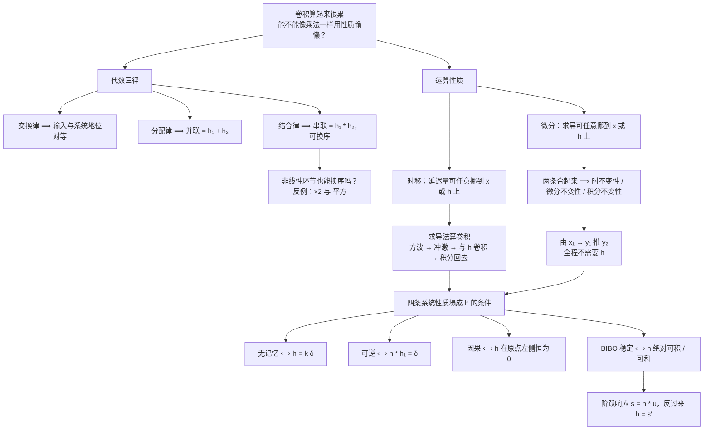
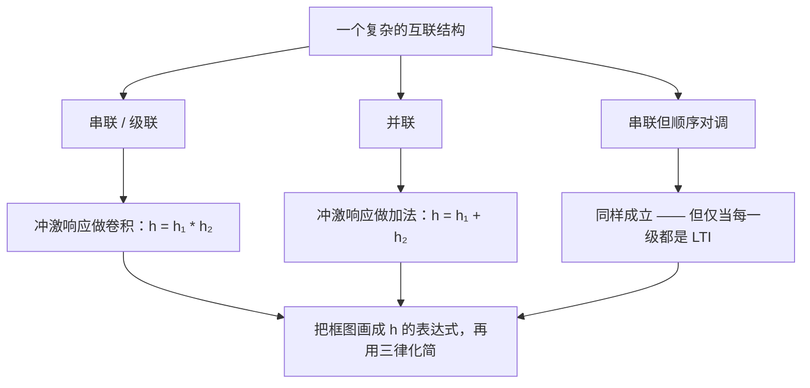
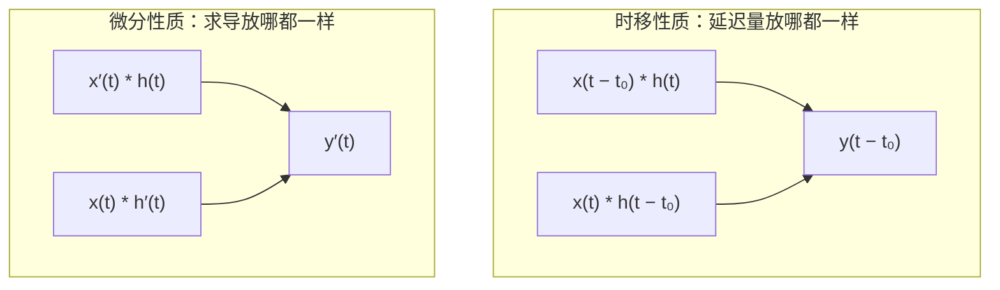
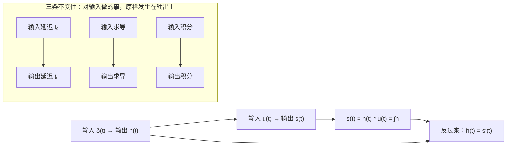

# 2.3 LTI 系统的性质 Properties of LTI System

> [!abstract] 这一讲的任务
> 前一讲我们会算卷积了，但**算得很累**——一个梯形要分四段讨论，一道题写满一页。
> 这一讲先解决“累”：卷积虽然长得像积分，行为却像**乘法**——交换律、分配律、结合律它全有，另外还多出时移、微分、积分三条。学完之后，很多卷积题**不动笔算积分就能看出答案**。
> 然后是更要紧的第二件事：第 1 章的记忆性、可逆性、因果性、稳定性这四条系统性质，在 LTI 系统里会全部**塌缩成一条关于 $h$ 的简单条件**。“一条 $h$ 刻画整个系统”这句话，到这里才真正兑现。

> [!info] 怎么读这份讲义
> 第 1 节讲代数三律（对应三种互联方式），第 2 节讲时移与微分两条运算性质，第 3 节用三个例题展示“怎么偷懒”，第 4 节把四条系统性质读到 $h$ 上，第 5 节讲阶跃响应，最后是两道随堂测的完整解析。
> 标注说明：标有 **（拓展）** 或 **【拓展】** 的内容，是课堂上没有展开、由教材与通行讲法延伸补充的部分。复习时先掌握未标注的主干，行有余力再看拓展。全篇只有一处拓展——BIBO 判据“必要性”的反证。
> 一处叫法上的勘误：原稿把微分性质印成 *The Derivation Property*，把微分/积分性质印成 *Differential or Difference property* / *Integral or Sum property*——指的是同一件事，本篇统一叫**微分性质**与**积分性质**。另外 p.47 那道多选题原稿标注“此题未设置答案”，所以本篇给的是按判据独立算出来的结果，不是原稿的标准答案。



---

## 0. 开场：两个滤波器，先做哪个？

你在写一段图像处理代码：先对图像做**高斯模糊**，再做**边缘增强**。同事说顺序反过来结果一样，你说不可能——直觉上“先模糊再锐化”和“先锐化再模糊”明明差很多。

谁对？

**如果两个操作都是 LTI 的，同事是对的，而且可以省一次运算**：两个滤波器可以先合并成一个再作用于图像。
**如果其中一个是非线性的**（比如中值滤波、ReLU、gamma 校正），你是对的，顺序绝不能换。

这一节就是把这句话变成定理。顺手你会发现，“能不能合并”这件事正是 DSP 里把多级滤波器折成一级、CNN 里把两个卷积层折成一个等效核的理论依据。

在动手之前先把上一讲留下的一个说法钉死：

> [!important] 这一讲反复要用的一句话
> 卷积是一个**乘法与加法的混合运算**（mixed operation of multiplication and summation）。
> 这句话是全部性质的来源：乘法和加法都满足交换律、分配律、结合律，所以由它们混出来的卷积也满足。
> 而“输入与输出之间是卷积”这件事**只对 LTI 系统成立**——这是所有性质的边界，越出边界就全部作废（第 1.3 节有个反例）。

---

## 1. 三条代数性质：卷积像乘法（p.32–34）

下面连续与离散并排写，证明只做一种——**两者的证明只差 $\sum$ 与 $\int$ 的符号**。

### 1.1 交换律 The Commutative Property

$$x[n]*h[n]=h[n]*x[n],\qquad x(t)*h(t)=h(t)*x(t)$$

> [!example] 证明（换元即可）
> $$y[n]=\sum_{k=-\infty}^{\infty}x[k]h[n-k]\ \xrightarrow{\ k'=n-k\ }\ \sum_{k'=-\infty}^{\infty}x[n-k']h[k']=h[n]*x[n]$$
> 连续情形令 $\tau'=t-\tau$：
> $$y(t)=\int_{-\infty}^{\infty}x(\tau)h(t-\tau)d\tau=\int_{-\infty}^{\infty}x(t-\tau')h(\tau')d\tau'=h(t)*x(t)$$
> **注意换元时积分限也翻了一次方向**（$\tau:-\infty\to\infty$ 对应 $\tau':\infty\to-\infty$），加上 $d\tau'=-d\tau$ 的负号，两个负号抵消，所以形式不变。这一步漏掉负号是常见错误。

> [!important] 它在说什么
> 输入 $x$、冲激响应 $h$ 的系统输出，**等于**输入 $h$、冲激响应 $x$ 的系统输出。
> 也就是说在卷积里，**“谁是信号、谁是系统”这个区分是人为的**——数学上两者完全对等（p.32 把两个系统上下并排放，中间一个双向箭头，正是这个意思）。
> **实用价值**：手算时哪个更简单就翻转哪个。翻转一个方波，永远比翻转一个分段函数省事。

> [!question] 停一下，先自己想想
> 考试里，交换律最实际的用法是什么？

答案就一句话：**选那两个里更好翻的一个去翻转**。卷积的“反转—平移—相乘—求和”四步里，反转的对象是可以挑的；方波、冲激串这类规则图形永远比分段指数好翻。这也是为什么后面所有例题都先把冲激或方波放到被翻转的位置上。

> [!note] 为什么卷积天然满足三大律
> 因为卷积是**乘法与加法的混合运算**，而乘法和加法都满足交换律、分配律、结合律（小学就学过）。证明只是做一次变量代换（把 $n-k$ 记成 $k'$）。
> 课堂上明确说过：**这种证明考试不考，记住性质、会用才是重点。**

### 1.2 分配律 The Distributive Property：对应“并联”

$$x[n]*\{h_1[n]+h_2[n]\}=x[n]*h_1[n]+x[n]*h_2[n]$$
$$x(t)*\{h_1(t)+h_2(t)\}=x(t)*h_1(t)+x(t)*h_2(t)$$

> [!important] 框图含义：并联 parallel interconnection
> 两个 LTI 系统**并联**（同一输入、输出相加），等效于**一个**冲激响应为 $h_1+h_2$ 的系统。
> ```mermaid
> flowchart LR
>     X1["x(t)"] --> P["整体：h₁(t) + h₂(t)"] --> Y1["y(t)"]
>     X2["x(t)"] --> A["h₁(t)"] --> S(("+"))
>     X2 --> B["h₂(t)"] --> S
>     S --> Y2["同一个 y(t)"]
> ```
> 这正是 [[C1.5 连续时间与离散时间系统]] 里“并联互联”的冲激响应版本。
> 推法：并联时 $y=y_1+y_2=x*h_1+x*h_2$，用分配律把 $x$ 提出来，就得到 $x*(h_1+h_2)$——**提出来之后那个系统的 $h$ 就是 $h_1+h_2$**。

**怎么用来偷懒**：把复杂输入拆成简单块。比如 [[C2.2 连续时间LTI系统与卷积积分]] 的随堂测里 $x_1=p+2p(t-1)$，拆开后只要算一次 $p*p$。

### 1.3 结合律 The Associative Property：对应“串联”

$$x[n]*\{h_1[n]*h_2[n]\}=\{x[n]*h_1[n]\}*h_2[n]$$
$$x(t)*\{h_1(t)*h_2(t)\}=\{x(t)*h_1(t)\}*h_2(t)$$

> [!important] 框图含义：串联（级联）cascade / series interconnection
> 两个 LTI 系统**串联**，等效于一个冲激响应为 $h_1*h_2$ 的系统；再结合交换律，**串联顺序可以任意交换**。
> ```mermaid
> flowchart LR
>     X["x(t)"] --> H1["h₁(t)"] --> H2["h₂(t)"] --> Y["y(t)"]
>     X2["x(t)"] --> H2b["h₂(t)"] --> H1b["h₁(t)"] --> Y2["同一个 y(t)"]
> ```
> 推法：串联时第一级的输出 $x*h_1$ 是第二级的输入，所以 $y=(x*h_1)*h_2$；用结合律挪一下括号，就得到 $x*(h_1*h_2)$。

> [!warning] 串联是卷积，不是乘法
> 很多人的第一直觉是“串联 = 冲激响应相乘”。**错**。在**时域**里，串联对应的是**卷积** $h_1*h_2$；**并联才是加法** $h_1+h_2$。
> 等到第 4 章做了傅里叶变换，在**频域**里串联才变成乘法 $H_1(j\omega)H_2(j\omega)$——这正是频域分析的好处。

> [!warning] 非线性系统不能换序
> $$x(t)\ \xrightarrow{\ \times2\ }\ 2x(t)\ \xrightarrow{\ (\cdot)^2\ }\ 4x^2(t)$$
> $$x(t)\ \xrightarrow{\ (\cdot)^2\ }\ x^2(t)\ \xrightarrow{\ \times2\ }\ 2x^2(t)$$
> $4x^2\neq2x^2$。**“级联可换序”是 LTI 的特权**，一旦链条里混进一个非线性环节就作废。
> ```mermaid
> flowchart LR
>     A["x(t)"] --> A1["×2"] --> A2["平方"] --> A3["4x²(t)"]
>     B["x(t)"] --> B1["平方"] --> B2["×2"] --> B3["2x²(t)"]
>     A3 -.-> C["两个结果不相等<br/>⟹ 顺序绝对不能换"]
>     B3 -.-> C
> ```
>
> 问题出在哪？**只有线性时不变系统的输入输出关系才是卷积**，而 $y=x^2$ 不是线性系统，它根本没有“冲激响应”可言，结合律无从谈起。两个子系统都必须是 LTI，才能任意换序。
>
> 回到开场：高斯模糊和边缘增强（两个卷积核）都是 LTI，可以换序也可以合并；但中值滤波、ReLU 不是，**深度网络里 conv–conv 可以合并成一个卷积，conv–ReLU–conv 不行**——这也正是激活函数存在的意义：没有它，多少层卷积都塌成一层。

**串联里那根“直通的线”是什么系统？** 这是第七节课上花了很久的一个坑，也是本章最容易丢分的地方之一。

> [!question] 课堂追问：输入 $x(t)$ 进去、输出还是 $x(t)$，这个系统的冲激响应 $h_3(t)$ 是什么？
> 很多人的答案是 $h_3(t)=1$。**错。**
> 那正确的答案是什么？

先看这个系统叫什么：输入原样输出的系统叫**恒等系统 identical system**，$y(t)=x(t)$。

再问：**什么信号和 $x(t)$ 卷积还是 $x(t)$？** 回到**信号分解**——
$$x(t)=\int_{-\infty}^{+\infty}x(\tau)\delta(t-\tau)d\tau$$
把这个式子和卷积的定义 $x(t)*h(t)=\int x(\tau)h(t-\tau)d\tau$ 对着读：结构一模一样，只是把 $h$ 换成了 $\delta$。所以

$$x(t)*\delta(t)=x(t)\quad\Longrightarrow\quad h_3(t)=\delta(t)$$

> [!important] 恒等系统的冲激响应是 $\delta(t)$，不是 1
> **“信号分解”与“卷积的单位元”原来是同一个式子的两种读法。**
> 顺便记住记号：$x(t)*\delta(t-t_0)=x(t-t_0)$——**卷一个延迟的冲激，就是把自己整体搬过去**。
> 于是那张“$h_1$ 之后分两路、上路直通、下路经 $h_2$、最后相减”的图，可以重画成：$h_1$ 之后并联 $\delta(t)$（取 +）与 $h_2(t)$（取 −）。

### 1.4 三种互联，一张图记住



> [!question] 停一下，先自己想想
> 一个系统由 $h_1$ 与 $h_2$ **串联**，再与 $h_3$ **并联**。总冲激响应是什么？

答案是
$$h=h_1*h_2+h_3$$
**串联卷、并联加**——把这一条记牢，复杂的框图就变成一道代数式化简题，第 6.2 节的随堂测就是这么做的。

---

## 2. 两条运算性质：时移与微分（p.35–36）

三律管的是“几个系统怎么拼”，接下来两条管的是“对信号做运算时会发生什么”。

### 2.1 时移性质 The Time Shift Property

> [!important] 若 $x(t)*h(t)=y(t)$，则
> $$x(t-t_0)*h(t)=x(t)*h(t-t_0)=y(t-t_0)$$
> **推论 Corollary**：
> $$x(t-t_1)*h(t-t_2)=x(t)*h(t-t_1-t_2)=x(t-t_1-t_2)*h(t)=y(t-t_1-t_2)$$

> [!example] 证明（换元）
> $$x(t-t_0)*h(t)=\int_{-\infty}^{+\infty}x(\tau-t_0)h(t-\tau)\,d\tau\ \xrightarrow{\ \tau'=\tau-t_0\ }\ \int_{-\infty}^{+\infty}x(\tau')h\big((t-t_0)-\tau'\big)d\tau'$$
> 右边正是把 $y$ 的公式里的 $t$ 换成 $t-t_0$，即 $y(t-t_0)$。
> 同理可证移 $h$ 得到同样的结果。

> [!note] 另一种理解：直接用时不变性（课堂上就是这么讲的）
> 卷积描述的是 LTI 系统。输入 $x(t)$、冲激响应 $h(t)$、输出 $y(t)$。
> - 系统不变，输入延迟成 $x(t-t_0)$：因为系统**时不变**，输出也只是延迟，$x(t-t_0)*h(t)=y(t-t_0)$；
> - 把角色对调：让 $x$ 当系统、$h$ 当输入。输入 $h$ 延迟 $t_0$，输出同样延迟：$h(t-t_0)*x(t)=y(t-t_0)$，再用**交换律**就是 $x(t)*h(t-t_0)=y(t-t_0)$。
>
> 严格说这不是证明（真正的证明是上面那次换元），但好理解、好记——**“时移量放在信号端还是系统端，是在描述同一个系统”**。

> [!tip] 一句话记忆
> **延迟可以随便挪。** 移输入、移系统、移输出，三者等价；两个延迟就相加。比如
> $$x(t)*h(t-4)=x(t-1)*h(t-3)=x(t-2)*h(t-2)=x(t-4)*h(t)=y(t-4)$$
> 甚至不必是整数。
> **这是所有卷积题里最省时间的一条**：碰到带 $u(t-3)$、$\delta(t-2)$ 之类的东西，先把延迟全部“提”到最外面，剩下的部分按最简单的形式算完再整体平移。

### 2.2 微分性质 The Derivation Property

> [!important] 若 $x(t)*h(t)=y(t)$，则
> $$x'(t)*h(t)=x(t)*h'(t)=y'(t)$$
> 高阶导数同理：**求 $n$ 阶导数的活儿可以任意分配**给 $x$ 和 $h$，总和不变，例如
> $$x''(t)*h(t)=x'(t)*h'(t)=x(t)*h''(t)=y''(t)$$
> 与之平行的是**积分性质**（p.39）：
> $$T\Big\{\int_{-\infty}^{t}x(\tau)d\tau\Big\}=\int_{-\infty}^{t}y(\tau)d\tau,\qquad T\Big\{\sum_{k=-\infty}^{n}x[k]\Big\}=\sum_{k=-\infty}^{n}y[k]$$
> 离散的对应版本把“求导”换成“差分”：$T\{x[n]-x[n-1]\}=y[n]-y[n-1]$。
>
> **取 $h(t)=\delta(t)$ 也照样满足**：这时 $x*\delta=x$，两边求导就是 $x'*\delta=x'$，性质退化成恒等式——恒等系统当然也满足它。而把求导推到 $\delta$ 自己身上，就冒出了 $\delta'(t)$，也就是 [[C2.7 奇异函数]] 里讲的**冲激偶**：把一个关于纵轴对称、底宽 $2\Delta$、高 $\frac1\Delta$ 的三角形求导，再让 $\Delta\to0$，就得到它。

> [!example] 证明（两个方向）
> **方向一（对 $h$ 求导）**：
> $$y'(t)=\frac{d}{dt}\int_{-\infty}^{+\infty}x(\tau)h(t-\tau)d\tau=\int_{-\infty}^{+\infty}x(\tau)\frac{d\,h(t-\tau)}{dt}d\tau=x(t)*h'(t)$$
> 求导和积分交换顺序即可（$t$ 在积分号外，$\tau$ 在里面，互不干扰）。
> **方向二（对 $x$ 求导）**：分部积分
> $$x'(t)*h(t)=\int\frac{dx(\tau)}{d\tau}h(t-\tau)d\tau=\underbrace{\big[x(\tau)h(t-\tau)\big]_{-\infty}^{+\infty}}_{=0}-\int x(\tau)\,d\,h(t-\tau)$$
> 再把 $d\,h(t-\tau)=h'(t-\tau)\cdot d(t-\tau)=-h'(t-\tau)d\tau$ 代入，负负得正：
> $$=\int x(\tau)h'(t-\tau)d\tau=x(t)*h'(t)$$
>
> **边界项为什么是 0**：严格说这一步需要条件 $x(+\infty)h(-\infty)-x(-\infty)h(+\infty)=0$。实际应用里系统多是**因果系统**、输入从 $t=0$ 才加上：没有激励就没有输出，所以 $h(-\infty)=0$；负时间上也没有输入，$x(-\infty)=0$。这一项为零，这个条件在应用中默认成立。
> **考试不考这个证明**（那是高数与数学课的事），记住性质、会用即可。

### 2.3 三条不变性：这一节最漂亮的地方

把时移性质和微分性质摆在一起看，会发现它们讲的是同一件事：



> [!important] LTI 系统最优美的性质：三条不变性
> | 名字 | 意思 | 公式 |
> |---|---|---|
> | **时不变性** Time Invariance | 输入延迟 $\Rightarrow$ 输出同样延迟 | $x(t-t_0)*h(t)=y(t-t_0)$ |
> | **微分不变性** Differential Invariance | **输入求导 $\Rightarrow$ 输出同样求导** | $x'(t)*h(t)=y'(t)$ |
> | **积分不变性** Integral Invariance | **输入积分 $\Rightarrow$ 输出同样积分** | $x^{(-1)}(t)*h(t)=y^{(-1)}(t)$ |
>
> 三条的共同句式是：**你对输入做了什么运算，同样的运算会原样出现在输出上，系统本身一点没变。**
> 这条性质值得单独给一句评价：它**是线性时不变系统最漂亮的一个性质**——别的系统没有这么好的性质。时不变、微分不变、积分不变，三条都很重要。

**积分不变性为什么成立？** 课堂上给了一个非常形式化的漂亮推导。起点是 $\delta$ 与 $u$ 的关系：$\delta$ 的一次积分（running integral）就是 $u$，所以

$$x(t)=x(t)*\delta(t)=x(t)*u'(t)=\Big(\int_{-\infty}^{t}x\Big)'(t)$$

把它送进系统：输入的积分经过 $h$ 得到输出，即 $\big(\int_{-\infty}^{t}x\big)*h$。而按微分不变性，“输入求导 $\Rightarrow$ 输出求导”反过来读就是“**输入的积分 $\Rightarrow$ 输出的积分**”：

$$\Big(\int_{-\infty}^{t}x\Big)*h=\int_{-\infty}^{t}\big(x*h\big)=\int_{-\infty}^{t}y$$

再换个角度写一遍（课堂上就是这么推进的）：把 $x$ 写成 $x*u'$，用交换律与结合律把 $u$ 挪到 $h$ 旁边——

$$x*u*h=x*(u*h)=(x*h)*u=y*u=\int_{-\infty}^{t}y(\tau)d\tau$$

两种写法都落在同一个结论上。**微分与积分互为逆运算，所以微分不变性成立，积分不变性自动成立**——它们在结构上是一对。

> [!question] 停一下，这条性质值钱在哪
> 想想什么信号求导之后会变得**特别简单**。

**答案：方波（矩形脉冲）。** 方波求一次导就变成两个冲激，而冲激卷积任何东西都等于“原样搬过去”（$x*\delta(t-t_0)=x(t-t_0)$）。于是“方波 * 复杂信号”这种硬骨头，被转化成“两个复杂信号相减”。下一节的例题就是靠这一招，把一道需要分四段讨论的题变成三行代数式。

> [!tip] 这三条不变性的战略价值
> 它们合起来说明：**当你解不出一个卷积时，可以先把问题搬到“导数空间”或“积分空间”去，在那里解完再搬回来。**
> 因为常数项求导就变成 0，很多在原来的空间里纠缠不清的东西，在导数空间里会一下子变干净。这个思路在第 5 节（阶跃响应）还会再出现一次。

---

## 3. 把性质用起来：三个例题

### 3.1 例一：方波 * 斜坡（p.37–38）

> [!example] 题目
> $x(t)$：$0\le t\le T$ 上高度为 1 的方波；$h(t)$：$0\le t\le 2T$ 上从 0 线性升到 $2T$ 的斜坡。求 $y=x*h$。

如果按定义硬算，要按重叠情况分几段讨论——这道题分段讨论要 **5 段**。换一条路：**先求导，再卷积，最后积分回去**。

**第一步：给 $x$ 求导。** 方波只在两个断点上跳变，断点上求导就是冲激，跳变量是冲激的强度：
$$x'(t)=\delta(t)-\delta(t-T)$$

**第二步：用微分不变性，把卷积变成减法。**
$$y'(t)=x'(t)*h(t)=h(t)*\big[\delta(t)-\delta(t-T)\big]=h(t)-h(t-T)$$

这一步用到了 $x(t)*\delta(t)=x(t)$ 与 $x(t)*\delta(t-t_0)=x(t-t_0)$——**冲激是卷积的“1”**（第 4.1 节会解释为什么）。

**第三步：把 $y'$ 画出来。** 取 $T=1$，$h(t)=t\ (0\le t\le 2T)$、$h(t-T)=t-T\ (T\le t\le 3T)$：

| 区间 | $y'(t)=h(t)-h(t-T)$ | 形状 |
|---|---|---|
| $0\to T$ | $t-0=t$ | 从 0 线性升到 $T$ |
| $T\to 2T$ | $t-(t-T)=T$ | 常数 $T$（两条斜坡之差） |
| $2T\to 3T$ | $0-(t-T)=T-t$ | 从 $-T$ 线性降到 $-2T$ |

在 $t=2T$ 处 $y'$ 有一个向下的跳变，从 $+T$ 跳到 $-T$。

**第四步：积分回去。** $y(t)=\int_{-\infty}^{t}y'(\tau)d\tau$，积分常数由“$t\to-\infty$ 时 $y=0$”定死（因果信号），不是任意的：

$$y(t)=\begin{cases}0,&t<0\\[1mm]\dfrac{t^2}{2},&0\le t\le T\\[2mm]tT-\dfrac{T^2}{2},&T\le t\le 2T\\[2mm]\dfrac{3T^2}{2}+tT-\dfrac{t^2}{2},&2T\le t\le 3T\\[2mm]0,&t>3T\end{cases}$$

分段积分的过程：$0\to T$ 段积的是线性增长的三角形，面积按平方增长；$T\to2T$ 段正负面积一直在抵消，净增长正好是那块**高度不变、宽度在变**的小矩形，所以是线性增长；过了 $2T$ 段净面积变负，曲线掉头向下；到 $3T$ 正负完全抵消，回到 0。

![[C2.3-求导法算卷积三步波形.png]]

三个关键节点（$T=1$）：

$$y(T)=\tfrac12T^2=0.5,\qquad y(2T)=\tfrac32T^2=1.5,\qquad y(3T)=0$$

**数值验算**（$T=1$，对 $y'$ 做数值积分）：$y(1)=0.500$，$y(2)=1.500$，$y(3)=0.000$，与闭式解 $\frac12T^2$、$\frac32T^2$、$0$ 完全吻合。

> [!warning] 用完微分一定要记得积分回去
> 最常见的失误是算出 $y'(t)$ 就交卷。$y'$ 和 $y$ 差一次积分，**而且积分常数由“$t\to-\infty$ 时 $y=0$”定死**（因果信号），不是任意的。

### 3.2 例二：由一个输入输出对推另一个（p.40）

这道题被特意点过名：**经常拿来考试，有一年的考研题就用了它**——只要把信号形状变一变就是一道新题。所以下面每一步都不要省。

> [!example] 题目
> 已知某 LTI 系统：$x_1(t)$（$0\le t\le1$ 的单位方波）$\to$ $y_1(t)=e^{-2t}u(t)$。
> 求它对 $x_2(t)$（$-1\le t\le0$ 线性从 0 升到 1，$t>0$ 恒为 1）的响应。

> [!question] 课堂追问
> 我们**不知道** $h(t)$。还能算吗？

#### 先看最自然的思路，以及它为什么走不通

最直接的想法是：$x_1$ 和 $y_1$ 都已知，把它们代进 $y_1=x_1*h$ 就能解出 $h$；有了 $h$，$y_2=x_2*h$ 就完事了。

**这条路走不通。** 因为这里要的不是加减乘除，而是**卷积的逆运算**：

- 加法有逆运算——减法；
- 乘法有逆运算——除法；
- **卷积没有逆运算。**

卷积是乘法与加法**耦合**在一起的混合运算，时域上找不到把 $x_1$ 和 $h$ “解耦”的办法。真要往前走，得等学过傅里叶变换：**频域里卷积变成乘法**，那时才能解出 $H$ 再反变换回来。现在没有这个工具。

#### 换一条能走通的路：找 $x_2$ 与 $x_1$ 的关系

既然解不出 $h$，那就绕开 $h$——

> [!important] 这类题的总思路
> **只要能把 $x_2$ 表示成“对 $x_1$ 做线性 + 时不变 + 微积分操作”的结果，$y_2$ 就用完全相同的那套操作作用在 $y_1$ 上。**
> 依据是线性 + 时不变 + 微分不变性 + 积分不变性。**全程不需要知道 $h$。**

那么 $x_2$ 和 $x_1$ 是什么关系？给 $x_2$ 求导试试：$-1\le t\le0$ 段是斜率 1 的直线，求导得常数 1；$t>0$ 段是常数，求导得 0。所以

$$x_2'(t)=\begin{cases}1,&-1\le t\le0\\0,&\text{其他}\end{cases}$$

这正是一个宽度 1、高度 1 的方波——就是 $x_1$ 往左平移 1 个单位：

$$\boxed{\ x_2'(t)=x_1(t+1)\ }$$

（等价的写法是积分关系：$x_2(t)=x_1^{(-1)}(t+1)=\displaystyle\int_{-\infty}^{t+1}x_1(\tau)d\tau$。两种写法都对，见本节末尾的“两种写法”说明。）

#### 把关系平移到输出上

$x_2$ 是由 $x_1$ 经过“左移 1 + 求导”两步得到的。这两步都有对应的不变性，可以直接平移到输出：

**时移不变性**：输入 $x_1(t+1)$ $\Rightarrow$ 输出 $y_1(t+1)$。
**微分不变性**：输入再求导 $\Rightarrow$ 输出再求导。

于是

$$y_2'(t)=y_1(t+1)=e^{-2(t+1)}u(t+1)$$

#### 最后积分回去

$$y_2(t)=\int_{-\infty}^{t}y_2'(\tau)d\tau=\int_{-\infty}^{t}y_1(\tau+1)\,d\tau$$

> [!note] 为什么“黑板上的写法”和“这一页的写法”看起来不一样
> 课堂上先把 $y_2$ 平行带下来，得到的是
> $$y_2(t)=\int_{-\infty}^{t}y_1(\tau+1)d\tau$$
> 而这一页（以及原稿）写的是
> $$y_2(t)=\int_{-\infty}^{t+1}y_1(\sigma)d\sigma$$
> 两式**一模一样**，只是中间省了一步**变量代换**：令 $\sigma=\tau+1$，则 $d\sigma=d\tau$（差一个常数 1，不影响微分元），积分下限 $\tau=-\infty$ 对应 $\sigma=-\infty$，上限 $\tau=t$ 对应 $\sigma=t+1$，所以
> $$\int_{-\infty}^{t}y_1(\tau+1)d\tau\ \xrightarrow{\ \sigma=\tau+1\ }\ \int_{-\infty}^{t+1}y_1(\sigma)d\sigma$$
> **看到两个长得不一样的积分式，先别慌，做一次变量代换往往就归一了。**

代入 $y_1(\sigma)=e^{-2\sigma}u(\sigma)$，被积函数从 $\sigma=0$ 才开始非零（**这一步隐含了条件 $t+1>0$**）：

$$y_2(t)=\int_{0}^{t+1}e^{-2\sigma}d\sigma=\frac{1-e^{-2(t+1)}}{2}\quad(t+1>0)$$

把隐含条件写成显式因子：

$$\boxed{\ y_2(t)=0.5\big(1-e^{-2(t+1)}\big)u(t+1)\ }$$

**数值验算**：$t=-1$ 时 $y_2=0$ ✓（响应从 $t=-1$ 才起）；$t=0$ 时 $y_2=0.5(1-e^{-2})=0.4323$；$t\to\infty$ 时 $y_2\to0.5=\int_0^\infty e^{-2\tau}d\tau$ ✓。

> [!warning] 这类题的两个易错点
> 1. **忘了隐含条件**。积分下限被 $u(\sigma)$ 截到 0，这等价于要求 $t+1>0$；不写 $u(t+1)$ 就把 $t<-1$ 时的响应也算成非零，答案直接错。
> 2. **把“左移 1”记成“右移 1”**。$x_2'(t)=x_1(t+1)$ 是**左移**（$t+1$ 让 $x_1$ 提前发生）；输出端的平移方向必须与输入端一致。

### 3.3 例三：方波 * 方波，一次积分都不用

> [!example] 求 $y(t)=p_T(t)*p_T(t)$，其中 $p_T$ 是 $[0,T]$ 上的单位方波。

$$p_T'(t)=\delta(t)-\delta(t-T)\ \Longrightarrow\ y'(t)=p_T(t)-p_T(t-T)$$

$y'(t)$ 是“$[0,T]$ 上为 $+1$、$[T,2T]$ 上为 $-1$”的方波。积分回去：

$$y(t)=\begin{cases}t,&0\le t\le T\\ 2T-t,&T<t\le2T\\ 0,&\text{else}\end{cases}$$

底宽 $2T$、峰值 $T$ 的**三角波**，与 [[C2.2 连续时间LTI系统与卷积积分]] 里直接分段积分的结果一致，但这里**一次积分都没算**。

**回头总结一句**：三个例题用的是同一招——**把信号搬到导数空间，让卷积退化成加减法，再积分搬回来**。这也正是第 2.3 节那三条不变性的战略价值。

---

## 4. 四条系统性质，在 LTI 下各塌成一条关于 $h$ 的条件

第 1 章讲系统性质时，讨论的是**一般系统**：有记忆/无记忆、可逆/不可逆、因果/非因果、稳定/不稳定。这一节给它们加了一个定语——**LTI**。

加了定语之后会发生什么？性质不再是抽象的“输出依赖不依赖未来”，而是**直接读在 $h$ 上**：每条性质都变成一个关于 $h$ 的简单条件。这是我们推导卷积时就一直在用的那件事的另一面——**$h$ 完全代表 LTI 系统**，所以系统的性质当然也只能由 $h$ 决定。

### 4.1 无记忆性 Memoryless（2.3.4）

无记忆的定义：**当前时刻的输出只依赖当前时刻的输入**。把离散卷积拆开看：

$$y[n]=\sum_{k}h[k]x[n-k]=\cdots+h[-1]x[n+1]+h[0]x[n]+h[1]x[n-1]+\cdots$$

> [!question] 停一下，先自己想想
> “无记忆”意味着 $y[n]$ 只能依赖 $x[n]$。那这一串里哪些项必须为零？

注意：**不是让输入项为零**（$x[n+1]$、$x[n-1]$ 作为信号当然可以非零），而是让**系数**为零——因为无记忆是**系统**的性质：

$$h[-1]=h[\pm1]=h[\pm2]=\cdots=0$$

**除了 $h[0]x[n]$ 这一项，其余全部必须为零。**

> [!important] 无记忆 ⇔ $h$ 只在原点非零
> $$h[n]=k\,\delta[n]\ \Longleftrightarrow\ y[n]=k\,x[n]$$
> $$h(t)=k\,\delta(t)\ \Longleftrightarrow\ y(t)=k\,x(t)$$
> 把 $h$ 展开写就是 $h[n]=k\delta[n]$——**一个孤零零的冲激**：$k$ 是冲激的**大小**（增益），$n=0$ 是冲激的**位置**。
> 反过来，只要 $h$ 在原点之外还有任何一项非零，那一项就必然带着 $x[n\pm1]$ 或 $x[n\pm2]$，系统就有记忆。

取 $k=1$ 就得到那条被反复用到的恒等式：

> [!important] 冲激是卷积运算的单位元
> $$\boxed{\ x[n]*\delta[n]=x[n],\qquad x(t)*\delta(t)=x(t)\ }$$
> 原稿把它和**信号分解**并列写出：
> $$x[n]=x[n]*\delta[n]\triangleq\sum_{k}x[k]\delta[n-k],\qquad x(t)=x(t)*\delta(t)\triangleq\int_{-\infty}^{+\infty}x(\tau)\delta(t-\tau)d\tau$$
> **“信号分解”和“卷积单位元”原来是同一个式子的两种读法**——第 1.3 节认出恒等系统 $h_3=\delta(t)$ 时用的正是这一条，这里正式回收。
> 这也是第 3.1 节那一步“冲激卷积任何东西都等于原样搬过去”的依据。

### 4.2 可逆性 Invertibility（2.3.5）

原系统 $h$，逆系统 $h_1$。两者**串联**之后应该“什么也没做”，也就是等效于**恒等系统**——而恒等系统的冲激响应是 $\delta$：

$$\boxed{\ h(t)*h_1(t)=\delta(t)\quad\text{或}\quad h[n]*h_1[n]=\delta[n]\ }$$

> [!warning] 时域里求逆系统是件很难的事
> $\delta$ 是已知的，但要从 $h*h_1=\delta$ 里解出 $h_1$，本质上是**卷积求逆**——而卷积没有逆运算（第 3.2 节已经撞过这堵墙）。
> 把问题投影到频域就轻松了：卷积变成乘法，$\delta$ 变成常数 1，于是 $H(j\omega)H_1(j\omega)=1$，即
> $$H_1=\frac{1}{H}$$
> **判断可逆性从此只是看 $H$ 有没有零点。** 第 4 章之后这比时域容易得多。

> [!tip] 举个例子
> 累加器 $h[n]=u[n]$ 的逆系统是一阶差分 $h_1[n]=\delta[n]-\delta[n-1]$。
> 验证：$u[n]*(\delta[n]-\delta[n-1])=u[n]-u[n-1]=\delta[n]$ ✓。
> 这对“积分 ↔ 微分”的离散版本（求和 ↔ 差分），在第 5 节阶跃响应那里还会再出现。

### 4.3 因果性 Causality（2.3.6）

因果 = 输出不能依赖未来的输入，也就是**输出不能超前于输入**（有因才有果，因在前、果在后）。看

$$y[n]=\sum_{k}h[k]x[n-k]=\cdots+h[-2]x[n+2]+h[-1]x[n+1]+h[0]x[n]+h[1]x[n-1]+\cdots$$

带**未来**输入 $x[n+1],x[n+2],\dots$ 的项，系数正是 $h[-1],h[-2],\dots$。要它们统统消失：

> [!important] LTI 因果性判据
> $$h[n]=0\ \ (n<0)\qquad\qquad h(t)=0\ \ (t<0)$$
> 换句话说：**冲激响应本身必须是因果信号**。
> 顺带定义：**因果信号 Causal Signal** 指 $x[n]=0\ (n<0)$ 或 $x(t)=0\ (t<0)$。

> [!warning] 别把“因果系统”和“因果信号”混为一谈
> 这两个词长得一样但说的是不同对象。判据的形式是：**系统因果 ⇔ 它的 $h$ 是因果信号**。
> 直觉检查：$t<0$ 就有 $h(t)\ne0$ 意味着“还没敲，箱子先响了”——物理上不可能。

### 4.4 稳定性 Stability（BIBO，2.3.7）

稳定的定义（第 1 章）：**每一个有界输入都产生有界输出**（Bounded Input Bounded Output）。下面把充分性从头推一遍。

> [!example] 充分性证明（离散）
> 设 $|x[n]|<B$ 对所有 $n$ 成立（$B$ 是一个常数上界）。先**用交换律把 $h$ 写在前面**，才好放缩：
> $$y[n]=x[n]*h[n]=\sum_{k=-\infty}^{+\infty}x[k]h[n-k]=\sum_{k=-\infty}^{+\infty}h[k]x[n-k]$$
> 取绝对值，用三角不等式 $|a+b|\le|a|+|b|$ 把求和号里的绝对值放大：
> $$|y[n]|\le\sum_{k}|h[k]|\,|x[n-k]|<B\sum_{k=-\infty}^{+\infty}|h[k]|$$
> 最后一步把每一个 $|x[n-k]|$ 都放大到上界 $B$ 并提到求和号外。于是**只要 $\sum_k|h[k]|<\infty$，就有 $|y[n]|<A$**（有界），$A$ 取 $B\sum_k|h[k]|$。
> 连续情形完全平行，只是把求和换成积分、把绝对值号拿到积分号里面：
> $$|y(t)|\le\int_{-\infty}^{+\infty}|h(\tau)|\,|x(t-\tau)|d\tau<B\int_{-\infty}^{+\infty}|h(\tau)|d\tau$$

> [!important] LTI 稳定性判据（充分必要 Sufficient & Necessary）
> $$\sum_{k=-\infty}^{+\infty}|h[k]|<+\infty\qquad\qquad \int_{-\infty}^{+\infty}|h(\tau)|\,d\tau<+\infty$$
> 即 **$h$ 绝对可和 / 绝对可积**。原稿特意标注这是**充要条件**（充分且必要）。

> [!question] 上面只证了“充分”，“必要”怎么来？
> 反证：若 $\sum_k|h[k]|=\infty$，构造一个**有界**输入
> $$x[n]=\operatorname{sgn}\big(h[-n]\big)=\begin{cases}1,&h[-n]\ge0\\-1,&h[-n]<0\end{cases}$$
> 显然 $|x[n]|\le1$ 有界。但
> $$y[0]=\sum_kh[k]x[-k]=\sum_kh[k]\operatorname{sgn}(h[k])=\sum_k|h[k]|=\infty$$
> 输出无界 ⇒ 系统不稳定。所以绝对可和是**必须**的。
>
> **【拓展】** 这段反证课堂上只提了一句“可以做反证法”就跳过了，它是标准教材（Oppenheim）里的证法，考“为什么是充要”时用得上。

> [!example] 三个快速判例，练手用
> **(a) $h(t)=u(t)$ —— 不稳定。** $\int_0^\infty1\,dt=\infty$。这是**积分器**：输入一个有界的常数 1，输出 $t$ 无限增长。
> **(b) $h[n]=(0.5)^nu[n]$ —— 稳定。** $\sum_{n\ge0}0.5^n=2<\infty$。
> **(c) $h[n]=2^{\,n}u[-n]$ —— 稳定。** $u[-n]$ 要求 $n\le0$，$\sum_{n=-\infty}^{0}2^{\,n}=\sum_{m\ge0}2^{-m}=2<\infty$。
> **(c) 的易错点**：底数 2 大于 1，但信号是**向左**延伸的，实际在衰减。判发散之前先看清 $u[\cdot]$ 的方向。

---

## 5. 阶跃响应：换一种“敲”的方式（2.3.8）

除了“敲一下”（冲激输入），工程上另一种常做的实验是“**推上去不放**”——加一个阶跃输入，看系统怎么爬。这个响应记作 $s$：

$$u[n]\ \longrightarrow\ \boxed{h[n]}\ \longrightarrow\ s[n]=u[n]*h[n]$$

> [!important] 阶跃响应与冲激响应的关系
> **离散**：
> $$s[n]=\sum_{k=-\infty}^{n}h[k]=h[n]*u[n]\quad\text{(Running sum 累加和)}$$
> $$h[n]=s[n]-s[n-1]\triangleq\Delta s[n]\quad\text{(First difference 一阶差分)}$$
> **连续**：
> $$s(t)=\int_{-\infty}^{t}h(\tau)\,d\tau=h(t)*u(t)=h^{(-1)}(t)\quad\text{(Running integral)}$$
> $$h(t)=s'(t)\quad\text{(First derivative)}$$

**为什么？** 因为 $u$ 和 $\delta$ 本来就是一对积分/微分关系（[[C1.4 单位冲激与单位阶跃函数]]）：

$$u[n]=\sum_{k=-\infty}^{n}\delta[k],\qquad \delta[n]=u[n]-u[n-1]$$
$$u(t)=\int_{-\infty}^{t}\delta(\tau)d\tau,\qquad \delta(t)=u'(t)$$

把这层关系“**穿过**”LTI 系统——用的正是第 2.3 节的微分不变性与积分不变性：输入是阶跃、输出是 $s$；那输入的导数 $\delta$ 对应的输出就是 $s'$，也就是 $h$。所以 $h$ 与 $s$ 之间继承了 $\delta$ 与 $u$ 完全相同的关系。



> [!important] 这里点出的一个方法论：导数空间 / 积分空间
> 既然 $h$ 和 $s$ 是“同一个系统的两种等价描述”，那么**研究一个系统时，你可以量 $h$，也可以量 $s$，两条路等价。**
> 更一般地：**在原来的空间里解不出来的问题，可以搬到导数空间或积分空间去解，解完再搬回来。** 因为常数项求导就变成 0，很多缠在一起的东西在导数空间里会一下子变干净。
> 这就是第 3 节那三个例题背后的同一件事——那条路走不通，就换一条（求导的、积分的）走。

> [!tip] 工程意义：为什么实验室测阶跃响应而不是冲激响应
> **测冲激响应很难**：真正的 $\delta(t)$ 做不出来——要在无限短的时间里注入有限能量，实际器件要么做不到，要么直接烧掉。
> **测阶跃响应很容易**：一个开关就够了，容易、可重复、信噪比高。
> 所以实验室的标准做法是：**测 $s$，再求导/差分得到 $h$。**

> [!example] 反着来一道：已知 $s$ 求 $h$
> 某 LTI 系统对 $u(t)$ 的响应是 $s(t)=(1-e^{-3t})u(t)$，求 $h(t)$ 并判断稳定性。
> $$h(t)=s'(t)=\frac{d}{dt}\big[(1-e^{-3t})u(t)\big]=3e^{-3t}u(t)+\underbrace{(1-e^{-3t})\big|_{t=0}}_{=0}\delta(t)=3e^{-3t}u(t)$$
> 求导时**必须用乘积法则**，冲激项的系数是 $s$ 在 0 处的跳变量；这里跳变为 0，所以冲激项消失。（若 $s$ 在 $t=0$ 有跳变，$h$ 里就会有 $\delta$。）
> **稳定**：$\int_0^\infty3e^{-3t}dt=1<\infty$ ✓
> **验算**：反过来 $\int_0^t3e^{-3\tau}d\tau=1-e^{-3t}$ ✓

**伏笔回收**：回头看 [[C2.1 离散时间LTI系统与卷积和]] 的例题 2.3，$u[n]*a^nu[n]=\frac{1-a^{n+1}}{1-a}u[n]$——那道题算的其实就是这个系统的**阶跃响应**，而 $\sum_{k=0}^n a^k$ 正是“$h$ 的累加和”。当时算的是一道普通卷积题，现在知道它只是 $h$ 与 $s$ 之间那条关系的一个实例。

---

## 6. 随堂测（p.47–48）

### 6.1 第 1 题（多选题 1 分）：哪个 $h$ 对应稳定系统

> [!example] 题目
> Which of the following impulse responses correspond(s) to a **stable** LTI system?
> **A** $h_1(t)=e^{-(1-2j)t}u(t)$  **B** $h_2(t)=e^{-t}\cos(2t)u(t)$
> **C** $h_3[n]=n\cos\big(\tfrac{\pi}{4}n\big)u[n]$  **D** $h_4[n]=3^{\,n}u[-n+10]$

> [!warning] 原稿标注
> 这一页写着“**此题未设置答案**”，所以下面的选项与解析是按判据独立算出来的结果，不是原稿给出的标准答案。

**逐项解析**：

- **A：稳定。** $|h_1(t)|=|e^{-t}e^{\,2jt}|=e^{-t}$（复指数部分模为 1，只管振荡不管大小）。$\int_0^\infty e^{-t}dt=1<\infty$ ✓
  **易错点**：看到指数上有虚部就慌。**判稳定只看实部**——实部为负（这里是 $-1$）就衰减。
- **B：稳定。** $|h_2(t)|=e^{-t}|\cos2t|\le e^{-t}$，被一个可积函数控制住，$\int_0^\infty e^{-t}dt=1<\infty$ ✓
- **C：不稳定。** $|h_3[n]|=n|\cos(\pi n/4)|$，随 $n$ **线性增长**，$\sum n|\cos(\cdot)|$ 发散 ✗
  **易错点**：$\cos$ 有界不代表乘积有界，前面那个 $n$ 是致命的。
- **D：稳定。** $u[-n+10]$ 要求 $n\le10$，是**左边信号**。在 $n\to-\infty$ 时 $3^n\to0$：
  $$\sum_{n=-\infty}^{10}3^{\,n}=3^{10}\sum_{m=0}^{\infty}3^{-m}=3^{10}\cdot\frac{3}{2}=\frac{3^{11}}{2}=88573.5<\infty\ ✓$$
  **易错点**：看到底数 $3>1$ 就判发散。**对左边信号，底数大于 1 反而是衰减的**——方向反了。这类“把 $u[-n+c]$ 看成右边信号”的错误在 [[C2.1 离散时间LTI系统与卷积和]] 的随堂测里也出现过。

**答案：A、B、D。**

### 6.2 第 2 题（主观题 5 分）：互联系统的 $h(t)$

> [!example] 题目
> $h_1(t)=e^{-2t}u(t)$，$h_2(t)=\delta(t-2)$。互联方式是：$x(t)$ 先过 $h_1$，之后分两路——上路**直通**，下路过 $h_2$，两路进加法器时**上取正、下取负**。求总系统的 $h(t)$。

**第一步：认出那根直通的线。** 上路输入 $x$ 出去还是 $x$，是一个**恒等系统**，冲激响应是 $\delta(t)$（第 1.3 节的结论），**不是 1**。

**第二步：算并联部分的等效冲激响应。** 两路取和后是 $\delta(t)-h_2(t)$。用**分配律**：

$$h_{\text{并}}(t)=\delta(t)-h_2(t)=\delta(t)-\delta(t-2)$$

**第三步：与 $h_1$ 串联。** 串联是卷积，用**分配律**拆开：

$$h(t)=h_1(t)*\big[\delta(t)-\delta(t-2)\big]=h_1(t)*\delta(t)-h_1(t)*\delta(t-2)$$

**第四步：用单位元与时移性质化简。** $x*\delta=x$、$x*\delta(t-t_0)=x(t-t_0)$：

$$\boxed{\ h(t)=e^{-2t}u(t)-e^{-2(t-2)}u(t-2)\ }$$

**全程没算一个积分。**

**判断两条性质**：

- **因果性**：$t<0$ 时两项都为 0 ⇒ **因果** ✓
- **稳定性**：$\int_0^\infty e^{-2t}dt=\frac12$，两项都绝对可积 ⇒ **稳定** ✓

**画出来看**：$0\le t<2$ 段是 $e^{-2t}$ 的衰减；$t=2$ 处突然减掉一个从 1 开始的衰减指数，出现向下的跳变

$$e^{-4}-1\approx-0.9817$$

之后是 $(e^{-4}-1)e^{-2(t-2)}$，从负值单调回到 0。

> [!warning] 这道题的两个易错点
> 1. **加法器的 $-$ 号要写进 $h_{\text{并}}$ 里**。忘了它会得到 $h_1+h_1(t-2)$，完全相反。
> 2. **直通支路的冲激响应是 $\delta(t)$，不是 1**。恒等系统是 $x*\delta=x$，不是 $x\times1$。

> [!todo] 这道题的来历
> 它是第七节课留的作业题，课上先完整讲了一遍——因为“从框图读 $h$”是这一节的核心技能，框图题在考试里一定会出现。

---

## 这一讲的三句话

1. **卷积的行为像乘法**：交换、分配、结合律齐全，分别对应“输入与系统对等”“并联相加”“串联相卷且可换序”——而换序是 **LTI 独有的特权**，混进一个非线性环节就作废。
2. **时移、微分、积分是同一件事的三个面**：延迟量、求导阶数都可以在 $x$ 与 $h$ 之间任意分配，总和落到输出上。方波求导变冲激，于是“卷积”退化成“减法”——这是这一节最实用的偷懒方式。
3. **四条系统性质在 LTI 下各塌成一条 $h$ 的条件**：无记忆 ⇔ $h=k\delta$；可逆 ⇔ $h*h_1=\delta$；因果 ⇔ $h$ 是因果信号；稳定 ⇔ $h$ 绝对可和/可积。

> [!tip] 速查表
> | 性质 | 公式 | 框图含义 |
> |---|---|---|
> | 交换 | $x*h=h*x$ | 输入与系统对等 |
> | 分配 | $x*(h_1+h_2)=x*h_1+x*h_2$ | **并联** $\Rightarrow h_1+h_2$ |
> | 结合 | $x*(h_1*h_2)=(x*h_1)*h_2$ | **串联** $\Rightarrow h_1*h_2$，可换序 |
> | 时移 | $x(t-t_1)*h(t-t_2)=y(t-t_1-t_2)$ | 延迟可挪 |
> | 微分 | $x'*h=x*h'=y'$ | 方波 → 冲激 |
> | 积分 | $x^{(-1)}*h=(x*h)^{(-1)}=y^{(-1)}$ | 阶跃 → 斜坡 |
> | 单位元 | $x*\delta=x$，$x*\delta(t-t_0)=x(t-t_0)$ | 恒等系统 $h=\delta$ |
> | 无记忆 | $h=k\delta$ | 只看当前时刻 |
> | 可逆 | $h*h_1=\delta$ | 串联抵消；频域 $H_1=1/H$ |
> | 因果 | $h(t)=0,\ t<0$ | 不看未来 |
> | 稳定 | $\int\lvert h\rvert<\infty$；$\sum\lvert h\rvert<\infty$ | 充要 |
> | 阶跃响应 | $s=h*u$；$h=s'$ 或 $\Delta s$ | 实验里测 $s$ 更容易 |

> [!tip] 下一讲预告
> 到这里，只要给了 $h$，一切都好办。可现实里没人会把 $h$ 递给你——**工程师手上拿到的是从电路图列出来的一个微分方程**，比如 $y''+6y'+8y=x$。
> 下一讲的问题是：**从一个微分方程出发，怎么求系统的响应？** 你会看到两条并行的路——高数里学过的“齐次解+特解”，和本章新学的“零输入+零状态”。它们长得很像却**不是一回事**，分不清是这一章最大的失分点。

---

## 相关笔记 Related Notes

- 相关：[[C1.5 连续时间与离散时间系统]]（串联/并联/反馈互联）、[[C1.6 系统的基本性质]]（四条性质的原始定义）、[[C2.7 奇异函数]]（$\delta$ 的运算公式与冲激偶 $\delta'$）
- 上一讲：[[C2.2 连续时间LTI系统与卷积积分]]
- 下一讲：[[C2.4 微分方程与连续时间系统求解]]
- 返回：[[信号与系统 MOC]]
