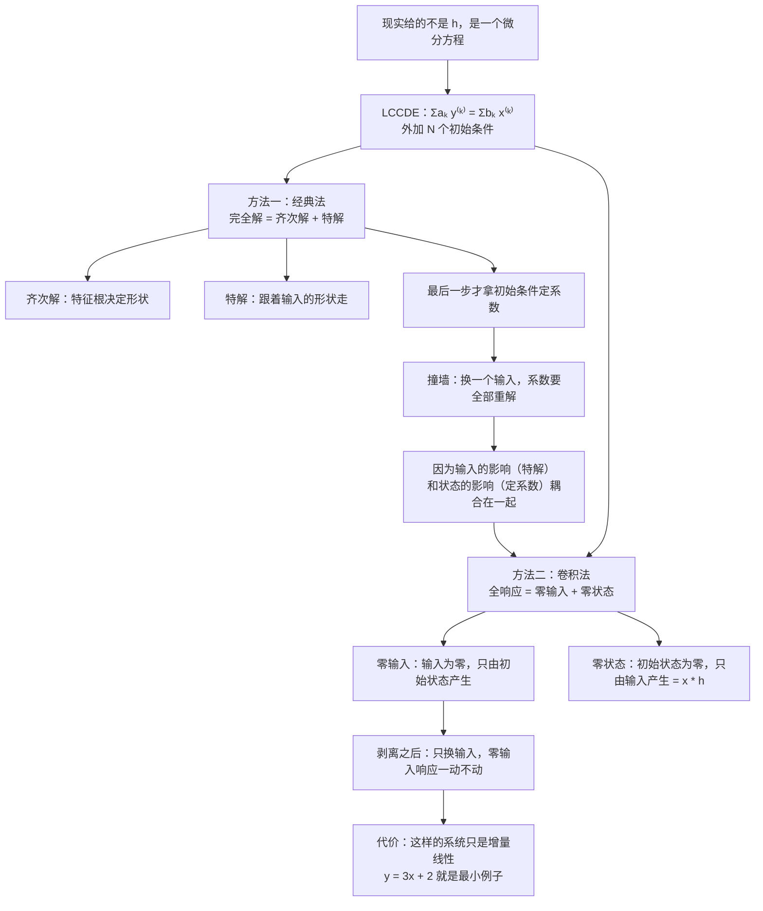
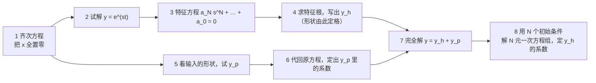
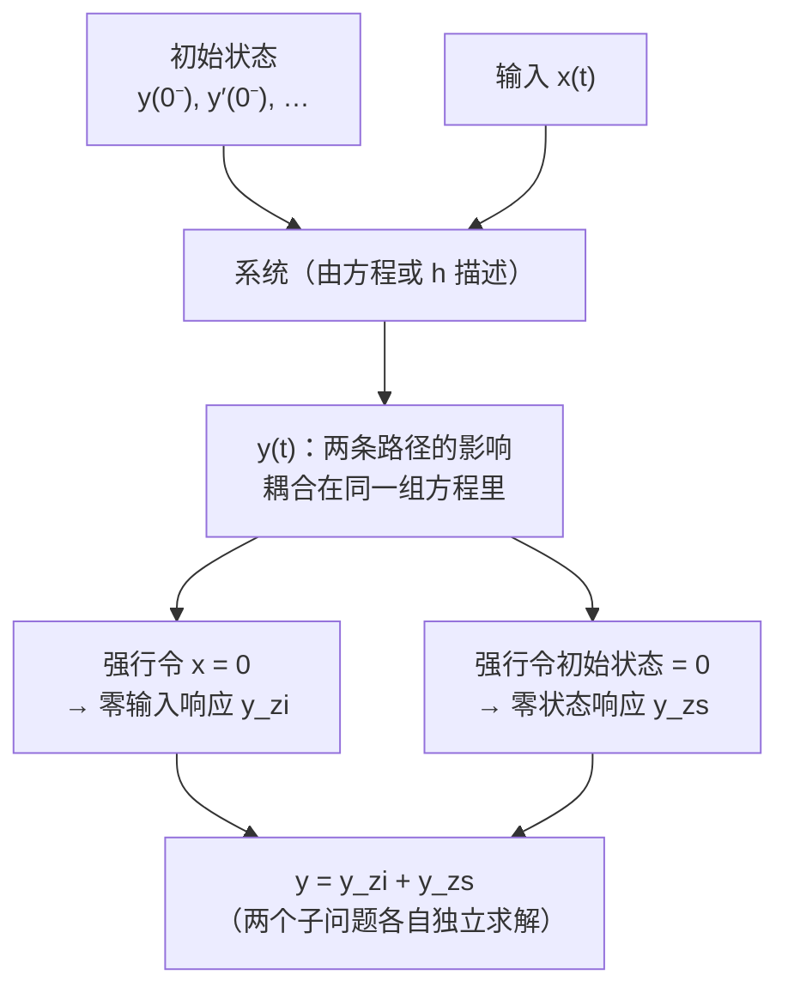

# 2.4 微分方程描述的因果 LTI 系统（连续时间）

> [!abstract] 这一讲的任务
> 前三讲的一切都建立在"已知 $h$"上。可你打开任何一本电路书、任何一份控制系统文档，拿到手的都不是 $h$，而是一个**微分方程**——因为方程是从元件的物理定律（$V=IR$、$I=C\frac{dV}{dt}$）直接列出来的，$h$ 反而要绕一圈才能得到。
> 这一讲要把两个世界接起来：**从方程出发怎么求响应？** 你会拿到两套方法——高数里的"齐次解 + 特解"，和本课的"零输入 + 零状态"。它们**长得很像但不是同一种分解**，分不清是本章最大的失分点，所以这一讲会专门让它们当着你的面对账。

> [!info] 怎么读这份讲义
> 按顺序读第一遍最省力：第 1 节把方程和 $h$ 的关系说清，第 2 节完整走一遍经典法，第 3 节专门讲它**哪里不好用**，第 4 节才引出零输入 / 零状态。第 2 节末尾的 $A=\frac52$、$B=-\frac{11}{6}$ 请自己动手算一遍再往下看，第 4 节会反复用到它。
> 标有 **（拓展）** 的内容是课堂没有展开、由标准教材讲法延伸出来的一小段，全篇只有一处。
> **一句话勘误提示**：本篇涉及的原稿数值有两处对不上——p.62 二重根那题给出的 $K_1,K_2$ 与同一页自己列的方程矛盾；p.51 的求和式右端导数记号印成了 $\frac{dx^k(t)}{dt^k}$。详情见对应小节。

> [!info] 编号说明
> 原书 2.4 一节共 39 页，涵盖连续与离散两套求解方法以及方框图表示。本笔记按知识依赖拆成三篇：
> **本篇（连续时间求解，p.49–67）→ [[C2.5 差分方程与离散时间系统求解]]（p.68–87）→ [[C2.6 LTI系统的方框图表示]]（p.88–96）**。
> 笔记编号 C2.4/C2.5/C2.6 与原文小节号 2.4/2.4.1/2.4.2/2.4.3 不完全对应，对照关系见 [[信号与系统 MOC]]。

---

## 0. 开场：一个电容上的旧电荷

你面前是一个 RC 电路：电阻 $R$、电容 $C$ 串联，$t=0$ 时合上开关接入电源 $x(t)$。你要求输出电压 $y(t)$。

列方程很容易，KVL 一写就是
$$RC\,\frac{dy}{dt}+y(t)=x(t)$$

但真要算的时候你会发现一个麻烦：**电容上可能本来就有电**。合闸前它存着 $y(0^-)=1\text{V}$，这 1 伏和你接进去的电源没有任何关系，可它照样会出现在输出里。

于是输出其实是两拨东西叠在一起：

- 一拨来自**电容里的旧电荷**（外界什么都不做，它也会自己放掉）；
- 一拨来自**你刚接上的电源**。

这两拨各是什么、怎么分开算、加起来对不对——就是这一讲的全部内容。而它们的正式名字叫**零输入响应**和**零状态响应**。

先别急着接受这两个名字。更值得问的是：**为什么非要把它们分开？** 高数里明明有现成的"齐次解 + 特解"，一路算到底不也能得到 $y(t)$ 吗？能，但你会看到一件很不划算的事——**电路没变、电容上的旧电荷也没变，只是换了个电源，整道题却要从头再做一遍**。这一讲的后半段，就是为这件事找一个更聪明的解法结构。

---

## 1. 现实给的是方程：LCCDE 与 LTI 的等价

### 1.1 方程的规范形式，以及五个限定词

前三讲描述系统用的是 $h$——输入输出关系是一个卷积 $y=x*h$，系统被"显式"地写了出来。**但 $h$ 是我们自己造出来的中间量，现实中你拿不到它。** 现实中拿到的是输入和输出之间那条**隐式**的关系：方程。

> [!important] 线性常系数微分方程 Linear Constant-Coefficient Differential Equation（LCCDE）
> $$\sum_{k=0}^{N}a_k\frac{d^ky(t)}{dt^k}=\sum_{k=0}^{M}b_k\frac{d^kx(t)}{dt^k}$$
> 展开写：
> $$a_Ny^{(N)}(t)+a_{N-1}y^{(N-1)}(t)+\cdots+a_1y'(t)+a_0y(t)=b_Mx^{(M)}(t)+\cdots+b_1x'(t)+b_0x(t)$$
> 配上 **$N$ 个初始条件**：$y(t_0),\ y'(t_0),\ \dots,\ y^{(N-1)}(t_0)$，且要求 $N\ge M$。
>
> （p.51 的求和式右端印成了 $\frac{dx^k(t)}{dt^k}$，指数位置的 $k$ 跑到了 $x$ 上；正确写法是 $\frac{d^kx(t)}{dt^k}$。下面统一用正确写法。）

五个限定词一个都不能少，每一个都对应一条系统性质：

| 要素 | 含义 | 为什么这么规定 |
|---|---|---|
| **线性 Linear** | $y$ 及其各阶导数都是一次的 | 出现 $y^2$、$y\cdot y'$ 就不是 LCCDE，也不是线性系统 |
| **常系数 Constant-Coefficient** | $a_k,b_k$ 是常数，不含 $t$ | 系数含 $t$ 就是**时变**系统（比如 $ty'+y=x$） |
| **阶数 $N$** | $y$ 的最高阶导数 | 它决定了**系统的记忆有多深**，也决定要几个初始条件 |
| **$N$ 个初始条件** | 解才唯一 | $N$ 阶方程要积分 $N$ 次，会冒出 $N$ 个待定常数 |
| **$N\ge M$** | 右端阶数不高于左端 | 否则系统含**纯微分器**，物理上不可实现（对高频噪声的增益无上限，[[C2.6 LTI系统的方框图表示]] 会再讲） |

> [!question] 停一下，先自己想想
> 为什么"常系数"这三个字这么重要？如果 $a_1$ 变成 $t$，会破坏 LTI 的哪一条？

破坏的是**时不变性**。系数含 $t$ 意味着"这个系统在不同时刻的行为不一样"，输入晚一秒送进去，输出就不只是晚一秒那么简单。**常系数 ⇔ 时不变**，这是本章所有方法能用的前提。

而**线性**来自方程的自变量一次性：求导是线性运算，所以把 $x$ 换成 $a x_1+b x_2$，左端的 $y$ 自然会跟着变成 $a y_1 + b y_2$。这条下面马上就要亲手验一遍。

### 1.2 LTI ⇔ LCCDE：当场验证一个最小例子

"只要是连续时间 LTI 系统，它的数学描述就是常系数微分方程；反过来，一个常系数微分方程定义的输入输出关系一定是线性时不变的"——这两句是等价的、有证明的。课上不证（那是信号与系统的前辈们早做完的活儿），但**反着推的方向值得亲手验一个最小的例子**，因为你以后每一章都要靠这条等价性把"系统"和"方程"来回翻译。

取最简单的（不带高阶项、$M=1$、$N=0$）
$$y(t)=2x'(t)+x(t)$$

**验证线性**：设 $x_1\to y_1$、$x_2\to y_2$，令 $x_3=ax_1+bx_2$。代入：
$$y_3=2x_3'+x_3=2(ax_1+bx_2)'+(ax_1+bx_2)=a\big(2x_1'+x_1\big)+b\big(2x_2'+x_2\big)=ay_1+by_2\ \checkmark$$
**验证时不变**：设 $x_2(t)=x_1(t-t_0)$，则
$$y_2(t)=2x_2'(t)+x_2(t)=2x_1'(t-t_0)+x_1(t-t_0)=y_1(t-t_0)\ \checkmark$$

两处用到的数学知识只有一条：**求导是线性运算**（$(\alpha f+\beta g)'=\alpha f'+\beta g'$，且它是**时不变**的——先移位再求导 = 先求导再移位）。把 $x$ 换成任何阶数更高的组合，验证过程一模一样好走。

> [!important] 于是可以放心画等号
> $$\text{连续时间 LTI 系统}\ \Longleftrightarrow\ \text{常系数微分方程（外加初始条件）}$$
> 正着走：给系统，写方程。反着走：给方程，系统就是那个 LTI 系统。
> **离散端是同一句话的复制品**：离散时间 LTI 系统 ⇔ 常系数差分方程，见 [[C2.5 差分方程与离散时间系统求解]]。

### 1.3 $h$ 藏在哪里？

方程给的是输入输出关系，$h$ 被"藏"在里面了——它是可以求出来的，只是时域上这条路又长又难。

顺便说一个更省事的替代品：**阶跃响应 $s(t)$ 和 $h(t)$ 地位相当**，两者可以互相转换。理由是 LTI 系统具有**微分不变性 / 积分不变性**：输入和输出之间的微分、积分关系会原样传到输出端。而 $\delta(t)=u'(t)$、$u(t)=\int_{-\infty}^{t}\delta(\tau)\,d\tau$，于是
$$h(t)=s'(t),\qquad s(t)=\int_{-\infty}^{t}h(\tau)\,d\tau$$

也就是说：**你可以去测冲激响应，也可以去测阶跃响应，测到哪个都能代表整个系统**，两者只差一次求导或一次积分。这个"在原空间里解决不了，就换到导数空间 / 积分空间去解决"的思路，后面做变换域分析时会反复出现。

> [!question] 那 $h$ 到底怎么从方程里挖出来？
> 有一条笨办法（冲击平衡法），第 9 节会完整走一遍。它不难理解，但算起来极其啰嗦——**而且不要求掌握**。原因很简单：等学完拉普拉斯变换，$h$ 会变成一个代数式的反变换，时域里要写两页纸的东西，频域上几行就完了。

---

## 2. 方法一：经典法：完全解 = 齐次解 + 特解

> [!important] 完全解 Complete Solution
> $$y(t)=y_h(t)+y_p(t)$$
> - $y_h(t)$（**homogeneous solution 齐次解**）由**特征根 characteristic roots** 决定——它描述系统"自己愿意怎么振"，与输入长什么样无关；
> - $y_p(t)$（**particular solution 特解**）的形式**跟着输入走**——输入是指数就试指数，是正弦就试正弦。
>
> 这是高数里那套解常系数线性微分方程的流程，原封不动搬过来。

### 2.1 第一步：齐次解（特征根决定形状）

先把右端的输入项全部置零，得到**齐次方程**：
$$y''(t)+6y'(t)+8y(t)=0$$

**试解 $y=e^{st}$**。这一步的动机很朴素：指数函数求导之后还是它自己（只多一个常数因子），代入后每一项都含公因子 $e^{st}$，能整体约掉，微积分方程就塌成一个**代数方程**。求一次导掉一个 $s$，于是 $y^{(k)}$ 贡献 $s^k$：

$$a_Ns^N+a_{N-1}s^{N-1}+\cdots+a_1s+a_0=0$$

> [!important] 特征方程 Characteristic Equation
> $$s^2+6s+8=0\ \Longrightarrow\ (s+2)(s+4)=0\ \Longrightarrow\ s_1=-2,\ s_2=-4$$
> 根 $s_1,\dots,s_N$ 叫**特征根**。齐次解就是它们对应的指数项的线性组合：
> $$y_h(t)=Ae^{-2t}+Be^{-4t},\qquad t>0$$
> 系数 $A,B$ 此刻还**待定**（to be determined）。

"特征"这两个字的分量在离散端会更清楚（那里特征根要放到**底数**上），见 [[C2.5 差分方程与离散时间系统求解]] 第 1 节；它最终会通向 [[C3.1 复指数是LTI系统的特征函数]]。

### 2.2 第二步：特解（跟着输入的形状走）

> [!example] 例题（p.54–56）
> 系统 $y''(t)+6y'(t)+8y(t)=x(t),\ t>0$，初始条件 $y(0)=1,\ y'(0)=2$，输入 $x(t)=e^{-t}u(t)$。求**全响应** $y(t)$。

特解的形状必须和输入"配对"——因为方程两边都在求导，而 $e^{-t}$ 求导之后**还在那里**（这就是上一节说的"求导过程中的不变项"），所以左边的 $y$ 里必须保留同一个指数项，方程才可能配平。于是试
$$y_p(t)=Ce^{-t},\qquad t>0$$
（$u(t)$ 在这里被写成 $t>0$，因为对 $u(t)$ 求导会冒出 $\delta(t)$，会把问题弄脏；先只在 $t>0$ 上配平，$t<0$ 由因果性直接为 0。）

代回原方程，逐项算：

$$y_p=Ce^{-t},\qquad y_p'=-Ce^{-t},\qquad y_p''=Ce^{-t}$$
$$y_p''+6y_p'+8y_p=Ce^{-t}-6Ce^{-t}+8Ce^{-t}=(1-6+8)Ce^{-t}=3Ce^{-t}\ \overset{!}{=}\ e^{-t}$$
$$3C=1\ \Longrightarrow\ C=\frac13\ \Longrightarrow\ y_p(t)=\frac13e^{-t},\qquad t>0$$

> [!important] 特解形状怎么选（对照表）
> | 输入 $x(t)$ | 试的特解 $y_p(t)$ |
> |---|---|
> | 常数 $A$ | $K$ |
> | $e^{\alpha t}$（$\alpha$ 不是特征根） | $Ce^{\alpha t}$ |
> | $\cos\omega t$ 或 $\sin\omega t$ | $K_1\cos\omega t+K_2\sin\omega t$ |
> | $t^m$（多项式） | $K_mt^m+\cdots+K_1t+K_0$ |
> | $e^{\alpha t}$ 而 $\alpha$ **恰好是特征根** | 直接试 $Ce^{\alpha t}$ 会得到 $0=e^{\alpha t}$ 这种矛盾（方程配不平），改写 $Cte^{\alpha t}$；若是 $k$ 重根就乘 $t^k$ |
>
> 前四行都是"照着输入的形状抄"；**最后一行是"撞车"**——输入的时间常数正好等于系统的固有时间常数，方程被解成恒等式 $0=\text{输入}$。这时只有**提高一次的幂次**（乘 $t$）才能配平。离散端完全平行，只是乘的是 $n$ 而不是 $t$（见 [[C2.5 差分方程与离散时间系统求解]]）。

> [!tip] 一个更快的记账方式（拓展）
> 试 $Ce^{\alpha t}$ 时根本不必把导数一个个写出来：把 $\alpha$ 直接代进**特征多项式** $P(s)=a_Ns^N+\cdots+a_0$，结果就是 $C\,P(\alpha)=1$，即 $C=1/P(\alpha)$。
> 本题 $P(-1)=1-6+8=3$，一眼得 $C=\frac13$——和上面逐项代入的结果一致。
> **这个 $1/P(\alpha)$ 就是第 9 章拉普拉斯变换里 $H(s)=\frac{1}{P(s)}$ 的雏形**，到那时整套经典法会被一条代数式取代。

### 2.3 第三步：合起来，再用初始条件定系数

$$y(t)=y_h(t)+y_p(t)=Ae^{-2t}+Be^{-4t}+\frac13e^{-t},\qquad t>0$$

现在把剩下的两个条件（初始状态）代进去。求一次导：
$$y'(t)=-2Ae^{-2t}-4Be^{-4t}-\frac13e^{-t}$$
在 $t=0$ 处取两个方程：
$$\begin{cases}y(0)=A+B+\dfrac13=1\\[6pt] y'(0)=-2A-4B-\dfrac13=2\end{cases}
\ \Longrightarrow\
\begin{cases}A+B=\dfrac23\\[6pt] -2A-4B=\dfrac73\end{cases}$$

逐步解这个二元一次方程组：由第一式 $A=\frac23-B$，代入第二式
$$-2\Big(\frac23-B\Big)-4B=\frac73\ \Longrightarrow\ -\frac43+2B-4B=\frac73\ \Longrightarrow\ -2B=\frac{11}{3}\ \Longrightarrow\ B=-\frac{11}{6}$$
$$A=\frac23+\frac{11}{6}=\frac{4}{6}+\frac{11}{6}=\frac{15}{6}=\frac52$$

$$\boxed{\ y(t)=\frac52e^{-2t}-\frac{11}{6}e^{-4t}+\frac13e^{-t},\qquad t>0\ }$$

**验算**：$y(0)=\frac52-\frac{11}{6}+\frac13=\frac{15-11+2}{6}=\frac66=1$ ✓；$y'(0)=-5+\frac{22}{3}-\frac13=\frac{-15+22-1}{3}=2$ ✓。

> [!warning] 顺序不能反
> **必须先把 $y_h+y_p$ 合成 $y$，再用初始条件定 $A,B$。**
> 如果你先拿初始条件去定齐次解里的 $A,B$、再把特解加上去，答案一定错——因为初始条件约束的是**完整的 $y$**，不是 $y_h$。这是经典法最高频的错误，没有之一。

### 2.4 每一步用到什么数学知识（自查清单）

这一节里没有一个"新数学"，全是高数课上的老工具。把它们点出来，是为了让你在卡住时知道该回去补哪一块：

| 步骤 | 用到的数学知识 |
|---|---|
| 写齐次方程（右端置零） | 线性方程的解结构：$y=y_h+y_p$ |
| 试解 $y=e^{st}$ | **待定指数法**：指数求导"形状不变"，把微积分方程降成代数方程 |
| 得特征方程并求根 | 一元 $N$ 次多项式**因式分解 / 求根公式**（本题 $s^2+6s+8=(s+2)(s+4)$） |
| 特解试 $Ce^{-t}$ 代回配平 | **待定系数法**：形状按输入选，系数由"代回后恒等"定 |
| 合成完全解 | 非齐次方程通解 = 齐次通解 + 任一特解 |
| 用 $y(0),y'(0)$ 定 $A,B$ | **二元一次方程组**（$N$ 阶方程就是 $N$ 元一次方程组） |

---

## 3. 撞墙：换一个输入，整道题要重做一遍

经典法本身没有错，数学上完全成立。**问题是它在工程上不划算。**

### 3.1 把题目改一个字母

系统没变、初始状态没变——还是 $y''+6y'+8y=x$、$y(0)=1$、$y'(0)=2$，只把输入换成
$$x(t)=e^{-3t},\qquad t>0$$

现在整条流水线要重新走一遍：

1. **特解要重试。** 输入的指数从 $e^{-t}$ 变成 $e^{-3t}$，特解就变成 $Ce^{-3t}$，代回去得到 $(9-18+8)C=C\cdot(-1)=1$，$C=-1$。C 是新的。
2. **完全解变了。** $y=Ae^{-2t}+Be^{-4t}-e^{-3t}$。
3. **方程组变了。** $y(0)=A+B-1=1$、$y'(0)=-2A-4B+3=2$，解出来的 $A,B$ 和上一节那两个数毫无关系。
4. **只有特征根没变**（$-2,-4$ 由方程左端决定，与输入无关）。

也就是说：齐次解的**形状**不用重新推，但从特解到最后的系数，**全部要重算**。

### 3.2 耦合在哪里

把整条流程摊开看，一眼就能找到"输入的影响"和"状态的影响"是在哪一步搅在一起的：

- 输入 $x$ → 决定**特解的形状和系数**（$C$）；
- 初始状态 $y(0),y'(0)$ → 拿去定**齐次解的系数**（$A,B$）；
- 而这两个动作**必须同时发生**：$A,B$ 是从"$y_h+y_p$ 合体之后"的方程组里解出来的，方程组右端带着 $C$。

> [!important] 这就是经典法的结构性缺陷
> 输入和初始状态对输出有**两条独立的作用路径**，但在经典法的求解过程里，它们被**耦合**在一组方程里：输入一变，$C$ 变 → 方程组变 → $A,B$ 变。于是"只改一个输入"这种最常见的工程操作，代价是整题重解。
> 我们想要的是一种**剥离**（把两条路径彻底分开）之后的解结构——第 4 节来做这件事。

### 3.3 两个追问，把话说死（p.57）

> [!question] 1）初始条件不变，输入换成 $x(t)=\sin t\,u(t)$，$y(t)=$？
> 2）输入不变（仍是 $e^{-t}u(t)$），初始条件换成 $y(0)=0$、$y'(0)=1$，$y(t)=$？

先别急着算，把两个问题当成一组对照：**第 1 问换的是输入，第 2 问换的是初始状态。** 哪一个要动特解？哪一个不用？

**第 1 问（换输入）。** 特征根不变，$y_h=Ae^{-2t}+Be^{-4t}$ 照旧。特解要换形状：输入是 $\sin t$，必须**同时**试 $\cos$ 与 $\sin$：
$$y_p=K_1\cos t+K_2\sin t,\qquad y_p'=-K_1\sin t+K_2\cos t,\qquad y_p''=-K_1\cos t-K_2\sin t$$
代回 $y_p''+6y_p'+8y_p=\sin t$，按 $\cos t$、$\sin t$ 分别配平：
$$\cos t:\ -K_1+6K_2+8K_1=0\ \Longrightarrow\ 7K_1+6K_2=0$$
$$\sin t:\ -K_2-6K_1+8K_2=1\ \Longrightarrow\ -6K_1+7K_2=1$$
解得 $K_1=-\dfrac{6}{85},\ K_2=\dfrac{7}{85}$（$\cos$ 的系数必须为零是本题的关键约束）。再用原来的初始条件：
$$y(0)=A+B-\frac{6}{85}=1,\qquad y'(0)=-2A-4B+\frac{7}{85}=2$$
$$\Longrightarrow\ A+B=\frac{91}{85},\qquad -2A-4B=\frac{163}{85}\ \Longrightarrow\ B=-\frac{69}{34},\qquad A=\frac{527}{170}\Big(=\frac{31}{10}\Big)$$
$$\boxed{\ y(t)=\frac{31}{10}e^{-2t}-\frac{69}{34}e^{-4t}-\frac{6}{85}\cos t+\frac{7}{85}\sin t\ }$$
验算：$y(0)=3.1-2.0294-0.0706=1.0000$ ✓；$y'(0)=-6.2+8.1176+0.0824=2.0000$ ✓。

**第 2 问（换初始状态）。** $y_h$ 和 $y_p$ **一个字都不用改**——特征根由方程定，$C=\frac13$ 由输入定，都和初始状态无关。只重解那两个方程：
$$A+B+\frac13=0,\qquad -2A-4B-\frac13=1\ \Longrightarrow\ A=0,\qquad B=-\frac13$$
$$\boxed{\ y(t)=-\frac13e^{-4t}+\frac13e^{-t},\qquad t\ge0\ }$$
验算：$y(0)=-\frac13+\frac13=0$ ✓；$y'(0)=\frac43-\frac13=1$ ✓。

> [!important] 这两问真正在说的事
> - 换输入 ⇒ 特解**形状和系数都要重来**，且 $A,B$ 跟着重解；$y_h$ 的形状不变。
> - 换初始状态 ⇒ 形状全不变，只重解那两个一次方程。
>
> 顺着再想一层：既然"输入"和"初始状态"的影响可以分开讨论，那能不能把**响应本身**也按这两个来源拆成两块？**能——那就是零输入 / 零状态分解。** 经典法的"齐次 + 特解"是按**数学形式**拆的，零输入/零状态是按**物理来源**拆的。这两刀切出来的四块，两两都不相等（第 10 节列成表）。

---

## 4. 方法二：把解重新构造——零输入 + 零状态

### 4.1 两个定义，以及它们为什么叫这个名字

既然经典法的病根是"两条路径耦合"，那就人为地把它们**掰开**：让方程只留一条路径的作用，另一条路径被强行置零。

> [!important] 全响应的物理分解（p.58、p.64）
> $$y(t)=y_{zi}(t)+y_{zs}(t)=y_{zi}(t)+x(t)*h(t)$$
> - **零输入响应 Zero-Input Response $y_{zi}$**：*results only from the initial state of the system and not from any external drive.*——把输入置零，只看初始状态会自己放出什么样的输出。
> - **零状态响应 Zero-State Response $y_{zs}$**：*the behavior or response of a system with initial state of zero. It results only from the external inputs or driving functions and not from the initial state.*——把初始状态清零，只看输入驱动出什么。
>
> 求解方式：
> - $y_{zi}$：解**齐次**方程（$x\equiv0$），用**真实初始状态** $y(0^-),y'(0^-),\dots$ 定系数；
> - $y_{zs}$：两条路——① 直接算卷积 $x*h$；② 解**完整方程**但把初始状态全部取零。

回到开场那个 RC 电路：**电容里的旧电荷 → 零输入响应；刚接上的电源 → 零状态响应。** 名字晦涩，物理却直白。

> [!question] 停一下，先自己想想
> 这样拆开之后，一定会满足 $y=y_{zi}+y_{zs}$ 吗？凭什么？

凭**线性**。方程是线性的，所以"输入为零、状态非零"这个子问题的解，加上"状态为零、输入非零"这个子问题的解，恰好满足原方程和原初始条件（叠加原理）；而 $N$ 阶方程在 $N$ 个初始条件下的解唯一，所以两者相加**就是**全响应。注意这一步用到的线性，指的不是"系统是 LTI"（下一节会说，非零初状态的系统严格讲不是 LTI），而是**方程本身对"输入 + 初始状态"这一组变量是线性的**。下面这个解法和第 5 节的"增量线性"是一回事的两面。

### 4.2 求零输入响应 $y_{zi}$

**做法**：把输入置零 → 方程退化成齐次方程 → 解法与第 2.1 节完全相同（特征根决定形状）→ 但这次定系数**只用初始状态，完全不看输入**。

用第 2 节那道题的数据（$y''+6y'+8y=x$，$y(0^-)=1$、$y'(0^-)=2$）：

$$y_{zi}(t)=K_1e^{-2t}+K_2e^{-4t}$$
$$\begin{cases}y_{zi}(0^-)=K_1+K_2=1\\[4pt] y_{zi}'(0^-)=-2K_1-4K_2=2\end{cases}$$

逐步解：第一式给 $K_1=1-K_2$，代入第二式
$$-2(1-K_2)-4K_2=-2-2K_2=2\ \Longrightarrow\ K_2=-2,\qquad K_1=3$$
$$\boxed{\ y_{zi}(t)=3e^{-2t}-2e^{-4t},\qquad t\ge0\ }$$

对照第 2 节算出来的 $y_h=Ae^{-2t}+Be^{-4t}=\frac52e^{-2t}-\frac{11}{6}e^{-4t}$：**函数形式一模一样，系数完全不同。**

> [!warning] 为什么这里一定用 $y(0^-)$
> $y(0^-)$ 是**输入接进来之前**一瞬间的状态，是电容电压 / 电感电流这些**真实储能**；$y(0^+)$ 是输入接上之后一瞬间的状态。零输入响应问的是"外界什么都没做时系统自己怎么放掉旧电荷"，所以必须用 $y(0^-)$。
> 如果输入里含 $\delta$ 或有跳变、并且这个跳变会传到输出上，那么 $y(0^+)\ne y(0^-)$，中间要做一次"跳变分析"把 $0^-$ 换算成 $0^+$。本讲的例题输入都不含冲激，两者相等，题目写 $y(0)$ 或 $y(0^-)$ 都行——**但一旦题目特意写 $0^-$，就是在提醒你这件事。**

### 4.3 求零状态响应 $y_{zs}$

**做法**：方程不变、输入不变，把初始状态**硬改成零**——相当于"换一道题"。因为方程没变，特征根不变（$y_h$ 形状照旧）；因为输入没变，特解形状和系数也不变（还是 $C=\frac13$）；**唯一变的是定系数用的那组条件**。

$$y_{zs}(t)=Ae^{-2t}+Be^{-4t}+\frac13e^{-t}$$
$$\begin{cases}y_{zs}(0)=A+B+\dfrac13=0\\[6pt] y_{zs}'(0)=-2A-4B-\dfrac13=0\end{cases}$$

逐步解：第一式给 $A=-\frac13-B$，代入第二式
$$-2\Big(-\frac13-B\Big)-4B-\frac13=0\ \Longrightarrow\ \frac23+2B-4B-\frac13=0\ \Longrightarrow\ \frac13-2B=0\ \Longrightarrow\ B=\frac16,\qquad A=-\frac12$$
$$\boxed{\ y_{zs}(t)=-\frac12e^{-2t}+\frac16e^{-4t}+\frac13e^{-t},\qquad t\ge0\ }$$

**注意这里没有求卷积。** 零状态响应当然等于 $x*h$，但在时域上要先求 $h$ 再算卷积，两件事都很难做（第 9 节就看到了）；我们的做法是**换题**：把初始状态改成零，然后照经典法解一遍，特解都不用重算。

### 4.4 对账：两份加起来必须等于经典解

$$3-\frac12=\frac52\ \checkmark,\qquad -2+\frac16=-\frac{11}{6}\ \checkmark,\qquad \frac13\ \checkmark$$

三项系数与第 2 节的 $\frac52e^{-2t}-\frac{11}{6}e^{-4t}+\frac13e^{-t}$ **逐项吻合**。也就是说，同一个 $y(t)$ 现在有了两种构造方式：

$$y=\underbrace{y_h+y_p}_{\text{按数学形式拆}}=\underbrace{y_{zi}+y_{zs}}_{\text{按物理来源拆}}$$

> [!question] 停一下，我们刚才干了什么
> 我们把"解一个耦合的问题"换成了"解两个各自独立的问题"，然后相加验证。代价是多算一次齐次方程；收益是第 6 节会展示的——**换输入时只动一块**。

---

## 5. 增量线性：$y=3x+2$ 为什么不是 LTI

刚才我们一直把"方程 + 非零初始状态"当 LTI 系统用。现在必须把话说准：**严格来说它不是 LTI。**

> [!example] 判断下列系统是否为 LTI（p.59）
> 1. $y(t)=3x(t)+2$   ( **×** )
> 2. $y(t)=3x(t)$    ( **√** )

**第 1 个为什么不行**——走标准四步（让 $x_1\to y_1$、$x_2\to y_2$，令 $x_3=x_1+x_2$，看 $y_3$ 是否等于 $y_1+y_2$）：
$$x_1\to y_1=3x_1+2,\qquad x_2\to y_2=3x_2+2$$
$$x_3=x_1+x_2\ \to\ y_3=3x_1+3x_2+2\ \neq\ y_1+y_2=3x_1+3x_2+4$$
差了一个常数 2 ⇒ **不满足可加性 ⇒ 连通性都没有**。

**第 2 个**：$x_3=ax_1+bx_2\to y_3=3ax_1+3bx_2=ay_1+by_2$ ✓，是纯 LTI。

> [!important] 那个 2 是什么
> 同一页底部给出了答案：第 1 个系统的**初始状态 $y(0)=2$**，标注为 **"LTI with nonzero initial state"（带非零初始状态的 LTI 系统）**；第 2 个系统 $y(0)=0$，标注为 **"Pure LTI"（纯 LTI）**。
>
> 换句话说：**那个 2 不是凭空多出来的常数，它就是零输入响应。** 只要把初始状态清零，它就退化成纯 LTI。所以这个系统有一个准确得多的名字——**增量线性（incrementally linear）**：它对**增量** $\Delta x$ 是线性的，对 $x$ 本身不是。
>
> 工程上照样把它当线性系统用（因为除了那个常数项，它就是个 LTI），但名字要叫对。

> [!important] 由此得到本章最容易被考的一条结论
> **只有零状态响应才等于 $x*h$。**
> $$y_{zs}=x*h\quad\text{✓}\qquad\qquad y=x*h\quad\text{✗（除非初始状态为零）}$$
> 前三讲所有"$y=x*h$"的公式，隐含前提都是**系统初始松弛（initially at rest）**。这个前提在本讲第一次被打破，所以全响应里必须补上 $y_{zi}$ 这一项。

---

## 6. 剥离之后有多省事

现在把第 3 节那个"换一个输入要重做一遍"的场景再走一次，看看剥离的收益。

系统不变、初始状态不变（$y(0^-)=1$、$y'(0^-)=2$），把输入换成一个**延迟了、还放大了 2 倍**的版本：
$$x(t)=2e^{-(t-1)}u(t-1)$$

**零输入响应一点没变**：它只由初始状态决定，和输入毫无关系，还是
$$y_{zi}(t)=3e^{-2t}-2e^{-4t}$$

**零状态响应**用两条 LTI 性质直接"变形"出来，一步都不用重解：

- 先看**时移**：$x_1(t)=e^{-t}u(t)$ 的零状态响应是 $y_{zs}(t)$；输入变成 $x_1(t-1)$，由**时不变性**，输出就是 $y_{zs}(t-1)$；
- 再看**数乘**：输入又乘了 2，由**线性（齐次性）**，输出也乘 2：$2y_{zs}(t-1)$。

于是新的全响应几乎不用算：
$$y_{\text{new}}(t)=y_{zi}(t)+2y_{zs}(t-1)=3e^{-2t}-2e^{-4t}+2\Big[-\frac12e^{-2(t-1)}+\frac16e^{-4(t-1)}+\frac13e^{-(t-1)}\Big]u(t-1)$$

![[C2.4-换输入零输入不变.png]]

左图把两半画在一起：黑色虚线是**两种情况共用的** $y_{zi}$；蓝、橙两条是两种输入各自的 $y_{zs}$（橙色那条就是蓝色那条右移 1、放大 2 倍）。右图是两个全响应本身——因为零输入那一项在数值上占主导，两条总曲线看起来很像，但**差异全来自 $y_{zs}$**，而且这个差异现在只要做"乘 2 + 平移"就够了。

> [!important] 这就是剥离的意义
> 换输入 ⇒ 只有 $y_{zs}$ 变；换初始状态 ⇒ 只有 $y_{zi}$ 变。**两条路径的影响真正分开了。**
> 这也更符合工程现实：系统本身你往往动不了（电路已经焊好、模型已经确定），你能调的就是**初始状态**和**输入**。剥离之后，"我调了哪个旋钮、输出里的哪一块会动"变成一句可以直接说出口的话。

---

## 7. 特征根的三种情况：三个例题各来一个

齐次解的形状由特征根决定，而 $N$ 次特征方程只有三种根型（p.60）。三种都配上零输入响应的完整算例（p.61–63），用的都是同一组初始条件 $y(0^-)=1$、$y'(0^-)=3$，正好对比形状差异。

> [!important] 三种根型的齐次解形式（p.60）
> | 根的类型 | 齐次解形式 |
> |---|---|
> | **(1) 互异实根** $s_1,\dots,s_n$ | $y_h(t)=K_1e^{s_1t}+K_2e^{s_2t}+\cdots+K_ne^{s_nt}$ |
> | **(2) $n$ 重实根** $s_1=\cdots=s_n=s$ | $y_h(t)=K_1e^{st}+K_2te^{st}+\cdots+K_nt^{\,n-1}e^{st}$ |
> | **(3) 共轭复根** $s_i=\sigma_i\pm j\omega_i$ | $y_h(t)=e^{\sigma_1t}(K_1\cos\omega_1t+K_2\sin\omega_1t)+\cdots$ |

> [!question] 为什么重根要多乘一个 $t$？
> $n$ 重根 $s$ 只提供一个线性无关的解 $e^{st}$，凑不齐 $N$ 维解空间，方程"欠"了 $n-1$ 个解。补的办法是乘 $t$ 的幂：$e^{st},\,te^{st},\,\dots,t^{n-1}e^{st}$ 都满足齐次方程（把 $te^{st}$ 直接代进去就能验）。
> **回收伏笔**：这和 [[C2.1 离散时间LTI系统与卷积和]] 里 $\alpha^nu[n]*\alpha^nu[n]=(n+1)\alpha^nu[n]$ 冒出来的那个 $n+1$、以及 [[C2.5 差分方程与离散时间系统求解]] 里"特解撞特征根要乘 $n$"，是同一个现象——**"重"这件事，永远用乘一个多项式因子来补。**

> [!question] 为什么共轭复根要写成 $e^{\sigma t}(K_1\cos\omega t+K_2\sin\omega t)$？
> 根 $\sigma\pm j\omega$ 对应 $e^{(\sigma\pm j\omega)t}=e^{\sigma t}(\cos\omega t\pm j\sin\omega t)$。两个复解的线性组合可以凑出两个**实**解 $e^{\sigma t}\cos\omega t$ 与 $e^{\sigma t}\sin\omega t$，复系数就换成实系数 $K_1,K_2$。
> 物理解读一眼看穿：**$\sigma$ 管衰减快慢（包络），$\omega$ 管振荡快慢**——正是 [[C1.3 指数信号与正弦信号]] 里"一般复指数 = 包络 × 振荡"的老结论。$\sigma<0$ 才衰减，这条在讲稳定性时会再用。

### 7.1 互异实根

> [!example] (a) $y''+5y'+6y=4x$，$y(0^-)=1$，$y'(0^-)=3$（p.61）
> 特征方程 $s^2+5s+6=(s+2)(s+3)=0\Rightarrow s_1=-2,\ s_2=-3$（**different roots**）
> $$y_{zi}(t)=K_1e^{-2t}+K_2e^{-3t}$$
> $$\begin{cases}K_1+K_2=1\\ -2K_1-3K_2=3\end{cases}\ \Longrightarrow\ K_1=6,\ K_2=-5$$
> $$\boxed{\ y_{zi}(t)=6e^{-2t}-5e^{-3t},\qquad t\ge0\ }$$
> 验算：$y(0^-)=6-5=1$ ✓；$y'(0^-)=-12+15=3$ ✓。

### 7.2 重根

> [!example] (b) $y''+4y'+4y=4x$，$y(0^-)=1$，$y'(0^-)=3$（p.62）
> $s^2+4s+4=0\Rightarrow s_1=s_2=-2$（**double root**）
> $$y_{zi}(t)=K_1e^{-2t}+K_2te^{-2t}$$
> 求导：$y_{zi}'(t)=-2K_1e^{-2t}+K_2(1-2t)e^{-2t}$，在 $t=0$ 处 $=-2K_1+K_2$。
> $$y(0^-)=K_1=1;\qquad y'(0^-)=-2K_1+K_2=3\ \Longrightarrow\ K_1=1,\ K_2=5$$
> $$\boxed{\ y_{zi}(t)=e^{-2t}+5te^{-2t},\qquad t\ge0\ }$$
> 验算：$y(0^-)=1$ ✓；$y'(0^-)=-2+5=3$ ✓。

> [!warning] 原稿这一页的结论与它自己列的方程矛盾（p.62）
> 同一页写出的两个条件是 $y(0^-)=K_1=1$ 与 $y'(0^-)=-2K_1+K_2=3$，由此应得 $K_1=1,\ K_2=5$；但结论框里给的是 $K_1=2,\ K_2=3$，对应 $y_{zi}=2e^{-2t}+3te^{-2t}$，在 $t=0$ 处等于 2，与题设 $y(0^-)=1$ 直接冲突（它连第一个条件都不满足）。
> **按题设与原稿自己列出的两式应为**
> $$y_{zi}(t)=e^{-2t}+5te^{-2t}$$
> 做题时以题设初始条件为准。

### 7.3 共轭复根

> [!example] (c) $y''+2y'+5y=4x$，$y(0^-)=1$，$y'(0^-)=3$（p.63）
> $s^2+2s+5=0\Rightarrow s=-1\pm2j$（**conjugate roots**）
> $$y_{zi}(t)=e^{-t}(K_1\cos2t+K_2\sin2t)$$
> 求导：$y_{zi}'=-e^{-t}(K_1\cos2t+K_2\sin2t)+e^{-t}(-2K_1\sin2t+2K_2\cos2t)$，在 $t=0$ 处 $=-K_1+2K_2$。
> $$y(0^-)=K_1=1;\qquad -K_1+2K_2=3\ \Longrightarrow\ K_1=1,\ K_2=2$$
> $$\boxed{\ y_{zi}(t)=e^{-t}(\cos2t+2\sin2t),\qquad t\ge0\ }$$
> 验算：$y(0^-)=1$ ✓；$y'(0^-)=-1+4=3$ ✓。

![[C2.4-特征根三型-零输入响应.png]]

三张子图是这三种根型的零输入响应（系数取上面的正确解）：(a) 两个衰减指数叠加，快慢由两个根分别管；(b) 重根多出来的 $te^{-2t}$ 让曲线**先冲高再落下**，峰值比 (a) 高、位置更靠右——这就是"多乘一个 $t$"看得见的效果；(c) 共轭根给出**衰减振荡**，包络 $e^{-t}$ 由实部定，振荡快慢由虚部定。

![[C2-零输入响应-三类特征根.png]]

上面这张图把三种根型放在**同一张坐标轴上**对比（二重根那条画的是原稿给的系数 $2e^{-2t}+3te^{-2t}$）。形状规律一致，只有数值差别——正好和上面那条勘误对照着看。

> [!warning] 混合情形不考
> 一个方程里既有实根又有共轭复根（比如特征方程是 $(s+2)(s^2+2s+5)=0$）当然也能写：实根贡献一个指数项，每一对共轭复根贡献两个正余弦项，照上面拼起来就行。但**不会考这么复杂的三阶混合根**，知道怎么拼就够。

---

## 8. 零状态响应：一题两解

> [!example] $y'(t)+3y(t)=2x(t)$，冲激响应 $h(t)=2e^{-3t}u(t)$，输入 $x(t)=3u(t)$，求 $y_{zs}(t)$（p.65–67）

**解法一：卷积。**
$$y_{zs}(t)=x*h=\int_{-\infty}^{+\infty}3u(\tau)\cdot2e^{-3(t-\tau)}u(t-\tau)\,d\tau$$
两个阶跃把积分限夹成 $0\le\tau\le t$（只在 $t>0$ 时非零）：
$$=\int_0^t6e^{-3(t-\tau)}d\tau=6e^{-3t}\int_0^te^{3\tau}d\tau=6e^{-3t}\cdot\frac{e^{3t}-1}{3}=2(1-e^{-3t})$$
$$\boxed{\ y_{zs}(t)=2(1-e^{-3t})u(t)\ }$$

**解法二：解方程，初始状态取零。**
- 特征方程 $s+3=0\Rightarrow s=-3$，齐次解 $y_h=Ae^{-3t}$；
- 输入在 $t>0$ 上是常数 3，试 $y_p=K$：代入 $0+3K=2\times3=6\Rightarrow K=2$；
- 完全解 $y=Ae^{-3t}+2$；
- **初始状态取零** $y(0)=0$：$A+2=0\Rightarrow A=-2$。

$$y(t)=-2e^{-3t}+2=2(1-e^{-3t})u(t)$$

**两条路结果完全一致**（在 $t=0.1,\,1,\,3$ 处逐点比对，差值为 0）。它们必然一致，因为 $h$ 本身就是同一个方程在 $x=\delta$、初始状态为零时的解。

> [!question] 停一下，我们刚才干了什么
> 我们用两种完全不同的工具算了同一个东西：一个是**积分**（卷积），一个是**解方程**。实用建议：
> - 输入形状简单（阶跃、指数、常数）⇒ **解方程更快**；
> - 输入是有限长的分段信号（方波、三角波）⇒ **卷积更快**；
> - 要看系统本身的性质（因果、稳定）⇒ 必须回到 $h$。

再补一道**零状态**自己练手（和上一题同型，换个方程）：

> [!example] $y''+3y'+2y=x$，$x(t)=u(t)$，$y(0)=0$，$y'(0)=0$，求全响应
> **齐次解**：$s^2+3s+2=0\Rightarrow s=-1,-2$，$y_h=Ae^{-t}+Be^{-2t}$。
> **特解**：输入是常数 1，试 $y_p=K$：$0+0+2K=1\Rightarrow K=\frac12$。
> **完全解**：$y=Ae^{-t}+Be^{-2t}+\frac12$。
> $$y(0)=A+B+\frac12=0,\qquad y'(0)=-A-2B=0$$
> 由第二式 $A=-2B$，代入第一式 $-2B+B=-\frac12\Rightarrow B=\frac12,\ A=-1$。
> $$\boxed{\ y(t)=-e^{-t}+\frac12e^{-2t}+\frac12,\qquad t\ge0\ }$$
> **验算**：$y(0)=-1+0.5+0.5=0$ ✓；$y'(0)=1-1=0$ ✓；$t\to\infty$ 时 $y\to\frac12$（直流增益 $b_0/a_0=1/2$）✓。
> 因为**初始状态是零，这里的全响应就是零状态响应**——这也是"零状态"这个名字最容易验证的一次。

---

## 9. 求 $h$ 的笨办法：冲击平衡法（不要求掌握）

方程里藏着 $h$，那怎么把它挖出来？思路只有一句话：**把 $h$ 的定义代回方程。**

> [!important] 冲击平衡法的思路
> $h(t)$ 的定义是"输入为 $\delta(t)$ 时的零状态响应"，所以它必须满足
> $$h''(t)+6h'(t)+8h(t)=\delta(t)$$
> 齐次解的形状和前面一样（特征根 $-2,-4$），设
> $$h(t)=\big(ae^{-2t}+be^{-4t}\big)u(t)$$
> 逐次求导，把冲激项分离出来。这里要反复用第一章的一条结论：
> $$x(t)\delta(t)=x(0)\delta(t)\qquad\Longrightarrow\qquad e^{-2t}\delta(t)=\delta(t),\quad e^{-4t}\delta(t)=\delta(t)$$
> 于是
> $$h'(t)=(a+b)\delta(t)+\big(-2ae^{-2t}-4be^{-4t}\big)u(t)$$
> $$h''(t)=(a+b)\delta'(t)+(-2a-4b)\delta(t)+\big(4ae^{-2t}+16be^{-4t}\big)u(t)$$
> 代回 $h''+6h'+8h$：两个 $u(t)$ 项各自抵消（因为 $-2$ 和 $-4$ 都是特征根，$e^{-2t},e^{-4t}$ 正是齐次解），剩下
> $$(a+b)\delta'(t)+(4a+2b)\delta(t)=\delta(t)$$
> 对应位置配平：
> $$\begin{cases}a+b=0\\ 4a+2b=1\end{cases}\ \Longrightarrow\ a=\frac12,\qquad b=-\frac12$$
> $$h(t)=\frac12\big(e^{-2t}-e^{-4t}\big)u(t)$$
> 用第 9 章的部分分式反变换核对：$H(s)=\dfrac{1}{(s+2)(s+4)}=\dfrac12\Big(\dfrac{1}{s+2}-\dfrac{1}{s+4}\Big)$，反变换正是上式 ✓。

> [!warning] 课上这一段的口述数字对不上，以配平方程为准
> 讲到 $\delta(t)$ 的系数时，课堂上随口举了"$3a+2b=1$"（并明说了"不一定，我这里不算了"）。按 $h''+6h'+8h=\delta(t)$ 逐项配平，$\delta(t)$ 的系数应当是
> $$\big(-2a-4b\big)+6(a+b)=4a+2b$$
> 所以正确的方程组是 $a+b=0,\ 4a+2b=1$，解出 $a=\frac12,b=-\frac12$；若真按 $3a+2b=1$ 解，会得到 $a=1,b=-1$，即 $h=(e^{-2t}-e^{-4t})u(t)$，**代回验算不满足方程**（差一个 $\frac12$ 因子）。两条路都指向同一个答案：$h=\frac12(e^{-2t}-e^{-4t})u(t)$。

> [!warning] 这一段**不需要掌握**
> 这个过程"很时域"——$\delta$、$\delta'$ 来回配平，极其容易写错，明确不要求掌握。
> 理由不是"太难所以不考"，而是**有更好的工具**：等学完拉普拉斯变换，$h$ 就是 $H(s)$ 的反变换，上面两页纸的活儿变成一条部分分式。**时域求 $h$ 只是一个"能求"的证明，不是实用手段。**

---

## 10. 两种分解，一张表说清

这是本章最容易混的地方，单独列出来对账。

> [!important] 齐次解 / 特解 ✗ 零输入 / 零状态
> | | 经典法 | 卷积法 |
> |---|---|---|
> | 分解 | $y=y_h+y_p$ | $y=y_{zi}+y_{zs}$ |
> | 分解依据 | **数学形式**（解的结构） | **物理来源**（谁引起的） |
> | 第一项 | 齐次解：特征根决定形状，**系数由全解的初始条件定** | 零输入响应：只由初始状态决定 |
> | 第二项 | 特解：形状跟着输入 | 零状态响应：$=x*h$ |
> | 系数什么时候定 | **最后**，用 $y_h+y_p$ 一起定 | $y_{zi}$ 单独用 $y(0^-)$ 定；$y_{zs}$ 用零初始状态定 |
>
> **关键区别：$y_h\neq y_{zi}$！**
> - $y_h$ 的系数是在 $y_h+y_p$ 合体之后、用全部初始条件定的 → 也被输入"污染"了；
> - $y_{zi}$ 的系数**只用初始状态**定，完全不看输入。
>
> 同理 $y_p\neq y_{zs}$。**四项两两都不相等，只有它们各自的和 $y$ 相等。**

> [!example] 用第 2 节那道题亲眼看一次差别
> $y''+6y'+8y=e^{-t}u(t)$，$y(0^-)=1$，$y'(0^-)=2$。
> **经典法**：$y_h=\frac52e^{-2t}-\frac{11}{6}e^{-4t}$，$y_p=\frac13e^{-t}$。
> **零输入**：$y_{zi}=3e^{-2t}-2e^{-4t}$。
> **对比**：$\frac52e^{-2t}-\frac{11}{6}e^{-4t}$ 与 $3e^{-2t}-2e^{-4t}$——**形状一样，系数完全不同**。
> **零状态**：$y_{zs}=y-y_{zi}=-\frac12e^{-2t}+\frac16e^{-4t}+\frac13e^{-t}$。
> 自检：$y_{zs}(0^-)=-\frac12+\frac16+\frac13=0$ ✓（零初始状态），$y_{zs}'(0^-)=1-\frac23-\frac13=0$ ✓。

![[C2.4-零输入零状态全解分解.png]]

图里三条曲线分别是 $y_{zi}$、$y_{zs}$ 和它们相加得到的 $y$：$y_{zs}$ 从 0 出发（零初始状态），$y_{zi}$ 从 1 出发（真实旧电荷）；而 $y$ 从 1 出发、初始斜率 2，与题设完全吻合。**三项系数逐项相加等于经典解**，这就是这一讲的最后一块拼图。

> [!example] 随堂测（p.87，主观题 10 分）
> The LTI system is given by $y''(t)+6y'(t)+8y(t)=x(t),\ t>0$ with initial conditions $y(0)=1,\ y'(0)=2$ and input signal $x(t)=e^{-t}u(t)$.
> Please determine the **zero-input response** $y_{zi}(t)$ and **zero-state response** $y_{zs}(t)$ of this system, respectively.

**完整解答**（就是 4.2、4.3 两节的步骤，这里连起来写一遍）：

**零输入**：令 $x=0$，解齐次方程，用**原始初始状态**。
$$y_{zi}=K_1e^{-2t}+K_2e^{-4t},\qquad K_1+K_2=1,\quad -2K_1-4K_2=2$$
由第一式 $K_1=1-K_2$ 代入：$-2+2K_2-4K_2=2\Rightarrow-2K_2=4\Rightarrow K_2=-2,\ K_1=3$。
$$y_{zi}(t)=3e^{-2t}-2e^{-4t},\qquad t\ge0$$

**零状态**：同一个方程、同一个特解，但**初始状态取零**。
$$y_{zs}=Ae^{-2t}+Be^{-4t}+\frac13e^{-t},\qquad A+B+\frac13=0,\quad -2A-4B-\frac13=0$$
由第一式 $A=-\frac13-B$ 代入：$\frac23+2B-4B=\frac13\Rightarrow-2B=-\frac13\Rightarrow B=\frac16,\ A=-\frac12$。
$$y_{zs}(t)=-\frac12e^{-2t}+\frac16e^{-4t}+\frac13e^{-t},\qquad t\ge0$$

**自检（必做）**：两者相加应等于经典法算出的全响应
$$3-\frac12=\frac52\ ✓,\qquad -2+\frac16=-\frac{11}{6}\ ✓,\qquad \frac13\ ✓$$

> [!tip] 另一条路：先求 $h$ 再卷积
> 由 $P(s)=(s+2)(s+4)$ 得 $h(t)=\frac12(e^{-2t}-e^{-4t})u(t)$，再算 $e^{-t}u(t)*h(t)$，结果相同。这条路要多做一次部分分式和一次卷积，只在"输入是分段有限长信号"时才划算。

---

## 这一讲的三句话

1. **LCCDE 是现实给你的东西**：线性、常系数、$N$ 阶、$N$ 个初始条件、$N\ge M$，每个限定词都对应一条系统性质；它和"连续时间 LTI 系统"可以放心画等号。
2. **两条路都能走到底**：经典法（齐次 + 特解，最后统一定系数）和卷积法（零输入 + 零状态，$y_{zs}=x*h$）。前者按数学形式拆，后者按物理来源拆。
3. **$y_h\ne y_{zi}$，$y_p\ne y_{zs}$**；并且**只有零状态响应才等于 $x*h$**——初始状态非零的系统严格来说不是 LTI，只是**增量线性**（$y=3x+2$ 就是最小例子）。剥离之后，换输入只动 $y_{zs}$，换状态只动 $y_{zi}$。

> [!tip] 速查表
> | 项目 | 内容 |
> |---|---|
> | 特征方程 | $a_Ns^N+\cdots+a_0=0$ |
> | 互异实根 | $\sum K_ie^{s_it}$ |
> | $n$ 重实根 | $(K_1+K_2t+\cdots+K_nt^{n-1})e^{st}$ |
> | 共轭复根 $\sigma\pm j\omega$ | $e^{\sigma t}(K_1\cos\omega t+K_2\sin\omega t)$ |
> | 特解：输入 $e^{\alpha t}$ | $Ce^{\alpha t}$，$C=1/P(\alpha)$（$P$ 为特征多项式） |
> | 特解：输入常数 | $K$ |
> | 特解：输入 $\cos\omega t$ | $K_1\cos\omega t+K_2\sin\omega t$（$\sin$ 那一项不能省） |
> | 撞车（$\alpha$ 是特征根） | 试探解乘 $t$ |
> | 全响应 | $y=y_h+y_p=y_{zi}+y_{zs}$ |
> | 零状态 | $y_{zs}=x*h$，或解方程并取零初始状态 |
> | 零输入 | 解齐次方程，用 $y(0^-),y'(0^-)$ 定系数 |
> | 阶跃响应 | $h=s'$，$s=\int h$（微分 / 积分不变性） |
> | 冲击平衡法 | $h''+6h'+8h=\delta(t)$，配平 $\delta$ 的各级导数；**不需要掌握** |

> [!tip] 下一讲预告
> 连续时间讲完了。离散时间呢？**差分方程 $y[n]-5y[n-1]+6y[n-2]=x[n]$ 长得和微分方程几乎一样，解法也几乎一样**——特征根、重根乘 $n$、零输入零状态，全都能平移过去。
> 但离散世界多了一件连续世界做不到的事：**你可以拿计算器一步一步把 $y[0],y[1],y[2],\dots$ 直接算出来**。这个"迭代法"三行代码就能写完，可它有个致命缺点——下一讲第一节就会撞上这堵墙。

> [!todo] 课程进度（第 8–10 节课）
> 第二章只剩一个内容没讲：**方框图表示**；下一讲讲完后布置第二章作业。第一章作业已在第 9 节课后截止。

---

## 相关笔记 Related Notes

- 相关：[[C1.5 连续时间与离散时间系统]]（RC 电路列微分方程）、[[C1.3 指数信号与正弦信号]]（复指数 = 包络 × 振荡）、[[C1.4 单位冲激与单位阶跃函数]]（$x(t)\delta(t)=x(0)\delta(t)$）、[[C2.1 离散时间LTI系统与卷积和]]（"重"要用多项式因子补）、[[C2.6 LTI系统的方框图表示]]（方程如何变成电路）、[[C3.1 复指数是LTI系统的特征函数]]（"特征"二字的来处）

- 上一讲：[[C2.3 LTI系统的性质]]
- 下一讲：[[C2.5 差分方程与离散时间系统求解]]
- 返回：[[信号与系统 MOC]]
