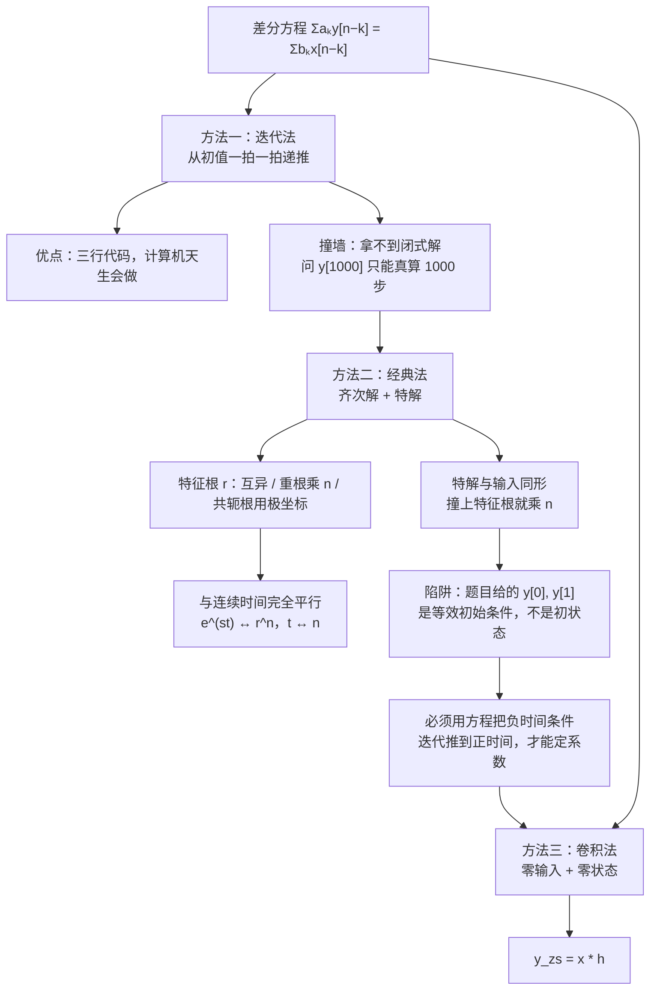
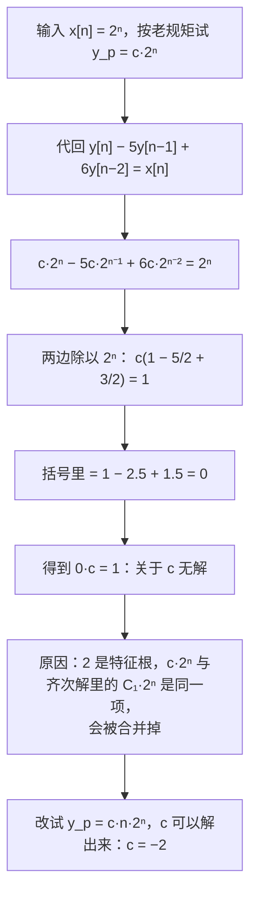
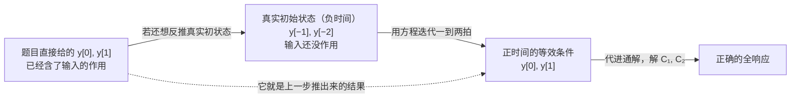

# 2.5 差分方程描述的因果 LTI 系统（离散时间）

> [!abstract] 这一讲的任务
> 上一讲把微分方程解完了。这一讲换成**差分方程**——你会发现整套方法几乎可以原样搬过来：特征根、重根乘 $n$、零输入 + 零状态，一个不少。但有一处记号要特别小心：**连续的特征根放在指数上，离散的特征根放在底上**，这一讲会把"为什么"讲透。
> 离散世界还多了一件连续世界**做不到**的事：**直接一步一步把 $y[0],y[1],y[2],\dots$ 算出来**。三行代码写完，计算机天生就这么干——可它有个致命缺点，第 2 节就撞上那堵墙。
> 最后一段是本讲最容易翻车的地方：**题目给的 $y[0],y[1]$ 不是初始状态**，而且差分方程求全解**不是考核重点**。

> [!info] 怎么读这份讲义
> 第 1 节很短但很关键（特征根为什么在底上），第 2 节是迭代法与它的墙，第 3 节才是经典法。第 4、5 两节连起来读：先看清"等效初始条件"这个陷阱，再看零输入 / 零状态怎么把它绕过去。第 7、8 节是三组例题。
> 标有 **（拓展）** 的内容是课堂没有展开、由标准教材讲法延伸出来的一小段，全篇只有一处。
> **一句话勘误提示**：这一段的原稿数值问题最集中——p.73 的 $y_p[1]$ 写成 $-2$（应为 $-4$）导致最终答案与题设初始条件冲突；p.78 二重根那题的第二式右端写成 $-1$（应为 $\frac12$）；p.79 的 $C_3$ 印成了 $C_5$；p.68 的初值集合把 $y[-2]$ 写了两遍。四处都在对应小节里复算过。

> [!info] 编号说明
> 原书 2.4 一节共 39 页，本篇对应其中的**离散时间求解部分（p.68–87）**，即小节 2.4.2。三篇的拆分与页码对照见 [[C2.4 微分方程与连续时间系统求解]] 开头的编号说明与 [[信号与系统 MOC]]。

---

## 0. 开场：一个每月都在滚的余额

你有一张信用卡，月利率 0.5%。设 $y[n]$ 是第 $n$ 个月末的欠款，$x[n]$ 是这个月新刷的钱。银行的规则是：

$$y[n]=1.005\,y[n-1]+x[n]$$

这就是一个**一阶差分方程**。

它和上一讲的微分方程有个关键差别：**你可以立刻开始算**。已知上个月余额 $y[-1]$，这个月刷了多少 $x[0]$，$y[0]$ 就出来了；有了 $y[0]$ 再算 $y[1]$……一路滚下去，完全不需要任何理论。

这正是差分方程的魅力，也是它的陷阱。我们先享受一下，再看看陷阱在哪。

---

## 1. 离散与连续：同一套方法，两套记号

### 1.1 方程的规范形式

> [!important] 线性常系数差分方程 Linear Constant-Coefficient Difference Equation（LCCDE）
> $$\sum_{k=0}^{N}a_k\,y[n-k]=\sum_{k=0}^{M}b_k\,x[n-k]$$
> 展开：
> $$a_0y[n]+a_1y[n-1]+\cdots+a_Ny[n-N]=b_0x[n]+b_1x[n-1]+\cdots+b_Mx[n-M]$$
> 初始条件：$y[0],\ y[-1],\ \dots,\ y[-(N-1)]$，且 $N\ge M$。
> （p.68 的初值集合印成 $\{y[-1],y[-2],y[-2],\cdots,y[-n]\}$，第二个 $y[-2]$ 是重复的，应为 $y[-3]$，末项按 $N$ 阶写为 $y[-N]$。）

和微分方程逐项对照：

| 连续时间 | 离散时间 |
|---|---|
| $\dfrac{d^ky}{dt^k}$ | $y[n-k]$（**延迟**代替求导） |
| 试探解 $e^{st}$ | 试探解 $r^{\,n}$ |
| 特征方程关于 $s$ | 特征方程关于 $r$ |
| 初始条件 $y(0),y'(0),\dots$ | 初始条件 $y[-1],y[-2],\dots$ |
| 记忆元件是积分器 | **延迟器**是记忆元件 |

> [!question] 停一下，为什么离散方程里"求导"变成了"延迟"？
> 因为离散的导数就是差分：$\dfrac{dy}{dt}\approx\dfrac{y[n]-y[n-1]}{T}$。
> 所以"$y$ 的一阶导数"这件事，在离散世界里靠"**取出上一拍的值**"来实现——记忆元件从积分器变成了延迟器（**D**，delay）。这一点在 [[C2.6 LTI系统的方框图表示]] 里会变成实实在在的框图方块。

### 1.2 特征根为什么"往底上放"

连续端算出来的特征根是 $-2,-4$，写出来是 $e^{-2t},e^{-4t}$——**根在指数上**。离散端算出来的根是 $2,3$，写出来是 $2^n,3^n$——**根在底上**。位置完全不一样，为什么？

> [!important] 唯一的理由：差分过程里"形状不变"的是 $r^n$
> 令 $y[n]=2^n$，则 $y[n-1]=2^{n-1}=\dfrac12\cdot2^n$——$y[n-1]$ 和 $y[n]$ **只差一个常数因子**，$2^n$ 这个"形状"在延迟的过程中保留了。
> 连续端对应的事实是：令 $y(t)=e^{st}$，则 $y'(t)=s\,e^{st}$——同样只差一个常数因子。
>
> 两边说的是同一件事：**"求导 / 延迟"这个运算作用在指数上，只把指数函数乘一个常数。** 代回齐次方程，这个指数因子可以整体约掉，剩下的是一个关于"那个常数"的代数方程——它的根就是特征根。
> 于是：连续的常数是 $s$（指数位置），离散的常数是 $r$（底），**特征根的位置由"运算作用在哪里"决定**。

用一个一阶例子把两边并排算出来最清楚：

| | 连续 | 离散 |
|---|---|---|
| 试探解 | $y=e^{st}$ | $y[n]=r^{n}$ |
| 微分 / 延迟之后 | $y'=s\,e^{st}$ | $y[n-1]=\frac1r\,r^n$ |
| 代入 $y'+3y=0$ / $y[n]-0.5y[n-1]=0$ | $(s+3)e^{st}=0$ | $(1-\frac{0.5}{r})r^n=0$ |
| 特征方程 | $s=-3$，解形如 $Ae^{-3t}$ | $r=0.5$，解形如 $A(0.5)^n$ |

特征方程的两端写法顺序是"反"的，这一条考试很爱考：差分方程 $y[n]-5y[n-1]+6y[n-2]=0$ 对应的特征方程是 $r^2-5r+6=0$，**最高阶（$y[n]$）对应 $r^2$、最低阶（$y[n-2]$）对应常数项**；而微分方程 $y''+6y'+8y=0$ 里，最低阶的 $y$ 对应常数项、最高阶的 $y''$ 对应 $s^2$——两边都把"最高阶配最高次幂"，只是"阶数"在离散里是**延迟的拍数**。

### 1.3 指数信号凭什么叫"特征函数"

"特征根"这个名字不是随口起的。把上一节那条性质推到极致，会得到一个漂亮得多的结论——它同时也是第 3 章的开场白。

设连续时间 LTI 系统的输入是一个指数 $x(t)=e^{st}$，输出为
$$y(t)=x(t)*h(t)=\int_{-\infty}^{+\infty}h(\tau)\,e^{s(t-\tau)}d\tau=e^{st}\underbrace{\int_{-\infty}^{+\infty}h(\tau)e^{-s\tau}d\tau}_{\text{与 }t\text{ 无关，只是 }s\text{ 的函数}}=e^{st}H(s)$$

**输入是一个指数，输出还是同一个指数，只是整体乘了一个复数 $H(s)$。** 所以 $e^{st}$ 被称为 LTI 系统的**特征函数**，$H(s)$ 是它对应的"特征值"。离散端一字不差：输入 $x[n]=r^n$，
$$y[n]=x[n]*h[n]=\sum_{k}h[k]\,r^{\,n-k}=r^n\underbrace{\sum_k h[k]r^{-k}}_{H(r)}=r^nH(r)$$
刚才把特征根"放到底上"的做法，其实就是这条结论在 $r$ 取特征根时的特例。

> [!important] 这条结论为什么值钱
> 本来 $y=x*h$ 是一次**卷积**（要积分 / 求和，很难算）；换成指数输入之后，输入输出的关系变成了**乘法** $y=e^{st}H(s)$。
> 而且**只有指数信号有这个性质**：把输入和输出一除，就能把系统本身（$H$）单独拎出来。这就是后面拉普拉斯变换 / Z 变换（以及作为特例的傅里叶变换）**把卷积变成乘法**的全部来由——变换的本质是"换一个投影面表达同一个系统"，$H(s)$ 和 $h(t)$ 是同一个东西的两副面孔。

> [!question] 那为什么是 $\delta(t)$（而不是方波、三角波）可以用来代表系统？
> 因为 $\delta(t)$ 在时域上站得笔直（宽度为零），它的频谱却是**无限宽的常数**——各种频率分量一个不缺，而且权重都相等。拿它去激励系统，相当于**给每一个频率都发了一次测试信号**，得到的响应里就含了系统对所有频率的响应（每一条都测到了、而且"公平"），所以 $h$ 能代表系统。
> 换一个方波或三角波去测，只测到它自己含有的那几个频率，**测不全**，自然代表不了系统。
>
> 一个现实里的类比：医院抢救心脏停跳的病人用**电击**，而不是用某个固定频率的正弦电流。因为电击脉冲是宽频信号，各个频率都有，才能"同频共振"地唤醒病人自身那些固有的节律——你不可能预先知道该用哪个频率去救谁。
> （这段在课堂上是作为"为什么 $h$ 能代表系统"的动机讲的，正式的变换定义在第 9、10 章。详细展开见 [[C3.1 复指数是LTI系统的特征函数]]。）

---

## 2. 方法一：迭代法（然后撞墙）

### 2.1 递推式

把方程解出 $y[n]$（要求 $a_0\ne0$）：

> [!important] 递推形式（recursive algorithm）
> $$y[n]=\frac{1}{a_0}\left\{-\sum_{k=1}^{N}a_k\,y[n-k]+\sum_{k=0}^{M}b_k\,x[n-k]\right\}$$
> 给定初值 $\{y[-1],y[-2],\dots,y[-N]\}$ 和输入，就能一拍一拍算下去。**这就是计算机里真正跑的那个式子。**

> [!example] 例题（p.69）
> $y[n]-0.5y[n-1]=u[n]$，$y[-1]=1$，用迭代法求输出。
>
> 改写：$y[n]=u[n]+0.5\,y[n-1]$
> $$y[0]=1+0.5\times1=1.5$$
> $$y[1]=1+0.5\times1.5=1.75$$
> $$y[2]=1+0.5\times1.75=1.875$$
> $$y[3]=1+0.5\times1.875=1.9375\ \dots$$

数值验算（递推 12 拍）：$1.5,\ 1.75,\ 1.875,\ 1.9375,\ 1.96875,\dots\to2$。

![[C2-迭代法-一阶差分方程.png]]

### 2.2 撞墙：得不到闭式解

> [!warning] Shortcoming: Can not get the closed solution
> 原稿就这一句"**得不到闭式解**"，但它的分量要说透：
> - 你能看出它趋于 2 吗？图上能看出来，但**迭代本身不会告诉你极限是 2**；
> - 问 $y[1000]$ 是多少？只能老老实实算 1000 步；
> - 问"换一个初值会怎样""稳不稳定""衰减多快"？迭代法一个都答不了——它给的是一堆数，不是一个公式。
>
> 所以要另外找能给出 $y[n]$ 表达式的方法。
>
> **反过来说**，迭代法在工程上极其重要：**计算机里跑的就是它**。DSP 芯片、`scipy.signal.lfilter`、IIR 滤波器的实时实现，全是这行递推式。理论上我们要闭式解，实现上我们要递推式——两者各司其职。

### 2.3 数值解与解析解：省下来的到底是什么

"迭代法也能出结果，为什么还要费劲求闭式解？"答案不在"准不准"，而在**代价**——尤其是**存储**。

- **数值解**：你得到的是 $y[0],y[1],\dots,y[N]$ 这一串数。要用的时候，这串数得**全部存下来**；$n$ 要到多大才够用，事先根本不知道。
- **解析解**：$y[n]=2-0.5^{\,n+1}$ 只占**三个参数**（一个常数、一个底、一个指数偏移）。任意一点随便代入就得到，极限、衰减速率、稳定性一眼可见。

**无穷多个数 vs 三个参数**——这就是数学的价值所在，也是为什么值得为它花力气。

> [!note] 课堂展开：从三个参数到神经网络
> 顺着他课上那段推下去，会看到一条今天最重要的技术脉络：
> - 现在的神经网络是**暴力计算**的极端：万亿级的参数一起跑，要算力、要电力、要显存，代价巨大。
> - 而如果我们能找到**更漂亮的数学表征**，参数量是可以降下来的——一个 IIR 滤波器只要三个系数就能精确描述整个系统，那神经网络为什么不能少一点？
> - 顺着这个思路往今天的技术走，就是 **encoder（编码器）**：编码器做的事就是"压缩"，把一个高维数据（一张图、一段语音）变成一个**特征向量的加权和**——那组权重就是它的新坐标。
>   一个具体的人工特征例子：把"戴不戴眼镜 / 上衣颜色 / 头发长短 / 性别 / 年龄"各算一维，每个同学就变成一个向量；识别谁是谁，就是比这组坐标。神经网络里学到的特征没这么直白，但机制相同——**都是把数据投影到特征空间里，用一组系数表示**，这个机制和傅里叶变换的机理是同一类东西。
> - 神经网络之前的那套叫 **PCA（主成分分析）**：把矩阵做特征分解，得到一堆特征值 / 特征向量（也就是一批"方向"和它们的权重）。分解出来可能有几万维，但**后面那些系数非常小**，就像傅里叶分析里高频那一小撮——把它们砍掉，只用前面的主成分做近似，几万维可以压到几十维，识别照样够用。
> - 数学系里专门有一支叫**计算数学**：偏微分方程、高维动力方程，解析解根本解不出来（太耦合、太复杂），他们的办法是**离散化 / 网格化**，然后用计算机迭代求解。解总能拿到，但**不是闭式的**。
>
> 所以整条思路是：**理论研究走连续这条路去找漂亮的解析结构，真正落地应用时再把它离散化、迭代化。** 神经网络、采样、扩散模型，走的都是这个套路——把连续的东西切碎、离散化处理。这门课从头到尾在连续与离散之间来回横跳，学的正是这套本事。
> 当然，最完美的还是那个解析解：**暴力计算属于暴力美学，解析解才是最漂亮的。**

### 2.4 顺手把闭式解求出来（对照用）

> [!tip] 同一个例子的闭式解
> $y[n]=2-0.5^{\,n+1}$（$n\ge0$）。验证：$y[0]=2-0.5=1.5$ ✓，$y[1]=2-0.25=1.75$ ✓，$y[2]=2-0.125=1.875$ ✓。
> 有了它，"$y[1000]$"和"极限是 2"都是一眼的事。求法见第 3 节。

> [!example] 把这个例子用经典法推一遍（旧自测里那道题）
> 方程 $y[n]-0.5y[n-1]=u[n]$，初值 $y[-1]=1$，求闭式解。
> - **齐次解**：特征方程 $r-0.5=0\Rightarrow r=0.5$，所以 $y_h[n]=C(0.5)^n$；
> - **特解**：输入是阶跃，试常数 $y_p[n]=K$，代回 $K-0.5K=1\Rightarrow K=2$；
> - **通解**：$y[n]=C(0.5)^n+2$；
> - **定系数**：把 $n=0$ 代回原方程，得 $y[0]=y[-1]+u[0]=1+1=2$（**$u[0]=1$ 是离散端特有的约定**，连续端的 $u(0)$ 没有定义）；再由通解 $y[0]=C+2=2\Rightarrow C=-0.5$。
>
> 所以 $y[n]=2-0.5^{\,n+1}$，与上面迭代出来的数列和对照曲线的闭式解一致 ✓。

![[C2.5-迭代解与闭式解对照.png]]

图里蓝色茎叶是迭代出来的**一堆数**，红色虚线是那个**公式**：前者只能告诉你已经算过的那几个点，后者一眼给出全部（包括 $n\to\infty$）。

---

## 3. 方法二：经典法

> [!important] 完全解 = 齐次解 + 特解
> $$y[n]=y_h[n]+y_p[n]$$
> $y_h$ 由**特征根**决定；$y_p$ 的形式跟着**输入**走。与连续时间一字不差。

### 3.1 齐次解的三种根型（p.76）

试 $y[n]=r^{\,n}$ 代入齐次方程，约掉 $r^{\,n-N}$，得**特征方程**（构造规则见第 1.2 节：最高阶配最高次幂）。三种情形：

> [!important] 三种根型的齐次解形式（p.76）
> | 根的类型 | 齐次解形式 |
> |---|---|
> | **(1) 互异实根** $r_1,\dots,r_N$ | $y_h[n]=C_1r_1^{\,n}+C_2r_2^{\,n}+\cdots+C_Nr_N^{\,n}$ |
> | **(2) $N$ 重实根** $r$ | $y_h[n]=C_1r^{\,n}+C_2nr^{\,n}+\cdots+C_Nn^{N-1}r^{\,n}$ |
> | **(3) 共轭复根** $r_{1,2}=a\pm jb=\rho e^{\pm j\omega_0}$ | $y_h[n]=C_1\rho^{\,n}\cos\omega_0n+C_2\rho^{\,n}\sin\omega_0n$ |

### 3.2 例题：特解撞上特征根，要乘一个 $n$

> [!example] 例题（p.71–73）
> 系统 $y[n]-5y[n-1]+6y[n-2]=x[n]$，初始条件 $y[0]=0,\ y[1]=-1$，输入 $x[n]=2^nu[n]$。求**全响应**。
> （先说结论：这两个"初始条件"不是真正的初始状态，第 4 节会专门算这笔账；这一节先照原稿的算法走完。）

**(1) 齐次解。** 特征方程
$$r^2-5r+6=0\ \Longrightarrow\ (r-2)(r-3)=0\ \Longrightarrow\ r_1=2,\ r_2=3$$
$$y_h[n]=C_12^{\,n}+C_23^{\,n}$$

**(2) 特解：这里会撞车。** 按老规矩，特解该和输入同形，试 $y_p[n]=c\,2^{\,n}$。代回原方程：
$$c\,2^{n}-5c\,2^{n-1}+6c\,2^{n-2}=2^{n}$$
两边除以 $2^{n}$：
$$c\left(1-\frac52+\frac32\right)=1\ \Longrightarrow\ c\cdot 0=1\ \Longrightarrow\ \textbf{关于 }c\textbf{ 无解}$$

$c$ 被彻底消掉了，左边恒为 0，右边是 1。这不是算错了，而是**结构性的**：

> [!important] 为什么"撞车"就解不出来
> 齐次解和特解在通解里是**并排相加**的：$y=C_12^n+C_23^n+y_p$。
> 如果 $y_p$ 也长成 $c\,2^n$，它和齐次解里的 $C_12^n$ **是同一项**，会被直接合并进系数 $C_1$ 里——那这个"特解"等于没写，$2^n$ 这一项在方程左边的作用**本来就被齐次解吃掉了**，自然配不出右边的 $2^n$。
> 判据：**把输入的底数代进特征多项式，结果为 0 就是撞车**。本题特征多项式 $P(r)=r^2-5r+6$，$P(2)=4-10+6=0$ ⇒ 撞车 ✓。
>
> 补的办法和在连续端补重根是**同一个手法**：乘一个 $n$。

改试 $y_p[n]=An\,2^{\,n}$（原稿直接给了这个形式，理由就是上面这条）。代入：
$$An2^{\,n}-5A(n-1)2^{\,n-1}+6A(n-2)2^{\,n-2}=2^{\,n}$$
两边除以 $2^{\,n}$：
$$An-\frac52A(n-1)+\frac32A(n-2)=1$$
$$\underbrace{\Big(1-\tfrac52+\tfrac32\Big)}_{=0}An+\underbrace{\Big(\tfrac52-3\Big)}_{=-\frac12}A=1$$
$n$ 的系数自动为 0——**这正是"2 是特征根"的表现**——剩下
$$-\tfrac12A=1\ \Longrightarrow\ A=-2\ \Longrightarrow\ y_p[n]=-2n\,2^{\,n}=-n\,2^{\,n+1},\qquad n\ge0$$

**(3) 用初始条件定系数。**
$$y[n]=C_12^{\,n}+C_23^{\,n}-n2^{\,n+1}$$
$$y[0]=C_1+C_2-0=0$$
$$y[1]=2C_1+3C_2-1\cdot2^{2}=2C_1+3C_2-4=-1$$

> [!warning] 原稿这里把 $y_p[1]$ 写成了 $-2$，应为 $-4$（p.73）
> $y_p[1]=-1\cdot2^{1+1}=-4$。原稿把方程写成 $y[1]=2C_1+3C_2-2=-1$，据此解出 $C_1=-1,\ C_2=1$，最终答案是 $y[n]=-2^{\,n}+3^{\,n}-n2^{\,n+1}$。
> **复算验证**：把这个答案代回 $n=1$，$y[1]=-2+3-4=-3\neq-1$，与题设 $y[1]=-1$ 不符。
> **正确解**：由 $C_1+C_2=0$、$2C_1+3C_2=3$ 得 $C_2=3,\ C_1=-3$：
> $$y[n]=-3\cdot2^{\,n}+3\cdot3^{\,n}-n\,2^{\,n+1}=-3\cdot2^{\,n}+3^{\,n+1}-n2^{\,n+1},\qquad n\ge0$$
> **逐点验算**（由 $y[n]=5y[n-1]-6y[n-2]+2^n$ 递推 vs 公式）：
>
> | $n$ | 0 | 1 | 2 | 3 | 4 | 5 |
> |---|---|---|---|---|---|---|
> | 递推 $y[n]$ | 0 | −1 | −1 | 9 | 67 | 313 |
> | **修正公式** | 0 | −1 | −1 | 9 | 67 | 313 ✓ |
> | 原稿公式 | 0 | −3 | −11 | −29 | −63 | −109 ✗ |
>
> 做题请用修正公式。第 5 节还会用"零输入 + 零状态"这条完全独立的路径把它再验一遍。

### 3.3 原稿的两个追问（p.74）

> [!question] 1）初始条件不变，输入换成 $x[n]=\sin\Omega_0n\,u[n]$，$y[n]=$？
> 2）输入不变，初始条件换成 $y[0]=1,\ y[1]=1$，$y[n]=$？

和连续端的两问是同一件事：**换输入要重算特解，换初始条件只需重解那两个线性方程。**

**第 1 问**：输入换成 $\sin\Omega_0n$，特解形状要换成 $y_p[n]=K_1\cos\Omega_0n+K_2\sin\Omega_0n$。这次**不会撞车**（$\sin$ 不是 $r^n$ 的形状，底数撞不到特征根 2、3），所以不用乘 $n$；代回配平后解出 $K_1,K_2$，再用原来的 $y[0],y[1]$ 重解 $C_1,C_2$。$y_h$ 的形状一个字不动。

**第 2 问（完整解答）**：$y_h$、$y_p$ 形式都不变，$y[n]=C_12^n+C_23^n-n2^{n+1}$：
$$y[0]=C_1+C_2=1$$
$$y[1]=2C_1+3C_2-4=1\ \Longrightarrow\ 2C_1+3C_2=5$$
由第一式 $C_1=1-C_2$：$2-2C_2+3C_2=5\Rightarrow C_2=3,\ C_1=-2$。
$$y[n]=-2\cdot2^{\,n}+3\cdot3^{\,n}-n2^{\,n+1}=-2^{\,n+1}+3^{\,n+1}-n2^{\,n+1}$$
验算：$y[0]=-2+3-0=1$ ✓；$y[1]=-4+9-4=1$ ✓。

**再用递推独立验一次**：$y[2]=5y[1]-6y[0]+x[2]=5-6+4=3$；公式：$-2\cdot4+3\cdot9-2\cdot2^{2}=-8+27-16=3$ ✓（注意 $-n2^{n+1}$ 在 $n=2$ 处是 $-2\cdot8=-16$，不是 $-8$）。

反推真实初状态也自洽：把 $y[-1],y[-2]$ 形式地代进完整解，
$$y[-1]=-2\cdot\tfrac12+3\cdot\tfrac13-(-1)\cdot2^{0}=-1+1+1=1,\qquad y[-2]=-2\cdot\tfrac14+3\cdot\tfrac19-(-2)\cdot2^{-1}=-\tfrac12+\tfrac13+1=\tfrac56$$
而由方程反解：$y[-1]=\frac{5y[0]+x[1]-y[1]}{6}=\frac{5+2-1}{6}=1$，$y[-2]=\frac{5y[-1]+x[0]-y[0]}{6}=\frac{5+1-1}{6}=\frac56$ ✓——两处吻合。

这说明 $(y[0],y[1])$ 与 $(y[-1],y[-2])$ 只是**同一组状态的两种坐标**（因为 $a_0=1\ne0$，来回转换都唯一确定），题目给哪一组都行。真正要小心的是：**$(y[0],y[1])$ 不是"输入作用之前的状态"**，里面已经掺进了 $x[0],x[1]$。求零输入响应时必须先换回 $(y[-1],y[-2])$（第 5.2 节）；求零状态响应时要反过来把 $(y[-1],y[-2])=(0,0)$ 推成正时间条件 $(1,7)$（第 5.3 节）。

---

## 4. 陷阱：题目给的 $y[0],y[1]$ 是"等效初始条件"

### 4.1 连续端为什么没有这个问题

连续端的输入写成 $x(t)=e^{-t}u(t)$，含义是"从 $0^+$ 起作用"：$u(0^-)=0$、$u(0^+)=1$。所以 $y(0^-),y'(0^-)$ 是**输入动手之前**的真实储能，和输入天然无关——零输入响应直接拿它定系数就行，干干净净。

离散端不一样。输入写成 $x[n]=2^nu[n]$，而离散的单位阶跃是 $u[0]=1$——**输入在 $n=0$ 这个点上就已经起作用了**。所以"输入动手之前"的状态只能往前推一拍（二阶系统推两拍）：
$$y[-1],\ y[-2]$$

而题目给的是 $y[0]=0,\ y[1]=-1$。这两个值**已经被输入污染过了**：$y[0]$ 里含 $x[0]$，$y[1]$ 里含 $x[0],x[1]$。

> [!important] 两个名字要分清
> - **真实的初始状态**：$y[-1],y[-2]$——输入作用之前的状态，这就是 [[C1.5 连续时间与离散时间系统]] 里说的"系统的记忆"。
> - **等效初始条件**：题目给的 $y[0],y[1]$——已经包含了输入的作用，是别人替你从真实初状态推过来的结果。
>
> 这两者**不能混用**：零输入响应必须从**真实初始状态**出发；而解通解定系数时，因为通解是对 $n\ge0$ 写的，又必须用**正时间**上的条件。两端各自的要求不同——这正是离散端比连续端麻烦的全部原因。

### 4.2 为什么通解只对 $n\ge0$ 成立

通解 $y[n]=C_12^n+C_23^n-n2^{n+1}$ 里那一项 $y_p[n]=-n2^{n+1}$ 是**为了匹配输入 $x[n]=2^nu[n]$** 而设的。$n<0$ 时 $x[n]=0$，这一项根本没有对应的物理意义，把它硬延拓到负时间是纯粹的代数操作。

所以：**定 $C_1,C_2$ 时必须用 $n\ge0$ 的条件。** 题目若直接给 $y[-1],y[-2]$，不能直接代进通解，要先用方程把它们**迭代推到** $y[0],y[1]$。

> [!note] 一个诚实的技术澄清（拓展）
> "必须推到正时间"这条要求，对**带特解的通解**是硬约束。但如果只要**零输入响应**（方程是齐次的），$r^n$ 对负 $n$ 本来就有定义，"直接代 $n=-1,-2$"和"先推到 $n=0,1$ 再代"两条路会给出**同一组系数**——第 5.2 节会两种都算一遍给你看。真正只能推的，是含 $y_p$ 的那一份。

### 4.3 怎么推：把方程当成迭代器

还是那道题 $y[n]-5y[n-1]+6y[n-2]=x[n]$，$x[n]=2^nu[n]$。把方程解出 $y[n]$：
$$y[n]=5y[n-1]-6y[n-2]+x[n]$$

**从负时间推向正时间**（已知 $y[-1],y[-2]$，求 $y[0],y[1]$）：
$$y[0]=5y[-1]-6y[-2]+x[0],\qquad x[0]=2^0=1$$
$$y[1]=5y[0]-6y[-1]+x[1],\qquad x[1]=2^1=2$$

**反过来从 $y[0],y[1]$ 推真实初状态**也一样，只要把方程朝另一个方向解：
$$y[1]=5y[0]-6y[-1]+x[1]\ \Longrightarrow\ y[-1]=\frac{5y[0]+x[1]-y[1]}{6}$$
$$y[0]=5y[-1]-6y[-2]+x[0]\ \Longrightarrow\ y[-2]=\frac{5y[-1]+x[0]-y[0]}{6}$$

代入题设 $y[0]=0,\ y[1]=-1$、$x[0]=1,\ x[1]=2$：
$$y[-1]=\frac{0+2-(-1)}{6}=\frac12,\qquad y[-2]=\frac{5\cdot\frac12+1-0}{6}=\frac{7/2+1}{6}=\frac{7}{12}$$

所以这一题**真实的初始状态是** $y[-1]=\frac12,\ y[-2]=\frac{7}{12}$——是个正数、还带分数，和题目给的 $(0,-1)$ 完全不是一回事。

> [!warning] 这一段**不是考核重点**
> 这一段把离散初始条件拆得很细，**课本上没有这个说法，一般的考试也不会考**。听明白"离散的初状态要往前推一拍、通解只对正时间成立"这件事就够了；真正要练熟的是连续时间的微分方程求解——**考试要考的是那个**。

---

## 5. 方法三：零输入 + 零状态（离散版）

### 5.1 定义

> [!important] 全响应的物理分解（p.75）
> $$y[n]=y_{zi}[n]+y_{zs}[n]=y_{zi}[n]+x[n]*h[n]$$
> 定义与连续时间完全相同：**零输入**只由初始状态产生（输入置零）；**零状态**在初始状态为零时只由输入产生。
> 离散端的特别之处只有一个——**"状态"是负时间上的那一两拍**：$y[-1],y[-2]$。

求解顺序和连续端一样：先求零输入（简单），再求零状态（把初始状态清零，当作换了一道题）。

### 5.2 零输入响应：先剥离输入影响，再推到正时间

**第一件事：把输入的影响剥掉，找到纯净的初状态。** 题目给的 $y[0],y[1]$ 不纯净，但真实系统只有一个，所以两者由同一个方程联系着。上面已经反解出
$$y[-1]=\frac12,\qquad y[-2]=\frac{7}{12}$$

**第二件事：从纯净初状态出发，在"输入为零"的假设下推到正时间。** 零输入意味着 $x\equiv0$，方程退化成齐次递推：
$$y_{zi}[n]=5y_{zi}[n-1]-6y_{zi}[n-2]$$
$$y_{zi}[0]=5\cdot\frac12-6\cdot\frac{7}{12}=\frac52-\frac72=-1$$
$$y_{zi}[1]=5\cdot(-1)-6\cdot\frac12=-5-3=-8$$

**第三件事：把这两个正时间条件代进齐次解。**
$$y_{zi}[n]=C_12^{\,n}+C_23^{\,n}$$
$$\begin{cases}C_1+C_2=y_{zi}[0]=-1\\ 2C_1+3C_2=y_{zi}[1]=-8\end{cases}
\ \Longrightarrow\ C_2=-6,\qquad C_1=5$$
$$\boxed{\ y_{zi}[n]=5\cdot2^{\,n}-6\cdot3^{\,n},\qquad n\ge0\ }$$

**逐点验算**：$n=0$：$5-6=-1$ ✓；$n=1$：$10-18=-8$ ✓；$n=2$：递推 $5(-8)-6(-1)=-34$，公式 $20-54=-34$ ✓。

> [!tip] 另一条路：直接代负的 $n$（同解）
> 零输入方程是齐次的，$2^n,3^n$ 对负 $n$ 本来就有意义，所以也可以直接把真实初状态代进去：
> $$C_1\cdot\frac12+C_2\cdot\frac13=\frac12,\qquad C_1\cdot\frac14+C_2\cdot\frac19=\frac{7}{12}$$
> 解出来仍是 $C_1=5,\ C_2=-6$。**两条路必然一致**，可用来自检。
> 但含特解的通解就不能这么干——这就是 4.2 节那条澄清的意思。

### 5.3 零状态响应：零状态不等于"$y[0]=0$"

零状态 = **真实初始状态为零**：$y[-1]=y[-2]=0$。然后照 4.3 节的办法**带着输入**推到正时间：
$$y_{zs}[0]=5\cdot0-6\cdot0+x[0]=0+0+1=1$$
$$y_{zs}[1]=5\cdot1-6\cdot0+x[1]=5+0+2=7$$

**注意：这里推出来的正时间条件是 $(1,7)$——非零！** 但它确确实实是零状态。

> [!warning] 零状态不等于"$y[0]=0$"
> 因为差分方程的"状态"是**输入到来之前**存的那几拍。对因果系统、输入从 $n=0$ 开始，$n<0$ 的那些 $y$ 才是初始状态；$y[0]$ 已经被输入影响了，不能拿它当"零状态"。
> 这和连续时间要用 $y(0^-)$ 而不是 $y(0^+)$ 是同一回事。
> 本题给出的 $(1,7)$ 叫**等效初始条件**：它是零状态在正时间上的"化身"，非零，但对应的真实初状态是 $(0,0)$。

有了 $(1,7)$，接下来的求解与经典法完全一样（特征根不变、特解不变，只换条件）：
$$y_{zs}[n]=C_12^{\,n}+C_23^{\,n}-n2^{\,n+1}$$
$$\begin{cases}C_1+C_2=1\\ 2C_1+3C_2-4=7\ \Rightarrow\ 2C_1+3C_2=11\end{cases}
\ \Longrightarrow\ C_2=9,\qquad C_1=-8$$
$$\boxed{\ y_{zs}[n]=-8\cdot2^{\,n}+9\cdot3^{\,n}-n2^{\,n+1},\qquad n\ge0\ }$$
验算：$n=0$：$-8+9-0=1$ ✓（等于 $y_{zs}[0]$）；$n=1$：$-16+27-4=7$ ✓。

### 5.4 相加：顺手把第 3 节的原稿笔误再证一次

$$y[n]=y_{zi}[n]+y_{zs}[n]=\big(5-8\big)2^{\,n}+\big(-6+9\big)3^{\,n}-n2^{\,n+1}=-3\cdot2^{\,n}+3\cdot3^{\,n}-n2^{\,n+1}$$

与第 3.2 节"修正公式"**完全相同**：$-3\cdot2^n+3^{n+1}-n2^{n+1}$。

再代一遍题设的两个条件：
$$y[0]=-3+3-0=0\ \checkmark\ (\text{题设 }y[0]=0)$$
$$y[1]=-6+9-4=-1\ \checkmark\ (\text{题设 }y[1]=-1)$$

而原稿那个答案 $y[n]=-2^n+3^n-n2^{n+1}$ 给出 $y[1]=-3$，**与题设直接冲突**。至此，第 3 节的勘误被一条完全独立的路径（零输入 + 零状态）再次确认。

![[C2.5-零输入零状态-等效初值分解.png]]

图里三条点列分别是 $y_{zi}$、$y_{zs}$ 与它们的和 $y$（纵轴用 symlog 才装得下——因为特征根 2、3 都大于 1，系统本身是**发散**的）。可以看到：$y$ 在 $n=0,1$ 处正好落在题设的 $0,-1$ 上，这就是"分解正确"的自检。

---

## 6. 离散齐次解的三种根型：写法与连续端对照

三种根型的形式在第 3.1 节已经列出，这里只把**离散端特有的写法**说清：

- **重根**：多乘 $n$ 的幂。三阶重根就是 $r^n,\ nr^n,\ n^2r^n$。理由和连续端一样——重根只提供一个线性无关的解，得用多项式因子把缺的解补齐。
- **共轭复根**：$r_{1,2}=a\pm jb$。连续端的根在**指数**上，所以写成 $e^{\sigma t}(\cos\omega t,\sin\omega t)$，实部和虚部各管一件事；离散端的根在**底**上，指数位置上没有可用的东西了，于是把复根写成**极坐标**：
$$r_{1,2}=\rho\,e^{\pm j\omega_0},\qquad \rho=|r|,\quad \omega_0=\arg r$$
这样才好用：**模 $\rho$ 做底的指数**（管包络），**幅角 $\omega_0$ 进正余弦**（管振荡）：
$$y_h[n]=C_1\rho^{\,n}\cos\omega_0n+C_2\rho^{\,n}\sin\omega_0n$$

> [!important] 连续 ↔ 离散，解方程这件事的完整对照
> | | 连续 | 离散 |
> |---|---|---|
> | 基本解 | $e^{st}$ | $r^{\,n}$ |
> | 特征根放在哪 | **指数上** | **底上** |
> | 重根补 | 乘 $t^{\,k}$ | 乘 $n^{\,k}$ |
> | 复根写法 | $e^{\sigma t}(\cos\omega t,\sin\omega t)$ | $\rho^{\,n}(\cos\omega_0n,\sin\omega_0n)$ |
> | 衰减条件 | $\mathrm{Re}\{s\}<0$ | $|r|<1$ |
> | 两者的桥 | $r=e^{sT}$：取样周期为 $T$ 时，连续端的 $e^{sT}$ 就是离散端的底。于是 $\mathrm{Re}\{s\}<0\Leftrightarrow|e^{sT}|<1$，左半平面与单位圆内是同一件事 | 同左 |
> | 记忆元件 | 积分器 | 延迟器 |
> | 初值 | $y(0^-),y'(0^-),\dots$ | $y[-1],y[-2],\dots$ |
> | 有没有迭代法 | 没有 | **有**（可直接递推） |
>
> 最后几行是**稳定性判据的雏形**：连续看"实部是否为负"，离散看"**模是否小于 1**"。这条差别会在第 9、10 章变成"左半平面 vs 单位圆内"——拉普拉斯变换和 Z 变换的分水岭。

---

## 7. 零输入响应的三个例题（三种根型各一）

> [!example] (a) 互异实根：$y[n]+3y[n-1]+2y[n-2]=x[n]$，$y[-1]=0$，$y[-2]=\tfrac12$（p.77）
> $r^2+3r+2=0\Rightarrow r_1=-1,\ r_2=-2$
> $$y_{zi}[n]=C_1(-1)^{\,n}+C_2(-2)^{\,n}$$
> 代入初值（注意 $n$ 取负数，要用 $(-1)^{-1}=-1$、$(-2)^{-1}=-\frac12$、$(-2)^{-2}=\frac14$）：
> $$y[-1]=-C_1-\tfrac12C_2=0,\qquad y[-2]=C_1+\tfrac14C_2=\tfrac12$$
> 由第一式 $C_1=-\frac12C_2$，代入第二式：$-\frac12C_2+\frac14C_2=-\frac14C_2=\frac12\Rightarrow C_2=-2,\ C_1=1$。
> $$\boxed{\ y_{zi}[n]=(-1)^{\,n}-2(-2)^{\,n},\qquad n\ge0\ }$$
> 复算：与原文一致 ✓。自检：公式给 $y_{zi}[0]=(-1)^0-2(-2)^0=1-2=-1$，齐次递推给 $y[0]=-3y[-1]-2y[-2]=0-1=-1$ ✓。

> [!example] (b) 重根：$y[n]+4y[n-1]+4y[n-2]=x[n]$，$y[-1]=0$，$y[-2]=\tfrac12$（p.78）
> $r^2+4r+4=0\Rightarrow r_1=r_2=-2$（**double root**）
> $$y_{zi}[n]=C_1n(-2)^{\,n}+C_2(-2)^{\,n}$$
> $$y[-1]=C_1(-1)(-2)^{-1}+C_2(-2)^{-1}=\tfrac{C_1}{2}-\tfrac{C_2}{2}=0$$
> $$y[-2]=C_1(-2)(-2)^{-2}+C_2(-2)^{-2}=-\tfrac{C_1}{2}+\tfrac{C_2}{4}=\tfrac12$$

> [!warning] 原稿把第二式右端写成了 $-1$，与题设 $y[-2]=\tfrac12$ 不符（p.78）
> 原稿据 $-\frac{C_1}{2}+\frac{C_2}{4}=-1$ 解出 $C_1=C_2=4$，得 $y_{zi}[n]=4n(-2)^n+4(-2)^n$。按题设应为 $\frac12$：
> 由第一式 $C_1=C_2$，代入第二式 $-\frac{C_1}{2}+\frac{C_1}{4}=-\frac{C_1}{4}=\frac12\Rightarrow C_1=C_2=-2$。
> $$y_{zi}[n]=-2n(-2)^{\,n}-2(-2)^{\,n},\qquad n\ge0$$
> **逐点验算**（由 $y[n]=-4y[n-1]-4y[n-2]$ 从 $y[-1]=0,y[-2]=\frac12$ 递推）：
>
> | $n$ | 0 | 1 | 2 | 3 | 4 |
> |---|---|---|---|---|---|
> | 递推 | −2 | 8 | −24 | 64 | −160 |
> | **修正公式** | −2 | 8 | −24 | 64 | −160 ✓ |
> | 原稿公式 | 4 | −16 | 48 | −128 | 320 ✗（差一个 −2 倍） |
>
> 注意：同一题的 (a) 用同样的初值却是自洽的，说明 (b) 这一页是誊写笔误，不是题目改了初值。

> [!example] (c) 共轭复根：$y[n]-0.5y[n-1]+y[n-2]-0.5y[n-3]=x[n]$，$y[-1]=2,\ y[-2]=-1,\ y[-3]=8$（p.79）
> 特征方程 $r^3-0.5r^2+r-0.5=0$。
> **因式分解**（原稿跳过了这一步，分组分解即可）：$r^2(r-0.5)+(r-0.5)=(r-0.5)(r^2+1)=0$
> $$r_1=0.5,\qquad r_{2,3}=\pm j=e^{\pm j\pi/2}$$
> 复根的模 $\rho=1$、幅角 $\omega_0=\frac{\pi}{2}$，按第 6 节的写法：
> $$y_{zi}[n]=C_1\Big(\tfrac12\Big)^{\,n}+C_2\sin\tfrac{\pi}{2}n+C_3\cos\tfrac{\pi}{2}n$$
> 代入三个初值（用 $\sin(-\frac\pi2)=-1$，$\cos(-\frac\pi2)=0$，$\sin(-\pi)=0$，$\cos(-\pi)=-1$，$\sin(-\frac{3\pi}{2})=1$，$\cos(-\frac{3\pi}{2})=0$）：
> $$y[-1]=2C_1-C_2=2$$
> $$y[-2]=4C_1-C_3=-1$$
> $$y[-3]=8C_1+C_2=8$$
> 一、三式相加：$10C_1=10\Rightarrow C_1=1$，于是 $C_2=0$，再由第二式 $C_3=4C_1+1=5$。
> $$\boxed{\ y_{zi}[n]=\Big(\tfrac12\Big)^{\,n}+5\cos\tfrac{\pi}{2}n,\qquad n\ge0\ }$$
> 复算：$C_1=1,\ C_2=0,\ C_3=5$ ✓，与原文结论一致（**原稿把 $C_3$ 印成了 $C_5$**，是排版笔误——通解里根本没有 $C_5$ 这个符号）。
> **物理解读**：$\rho=1$ 意味着 $\cos\frac{\pi}{2}n$ 这一项**既不衰减也不发散**——系统处在稳定与不稳定的**临界**上（极点在单位圆上）。输出里会永远留着一个周期为 4 的等幅振荡：$y_{zi}[0]=6,\ y_{zi}[1]=\frac12,\ y_{zi}[2]=-4.75,\ y_{zi}[3]=\frac18,\ y_{zi}[4]=\frac{81}{16},\dots$，正余弦那一项始终不消失。

> [!warning] 那它到底算不算稳定？把第 2 章的判据接上来
> 第 2 章说过：LTI 系统 **BIBO 稳定 ⇔ 冲激响应绝对可和** $\sum_n\lvert h[n]\rvert<\infty$。
> $|r|=1$ 时，$h[n]$ 里的等幅项永远不衰减，$\sum_n\lvert h[n]\rvert$ **发散**，所以严格说来**它不满足 BIBO 稳定**。
> 换句话说：**只有 $|r|<1$（特征根全在单位圆内）才是稳定的**。临界状态在工程上最麻烦——它不发散，但也永远安静不下来。

![[C2.5-特征根三型-离散零输入.png]]

三张子图（系数都取上面的修正值）：(a) 两个实根 $(-1),(-2)$ 模都大于 1，振荡着发散；(b) 重根多出来的 $n$ 因子让发得更快；(c) $\rho=1$ 的共轭根给出**永不衰减的周期 4 振荡**，叠加在衰减的 $(1/2)^n$ 上。

---

## 8. 零状态与全响应：一题两解

> [!example] Example 1（p.81–84）零状态响应
> 系统 $y[n]+3y[n-1]+2y[n-2]=x[n]$，输入 $x[n]=3\big(\tfrac12\big)^{\,n}u[n]$，已知 $h[n]=\big[-(-1)^{\,n}+2(-2)^{\,n}\big]u[n]$。求 $y_{zs}[n]$。

**解法一：卷积。**
$$y_{zs}[n]=\sum_{k=-\infty}^{\infty}3\Big(\tfrac12\Big)^{k}u[k]\cdot\Big[-(-1)^{\,n-k}+2(-2)^{\,n-k}\Big]u[n-k]$$
两个阶跃把和夹在 $0\le k\le n$（$n\ge0$）。把 $(-1)^{n-k}=(-1)^n(-1)^{-k}$、$(-2)^{n-k}=(-2)^n(-2)^{-k}$ 提出来：
$$=-3(-1)^{\,n}\sum_{k=0}^{n}\Big(-\tfrac12\Big)^{k}+6(-2)^{\,n}\sum_{k=0}^{n}\Big(-\tfrac14\Big)^{k}$$
两个等比和：
$$\sum_{k=0}^{n}\Big(-\tfrac12\Big)^{k}=\frac{1-(-\frac12)^{n+1}}{\frac32},\qquad \sum_{k=0}^{n}\Big(-\tfrac14\Big)^{k}=\frac{1-(-\frac14)^{n+1}}{\frac54}$$
整理后
$$\boxed{\ y_{zs}[n]=\Big[-2(-1)^{\,n}+\tfrac{24}{5}(-2)^{\,n}+\tfrac15\Big(\tfrac12\Big)^{\,n}\Big]u[n]\ }$$

数值验算（按定义直接卷积 vs 公式）：

| $n$ | 0 | 1 | 2 | 3 |
|---|---|---|---|---|
| 直接卷积 | 3 | −15/2 | 69/4 | −291/8 |
| 公式 | 3 | −15/2 | 69/4 | −291/8 ✓ |

顺带验一下 $h[n]$：由 $h[n]=\delta[n]-3h[n-1]-2h[n-2]$ 递推得 $1,-3,7,-15,31,-63$，公式 $-(-1)^n+2(-2)^n$ 给出 $1,-3,7,-15,31,-63$ ✓。

**解法二：解方程，初始状态取零。**
- 特征根 $r_1=-1,\ r_2=-2$，$y_h[n]=C_1(-1)^n+C_2(-2)^n$；
- 特解：输入 $\big(\frac12\big)^n$ 的底数 $\frac12$ 不是特征根，**不撞车**，试 $y_p[n]=A\big(\frac12\big)^n$。代入：
  $$A\Big(\tfrac12\Big)^{n}+3A\Big(\tfrac12\Big)^{n-1}+2A\Big(\tfrac12\Big)^{n-2}=3\Big(\tfrac12\Big)^{n}$$
  除以 $\big(\frac12\big)^n$：$A+6A+8A=15A=3\Rightarrow A=\frac15$ ✓
- 完全解 $y[n]=C_1(-1)^n+C_2(-2)^n+\frac15\big(\frac12\big)^n$；
- **零初始状态** $y[-1]=y[-2]=0$：
  $$y[-2]=C_1+\tfrac14C_2+\tfrac45=0,\qquad y[-1]=-C_1-\tfrac12C_2+\tfrac25=0$$
  解得 $C_1=-2,\ C_2=\frac{24}{5}$ ✓ —— 与解法一完全一致。

> [!warning] 零状态不等于"$y[0]=0$"
> 这里的零初始状态写的是 $y[-1]=y[-2]=0$，**不是** $y[0]=y[1]=0$。
> 因为差分方程的"状态"是**输入到来之前**存的那几拍。对因果系统、输入从 $n=0$ 开始，$n<0$ 的那些 $y$ 才是初始状态。$y[0]$ 已经被输入影响了，不能拿它当"零状态"。
> 这和连续时间要用 $y(0^-)$ 而不是 $y(0^+)$ 是同一回事。

> [!warning] 这一步"代入负的 $n$"是什么意思
> $y_p[n]$ 的表达式只在 $n\ge0$ 有物理意义。把它**形式上**延拓到 $n<0$ 去解系数是标准做法（原稿也是这么做的），延拓出来的值不是系统真实的历史值，只是用来定 $C_1,C_2$ 的代数手段。方程里那个 $+\frac45$ 就是这么来的：$\frac15\big(\frac12\big)^{-2}=\frac15\times4=\frac45$。

> [!example] Example 2（p.85–86）全响应，两种解法
> 同一个系统 $y[n]+3y[n-1]+2y[n-2]=x[n]$，$y[-1]=0$，$y[-2]=\tfrac12$，$x[n]=3\big(\tfrac12\big)^nu[n]$，求**全响应**。

**解法一（经典法）**：完全解形式已知，直接用**真实**初始条件定系数：
$$y[-2]=C_1+\tfrac14C_2+\tfrac45=\tfrac12,\qquad y[-1]=-C_1-\tfrac12C_2+\tfrac25=0$$
解得 $C_1=-1,\ C_2=\frac{14}{5}$：
$$y[n]=-(-1)^{\,n}+\tfrac{14}{5}(-2)^{\,n}+\tfrac15\Big(\tfrac12\Big)^{\,n},\qquad n\ge0$$

**解法二（零输入 + 零状态）**：
$$y_{zi}[n]=(-1)^{\,n}-2(-2)^{\,n}\quad\text{（第 7 节 (a)）}$$
$$y_{zs}[n]=-2(-1)^{\,n}+\tfrac{24}{5}(-2)^{\,n}+\tfrac15\Big(\tfrac12\Big)^{\,n}\quad\text{（本节 Example 1）}$$
相加：
$$(1-2)(-1)^n=-(-1)^n\ \checkmark,\qquad \Big(-2+\tfrac{24}{5}\Big)(-2)^n=\tfrac{14}{5}(-2)^n\ \checkmark,\qquad \tfrac15\Big(\tfrac12\Big)^n\ \checkmark$$
**两条路完全一致。**

**数值验算**（把 $n=-1,-2$ 形式地代进全响应表达式）：
$$y[-1]=-(-1)^{-1}+\tfrac{14}{5}(-2)^{-1}+\tfrac15\big(\tfrac12\big)^{-1}=1-1.4+0.4=0\ \checkmark$$
$$y[-2]=-(-1)^{-2}+\tfrac{14}{5}(-2)^{-2}+\tfrac15\big(\tfrac12\big)^{-2}=-1+0.7+0.8=\tfrac12\ \checkmark$$

> [!note] 随堂测去哪了
> p.87 的随堂测（$y''+6y'+8y=x$，$y(0)=1,y'(0)=2$，$x=e^{-t}u(t)$，求 $y_{zi}$ 与 $y_{zs}$）是**连续时间**的题，完整解答见 [[C2.4 微分方程与连续时间系统求解]] 第 10 节。离散部分的随堂测在 p.99，与方框图一起出现在 [[C2.6 LTI系统的方框图表示]]。

---

## 这一讲的三句话

1. **离散和连续是同一套方法的两种记号**：$e^{st}\leftrightarrow r^{\,n}$，求导 $\leftrightarrow$ 延迟，$\mathrm{Re}\{s\}<0\leftrightarrow|r|<1$；唯一的机械差别是**特征根在指数上还是底上**。
2. **迭代法是计算机的做法，经典法 / 卷积法是人的做法**：前者给一堆数（存储代价无穷），后者给一个公式（三个参数就能装下）——这条"无穷个数据 vs 三个系数"的对比，正是今天神经网络压缩、encoder、PCA 在做的事。
3. **撞车就乘 $n$**：输入的底数等于特征根时，特解必须试 $An\,r^{\,n}$——原因是特解与齐次解同形会被合并掉。附送一条陷阱：**题目给的 $y[0],y[1]$ 是等效初始条件，真正的初状态是 $y[-1],y[-2]$，通解只对 $n\ge0$ 成立。**

> [!tip] 速查表
> | 项目 | 内容 |
> |---|---|
> | 递推形式 | $y[n]=\frac{1}{a_0}\{-\sum_{k\ge1}a_ky[n-k]+\sum b_kx[n-k]\}$ |
> | 特征方程 | 最高阶配最高次幂：$y[n]$ 配 $r^N$，$y[n-N]$ 配常数 |
> | 互异根 | $\sum C_ir_i^{\,n}$ |
> | $N$ 重根 | $(C_1+C_2n+\cdots+C_Nn^{N-1})r^{\,n}$ |
> | 共轭根 $\rho e^{\pm j\omega_0}$ | $\rho^{\,n}(C_1\cos\omega_0n+C_2\sin\omega_0n)$ |
> | 特解撞车 | 输入底数 = 特征根（$P(r)=0$）⇒ 乘 $n$ |
> | 零状态初值 | $y[-1]=\cdots=y[-N]=0$（不是 $y[0]=0$） |
> | 通解适用范围 | 只对 $n\ge0$；初状态要先从负时间推到正时间 |
> | 衰减条件 | $|r|<1$；$|r|=1$ 临界；$|r|>1$ 发散 |
> | 考试范围 | **差分方程求全解不作为考核重点**；微分方程求解才是考点 |

> [!tip] 下一讲预告
> 现在我们能从方程算出响应了。可是**怎么把一个方程做成实实在在的电路或代码？**
> 下一讲只用三种零件——加法器、乘常数、延迟器（连续时间换成积分器）——把任何一个 LCCDE 搭出来。你会看到同一个方程有两种搭法，其中一种**省掉一半的存储器**，而省掉的理由正是我们在 [[C2.3 LTI系统的性质]] 学过的交换律。

> [!todo] 课程进度（第 9–10 节课）
> 差分方程的求解讲完；第二章只剩**方框图表示**没讲，讲完后布置第二章作业。第一章作业已在第 9 节课后截止。

---

## 相关笔记 Related Notes

- 相关：[[C2.1 离散时间LTI系统与卷积和]]（$y_{zs}=x*h$ 的算法）、[[C1.5 连续时间与离散时间系统]]（银行账户差分方程）、[[C3.1 复指数是LTI系统的特征函数]]（$y[n]=r^nH(r)$ 的完整证明）、[[C1.4 单位冲激与单位阶跃函数]]（$u[0]=1$ 为什么让初状态往前推一拍）

- 上一讲：[[C2.4 微分方程与连续时间系统求解]]
- 下一讲：[[C2.6 LTI系统的方框图表示]]
- 返回：[[信号与系统 MOC]]
