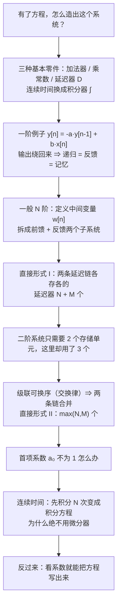
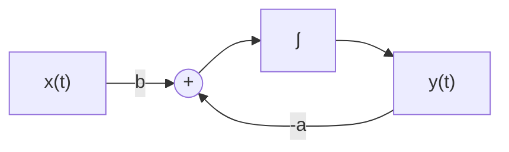
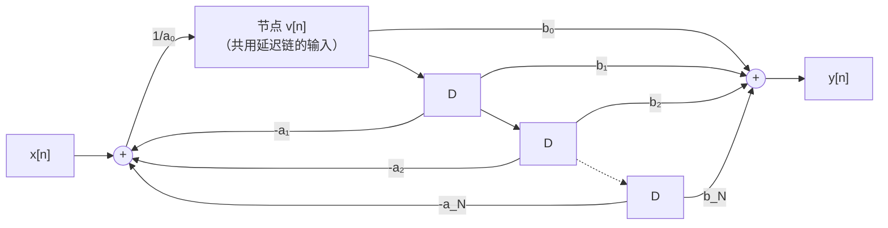
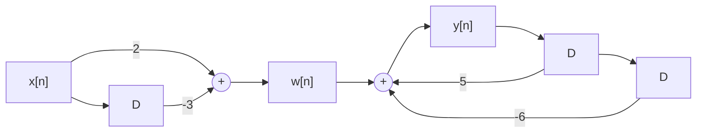
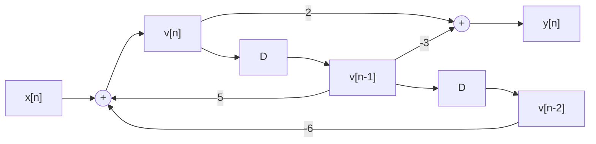

# 2.6 LTI 系统的方框图表示 Block Diagram Representations

> [!abstract] 这一讲的任务
> 前面几讲都在「解」方程、算卷积。这一讲反过来问：**怎么把一个方程造成一个能跑的系统？**
> 答案只要三种零件：**加法器、乘常数、延迟器 D**（连续时间换成积分器 $\int$）。任何一个常系数线性方程都能用它们搭出来，而且同一个系统有两种搭法——其中一种**省掉近一半的存储器**，省掉的理由正是 2.3 节证过的那条交换律。
> 这是第 2 章的最后一块拼图：学完你就知道手机里的滤波器、`scipy.signal.lfilter` 内部到底在干什么。

> [!info] 怎么读这份讲义
> - 第 1 节是零件清单；第 2–4 节从一个一阶例子搭到一个二阶例子；第 5–6 节讲怎么把存储单元省下来；第 7–9 节是首项系数不为 1、连续时间的对应、以及反过来从图写方程；第 10 节是随堂测。赶时间可以直接翻「这一讲的三句话」。
> - **考试提示：方框图一定会考。** 它和冲激响应 $h$、方程一样，是系统的一种描述方式；后面学完傅里叶变换、拉普拉斯变换还会有频率响应、系统函数、零极点图等更多描述方式，而方框图是最基础、最能用「固定套路」拿分的一种。
> - 一句话勘误：p.94 积分式里印的 $ay(t)$ 应为 $ay(\tau)$（积分变量是 $\tau$），第 8 节说明为什么。
> - 标有 **（拓展）** 或 **【拓展】** 的段落，是课堂没有展开、由教材与通行讲法延伸补充的部分，复习时先吃透未标注的主干。

> [!info] 平时成绩怎么算（第 10 节课通报）
> - **平时分 = 考勤 + 作业**（课程成绩构成里的 30%）。考勤以课堂扫码签到为准；同一节课可能签到多次，多次记录会覆盖前面的，为的是给出一份公平可信的出勤记录。
> - 作业不只看「交没交」，还看**提交的质量**与**是否按时提交**——迟交会算进平时分。
> - 第 10 节课布置**第二章作业**，**第一章作业同期截止**；第三、四、五章的材料会放到课程网站与课程 QQ 群。
> - 缺勤不要指望期末被「捞」：平时分的唯一来源就是出勤与作业。

---

## 0. 开场：只给你三个零件

假设你在设计一块芯片，工艺库里只有三种单元：

- **加法器**：两个数进去，和出来；
- **乘法器（乘一个固定常数）**：一个数进去，放大 $a$ 倍出来；
- **寄存器 D**：一个数进去，**下一拍**才出来（也就是延迟一拍）。

现在丢给你一个公式：
$$y[n]-5y[n-1]+6y[n-2]=2x[n]+3x[n-1]$$
让你用这三种零件把它搭出来。

**你会怎么开始？**

先把它改写成「$y[n]=\dots$」的形式——因为芯片每拍要输出一个 $y[n]$，你得告诉它这个数怎么算：
$$y[n]=2x[n]+3x[n-1]+5y[n-1]-6y[n-2]$$

右边一共出现四个量：$x[n]$（现在的输入）、$x[n-1]$（上一拍的输入）、$y[n-1]$ 和 $y[n-2]$（前两拍的输出）。**「上一拍的值」正好是延迟器 D 提供的东西**，乘常数和相加也都有零件。于是这个公式可以一比一地画成电路。

这件事你在神经网络里天天见：写一个 ResNet，你得画出「conv → BN → ReLU → 相加」的架构图；架构图里每一块也是最基本的算子。方框图就是**最小号的架构图**——每个模块只干三件事里的一件：相加、乘一个常数、存一拍。区别在于：神经网络的模块动辄成千上万参数，而这里的模块小到不能再小，小到「结构」本身成了它唯一的自由度。

> [!important] 第 2 章的三条腿
> 一个 LTI 系统到此有了三种描述方式，它们是同一件事的三件衣服：
> 1. **冲激响应 $h$**（第 2.1–2.2 节）：$y=x*h$，做卷积；
> 2. **常系数微分 / 差分方程**（第 2.4–2.5 节）：$y$ 和 $x$ 各阶导（差）分的线性组合；
> 3. **方框图**（这一节）：用加法器、乘常数、延迟器搭出来的连接结构。
> 后面还会加上频率响应 $H(j\omega)$、系统函数 $H(s)$、零极点图。它们之间可以互相翻译，而考试就考这个翻译。

---

## 1. 三种基本零件（p.89, p.93）

![[C2.6-三种基本零件.png]]

### 1.1 离散时间

| 零件 | 作用 | 记号 |
|---|---|---|
| **加法器 An adder** | $x_1[n],x_2[n]\to x_1[n]+x_2[n]$ | 圆圈里一个 $+$ |
| **乘常数 Multiplication by a coefficient** | $x[n]\to a\,x[n]$ | 箭头旁标 $a$ |
| **单位延迟 A unit delay** | $x[n]\to x[n-1]$ | 方块 **D** |

### 1.2 连续时间：没有延迟器，只有积分器

| 零件 | 作用 |
|---|---|
| **加法器** | $x_1(t)+x_2(t)$ |
| **乘常数** | $a\,x(t)$ |
| **积分器 An integrator** | $x(t)\to\displaystyle\int_{-\infty}^{t}x(\tau)\,d\tau$ |

离散的「延迟一拍」在连续世界里天然对应的是「求导」——所以第一反应会想用**微分器**。但结论是：**绝不用微分器，一律换成积分器。** 这不是审美偏好，而是两条硬理由。

**理由一：微分器会把有界的输入变成无界的输入，系统当场崩掉（p.93）。**

拿最普通的阶跃输入 $u(t)$ 试一下。$u(t)$ 本身完全有界（取值只有 0 和 1），可它求导就是 $\delta(t)$：
$$\frac{d}{dt}u(t)=\delta(t)$$
而 $\delta(t)$ 是一个**幅度无穷大**的东西。于是无论这个系统本身多么稳定，只要它的结构里挂着微分器，输入侧一个开关动作就会在微分器后面造出一个无穷大的信号，后面所有环节全部失效——系统崩了。

注意这里和 BIBO 稳定不矛盾：BIBO 说的是「**有界**输入 ⇒ 有界输出」，而现在输入到微分器那一段已经不是有界输入了。信号在结构内部就已经发散，稳定性的前提被破坏掉了。

![[C2.6-微分器为何爆炸.png]]

**理由二：微分器增益随频率线性增长，等于给噪声装了个放大器。**

把 $e^{j\omega t}$ 送进微分器：$\frac{d}{dt}e^{j\omega t}=j\omega\,e^{j\omega t}$，增益 $|\omega|$ 随频率一路线性涨上去；频率越高，放大得越狠。信号里一点点高频噪声，经过微分就被放大几十倍。积分器正相反，增益是 $1/|\omega|$，**天然抑制高频**。

而积分器在物理上也更好做：运放 + 电容就是积分器（p.94 Note 1：*integrators can be readily implemented using operational amplifiers, the representation lead directly to analog implementations*）。所以模拟电路的实现方式，是从积分器这条路上长出来的。

> [!important] 为什么积分器不会崩
> 积分的本质是**累加**。只要输入有界，累加出来的每一项都有界，加在一起仍然有界——它只是慢慢变化，绝不会像微分那样在跳变点爆炸。
> 所以「用积分器代替微分器」，换来的不只是好实现，还有**数值上稳得多**。

这条理由还顺手解释了上一讲 LCCDE 里那条 **$N\ge M$**：如果 $M>N$，方程里就必须出现纯微分环节，物理上做不出来。**上一节埋的伏笔在这里回收。**

### 1.3 记忆元件是谁

> [!important] 延迟器和积分器就是记忆
> - 离散：**延迟器 D**。（p.90 Note：*A delay corresponds to a memory element, as the delay element must retain the previous value of its input.*）
> - 连续：**积分器**。（p.94 Note 2：*The integrator represents the memory storage element of the system.*）
>
> 一个延迟器要「记住上一拍的输入」，所以它必须是一个存储单元。数一个系统里有几个 D（或几个 $\int$），就知道它需要**几个存储单元**——这就是「省存储器」这件事的计量单位。

---

## 2. 一阶系统：递归、反馈、记忆是怎么同时出现的

从最简单的一阶方程开始（p.90）：

$$y[n]+a\,y[n-1]=b\,x[n]\ \Longrightarrow\ y[n]=-a\,y[n-1]+b\,x[n]\quad\text{(recursive algorithm 递归算法)}$$

![[C2.6-一阶反馈系统框图.png]]

**读这张图**：输入乘 $b$ 送进加法器；加法器的输出就是 $y[n]$，它同时被抽出来送进延迟器 D，延迟一拍变成 $y[n-1]$，再乘 $-a$ **绕回加法器**。

> [!important] 这是一个反馈系统 feedback system
> 「输出绕回输入」就是 [[C1.5 连续时间与离散时间系统]] 里讲的**反馈互联**。
> 它和「把公式写成递归形式」是同一件事的两种说法：**递归 ⇔ 反馈 ⇔ 系统有记忆**。
> 因为要回看 $y[n-1]$，系统就必须把上一拍的输出存住——这就是那一个 D 存在的全部理由。

> [!example] 手算一遍：$y[n]+0.8y[n-1]=x[n]$，看它有几个存储单元、稳不稳
> 递归形式：$y[n]=x[n]-0.8y[n-1]$，所以框图里只有**一个** D。
> 冲激响应：$h[n]=(-0.8)^n u[n]$，于是
> $$\sum_{n=0}^{\infty}|h[n]|=\sum_{n=0}^{\infty}0.8^n=\frac{1}{1-0.8}=5<\infty\ \Rightarrow\ \textbf{BIBO 稳定}$$
> 特征根 $r=-0.8$，$|r|=0.8<1$，与 BIBO 判据一致。
> **一阶系统最少需要 1 个存储单元，这个搭法一个不多一个不少。**

> [!question] 停一下，先自己想想
> 上面这个系统里只有**一个** D。它存的是什么？为什么一个就够？
>
> 存的是 $y[n-1]$。够，是因为方程只回看一拍。**一般地：$N$ 阶方程要回看 $N$ 拍 ⇒ 至少需要 $N$ 个存储单元。** 这句「至少」很重要——下面会看到有的搭法用得比这更多，那是浪费。

**连续时间的对应版本**（p.94）：把「输出」写成状态、把方程两边积分一次：
$$y'(t)+a\,y(t)=b\,x(t)\ \Longrightarrow\ y'(t)=b\,x(t)-a\,y(t)\ \Longrightarrow\ y(t)=\int_{-\infty}^{t}\big[b\,x(\tau)-a\,y(\tau)\big]d\tau$$

> [!warning] p.94 的一处笔误
> 原稿把积分式印成 $y(t)=\int_{-\infty}^{t}[bx(\tau)-ay(t)]\,d\tau$，**第二个 $y(t)$ 应为 $y(\tau)$**——积分变量是 $\tau$。
> 按图看也很清楚：绕回来的是被积函数里的 $y$，不可能是积分号外的常数。

---

## 3. 一般 $N$ 阶：前馈 + 反馈 = 直接形式 I

现在处理完整的方程
$$\sum_{k=0}^{N}a_k\,y[n-k]=\sum_{k=0}^{M}b_k\,x[n-k]$$

**关键一步：把它看成两个子系统的级联。** 定义中间变量
$$w[n]\triangleq\sum_{k=0}^{M}b_k\,x[n-k]$$
也就是把等号右边的输入项单独打包。于是原方程变成
$$y[n]=\frac{1}{a_0}\left[w[n]-\sum_{k=1}^{N}a_k\,y[n-k]\right]\quad\text{(recursive algorithm)}$$

一左一右两块，性质完全不同：

| 子系统 | 做什么 | 结构 |
|---|---|---|
| **前馈部分**（$b$ 侧） | $x\to w$：把输入的各阶延迟加权求和 | **非递归**，没有反馈，一条延迟链 |
| **反馈部分**（$a$ 侧） | $w\to y$：减去输出的各阶延迟 | **递归**，有反馈环 |

> [!important] 直接形式 I Direct-Form I
> 把两条延迟链**分别**画出来：左边 $M$ 个 D（存 $x$ 的历史），右边 $N$ 个 D（存 $y$ 的历史），共 **$N+M$ 个延迟器**。

![[C2.6-DirectFormI-完整框图.png]]

这张图是规范画法，但**画的时候完全不用想结构**：结构是固定的，你只是把系数一条条挂上去。挂法记住两句话——

- **前馈的系数照抄**：等号右边 $x[n-k]$ 的系数 $b_k$ 挂到第 $k$ 条延迟线上，正负不动；
- **反馈的系数要变号**：等号左边 $y[n-k]$ 的系数 $a_k$ 在图上写成 $-a_k$。

为什么反馈要变号？因为要把方程整理成「左边只剩 $y[n]$」的迭代形式，那些原来在等号左边的项**搬到右边去，必须变号**。这一步在第 4 节配着具体数字讲透。

---

## 4. 二阶例子：对着系数画一遍

拿课堂上的具体例子（系数上做了一点改动，比随堂测那道稍复杂）：

$$y[n]-5y[n-1]+6y[n-2]=2x[n]+3x[n-1]$$

![[C2.6-二阶例子-两种直接形式.png]]

**先读系数**：$a_0=1,a_1=-5,a_2=6$；$b_0=2,b_1=3$。$N=2,M=1$，满足 $N\ge M$ ✓。

**第一步，拆出前馈部分。** 把等号右边打包成 $w[n]$：
$$w[n]=2x[n]+3x[n-1]$$
$x[n]$ 直接挂系数 $2$ 进加法器；$x[n-1]$ 由 $x[n]$ 过**一个** D 得到，挂系数 $3$ 进同一个加法器。前馈画完了，这里 $M=1$，所以只用 **1 个** D。

**第二步，拆出反馈部分。** 剩下的关系是
$$y[n]-5y[n-1]+6y[n-2]=w[n]$$
把 $y$ 的项全部搬到右边，才得到「每拍怎么算 $y[n]$」的迭代式：
$$y[n]=w[n]\underbrace{+5y[n-1]}_{\text{原为 }-5y[n-1]}\underbrace{-6y[n-2]}_{\text{原为 }+6y[n-2]}$$
看清楚了：**原来左边的 $-5$ 搬过去变成 $+5$，$+6$ 搬过去变成 $-6$。** 图上所以写 $-a_1=-(-5)=+5$、$-a_2=-(6)=-6$。这就是「反馈项要变号」的全部内容——不是规定，是移项。

**第三步，把两部分串起来。** $w[n]$ 作为前馈子系统的输出，同时是反馈子系统的输入。反馈这一侧要从 $y[n]$ 拉出 $y[n-1]$ 和 $y[n-2]$，所以要 **2 个** D（一阶一个、二阶两个）。

合起来如图 (a)：$x$ 侧 1 个 D、$y$ 侧 2 个 D，**一共 3 个延迟器**。这就是**直接形式 I**。

> [!warning] 最容易错的两处
> 1. **$y$ 侧的系数忘变号**——直接把 $-5$、$+6$ 抄到反馈线上。检查办法：把图上的关系反推回原方程，符号必须能对上。
> 2. **把 $w[n]$ 当成输出**。$w[n]$ 只是中间变量，输出永远是 $y[n]$。

> [!question] 课堂追问：p.99 的随堂测为什么是 $-3x[n-1]$？
> 随堂测给的方程是 $y[n]-5y[n-1]+6y[n-2]=2x[n]-3x[n-1]$。**反馈部分一字不动**（$+5$、$-6$），只有前馈线 $x[n-1]$ 上的系数从 $+3$ 变 $-3$。
> 也就是说：**改一个数字，只改对应那条线上挂的系数，结构纹丝不动。** 这正是「结构固定、系数可填」的意思。

---

## 5. 存储代价：3 个延迟器里有 1 个是冗余

先数一下这个系统是几阶：**二阶**。按第 2 节的结论，$N$ 阶系统至少需要 $N$ 个存储单元，所以 **2 个就够**。

可是直接形式 I 用了 **3 个**：$x$ 侧 1 个、$y$ 侧 2 个。

多出来的那一个就是**设计冗余**。硬件上，寄存器 = 芯片面积 = 功耗 = 成本；软件上，多一个状态变量就多一份内存和一次读写。所以要把结构做紧凑——用今天的话说，这是一次**轻量化**：不改系统的功能，只改实现方式，把多余的单元去掉。

> [!question] 停一下，先自己想想
> 左边那条链存着 $x[n-1],x[n-2],\dots$，右边那条链存着 $y[n-1],y[n-2],\dots$，**各存各的**。
> 有没有办法让它们**共用**同一批存储单元？

---

## 6. 交换律换序 ⇒ 两条链合并：直接形式 II（p.92）

有办法，而且理由在 2.3 节已经证过了——原文说得很直接：

> *Since the convolution sum has the **commutative property**, we can **change the order of two cascade systems**, and **merge together** the unit delays in the two subsystems.*

**三步推理**：

1. 整个系统是 $h_1$（前馈）与 $h_2$（反馈）的**级联**：$h=h_1*h_2$；
2. 由**交换律**（[[C2.3 LTI系统的性质]]），级联可以换序：$h_1*h_2=h_2*h_1$，即先做反馈部分、再做前馈部分，输出完全一样；
3. 换序之后，**两条延迟链的输入变成了同一个信号**——原来 $x$ 侧存的是 $x$ 的历史、$y$ 侧存的是 $y$ 的历史，现在中间的节点同时喂给上下两侧，两条链可以**合并成一条**：只存那个中间信号 $v[n]$ 的历史。

![[C2.6-DirectFormII-共用延迟链框图.png]]

> [!important] 直接形式 II Direct-Form II（又称正准型 canonical form）
> 只需要 **$\max(N,M)$ 个延迟器**（p.92 是在 $N=M$ 的情形下画的），比直接形式 I 省掉近一半。
> **这就是「正准（canonical）」的意思——延迟器数量达到了理论下限**（$N$ 阶系统至少要 $N$ 个存储单元）。
> 二阶例子从 3 个降到 2 个；如果用一般式 $N\ge M$，就是从 $N+M$ 降到 $N$。

**这个例子里的两张图合起来验证一下**：设中间节点为 $v[n]$，
$$v[n]=x[n]+5v[n-1]-6v[n-2],\qquad y[n]=2v[n]+3v[n-1]$$
把 $y[n]$、$y[n-1]$、$y[n-2]$ 三式按权重 $1,-5,6$ 相加，每一组都凑出 $v$ 的同一个组合：
$$y[n]-5y[n-1]+6y[n-2]=2\underbrace{\big(v[n]-5v[n-1]+6v[n-2]\big)}_{=x[n]}+3\underbrace{\big(v[n-1]-5v[n-2]+6v[n-3]\big)}_{=x[n-1]}$$
于是
$$y[n]-5y[n-1]+6y[n-2]=2x[n]+3x[n-1]\ ✓$$
（我按这个结构逐步算过 60 拍，输出与原方程逐点一致。）

> [!warning] 这个等式里藏着一个前提：**只有 LTI 才能换序**
> 交换律对卷积成立，对别的运算不一定。神经网络里模块之间的顺序**不能随便换**——卷积后面接 ReLU 和 ReLU 后面接卷积是两个完全不同的网络，因为 ReLU 是非线性的。
> 但卷积层之间、线性层之间可以换序、甚至可以合并成一个更大的卷积（这正是「两层 $3\times3$ 等价于一层 $5\times5$」的来源）。方框图能省存储单元，靠的就是这个「线性才有的自由度」。

> [!tip] 工程意义（拓展）
> - **硬件**：寄存器就是面积、功耗和钱。同一个滤波器，直接形式 II 的芯片面积小一半。
> - **软件**：`scipy.signal.lfilter(b, a, x)` 默认用的就是**直接形式 II 转置结构**（transposed direct form II）；`sos`（二阶节级联）是同一思想的延伸。你传进去的 `b`、`a` 两个数组，正是图上的 $b_k$ 和 $a_k$。
> - **数值稳定性**：高阶直接形式对系数量化误差极其敏感，所以工程上会把高阶系统拆成若干**二阶节级联**（依据又是结合律）。这是 DSP 里「IIR 滤波器实现结构」的全部出发点。

---

## 7. 首项系数不为 1 怎么办

前面的公式里都藏着 $1/a_0$（连续的版本是 $1/a_N$）。它平时等于 1，所以容易被忽略。**如果 $y[n]$ 前面的系数不是 1 呢？** 比如把式子写成
$$4y[n]-5y[n-1]+6y[n-2]=2x[n]+3x[n-1]$$
有两种处理，都可以：

**做法一：两边同除 4，把首项化成 1。** 所有系数一起变：
$$y[n]-1.25y[n-1]+1.5y[n-2]=0.5x[n]+0.75x[n-1]$$
然后照第 4 节的办法画，图上挂的系数是 $0.5$、$0.75$、$+1.25$、$-1.5$（$1/2$、$1/4$ 之类的分数写成分数更好看：$b_0=1/2$、$b_1=3/4$、反馈 $5/4$、$-6/4$）。

**做法二：保留 4，在最后一级乘 $1/4$。** 前馈、反馈两部分的系数一个都不动，只在反馈加法器输出到 $y[n]$ 的那条线上放一个 $\times\frac14$：
$$y[n]=\frac14\Big(4y[n]\Big)=\frac14\Big(w[n]+5y[n-1]-6y[n-2]\Big)$$
这与做法一完全等价——只是「除以 4」发生在最后一步，而不是在每一条系数线上。

> [!warning] 这里最容易写成 4
> 保留 4 的时候，最后那一级是 **$1/4$（倒数）**，不是 4。顺着「4 倍的 $y$」往下写很容易顺手写成 $4y=\dots$，然后输出就差了 16 倍。
> 记忆方式：加法器输出的那一坨是 $4y[n]$，要得到 $y[n]$ 就得乘 $1/4$；而 $1/a_0$ 的写法本来就把「倒数」写在了明面上。

**这个 $1/a_0$ 就是「正准型」里的归一化**：它保证了 $y[n]$ 的系数是 1，也保证了图上只有一条反馈链的增益需要额外处理。

---

## 8. 连续时间：把微分方程变成积分方程（p.95–96）

连续时间的零件里只有积分器，所以**不能**照着离散的样子直接画导数。做法是：**先把微分方程两边积分 $N$ 次，把最高阶导数降成 $y$ 本身。**

以二阶为例，原方程（$N=M=2$）：
$$a_2\frac{d^2y}{dt^2}+a_1\frac{dy}{dt}+a_0y=b_2\frac{d^2x}{dt^2}+b_1\frac{dx}{dt}+b_0x$$
两边各积分两次，记 $y_{(k)}(t)$ 为 $y$ 的 $k$ 重积分：
$$a_2y(t)+a_1y_{(1)}(t)+a_0y_{(2)}(t)=b_2x(t)+b_1x_{(1)}(t)+b_0x_{(2)}(t)$$
其中
$$y_{(1)}(t)=y^{(-1)}(t)=\int_{-\infty}^{t}y(\tau)\,d\tau,\qquad y_{(2)}(t)=y^{(-2)}(t)=\iint y(\tau)\,d\tau$$
变形写成迭代式：
$$y(t)=\frac{1}{a_N}\left[\sum_{k=0}^{N}b_k\,x_{(N-k)}(t)-\sum_{k=0}^{N-1}a_k\,y_{(N-k)}(t)\right]$$
**两项都是「若干重积分」，于是每一项都能从一条积分器链上取到。** 剩下的做法和离散完全一样：前馈一条链、反馈一条链、级联可换序、合并共用的积分器。

![[C2.6-连续时间积分器-两种直接形式.png]]

> [!warning] 连续版本的系数下标是「反着」的
> 离散里 $x[n-k]$ 的系数是 $b_k$；连续里第 $k$ 重积分的系数是 $b_{N-k}$。这不是笔误，而是因为连续版本习惯把方程写成 $a_Ny(t)+\dots$ 的形式（最高阶项写在最前面）。看系数时按「几重积分」对上号即可，别死记下标。

**具体走一遍**：$y''(t)+6y'(t)+8y(t)=x'(t)+4x(t)$。两边积分两次：

$$y(t)+6\int_{-\infty}^{t}\!y+8\iint y=\int_{-\infty}^{t}\!x+4\iint x$$

于是前馈线挂 $(b_2,b_1,b_0)=(0,1,4)$——「直通」那一条是 0，`1` 挂在一次积分后，`4` 挂在二次积分后；反馈线挂 $-a_1=-6$、$-a_0=-8$，输出前乘 $1/a_2=1$。

![[C2.6-连续例子-积分器框图.png]]

把图 (a) 和图 (b) 对照着看：直接形式 I 用了 **4 个积分器**（前馈链 2 个，分别取出 $\int x$ 和 $\iint x$；反馈链 2 个，分别取出 $\int y$ 和 $\iint y$），正好是 $N+M=2+2$。直接形式 II 把两条链合并成一条，只剩 **2 个积分器** $=\max(N,M)$——二阶系统的下限就是 2，与离散时间的结论一字不差。

> [!question] 为什么连续时间要把方程「积分 $N$ 次」再画图？
> 因为可用的零件只有积分器，没有微分器（第 1.2 节：微分器会把有界输入变成无穷大、还放大高频噪声）。整体积分 $N$ 次后，最高阶导数 $y^{(N)}$ 降成 $y$，其余各项变成 $y$ 的各重积分 $y^{(-1)},y^{(-2)},\dots$，正好能从积分器链上逐级取出来。
> 这是「用可实现的零件改写方程」的标准手法。

---

## 9. 反过来：给你方框图，怎么把方程写出来

前面的路是「方程 → 图」。考试也会反过来考：**图上没有数字就一个结构，让你把方程写出来。**

方法只有一句话：**看系数，前馈归右边、反馈归左边。** 具体三步：

1. **前馈（输入侧）的系数是等号右边 $x$ 的系数**，符号照抄：图上从 $x$ 出发、经过 $k$ 个 D（或 $k$ 重积分）那条线上的数，就是 $b_k$。
2. **反馈（输出侧）的系数是等号左边 $y$ 的系数**，取出图上数字的**相反数**：图上写 $-a_k$，方程左边就写 $+a_k y[n-k]$。
3. **首项系数取倒数**：图上输出前的 $1/a_0$（连续是 $1/a_N$）对应左边 $y[n]$ 的系数 $a_0$，把整个方程按这个数归一化即可。

不管直接形式 I 还是 II，系数都一样——**两种形式是同一个系统的两种画法，所以从图写方程的结果必然相同**。画图时也用不着每次都先拆 $w$、再合并：那是为了讲清楚来路；真做题时直接抓系数往固定结构上填就行。

---

## 10. 随堂测（p.99）

> [!example] 主观题 10 分
> The discrete time LTI system is given by
> $$y[n]-5y[n-1]+6y[n-2]=2x[n]-3x[n-1]$$
> Please draw the block diagram (including **direct form I** and **II**) of this system.

**解**：对照标准式 $\sum a_ky[n-k]=\sum b_kx[n-k]$ 读系数：
$$a_0=1,\ a_1=-5,\ a_2=6;\qquad b_0=2,\ b_1=-3$$
（$N=2$，$M=1$，满足 $N\ge M$ ✓）

递归形式：
$$y[n]=2x[n]-3x[n-1]+5y[n-1]-6y[n-2]$$

**直接形式 I**（$N+M=3$ 个延迟器）：

**直接形式 II**（$\max(N,M)=2$ 个延迟器）：

**怎么验证画对了**：设中间节点信号为 $v[n]$，图给出两条关系
$$v[n]=x[n]+5v[n-1]-6v[n-2],\qquad y[n]=2v[n]-3v[n-1]$$
把第一式两边乘 2，把它在 $n-1$ 处的形式乘 $-3$，相加即得
$$y[n]-5y[n-1]+6y[n-2]=2x[n]-3x[n-1]\ ✓$$
（同样的结构我按 60 拍逐点算过，和原方程的输出完全一致。）

> [!tip] 顺便：这个系统稳定吗？
> 特征方程 $r^2-5r+6=0\Rightarrow r=2,3$，两个根的模都大于 1 ⇒ **不稳定**。
> 画框图和判稳定是两件独立的事——**能搭出来不代表能用**。实际设计里会先看极点位置，再动手画结构。

> [!question] 加练一题：$N=3$、$M=2$ 的系统，两种直接形式各要几个延迟器？
> **直接形式 I**：$N+M=3+2=5$ 个。
> **直接形式 II**：$\max(N,M)=3$ 个。
> 省掉的 2 个，正是「两条链共用」省下的。

---

## 这一讲的三句话

1. **三种零件够用了**：加法器、乘常数、延迟器（连续时间用积分器）——任何 LCCDE 都能搭出来，搭法就是把方程写成递归形式、再照着系数挂上去。
2. **递归 = 反馈 = 记忆**：$N$ 阶系统至少需要 $N$ 个存储单元，而直接形式 II 恰好达到这个下限（$\max(N,M)$ 个）。
3. **省存储器靠的是交换律**：级联可换序 ⇒ 两条延迟链共用 ⇒ 从 $N+M$ 降到 $\max(N,M)$。这是 2.3 节那条抽象性质最实在的一次兑现；而「只有 LTI 才能换序」也正是神经网络里 ReLU 不能乱换位置的原因。

> [!tip] 速查表
> | 项目 | 离散 | 连续 |
> |---|---|---|
> | 记忆元件 | 延迟器 D | 积分器 $\int$ |
> | 为什么不用另一个 | — | 微分器把有界输入变成 $\delta(t)$（无界）、增益 $\lvert\omega\rvert$ 放大噪声 |
> | 画图前要做的变形 | 写成 $y[n]=\dots$ 的递归式 | 两边积分 $N$ 次，把 $y^{(N)}$ 降成 $y$ |
> | 递归形式 | $y[n]=\frac{1}{a_0}[w[n]-\sum_{k\ge1}a_ky[n-k]]$ | $y(t)=\frac{1}{a_N}[\sum b_kx_{(N-k)}-\sum a_ky_{(N-k)}]$ |
> | 前馈线挂什么系数 | $b_k$（照抄） | $b_{N-k}$（按几重积分对号） |
> | 反馈线挂什么系数 | $-a_k$（移项变号） | $-a_{N-k}$（移项变号） |
> | 直接形式 I 的单元数 | $N+M$ | $N+M$ |
> | 直接形式 II 的单元数 | $\max(N,M)$ | $\max(N,M)$ |
> | 合并的依据 | 卷积和交换律 | 卷积积分交换律 |
> | 从图写方程 | 前馈 → 等号右边；反馈 → 等号左边（取相反数）；首项取倒数 | 同 |

> [!tip] 下一讲预告
> 这一章还剩最后一块拼图。我们从头到尾都在用 $\delta(t)$，把它当成「卷积的 1」、当成基底、当成测试信号——可它究竟**是什么**？
> $\delta(t)$ 不是普通函数（哪个函数在一点上无穷大、积分还是 1？）。下一讲给它一个正经的身份：**奇异函数**。顺便把 $x(t)\delta(t)$、$x(t)*\delta'(t)$、$\delta(at)$ 这一串考试常用公式一次性理清——它们之间的区别（**乘**还是**卷**）是本章最后一个高频失分点。

---

## 相关笔记 Related Notes

- 相关：[[C2.3 LTI系统的性质]]（交换律 / 结合律与串并联——本节省存储器的依据）、[[C1.5 连续时间与离散时间系统]]（反馈互联）、[[C2.4 微分方程与连续时间系统求解]]（$N\ge M$ 的来历）

- 上一讲：[[C2.5 差分方程与离散时间系统求解]]
- 下一讲：[[C2.7 奇异函数]]
- 返回：[[信号与系统 MOC]]
