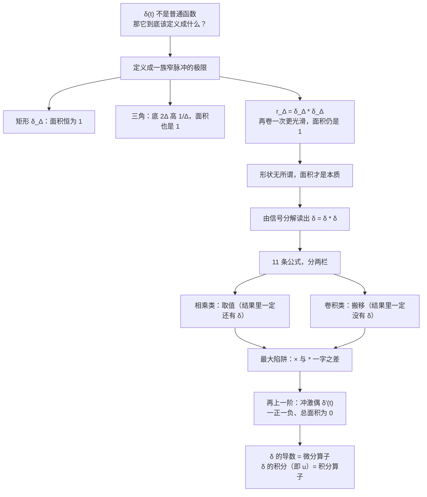
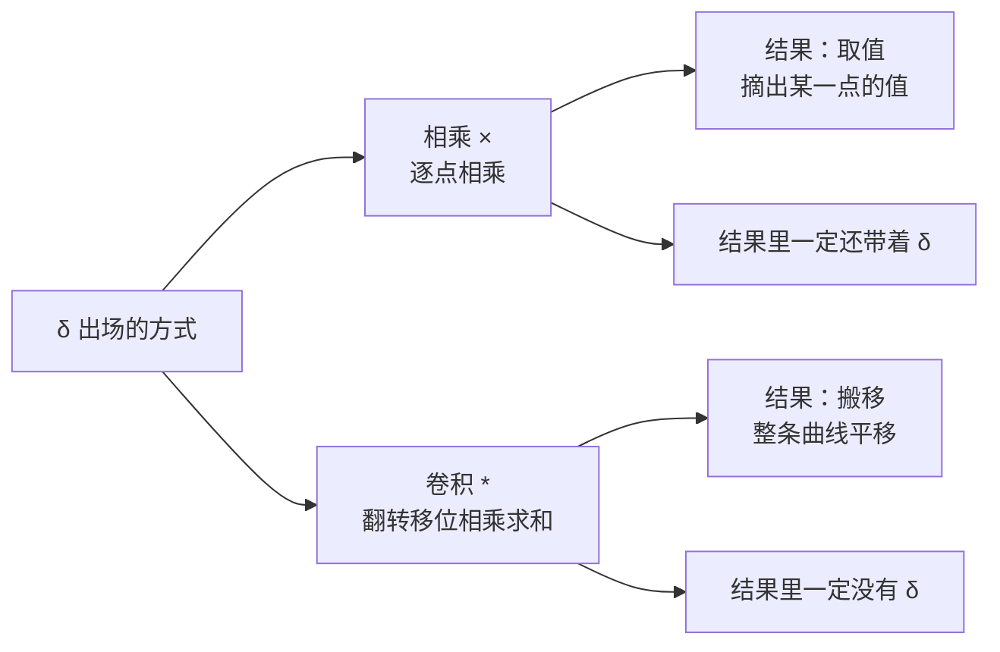
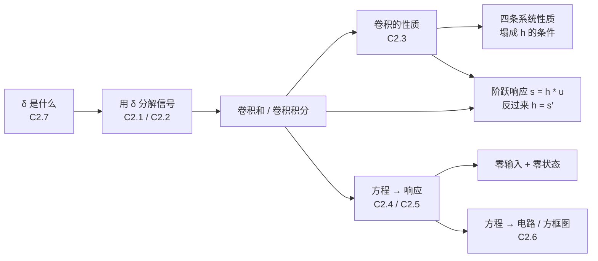

# 2.7 奇异函数 Singularity Functions

> [!abstract] 这一讲的任务
> 整章我们都在用 $\delta(t)$：它是基底、是卷积的“1”、是测试信号。可它到底**是什么**？——哪有函数在一点上是无穷大，积分还等于 1？
> 这一讲给它一个正经身份：$\delta$ 不是普通函数，而是**一族窄脉冲的极限**，它的意义只在“被积分时做了什么”。
> 然后把整章散落的 $\delta$ 公式一次性收拢成一张表。它同时也是第二章的收尾——学完这张表，第二章的工具箱就齐了。

> [!info] 怎么读这份讲义
> 第 1 节解决“$\delta$ 是什么”，第 2 节把 11 条公式分成**相乘**与**卷积**两栏逐条讲透，第 3 节给离散时间的对应版本，第 4 节把整个第二章串一遍。
> 标注说明：标有 **（拓展）** 或 **【拓展】** 的内容，是课堂上没有展开、由教材与通行讲法延伸补充的部分。复习时先掌握未标注的主干，行有余力再看拓展。本篇有两处拓展：离散时间的对应版本、以及公式 (8′) 的推导。
> 一处勘误：公式 (11) 原稿印的是 $\int_{-\infty}^{+\infty}\delta'(t)\,d(t)=0$，那个 $d(t)$ 就是 $dt$，是印刷笔误。

---

## 0. 开场：一个函数值根本不重要的“函数”

请你回答：$\delta(0)$ 等于多少？

如果你答“无穷大”，那我再问：$2\delta(0)$ 呢？也是无穷大。可是 $\delta(t)$ 和 $2\delta(t)$ 明明是**不同的信号**（一个面积 1，一个面积 2）。**那“无穷大”这个答案显然没描述清楚它们的区别。**

再问：$\delta(t)$ 在 $t=0.001$ 处等于多少？0。$t=-0.001$ 呢？0。**除了一个点以外，它处处为零，而那一个点的值又说不清楚。** 按普通函数的标准，这东西的信息量是零。

所以，**$\delta$ 根本不该被当成“函数值的集合”来理解。** 它的全部意义在于：**当它出现在积分里时，做了什么。**

$$\int_{-\infty}^{+\infty}x(t)\delta(t)\,dt=x(0)$$

这一句才是 $\delta$ 的定义。数学上这叫**广义函数 generalized function** 或**分布 distribution**；工程上我们叫它**奇异函数 singularity function**。

> [!question] 停一下，先自己想想
> “$\delta(0)=\infty$”这个说法，到底哪里不成立？

因为它**区分不了不同的冲激**：$\delta$ 和 $2\delta$ 在 0 处都是“无穷大”，而它们显然是两个不同的信号；而且按函数值看，它除原点外处处为零，信息量为零。
正确的定义是**通过它在积分里的作用**（$\int x\delta\,dt=x(0)$），等价地定义成“面积为 1、宽度趋于 0 的脉冲族的极限”。**描述 $\delta$ 的语言不是“值”，而是“面积”与“它把被积函数筛成什么”。**

---

## 1. 把 $\delta$ 定义成极限（2.5.1）

> [!important] 理想化的短脉冲 The unit impulse as idealized short pulse
> $$\delta_\Delta(t)=\begin{cases}\dfrac1\Delta,&0\le t\le\Delta\\[1mm]0,&\text{otherwise}\end{cases}\qquad \delta(t)=\lim_{\Delta\to0}\delta_\Delta(t)$$
> 这就是 [[C2.2 连续时间LTI系统与卷积积分]] 里用来搭台阶的那个窄脉冲。**面积恒为 1**（宽 $\Delta$、高 $\frac1\Delta$），让 $\Delta\to0$ 就得到 $\delta$。

### 1.1 形状可以换：矩形、三角、钟形都行

![[C2-冲激的逐次光滑近似.png]]

这一页的右上方还画了两个替代品：

- **居中的矩形**：$-\frac\Delta2\le t\le\frac\Delta2$，高 $\frac1\Delta$，面积 1；
- **三角形**：底宽 $2\Delta$、高 $\frac1\Delta$，面积 $\frac12\cdot2\Delta\cdot\frac1\Delta=1$。

它们的极限**同样是 $\delta(t)$**。

> [!question] 停一下，先自己想想
> 矩形、三角形、高斯钟形……形状差那么多，凭什么极限都是同一个 $\delta$？

**因为唯一被保留的特征是“面积为 1”。** 当宽度趋于 0 时，任何“面积为 1、宽度趋于 0、高度趋于无穷”的函数族，在积分意义下的作用都一样：把 $x$ 在原点的值筛出来。形状的细节在极限里全部被抹掉了。

这一点在 [[C1.4 单位冲激与单位阶跃函数]] 里已经见过（$\delta$ 的极限构造与三种近似），这里是把它和卷积接起来。工程上的直接推论是：**任何足够窄、面积归一的脉冲都可以当作冲激来用**——这是实验室里用窄脉冲测冲激响应的理论依据。

### 1.2 $\delta=\delta*\delta$：冲激卷自己还是自己

由信号分解式
$$x(t)=\int_{-\infty}^{+\infty}x(\tau)\delta(t-\tau)d\tau=x(t)*\delta(t)$$
取 $x=\delta$，立刻得到原稿那条式子：

$$\boxed{\ \delta(t)=\delta(t)*\delta(t)\ }$$

> [!important] 为什么这条式子值得单列
> 因为它说明 **$\delta$ 是卷积运算的单位元**（幂等元），就像数字 1 之于乘法：$1\times1=1$。
> [[C2.3 LTI系统的性质]] 里“无记忆系统 ⇔ $h=k\delta$”讲的正是这件事——**什么都不做的系统，冲激响应就是 $\delta$。**

### 1.3 反复卷积：越卷越光滑，面积永远是 1（公式 (2)(3)）

原稿给了一条有意思的链：

$$r_\Delta(t)=\delta_\Delta(t)*\delta_\Delta(t)\qquad\Longrightarrow\qquad \delta(t)=\lim_{\Delta\to0}r_\Delta(t)$$

$r_\Delta$ 是什么？**矩形卷矩形 = 三角形**（[[C2.2 连续时间LTI系统与卷积积分]] 的结论）：底宽 $2\Delta$、峰值 $\frac1\Delta$、面积 $\frac12\cdot2\Delta\cdot\frac1\Delta=1$ ✓。

再卷一次 $r_\Delta*r_\Delta$（原稿的第 (3) 项），得到一条**更光滑、更宽、峰值更低**的钟形曲线：它的底宽变成 $4\Delta$、峰值降到 $\frac{2}{3\Delta}\approx0.67/\Delta$——**每多卷一次，曲线就更宽、更矮一点**（三次卷积的峰值依次是 $\frac1\Delta\to\frac{3}{4\Delta}\to\frac{2}{3\Delta}$），但**面积始终是 1**，极限依然是 $\delta$。

> [!important] 从这条链能读出两件事
> 1. **$\delta$ 的“形状”完全不重要**——矩形、三角、钟形都行，只要面积为 1、宽度趋于 0。工程上就是“任何足够窄的脉冲都可以当作冲激来用”。
> 2. **卷积具有平滑作用**：每卷一次，信号就变光滑一次（矩形→三角→钟形，可导阶数逐次提高）。
>    **接到 AI 上**：这正是“多次滑动平均 ≈ 高斯模糊”的原理（中心极限定理的卷积版本）——CNN 里堆叠小卷积核得到大而光滑的等效感受野，用的是同一件事。

---

## 2. 十一条公式：一次性理清（p.98）

这 11 条是第二章的工具箱，第十节课末尾逐条过了一遍，结论是：**“这一页的公式都是常用的，记下来就好。”**

原稿把它们分成左右两栏，**左栏是“相乘”，右栏是“卷积”**——这个分栏本身就是最重要的提示：

### 2.1 相乘类：$\delta$ 把函数“取值”

| # | 公式 | 怎么理解 |
|---|---|---|
| **(1)** | $x(t)\delta(t)=x(0)\delta(t)$ | $\delta$ 只在 $t=0$ 非零，别处乘什么都是 0，所以 $x$ 只有 $x(0)$ 这一个值起作用 |
| **(2)** | $x(t)\delta(t-t_0)=x(t_0)\delta(t-t_0)$ | 同上，把关注点搬到 $t_0$ |
| **(3)** | $\displaystyle\int_{-\infty}^{+\infty}x(t)\delta(t-t_0)\,dt=x(t_0)$ | 在 (2) 两边积分，$\int\delta(t-t_0)dt=1$ ⇒ **抽样性质 Sampling Property** |
| **(4)** | $\delta(at)=\dfrac{1}{\lvert a\rvert}\delta(t)$ | **尺度性质**，见下面的警告 |
| **(8')** | $x(t)\cdot\delta'(t)=x(0)\delta'(t)-x'(0)\delta(t)$ | 对 (1) 两边求导即得，推导留到 2.4 节 |

原稿对 (3) 的解释很直白：**把 $\delta(t-t_0)$ 代进积分里，$x$ 就只剩 $t=t_0$ 那一个点的值，冲激项的积分就是冲激的强度（大小）。** 这一条就是“抽样性质”这个名字的来历——$\delta$ 像一把尺子，把函数在某一点的值“量”了出来。

> [!warning] (4) 的绝对值：本课最经典的易错点
> $$\delta(at)=\frac{1}{|a|}\delta(t)$$
> **为什么有 $\frac{1}{|a|}$？** 令 $u=at$，则 $dt=\frac{du}{a}$：
> $$\int\delta(at)dt=\frac{1}{|a|}\int\delta(u)du=\frac{1}{|a|}$$
> 横轴压缩 $a$ 倍，面积也被压缩了 $|a|$ 倍，所以要乘 $\frac{1}{|a|}$ 补回来。
> **为什么是绝对值不是 $a$？** 因为 $a<0$ 时换元会把积分上下限翻过来，多出一个负号，两个负号抵消。物理上更直白：**面积不可能是负的。**
> 这一条在 [[C1.4 单位冲激与单位阶跃函数]] 里第一次出现（当时标注为“书外结论”），并明确说过是考试题型。
>
> **对照记忆**：普通信号做尺度变换 $x(at)$ **不会**冒出 $\frac{1}{|a|}$，只有 $\delta$ 会——因为 $\delta$ 是由“面积”定义的。这正是“$x(at)$ 位移量要不要除以 $|a|$”这类混淆的根源。

> [!example] 立刻用一次：把 $\delta(3t-6)$ 化到标准形式
> 先提公因子：$\delta(3t-6)=\delta\big(3(t-2)\big)$。
> 再用尺度性质（$a=3$）：
> $$\boxed{\ \delta(3t-6)=\tfrac13\,\delta(t-2)\ }$$
> **验算**：$\int\delta(3t-6)dt$，令 $u=3t-6$，$dt=du/3$，$=\frac13$ ✓。
> **易错点**：① 忘了 $\frac13$；② 把位置算成 $t=6$（应先提出 $3$ 再看括号里的零点）。

### 2.2 卷积类：$\delta$ 把函数“搬移”

| # | 公式 | 怎么理解 |
|---|---|---|
| **(5)** | $x(t)*\delta(t)=x(t)$ | **卷积的单位元**：什么都不做 |
| **(6)** | $x(t)*\delta(t-t_0)=x(t-t_0)$ | **纯延迟**：整体搬到 $t_0$ |
| **(7)** | $x(t-t_1)*\delta(t-t_2)=x(t-t_1-t_2)$ | 延迟相加（[[C2.3 LTI系统的性质]] 时移性质的推论） |
| **(8)** | $x(t)*\delta'(t)=x'(t)$ | **卷 $\delta'$ = 求一次导** |
| **(9)** | $x(t)*u(t)=x(t)*\delta^{(-1)}(t)=x^{(-1)}(t)=\displaystyle\int_{-\infty}^{t}x(\tau)d\tau$ | **卷 $u$ = 做一次积分** |
| **(10)** | $u(t)*\delta'(t)=\delta^{(-1)}(t)*\delta'(t)=\delta(t)$ | 积分与微分互相抵消 |
| **(11)** | $\displaystyle\int_{-\infty}^{+\infty}\delta'(t)\,dt=0$ | $\delta'$ 的面积为零 |

> [!note] 这四条放在一起看，非常整齐
> $$x*\delta=x,\qquad x*\delta(t-t_0)=x(t-t_0),\qquad x*\delta'=x',\qquad x*\delta^{(-1)}=x^{(-1)}$$
> **卷冲激 = 不变；卷延迟的冲激 = 自己延迟；卷冲激的导数 = 自己求导；卷冲激的积分 = 自己求积分。**
> 四条各有来历：
> - (5) 来自**信号分解**：$x(t)=\int x(\tau)\delta(t-\tau)d\tau$ 按卷积定义读，就是 $x*\delta$。这也是**恒等系统**的冲激响应为 $\delta(t)$ 的原因（见 [[C2.3 LTI系统的性质]] 的随堂测第 2 题）。
> - (6) 来自**时移性质**：$x(t-t_0)*\delta(t)=x(t-t_0)$，把延迟从输入挪到系统上，就是 $x(t)*\delta(t-t_0)$。
> - (7) 正是时移性质的推论。课堂上特别强调的一点是：**延迟项可以往里堆叠**——(7) 里两个延迟直接相加，不需要别的条件。
> - (8) 来自**微分性质**：$x'(t)*\delta(t)=x'(t)$，把求导从输入挪到系统上，就是 $x(t)*\delta'(t)$。
> - (9) 直接按定义算：
>   $$x(t)*u(t)=\int_{-\infty}^{+\infty}x(\tau)\,u(t-\tau)\,d\tau$$
>   $u(t-\tau)$ 在 $\tau<t$ 时取 1、$\tau>t$ 时取 0，把积分上限截到 $t$：
>   $$x(t)*u(t)=\int_{-\infty}^{t}x(\tau)\,d\tau$$
>   （课堂推导到这里时转写稿中断，最后一步按定义补全。）
> - (10) 是一句话的事：$u$ 是 $\delta$ 的积分、$\delta'$ 是 $\delta$ 的导数，**积分完再求导就抵消回 $\delta$**。

> [!warning] 公式 (11) 的印刷
> 原稿写作 $\int_{-\infty}^{+\infty}\delta'(t)\,d(t)=0$，那个 $d(t)$ 就是 $dt$，是印刷笔误。
> **为什么面积是 0？** $\delta'$ 是“一正一负紧挨着的两个冲激”（偶极子），正负相消；也可以从 $\int\delta'=\big[\delta\big]_{-\infty}^{+\infty}=0-0=0$ 看出。
> 课堂上讲这一条时的话是：**$\delta$ 积分起来是有面积的（面积 1），$\delta$ 再求一次导之后就没有面积了（面积 0）。**

> [!important] (8) 和 (9) 合起来是一条漂亮的规律
> $$\delta^{(k)}\ \text{是“求 }k\text{ 阶导”算子},\qquad \delta^{(-1)}=u\ \text{是“积一次”算子}$$
> 记号 $\delta^{(-1)}(t)=u(t)$ 的意思就是“$\delta$ 的一次积分”——用上标 $'$ 表示求导，用 $(-1)$ 表示积分，两者互为逆运算。
> **卷积一个奇异函数 = 施加一次微分或积分。**
> 这解释了 [[C2.3 LTI系统的性质]] 里为什么 $s(t)=h(t)*u(t)=h^{(-1)}(t)$——阶跃响应就是冲激响应的积分。**又一次回收。**

![[C2.7-奇异函数的微分积分阶梯.png]]

> [!example] 把卷积类公式用在系统上
> 某 LTI 系统 $h(t)=\delta'(t)+2\delta(t-1)$，求它对 $x(t)=u(t)$ 的响应。
> $$y=x*h=u(t)*\delta'(t)+2\,u(t)*\delta(t-1)$$
> 第一项用 (10)：$u*\delta'=\delta(t)$（阶跃被微分一次，微回冲激）。
> 第二项用 (6)：$u(t)*\delta(t-1)=u(t-1)$（阶跃整体延迟 1 秒，再放大 2 倍）。
> $$\boxed{\ y(t)=\delta(t)+2u(t-1)\ }$$
> **读一遍这个系统**：$\delta'$ 那一路是**微分器**，把阶跃微分成冲激；$2\delta(t-1)$ 那一路是“延迟 1 秒并放大 2 倍”。
> **稳定性**：含 $\delta'$ 的系统**不是 BIBO 稳定**的——微分器对有界输入可以给出无界输出（比如输入一个带跳变的有界信号，输出里会出现冲激）。

### 2.3 最要命的对照：$\times$ 还是 $*$

> [!warning] 第二章最后一个高频失分点
> | | $x(t)\,\delta(t-t_0)$ | $x(t)*\delta(t-t_0)$ |
> |---|---|---|
> | 运算 | **相乘**（逐点） | **卷积** |
> | 结果 | $x(t_0)\,\delta(t-t_0)$ | $x(t-t_0)$ |
> | 结果是什么 | **一个冲激**，强度为数 $x(t_0)$ | **一个信号**，是 $x$ 整体平移 |
> | 一句话 | **取值**（把一个数摘出来） | **搬移**（把整条曲线挪过去） |
>
> **记忆口诀：乘是“摘一个点”，卷是“搬一整条”。**
> 判卷时看结果的类型就能自查：相乘的结果里**一定还带着 $\delta$**；卷积的结果里**一定没有 $\delta$**（除非 $x$ 本身含 $\delta$）。

![[C2.7-相乘取值与卷积搬移对照.png]]

**举个具体例子**（自己算一遍再看）：设 $x(t)=e^{-t}u(t)$，$t_0=2$。

- **相乘**：$x(t)\delta(t-2)=e^{-2}\delta(t-2)$ —— 一个位于 $t=2$、强度 $e^{-2}\approx0.135$ 的冲激；
- **卷积**：$x(t)*\delta(t-2)=e^{-(t-2)}u(t-2)$ —— 一条从 $t=2$ 才开始的衰减指数曲线。

两者**连类型都不一样**。

> [!example] 换个数字再算一遍
> $x(t)=e^{-2t}u(t)$，$t_0=1$。
> **相乘**：$x(t)\delta(t-1)=e^{-2}\delta(t-1)$，是一个位于 $t=1$、强度 $e^{-2}\approx0.1353$ 的**冲激**。
> **卷积**：$x(t)*\delta(t-1)=e^{-2(t-1)}u(t-1)$，是一条从 $t=1$ 开始、初值为 1 的**衰减指数曲线**。
> 注意两个例子里都出现 $e^{-2}$ 只是巧合——一个是“取值”取到的数，一个是信号本身的参数。

### 2.4 冲激偶 $\delta'(t)$ 是什么

公式 (8) 里出现了 $\delta'(t)$。$\delta(t)$ 已经够抽象了，它的导数又是什么？

$\delta(t)$ 的极限模型不一定要用矩形。换一个**关于纵轴对称的三角形**：底从 $-\Delta$ 到 $\Delta$（宽 $2\Delta$）、高 $\frac1\Delta$，面积 $\frac12\cdot2\Delta\cdot\frac1\Delta=1$。$\Delta\to0$ 时，它同样收敛到 $\delta(t)$。

![[C2-冲激偶-三角近似求导.png]]

给这个三角形求导：

- 左半边斜率为正，导数是常数 $+\frac{1}{\Delta^2}$，宽 $\Delta$；
- 右半边斜率为负，导数是常数 $-\frac{1}{\Delta^2}$，宽 $\Delta$。

让 $\Delta\to0$：左边一个向上冲到无穷、右边一个向下冲到无穷，两者紧挨在原点两侧——**一正一负的一对冲激**。但它们不是普通的冲激：每块面积是 $\Delta\cdot\frac1{\Delta^2}=\frac1\Delta$，一正一负，**总面积为 0**。

> [!important] 冲激偶 doublet
> 这种极限定义为 $\delta'(t)$，中文叫**冲激偶**。它是比 $\delta(t)$ 更高阶的奇异信号：
> - $\delta(t)$：面积为 1；
> - $\delta'(t)$：一正一负、面积为 0（公式 (11)）。
>
> 它很抽象，理解到“**一对紧挨着、方向相反、总面积为零的冲激**”就够了。课堂上给它的定位是：**$\delta$ 的导数，一个更高阶的奇异信号，了解就行。**

> [!note] (8′) 的来历（拓展：课下自证）
> 公式 (8′) $x(t)\delta'(t)=x(0)\delta'(t)-x'(0)\delta(t)$ 原稿印在表里，课堂上只读了一遍就说明：**这一条属于特别高阶的性质，一般考试不会涉及，感兴趣自己证一下。** 所以下面这段推导算课下自证的延伸，不算课堂内容。
> 从乘积求导法则出发：
> $$\frac{d}{dt}\big[x(t)\delta(t)\big]=x'(t)\delta(t)+x(t)\delta'(t)$$
> 左边用 (1)：$\frac{d}{dt}[x(0)\delta(t)]=x(0)\delta'(t)$；右边第一项再用 (1)：$x'(t)\delta(t)=x'(0)\delta(t)$。移项：
> $$x(t)\delta'(t)=x(0)\delta'(t)-x'(0)\delta(t)$$
> **注意 $\delta'$ 的“取值”不再只取 $x(0)$，还要取 $x'(0)$**——这是 $\delta'$（偶极子）和 $\delta$ 的本质差别。
> 顺带一提，同一招（乘积求导）也是解决“信号乘冲激”这类题的通用手段。

> [!example] 两条抽样公式对比着算一遍
> 计算 $\displaystyle\int_{-\infty}^{+\infty}(t^2+3t)\,\delta(t-2)\,dt$ 和 $\displaystyle\int_{-\infty}^{+\infty}(t^2+3t)\,\delta'(t-2)\,dt$。
> **第一个**（抽样性质 (3)）：$=x(2)=4+6=10$。
> **第二个**：$\delta'$ 的抽样带一个负号，而且取的是**导数值**：
> $$\int_{-\infty}^{+\infty}x(t)\delta'(t-t_0)\,dt=-x'(t_0)$$
> 这条可以从 (8′) 直接推出：把 $t_0$ 挪进去得 $x(t)\delta'(t-t_0)=x(t_0)\delta'(t-t_0)-x'(t_0)\delta(t-t_0)$，两边积分，第一项积分为 0（由 (11)，$\delta'$ 面积为 0），剩下 $-x'(t_0)$。
> 这里 $x'(t)=2t+3$，$x'(2)=7$，所以 $=-7$。
> **易错点**：$\delta'$ 的抽样公式里那个**负号**最容易漏。

---

## 3. 离散时间的对应版本（拓展）

> [!note] 为什么这一节标“拓展”
> §2.5 只写了连续时间。下面是离散时间的对应公式，属于标准讲法的延伸（课堂未展开），不必优先看，但对照着读能防止连续/离散串味。

离散时间的公式更简单，因为 $\delta[n]$ 是**真正的函数**（在 $n=0$ 取值 1），没有任何“广义”的麻烦：

| 相乘 | 卷积 |
|---|---|
| $x[n]\delta[n]=x[0]\delta[n]$ | $x[n]*\delta[n]=x[n]$ |
| $x[n]\delta[n-n_0]=x[n_0]\delta[n-n_0]$ | $x[n]*\delta[n-n_0]=x[n-n_0]$ |
| $\sum_n x[n]\delta[n-n_0]=x[n_0]$ | $x[n]*u[n]=\sum_{k=-\infty}^{n}x[k]$ |

> [!important] 离散没有“尺度性质”这一说
> $\delta[an]$ 里 $a$ 必须是整数，而且 $\delta[an]=\delta[n]$（$a\neq0$ 的整数）——**没有 $\frac{1}{|a|}$**。
> 因为离散冲激的定义是“取值为 1”，不是“面积为 1”。
> **这正是连续与离散最容易串的一处**：$\delta(at)=\frac{1}{|a|}\delta(t)$ 只属于连续时间。

---

## 4. 把整章串起来

第二章到这里全部讲完。回头看这条线：

> [!important] 第二章的一句话总结
> **LTI 系统 = 一条 $h$。**
> 把信号拆成冲激（2.1/2.2/2.7），送进系统，用线性和时不变叠加回去，得到卷积；卷积的代数性质对应电路的接法（2.3/2.6）；而现实给的是方程，解方程得到响应（2.4/2.5）。
> 下一章换一套基底（复指数），同样的逻辑会给出**频域**的全部内容——而且你会发现，**时域里麻烦的卷积，在频域里变成简单的乘法**。这就是傅里叶分析存在的全部理由。
> 顺带一提：第二章给出了三种系统表征方式（$h$、方程、方框图）；后面第 4、5 章还会补上**频率响应**与**系统函数**两套表征——它们与 $h$ 之间都是傅里叶变换/拉普拉斯变换的关系。

---

## 这一讲的三句话

1. **$\delta$ 不是普通函数，是一族“面积为 1、宽度趋于 0”的脉冲的极限**；形状无关紧要，只有面积和“在积分里做了什么”才是本质。
2. **乘是取值，卷是搬移**：$x\delta(t-t_0)=x(t_0)\delta(t-t_0)$（还是冲激），$x*\delta(t-t_0)=x(t-t_0)$（是信号）。一字之差，结果连类型都不同。
3. **$\delta^{(k)}$ 是微分算子，$\delta^{(-1)}$（即 $u$）是积分算子**；卷积一个奇异函数 = 施加一次微分或积分，于是阶跃响应就是冲激响应的积分。

> [!tip] 速查表（p.98 全 11 条 + 离散版）
> **相乘类**
> | | |
> |---|---|
> | (1) | $x(t)\delta(t)=x(0)\delta(t)$ |
> | (2) | $x(t)\delta(t-t_0)=x(t_0)\delta(t-t_0)$ |
> | (3) | $\int x(t)\delta(t-t_0)dt=x(t_0)$ |
> | (4) | $\delta(at)=\frac{1}{\lvert a\rvert}\delta(t)$ |
> | (8') | $x(t)\delta'(t)=x(0)\delta'(t)-x'(0)\delta(t)$　（推导为拓展） |
> | 补充 | $\int x(t)\delta'(t-t_0)dt=-x'(t_0)$ |
>
> **卷积类**
> | | |
> |---|---|
> | (5) | $x(t)*\delta(t)=x(t)$ |
> | (6) | $x(t)*\delta(t-t_0)=x(t-t_0)$ |
> | (7) | $x(t-t_1)*\delta(t-t_2)=x(t-t_1-t_2)$ |
> | (8) | $x(t)*\delta'(t)=x'(t)$ |
> | (9) | $x(t)*u(t)=x^{(-1)}(t)=\int_{-\infty}^tx(\tau)d\tau$ |
> | (10) | $u(t)*\delta'(t)=\delta(t)$ |
> | (11) | $\int\delta'(t)dt=0$ |
>
> **其他**：$\delta(t)=\delta(t)*\delta(t)$；离散 $\delta[an]=\delta[n]$（**无** $\frac{1}{|a|}$）

> [!tip] 下一章预告
> 第二章用**冲激**作基底，把系统压缩成一条 $h$，代价是每次求响应都要算一次卷积——而卷积很累，连逆运算都没有。
> 第三章换一套基底：**复指数 $e^{j\omega t}$**。它是 LTI 系统的**特征函数**——进去出来还是同一个频率，只是幅度和相位变了。于是“卷积”会塌成“**乘一个复数**”，前面撞过的那堵墙（卷积求逆）也就顺势倒了。
> 你在 [[C1.3 指数信号与正弦信号]] 里已经见过谐波集和正交性，在 [[L01 绪论 Introduction]] 里已经见过方波的傅里叶合成——那些伏笔，从第三章开始正式回收。

---

## 相关笔记 Related Notes

- 相关：[[C1.4 单位冲激与单位阶跃函数]]（$\delta$ 的极限构造与尺度性质）、[[C2.2 连续时间LTI系统与卷积积分]]（用 $\delta_\Delta$ 搭台阶）、[[C2.3 LTI系统的性质]]（$\delta$ 作为卷积单位元、微分/积分不变性）
- 上一讲：[[C2.6 LTI系统的方框图表示]]
- 下一讲：[[C3.1 复指数是LTI系统的特征函数]]
- 返回：[[信号与系统 MOC]]

