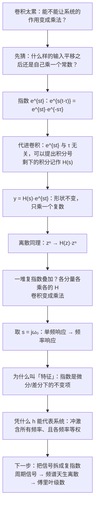
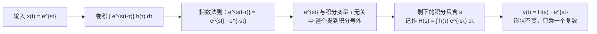

# 3.1–3.2 复指数是 LTI 系统的特征函数

> [!abstract] 这一讲的任务
> 第 2 章把 LTI 系统压缩成一条 $h$，代价是每换一个输入就要重算一次卷积——翻转、滑动、分段积分，很累。
> 这一讲换一个问题：**有没有哪种输入，送进任何 LTI 系统，出来都「不变形」，只是被乘了一个数？**
> 答案是复指数 $e^{st}$（离散是 $z^n$）。这一个事实把卷积变成乘法，也是「特征根」这个名字的来历；它撑起第 3–10 章的全部频域方法。

> [!info] 怎么读这份讲义
> - 第 0 节从一个具体问题切入；第 1 节撞墙（卷积为什么累）；第 2–3 节连续、离散各推一遍；第 4 节讲「变换到底在干什么」；第 5–6 节把结论推到频率上；第 7 节回答「为什么配叫特征」；第 8 节回答「凭什么一条 $h$ 能代表整个系统」；第 9 节是第三章导读；第 10 节把例题与两个易混辨析放在一起。
> - 标有 **（拓展）** 或 **【拓展】** 的段落，是课堂上没有展开、由教材与通行讲法延伸的内容。复习优先级：先把不带标记的主干（推导、$H(s)$ 的意义、为什么是特征函数）吃透，再看拓展。
> - 一句话勘误：本篇涉及的公式与数值均已逐条复算，**未发现印刷错误**；第三章后面 p.42–44 有一处频率区间写法前后不一致（不影响结论），已在 [[C3.4 连续时间傅里叶级数的性质]] 里说明。

---

## 0. 开场：把 50 Hz 刨掉

你拿到一段心电信号，上面叠着明显的 50 Hz 工频干扰（电源串进来的）。要把它刨掉，你手上有什么工具？

翻回第 2 章，能做的只有一件：设计一条冲激响应 $h$，然后算卷积 $y=x*h$。问题是——**你怎么知道 $h$ 该长什么样？** 信号里混着心跳、基线漂移和 50 Hz，全都在时域上叠成一团，你没法指着某一段说「这就是 50 Hz」。

于是真正的问题变成：**有没有一种「坐标」，让不同的频率成分在它里面各占一个位置、互不重叠？** 有，那就是频率轴。而通往频率轴的第一步，就是这一讲要讲的事实：

> 只要输入是**复指数**，任何 LTI 系统对它的作用都会退化成「**乘一个数**」。

卷积（要做积分）变成乘法（一步到位），这就是整章频域方法的起点。

> [!note] 傅里叶这条线的历史（拓展）
> - **1807**：法国人**傅里叶（Jean Baptiste Joseph Fourier，1768 年生）**研究热传导时提出 *periodic signal could be represented by sinusoidal series*——周期信号可以用正弦级数表示。当时的大数学家**拉格朗日**强烈反对：一个有棱有角的方波，怎么可能用光滑的正弦拼出来？
> - **1829**：**狄利克雷 (Dirichlet)** 给出严格的收敛条件（[[C3.3 傅里叶级数的收敛与吉布斯现象]]）。
> - **1960 年代**：**Cooley 和 Tukey** 提出**快速傅里叶变换 FFT**，傅里叶分析从此能在计算机上大规模运行——今天每一部手机里都在跑它。
>
> 你在 [[L01 绪论 Introduction]] 里已经见过方波被一根根正弦「拼」出来的图。本章要做的，是在动手拆信号之前先回答一个更根本的问题：**为什么偏偏选复指数来拆？**

---

## 1. 撞墙：卷积对任意输入都很累

回忆第 2 章：输入 $x(t)$ 过 LTI 系统，输出是
$$y(t)=x(t)*h(t)=\int_{-\infty}^{+\infty}x(t-\tau)h(\tau)\,d\tau$$
对一般的 $x(t)$，每换一个输入就要重新「翻转、滑动、分段积分」一次。第 2 章做的所有工作，本质都是在找更省事的算法——而算法再省，也还是卷积。

> [!question] 停一下，先自己想想
> 什么样的输入信号，过了系统之后**形状不变**？也就是 $y(t)=(\text{某个与 }t\text{ 无关的常数})\times x(t)$？
> 提示：想想哪种函数，自己平移一下之后，还等于「自己乘一个常数」。

答案是**指数函数**。因为
$$e^{s(t-\tau)}=e^{st}\cdot e^{-s\tau}$$
平移一下，只是多乘了一个**与 $t$ 无关**的因子。而卷积的本质就是「把输入平移、加权、叠加」——指数函数被平移多少次，出来都还是它自己的倍数。

这个「猜」不需要灵感，它是唯一解：能满足「平移后只差一个常数因子」的函数，只有指数型。

---

## 2. 连续时间：$e^{st}$ 进去，$H(s)e^{st}$ 出来

令 $x(t)=e^{st}$，其中 $s=\sigma+j\omega$ 是复数（$e^{st}=e^{\sigma t}e^{j\omega t}$，即 [[C1.3 指数信号与正弦信号]] 里的一般复指数）。代进卷积：

$$
\begin{aligned}
y(t)=e^{st}*h(t)&=\int_{-\infty}^{+\infty}e^{s(t-\tau)}h(\tau)\,d\tau\\
&=\int_{-\infty}^{+\infty}e^{st}\,e^{-s\tau}h(\tau)\,d\tau\\
&=e^{st}\underbrace{\int_{-\infty}^{+\infty}h(\tau)e^{-s\tau}\,d\tau}_{H(s)}\\
&=e^{st}\,H(s)
\end{aligned}
$$

**关键只有一步**：$e^{st}$ 里没有积分变量 $\tau$，所以它是「与 $\tau$ 无关的项」，可以整个提到积分号外面。剩下的积分只跟 $s$ 有关——积完之后 $\tau$ 消失了，得到一个**只依赖 $s$ 的复数**。给它一个名字：

> [!important] 系统函数 System Function
> $$H(s)=\int_{-\infty}^{+\infty}h(\tau)e^{-s\tau}\,d\tau$$
> 这就是冲激响应 $h(t)$ 的**拉普拉斯变换 Laplace Transform**（第 9 章）。
> $$e^{st}\ \longrightarrow\ \boxed{h(t)}\ \longrightarrow\ H(s)\,e^{st}$$
> *The response of an LTI system to a complex exponential input is the same complex exponential with only a change in amplitude.*
> LTI 系统对复指数输入的响应，是**同一个复指数**，只是幅度（一个复数因子）变了。

![[C3.1-复指数进出系统不变形.png]]

逐个符号看清楚：

- $e^{st}$ 里 $t$ 是自由变量；
- $H(s)$ **不含 $t$**——对于固定的 $s$，它就是一个复数常数；
- 所以输出和输入「长得一模一样」，只差一个复数倍：**幅度被乘了 $|H(s)|$，相位被加了 $\angle H(s)$**。

图里的例子：取 $s=-0.2+2j$、系统 $H(s)=1/(s+1)$，则 $H(s)=0.172-0.431j$，$|H(s)|=0.464$，$\angle H(s)=-68.2^\circ$。输出就是输入的 0.464 倍、并整体后移 $68.2^\circ$——波形形状一根毛都没变。

**一个可以直接用的小例子**：系统对 $e^{-2t}$ 的响应是 $e^{-2t}H(-2)$；对 $e^{j5t}$ 的响应是 $e^{j5t}H(j5)$。指数位置上是什么，就把那个数代进 $H(\cdot)$ 里——**这就是「把输入除以输出就得到系统」的意思**：

$$\frac{y(t)}{x(t)}=H(s)$$

> [!important] 特征函数与特征值
> $$\mathcal{T}\{e^{st}\}=H(s)\,e^{st}$$
> $e^{st}$ 叫 LTI 系统的**特征函数 eigenfunction**，对应的 $H(s)$ 叫**特征值 eigenvalue**。
> 因为 $H(s)$ 只是一个数，我们把输入除掉就把它单独捞出来了——这件事只有指数输入做得到。

---

## 3. 离散时间：$z^n$ 进去，$H(z)z^n$ 出来

完全平行，只是把积分换成求和。令 $x[n]=z^n$，$z=re^{j\omega}$（$z^n=r^ne^{j\omega n}$）：

$$
y[n]=z^n*h[n]=\sum_{k=-\infty}^{+\infty}z^{\,n-k}h[k]=z^n\underbrace{\sum_{k=-\infty}^{+\infty}h[k]z^{-k}}_{H(z)}=z^nH(z)
$$

关键一步同样是 $z^{\,n-k}=z^nz^{-k}$：$z^n$ 与求和指标 $k$ 无关，提出去。

> [!important] 离散时间系统函数
> $$H(z)=\sum_{k=-\infty}^{+\infty}h[k]z^{-k}\qquad\text{（Z 变换 Z-Transform，第 10 章）}$$
> *Complex exponentials are **eigenfunctions** of LTI systems.*

同样可以代数字：输入 $2^n$ 进来，输出就是 $2^nH(2)$；输入 $e^{j\omega_0n}$ 进来，输出是 $e^{j\omega_0n}H(e^{j\omega_0})$。**底数是什么，就把那个数代进 $H(\cdot)$。**

---

## 4. 变换到底在干什么：换一个表征面

看起来 $H(s)$ 是个新东西，其实不是。它是**同一个系统在另一个面上的表达**。

> [!important] 变换就是换一个投影面
> - 求 $H(s)$ 的那个积分**改变了自变量**：对 $\tau$ 积完，$\tau$ 不见了，剩下的是 $s$ 的函数。所以「变换」就是一次**投影**——把同一个对象投到另一个表征面上看。
> - **$H$ 和 $h$ 是同一个东西**：都表示这个系统，只是分别在 $s$ 面和时间面上写出来，就像同一段声音的时域波形与频谱。
> - 正变换和反变换是**可逆**的（拉普拉斯变换、傅里叶变换都有反变换）。既然可逆，就说明信息没丢、也没多——**它还是它，只是换了个面**。
> - 因此 $H(s)$ 不是「系统的另一个参数」，它就是**系统本身**：只要 $h$ 定了，$H$ 就定了，反之亦然。

这也解释了这门课的编排顺序：**先学 LTI 系统，再学各种变换**。LTI 是最「漂亮」的系统——它的数学表达是完美的，输入输出关系只有卷积一种，所以只要找到合适的表征面，卷积就能变成乘法。

> [!tip] 傅里叶变换是拉普拉斯变换的特例
> 拉普拉斯变换的自变量 $s=\sigma+j\omega$ 是任意的复数。**把 $s$ 限制在纯虚轴上（$\sigma=0$，即 $s=j\omega$）**，拉普拉斯变换就退化成傅里叶变换。所以第 4 章的傅里叶变换、第 9 章的拉普拉斯变换，本质是同一台机器在两条不同的线上取值。

---

## 5. 一堆复指数叠加：卷积彻底变成乘法

一个复指数好算，那么**一堆复指数加起来**呢？LTI 系统是线性的，各算各的、再加起来：

$$
x(t)=\sum_{k=1}^{N}a_k\,e^{s_kt}\quad\Longrightarrow\quad y(t)=\sum_{k=1}^{N}a_k\,H(s_k)\,e^{s_kt}
$$
$$
x[n]=\sum_{k=1}^{N}a_k\,z_k^{\,n}\quad\Longrightarrow\quad y[n]=\sum_{k=1}^{N}a_k\,H(z_k)\,z_k^{\,n}
$$

**每个分量的「形状」$e^{s_kt}$ 原封不动，只有系数 $a_k$ 变成了 $a_kH(s_k)$。** 卷积被彻底绕开了，只剩乘法——这就是频域方法全部威力的来源。

> [!question] 停一下，我们刚才干了什么
> 1. 发现复指数是 LTI 系统的特征函数：进去出来形状不变，只乘一个复数 $H$；
> 2. 于是只要把输入写成复指数的线性组合，输出就是**各分量各乘各的 $H$**。
>
> 剩下的问题只有一个：**任意一个信号，能不能写成复指数的线性组合？系数怎么求？** 对周期信号，答案就是**傅里叶级数**。
> 这和第 2 章是同一个套路：第 2 章选冲激作基底（得到卷积），这里选复指数作基底（得到乘法）。

---

## 6. 取 $s=j\omega_0$：从单频到频率响应

现在把 $s$ 限制到一个具体的频率上：$s=j\omega_0$。输入变成 $e^{j\omega_0t}$，输出是
$$e^{j\omega_0t}\ \longrightarrow\ \boxed{h(t)}\ \longrightarrow\ H(j\omega_0)\,e^{j\omega_0t}$$
这是一个**单频（single frequency）**信号，而 $H(j\omega_0)$ 就是这个频率上的响应——**幅度缩放 $|H(j\omega_0)|$、相位平移 $\angle H(j\omega_0)$**。

只测一个频率显然不够。但如果**把每个频率都过一遍**，就得到了一整条曲线 $H(j\omega)$，它叫**频率响应 frequency response**：系统对每一个频率成分各自的响应（权重）。

![[C3.1-系统函数与频率响应.png]]

图里系统是 $H(s)=1/(s+1)$：它的极点在 $s=-1$；把 $s$ 沿虚轴滑动就得到 $|H(j\omega)|$——低频（$\omega\to0$）增益约 1，频率越高衰减越狠。$\omega=1$ 时 $|H|=0.707$（半功率点），$\omega=2$ 时 $|H|=1/\sqrt5\approx0.447$。**这就是一个低通滤波器**，只是我们此刻还没给它起这个名字。

> [!important] 频谱是什么
> 沿频率轴看一条信号，$X(j\omega)$ 的大小表示「**这个频率成分占多少权重**」。
> - 时域上**站着的**信号（没有宽度、$\delta(t)$）在频率上是**躺平的**——所有频率等权，这种谱叫宽频；
> - 时域上越集中，频率上就越铺开；反过来，频率上越集中（窄带），时域上就越拖沓。这是后面「时宽–带宽」一类结论的雏形。

---

## 7. 为什么偏偏叫「特征」：指数是微分与差分下的不变项

「特征函数」「特征根」这两个名字不是随便起的。回到第 2.5 节解方程时那个位置：

- 连续：齐次解写成 $e^{st}$，特征根 $s$ 出现在**指数的位置上**；
- 离散：齐次解写成 $r^{\,n}$，特征根 $r$ 出现在**底数的位置上**。

为什么偏偏是指数？因为**指数是指数运算求导（差分）时的不变项**：

$$\frac{d}{dt}e^{st}=s\,e^{st}\qquad\text{（求导后还是它自己，只多乘一个 }s\text{）}$$
$$r^{\,n}-r^{\,n-1}=\Big(1-\frac1r\Big)r^{\,n}\qquad\text{（差分后还是它自己，只多乘一个常数）}$$

**求导、差分这些「变化」算子作用在指数上，得到的还是原样的指数。** 一个量在某个运算下保持不变、只被乘一个数——这就是「特征」二字的全部含义。于是：

- 微分方程（差分方程）里出现指数解，是必然的；
- 而 $e^{st}$ 过 LTI 系统也不变形，同样是必然的——**卷积这个运算作用在指数上，和求导一样只会提出一个与 $t$ 无关的常数因子**。

两种特征根的处理方式差别也来自这里：

| | 连续 | 离散 |
|---|---|---|
| 特征根的形态 | $s=\sigma+j\omega$ 在**指数位置**上 | $r=\rho e^{j\omega_0}$ 在**底数位置**上 |
| 复根的写法 | $e^{\sigma t}(K_1\cos\omega t+K_2\sin\omega t)$ | $\rho^{\,n}(C_1\cos\omega_0n+C_2\sin\omega_0n)$ |
| 衰减条件 | $\mathrm{Re}\{s\}<0$ | $\rho=\lvert r\rvert<1$ |

离散的那个 $r$ 之所以要用**极坐标**表示，就是因为它是「底数」：模 $\rho$ 当底负责增长/衰减，相位 $\omega_0$ 负责正余弦振荡。连续那边的实部虚部都挤在指数上，所以写法不一样。（对照 [[C2.5 差分方程与离散时间系统求解]]）

> [!note] 与线性代数里的特征向量对照（拓展）
> 线性代数里：矩阵 $A$ 作用在特征向量 $v$ 上，$Av=\lambda v$——方向不变，只被拉伸 $\lambda$ 倍。
> 这里：LTI 系统（一个线性算子）作用在 $e^{st}$ 上，$\mathcal{T}\{e^{st}\}=H(s)e^{st}$——形状不变，只被乘 $H(s)$。
> 所以 $e^{st}$ 叫**特征函数 eigenfunction**，$H(s)$ 叫对应的**特征值 eigenvalue**。这是 [[C1.3 指数信号与正弦信号]] 里「特征函数视角」那条伏笔的正式回收。

---

## 8. 凭什么一条 $h$ 就能代表整个系统

第 2 章一开始就说「一个 LTI 系统就是一条 $h$」，可当时没解释清楚：**为什么偏偏是冲激响应能代表系统？** 换成方波的响应、三角波的响应，不行吗？

用频率一看就明白了：

> [!important] 冲激是「全频率等权」的测试信号
> 1. 冲激 $\delta(t)$ 在时域上是一个**没有任何宽度**的尖峰，它的频率成分极其丰富——**每一个频率上都有分量**；
> 2. 更关键的是，这些频率分量的**权重相等**（都等于 1）：每个 $\omega$ 都被公平地激发了一次；
> 3. 于是拿 $\delta(t)$ 打进系统，得到的响应 $h(t)$ 里就同时含有**系统对所有频率的响应**。把这些响应按频率铺开，就是完整的 $H(j\omega)$。
>
> 所以 $h$ 不是「随便挑一个测试输入碰运气」，而是**一次测全**：一个冲激，等价于同时把所有频率各测了一遍。

换成方波或三角波做测试就不行：它们只含特定的一些频率成分（离散的几条谱线），测出来的只是系统在这几条频率上的表现，**其余频率完全没被测到**，自然无法代表整个系统。

![[C3.1-冲激宽频谱-为什么h能代表系统.png]]

这就是时域与频域必须合起来看的地方：**在时域里说不清的事，换到频率上看就一句话。**

> [!tip] 一个能记住的例子：除颤仪为什么用「电击」
> 医院里抢救心脏停跳的病人要用电击（除颤）。用的信号是**脉冲**——宽频、各频率都有。
> 为什么要宽频？因为每个人的心脏、听觉（人耳大约 20 Hz–20 kHz）、各个器官都有**自己固有的响应频率**，而且因人而异。你无法事先知道该用哪个固定频率去「唤醒」它，所以干脆用一个**什么频率都含**的信号打进去，总有一个频率能和它同频共振，把原有的节律唤醒。
> 这也是为什么白噪声（各频率权重相当）在工程上是「最讨厌」的信号之一，却同时也是最好的**测试**信号：宽频、等权，一次就把系统的各个频段全测到。

> [!note] 伏笔
> 「周期信号的谱是离散的，非周期信号的谱是连续的」——这句现在还只是听说。第 3–4 章会把它严格证出来：时域的**周期性**对应频域的**离散性**，时域的**非周期**对应频域的**连续**。下一节先用方波开个头。

---

## 9. 第三章导读：周期信号的频谱天生是离散的

第三章讲两类信号：**连续周期信号**与**离散周期信号**，工具都是**傅里叶级数**（连续 CTFS、离散 DTFS）。这一节的结论（复指数是特征函数）马上就能用上：只要能把周期信号拆成复指数的叠加，输出就等于各分量各乘各的 $H$。

先看一个已经见过的画面：周期矩形波。把它拆成一根根正弦/余弦再叠加起来——

![[C3.1-时域周期与频域离散.png]]

> [!important] 时域周期性 ⇒ 频域离散性
> - 一个周期为 $T$ 的信号，可以只用**基频的整数倍** $\omega_0=2\pi/T$ 的成分拼出来：$0,\ \pm\omega_0,\ \pm2\omega_0,\ \pm3\omega_0,\dots$ 这些成分叫**谐波 harmonics**；
> - 为什么只能是整数倍？因为**每个分量都必须保留原信号的周期**：$k\omega_0$ 的成分周期是 $T/k$，但它的整数个正好凑成 $T$，所以叠加起来整体仍是周期 $T$。**只要允许一个非整数倍的频率混进来，原有的周期性就被破坏了**；
> - 于是频谱**天然是离散的**：只在 $k\omega_0$ 这些点上取值，中间是空的。这正是「周期信号的谱是离散的」的来历；
> - 图里那个方波（奇对称、均值为 0）只在**奇次谐波**上有值：$|a_k|=2/(k\pi)$，即 $2/\pi\approx0.637$、$2/3\pi\approx0.212$、$2/5\pi\approx0.127\dots$ 越来越小——高频分量只负责「微调」，把方波的棱角磨出来；
> - $a_k$ 就是**频谱**：它告诉我们对频率 $k\omega_0$ 这个成分要加权多少。

写成一般式，就是第 1 节课见过的那个式子（现在把实信号放开到复值信号）：
$$\tilde{x}(t)=\sum_{k=-\infty}^{+\infty}a_k\,e^{jk\omega_0t}\qquad\text{（傅里叶级数 Fourier series）}$$
每个分量 $e^{jk\omega_0t}$ 都是**单频**的，$a_k$ 是它的加权。

> [!tip] 连续与离散的一点预告
> 第三章里连续与离散会分开讲，差别在**基底有多少个成员**：
> - 连续周期信号的基底 $e^{jk\omega_0t},\ k=0,\pm1,\pm2,\dots$ 是**无穷维**的；
> - 离散周期信号（周期 $N$）的基底**只有 $N$ 个**——$e^{jk(2\pi/N)n}$ 在 $k$ 上以 $N$ 为周期重复，超过 $N$ 就绕回来了。
> 这一点差别会带来一整套后果（有限和、系数周期性、没有吉布斯现象），第 3.5 节专门讲。
>
> 另外：第三、四、五章会**串起来**讲，材料会放在课程网站，并分享到课程 QQ 群。

---

## 10. 例题与两个易混点

### 例 3.1：纯延迟系统 $y(t)=x(t-3)$（拓展：课堂未讲解）

> [!example] 延迟系统
> LTI 系统 $y(t)=x(t-3)$，输入 $x(t)=\cos4t+\cos7t$，求输出。

用欧拉公式把输入拆成复指数：
$$x(t)=\tfrac12e^{j4t}+\tfrac12e^{-j4t}+\tfrac12e^{j7t}+\tfrac12e^{-j7t}$$
这个系统的冲激响应是 $h(t)=\delta(t-3)$，于是
$$H(j\omega)=\int_{-\infty}^{+\infty}\delta(\tau-3)e^{-j\omega\tau}d\tau=e^{-j3\omega}$$
每个分量乘上自己的 $H$：
$$
y(t)=\tfrac12e^{-j12}e^{j4t}+\tfrac12e^{j12}e^{-j4t}+\tfrac12e^{-j21}e^{j7t}+\tfrac12e^{j21}e^{-j7t}
=\cos\big(4(t-3)\big)+\cos\big(7(t-3)\big)
$$
（$\omega=4$ 时 $e^{-j3\cdot4}=e^{-j12}$，$\omega=7$ 时 $e^{-j21}$，与直接代入 $t\to t-3$ 的结果逐项吻合 ✓）

![[C3-特征函数-延迟系统例.png]]

> [!tip] 读懂这个结果
> 纯延迟 $t_0$ 秒，在频域里就是**每个频率分量的幅度不变、相位滞后 $\omega t_0$**；频率越高，相位滞后越多。
> 这正是后面 CTFS 时移性质 $a_ke^{-jk\omega_0t_0}$ 的雏形（[[C3.4 连续时间傅里叶级数的性质]]）。

### 例：$h(t)=e^{-t}u(t)$ 对 $e^{j2t}$ 的响应

> [!example] $h(t)=e^{-t}u(t)$，输入 $x(t)=e^{j2t}$，求输出
> $$H(j\omega)=\int_0^\infty e^{-\tau}e^{-j\omega\tau}d\tau=\frac{1}{1+j\omega}$$
> 取 $\omega=2$：$H(j2)=\dfrac{1}{1+2j}=\dfrac{1-2j}{5}$，于是
> $$|H(j2)|=\frac{1}{\sqrt5}\approx0.4472,\qquad \angle H(j2)=-\arctan 2\approx-1.107\ \mathrm{rad}\approx-63.4^\circ$$
> $$y(t)=\frac{1}{1+2j}e^{j2t}\approx0.447\,e^{j(2t-1.107)}$$
> **输出仍是频率为 2 的复指数**，只是幅度缩到约 0.447 倍、相位滞后约 1.107 rad。全程只做了一次积分，没有卷积。

### 辨析一：复指数和余弦，谁是特征函数？

> [!warning] 【拓展】严格说，只有复指数是
> 其实从例 3.1 已经能看出来：$\cos\omega t$ 过一般 LTI 系统会变成 $|H|\cos(\omega t+\angle H)$——频率不变，但**相位动了**，没法写成「$\cos\omega t$ 乘一个常数」。
> 只有当 $H(j\omega)$ 恰好是实数时（例如 $h$ 是实偶函数），余弦才刚好是特征函数。
> **这就是为什么傅里叶分析坚持用复指数、而不是正弦余弦做基底**：复指数把幅度和相位一起装进一个复数里，一次乘法全办完；用实数正余弦，就总要带着相位表另算。

### 辨析二：$H(s)$、$H(j\omega)$、$H(z)$ 三个记号

> [!warning] 同一个东西，取在不同的面上
> | 记号 | 自变量 | 描述的系统 | 后面在哪一章正式讲 |
> |---|---|---|---|
> | $H(s)=\int h(\tau)e^{-s\tau}d\tau$ | 复频率 $s=\sigma+j\omega$ | 整个复平面上的系统函数 | 第 9 章 拉普拉斯变换 |
> | $H(j\omega)=\int h(t)e^{-j\omega t}dt$ | 纯虚轴 $s=j\omega$ | 频率响应（每个频率的增益与相移） | 第 4 章 傅里叶变换 |
> | $H(z)=\sum_k h[k]z^{-k}$ | 复变量 $z=re^{j\omega}$ | 离散系统函数 | 第 10 章 Z 变换 |
> | $H(e^{j\omega})=\sum_n h[n]e^{-j\omega n}$ | 单位圆 $z=e^{j\omega}$ | 离散频率响应（以 $2\pi$ 为周期） | 第 5 章 DTFT |
>
> 只要记住一句：**$H$ 就是 $h$ 在另一个面上的写法。**

---

## 这一讲的三句话

1. **复指数是 LTI 系统的特征函数**：$e^{st}\to H(s)e^{st}$，$z^n\to H(z)z^n$——形状不变，只乘一个复数；而 $H(s)$ 就是 $y(t)/x(t)$，把输入除掉就把系统单独捞出来了。
2. **$H$ 与 $h$ 是同一个系统的两个面**：$H(s)=\int h(\tau)e^{-s\tau}d\tau$（拉普拉斯变换，第 9 章）、$H(z)=\sum h[k]z^{-k}$（Z 变换，第 10 章）。取 $s=j\omega_0$ 就得到该频率的单频响应；把 $\omega$ 全扫一遍就是频率响应 $H(j\omega)$。
3. **输入是复指数的组合 ⇒ 输出 = 各分量各乘各的 $H$**，卷积变乘法；下一步就是把信号拆成复指数——周期信号只能拆成基频的整数倍（谐波），所以它的频谱天生离散。

> [!tip] 速查表
> | | 连续 | 离散 |
> |---|---|---|
> | 特征函数 | $e^{st}$，$s=\sigma+j\omega$ | $z^n$，$z=re^{j\omega}$ |
> | 特征值 / 系统函数 | $H(s)=\int h(\tau)e^{-s\tau}d\tau$ | $H(z)=\sum_kh[k]z^{-k}$ |
> | 对应变换 | 拉普拉斯变换（Ch.9） | Z 变换（Ch.10） |
> | 频率响应 | $H(j\omega)$（取 $s=j\omega$） | $H(e^{j\omega})$（取 $z=e^{j\omega}$，周期 $2\pi$） |
> | 组合输入 | $\sum a_ke^{s_kt}\to\sum a_kH(s_k)e^{s_kt}$ | $\sum a_kz_k^n\to\sum a_kH(z_k)z_k^n$ |
> | 延迟 $t_0$ | $H(j\omega)=e^{-j\omega t_0}$ | $H(e^{j\omega})=e^{-j\omega n_0}$ |
> | 为什么叫特征 | $e^{st}$ 求导仍是自己乘 $s$ | $r^n$ 差分仍是自己乘 $(1-1/r)$ |

> [!tip] 下一讲预告
> 我们需要把信号拆成复指数。对**周期**信号，拆法出奇地整齐：只用基频的整数倍 $k\omega_0$ 就够了，每个分量的系数用一个积分就能算出来——靠的是 [[C1.3 指数信号与正弦信号]] 里证过的**正交性**。下一讲，傅里叶级数正式登场：综合公式、分析公式，以及怎么从幅度谱和相位谱读出信号的形状。

---

## 相关笔记 Related Notes

- 相关：[[C1.3 指数信号与正弦信号]]（谐波集、正交性、特征函数视角）、[[C2.3 LTI系统的性质]]（卷积与级联——特征函数性质与它同源）、[[C2.5 差分方程与离散时间系统求解]]（特征根、$r^n$ 与极坐标写法）、[[L01 绪论 Introduction]]（方波的傅里叶合成）

- 上一讲：[[C2.7 奇异函数]]
- 下一讲：[[C3.2 连续时间傅里叶级数]]
- 返回：[[信号与系统 MOC]]
