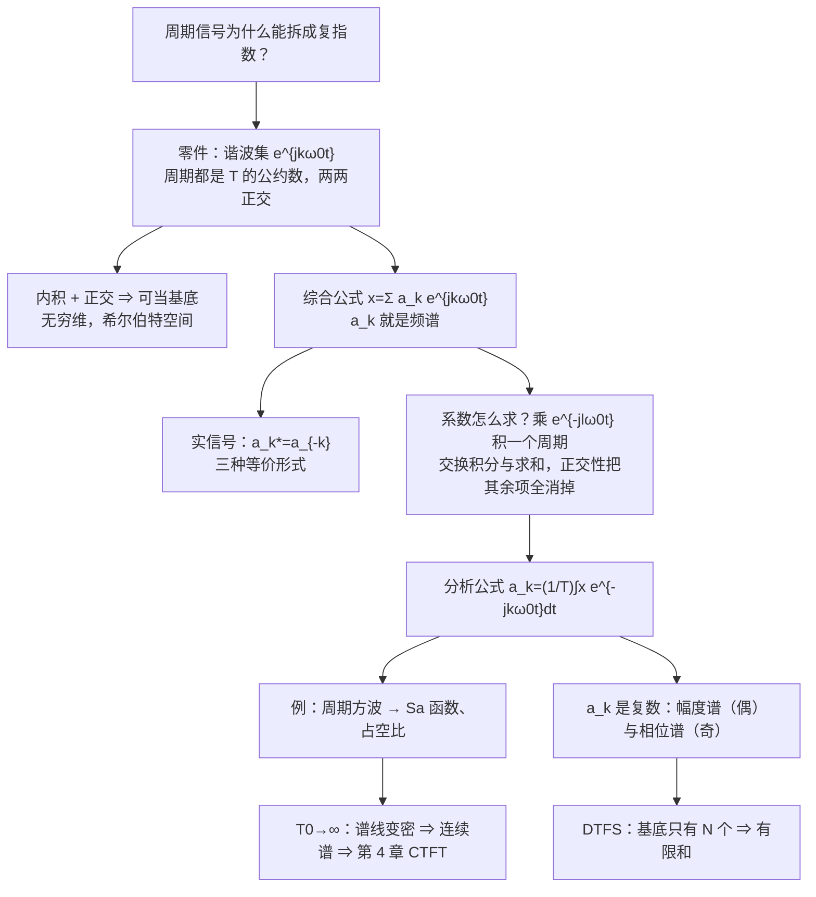

# 3.3 连续时间周期信号的傅里叶级数 CTFS

> [!abstract] 这一讲的任务
> 从这一讲起，我们正式进入**频域**。
> 上一讲说：输入只要是复指数的线性组合，LTI 系统的作用就成了乘法。这一讲兑现前提——**任何（满足条件的）周期信号都能写成复指数的线性组合**，而且只要基频的整数倍 $k\omega_0$ 就够了。
> 我们要拿到两个公式：**综合公式**（怎么用系数拼出信号）和**分析公式**（怎么从信号求出系数），并学会读**幅度谱**和**相位谱**。
> **课堂原话：第一个公式要记住；周期方波那条"占空比 × Sa 函数"的结论要背下来；归一化的 sinc 写法不要求背。**

> [!note] 这一章在第 3–5 章里的位置
> 老师把第 3、4、5 章串起来讲，分工是这样的：
> - **第 3 章**：周期信号的工具——连续时间傅里叶级数 CTFS、离散时间傅里叶级数 DTFS；
> - **第 4 章**：第 3 章**第一部分的延伸**。把周期 $T_0$ 推向无穷大，周期信号变成非周期信号，级数变成**连续时间傅里叶变换 CTFT**；
> - **第 5 章**：DTFS 的延伸，**离散时间傅里叶变换 DTFT**，管离散非周期信号。
>
> 一条主线贯穿这三章：**时域周期 ⇒ 频谱离散**（用级数，式子是求和）；**时域非周期 ⇒ 频谱连续**（用变换，式子是积分）。这一讲先把"离散"这一半说清楚，第 4、5 章做的事就是取极限，把离散的谱线连成连续的谱。

---

## 0. 开场：调音台上的推子

录音棚的调音台（均衡器 EQ）上有一排推子：60 Hz、120 Hz、240 Hz……每个推子控制一个频率成分的音量。把推子摆成某个样子，就“调”出了一种音色。

反过来想：**任何一个周期性的声音，是不是都能被某种推子摆法完全还原出来？** 如果能，那么“声音”就可以用“一排推子的位置”来记录——这就是**频谱**。

傅里叶级数说：能。而且推子只需要摆在**基频的整数倍**上（120 Hz 声音只需要 120、240、360……），每个推子的“位置”是一个复数 $a_k$（大小 + 相位）。

---

## 1. 零件：谐波相关的复指数集

> [!important] 谐波相关复指数集 Harmonically related complex exponentials
> $$\Phi_k(t)=e^{jk\omega_0t}=e^{jk(2\pi/T)t},\qquad k=0,\pm1,\pm2,\cdots$$
> - $T$：基波周期 fundamental period（也是所有成员的**公共周期 common period**）
> - $\omega_0=2\pi/T$：基波频率 fundamental frequency
> - $k=\pm1$：**基波分量** fundamental components $e^{\pm j\omega_0t}$
> - $k=\pm2$：**二次谐波** second harmonic components $e^{\pm j2\omega_0t}$
> - $k=\pm N$：**$N$ 次谐波** $N$th harmonic components

课堂上先把"为什么是这些零件"讲了一遍：$e^{jk\omega_0t}$ 的实部（$\cos$）和虚部（$\sin$）频率完全相同，所以它是一个**单频**信号；而构成信号分解结果的每一个小成分，都必须带着**同一个公共周期**，也就是基频的整数倍——$k$ 次谐波。

> [!question] 停一下，先自己想想
> 为什么只选 $k\omega_0$，不选 $1.5\omega_0$ 或 $\sqrt2\omega_0$？

因为我们要拼的是**周期为 $T$ 的信号**。$e^{jk\omega_0t}$ 的周期是 $T/k$，把 $T$ 整除——每个零件都在 $T$ 之后重复，拼出来的和自然也以 $T$ 为周期。频率 $1.5\omega_0$ 的零件周期是 $\frac{2T}{3}$，在 $T$ 之后不回到原位，拼出来就不以 $T$ 为周期了。**“周期为 $T$”这个要求，把可用频率锁死在 $\omega_0$ 的整数倍上**——频谱因此是**离散的**（一根一根的谱线）。

### 1.1 为什么这个集合能当基底：内积、正交、希尔伯特空间

> [!important] 内积与正交性
> 这个集合里的成员都是**复数**，所以"两个成员正不正交"要按**复内积空间**的定义来判断：用**负共轭**相乘，并且因为每个成员都以 $T$ 为周期，**只在一个整周期上积分**——
> $$\langle\Phi_k,\Phi_l\rangle=\int_T\Phi_k(t)\Phi_l^*(t)\,dt=\int_Te^{jk\omega_0t}e^{-jl\omega_0t}\,dt=\int_Te^{j(k-l)\omega_0t}\,dt=\begin{cases}T,&k=l\\0,&k\ne l\end{cases}$$
> 也就是说：**集合里任意两个不同的成员都正交**。（正交性的证明见 [[C1.3 指数信号与正弦信号]]。）

> [!important] 于是它是一组基
> 任意两个成员都正交 ⇒ 这组信号可以**张成一个空间**，每个成员是一个**基底**；而
> $$x(t)=\sum_k a_k e^{jk\omega_0t}$$
> 就是"把一个信号用这组基底加权表示出来"，$a_k$ 是它在第 $k$ 个基上的**坐标（权重）**。
> 和欧氏空间唯一的区别是：这里的基底**有无穷多个**，所以它不是欧氏空间，而是**无穷维**的希尔伯特空间（Hilbert space）。
> 物理含义不变：**$a_k$ 越大，说明频率 $k\omega_0$ 这个成分在这个信号里越强。**

> [!important] $a_k$ 就是频谱
> $a_k$ 挂在哪个基上，就代表哪个频率：$a_k$ 对应 $k\omega_0$，也就是第 $k$ 次谐波。把 $a_k$ 按 $k\omega_0$ 排开画出来，就是**频谱**——它只在这些离散的点上有值，中间是空的。
> 课堂上的画面：周期矩形波的频谱是等间隔的一根根谱线，$k=0$ 处是均值 $a_0$，往两边每隔 $\omega_0$ 一根 $a_{\pm1},a_{\pm2},\dots$，越往高频越矮。

> [!note] 课堂上先看到的那张图
> 第一节课讲频谱时，先看过一个**周期矩形信号**：时域上是一个个等宽脉冲，按频率拆开后得到的是**一根根等间距的谱线**——$k=0$ 处是平均值 $a_0$，往两边每隔 $\omega_0$ 出现一根 $a_{\pm1},a_{\pm2},\dots$，越往高频谱线越矮。
> **为什么会这样？** 因为每个分量都得保留原来那个大周期：基波 $\omega_0$ 先把波形的主体轮廓拟合出来，剩下的细节由 $\omega_0$ 的高次谐波一点点“微调”。既然所有分量的周期都必须是 $T$ 的约数，可用频率就被锁死在 $\omega_0$ 的整数倍上，谱线自然离散、等间隔。
> 这里也埋下了连续与离散的分野：**连续时间的基底有无穷多个成员**（$k$ 可以一直数下去），**离散时间的基底只有有限个**（数到 $N$ 个以后就开始重复，见 [[C3.5 离散时间傅里叶级数DTFS及性质]]）。

> [!important] 傅里叶级数 Fourier series（综合公式 Synthesis equation）
> $$\boxed{\ x(t)=\sum_{k=-\infty}^{+\infty}a_k\,e^{jk\omega_0t}\ }$$
> $a_k$ 叫**傅里叶级数系数** Fourier series coefficients，也叫**频谱系数**。
> 这个式子是这一讲的**第一个公式**，老师明确要求记住。它的作用方向是"**从频域回到时域**"：给你一组 $a_k$，就能把信号拼回来。

### 例 3.2：读出系数

> [!example] 例 3.2：从三角形式读出系数
> $\tilde x(t)=1+\frac12\cos2\pi t+\cos4\pi t+\frac23\cos6\pi t$

用欧拉公式 $\cos\theta=\frac12(e^{j\theta}+e^{-j\theta})$：
$$\tilde x(t)=1+\tfrac14(e^{j2\pi t}+e^{-j2\pi t})+\tfrac12(e^{j4\pi t}+e^{-j4\pi t})+\tfrac13(e^{j6\pi t}+e^{-j6\pi t})=\sum_{k=-3}^{3}a_ke^{jk2\pi t}$$
基频 $\omega_0=2\pi$，读出
$$a_0=1,\quad a_{\pm1}=\tfrac14,\quad a_{\pm2}=\tfrac12,\quad a_{\pm3}=\tfrac13$$

课堂上是这么读的：

- **常数项就是 $a_0$，它等于信号一个周期的平均值，也就是直流分量。** 分解出来的其他成分（$e^{jk\omega_0t},k\ne0$）都绕着零均值上下波动，信号整体的"上下偏移"只能由 $a_0$ 承担。把 $a_0$ 从信号里减掉，剩下的就是一串均值为零的正弦余弦之和。
- 剩下三个余弦的频率是 $2\pi,4\pi,6\pi$，都是 $2\pi$ 的整数倍 ⇒ 基频 $\omega_0=2\pi$，它们分别是 1、2、3 次谐波。
- 展开后一共 **7 项**（$k=0,\pm1,\pm2,\pm3$）。看起来挺复杂的波形，其实只由三个频率拼出来。

> [!warning] 最常见的错：系数要减半
> $\frac12\cos2\pi t$ 的系数是 $\frac12$，但它拆成两个复指数后，$a_1=a_{-1}=\frac14$。**余弦的振幅 = $2|a_k|$**，一半给正频率、一半给负频率。直流项 $a_0$ 不拆，原样保留。
![[C3.2-例3.2-四个谐波合成.png]]

上图把四个分量与它们的和画在一起：直流、一次谐波、二次谐波、三次谐波各一条，最右边是四者之和——一个看起来复杂、实际上只由三个频率拼出来的周期波形。

把这个例子的**频谱**画出来：

![[C3.2-例3.2的离散频谱.png]]

> [!important] 这个例子最漂亮的地方
> 时域上 $x(t)$ 是**实信号、又是偶信号**（关于 $t=0$ 对称），于是它的频谱**也是实的、偶的**——除了 $k=0,\pm1,\pm2,\pm3$ 这几根，其余 $a_k$ 全是 0，而且左右对称。
> 因为 $a_k$ 本身是实数，一条实轴上的谱线图就画完了，不需要分成幅度谱和相位谱。
> 这是性质，后面会证明。**但别以为所有信号都这么漂亮**——下一个例子就没这么幸运。

### 例 1：带相位的余弦

> [!example] 带相位的余弦
> $\tilde x(t)=3\cos(\omega_0t+4)$
> $$=\tfrac32e^{j4}e^{j\omega_0t}+\tfrac32e^{-j4}e^{-j\omega_0t}$$
> $$a_1=\tfrac32e^{j4},\quad a_{-1}=\tfrac32e^{-j4},\quad a_k=0\ (k\ne\pm1)$$
> **初相位跑进了系数里**：$|a_{\pm1}|=\frac32$（幅度），$\angle a_{\pm1}=\pm4$（相位）。$a_k$ 是复数，正是为了同时装下“多大”和“错开多少”。

课堂上从这里引出了下一节的关键动机：$a_1=\frac32e^{j4}$ **不是实数**，它既有实部又有虚部。既然系数跑到复平面上去了，**就没法用一条实轴上的谱线把它画出来**——必须分成两张图。这就是"幅度谱 + 相位谱"的来历。

> [!warning] 口述勘误：$\varphi$ 的正负是"左移"还是"右移"
> 课堂上讲这个例子时说“相位就是把波形**往右偏**了一下”。按公式核对一遍：$\cos(\omega_0t+\varphi)$ 的峰值出现在 $\omega_0t=-\varphi$，也就是 $t=-\varphi/\omega_0$。
> - 写成 $\cos[\omega_0(t-t_0)]$ 时，$t_0>0$ 是**延迟（右移）**；
> - 而这个例子里括号中是**加号**，$\varphi=4>0$ ⇒ 峰值在 $t=-4/\omega_0<0$，波形是**往左**（提前）的。
> 所以口述里的"往右"说反了，**以公式为准**。记法：**括号里加号 = 提前（左移），减号 = 延迟（右移）。**

> [!example] 练一道：混合三角函数
> 求 $x(t)=2+4\cos3t-6\sin\left(6t+\frac\pi4\right)$ 的基频与全部非零 $a_k$。
>
> 基频取各项频率的最大公约数：$3$ 与 $6$ 的最大公约数是 $3$，所以 $\omega_0=3$。
> - 直流：$a_0=2$；
> - $4\cos3t=2e^{j3t}+2e^{-j3t}$ ⇒ $a_{\pm1}=2$；
> - $-6\sin\left(6t+\frac\pi4\right)=-6\cdot\dfrac{e^{j(6t+\pi/4)}-e^{-j(6t+\pi/4)}}{2j}=3j\,e^{j\pi/4}e^{j6t}-3j\,e^{-j\pi/4}e^{-j6t}$
>   ⇒ $a_2=3je^{j\pi/4}=3e^{j3\pi/4}$，$a_{-2}=-3je^{-j\pi/4}=3e^{-j3\pi/4}$。
>
> **自检**：$a_{-2}=a_2^*$ ✓ ——实信号的系数必然共轭对称，算完顺手验一下，能拦下大半符号错误。

---

## 2. 实信号的三种等价写法（拓展：按原稿整理，课堂只讲了结论）

第 11 节课提到了结论——**实信号的系数满足共轭对称**，老师明确说"这个性质后面会证明"；但没有在课堂上展开推导，也没有讲三种等价形式。下面是按原稿整理的部分，供对照。

实际中的信号几乎都是**实信号**：$x(t)=x^*(t)$。这会给系数加上一条约束。

> [!example] 推导（p.7–8）
> $$x(t)=\sum_ka_ke^{jk\omega_0t}\quad\text{而}\quad x^*(t)=\sum_ka_k^*e^{-jk\omega_0t}\xrightarrow{\ k'=-k\ }\sum_{k'}a_{-k'}^*e^{jk'\omega_0t}$$
> 两者相等且傅里叶级数表示唯一，逐项比较系数：
> $$\boxed{\ a_k^*=a_{-k}\ }$$
> 正负频率的系数**互为共轭**。

于是正负频率两两配对，每对加起来是实数：
$$x(t)=a_0+\sum_{k=1}^{\infty}\big[a_ke^{jk\omega_0t}+(a_ke^{jk\omega_0t})^*\big]=a_0+\sum_{k=1}^{\infty}2\,\mathrm{Re}\big[a_ke^{jk\omega_0t}\big]$$

| 形式 | 设 | 结果 |
|---|---|---|
| **(A) 极坐标式 Polar form** | $a_k=A_ke^{j\theta_k}$ | $x(t)=a_0+\sum_{k=1}^\infty2A_k\cos(k\omega_0t+\theta_k)$ |
| **(B) 直角坐标式 Rectangular form** | $a_k=B_k+jC_k$ | $x(t)=a_0+2\sum_{k=1}^\infty\big[B_k\cos k\omega_0t-C_k\sin k\omega_0t\big]$ |
| **复指数式** | — | $x(t)=\sum_{-\infty}^{\infty}a_ke^{jk\omega_0t}$ |

三者**数学上等价 (Mathematically equivalent)**。

> [!tip] 为什么教材偏用复指数式
> 三角形式对人更直观（一眼看到 $\cos$、$\sin$），但复指数式：① 一个公式同时装下幅度和相位；② 正是 LTI 的特征函数，过系统只要乘 $H(jk\omega_0)$；③ 推导性质时只需要指数运算。[[L01 绪论 Introduction]] 里对三种形式的比较在这里得到了严格推导。
> (B) 式里 $-C_k\sin$ 的负号来自 $\mathrm{Re}[(B_k+jC_k)(\cos\theta+j\sin\theta)]=B_k\cos\theta-C_k\sin\theta$，别漏。

---

## 3. 系数怎么求：正交性一把消掉

有了综合公式，还缺一步：**给一个信号 $x(t)$，$a_k$ 到底是多少？**

> [!question] 停一下，先自己想想
> 等式 $x(t)=\sum_ka_ke^{jk\omega_0t}$ 右边有无穷多个未知数。怎么只把 $a_n$ 一个“挑”出来？

**朴素尝试**：在某个时刻 $t_1$ 取值？得到一个方程、无穷多未知数，解不出来。

**正确做法**：利用谐波集的**正交性 Orthogonality**（[[C1.3 指数信号与正弦信号]] 已证）：
$$\int_Te^{jk\omega_0t}e^{-jn\omega_0t}dt=\begin{cases}T,&k=n\\0,&k\ne n\end{cases}$$

两边同乘 $e^{-jn\omega_0t}$，再在一个周期上积分：
$$\int_Tx(t)e^{-jn\omega_0t}dt=\sum_ka_k\underbrace{\int_Te^{j(k-n)\omega_0t}dt}_{\text{只有 }k=n\text{ 时为 }T}=a_nT$$

> [!note] 课堂推导里特意强调的两步
> 1. **乘进去用分配律**：两边同乘 $e^{-jl\omega_0t}$，它不是只乘在某一项上，而是可以**乘进求和号里的每一项**；
> 2. **交换积分与求和的顺序**：积分是线性的，$\int\sum=\sum\int$。交换之后，与 $t$ 无关的 $a_k$ 提到积分外面，剩下的就是基函数之间的积分——那正是正交性的用武之地。
> 这两步做完，右边只剩 $k=l$ 那一项 $a_lT$；于是 $a_l=\frac1T\int_Tx(t)e^{-jl\omega_0t}dt$，**把 $l$ 换成 $k$**，就得到通用的分析公式。

> [!important] 傅里叶级数系数（分析公式 Analysis equation）
> $$\boxed{\ a_k=\frac1T\int_Tx(t)e^{-jk\omega_0t}dt\ }$$
> 与综合公式 $x(t)=\sum a_ke^{jk\omega_0t}$ 成对使用。$\int_T$ 表示在**任意一个完整周期**上积分（$[0,T]$ 或 $[-\frac T2,\frac T2]$ 都行，挑好算的）。

> [!question] 停一下，这一步的关键在哪
> 用正交性推分析公式，真正起作用的是哪个事实？

**答案**：关键只有一句——**非零频率的复指数在一个整周期上的积分为零**：
$$\int_Te^{j(k-n)\omega_0t}dt=\begin{cases}T,&k=n\\0,&k\ne n\end{cases}$$
这就是“正交”。两边乘 $e^{-jn\omega_0t}$ 再积一个周期后，右边无穷多项里**只剩下 $k=n$ 那一项**，其余全被积成 0，于是 $\int_Tx(t)e^{-jn\omega_0t}dt=a_nT$。没有正交性，这一步就只是一个无穷元方程组，解不出来。

> [!tip] 两个公式的记忆
> - **综合**：系数 × 基函数，求和 → 信号；
> - **分析**：信号 × 基函数的**共轭**，积分再除以 $T$ → 系数。
> 这和线性代数里“向量在正交基上的坐标 = 与基向量的内积 / 基向量长度²”完全一样。$a_0=\frac1T\int_Tx\,dt$ 就是**一个周期的平均值（直流分量）**。

---

## 4. 周期方波：Sa 函数与占空比

> [!example] 周期方波
> 幅度 1，在 $|t|<T_1$ 内为 1，周期 $T_0$。

> [!question] 停一下，积分区间该挑哪一段？
> 分析公式里的 $\int_T$ 是"任意一个整周期"。为什么取 $[-\frac{T_0}{2},\frac{T_0}{2}]$，而不是 $[0,T_0]$？

**答案**：数学直觉——**挑好算的那一段**。$[-\frac{T_0}2,\frac{T_0}2]$ 关于原点对称，和对称的方波配合起来最省事；而且方波在这段里只有 $[-T_1,T_1]$ 上非零，其余两段 $x(t)=0$ 对积分没有贡献，**区间可以一路缩到 $[-T_1,T_1]$**。取 $[0,T_0]$ 则要横跨一个跳变点，式子更啰嗦。

取积分区间 $[-\frac{T_0}{2},\frac{T_0}{2}]$，只有 $[-T_1,T_1]$ 上非零：
$$a_k=\frac1{T_0}\int_{-T_1}^{T_1}e^{-jk\omega_0t}dt=-\frac{1}{jk\omega_0T_0}e^{-jk\omega_0t}\Big|_{-T_1}^{T_1}=\frac{2\sin k\omega_0T_1}{k\omega_0T_0}$$
（最后一步用了 $e^{j\theta}-e^{-j\theta}=2j\sin\theta$。）
凑成标准形式：
$$\boxed{\ a_k=\frac{2T_1}{T_0}\cdot\frac{\sin k\omega_0T_1}{k\omega_0T_1}=\frac{2T_1}{T_0}\,\mathrm{Sa}(k\omega_0T_1)=\frac{2T_1}{T_0}\,\mathrm{sinc}\!\Big(\frac{2T_1}{T_0}k\Big)\ }$$
$k=0$ 单独算：$a_0=\frac{2T_1}{T_0}$（与 $\mathrm{Sa}(0)=1$ 的极限一致）。

**用数字验一遍**（$T_0=4$、$T_1=1$）：占空比 $\frac{2T_1}{T_0}=\frac12$，$\omega_0=\frac\pi2$，于是 $a_k=\frac12\mathrm{Sa}\left(\frac{k\pi}{2}\right)=\frac{\sin(k\pi/2)}{k\pi}$：
$$a_0=\frac12,\qquad a_1=\frac1\pi\approx0.318,\qquad a_2=0,\qquad a_3=-\frac1{3\pi}\approx-0.106$$
**占空比 $\frac12$ 时偶次谐波全部为零**——这就是“方波只含奇次谐波”的来源，也是下面频谱图里 $k=\pm2,\pm4,\dots$ 处恰好没有谱线的原因。

> [!important] 两个长得很像的函数：Sa 与 sinc
> $$\mathrm{Sa}(x)=\frac{\sin x}{x}\qquad\qquad \mathrm{sinc}(x)=\frac{\sin\pi x}{\pi x}$$
> **主瓣与旁瓣**：$\mathrm{Sa}(x)$ 在 $x=k\pi$（$k=\pm1,\pm2,\dots$）处取零，在 $x=0$ 处取最大值 1——$x\to0$ 时分子分母都是 0，用洛必达法则（或对小量展开）都得到 1。它每过一个 $\pi$ 换一次符号，振幅随 $|x|$ 增大而衰减。**$[-\pi,\pi]$ 这一段叫主瓣（main lobe）**，集中了大部分能量；**往外的那些小波瓣叫旁瓣（side lobes）**。
> ![[C3-Sa函数主瓣与旁瓣.png]]
> ![[C3-Sa函数与sinc函数.png]]
> **注意二者区别。** Sa 的零点在 $x=k\pi$；sinc 的零点在**整数** $x=k$。$\mathrm{Sa}(\pi x)=\mathrm{sinc}(x)$——把横轴压缩 $\pi$ 倍，就是归一化。
> 编程要小心：`numpy.sinc(x)` 实现的是 $\frac{\sin\pi x}{\pi x}$（归一化 sinc）。
> **老师明确说了：$\mathrm{Sa}$ 形式那条结论要记住，$\mathrm{sinc}$ 的归一化写法不要求背。**

### 占空比如何影响频谱

$\frac{2T_1}{T_0}$ 叫**占空比 duty ratio**：一个周期里“高电平”所占的比例。

![[C3-周期方波频谱-占空比.png]]

**左列（固定 $T_0$，缩短脉宽 $T_1$）**，横轴是谐波序号 $k$：
- 占空比 $\frac12\to\frac14\to\frac18$，**包络变宽、变矮**；
- 包络第一个零点在 $k\omega_0T_1=\pi$，即 $k=\frac{T_0}{2T_1}$（占空比的倒数）：分别在 $k=2,4,8$；
- **脉冲越窄，能量铺得越开，高频成分越多。**

**右列（固定 $T_1$，拉长周期 $T_0$）**，横轴是实际频率 $\omega=k\omega_0$：
- 包络**形状不变**（零点永远在 $\omega=\pi/T_1$），只是**谱线越来越密**（间隔 $\omega_0=2\pi/T_0$ 变小）、高度越来越低（整体乘 $\frac{2T_1}{T_0}$）；
- **推到极限 $T_0\to\infty$**：周期信号变成单个脉冲，谱线密到连成一片——**这就是第 4 章傅里叶变换的由来**。

> [!important] 要背的结论，以及它背后的两句话
> **周期方波的频谱 = 占空比 × 采样函数**：$a_k=\dfrac{2T_1}{T_0}\mathrm{Sa}(k\omega_0T_1)$。
> 主瓣边界由 $\mathrm{Sa}$ 的第一个零点定住：$k\omega_0T_1=\pi$，即 $\omega=\frac{\pi}{T_1}$——**主瓣宽度只由脉冲宽度 $T_1$ 决定**。
> - **固定 $T_0$、脉冲变窄** ⇒ 主瓣边界 $\frac{\pi}{T_1}$ 变大，主瓣变宽，里面能装的谱线条数变多；而谱线间隔 $\omega_0=\frac{2\pi}{T_0}$ 没变，所以看起来是"包络变宽、每根变矮"。
> - **固定 $T_1$、周期变长** ⇒ 主瓣宽度 $\frac{\pi}{T_1}$ 不变（图上包络是对齐的），但谱线间隔 $\frac{2\pi}{T_0}$ 变小、**谱线越来越密**，整体高度按 $\frac{2T_1}{T_0}$ 变矮。
> 一句话：**等周期下，时域越窄 ⇒ 频域越宽；脉冲不变时，周期越长 ⇒ 谱线越密。**

> [!warning] 读图时注意两列横轴不同
> 左列横轴是 $k$（序号），右列横轴是 $\omega$（真实频率）。同样的占空比，在 $k$ 轴上看一样，在 $\omega$ 轴上看却完全不同。这是初学者最容易卡住的地方。

---

## 5. 幅度谱与相位谱

一般情况下 $a_k$ 是**复数**：时域明明是实信号，系数却跑到复平面上去了（前面的例 1 就是）。**一个复数需要两个实数才说得清**，所以描述频谱的常规做法是用**极坐标**：

$$a_k=|a_k|e^{j\varphi_k}\qquad|a_k|\text{：幅度频谱 magnitude spectra},\quad\varphi_k\text{：相位频谱 phase spectra}$$

- $|a_k|$ 随 $k$ 变化 = **幅度谱**：这个频率的成分有多强；
- $\varphi_k$ 随 $k$ 变化 = **相位谱**：这个频率的成分错开了多少。

> [!important] 一张图还是两张图
> 一个实信号，**通常要两张图**才能完整描述它的频谱。只有频谱本身是实数的特殊信号（例如前面那种"实且偶"的信号），才能只用一张图搞定。
> 这也是为什么"幅频响应 / 相频响应"总是一起出现——滤波器改了幅度的同时，往往也改了相位。

![[C3-相位使波形左移.png]]

上图把两件事对起来看：时域上把余弦**提前**一点（括号里加一个正相位），频域上就是 $|a_{\pm1}|$ 不变、而 $\angle a_{\pm1}=\pm4$。**幅度谱管"这个频率有多强"，相位谱管"这个频率错开了多少"。**

### 例 2：三角函数组合（复数系数）

> [!example] 例 2：三角函数组合
> 求 $x(t)=1-\cos(\pi t)+2\sin(2\pi t)+\cos(3\pi t)$ 的 CTFS 系数。

基频 $\omega_0=\pi$（各频率 $\pi,2\pi,3\pi$ 的最大公约数）。逐项展开：
$$x=1-\frac{e^{j\omega_0t}+e^{-j\omega_0t}}{2}+2\cdot\frac{e^{j2\omega_0t}-e^{-j2\omega_0t}}{2j}+\frac{e^{j3\omega_0t}+e^{-j3\omega_0t}}{2}$$
其中 $\frac{2}{2j}=-j$，所以 $e^{j2\omega_0t}$ 的系数是 $-j$、$e^{-j2\omega_0t}$ 的系数是 $+j$：
$$a_k=\begin{cases}1,&k=0\\-\frac12,&k=\pm1\\\mp j,&k=\pm2\\\frac12,&k=\pm3\\0,&\text{others}\end{cases}$$

![[C3-例2幅度谱与相位谱.png]]

- **幅度谱（偶对称）**：$|a_0|=1$，$|a_{\pm1}|=\frac12$，$|a_{\pm2}|=1$，$|a_{\pm3}|=\frac12$；
- **相位谱（奇对称）**：$a_{\pm1}=-\frac12$ 的相位是 $\pm\pi$（负实数，取 $+\pi$ 或 $-\pi$ 都对，画图时取成奇对称）；$a_2=-j$ 相位 $-\frac\pi2$，$a_{-2}=j$ 相位 $+\frac\pi2$；$a_{\pm3}$ 是正实数，相位 0。

> [!warning] 两个易错点
> 1. $\sin$ 展开时分母是 $2j$，$\frac{1}{j}=-j$，所以 $\sin$ 对应的是**纯虚数**系数，正频率那一项是 $-j$ 倍。
> 2. 负实数的相位是 $\pi$ 不是 0；相位谱只在 $a_k\ne0$ 处有意义。

> [!question] 停一下，为什么幅度谱一定偶、相位谱一定奇？
> 由 $a_k^*=a_{-k}$ 出发，写 $a_k=|a_k|e^{j\varphi_k}$，立刻得到 $a_{-k}=a_k^*=|a_k|e^{-j\varphi_k}$：模相同、相位差一个负号。

这正是**实信号**的结果：负频率那一半不是新信息，它只是正频率那一半的镜像（相位镜像后取负）。所以画频谱时可以只画 $k\ge0$ 的一半。

> [!important] 实信号频谱的一般规律
> 由 $a_k^*=a_{-k}$：$|a_k|=|a_{-k}|$（**幅度谱偶对称**），$\varphi_k=-\varphi_{-k}$（**相位谱奇对称**）。两个例子都验证了这一点。所以实信号只需要看 $k\ge0$ 的一半。

### 例 3：周期指数信号（拓展：原稿例题，课堂未讲）

这一题课堂上没有展开，是原稿上的第三个例题。放在这里，补上"用分析公式去算一个非三角函数信号"的做法。

> [!example] 例 3：周期指数信号
> $x(t)$ 在 $[0,2)$ 上为 $e^{-2t}$，周期 $T=2$，$\omega_0=\pi$。

$$a_k=\frac12\int_0^2e^{-2t}e^{-jk\pi t}dt=\frac12\cdot\frac{1-e^{-(2+jk\pi)\cdot2}}{2+jk\pi}=\frac{1-e^{-4}}{4+j2k\pi}$$
（用了 $e^{-j2k\pi}=1$。）

![[C3-例3周期指数信号的频谱.png]]

**数值验算**（python 数值积分）：$a_0=\frac{1-e^{-4}}{4}=0.2454$，$|a_1|=0.1318$、$\varphi_1=-1.004$ rad，$|a_2|=0.0744$，与公式及频谱图一致。
**读图**：$|a_k|\sim\frac{1}{2\pi|k|}$ 缓慢衰减（因为信号有跳变）；相位随 $k\to\pm\infty$ 趋于 $\mp\frac\pi2$（分母被 $j2k\pi$ 主导）。

---

## 这一讲的三句话

1. **周期信号只需要 $k\omega_0$ 这些频率**：谐波集两两正交，可以当一组（无穷维的）基底，$a_k$ 是信号在第 $k$ 根基上的坐标——它就是**频谱**；所以周期信号的谱是**离散**的谱线。
2. **系数靠正交性求**：$a_k=\frac1T\int_Tx(t)e^{-jk\omega_0t}dt$；$a_k$ 一般是复数，实信号满足 $a_k^*=a_{-k}$（幅度谱偶、相位谱奇），所以通常要画**幅度谱和相位谱两张图**。
3. **周期方波的系数是 Sa 函数**：$a_k=\frac{2T_1}{T_0}\mathrm{Sa}(k\omega_0T_1)$（要背）；脉冲越窄频谱越宽，周期越长谱线越密——这是走向傅里叶变换的桥。

> [!tip] 速查表
> | 项目 | 公式 |
> |---|---|
> | 综合公式 | $x(t)=\sum_{k}a_ke^{jk\omega_0t}$，$\omega_0=2\pi/T$ |
> | 分析公式 | $a_k=\frac1T\int_Tx(t)e^{-jk\omega_0t}dt$ |
> | 正交性 | $\int_Te^{jk\omega_0t}e^{-jl\omega_0t}dt=T\delta_{kl}$（内积用负共轭） |
> | 直流分量 | $a_0=\frac1T\int_Tx\,dt$（周期平均值） |
> | 实信号 | $a_k^*=a_{-k}$；$x=a_0+\sum_{k\ge1}2A_k\cos(k\omega_0t+\theta_k)$ |
> | 相位与平移 | $\cos(\omega_0t+\varphi)$ 峰值在 $t=-\varphi/\omega_0$：**加号=提前（左移）** |
> | $\cos(k\omega_0t)$ | $a_{\pm k}=\frac12$ |
> | $\sin(k\omega_0t)$ | $a_k=\frac1{2j}=-\frac j2$，$a_{-k}=\frac j2$ |
> | 周期方波 | $a_k=\frac{2T_1}{T_0}\mathrm{Sa}(k\omega_0T_1)$，占空比 $\frac{2T_1}{T_0}$ |
> | 主瓣边界 | $\mathrm{Sa}$ 第一个零点：$k\omega_0T_1=\pi$ ⇔ $\omega=\pi/T_1$（只由脉宽定） |
> | Sa / sinc | $\mathrm{Sa}(x)=\frac{\sin x}{x}$；$\mathrm{sinc}(x)=\frac{\sin\pi x}{\pi x}=\mathrm{Sa}(\pi x)$ |

> [!tip] 下一讲预告
> 老师在第 11 节课最后说了：**下节课讲傅里叶级数的性质**。
> 阅读链条上的下一篇（收敛性与吉布斯现象）是原稿里排在性质之前的一节，它回答的是"无穷多项加起来真的等于原信号吗"——可方波明明有跳变，光滑的正弦怎么拼出一个断崖？项数加到一百、一千，跳变处的尖峰为什么始终顽固地高出约 9%？读完这一节，正好接上下节课的性质。

---

## 相关笔记 Related Notes

- 相关：[[C1.3 指数信号与正弦信号]]（谐波集与正交性证明）、[[L01 绪论 Introduction]]（三种形式、方波合成）、[[C3.5 离散时间傅里叶级数DTFS及性质]]（离散版的两个公式与"基底只有 $N$ 个"）

- 上一讲：[[C3.1 复指数是LTI系统的特征函数]]
- 下一讲：[[C3.3 傅里叶级数的收敛与吉布斯现象]]
- 返回：[[信号与系统 MOC]]
