# 第 3–5 章：四种傅里叶表示并行讲义

> [!abstract] 这一讲的任务
> 给你一个信号，先判断连续还是离散、周期还是非周期；再写对它的分析与综合公式。随后对四种信号同时问：能否收敛？平移后谱怎么变？卷积为什么变乘法？同一个性质的系数、取值范围与周期在哪里改变？
> 本篇按老师将第 3、4、5 章并行授课的思路重排，所有原有推导、例题、随堂题、图像、复盘和阅读线索均收入本文件正文；读本篇即可看到这些内容，不依赖嵌入其他笔记。

> [!info] 阅读说明与课堂证据
> 本篇整合原有 **16 篇**笔记，并重新考虑已经标记“已合并”的转写稿。原笔记保留原位；这里另成一份讲义。
> 第 10 节提供复指数与 LTI 的起点；第 11–12 节建立四套公式与四种矩形；第 13 节进一步讲收敛、吉布斯、语音分帧加窗、二维图像的平移与相位实验，以及线性、时移和频移。其余性质和系统求解的原有完整内容仍保留，不能因为本节暂未讲到而删去。
> 每一主题先给并排比较，再展开原有完整讲解。同一主题里仍保留有用的重复推导，便于逐项核对；原篇任务导读、历史进度和收尾集中在第 17 节。那里“未讲”等旧状态是历史快照，现时进度见第 18 节。**校正框优先于其后保留的旧稿措辞。**
> 第十三节课没有时间戳，开头、若干中间位置有明显的识别重复，原图也未随转写提供。本篇还原能确认的讲解与实验动作；听不清的通信缩写、图像的具体像素和未定的考试日期不作补猜。

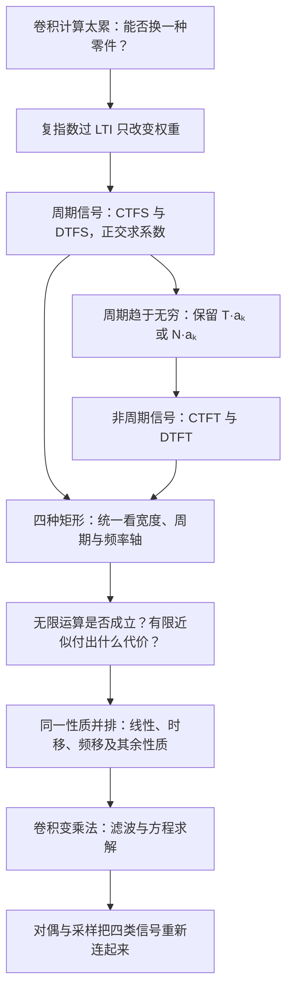

## 0. 开场：同一个矩形，为什么要学四套公式

你拿到一段宽度固定的矩形脉冲。让它周期重复，频域只需基频整数倍的权重；把周期拉远，谱线变密，却不能直接拿趋于零的系数当作连续谱。再把时间改成整数采样点，频率又会绕一圈重复。四套公式正是这几个改变的结果。

本篇采用 $\Omega_0=2\pi/T$ 表示连续周期信号的基频，采用 $\omega_N=2\pi/N$ 表示离散周期信号的基频；原有讲解里的 $\omega_0$、$T_0$、$N_0$ 按各段自己的定义读。连续频率 $\Omega$ 的单位是 rad/s；离散频率 $\omega$ 的单位是 rad/sample，模 $2\pi$ 等价。$k$ 是谐波编号，不是时间。

| 工具 | 时域对象 | 频谱的变量与结构 | 分析用什么运算 | 综合用什么运算 |
|---|---|---|---|---|
| CTFS | 连续，周期 $T$ | $a_k$，离散谐波，通常不周期 | 一个 $T$ 上积分并除以 $T$ | 对全部整数 $k$ 求和 |
| DTFS | 离散，周期 $N$ | $a_k$，离散且以 $N$ 为周期 | 任意连续 $N$ 个样本求和并除以 $N$ | 任意连续 $N$ 个系数求和 |
| CTFT | 连续非周期信号的通常表示，也可扩展到周期信号 | $X(j\Omega)$，连续频率轴；允许广义冲激谱 | 全时间轴积分 | 全频率轴积分并除以 $2\pi$ |
| DTFT | 离散非周期信号的通常表示，也可扩展到周期信号 | $X(e^{j\omega})$，连续频率变量且 $2\pi$ 周期 | 全整数时间轴求和 | 任意一个 $2\pi$ 上积分并除以 $2\pi$ |

> [!warning] 四象限是记公式的结构，不能用来排除特例
> “连续”首先指自变量连续，不保证函数处处连续。DTFT 即便含冲激，仍定义在连续频率变量上；连续时间冲激串的 CTFT 也可以是周期谱。非周期信号还可能有离散或混合谱，例如两个不可公度的正弦之和。因此课堂“周期对应离散、离散对应周期”的口诀，要结合对象、单位和傅里叶对的适用范围读，不能机械地把所有箭头都当成无条件充要关系。

阅读入口：[[#2. 四套公式：正交、有限维与周期趋于无穷|四套公式]] · [[#3. 四种矩形并排：占空比、半角技巧与时宽带宽|四种矩形]] · [[#5. 收敛与有限近似：四种情形到底各需要什么条件|收敛与吉布斯]] · [[#7. 时移与相位：幅度不变为什么仍会改变图像|时移与相位]] · [[#13. 卷积与相乘：普通卷积、周期卷积及归一化|卷积归一化]] · [[#18. 课堂补充、考试安排与证据边界|课堂进度与考试]]。


## 1. 共同起点：复指数、特征函数与频率响应


先把系统分析的困难与信号分解的困难分开。若 $x(t)=e^{st}$，卷积里 $e^{s(t-\tau)}=e^{st}e^{-s\tau}$，于是

$$y(t)=e^{st}\int h(\tau)e^{-s\tau}d\tau=H(s)e^{st}.$$

离散端同样由 $z^{n-m}=z^nz^{-m}$ 得 $y[n]=H(z)z^n$。这个结论要求对应的积分或级数存在；取纯虚轴或单位圆也必须在相应收敛范围内，不能拿一个未收敛的表达式随意代值。

| 输入的表示 | 每个零件通过系统后的权重 |
|---|---|
| CTFS：$a_ke^{jk\Omega_0t}$ | $b_k=a_kH(jk\Omega_0)$ |
| DTFS：$a_ke^{jk\omega_Nn}$ | $b_k=a_kH(e^{jk\omega_N})$ |
| CTFT：连续频率零件 | $Y(j\Omega)=H(j\Omega)X(j\Omega)$ |
| DTFT：一个 $2\pi$ 内的连续频率零件 | $Y(e^{j\omega})=H(e^{j\omega})X(e^{j\omega})$ |

四种方法都没有改变线性叠加的逻辑。区别是把哪些频率算作不同零件，以及用求和还是积分把它们加回来。以下保留原有动机、完整证明与例题。


### 1 · 共同基础 · 完整推导、例题与原有讲解


#### C3.1 · 0. 开场：把 50 Hz 刨掉

你拿到一段心电信号，上面叠着明显的 50 Hz 工频干扰（电源串进来的）。要把它刨掉，你手上有什么工具？

翻回第 2 章，能做的只有一件：设计一条冲激响应 $h$，然后算卷积 $y=x*h$。问题是——**你怎么知道 $h$ 该长什么样？** 信号里混着心跳、基线漂移和 50 Hz，全都在时域上叠成一团，你没法指着某一段说「这就是 50 Hz」。

于是真正的问题变成：**有没有一种「坐标」，让不同的频率成分在它里面各占一个位置、互不重叠？** 有，那就是频率轴。而通往频率轴的第一步，就是这一讲要讲的事实：

> 只要输入是**复指数**，任何 LTI 系统对它的作用都会退化成「**乘一个数**」。

卷积（要做积分）变成乘法（一步到位），这就是整章频域方法的起点。

> [!note] 傅里叶这条线的历史（拓展）
> - **1807**：法国人**傅里叶（Jean Baptiste Joseph Fourier，1768 年生）**研究热传导时提出 *periodic signal could be represented by sinusoidal series*——周期信号可以用正弦级数表示。当时的大数学家**拉格朗日**强烈反对：一个有棱有角的方波，怎么可能用光滑的正弦拼出来？
> - **1829**：**狄利克雷 (Dirichlet)** 给出严格的收敛条件（[[C3.3 傅里叶级数的收敛与吉布斯现象]]）。
> - **1960 年代**：**Cooley 和 Tukey** 提出**快速傅里叶变换 FFT**，傅里叶分析从此能在计算机上大规模运行——今天每一部手机里都在跑它。
>
> 你在 [[L01 绪论 Introduction]] 里已经见过方波被一根根正弦「拼」出来的图。本章要做的，是在动手拆信号之前先回答一个更根本的问题：**为什么偏偏选复指数来拆？**

---

#### C3.1 · 1. 撞墙：卷积对任意输入都很累

回忆第 2 章：输入 $x(t)$ 过 LTI 系统，输出是
$$y(t)=x(t)*h(t)=\int_{-\infty}^{+\infty}x(t-\tau)h(\tau)\,d\tau$$
对一般的 $x(t)$，每换一个输入就要重新「翻转、滑动、分段积分」一次。第 2 章做的所有工作，本质都是在找更省事的算法——而算法再省，也还是卷积。

> [!question] 停一下，先自己想想
> 什么样的输入信号，过了系统之后**形状不变**？也就是 $y(t)=(\text{某个与 }t\text{ 无关的常数})\times x(t)$？
> 提示：想想哪种函数，自己平移一下之后，还等于「自己乘一个常数」。

答案是**指数函数**。因为
$$e^{s(t-\tau)}=e^{st}\cdot e^{-s\tau}$$
平移一下，只是多乘了一个**与 $t$ 无关**的因子。而卷积的本质就是「把输入平移、加权、叠加」——指数函数被平移多少次，出来都还是它自己的倍数。

这个「猜」不需要灵感，它是唯一解：能满足「平移后只差一个常数因子」的函数，只有指数型。

---

> [!warning] 校正：比值与收敛范围
> 下段口述“把输入除以输出”应读作**输出除以输入**，公式 $H=y/x$ 才是正确方向。指数输入的结论须满足对应变换收敛；例如 $H(s)=1/(s+1)$ 若对应因果 $e^{-t}u(t)$，仅在 $\Re s>-1$ 有该积分，不能把 $s=-2$ 直接当成存在的特征值。

#### C3.1 · 2. 连续时间：$e^{st}$ 进去，$H(s)e^{st}$ 出来

令 $x(t)=e^{st}$，其中 $s=\sigma+j\omega$ 是复数（$e^{st}=e^{\sigma t}e^{j\omega t}$，即 [[C1.3 指数信号与正弦信号]] 里的一般复指数）。代进卷积：

$$
\begin{aligned}
y(t)=e^{st}*h(t)&=\int_{-\infty}^{+\infty}e^{s(t-\tau)}h(\tau)\,d\tau\\
&=\int_{-\infty}^{+\infty}e^{st}\,e^{-s\tau}h(\tau)\,d\tau\\
&=e^{st}\underbrace{\int_{-\infty}^{+\infty}h(\tau)e^{-s\tau}\,d\tau}_{H(s)}\\
&=e^{st}\,H(s)
\end{aligned}
$$

**关键只有一步**：$e^{st}$ 里没有积分变量 $\tau$，所以它是「与 $\tau$ 无关的项」，可以整个提到积分号外面。剩下的积分只跟 $s$ 有关——积完之后 $\tau$ 消失了，得到一个**只依赖 $s$ 的复数**。给它一个名字：

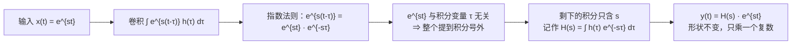

> [!important] 系统函数 System Function
> $$H(s)=\int_{-\infty}^{+\infty}h(\tau)e^{-s\tau}\,d\tau$$
> 这就是冲激响应 $h(t)$ 的**拉普拉斯变换 Laplace Transform**（第 9 章）。
> $$e^{st}\ \longrightarrow\ \boxed{h(t)}\ \longrightarrow\ H(s)\,e^{st}$$
> *The response of an LTI system to a complex exponential input is the same complex exponential with only a change in amplitude.*
> LTI 系统对复指数输入的响应，是**同一个复指数**，只是幅度（一个复数因子）变了。

![[C3.1-复指数进出系统不变形.png]]

逐个符号看清楚：

- $e^{st}$ 里 $t$ 是自由变量；
- $H(s)$ **不含 $t$**——对于固定的 $s$，它就是一个复数常数；
- 所以输出和输入「长得一模一样」，只差一个复数倍：**幅度被乘了 $|H(s)|$，相位被加了 $\angle H(s)$**。

图里的例子：取 $s=-0.2+2j$、系统 $H(s)=1/(s+1)$，则 $H(s)=0.172-0.431j$，$|H(s)|=0.464$，$\angle H(s)=-68.2^\circ$。输出就是输入的 0.464 倍、并整体后移 $68.2^\circ$——波形形状一根毛都没变。

**一个可以直接用的小例子**：系统对 $e^{-2t}$ 的响应是 $e^{-2t}H(-2)$；对 $e^{j5t}$ 的响应是 $e^{j5t}H(j5)$。指数位置上是什么，就把那个数代进 $H(\cdot)$ 里——**这就是「把输入除以输出就得到系统」的意思**：

$$\frac{y(t)}{x(t)}=H(s)$$

> [!important] 特征函数与特征值
> $$\mathcal{T}\{e^{st}\}=H(s)\,e^{st}$$
> $e^{st}$ 叫 LTI 系统的**特征函数 eigenfunction**，对应的 $H(s)$ 叫**特征值 eigenvalue**。
> 因为 $H(s)$ 只是一个数，我们把输入除掉就把它单独捞出来了——这件事只有指数输入做得到。

---

#### C3.1 · 3. 离散时间：$z^n$ 进去，$H(z)z^n$ 出来

完全平行，只是把积分换成求和。令 $x[n]=z^n$，$z=re^{j\omega}$（$z^n=r^ne^{j\omega n}$）：

$$
y[n]=z^n*h[n]=\sum_{k=-\infty}^{+\infty}z^{\,n-k}h[k]=z^n\underbrace{\sum_{k=-\infty}^{+\infty}h[k]z^{-k}}_{H(z)}=z^nH(z)
$$

关键一步同样是 $z^{\,n-k}=z^nz^{-k}$：$z^n$ 与求和指标 $k$ 无关，提出去。

> [!important] 离散时间系统函数
> $$H(z)=\sum_{k=-\infty}^{+\infty}h[k]z^{-k}\qquad\text{（Z 变换 Z-Transform，第 10 章）}$$
> *Complex exponentials are **eigenfunctions** of LTI systems.*

同样可以代数字：输入 $2^n$ 进来，输出就是 $2^nH(2)$；输入 $e^{j\omega_0n}$ 进来，输出是 $e^{j\omega_0n}H(e^{j\omega_0})$。**底数是什么，就把那个数代进 $H(\cdot)$。**

---

#### C3.1 · 4. 变换到底在干什么：换一个表征面

看起来 $H(s)$ 是个新东西，其实不是。它是**同一个系统在另一个面上的表达**。

> [!important] 变换就是换一个投影面
> - 求 $H(s)$ 的那个积分**改变了自变量**：对 $\tau$ 积完，$\tau$ 不见了，剩下的是 $s$ 的函数。所以「变换」就是一次**投影**——把同一个对象投到另一个表征面上看。
> - **$H$ 和 $h$ 是同一个东西**：都表示这个系统，只是分别在 $s$ 面和时间面上写出来，就像同一段声音的时域波形与频谱。
> - 正变换和反变换是**可逆**的（拉普拉斯变换、傅里叶变换都有反变换）。既然可逆，就说明信息没丢、也没多——**它还是它，只是换了个面**。
> - 因此 $H(s)$ 不是「系统的另一个参数」，它就是**系统本身**：只要 $h$ 定了，$H$ 就定了，反之亦然。

这也解释了这门课的编排顺序：**先学 LTI 系统，再学各种变换**。LTI 是最「漂亮」的系统——它的数学表达是完美的，输入输出关系只有卷积一种，所以只要找到合适的表征面，卷积就能变成乘法。

> [!tip] 傅里叶变换是拉普拉斯变换的特例
> 拉普拉斯变换的自变量 $s=\sigma+j\omega$ 是任意的复数。**把 $s$ 限制在纯虚轴上（$\sigma=0$，即 $s=j\omega$）**，拉普拉斯变换就退化成傅里叶变换。所以第 4 章的傅里叶变换、第 9 章的拉普拉斯变换，本质是同一台机器在两条不同的线上取值。

---

#### C3.1 · 5. 一堆复指数叠加：卷积彻底变成乘法

一个复指数好算，那么**一堆复指数加起来**呢？LTI 系统是线性的，各算各的、再加起来：

$$
x(t)=\sum_{k=1}^{N}a_k\,e^{s_kt}\quad\Longrightarrow\quad y(t)=\sum_{k=1}^{N}a_k\,H(s_k)\,e^{s_kt}
$$
$$
x[n]=\sum_{k=1}^{N}a_k\,z_k^{\,n}\quad\Longrightarrow\quad y[n]=\sum_{k=1}^{N}a_k\,H(z_k)\,z_k^{\,n}
$$

**每个分量的「形状」$e^{s_kt}$ 原封不动，只有系数 $a_k$ 变成了 $a_kH(s_k)$。** 卷积被彻底绕开了，只剩乘法——这就是频域方法全部威力的来源。

> [!question] 停一下，我们刚才干了什么
> 1. 发现复指数是 LTI 系统的特征函数：进去出来形状不变，只乘一个复数 $H$；
> 2. 于是只要把输入写成复指数的线性组合，输出就是**各分量各乘各的 $H$**。
>
> 剩下的问题只有一个：**任意一个信号，能不能写成复指数的线性组合？系数怎么求？** 对周期信号，答案就是**傅里叶级数**。
> 这和第 2 章是同一个套路：第 2 章选冲激作基底（得到卷积），这里选复指数作基底（得到乘法）。

---

#### C3.1 · 6. 取 $s=j\omega_0$：从单频到频率响应

现在把 $s$ 限制到一个具体的频率上：$s=j\omega_0$。输入变成 $e^{j\omega_0t}$，输出是
$$e^{j\omega_0t}\ \longrightarrow\ \boxed{h(t)}\ \longrightarrow\ H(j\omega_0)\,e^{j\omega_0t}$$
这是一个**单频（single frequency）**信号，而 $H(j\omega_0)$ 就是这个频率上的响应——**幅度缩放 $|H(j\omega_0)|$、相位平移 $\angle H(j\omega_0)$**。

只测一个频率显然不够。但如果**把每个频率都过一遍**，就得到了一整条曲线 $H(j\omega)$，它叫**频率响应 frequency response**：系统对每一个频率成分各自的响应（权重）。

![[C3.1-系统函数与频率响应.png]]

图里系统是 $H(s)=1/(s+1)$：它的极点在 $s=-1$；把 $s$ 沿虚轴滑动就得到 $|H(j\omega)|$——低频（$\omega\to0$）增益约 1，频率越高衰减越狠。$\omega=1$ 时 $|H|=0.707$（半功率点），$\omega=2$ 时 $|H|=1/\sqrt5\approx0.447$。**这就是一个低通滤波器**，只是我们此刻还没给它起这个名字。

> [!important] 频谱是什么
> 沿频率轴看一条信号，$X(j\omega)$ 的大小表示「**这个频率成分占多少权重**」。
> - 时域上**站着的**信号（没有宽度、$\delta(t)$）在频率上是**躺平的**——所有频率等权，这种谱叫宽频；
> - 时域上越集中，频率上就越铺开；反过来，频率上越集中（窄带），时域上就越拖沓。这是后面「时宽–带宽」一类结论的雏形。

---

#### C3.1 · 7. 为什么偏偏叫「特征」：指数是微分与差分下的不变项

「特征函数」「特征根」这两个名字不是随便起的。回到第 2.5 节解方程时那个位置：

- 连续：齐次解写成 $e^{st}$，特征根 $s$ 出现在**指数的位置上**；
- 离散：齐次解写成 $r^{\,n}$，特征根 $r$ 出现在**底数的位置上**。

为什么偏偏是指数？因为**指数是指数运算求导（差分）时的不变项**：

$$\frac{d}{dt}e^{st}=s\,e^{st}\qquad\text{（求导后还是它自己，只多乘一个 }s\text{）}$$
$$r^{\,n}-r^{\,n-1}=\Big(1-\frac1r\Big)r^{\,n}\qquad\text{（差分后还是它自己，只多乘一个常数）}$$

**求导、差分这些「变化」算子作用在指数上，得到的还是原样的指数。** 一个量在某个运算下保持不变、只被乘一个数——这就是「特征」二字的全部含义。于是：

- 微分方程（差分方程）里出现指数解，是必然的；
- 而 $e^{st}$ 过 LTI 系统也不变形，同样是必然的——**卷积这个运算作用在指数上，和求导一样只会提出一个与 $t$ 无关的常数因子**。

两种特征根的处理方式差别也来自这里：

| | 连续 | 离散 |
|---|---|---|
| 特征根的形态 | $s=\sigma+j\omega$ 在**指数位置**上 | $r=\rho e^{j\omega_0}$ 在**底数位置**上 |
| 复根的写法 | $e^{\sigma t}(K_1\cos\omega t+K_2\sin\omega t)$ | $\rho^{\,n}(C_1\cos\omega_0n+C_2\sin\omega_0n)$ |
| 衰减条件 | $\mathrm{Re}\{s\}<0$ | $\rho=\lvert r\rvert<1$ |

离散的那个 $r$ 之所以要用**极坐标**表示，就是因为它是「底数」：模 $\rho$ 当底负责增长/衰减，相位 $\omega_0$ 负责正余弦振荡。连续那边的实部虚部都挤在指数上，所以写法不一样。（对照 [[C2.5 差分方程与离散时间系统求解]]）

> [!note] 与线性代数里的特征向量对照（拓展）
> 线性代数里：矩阵 $A$ 作用在特征向量 $v$ 上，$Av=\lambda v$——方向不变，只被拉伸 $\lambda$ 倍。
> 这里：LTI 系统（一个线性算子）作用在 $e^{st}$ 上，$\mathcal{T}\{e^{st}\}=H(s)e^{st}$——形状不变，只被乘 $H(s)$。
> 所以 $e^{st}$ 叫**特征函数 eigenfunction**，$H(s)$ 叫对应的**特征值 eigenvalue**。这是 [[C1.3 指数信号与正弦信号]] 里「特征函数视角」那条伏笔的正式回收。

---

> [!warning] 校正：保留课堂的宽频直观，限定工程与医学类比
> 下段“方波、三角波只含离散几条频率”的说法只适用于相应的周期测试，且通常有无限条谐波；非周期矩形、三角脉冲一般有连续谱。已知测试信号只要在所需频带非零，也可以用 $H=Y/X$ 辨识该频带。冲激代表 LTI 系统的严格根据是任意输入的移位冲激分解；“一次激发所有频率”提供另一种直观。
> 下段除颤例子保留为课堂类比的记录，但“靠全频共振唤醒心脏”不是这里可推出的机制。除颤器在适当心律条件下施加电击，目标是恢复正常心律，不能把心脏视为本节线性共振测试对象。[NIH 的除颤器说明](https://www.nhlbi.nih.gov/health/defibrillators/how-do-defibrillators-work)。

#### C3.1 · 8. 凭什么一条 $h$ 就能代表整个系统

第 2 章一开始就说「一个 LTI 系统就是一条 $h$」，可当时没解释清楚：**为什么偏偏是冲激响应能代表系统？** 换成方波的响应、三角波的响应，不行吗？

用频率一看就明白了：

> [!important] 冲激是「全频率等权」的测试信号
> 1. 冲激 $\delta(t)$ 在时域上是一个**没有任何宽度**的尖峰，它的频率成分极其丰富——**每一个频率上都有分量**；
> 2. 更关键的是，这些频率分量的**权重相等**（都等于 1）：每个 $\omega$ 都被公平地激发了一次；
> 3. 于是拿 $\delta(t)$ 打进系统，得到的响应 $h(t)$ 里就同时含有**系统对所有频率的响应**。把这些响应按频率铺开，就是完整的 $H(j\omega)$。
>
> 所以 $h$ 不是「随便挑一个测试输入碰运气」，而是**一次测全**：一个冲激，等价于同时把所有频率各测了一遍。

换成方波或三角波做测试就不行：它们只含特定的一些频率成分（离散的几条谱线），测出来的只是系统在这几条频率上的表现，**其余频率完全没被测到**，自然无法代表整个系统。

![[C3.1-冲激宽频谱-为什么h能代表系统.png]]

这就是时域与频域必须合起来看的地方：**在时域里说不清的事，换到频率上看就一句话。**

> [!tip] 一个能记住的例子：除颤仪为什么用「电击」
> 医院里抢救心脏停跳的病人要用电击（除颤）。用的信号是**脉冲**——宽频、各频率都有。
> 为什么要宽频？因为每个人的心脏、听觉（人耳大约 20 Hz–20 kHz）、各个器官都有**自己固有的响应频率**，而且因人而异。你无法事先知道该用哪个固定频率去「唤醒」它，所以干脆用一个**什么频率都含**的信号打进去，总有一个频率能和它同频共振，把原有的节律唤醒。
> 这也是为什么白噪声（各频率权重相当）在工程上是「最讨厌」的信号之一，却同时也是最好的**测试**信号：宽频、等权，一次就把系统的各个频段全测到。

> [!note] 伏笔
> 「周期信号的谱是离散的，非周期信号的谱是连续的」——这句现在还只是听说。第 3–4 章会把它严格证出来：时域的**周期性**对应频域的**离散性**，时域的**非周期**对应频域的**连续**。下一节先用方波开个头。

---

#### C3.1 · 10. 例题与两个易混点

##### C3.1 · 例 3.1：纯延迟系统 $y(t)=x(t-3)$（拓展：课堂未讲解）

> [!example] 延迟系统
> LTI 系统 $y(t)=x(t-3)$，输入 $x(t)=\cos4t+\cos7t$，求输出。

用欧拉公式把输入拆成复指数：
$$x(t)=\tfrac12e^{j4t}+\tfrac12e^{-j4t}+\tfrac12e^{j7t}+\tfrac12e^{-j7t}$$
这个系统的冲激响应是 $h(t)=\delta(t-3)$，于是
$$H(j\omega)=\int_{-\infty}^{+\infty}\delta(\tau-3)e^{-j\omega\tau}d\tau=e^{-j3\omega}$$
每个分量乘上自己的 $H$：
$$
y(t)=\tfrac12e^{-j12}e^{j4t}+\tfrac12e^{j12}e^{-j4t}+\tfrac12e^{-j21}e^{j7t}+\tfrac12e^{j21}e^{-j7t}
=\cos\big(4(t-3)\big)+\cos\big(7(t-3)\big)
$$
（$\omega=4$ 时 $e^{-j3\cdot4}=e^{-j12}$，$\omega=7$ 时 $e^{-j21}$，与直接代入 $t\to t-3$ 的结果逐项吻合 ✓）

![[C3-特征函数-延迟系统例.png]]

> [!tip] 读懂这个结果
> 纯延迟 $t_0$ 秒，在频域里就是**每个频率分量的幅度不变、相位滞后 $\omega t_0$**；频率越高，相位滞后越多。
> 这正是后面 CTFS 时移性质 $a_ke^{-jk\omega_0t_0}$ 的雏形（[[C3.4 连续时间傅里叶级数的性质]]）。

##### C3.1 · 例：$h(t)=e^{-t}u(t)$ 对 $e^{j2t}$ 的响应

> [!example] $h(t)=e^{-t}u(t)$，输入 $x(t)=e^{j2t}$，求输出
> $$H(j\omega)=\int_0^\infty e^{-\tau}e^{-j\omega\tau}d\tau=\frac{1}{1+j\omega}$$
> 取 $\omega=2$：$H(j2)=\dfrac{1}{1+2j}=\dfrac{1-2j}{5}$，于是
> $$|H(j2)|=\frac{1}{\sqrt5}\approx0.4472,\qquad \angle H(j2)=-\arctan 2\approx-1.107\ \mathrm{rad}\approx-63.4^\circ$$
> $$y(t)=\frac{1}{1+2j}e^{j2t}\approx0.447\,e^{j(2t-1.107)}$$
> **输出仍是频率为 2 的复指数**，只是幅度缩到约 0.447 倍、相位滞后约 1.107 rad。全程只做了一次积分，没有卷积。

##### C3.1 · 辨析一：复指数和余弦，谁是特征函数？

> [!warning] 【拓展】严格说，只有复指数是
> 其实从例 3.1 已经能看出来：$\cos\omega t$ 过一般 LTI 系统会变成 $|H|\cos(\omega t+\angle H)$——频率不变，但**相位动了**，没法写成「$\cos\omega t$ 乘一个常数」。
> 只有当 $H(j\omega)$ 恰好是实数时（例如 $h$ 是实偶函数），余弦才刚好是特征函数。
> **这就是为什么傅里叶分析坚持用复指数、而不是正弦余弦做基底**：复指数把幅度和相位一起装进一个复数里，一次乘法全办完；用实数正余弦，就总要带着相位表另算。

##### C3.1 · 辨析二：$H(s)$、$H(j\omega)$、$H(z)$ 三个记号

> [!warning] 同一个东西，取在不同的面上
> | 记号 | 自变量 | 描述的系统 | 后面在哪一章正式讲 |
> |---|---|---|---|
> | $H(s)=\int h(\tau)e^{-s\tau}d\tau$ | 复频率 $s=\sigma+j\omega$ | 整个复平面上的系统函数 | 第 9 章 拉普拉斯变换 |
> | $H(j\omega)=\int h(t)e^{-j\omega t}dt$ | 纯虚轴 $s=j\omega$ | 频率响应（每个频率的增益与相移） | 第 4 章 傅里叶变换 |
> | $H(z)=\sum_k h[k]z^{-k}$ | 复变量 $z=re^{j\omega}$ | 离散系统函数 | 第 10 章 Z 变换 |
> | $H(e^{j\omega})=\sum_n h[n]e^{-j\omega n}$ | 单位圆 $z=e^{j\omega}$ | 离散频率响应（以 $2\pi$ 为周期） | 第 5 章 DTFT |
>
> 只要记住一句：**$H$ 就是 $h$ 在另一个面上的写法。**

---


## 2. 四套公式：正交、有限维与周期趋于无穷


第 11–13 节反复采用的记忆方法是：**先看被加起来的对象是不是离散，再看它有没有周期，最后核对指数正负和外面的系数。**分析是从信号提取谱，综合是从谱还原信号；正变换的负号来自与基函数的复共轭作内积。

| 工具 | 分析公式 | 综合公式 |
|---|---|---|
| CTFS | $a_k=\frac1T\int_{t_0}^{t_0+T}x(t)e^{-jk\Omega_0t}dt$ | $x(t)=\sum_{k=-\infty}^{\infty}a_ke^{jk\Omega_0t}$ |
| DTFS | $a_k=\frac1N\sum_{n=n_0}^{n_0+N-1}x[n]e^{-jk\omega_Nn}$ | $x[n]=\sum_{k=k_0}^{k_0+N-1}a_ke^{jk\omega_Nn}$ |
| CTFT | $X(j\Omega)=\int_{-\infty}^{\infty}x(t)e^{-j\Omega t}dt$ | $x(t)=\frac1{2\pi}\int_{-\infty}^{\infty}X(j\Omega)e^{j\Omega t}d\Omega$ |
| DTFT | $X(e^{j\omega})=\sum_{n=-\infty}^{\infty}x[n]e^{-j\omega n}$ | $x[n]=\frac1{2\pi}\int_{\alpha}^{\alpha+2\pi}X(e^{j\omega})e^{j\omega n}d\omega$ |

CTFS 的正交积分等于 $T\delta_{k\ell}$；DTFS 在一组不同的 $N$ 个谐波上，正交和等于 $N\delta_{k\ell}$。所以提取系数时要除掉 $T$ 或 $N$。“负共轭”是转写中容易出现的词，数学操作是**复共轭**：$[e^{j\theta}]^*=e^{-j\theta}$，没有再在整个信号前加负号。

连续周期信号的 $k$ 无限延伸时，每种频率都不同；离散周期信号却有

$$e^{j(k+N)\omega_Nn}=e^{jk\omega_Nn}e^{j2\pi n}=e^{jk\omega_Nn},$$

因此只需 $N$ 个基底，且 $a_{k+N}=a_k$。任何一个 $N$ 周期都可使用，不必总从零开始；端点不能多算一次。

从级数走向变换时，固定脉冲形状并把副本推远。先定义该周期内波形的变换 $X_T$，则精确有 $T a_k^{(T)}=X_T(jk\Omega_0)$；离散端是 $N a_k^{(N)}=X_N(e^{jk\omega_N})$。谱的极限应看这些乘积。要追踪固定的非零频率 $\Omega$，需选随 $T$ 增加的 $k(T)$，使 $k(T)\Omega_0\to\Omega$；固定 $k$ 只会走向零频。

老师强调的三处替换是 $k\Omega_0\to\Omega$、频率间隔 $\Omega_0\to d\Omega$、黎曼和变积分。外面 $1/T=\Omega_0/(2\pi)$，这才给出反变换的 $1/(2\pi)$。DTFS 同理，但 $N$ 个频率间隔一共只有 $N\omega_N=2\pi$，所以 DTFT 的反变换积一个周期，而不是整个频率轴。

最后核对周期的单位：$a_k$ 在**编号轴**上的周期是 $N$；同一谱写到 $\omega=k\omega_N$ 上，周期变成 $2\pi$，不是“频率周期等于 $N$ rad/sample”。$X(e^{j\omega})$ 的记法也可由 Z 变换在单位圆 $z=e^{j\omega}$ 上取值得到；$X(j\Omega)$ 对应拉普拉斯变换在虚轴取值，前提是相应轴或圆位于收敛范围。


### 2 · 共同基础 · 完整推导、例题与原有讲解


#### C3.1 · 9. 第三章导读：周期信号的频谱天生是离散的

第三章讲两类信号：**连续周期信号**与**离散周期信号**，工具都是**傅里叶级数**（连续 CTFS、离散 DTFS）。这一节的结论（复指数是特征函数）马上就能用上：只要能把周期信号拆成复指数的叠加，输出就等于各分量各乘各的 $H$。

先看一个已经见过的画面：周期矩形波。把它拆成一根根正弦/余弦再叠加起来——

![[C3.1-时域周期与频域离散.png]]

> [!important] 时域周期性 ⇒ 频域离散性
> - 一个周期为 $T$ 的信号，可以只用**基频的整数倍** $\omega_0=2\pi/T$ 的成分拼出来：$0,\ \pm\omega_0,\ \pm2\omega_0,\ \pm3\omega_0,\dots$ 这些成分叫**谐波 harmonics**；
> - 为什么只能是整数倍？因为**每个分量都必须保留原信号的周期**：$k\omega_0$ 的成分周期是 $T/k$，但它的整数个正好凑成 $T$，所以叠加起来整体仍是周期 $T$。**只要允许一个非整数倍的频率混进来，原有的周期性就被破坏了**；
> - 于是频谱**天然是离散的**：只在 $k\omega_0$ 这些点上取值，中间是空的。这正是「周期信号的谱是离散的」的来历；
> - 图里那个方波（奇对称、均值为 0）只在**奇次谐波**上有值：$|a_k|=2/(k\pi)$，即 $2/\pi\approx0.637$、$2/3\pi\approx0.212$、$2/5\pi\approx0.127\dots$ 越来越小——高频分量只负责「微调」，把方波的棱角磨出来；
> - $a_k$ 就是**频谱**：它告诉我们对频率 $k\omega_0$ 这个成分要加权多少。

写成一般式，就是第 1 节课见过的那个式子（现在把实信号放开到复值信号）：
$$\tilde{x}(t)=\sum_{k=-\infty}^{+\infty}a_k\,e^{jk\omega_0t}\qquad\text{（傅里叶级数 Fourier series）}$$
每个分量 $e^{jk\omega_0t}$ 都是**单频**的，$a_k$ 是它的加权。

> [!tip] 连续与离散的一点预告
> 第三章里连续与离散会分开讲，差别在**基底有多少个成员**：
> - 连续周期信号的基底 $e^{jk\omega_0t},\ k=0,\pm1,\pm2,\dots$ 是**无穷维**的；
> - 离散周期信号（周期 $N$）的基底**只有 $N$ 个**——$e^{jk(2\pi/N)n}$ 在 $k$ 上以 $N$ 为周期重复，超过 $N$ 就绕回来了。
> 这一点差别会带来一整套后果（有限和、系数周期性、没有吉布斯现象），第 3.5 节专门讲。
>
> 另外：第三、四、五章会**串起来**讲，材料会放在课程网站，并分享到课程 QQ 群。

---


### 2 · CTFS · 完整推导、例题与原有讲解


#### C3.2 · 0. 开场：调音台上的推子

录音棚的调音台（均衡器 EQ）上有一排推子：60 Hz、120 Hz、240 Hz……每个推子控制一个频率成分的音量。把推子摆成某个样子，就“调”出了一种音色。

反过来想：**任何一个周期性的声音，是不是都能被某种推子摆法完全还原出来？** 如果能，那么“声音”就可以用“一排推子的位置”来记录——这就是**频谱**。

傅里叶级数说：能。而且推子只需要摆在**基频的整数倍**上（120 Hz 声音只需要 120、240、360……），每个推子的“位置”是一个复数 $a_k$（大小 + 相位）。

---

> [!warning] 校正：复共轭与基底
> 下段“负共轭”按复共轭 $e^{j\theta}\mapsto e^{-j\theta}$ 理解；两两正交本身还不保证能表示空间中的所有信号，还需要完备性。这里完整的谐波集在周期平方可积空间中构成完备正交系。

#### C3.2 · 1. 零件：谐波相关的复指数集

> [!important] 谐波相关复指数集 Harmonically related complex exponentials
> $$\Phi_k(t)=e^{jk\omega_0t}=e^{jk(2\pi/T)t},\qquad k=0,\pm1,\pm2,\cdots$$
> - $T$：基波周期 fundamental period（也是所有成员的**公共周期 common period**）
> - $\omega_0=2\pi/T$：基波频率 fundamental frequency
> - $k=\pm1$：**基波分量** fundamental components $e^{\pm j\omega_0t}$
> - $k=\pm2$：**二次谐波** second harmonic components $e^{\pm j2\omega_0t}$
> - $k=\pm N$：**$N$ 次谐波** $N$th harmonic components

课堂上先把"为什么是这些零件"讲了一遍：$e^{jk\omega_0t}$ 的实部（$\cos$）和虚部（$\sin$）频率完全相同，所以它是一个**单频**信号；而构成信号分解结果的每一个小成分，都必须带着**同一个公共周期**，也就是基频的整数倍——$k$ 次谐波。

> [!question] 停一下，先自己想想
> 为什么只选 $k\omega_0$，不选 $1.5\omega_0$ 或 $\sqrt2\omega_0$？

因为我们要拼的是**周期为 $T$ 的信号**。$e^{jk\omega_0t}$ 的周期是 $T/k$，把 $T$ 整除——每个零件都在 $T$ 之后重复，拼出来的和自然也以 $T$ 为周期。频率 $1.5\omega_0$ 的零件周期是 $\frac{2T}{3}$，在 $T$ 之后不回到原位，拼出来就不以 $T$ 为周期了。**“周期为 $T$”这个要求，把可用频率锁死在 $\omega_0$ 的整数倍上**——频谱因此是**离散的**（一根一根的谱线）。

##### C3.2 · 1.1 为什么这个集合能当基底：内积、正交、希尔伯特空间

> [!important] 内积与正交性
> 这个集合里的成员都是**复数**，所以"两个成员正不正交"要按**复内积空间**的定义来判断：用**负共轭**相乘，并且因为每个成员都以 $T$ 为周期，**只在一个整周期上积分**——
> $$\langle\Phi_k,\Phi_l\rangle=\int_T\Phi_k(t)\Phi_l^*(t)\,dt=\int_Te^{jk\omega_0t}e^{-jl\omega_0t}\,dt=\int_Te^{j(k-l)\omega_0t}\,dt=\begin{cases}T,&k=l\\0,&k\ne l\end{cases}$$
> 也就是说：**集合里任意两个不同的成员都正交**。（正交性的证明见 [[C1.3 指数信号与正弦信号]]。）

> [!important] 于是它是一组基
> 任意两个成员都正交 ⇒ 这组信号可以**张成一个空间**，每个成员是一个**基底**；而
> $$x(t)=\sum_k a_k e^{jk\omega_0t}$$
> 就是"把一个信号用这组基底加权表示出来"，$a_k$ 是它在第 $k$ 个基上的**坐标（权重）**。
> 和欧氏空间唯一的区别是：这里的基底**有无穷多个**，所以它不是欧氏空间，而是**无穷维**的希尔伯特空间（Hilbert space）。
> 物理含义不变：**$a_k$ 越大，说明频率 $k\omega_0$ 这个成分在这个信号里越强。**

> [!important] $a_k$ 就是频谱
> $a_k$ 挂在哪个基上，就代表哪个频率：$a_k$ 对应 $k\omega_0$，也就是第 $k$ 次谐波。把 $a_k$ 按 $k\omega_0$ 排开画出来，就是**频谱**——它只在这些离散的点上有值，中间是空的。
> 课堂上的画面：周期矩形波的频谱是等间隔的一根根谱线，$k=0$ 处是均值 $a_0$，往两边每隔 $\omega_0$ 一根 $a_{\pm1},a_{\pm2},\dots$，越往高频越矮。

> [!note] 课堂上先看到的那张图
> 第一节课讲频谱时，先看过一个**周期矩形信号**：时域上是一个个等宽脉冲，按频率拆开后得到的是**一根根等间距的谱线**——$k=0$ 处是平均值 $a_0$，往两边每隔 $\omega_0$ 出现一根 $a_{\pm1},a_{\pm2},\dots$，越往高频谱线越矮。
> **为什么会这样？** 因为每个分量都得保留原来那个大周期：基波 $\omega_0$ 先把波形的主体轮廓拟合出来，剩下的细节由 $\omega_0$ 的高次谐波一点点“微调”。既然所有分量的周期都必须是 $T$ 的约数，可用频率就被锁死在 $\omega_0$ 的整数倍上，谱线自然离散、等间隔。
> 这里也埋下了连续与离散的分野：**连续时间的基底有无穷多个成员**（$k$ 可以一直数下去），**离散时间的基底只有有限个**（数到 $N$ 个以后就开始重复，见 [[C3.5 离散时间傅里叶级数DTFS及性质]]）。

> [!important] 傅里叶级数 Fourier series（综合公式 Synthesis equation）
> $$\boxed{\ x(t)=\sum_{k=-\infty}^{+\infty}a_k\,e^{jk\omega_0t}\ }$$
> $a_k$ 叫**傅里叶级数系数** Fourier series coefficients，也叫**频谱系数**。
> 这个式子是这一讲的**第一个公式**，老师明确要求记住。它的作用方向是"**从频域回到时域**"：给你一组 $a_k$，就能把信号拼回来。

##### C3.2 · 例 3.2：读出系数

> [!example] 例 3.2：从三角形式读出系数
> $\tilde x(t)=1+\frac12\cos2\pi t+\cos4\pi t+\frac23\cos6\pi t$

用欧拉公式 $\cos\theta=\frac12(e^{j\theta}+e^{-j\theta})$：
$$\tilde x(t)=1+\tfrac14(e^{j2\pi t}+e^{-j2\pi t})+\tfrac12(e^{j4\pi t}+e^{-j4\pi t})+\tfrac13(e^{j6\pi t}+e^{-j6\pi t})=\sum_{k=-3}^{3}a_ke^{jk2\pi t}$$
基频 $\omega_0=2\pi$，读出
$$a_0=1,\quad a_{\pm1}=\tfrac14,\quad a_{\pm2}=\tfrac12,\quad a_{\pm3}=\tfrac13$$

课堂上是这么读的：

- **常数项就是 $a_0$，它等于信号一个周期的平均值，也就是直流分量。** 分解出来的其他成分（$e^{jk\omega_0t},k\ne0$）都绕着零均值上下波动，信号整体的"上下偏移"只能由 $a_0$ 承担。把 $a_0$ 从信号里减掉，剩下的就是一串均值为零的正弦余弦之和。
- 剩下三个余弦的频率是 $2\pi,4\pi,6\pi$，都是 $2\pi$ 的整数倍 ⇒ 基频 $\omega_0=2\pi$，它们分别是 1、2、3 次谐波。
- 展开后一共 **7 项**（$k=0,\pm1,\pm2,\pm3$）。看起来挺复杂的波形，其实只由三个频率拼出来。

> [!warning] 最常见的错：系数要减半
> $\frac12\cos2\pi t$ 的系数是 $\frac12$，但它拆成两个复指数后，$a_1=a_{-1}=\frac14$。**余弦的振幅 = $2|a_k|$**，一半给正频率、一半给负频率。直流项 $a_0$ 不拆，原样保留。
![[C3.2-例3.2-四个谐波合成.png]]

上图把四个分量与它们的和画在一起：直流、一次谐波、二次谐波、三次谐波各一条，最右边是四者之和——一个看起来复杂、实际上只由三个频率拼出来的周期波形。

把这个例子的**频谱**画出来：

![[C3.2-例3.2的离散频谱.png]]

> [!important] 这个例子最漂亮的地方
> 时域上 $x(t)$ 是**实信号、又是偶信号**（关于 $t=0$ 对称），于是它的频谱**也是实的、偶的**——除了 $k=0,\pm1,\pm2,\pm3$ 这几根，其余 $a_k$ 全是 0，而且左右对称。
> 因为 $a_k$ 本身是实数，一条实轴上的谱线图就画完了，不需要分成幅度谱和相位谱。
> 这是性质，后面会证明。**但别以为所有信号都这么漂亮**——下一个例子就没这么幸运。

##### C3.2 · 例 1：带相位的余弦

> [!example] 带相位的余弦
> $\tilde x(t)=3\cos(\omega_0t+4)$
> $$=\tfrac32e^{j4}e^{j\omega_0t}+\tfrac32e^{-j4}e^{-j\omega_0t}$$
> $$a_1=\tfrac32e^{j4},\quad a_{-1}=\tfrac32e^{-j4},\quad a_k=0\ (k\ne\pm1)$$
> **初相位跑进了系数里**：$|a_{\pm1}|=\frac32$（幅度），$\angle a_{\pm1}=\pm4$（相位）。$a_k$ 是复数，正是为了同时装下“多大”和“错开多少”。

课堂上从这里引出了下一节的关键动机：$a_1=\frac32e^{j4}$ **不是实数**，它既有实部又有虚部。既然系数跑到复平面上去了，**就没法用一条实轴上的谱线把它画出来**——必须分成两张图。这就是"幅度谱 + 相位谱"的来历。

> [!warning] 口述勘误：$\varphi$ 的正负是"左移"还是"右移"
> 课堂上讲这个例子时说“相位就是把波形**往右偏**了一下”。按公式核对一遍：$\cos(\omega_0t+\varphi)$ 的峰值出现在 $\omega_0t=-\varphi$，也就是 $t=-\varphi/\omega_0$。
> - 写成 $\cos[\omega_0(t-t_0)]$ 时，$t_0>0$ 是**延迟（右移）**；
> - 而这个例子里括号中是**加号**，$\varphi=4>0$ ⇒ 峰值在 $t=-4/\omega_0<0$，波形是**往左**（提前）的。
> 所以口述里的"往右"说反了，**以公式为准**。记法：**括号里加号 = 提前（左移），减号 = 延迟（右移）。**

> [!example] 练一道：混合三角函数
> 求 $x(t)=2+4\cos3t-6\sin\left(6t+\frac\pi4\right)$ 的基频与全部非零 $a_k$。
>
> 基频取各项频率的最大公约数：$3$ 与 $6$ 的最大公约数是 $3$，所以 $\omega_0=3$。
> - 直流：$a_0=2$；
> - $4\cos3t=2e^{j3t}+2e^{-j3t}$ ⇒ $a_{\pm1}=2$；
> - $-6\sin\left(6t+\frac\pi4\right)=-6\cdot\dfrac{e^{j(6t+\pi/4)}-e^{-j(6t+\pi/4)}}{2j}=3j\,e^{j\pi/4}e^{j6t}-3j\,e^{-j\pi/4}e^{-j6t}$
>   ⇒ $a_2=3je^{j\pi/4}=3e^{j3\pi/4}$，$a_{-2}=-3je^{-j\pi/4}=3e^{-j3\pi/4}$。
>
> **自检**：$a_{-2}=a_2^*$ ✓ ——实信号的系数必然共轭对称，算完顺手验一下，能拦下大半符号错误。

---

#### C3.2 · 2. 实信号的三种等价写法（拓展：按原稿整理，课堂只讲了结论）

第 11 节课提到了结论——**实信号的系数满足共轭对称**，老师明确说"这个性质后面会证明"；但没有在课堂上展开推导，也没有讲三种等价形式。下面是按原稿整理的部分，供对照。

实际中的信号几乎都是**实信号**：$x(t)=x^*(t)$。这会给系数加上一条约束。

> [!example] 推导（p.7–8）
> $$x(t)=\sum_ka_ke^{jk\omega_0t}\quad\text{而}\quad x^*(t)=\sum_ka_k^*e^{-jk\omega_0t}\xrightarrow{\ k'=-k\ }\sum_{k'}a_{-k'}^*e^{jk'\omega_0t}$$
> 两者相等且傅里叶级数表示唯一，逐项比较系数：
> $$\boxed{\ a_k^*=a_{-k}\ }$$
> 正负频率的系数**互为共轭**。

于是正负频率两两配对，每对加起来是实数：
$$x(t)=a_0+\sum_{k=1}^{\infty}\big[a_ke^{jk\omega_0t}+(a_ke^{jk\omega_0t})^*\big]=a_0+\sum_{k=1}^{\infty}2\,\mathrm{Re}\big[a_ke^{jk\omega_0t}\big]$$

| 形式 | 设 | 结果 |
|---|---|---|
| **(A) 极坐标式 Polar form** | $a_k=A_ke^{j\theta_k}$ | $x(t)=a_0+\sum_{k=1}^\infty2A_k\cos(k\omega_0t+\theta_k)$ |
| **(B) 直角坐标式 Rectangular form** | $a_k=B_k+jC_k$ | $x(t)=a_0+2\sum_{k=1}^\infty\big[B_k\cos k\omega_0t-C_k\sin k\omega_0t\big]$ |
| **复指数式** | — | $x(t)=\sum_{-\infty}^{\infty}a_ke^{jk\omega_0t}$ |

三者**数学上等价 (Mathematically equivalent)**。

> [!tip] 为什么教材偏用复指数式
> 三角形式对人更直观（一眼看到 $\cos$、$\sin$），但复指数式：① 一个公式同时装下幅度和相位；② 正是 LTI 的特征函数，过系统只要乘 $H(jk\omega_0)$；③ 推导性质时只需要指数运算。[[L01 绪论 Introduction]] 里对三种形式的比较在这里得到了严格推导。
> (B) 式里 $-C_k\sin$ 的负号来自 $\mathrm{Re}[(B_k+jC_k)(\cos\theta+j\sin\theta)]=B_k\cos\theta-C_k\sin\theta$，别漏。

---

#### C3.2 · 3. 系数怎么求：正交性一把消掉

有了综合公式，还缺一步：**给一个信号 $x(t)$，$a_k$ 到底是多少？**

> [!question] 停一下，先自己想想
> 等式 $x(t)=\sum_ka_ke^{jk\omega_0t}$ 右边有无穷多个未知数。怎么只把 $a_n$ 一个“挑”出来？

**朴素尝试**：在某个时刻 $t_1$ 取值？得到一个方程、无穷多未知数，解不出来。

**正确做法**：利用谐波集的**正交性 Orthogonality**（[[C1.3 指数信号与正弦信号]] 已证）：
$$\int_Te^{jk\omega_0t}e^{-jn\omega_0t}dt=\begin{cases}T,&k=n\\0,&k\ne n\end{cases}$$

两边同乘 $e^{-jn\omega_0t}$，再在一个周期上积分：
$$\int_Tx(t)e^{-jn\omega_0t}dt=\sum_ka_k\underbrace{\int_Te^{j(k-n)\omega_0t}dt}_{\text{只有 }k=n\text{ 时为 }T}=a_nT$$

> [!note] 课堂推导里特意强调的两步
> 1. **乘进去用分配律**：两边同乘 $e^{-jl\omega_0t}$，它不是只乘在某一项上，而是可以**乘进求和号里的每一项**；
> 2. **交换积分与求和的顺序**：积分是线性的，$\int\sum=\sum\int$。交换之后，与 $t$ 无关的 $a_k$ 提到积分外面，剩下的就是基函数之间的积分——那正是正交性的用武之地。
> 这两步做完，右边只剩 $k=l$ 那一项 $a_lT$；于是 $a_l=\frac1T\int_Tx(t)e^{-jl\omega_0t}dt$，**把 $l$ 换成 $k$**，就得到通用的分析公式。

> [!important] 傅里叶级数系数（分析公式 Analysis equation）
> $$\boxed{\ a_k=\frac1T\int_Tx(t)e^{-jk\omega_0t}dt\ }$$
> 与综合公式 $x(t)=\sum a_ke^{jk\omega_0t}$ 成对使用。$\int_T$ 表示在**任意一个完整周期**上积分（$[0,T]$ 或 $[-\frac T2,\frac T2]$ 都行，挑好算的）。

> [!question] 停一下，这一步的关键在哪
> 用正交性推分析公式，真正起作用的是哪个事实？

**答案**：关键只有一句——**非零频率的复指数在一个整周期上的积分为零**：
$$\int_Te^{j(k-n)\omega_0t}dt=\begin{cases}T,&k=n\\0,&k\ne n\end{cases}$$
这就是“正交”。两边乘 $e^{-jn\omega_0t}$ 再积一个周期后，右边无穷多项里**只剩下 $k=n$ 那一项**，其余全被积成 0，于是 $\int_Tx(t)e^{-jn\omega_0t}dt=a_nT$。没有正交性，这一步就只是一个无穷元方程组，解不出来。

> [!tip] 两个公式的记忆
> - **综合**：系数 × 基函数，求和 → 信号；
> - **分析**：信号 × 基函数的**共轭**，积分再除以 $T$ → 系数。
> 这和线性代数里“向量在正交基上的坐标 = 与基向量的内积 / 基向量长度²”完全一样。$a_0=\frac1T\int_Tx\,dt$ 就是**一个周期的平均值（直流分量）**。

---


### 2 · DTFS · 完整推导、例题与原有讲解


#### C3.5 · 0. 开场：手机上的调音器

手机上的吉他调音 App，麦克风每秒采几万个样本，屏幕上立刻显示“这根弦是 110 Hz，偏低了 2 Hz”。

App 里没有积分：计算机只有**有限个采样点**，只能做**有限次加法和乘法**。连续时间傅里叶级数里的 $\int$ 和 $\sum_{-\infty}^{\infty}$，计算机都做不了。

这一讲的离散傅里叶级数恰好绕开了这两个“无穷”：一个周期只有 $N$ 个样本，系数也只有 $N$ 个，全部是有限和。App 里算频谱用的 DFT/FFT，数学上就是这一讲的公式。

---

#### C3.5 · 1. 零件：离散谐波复指数集

周期为 $N$ 的序列：$x[n]=x[n+N]$，基波频率 $\omega_0=\frac{2\pi}N$。

$$\phi_k[n]=e^{jk\omega_0n}=e^{jk(2\pi/N)n},\qquad k=0,\pm1,\pm2,\cdots$$

每个 $\phi_k[n]$ 都以 $N$ 为周期（$N$ 是公共周期 common period）。

> [!warning] 前提：$N=\frac{2\pi}{\omega_0}$ 必须是有理数
> "每个 $\phi_k[n]$ 都以 $N$ 为周期"这句话其实默认了一件事：**$\frac{2\pi}{\omega_0}$ 得是有理数**（在整数周期里就是正整数 $N$）。否则这个离散序列压根没有周期性，也就谈不上"周期为 $N$ 的谐波集"。
> 这条前提是 [[C1.3 指数信号与正弦信号]] 讲离散复指数周期性的直接结论：**离散复指数的频率以 $2\pi$ 为周期，只有 $\frac{2\pi}{\omega_0}$ 为有理数时序列才周期。** 后面凡是写"周期为 $N$ 的序列"，都默认满足它。

> [!question] 停一下，先自己想想
> 连续时间里 $e^{jk\omega_0t}$ 对不同的 $k$ 全都不同，有无穷多个。离散时间里 $\phi_k[n]$ 和 $\phi_{k+N}[n]$ 有什么关系？

$$\phi_{k+N}[n]=e^{jk\omega_0n}\cdot e^{jN\omega_0n}=e^{jk\omega_0n}\cdot e^{j2\pi n}=\phi_k[n]$$

因为 $n$ 是整数，$e^{j2\pi n}=1$。

> [!important] 性质 1：零件以 $N$ 为周期重复
> $$\phi_k[n]=\phi_{k+rN}[n]$$
> $k=0,1,\dots,N-1$ 之外的零件全是重复的。**本质不同的零件只有 $N$ 个。**
> 这是 [[C1.3 指数信号与正弦信号]] 里“离散复指数的频率 $\omega$ 以 $2\pi$ 为周期”的直接结果：$k$ 加 $N$，频率加 $2\pi$，序列不变。

> [!note] 几何图像：为什么会"绕回来"
> $e^{j2\pi n}=1$ 在复平面上就是"转整数圈回到起点"：$e^{j0},e^{j2\pi},e^{j4\pi},\dots$ 全都落在**同一个点** $(1,0)$。所以 $k$ 每加 $N$，频率加了 $2\pi$，而序列一个点都没变。
> ![[C3-DTFS基底重复-单位圆.png]]
> 这正好和连续端形成对照：连续的 $e^{jN\omega_0t}=e^{j2\pi t/T}$ **随 $t$ 一直在变**，没有任何一个时刻使它对所有时间都等于 1，所以连续端的每个 $k$ 都是**新的频率**，基底是无穷维的；离散端因为 $n$ 只取整数，才会出现"转回原点"这回事——**这就是 DTFS 只有 $N$ 维的根本原因。**

> [!important] 性质 2：正交性 Orthogonality
> $$\sum_{n=\langle N\rangle}\phi_k[n]\phi_r^*[n]=\sum_{n=\langle N\rangle}e^{j(k-r)\omega_0n}=\begin{cases}N,&k=r\ (\text{mod}\ N)\\0,&k\ne r\ (\text{mod}\ N)\end{cases}$$
> $\langle N\rangle$ 表示任意连续 $N$ 个整数。

**证明**：$k=r$ 时每项为 1，共 $N$ 项。$k\ne r$ 时，令 $q=e^{j(k-r)2\pi/N}\ne1$，等比数列求和：$\sum_{n=0}^{N-1}q^n=\frac{1-q^N}{1-q}=\frac{1-e^{j2\pi(k-r)}}{1-q}=0$。

---

#### C3.5 · 2. DTFS 公式

##### C3.5 · 2.1 推导

综合公式只需 $N$ 项：
$$x[n]=\sum_{k=\langle N\rangle}a_ke^{jk(2\pi/N)n}$$

求 $a_r$：两边乘 $e^{-jr(2\pi/N)n}$，对一个周期的 $n$ 求和，交换求和次序：
$$\sum_{n=\langle N\rangle}x[n]e^{-jr(2\pi/N)n}=\sum_{k=\langle N\rangle}a_k\sum_{n=\langle N\rangle}e^{j(k-r)(2\pi/N)n}=a_r\cdot N$$
由正交性，里面的和只有 $k=r$ 时为 $N$。和 [[C3.2 连续时间傅里叶级数]] 的思路完全一样，只是积分换成了求和。

##### C3.5 · 2.2 公式对

> [!important] 离散时间傅里叶级数 DTFS
> $$\text{综合公式：}\quad x[n]=\sum_{k=\langle N\rangle}a_ke^{jk\omega_0n}=\sum_{k=\langle N\rangle}a_ke^{jk(2\pi/N)n}$$
> $$\text{分析公式：}\quad a_k=\frac1N\sum_{n=\langle N\rangle}x[n]e^{-jk\omega_0n}=\frac1N\sum_{n=\langle N\rangle}x[n]e^{-jk(2\pi/N)n}$$
> 记作 $x[n]\xleftrightarrow{\mathcal{FS}}a_k$。

> [!important] 和连续时间的三处不同
> 1. **有限项**（sum of finite items）：综合公式只有 $N$ 项；
> 2. **系数以 $N$ 为周期**：$a_{k+N}=a_k$（分析公式里 $e^{-jk\omega_0n}$ 对 $k$ 以 $N$ 为周期）。所以求和可以取任意连续 $N$ 个 $k$；
> 3. **没有收敛问题**：有限和总是精确等于 $x[n]$，**没有吉布斯现象**（No Gibbs phenomenon）。

![[C3.5-离散无吉布斯-与连续对比.png]]

三格把这件事说透：左格是连续端——取 2、11、51 次谐波，跳变旁始终留着约 9% 的过冲；中格是离散端——把 $N=32$ 个系数**全取上**，合成的序列与 $x[n]$ **逐点重合**；右格是"人为只留 5 个系数"，振铃立刻回来了。
**结论要说得准确**：不是"离散信号天生不会振铃"，而是"**DTFS 本来就只有 $N$ 项，根本不存在截断**"；一旦自己丢掉一部分系数，照样振铃。

实信号的对称性和连续时间一样：$a_k^*=a_{-k}$，即 $|a_k|$ 偶、$\arg a_k$ 奇；$\mathrm{Re}\{a_k\}$ 偶、$\mathrm{Im}\{a_k\}$ 奇。

> [!tip] 课堂上教的记法：两个公式一起背
> 老师是**对照着讲**的，因为两边的结构完全平行，只有三处换掉：
> 1. **"一个周期上的累加"**：连续端是 $\frac1T\int_T(\cdot)\,dt$，离散端是 $\frac1N\sum_{n=\langle N\rangle}(\cdot)$——**积分换求和，$\frac1T$ 换 $\frac1N$**；
> 2. **基函数差一个负号**：分析式里是 $e^{-jk\omega_0t}$ / $e^{-jk\omega_0n}$，这个负号来自**正交性要乘的是负共轭**，不是笔误；
> 3. **取多少个 $k$**：连续端 $k$ 从 $-\infty$ 到 $+\infty$（无穷维），离散端只取满一个周期（$N$ 维）——这是两者**最本质的区别**，其余都是细节。
> 老师还提到，这种"连续 ↔ 离散"的对应关系本身就叫**对偶性**，后面讲性质时会反复用到。

> [!tip] 与 DFT 的关系
> 取 $n=0\sim N-1$、$k=0\sim N-1$，分析公式乘以 $N$ 就是 DFT：$X[k]=Na_k$。numpy 里 `np.fft.fft(x)/N` 给出的正是 $a_k$（本篇的数值验算都这样做）。

---


### 2 · CTFT · 完整推导、例题与原有讲解


#### C4.1 · 0. 开场：敲一下桌子

一台设备发出"啪、啪"的异响。你要判断这声音里到底是什么频率在作怪——是 50 Hz 的电源哼声，还是某个轴承的共振？

如果声音是**持续不断**的嗡鸣，第 3 章的推子可以直接用：它是周期的，有基频 $\omega_0$，一根根谱线摆出来，看一眼就知道高频成分多不多。

可"啪"这一声**只响一次**。它没有周期，也就没有 $\omega_0$；谱线间隔无从谈起，那一排推子连同整个 CTFS 一起失效了。

工程师的做法很朴素：**先假装它是周期的。** 在很远的地方把这一声"啪"复制一份、再复制一份，间隔 $T$，于是得到一个周期为 $T$ 的信号 $\tilde x(t)$。只要 $T$ 取得足够大，在原始那一声"啪"附近，$\tilde x(t)$ 与真正的 $x(t)$ 一模一样——**添加的复制品都在很远的地方，不影响我们关心的那一段。**

对这个 $\tilde x(t)$ 就可以名正言顺地做 CTFS 了：谱线间隔是 $\omega_0=\frac{2\pi}{T}$。$T$ 越大，间隔越小，谱线越密。

最后一步：**把复制品的间隔推到无穷远**（$T\to\infty$），$\tilde x(t)$ 就退化成原来那个孤零零的 $x(t)$。此时谱线密到连成一片，离散谱变成了**连续谱**——那条连成的曲线，就是傅里叶变换 $X(j\omega)$。

"刚才你做的，就是一次完整的 CTFT 推导。"整节剩下的工作，只是把这个过程每一步的账算清楚。

> [!question] 停一下，先自己想想
> 既然谱线要连成曲线，那"曲线的高度"应该取哪一根谱线？$a_k$ 本身行不行？

---

> [!warning] 校正：极限的频率要跟踪
> 下段的 $Ta_k$ 对应 $\Omega=k\Omega_0$ 处的谱值；研究固定非零 $\Omega$ 要让 $k$ 随周期增加，不能固定 $k$ 后又把频率当成不变。“非周期必为连续谱”只用于本节通常脉冲类例子的结构直观，特殊信号可有混合或离散谱。

#### C4.1 · 1. 从级数到变换：把周期推到无穷（p.2–4）

##### C4.1 · 1.1 第一步：给非周期信号配一个周期

> [!important] 周期延拓 Periodic extension
> $$\tilde x(t)=\sum_{k=-\infty}^{+\infty}x(t-kT)$$
> 把 $x(t)$ 每隔 $T$ 复制一份叠起来，就得到一个周期为 $T$ 的周期信号 $\tilde x(t)$；反过来，在 $T\to\infty$ 的极限下 $\tilde x(t)\to x(t)$。

于是 $\tilde x(t)$ 有一套 CTFS 系数：

$$\tilde x(t)=\sum_{k=-\infty}^{+\infty}a_ke^{jk\omega_0t},\qquad a_k=\frac1T\int_T\tilde x(t)e^{-jk\omega_0t}dt$$

##### C4.1 · 1.2 第二步：盯住 $T a_k$，而不是 $a_k$

这是整节最关键、也最容易忽略的一步。

对一个**脉宽固定、周期不断变长**的方波，第 3 章已经算过它的系数：

$$a_k=\frac{2T_1}{T}\,\mathrm{Sa}(k\omega_0T_1)$$

$\frac{1}{T}$ 这个因子意味着：$T$ 每翻一倍，每根谱线的高度就掉一半。**如果直接盯 $a_k$，随着 $T\to\infty$ 它一路趋近于 0，什么也收不到。**

课堂上是把这堵墙推到尽头的：$a_k=\frac1T\int_T x(t)e^{-jk\omega_0t}dt$ 里，**被积函数是有限值，分母 $T$ 是无穷大**，所以 $\lim\limits_{T\to\infty}a_k=0$ 是必然的——问题不在"算不出来"，而在这个极限**根本不含信息**。把 $T$ 和 $a_k$ 打包成 $Ta_k$，等于把那个无穷大的分母乘过来，让真正有限的那部分露出来。

乘上 $T$ 就稳定了：

$$T a_k=2T_1\,\mathrm{Sa}(k\omega_0T_1)=2T_1\,\mathrm{Sa}(\omega T_1)\Big|_{\omega=k\omega_0}$$

$\frac1T$ 被约掉，剩下的部分**只与脉宽 $T_1$ 有关，与周期 $T$ 无关**。也就是说：$T$ 变大时，谱线越来越密、越来越矮，但**每根谱线乘上 $T$ 之后，都精确地落在那同一条曲线上**。

> [!important] 这就是变换的定义
> $$X(j\omega)\triangleq\lim_{T\to\infty}T a_k=\int_{-\infty}^{+\infty}x(t)e^{-j\omega t}dt$$

> [!note] 为什么偏偏是 $T a_k$
> 换个说法：$a_k$ 是"**第 $k$ 个频率上有多少**"，而 $T a_k$ 是"**每单位频率上有多少**"。当频率点无限密起来时，有意义的量是**密度**，不是某一根谱线的高度。
> 所以 $X(j\omega)$ 也叫**频谱密度 spectral density**。它的量纲比 $a_k$ 多一个时间量纲（$X=T a_k$）——把"谱线高度"和"包络高度"画在同一张图里时，先乘 $T$ 再比，否则对不上。

##### C4.1 · 1.3 第三步：综合式——求和怎么变成积分

把 $a_k=\frac{X(jk\omega_0)}{T}$ 代回级数，再把 $\frac1T$ 写成 $\frac{\omega_0}{2\pi}$：

$$\tilde x(t)=\sum_{k=-\infty}^{+\infty}a_ke^{jk\omega_0t}=\sum_{k=-\infty}^{+\infty}\frac{X(jk\omega_0)}{T}e^{jk\omega_0t}=\frac{1}{2\pi}\sum_{k=-\infty}^{+\infty}X(jk\omega_0)e^{jk\omega_0t}\,\omega_0$$

最后这一步是整个推导的枢纽：$\sum_k(\cdots)\omega_0$ 正是**黎曼和**的形状——把 $\omega$ 轴按间隔 $\omega_0$ 切成小格，每格宽 $\omega_0$，取值 $X(j\omega)e^{j\omega t}$。令 $T\to\infty$ 即 $\omega_0\to0$，小格宽变成微元 $d\omega$，求和就变成积分：

$$\boxed{\ x(t)=\frac{1}{2\pi}\int_{-\infty}^{+\infty}X(j\omega)e^{j\omega t}\,d\omega\ }$$

三处替换同时发生，记住这个对照表，这类"离散 → 连续"的推导都能自己推出来：

| 周期信号（求和） | $\to$ | 非周期信号（积分） |
|---|---|---|
| $\tilde x(t)$ | $\to$ | $x(t)$ |
| $\omega_0=\frac{2\pi}{T}$ | $\to$ | $d\omega$ |
| $k\omega_0$ | $\to$ | $\omega$（连续变量） |
| $\sum\limits_{k=-\infty}^{+\infty}(\cdots)$ | $\to$ | $\frac{1}{\omega_0}\int_{-\infty}^{+\infty}(\cdots)d\omega$，即 $\sum_k(\cdots)\omega_0\to\int(\cdots)d\omega$ |
| $T a_k$ | $\to$ | $X(j\omega)$ |

> [!important] 连续时间傅里叶变换 CTFT
> $$\text{分析式（Analysis equation）：}\quad X(j\omega)=\int_{-\infty}^{+\infty}x(t)e^{-j\omega t}dt$$
> $$\text{综合式（Synthesis equation）：}\quad x(t)=\frac{1}{2\pi}\int_{-\infty}^{+\infty}X(j\omega)e^{j\omega t}d\omega$$
> 记法：$x(t)\xleftarrow{\ \ CTFT\ \ }X(j\omega)$。**两个式子的分工和 CTFS 完全一样**：分析式从时域取到频域，综合式从频域拼回时域。

> [!note] 那个 $\frac{1}{2\pi}$ 是怎么来的
> 它来自"用角频率 $\omega$ 数频率"这件事：一个周期 $T$ 对应一整个 $2\pi$ 的相位变化，所以用 $\omega$ 计数时，频域的总"长度"多了一个 $2\pi$ 因子。分析式里除的是 $T$，综合式里除的是 $2\pi$——**同一个东西的两种写法**。
> 如果改用普通频率 $f=\frac{\omega}{2\pi}$：
> $$X(f)=\int_{-\infty}^{+\infty}x(t)e^{-j2\pi ft}dt,\qquad x(t)=\int_{-\infty}^{+\infty}X(f)e^{j2\pi ft}df$$
> 两个式子长得**完全对称**，$\frac{1}{2\pi}$ 消失了，代价是每处指数上都多一个 $2\pi$。以后看 FFT 库里的定义（`numpy.fft` 用的是 $f$ 这一套），对不上的往往就是这个 $2\pi$。

##### C4.1 · 1.4 两个公式的换算关系：级数与变换是同一件事

由 1.2 的定义直接得到一对换算公式：

$$\boxed{\ a_k=\frac1T X(j\omega)\Big|_{\omega=k\omega_0}\qquad\qquad X(j\omega)=\lim_{T\to\infty}T a_k\Big|_{k\omega_0=\omega}\ }$$

> [!example] 用周期方波验一遍
> 幅度 $A$、脉宽 $2T_1$、周期 $T$ 的方波，第 3 章得到 $a_k=\frac{2AT_1}{T}\mathrm{Sa}(k\omega_0T_1)$。
> - 用 $X(j\omega)=2AT_1\mathrm{Sa}(\omega T_1)$ 在 $\omega=k\omega_0$ 处取值再除 $T$：$\frac{2AT_1}{T}\mathrm{Sa}(k\omega_0T_1)$ ✓
> - 反过来，$T a_k=2AT_1\mathrm{Sa}(k\omega_0T_1)\to 2AT_1\mathrm{Sa}(\omega T_1)$ ✓
>
> **数值验算**（$T=4,T_1=1,A=1$）：$a_0=\frac12$，$a_{\pm1}=\frac1\pi\approx0.3183$，$a_{\pm2}=0$，$a_{\pm3}=-\frac1{3\pi}\approx-0.1061$；乘 $T$ 得 $Ta_{0}=2$、$Ta_{\pm1}\approx1.2732$、$Ta_{\pm3}\approx-0.4244$——与 $2\mathrm{Sa}(\omega)$ 在 $\omega=0,\pm\frac\pi2,\pm\frac{3\pi}2$ 处的取值一致（已用 python 逐点复核）。

![[C4.1-CTFS谱线到CTFT连续谱.png]]

上图把三档周期画在一起：**谱线越密，包络纹丝不动**。所有的谱线（蓝）都落在同一条曲线（灰）上，这条灰线就是 $X(j\omega)$。推到 $T\to\infty$，谱线无限密，剩下的就只有那条曲线——**离散谱变成了连续谱**。

> [!important] 这一步真正改变的东西
> 周期信号的频谱是**离散**的（一根根谱线，可以用 $k$ 编号数出来）；非周期信号的频谱是**连续**的（$\omega$ 是连续变量，$X(j\omega)$ 是一条曲线）。
> 但工具没变：**分析式仍然是"乘 $e^{-j\omega t}$ 再积分"，综合式仍然是"乘 $e^{j\omega t}$ 再求和/积分"**——$\frac1T$ 换成了 $\frac{d\omega}{2\pi}$，$\sum_k$ 换成了 $\int$。
> 第 3–5 章的这一条主线到这里定型：**时域周期 $\Leftrightarrow$ 频谱离散；时域非周期 $\Leftrightarrow$ 频谱连续。**

---


### 2 · DTFT · 完整推导、例题与原有讲解


#### C5.1 · 0. 开场：一段鼓点录音，为什么只有一半频率点是"新"的

你录了 8 秒鼓点，采样率 8 kHz，拿去做 FFT，得到 32000 个频率点。理论上"频率"是个连续量，怎么会只给出有限个点？

把采样率提高到 16 kHz 再算一遍，点数翻了一倍。但奇怪的是：**新出现的点并没有落在旧点之间**——它们落在同一根曲线上，只是更密。也就是说，存在一根与采样率无关的连续曲线，FFT 给出的永远只是这根曲线上的**采样值**。

这根曲线就是离散时间傅里叶变换 $X(e^{j\omega})$。它回答的问题是：**这个离散序列里，频率 $\omega$ 的成分占多大比重。** 而 FFT 给出的离散点，是"在一个 $2\pi$ 周期上均匀取 $N$ 个样"——取多少个样由你说了算，曲线本身不变。

顺带还有一个更反直觉的事实：这根曲线的真正"独立"区间只有 $2\pi$ 宽。$\omega$ 从 $-\pi$ 走到 $\pi$，所有能出现的频率就都出现了；再往前走，看到的是同一段曲线的复制品。这就是下面要证的 **$2\pi$ 周期性**。

上一章对连续信号做的是"把周期推到无穷"；这一节对离散序列做同一件事，但推到尽头会多撞出一堵墙。我们先看这堵墙是怎么竖起来的。

---

#### C5.1 · 1. 从 DTFS 出发：让 $N$ 趋于无穷（p.3–7）

##### C5.1 · 1.1 出发点是周期延拓，不是周期信号本身

$N\to\infty$ 这个动作在数学上必须有个落脚点。$x[n]$ 本身不是周期的，谈不了 DTFS；所以先构造它的**周期延拓** $\tilde x[n]$：取 $x[n]$ 在 $[-N_1,N_1]$ 里的那一段，以 $N>2N_1+1$ 为周期复制出去。

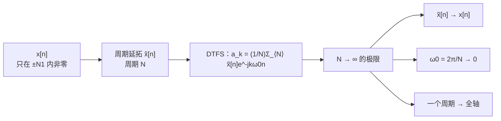

四条变换的分工，先钉在墙上：判断该用求和还是积分、该在一个周期上取还是全轴取，只看**信号自己的两个性质**——连续还是离散、周期还是非周期：

| 时域 | 频域 | 工具 | 用求和还是积分 | 在什么范围上取 |
|---|---|---|---|---|
| 连续 + 周期 | 离散 + 非周期 | CTFS | 求和（无穷项） | 一个周期 |
| 离散 + 周期 | 离散 + 周期（以 $N$ 为周期） | DTFS | 求和（$N$ 项） | 一个周期 |
| 连续 + 非周期 | 连续 + 非周期 | CTFT | 积分 | 全轴 |
| **离散 + 非周期** | **连续 + 周期（以 $2\pi$ 为周期）** | **DTFT** | **求和（无穷项）** | **全轴** |

规律一句话：**时域连续 ⇒ 频域用积分；时域离散 ⇒ 频域用求和；时域周期 ⇒ 只取一个周期；时域非周期 ⇒ 全部拿过来。** 这张表第 4 行就是本节要建的东西。

##### C5.1 · 1.2 撞墙：$a_k$ 的极限一定是零

先做最自然的尝试：$\tilde x[n]\to x[n]$ 时，让 $a_k$ 跟着趋于无穷试试。

$$a_k=\frac1N\sum_{n=\langle N\rangle}\tilde x[n]e^{-jk\omega_0n}$$

$x[n]$ 的能量是有限的（它只在 $[-N_1,N_1]$ 里非零），而 $\frac1N\to0$。所以对任意的 $k$，

$$|a_k|\le\frac1N\sum_{n}|x[n]|\;\xrightarrow[N\to\infty]{}\;0.$$

**每个系数都趋于零，极限是 0。** 这不是"还没算完"，而是这条路本来就没信息：所有 $a_k$ 一起变成 0，$k$ 之间的相对大小被无穷大的分母抹平了。

> [!warning] 为什么不能就此收工
> 如果只看 $a_k\to0$，会得出"非周期序列的频谱处处为零"这种荒唐结论。问题出在写法上：$a_k$ 是**离散指标上的一个数**，随着 $N$ 变大，它在同一个 $k$ 上的值同时在变小、可用的 $k$ 又同时在变多。这不是一个可以取极限的对象。

##### C5.1 · 1.3 转机：把分母搬进待求变量里

$a_k$ 里那个致命的因子是 $\frac1N$。**把它乘回去**，定义一个新对象：

$$Na_k=\sum_{n=\langle N\rangle}\tilde x[n]e^{-jk\omega_0n}.$$

同一个 $k$ 上，它不再趋于零。下一步把 $\omega_0=\frac{2\pi}{N}$ 显式写出来：$\omega=k\omega_0$ 就成了一个**可以连续变动的量**。$N$ 增大时，$\omega_0$ 变小，$k$ 取遍一个周期，$\omega$ 就从 $0$ 一路铺到 $2\pi$，**采样间隔越来越细，但铺的位置不变**。

![[C3–5-并行-C5.1-周期延拓的频谱采样.png]]

三张图用的是同一个 $N_1=2$ 的矩形延拓，只改周期 $N=10,20,40$。虚线是**包络**（它不随 $N$ 变），竖条是离散的 $Na_k$：

- $N=10$ 时只有 10 根谱线，间隔 $\omega_0=\frac{2\pi}{10}$，看得见包络的轮廓，但很粗；
- $N=20$ 时谱线加倍、间隔减半，**每根的高度没变**，只是插在包络上的位置更密；
- $N=40$ 时已经看不出"离散"，谱线贴满整条曲线。

这就是"量变导致质变"的具体形态：**离散谱线的间隔趋于零，离散谱就变成了连续谱**。而包络本身，就是非周期序列的频谱。

> [!important] DTFT 的分析式
> $$\boxed{\ X(e^{j\omega})=\sum_{n=-\infty}^{+\infty}x[n]\,e^{-j\omega n}\ }\qquad\text{（离散 }x[n]\text{ 的离散时间傅里叶变换）}$$
> 三处替换一步到位：求和区间从"一个周期"膨胀到全轴（$N\to\infty$ 把窗口撑满了整个序列）；$k\omega_0$ 换成连续变量 $\omega$；离散的 $e^{-jk\omega_0n}$ 换成 $e^{-j\omega n}$。

##### C5.1 · 1.4 综合式：把 $a_k$ 换成 $X(e^{j\omega})$ 再量变一次

现在要反过来：知道 $X(e^{j\omega})$，怎么还原 $x[n]$？起点仍是 DTFS 的综合式，只是在里面塞进"$a_k$ 与 $X$ 的桥"。

第 1.3 节的结论换个写法就是那个桥：

$$a_k=\frac1N X(e^{j\omega})\Big|_{\omega=k\omega_0}.$$

代进 $\tilde x[n]=\sum_{k=\langle N\rangle}a_ke^{jk\omega_0n}$：

$$\tilde x[n]=\frac1N\sum_{k=\langle N\rangle}X(e^{jk\omega_0})e^{jk\omega_0n}.$$

接下来一步是整段推导的关键：**把 $\frac1N$ 改写成 $\frac{\omega_0}{2\pi}$**。这不是凑数，它就是 $N\omega_0=2\pi$ 的改写：

$$N=\frac{2\pi}{\omega_0}\quad\Longrightarrow\quad\frac1N=\frac{\omega_0}{2\pi}.$$

于是

$$\tilde x[n]=\frac1{2\pi}\sum_{k=\langle N\rangle}X(e^{jk\omega_0})e^{jk\omega_0n}\,\omega_0.$$

右边这个求和，形状已经是一个**黎曼和**了：被加的函数是 $X(e^{j\omega})e^{j\omega n}$，在等间隔的点 $\omega=k\omega_0$ 上取值，再乘上间隔 $\omega_0$。间隔趋零时它就是积分：

$$\sum_{k=\langle N\rangle}(\cdots)\omega_0\;\longrightarrow\;\int_{2\pi}(\cdots)\,d\omega.$$

> [!important] DTFT 的综合式（反变换）
> $$\boxed{\ x[n]=\frac1{2\pi}\int_{2\pi}X(e^{j\omega})\,e^{j\omega n}\,d\omega\ }$$
> 这是 $x[n]$ 的**复指数加权和**：$X(e^{j\omega})\frac{d\omega}{2\pi}$ 是频率落在 $[\omega,\omega+d\omega]$ 里的那一份振幅。积分只取**一个 $2\pi$ 区间**（习惯取 $-\pi\sim\pi$，也可以取 $0\sim2\pi$）——理由就是下一节要证的 $2\pi$ 周期性：整条实轴上的被积函数是同一段曲线的复制品，多积没有新内容。

> [!note] 那个 $\frac1{2\pi}$ 是从哪里冒出来的
> 不是硬加的。它来自"**积分比求和多一个 $2\pi$**"：连续端的基底 $e^{j\omega t}$ 在一个周期上积分给出 $2\pi$（$\int_0^{2\pi}e^{j\theta}d\theta=2\pi$），于是综合式的分母上就需要 $2\pi$ 来除掉它。CTFT 与 DTFT 的综合式都带 $\frac1{2\pi}$，而 CTFS / DTFS 的综合式不带——因为级数那一侧是求和，不产生这个 $2\pi$。

##### C5.1 · 1.5 记法：为什么写 $X(e^{j\omega})$ 而不是 $X(j\omega)$

连续时间写 $X(j\omega)$，括号里放的是 $j\omega$——一个纯虚数。离散时间写 $X(e^{j\omega})$，括号里放的是 $e^{j\omega}$——**单位圆上的一个点**。

理由在基底里。离散时间的复指数基底是 $z^n$，$z$ 是任意复数；当 $z$ 被限制在单位圆上，$z=e^{j\omega}$，它就退化成"纯振荡"。所以

$$X(z)=\sum_n x[n]z^{-n}\ \Longrightarrow\ X(e^{j\omega})=\sum_nx[n]e^{-j\omega n}.$$

**括号里那个 $e$ 记录的是"代进去的是什么"**：一个模为 1、辐角为 $\omega$ 的复数。写成 $X(j\omega)$ 会让人以为参数是虚数 $\omega$，实际上那个量的模被钉死成 1 了——这正是"离散时域 ⇒ 频域只剩一个圆周"的含义，第 10 章的 Z 变换会把它讲透。

> [!tip] 一眼区分两个频谱
> 看见 $X(j\omega)$ 就是连续时间；看见 $X(e^{j\omega})$ 就是离散时间。考试里写错这个括号，往往意味着整个式子都按错的那一类在套——老师在第 12 节课上反复强调过：**这四种变换的符号，一写错就说明根本没理解信号是什么**。

---

> [!warning] 校正：共同周期与最小周期
> $2\pi$ 总是 DTFT 的一个周期，但不一定是最小正周期；有特殊支撑结构时可更小，常数谱更没有唯一的最小正周期。DTFS 的 $a_k$ 同样保证以 $N$ 为一个周期，实际还可能有更短周期。下段“正好”按通用的完整频率区间理解。

#### C5.1 · 2. $2\pi$ 周期性：离散时域的副产品（p.5、p.23）

##### C5.1 · 2.1 证明只有一行

> [!important] 离散时间信号的谱一律以 $2\pi$ 为周期
> $$X(e^{j(\omega+2\pi)})=X(e^{j\omega}).$$

证明就是把它代回定义：

$$X(e^{j(\omega+2\pi)})=\sum_{n=-\infty}^{+\infty}x[n]e^{-j(\omega+2\pi)n}=\sum_nx[n]e^{-j\omega n}\underbrace{e^{-j2\pi n}}_{\equiv 1}=X(e^{j\omega}).$$

关键在于 $n$ 是**整数**：$e^{-j2\pi n}=\cos 2\pi n-j\sin2\pi n=1$。连续时间里 $t$ 是实数，$e^{-j2\pi t}$ 随 $t$ 一直在转，永远不恒等于 1，所以 CTFT 的谱不是周期的。**"离散"这件事，在频域上就是"以 $2\pi$ 为周期"。**

##### C5.1 · 2.2 为什么周期正好是 $2\pi$

不用背，从 DTFS 的 $k$ 就能推出来。DTFS 里 $k$ 只取满 $N$ 个整数值（约定取 $0\sim N-1$，或 $-N/2\sim N/2-1$），而

$$\omega_k=k\omega_0=k\cdot\frac{2\pi}{N}.$$

$k=0$ 时 $\omega=0$；$k=N$ 时 $\omega=N\cdot\frac{2\pi}{N}=2\pi$。也就是说，**$k$ 的 $N$ 个取值，正好把 $\omega$ 的一个 $2\pi$ 区间铺满**。再往后 $k=N+1$ 给出的 $\omega$ 与 $k=1$ 给出的只差 $2\pi$，而 $N$ 点 DTFS 也认为 $a_{k+N}=a_k$——两边都对上了。

| 对象 | 周期性 | 原因 |
|---|---|---|
| DTFS 系数 $a_k$ | 以 $N$ 为周期：$a_{k+N}=a_k$ | 基底 $e^{j2\pi n}=1$，$k$ 与 $k+N$ 是同一根基底 |
| DTFT 谱 $X(e^{j\omega})$ | 以 $2\pi$ 为周期 | $e^{-j2\pi n}=1$，$\omega$ 与 $\omega+2\pi$ 是同一个频率 |

两条是同一件事的两种说法：**$k$ 的周期对应 $\omega$ 的 $2\pi$**。

##### C5.1 · 2.3 推论：只需要画一个周期

谱是 $2\pi$ 周期的，所以画图时约定俗成只画一个周期，**最常用 $-\pi\sim\pi$**。同时要记住一个物理含义：

> [!important] $\omega=\pi$ 是离散时间的最高频
> $\omega=\pi$ 对应的序列是 $e^{j\pi n}=(-1)^n$：一个样本翻一次符号，这是"逐点翻"的极限，再快就分辨不出来了。所以 $\omega$ 与 $2\pi-\omega$ 给出的是一对**互相共轭**的复指数（$e^{j(2\pi-\omega)n}=e^{-j\omega n}$）——对实信号来说，后半段不提供新信息，**离散时间真正需要看的频率范围是 $[0,\pi]$ 加一个镜像**。
> 第 3 章的 $H(e^{j\omega})$、第 7 章的采样定理都会回到这一点：所谓"混叠"，在频域上就是 $2\pi$ 周期里那些副本互相压上了。

> [!question] 停一下，先自己想想
> 如果 $x[n]$ 本身是周期的（以 $N$ 为周期），它的 DTFT 会周期多少？
> 答案在下一讲：仍是 $2\pi$，但一个 $2\pi$ 里只**有 $N$ 根冲激**，其余地方为零。周期信号的谱是"冲激串"，冲激的位置由信号自己的周期决定。

---

#### C5.3 · 1. 周期性（p.23）

> [!important] 结论
> 若 $x[n]\leftrightarrow X(e^{j\omega})$，则 $X(e^{j(\omega+2\pi)})=X(e^{j\omega})$。
> **DTFT 在 $\omega$ 上永远以 $2\pi$ 为周期**，这不是某类信号的特殊性质，而是定义的直接后果。

证明就是代进去用一次 $e^{-j2\pi n}=1$（5.1 节 §2 已做）。性质表里之所以还要把它列成"第 1 条"，是因为它**约束了后面每一条的写法**：凡是出现"把频率搬走 $\omega_0$"的地方，搬过去的谱会自动在 $\omega_0+2\pi k$ 处都出现一份；凡是写"积分"的地方，积分区间只取一个 $2\pi$。

---


## 3. 四种矩形并排：占空比、半角技巧与时宽带宽


这里把第 11–12 节老师要求一起记的四种矩形放在同一张表。连续脉冲取 $|t|<T_1$ 时为 1，离散脉冲取 $|n|\le M$ 时为 1；离散宽度是 **$L=2M+1$ 个样本**，不能漏掉中间的零号点。周期延拓应保证相邻脉冲不重叠。

| 情形 | 频谱 |
|---|---|
| CTFS，周期 $T$ | $a_k=\frac{2T_1}{T}\operatorname{Sa}(k\Omega_0T_1)$ |
| DTFS，周期 $N$ | $a_k=\frac1N\frac{\sin(Lk\omega_N/2)}{\sin(k\omega_N/2)}$，$k=0\pmod N$ 时为 $L/N$ |
| CTFT，单个连续脉冲 | $X(j\Omega)=2T_1\operatorname{Sa}(\Omega T_1)$ |
| DTFT，单个离散脉冲 | $X(e^{j\omega})=\frac{\sin(L\omega/2)}{\sin(\omega/2)}$，$\omega=2\pi m$ 时为 $L$ |

$\operatorname{Sa}(v)=\sin(v)/v$，零点处用极限补成 1；归一化 $\operatorname{sinc}(v)=\sin(\pi v)/(\pi v)$，两种记法不能把自变量照抄。$\operatorname{Sa}$ 的主瓣在 $(-\pi,\pi)$，其余为旁瓣。CTFS 前面的 $2T_1/T$ 是占空比，零频系数就是平均值。

对离散矩形，等比和中最值得保留的技巧是

$$1-e^{-j\theta}=2je^{-j\theta/2}\sin(\theta/2),\qquad
1+e^{-j\theta}=2e^{-j\theta/2}\cos(\theta/2).$$

把分子、分母各提出半个指数，剩下正负相反的一对指数，才能用欧拉公式；居中矩形的相位因子恰好抵消。没有居中的矩形会留下一个相位因子，不能都约掉。分母为零的点回到有限和求值，不能直接写“无穷”。

老师分别改变过两个参数：固定 $T$ 缩小 $T_1$，谱线间隔不变，第一零点 $\pi/T_1$ 外移，主瓣内的谱线增多；固定 $T_1$ 增大 $T$，在真实频率轴上主瓣宽度不变，谱线间隔 $2\pi/T$ 变小，单条系数按 $1/T$ 缩小。比较第二组图时须对齐 $k\Omega_0$，不能仅对齐 $k$。

因此 CTFT 矩形有课堂上的两种算法：直接积分，或对 CTFS 先乘 $T$ 再取极限。离散端对应先乘 $N$，有限和的形状不变。两条路都保留在下方完整推导中。


### 3 · CTFS · 完整推导、例题与原有讲解


#### C3.2 · 4. 周期方波：Sa 函数与占空比

> [!example] 周期方波
> 幅度 1，在 $|t|<T_1$ 内为 1，周期 $T_0$。

> [!question] 停一下，积分区间该挑哪一段？
> 分析公式里的 $\int_T$ 是"任意一个整周期"。为什么取 $[-\frac{T_0}{2},\frac{T_0}{2}]$，而不是 $[0,T_0]$？

**答案**：数学直觉——**挑好算的那一段**。$[-\frac{T_0}2,\frac{T_0}2]$ 关于原点对称，和对称的方波配合起来最省事；而且方波在这段里只有 $[-T_1,T_1]$ 上非零，其余两段 $x(t)=0$ 对积分没有贡献，**区间可以一路缩到 $[-T_1,T_1]$**。取 $[0,T_0]$ 则要横跨一个跳变点，式子更啰嗦。

取积分区间 $[-\frac{T_0}{2},\frac{T_0}{2}]$，只有 $[-T_1,T_1]$ 上非零：
$$a_k=\frac1{T_0}\int_{-T_1}^{T_1}e^{-jk\omega_0t}dt=-\frac{1}{jk\omega_0T_0}e^{-jk\omega_0t}\Big|_{-T_1}^{T_1}=\frac{2\sin k\omega_0T_1}{k\omega_0T_0}$$
（最后一步用了 $e^{j\theta}-e^{-j\theta}=2j\sin\theta$。）
凑成标准形式：
$$\boxed{\ a_k=\frac{2T_1}{T_0}\cdot\frac{\sin k\omega_0T_1}{k\omega_0T_1}=\frac{2T_1}{T_0}\,\mathrm{Sa}(k\omega_0T_1)=\frac{2T_1}{T_0}\,\mathrm{sinc}\!\Big(\frac{2T_1}{T_0}k\Big)\ }$$
$k=0$ 单独算：$a_0=\frac{2T_1}{T_0}$（与 $\mathrm{Sa}(0)=1$ 的极限一致）。

**用数字验一遍**（$T_0=4$、$T_1=1$）：占空比 $\frac{2T_1}{T_0}=\frac12$，$\omega_0=\frac\pi2$，于是 $a_k=\frac12\mathrm{Sa}\left(\frac{k\pi}{2}\right)=\frac{\sin(k\pi/2)}{k\pi}$：
$$a_0=\frac12,\qquad a_1=\frac1\pi\approx0.318,\qquad a_2=0,\qquad a_3=-\frac1{3\pi}\approx-0.106$$
**占空比 $\frac12$ 时偶次谐波全部为零**——这就是“方波只含奇次谐波”的来源，也是下面频谱图里 $k=\pm2,\pm4,\dots$ 处恰好没有谱线的原因。

> [!important] 两个长得很像的函数：Sa 与 sinc
> $$\mathrm{Sa}(x)=\frac{\sin x}{x}\qquad\qquad \mathrm{sinc}(x)=\frac{\sin\pi x}{\pi x}$$
> **主瓣与旁瓣**：$\mathrm{Sa}(x)$ 在 $x=k\pi$（$k=\pm1,\pm2,\dots$）处取零，在 $x=0$ 处取最大值 1——$x\to0$ 时分子分母都是 0，用洛必达法则（或对小量展开）都得到 1。它每过一个 $\pi$ 换一次符号，振幅随 $|x|$ 增大而衰减。**$[-\pi,\pi]$ 这一段叫主瓣（main lobe）**，集中了大部分能量；**往外的那些小波瓣叫旁瓣（side lobes）**。
> ![[C3-Sa函数主瓣与旁瓣.png]]
> ![[C3-Sa函数与sinc函数.png]]
> **注意二者区别。** Sa 的零点在 $x=k\pi$；sinc 的零点在**整数** $x=k$。$\mathrm{Sa}(\pi x)=\mathrm{sinc}(x)$——把横轴压缩 $\pi$ 倍，就是归一化。
> 编程要小心：`numpy.sinc(x)` 实现的是 $\frac{\sin\pi x}{\pi x}$（归一化 sinc）。
> **老师明确说了：$\mathrm{Sa}$ 形式那条结论要记住，$\mathrm{sinc}$ 的归一化写法不要求背。**

##### C3.2 · 占空比如何影响频谱

$\frac{2T_1}{T_0}$ 叫**占空比 duty ratio**：一个周期里“高电平”所占的比例。

![[C3-周期方波频谱-占空比.png]]

**左列（固定 $T_0$，缩短脉宽 $T_1$）**，横轴是谐波序号 $k$：
- 占空比 $\frac12\to\frac14\to\frac18$，**包络变宽、变矮**；
- 包络第一个零点在 $k\omega_0T_1=\pi$，即 $k=\frac{T_0}{2T_1}$（占空比的倒数）：分别在 $k=2,4,8$；
- **脉冲越窄，能量铺得越开，高频成分越多。**

**右列（固定 $T_1$，拉长周期 $T_0$）**，横轴是实际频率 $\omega=k\omega_0$：
- 包络**形状不变**（零点永远在 $\omega=\pi/T_1$），只是**谱线越来越密**（间隔 $\omega_0=2\pi/T_0$ 变小）、高度越来越低（整体乘 $\frac{2T_1}{T_0}$）；
- **推到极限 $T_0\to\infty$**：周期信号变成单个脉冲，谱线密到连成一片——**这就是第 4 章傅里叶变换的由来**。

> [!important] 要背的结论，以及它背后的两句话
> **周期方波的频谱 = 占空比 × 采样函数**：$a_k=\dfrac{2T_1}{T_0}\mathrm{Sa}(k\omega_0T_1)$。
> 主瓣边界由 $\mathrm{Sa}$ 的第一个零点定住：$k\omega_0T_1=\pi$，即 $\omega=\frac{\pi}{T_1}$——**主瓣宽度只由脉冲宽度 $T_1$ 决定**。
> - **固定 $T_0$、脉冲变窄** ⇒ 主瓣边界 $\frac{\pi}{T_1}$ 变大，主瓣变宽，里面能装的谱线条数变多；而谱线间隔 $\omega_0=\frac{2\pi}{T_0}$ 没变，所以看起来是"包络变宽、每根变矮"。
> - **固定 $T_1$、周期变长** ⇒ 主瓣宽度 $\frac{\pi}{T_1}$ 不变（图上包络是对齐的），但谱线间隔 $\frac{2\pi}{T_0}$ 变小、**谱线越来越密**，整体高度按 $\frac{2T_1}{T_0}$ 变矮。
> 一句话：**等周期下，时域越窄 ⇒ 频域越宽；脉冲不变时，周期越长 ⇒ 谱线越密。**

> [!warning] 读图时注意两列横轴不同
> 左列横轴是 $k$（序号），右列横轴是 $\omega$（真实频率）。同样的占空比，在 $k$ 轴上看一样，在 $\omega$ 轴上看却完全不同。这是初学者最容易卡住的地方。

---


### 3 · DTFS · 完整推导、例题与原有讲解


#### C3.5 · 4. 例 2：离散周期方波

> [!example] 例 2：离散周期方波
> 周期 $N$ 的方波：一个周期内 $|n|\le N_1$ 时 $x[n]=1$，其余为 0（共 $2N_1+1$ 个 1）。求 $a_k$。

**推导**：取一个周期 $n=-N_1\sim N-N_1-1$，只有 $|n|\le N_1$ 的项非零：
$$a_k=\frac1N\sum_{n=-N_1}^{N_1}e^{-jk\omega_0n}$$
这是首项 $e^{jk\omega_0N_1}$、公比 $e^{-jk\omega_0}$、共 $2N_1+1$ 项的等比数列：
$$a_k=\frac1N\cdot e^{jk\omega_0N_1}\frac{1-e^{-jk\omega_0(2N_1+1)}}{1-e^{-jk\omega_0}}$$
分子、分母各提出半角因子（$e^{-jk\omega_0(2N_1+1)/2}$ 和 $e^{-jk\omega_0/2}$），把“1 − 复指数”凑成正弦：
$$a_k=\frac1N\cdot\frac{e^{-jk\omega_0(2N_1+1)/2}\big(e^{jk\omega_0(2N_1+1)/2}-e^{-jk\omega_0(2N_1+1)/2}\big)}{e^{-jk\omega_0/2}\big(e^{jk\omega_0/2}-e^{-jk\omega_0/2}\big)}\cdot e^{jk\omega_0N_1}$$
相位因子 $e^{jk\omega_0N_1}\cdot e^{-jk\omega_0(2N_1+1)/2}\cdot e^{jk\omega_0/2}=1$，恰好抵消（因为方波关于 $n=0$ 对称，系数是实数）：

> [!tip] 半角技巧：碰到 $1\pm e^{-j\theta}$ 就提出一半指数
> 这一节的分子、分母同时冒出 $1-e^{-j\theta}$ 这种形状，硬展开等比级数会很乱。第 12 节课把话说明白了：**这门课有些计算绕不过去，凡是遇到"$1$ 加减一个复指数"，就把它指数上的一半提出来**，剩下的自动凑成欧拉公式：
> $$1-e^{-j\theta}=e^{-j\theta/2}\big(e^{j\theta/2}-e^{-j\theta/2}\big)=e^{-j\theta/2}\cdot 2j\sin\frac\theta2,\qquad 1+e^{-j\theta}=e^{-j\theta/2}\cdot 2\cos\frac\theta2$$
> 提出来的 $e^{-j\theta/2}$ 是**相位因子**，它往往和别的因子（比如等比级数首项带来的 $e^{jk\omega_0N_1}$）**正好抵消**——方波关于 $n=0$ 对称、系数是实数，原因就在这里。约掉之后剩下的就是"正弦除正弦"。
> 这条技巧不只对 DTFS 有效：连续那边 $e^{-j\omega T_1}-e^{j\omega T_1}=-2j\sin\omega T_1$ 是同一件事，它正是 $\frac{2\sin\omega T_1}{\omega}$ 能写成 $2T_1\mathrm{Sa}(\omega T_1)$ 的那一步（见 [[C4.1 非周期信号的表示：连续时间傅里叶变换]] §3.4）。**看到两个复指数相减，先想它。**

> [!important] 离散方波的 DTFS
> $$a_k=\begin{cases}\dfrac1N\cdot\dfrac{\sin\big[2\pi k(N_1+\frac12)/N\big]}{\sin(\pi k/N)},&k\ne0,\pm N,\pm2N,\dots\\[3mm]\dfrac{2N_1+1}{N},&k=0,\pm N,\pm2N,\dots\end{cases}$$

**对比连续方波**：连续是 $\frac{\sin x}{x}$（Sa 函数，逐渐衰减到 0）；离散是 $\frac{\sin(Mx)}{\sin x}$ 型（分母也是正弦，所以**周期重复**）。$k$ 较小时 $\sin\frac{\pi k}N\approx\frac{\pi k}N$，两者形状接近。

![[C3-DTFS方波系数-周期N变化.png]]

**数值验算**（$N_1=2$、$N=10$，python）：$a_0=\frac5{10}=0.5$，$a_1=0.3236$，$a_2=0$，$a_3=-0.1236$，$a_4=0$，$a_5=0.1$ ✓。

> [!question] 停一下：$a_2$ 为什么正好是 0？$a_5$ 又为什么不是 0？
> 把数代进公式看，$N_1=2$、$N=10$ 时分子是 $\sin\big[2\pi k(2+\frac12)/10\big]=\sin\frac{\pi k}{2}$。
> - $k=2$：$\sin\pi=0$，而分母 $\sin\frac{2\pi}{10}\ne0$ ⇒ **$a_2=0$**。物理上说，$k=2$ 这一项在窗口内正负抵消，正好落在包络的零点上。
> - $k=5$：$a_5=\frac1{10}\cdot\frac{\sin(5\pi/2)}{\sin(\pi/2)}=\frac1{10}\cdot\frac11=0.1$。**$k=5=\frac N2$ 是离散时间的最高频**（$\omega=\pi$，即 $(-1)^n$），它恰好是两个 1 之间的交界，所以既没有抵消也没被放大。

**读图**（固定 $N_1=2$，改变 $N$）：
- $N$ 越大（周期越长、脉冲占比越小）：谱线越**密**，高度越**低**（$a_0=\frac{2N_1+1}N$ 变小），包络形状不变；
- 与连续方波一样：$N\to\infty$ 时谱线连成连续谱，通向第 5 章的离散时间傅里叶变换 DTFT。

p.61 还给了 $N=50$、$N_1=4$ 与 $N_1=12$ 的对比：固定 $N$、增大 $N_1$（脉冲变宽）→ 主瓣变窄，**脉冲越宽，频谱越集中**，与连续时间同一规律。

---


### 3 · CTFT · 完整推导、例题与原有讲解


#### C4.1 · 3.4 矩形脉冲：与第 3 章的方波对上（p.9–10）

> [!example] 例 4.4　$x(t)=\begin{cases}1,&|t|<T_1\\0,&|t|>T_1\end{cases}$
> $$X(j\omega)=\int_{-T_1}^{T_1}e^{-j\omega t}dt=\frac{e^{-j\omega T_1}-e^{j\omega T_1}}{-j\omega}=\frac{2\sin\omega T_1}{\omega}=2T_1\cdot\frac{\sin\omega T_1}{\omega T_1}$$
> $$\boxed{\ X(j\omega)=2T_1\,\mathrm{Sa}(\omega T_1)\ }$$

$$e^{-j\theta}-e^{j\theta}=-2j\sin\theta$$，分母的 $-j$ 与分子的 $-2j$ 各贡献一半，最后剩 $2\sin\theta$——符号别弄丢，这是本题唯一容易错的地方。

**和上一章的方波对上**：周期方波那里是 $a_k=\frac{2T_1}{T}\mathrm{Sa}(k\omega_0T_1)$，这里把 $T$ 乘过来，就是同一条 $\mathrm{Sa}$ 曲线。**同一个 $T_1$、同一条包络，一个用来取离散点（谱线），一个用来画连续曲线。**

> [!tip] 第二种求法：不积分，直接让周期趋于无穷
> 上面那条路是"照定义硬积"。课堂上紧接着给了另一条更省事的路——**先把周期矩形的系数背下来，再把 $T$ 推到无穷**：
> $$a_k=\frac{2T_1}{T}\mathrm{Sa}(k\omega_0T_1)\quad\Longrightarrow\quad X(j\omega)=\lim_{T\to\infty}Ta_k=2T_1\mathrm{Sa}(\omega T_1)$$
> 最后一步只做两件事：$\frac1T$ 和 $T$ 约掉；按 §1.3 的替换表把离散记号 $k\omega_0$ 换成连续变量 $\omega$。
> **两条路必须给出同一个答案**，这不是巧合——$X(j\omega)=\lim\limits_{T\to\infty}Ta_k$ 本来就是变换的定义（§1.4）。落到做题上就是一条省力原则：**"周期方波的谱线"和"非周期矩形的谱"这两件事只需要背一件**，另一件用 $Ta_k$ 一步换过去。它同时还是最快的自检：两条路对不上，一定是哪一步的 $T$ 或 $T_1$ 掉了一个。

> [!important] 宽窄互换：一张图看两件事
> 上图（$T_1=1$，时域宽）的频谱是**窄**的，第一零点在 $\omega=\frac{\pi}{T_1}=\pi$；下图（$T_1=0.5$，时域窄）的频谱是**宽**的，第一零点推到 $\omega=2\pi$。
> - 时域脉宽减半 $\Rightarrow$ 频域主瓣宽度**翻倍**；
> - 主瓣峰值 $2T_1$ 也随之减半，但**主瓣覆盖的"面积"不变**（这正是 $X(0)=\int x\,dt$ 的含义）。

![[C4.1-时域宽频域窄.png]]

#### C4.1 · 3.5 理想低通：反过来，从频域看时域（p.11）

> [!example] 例 4.5　$X(j\omega)=\begin{cases}1,&|\omega|<W\\0,&|\omega|>W\end{cases}$（理想低通滤波器 Ideal low-pass filter）
> 用**综合式**从频域积回时域：
> $$x(t)=\frac{1}{2\pi}\int_{-W}^{W}e^{j\omega t}d\omega=\frac{1}{2\pi}\cdot\frac{e^{jWt}-e^{-jWt}}{jt}=\frac{\sin Wt}{\pi t}=\boxed{\ \frac{W}{\pi}\mathrm{Sa}(Wt)\ }$$

这一题的意义在于**换了个方向看同一对变换**：

- 例 4.4 是"时域矩形 $\to$ 频域 Sa"；例 4.5 是"频域矩形 $\to$ 时域 Sa"。**矩形和 Sa 互为对方的变换形状**，这就是下一节的**对偶**。
- **理想低通的冲激响应不是有限长的**，而且拖着无限长的振铃；更麻烦的是它在 $t<0$ 就已经有值——**非因果**。所以"理想低通"只能当基准，物理上做不出来（第 6 章讲滤波器设计时的出发点，[[C3.6 傅里叶级数与LTI系统、滤波]] 已经见过理想滤波器了）。
- 让 $W$ 增大：频域通带变宽，时域主瓣**变高（峰值 $\frac{W}{\pi}$）、变窄（第一零点 $\frac{\pi}{W}$）**，两侧振铃越来越密；到 $W\to\infty$ 时 $X(j\omega)=1$ 对**所有** $\omega$ 成立，时域就退化成 $\delta(t)$——正好接回例 4.3。

#### C4.2 · 3.3 周期方波：把第 3 章的谱线搬过来（p.22）

> [!example] 例 4　周期方波（幅度 1，$|t|<T_1$ 内为 1，周期 $T_0$）
> 第 3 章已经算出系数，这里直接搬：
> $$a_k=\frac{2T_1}{T_0}\mathrm{Sa}(k\omega_0T_1)=\frac{\sin k\omega_0T_1}{\pi k}$$
> （第二种写法是把 $\mathrm{Sa}(x)=\frac{\sin x}{x}$ 代进去、再用 $\omega_0T_0=2\pi$ 约掉：$\frac{2T_1}{T_0}\cdot\frac{\sin k\omega_0T_1}{k\omega_0T_1}=\frac{2\sin k\omega_0T_1}{k\omega_0T_0}=\frac{\sin k\omega_0T_1}{\pi k}$。）
> 于是
> $$X(j\omega)=\sum_{k=-\infty}^{+\infty}2\pi a_k\delta(\omega-k\omega_0)=\sum_{k=-\infty}^{+\infty}\frac{2\sin(k\omega_0T_1)}{k}\,\delta(\omega-k\omega_0)$$

两点要留意：

- **$k=0$ 这一项要单独看**：$\frac{\sin(k\omega_0T_1)}{k}$ 在 $k=0$ 处是 $\frac00$，取极限得 $a_0\omega_0=\frac{2T_1}{T_0}\cdot\frac{2\pi}{T_0}$，即 $2\pi a_0=\frac{4\pi T_1}{T_0}$——**面积就是 $2\pi a_0$，直流分量照样按同一条规则来**。
- **占空比 $\frac12$ 时（$T_0=4T_1$）**，$k\omega_0T_1=\frac{k\pi}{2}$，$\sin\frac{k\pi}{2}$ 在 $k$ 为偶数时为 0：**偶次谐波整根消失**，频谱上只剩奇次冲激。这就是第 3 章"方波只含奇次谐波"在变换语言里的样子。

**数值核对**（$T_0=4,T_1=1$，占空比 $\frac12$，$\omega_0=\frac\pi2$）：

| $k$ | 0 | 1 | 2 | 3 | 5 |
|---|---|---|---|---|---|
| $a_k$ | $\frac12$ | $\frac1\pi\approx0.3183$ | $0$ | $-\frac1{3\pi}\approx-0.1061$ | $\frac1{5\pi}\approx0.0637$ |
| 冲激面积 $2\pi a_k$ | $\pi\approx3.1416$ | $2$ | $0$ | $-\frac23\approx-0.6667$ | $0.4$ |

冲激面积也可直接由 $\frac{2\sin(k\omega_0T_1)}{k}$ 得到：$k=1$ 得 $2\sin\frac\pi2=2$ ✓，$k=3$ 得 $\frac{2\sin\frac{3\pi}2}{3}=-\frac23$ ✓，$k=5$ 得 $\frac{2\sin\frac{5\pi}2}{5}=0.4$ ✓（三条都已用 python 复核）。

> [!important] 一句话收尾
> **CTFS 与 CTFT 不是两套工具，是同一套工具的两种刻度。** 拿到周期信号的频谱，两种写法都合法：
> - 写 $a_k$：简洁，但只在 $k$ 上有定义；
> - 写 $\sum2\pi a_k\delta(\omega-k\omega_0)$：啰嗦一点，但它**住在连续频率轴上**，于是可以和非周期信号的频谱做加法、做卷积、一起画在同一张图里。
> 工程上永远选后者。

---


### 3 · DTFT · 完整推导、例题与原有讲解


#### C5.1 · 3. 离散矩形序列：把 DTFS 的 $a_k$ 采样一遍（p.11–12）

##### C5.1 · 3.1 直接按定义算

$$x[n]=\begin{cases}1,&|n|\le N_1\\0,&|n|>N_1\end{cases}$$

求和只有 $2N_1+1$ 项，是等比级数：

$$X(e^{j\omega})=\sum_{n=-N_1}^{N_1}e^{-j\omega n}=e^{j\omega N_1}\sum_{m=0}^{2N_1}e^{-j\omega m}=e^{j\omega N_1}\cdot\frac{1-e^{-j\omega(2N_1+1)}}{1-e^{-j\omega}}.$$

##### C5.1 · 3.2 提一半指数：两把钥匙互相抵消

分子分母各用一次"半角"改写 $1-e^{-j\theta}=e^{-j\theta/2}\cdot2j\sin\frac\theta2$：

- 分子：$1-e^{-j\omega(2N_1+1)}=e^{-j\omega(2N_1+1)/2}\cdot2j\sin\dfrac{\omega(2N_1+1)}{2}$；
- 分母：$1-e^{-j\omega}=e^{-j\omega/2}\cdot2j\sin\dfrac{\omega}{2}$。

把指数部分单独看：$e^{j\omega N_1}\cdot e^{-j\omega(2N_1+1)/2}\cdot e^{+j\omega/2}=e^{j\omega N_1-j\omega N_1-j\omega/2+j\omega/2}=e^{0}=1$。

**三个指数恰好抵光。** 这不是运气：矩形是**偶对称**的，它的变换必须**实**（相位只能是 0 或 $\pi$），指数项抵光是"实"在代数上的体现。于是

> [!important] 离散非周期矩形序列的 DTFT
> $$X(e^{j\omega})=\frac{\sin\left[\omega\left(N_1+\frac12\right)\right]}{\sin\left(\frac{\omega}{2}\right)},\qquad X(e^{j0})=2N_1+1.$$
> $\omega=0$ 处是 $\frac00$，用洛必达或"分子分母同时用小角近似"取极限：$\frac{\omega(N_1+1/2)}{\omega/2}=2N_1+1$。零点在 $\omega(N_1+\frac12)=k\pi$ 上，也就是**主瓣宽度由 $N_1$ 决定**，与连续端 $\mathrm{Sa}$ 的主瓣由脉宽决定完全对应。

![[C3–5-并行-C5.1-矩形序列的DTFT.png]]

左图是 $N_1=2$ 的序列本身；右图绿线就是上面的结果（峰值 5），红线是把**对应的周期矩形**（周期 $N=10$）的 DTFS 系数乘上 $N$ 之后画在同一张图上。

> [!important] 这两张图讲的是同一件事
> $$a_k=\frac1N X(e^{j\omega})\Big|_{\omega=k\omega_0=k\frac{2\pi}{N}}$$
> 周期序列的 $a_k$，就是非周期序列的 DTFT 在 $k\omega_0$ 上的**采样值再除以 $N$**。把这条式子乘上 $N$，红点就整整齐齐落在绿线上——第 12 节课上老师就是这样把两个结果并排放在一起的：
> - **周期化**（时域复制 $\Rightarrow$ 频域采样）：非周期矩形的连续谱，被采样成离散谱线；
> - **离散化**（时域采样 $\Rightarrow$ 频域周期化）：连续矩形的非周期谱，被复制成 $2\pi$ 周期的谱。
> 一正一反两个动作，正好把"四种矩形信号"里的两格连起来。四种全貌见 [[C4.1 非周期信号的表示：连续时间傅里叶变换]] §4 的对照表。

> [!warning] 两个"看起来一样"的结果，别混用
> 离散周期矩形的 $a_k=\dfrac1N\cdot\dfrac{\sin\left[\frac{2\pi k}{N}\left(N_1+\frac12\right)\right]}{\sin\left(\frac{\pi k}{N}\right)}$ 与这里的 $X(e^{j\omega})=\dfrac{\sin\left[\omega\left(N_1+\frac12\right)\right]}{\sin(\omega/2)}$ 确实只差一个"$\omega$ 换成 $\frac{2\pi k}{N}$、再除以 $N$"。但**能用 $a_k$ 的场合只有周期序列**；遇到非周期序列，必须用 $X(e^{j\omega})$，然后接受"谱是连续曲线"这件事。

---


## 4. 基本信号与周期谱：指数、冲激、常数和正弦


四种表示要分清“系数图中的一根线”和“变换中的一个冲激”。CTFS、DTFS 的 $a_k$ 是数；在 CTFT、DTFT 的周期信号谱里，箭头标注的是冲激的**面积权重**。

| 时域对象 | 对应结果 |
|---|---|
| 连续周期信号，CTFS 系数 $a_k$ | CTFT：$2\pi\sum_k a_k\delta(\Omega-k\Omega_0)$ |
| 离散周期信号，DTFS 系数 $a_k$ | DTFT：$2\pi\sum_{k\in\mathbb Z}a_k\delta(\omega-k\omega_N)$，系数与谱均周期重复 |
| $\delta(t)$ 与 $\delta[n]$ | 两端的变换都为 1 |
| 连续冲激串 $\sum_m\delta(t-mT)$ | CTFS 的每个 $a_k=1/T$；CTFT 的每个频率冲激面积为 $2\pi/T$ |
| 离散冲激串 $\sum_m\delta[n-mN]$ | DTFS 的每个 $a_k=1/N$；DTFT 的每个频率冲激面积为 $2\pi/N$ |

第十二节课求连续冲激串时，先选 $(-T/2,T/2)$，里面只有一个 $\delta(t)$；筛选 $e^{-jk\Omega_0t}$ 在零点的值为 1，最后留下 $1/T$。这也为后面的冲激串采样铺路。零频常数、复指数、余弦、正弦的变换都应放进同一套广义谱里理解，不能先以绝对可积条件把它们排除后又直接套普通积分。


### 4 · CTFS · 完整推导、例题与原有讲解


#### C3.4 · 10. 用性质做题：冲激串与周期方波

##### C3.4 · 例 3：周期冲激串

> [!example] 例 3：周期冲激串
> $x(t)=\sum_{k=-\infty}^{\infty}\delta(t-kT)$，求 $a_k$。

一个周期 $[-\frac T2,\frac T2]$ 内只有 $\delta(t)$：
$$a_k=\frac1T\int_{-T/2}^{T/2}\delta(t)e^{-jk\omega_0t}dt=\frac1T$$

所有谐波**一样高**：
$$\sum_k\delta(t-kT)=\frac1T\sum_ke^{jk\omega_0t},\qquad\omega_0=\frac{2\pi}T$$

> [!note] 直觉
> 冲激无限窄 ⇒ 按“脉冲越窄频谱越宽”的规律，它的频谱宽到无穷，而且完全平坦。这个结果在第 7 章采样中是关键。

##### C3.4 · 例 4：由冲激串推出周期方波

> [!example] 例 4：由冲激串推出周期方波
> $g(t)$ 是周期 $T$、脉宽 $2T_1$、高度 1 的周期方波，用性质求它的系数 $c_k$。

**思路**：方波求导后，每个上升沿变成 $+\delta$，每个下降沿变成 $-\delta$：
$$g'(t)=x(t+T_1)-x(t-T_1)$$
其中 $x(t)$ 是例 3 的冲激串。

![[C3.4-冲激串与方波的求导关系.png]]

四格连起来看：冲激串 $\to$ 系数恒为 $\frac1T$（完全平坦）$\to$ 方波 $\to$ 它的导数就是两串正负冲激。**"分段常数信号求导变冲激"是这条捷径的全部秘密。**

**第一步：时移 + 线性**。设 $g'(t)\leftrightarrow b_k$，由 $x(t-t_0)\leftrightarrow a_ke^{-jk\omega_0t_0}$：
$$b_k=a_k\big(e^{jk\omega_0T_1}-e^{-jk\omega_0T_1}\big)=\frac1T\cdot2j\sin(k\omega_0T_1)$$

**第二步：微分**。$b_k=jk\omega_0c_k$ ⇒
$$c_k=\frac{b_k}{jk\omega_0}=\frac{2\sin(k\omega_0T_1)}{k\omega_0T}=\frac{2T_1}{T}\cdot\frac{\sin(k\omega_0T_1)}{k\omega_0T_1}\qquad(k\ne0)$$

**第三步：单独求 $c_0$**。微分丢掉了直流，$c_0$ 要回到定义：$c_0=\frac1T\int_Tg\,dt=\frac{2T_1}T$。（恰好也等于上式 $k\to0$ 的极限。）

结果与 [[C3.2 连续时间傅里叶级数]] 直接积分所得的 $\frac{2T_1}{T}\mathrm{Sa}(k\omega_0T_1)$ 一致。**数值验算**（$T=2$、$T_1=\frac12$，python 数值积分）：$c_0=0.5$，$c_1=0.3183$，$c_2=0$，$c_3=-0.1061$ ✓。

> [!example] 练一道：周期锯齿波（一个周期 $0\le t<1$ 内 $x(t)=t$，$T=1$）
> **第一步：求导**。在一个周期内 $x'(t)=1$，但每个整数点处从 1 跌回 0，所以还要补上一串负冲激：
> $$x'(t)=1-\sum_n\delta(t-n)$$
> **第二步：查表写系数**。常数 1 只贡献 $k=0$（$b_0=1$）；冲激串的系数是 $\frac1T=1$，带负号后在 $k\ne0$ 上给出 $b_k=-1$。
> **第三步：除以 $jk\omega_0$ 回来**（$\omega_0=2\pi$）：
> $$a_k=\frac{b_k}{jk\omega_0}=\frac{-1}{j2\pi k}=\frac{j}{2\pi k}\qquad(k\ne0)$$
> **第四步：$a_0$ 单独算**（微分把直流丢了）：$a_0=\frac1T\int_0^1t\,dt=\frac12$。
> **验算**：直接积分 $\int_0^1te^{-j2\pi kt}dt=\frac{j}{2\pi k}$ ✓，与查表结果一致。

> [!tip] 关键点 Key points
> **微分性质 + 时移性质**。遇到分段常数信号，先求导变成冲激串，查表，再除以 $jk\omega_0$ 回来；**直流分量 $c_0$ 永远单独算**。

---


### 4 · DTFS · 完整推导、例题与原有讲解


#### C3.5 · 3. 例 1：余弦序列

> [!example] 例 1：余弦序列
> 求 $x[n]=\cos\big(\frac\pi8n+\frac\pi3\big)$ 的 DTFS 系数。

**第一步：周期**。$\omega_0=\frac\pi8=\frac{2\pi}{16}$ ⇒ $N=16$。

**第二步：用欧拉公式拆开**（不必套分析公式）：
$$x[n]=\frac12e^{j\pi/3}e^{j\frac{\pi}{8}n}+\frac12e^{-j\pi/3}e^{-j\frac{\pi}{8}n}$$
对照 $\sum a_ke^{jk\frac{2\pi}{16}n}$：

$$a_k=\begin{cases}\frac12e^{j\pi/3},&k=1\\\frac12e^{-j\pi/3},&k=-1\\0,&-8\le k\le7\ \text{的其余}\ k\end{cases}\qquad a_{k+16}=a_k$$

![[C3-DTFS例1幅相谱.png]]

**读图**：
- 幅度谱：$k=\pm1$ 处高 $\frac12$，**每隔 16 重复一次**（$k=\pm15,\pm17,\dots$）；偶对称；
- 相位谱：$k=1+16r$ 处 $+\frac\pi3$，$k=-1+16r$ 处 $-\frac\pi3$；奇对称。

> [!warning] 易错点
> 离散谱是**周期的**，画图时要画出重复。$k=15$ 的谱线不是“新的高频分量”，它就是 $k=-1$。

> [!example] 练一道：正弦 + 余弦
> 求 $x[n]=\sin\big(\frac{2\pi}5n\big)+\cos\big(\frac{4\pi}5n\big)$ 的周期与一个周期内的 $a_k$。
>
> 两项的频率都是 $\frac{2\pi}5$ 的整数倍（$1$ 倍与 $2$ 倍），所以基波频率 $\omega_0=\frac{2\pi}5$、**$N=5$**。
> 拆开（不必套分析公式）：
> - $\sin(\omega_0n)=\frac{1}{2j}e^{j\omega_0n}-\frac{1}{2j}e^{-j\omega_0n}$ ⇒ $a_1=-\frac j2$、$a_{-1}=\frac j2$；
> - $\cos(2\omega_0n)=\frac12e^{j2\omega_0n}+\frac12e^{-j2\omega_0n}$ ⇒ $a_2=a_{-2}=\frac12$。
>
> 取一个周期的 $k=-2\sim2$：$a_0=0$，$a_{\pm1}=\mp\frac j2$，$a_{\pm2}=\frac12$；其余靠 $a_{k+5}=a_k$ 得到（例如 $a_3=a_{-2}=\frac12$，$a_4=a_{-1}=\frac j2$）。
> **注意**：正弦的系数是**纯虚**的（和连续端一样，$\sin$ 对应奇对称），而余弦的系数是实的——两类项不要混在一栏里。

---

#### C3.5 · 5. 随堂测（p.62）：由系数反求信号

> [!example] 题目
> 周期 $N=8$ 的序列 $x[n]$，一个周期内的 DTFS 系数如图（左）：$a_0=2$，$a_{\pm1}=1$，$a_{\pm2}=\frac12$，$a_{\pm3}=\frac14$，$a_4=0$，并以 8 为周期重复。求 $x[n]$。

![[C3-随堂测DTFS系数反求信号.png]]

**解**：$\omega_0=\frac{2\pi}8=\frac\pi4$。系数实且偶 ⇒ $x[n]$ 实且偶；成对合并：$a_ke^{jk\omega_0n}+a_{-k}e^{-jk\omega_0n}=2a_k\cos(k\omega_0n)$。
$$x[n]=2+2\cos\Big(\frac{\pi}{4}n\Big)+\cos\Big(\frac{\pi}{2}n\Big)+\frac12\cos\Big(\frac{3\pi}{4}n\Big)$$

一个周期的值（$n=0\sim7$）：
$$x[n]=\{5.5,\ 3.0607,\ 1,\ 0.9393,\ 0.5,\ 0.9393,\ 1,\ 3.0607\}$$

**验算**（python）：对上面 8 个值做 `np.fft.fft(x)/8`，得到 $\{2,1,0.5,0.25,0,0.25,0.5,1\}$，正是题给系数（$k=5,6,7$ 就是 $k=-3,-2,-1$）✓。帕塞瓦尔也对得上：$\frac18\sum x^2=6.625=2^2+2(1+\frac14+\frac1{16})$ ✓。

> [!warning] 易错点
> 1. 只取**一个周期**内的 $N=8$ 个系数（例如 $k=-3\sim4$），不要把 $k=8$ 等重复的谱线再加一遍；
> 2. $a_4$ 如果非零，它**没有配对**（$a_{-4}=a_4$ 是同一个），贡献是 $a_4e^{j\pi n}=a_4(-1)^n$，**不乘 2**。

> [!question] 停一下：把 $a_4$ 改成 1，$x[n]$ 变成什么？
> 只有 $a_4$ 这一项变，其余照旧，另外补上它那**不乘 2** 的贡献：
> $$x[n]=2+2\cos\Big(\frac{\pi n}4\Big)+\cos\Big(\frac{\pi n}2\Big)+\frac12\cos\Big(\frac{3\pi n}4\Big)+(-1)^n$$
> **为什么不能写 $2\cos(\pi n)$**：$k=4$ 与 $k=-4$ 在 $N=8$ 下是**同一个** $k$（$4\equiv-4\bmod 8$），把它当成一对 $\pm k$ 就会把这一项算成两倍。这是离散谱"成对合并"最容易踩的一个坑——**判断能不能配对，要看 $k$ 与 $-k$ 在模 $N$ 意义下是不是同一个**。

---


### 4 · CTFT · 完整推导、例题与原有讲解


#### C4.1 · 3. 六个基本变换对（p.6–14）

下面六个例子是这一节的全部零件。前两个是"标准指数型"，中间两个是"矩形与 Sa"，最后两个靠奇异函数补漏。**每一个都要能独立算出来**，因为后面的性质题、系统题几乎都是它们的组合。

#### C4.1 · 3.1 单边指数（p.6）

> [!example] 例 4.1　$x(t)=e^{-at}u(t),\ a>0$
> $$X(j\omega)=\int_0^{\infty}e^{-at}e^{-j\omega t}dt=\int_0^{\infty}e^{-(a+j\omega)t}dt=\boxed{\ \frac{1}{a+j\omega}\ }$$
> （用了 $\int_0^\infty e^{-st}dt=\frac1s$，这里 $s=a+j\omega$，$\mathrm{Re}\{s\}=a>0$ 保证收敛。）

拆成幅度和相位：

$$\big|X(j\omega)\big|=\frac{1}{\sqrt{a^2+\omega^2}},\qquad \angle X(j\omega)=-\arctan\frac{\omega}{a}$$

![[C4.1-指数信号幅度谱与相位谱.png]]

- **幅度谱是偶函数、相位谱是奇函数**。因为 $x(t)$ 是实信号，$X(-j\omega)=X^*(j\omega)$——频率取负，模不变、相位取反。
- 峰值在 $\omega=0$ 处，为 $\frac1a$；**$\omega=\pm a$ 处降到 $\frac{1}{\sqrt2 a}$，正好是峰值的 $\frac{1}{\sqrt2}$，即 $-3\,\mathrm{dB}$**。所以 $a$ 就是这条谱的**半功率带宽**：$a$ 越大（时域衰减越快），谱越宽。
- 相位从 $+\frac\pi2$ 单调降到 $-\frac\pi2$，在 $\omega=0$ 处过零。**这个 $-\arctan$ 就是"一阶低通的相频特性"**——RC 电路的 $H(j\omega)=\frac{1}{1+j\omega RC}$ 与它同形（[[C1.5 连续时间与离散时间系统]] 的 RC 电路，把时间尺度归一化之后就是它）。
- 看极点：$X(j\omega)=\frac{1}{j\omega+a}$ 在 $s=a+j\omega=-a$ 处有极点，**极点位置就是衰减率 $a$**。第 9 章拉普拉斯变换会把这件事讲成一般规律。

> [!tip] 顺便记住它的兄弟：$e^{-at}u(t)$ 的变换只有一阶
> 后面求 $te^{-at}u(t)$ 之类的变换时，会用**频域微分**得到 $\frac{1}{(a+j\omega)^2}$（见 [[C4.3 连续时间傅里叶变换的性质]] 的频域微分一小节），不必每次重算积分。

#### C4.1 · 3.2 双边指数（p.7）

> [!example] 例 4.2　$x(t)=e^{-a|t|},\ a>0$
> 分段积分，$t<0$ 时 $|t|=-t$：
> $$X(j\omega)=\int_{-\infty}^{0}e^{at}e^{-j\omega t}dt+\int_0^{\infty}e^{-at}e^{-j\omega t}dt=\frac{1}{a-j\omega}+\frac{1}{a+j\omega}=\boxed{\ \frac{2a}{a^2+\omega^2}\ }$$

$\frac{1}{a-j\omega}+\frac{1}{a+j\omega}$ 这一步值得停一下：两项都是复数，虚部**正好抵消**，所以结果是一个**实函数**。

- $x(t)=e^{-a|t|}$ 是**实且偶**信号 $\Rightarrow$ $X(j\omega)$ **实且偶**，于是 $|X(j\omega)|=X(j\omega)$、$\angle X(j\omega)=0$，**一张图就够了**（对照 §3.1：单边指数是实的但不必偶，就必须两张图）。
- 形状是**中间一个钟形，两边拖尾**：峰值 $\frac{2}{a}$ 落在 $\omega=0$，$\omega=\pm a$ 处降到 $\frac1a$（正好是峰值的一半）。而时域那边是**一个尖峰（三角形）**。
- **尖峰 ↔ 钟形**这对形状反复出现：时域越"尖"，频域越"胖"。等会儿的矩形 ↔ Sa、$\delta$ ↔ 常数，都是这一条的不同极端。

#### C4.1 · 3.3 冲激：为什么一条 $h$ 能代表整个系统（p.8）

> [!example] 例 4.3　$x(t)=\delta(t)$
> 用抽样性质，$\delta(t)$ 只在 $t=0$ 处"取值"：
> $$X(j\omega)=\int_{-\infty}^{\infty}\delta(t)e^{-j\omega t}dt=e^{-j\omega\cdot0}=\boxed{\ 1\ }$$

**冲激的频谱是一条水平线**：所有频率上的分量**一样多**。这正是 [[C3.1 复指数是LTI系统的特征函数]] 里那句话的频域版本——**冲激把每个频率都等权激发了一次，所以测一次 $h(t)$ 就把 $H(j\omega)$ 在整个频段上全测出来了**，这就是"一条冲激响应能代表整个 LTI 系统"的根据。

顺便记住时移版本（用抽样性质同样一行）：

$$\delta(t-t_0)\ \xleftarrow{\ \ CTFT\ \ }\ e^{-j\omega t_0}$$

一个时移，在频域只是乘一个**纯相位因子** $e^{-j\omega t_0}$，幅度谱一点没变。这是 4.3 节"时移性质"的第一个例子。

> [!note] 为什么"一条 $h$ 能代表整个系统"值得再说一遍
> 第 10 节课在讲"为什么测一次冲激响应就够了"时用的是同一个道理，当时举的是**除颤器电击**：心脏骤停时靠一次宽频电击把所有频率一次性激发，才谈得上让心脏恢复节律。
> 冲激的频谱是一条水平线，就是这件事的极限形态——**它在所有频率上等量注入**。所以测一次 $h(t)$，等于把 $H(j\omega)$ 在整个频段上同时测了一遍。这不是类比，而是"$\delta(t)$ 的变换恒为 1"的直接后果（[[C3.1 复指数是LTI系统的特征函数]] 里有这次讨论的完整版）。

#### C4.1 · 3.6 常数与复指数：用奇异函数补漏（p.13–14）

> [!example] 例 4.6　$x(t)=1$
> $$1\ \xleftarrow{\ \ CTFT\ \ }\ 2\pi\delta(\omega)$$

推导不能靠 $\int 1\cdot e^{-j\omega t}dt$（发散），要靠**综合式反推**：假设 $X(j\omega)=K\delta(\omega)$，代入综合式必须还原出 $1$：

$$x(t)=\frac{1}{2\pi}\int_{-\infty}^{\infty}K\delta(\omega)e^{j\omega t}d\omega=\frac{K}{2\pi}$$

要它等于 $1$，就得 $K=2\pi$。**常数信号的能量全部集中在 $\omega=0$ 这一根谱线上**——这与直觉一致：$x(t)=1$ 是"直流"，只有一个频率成分。

> [!example] 例 4.7　$x(t)=e^{j\omega_0t}$
> $$e^{j\omega_0t}\ \xleftarrow{\ \ CTFT\ \ }\ 2\pi\delta(\omega-\omega_0)$$

**两条路都能走通，路数的选择本身就是方法**：

1. **先当周期信号算 CTFS**：$e^{j\omega_0t}$ 的周期是 $\frac{2\pi}{\omega_0}$，它的 CTFS 系数里只有一根谱线不为零——$a_1=1$，其余 $a_k=0$。
2. 再用 $X(j\omega)=\lim\limits_{T\to\infty}Ta_k$：$k=1$ 那一支乘以 $T$ 会发散，$k\ne1$ 那支恒为 0，所以极限只能是一个**冲激**。设 $X(j\omega)=K\delta(\omega-\omega_0)$，代回综合式：
   $$e^{j\omega_0t}=\frac{1}{2\pi}\int K\delta(\omega-\omega_0)e^{j\omega t}d\omega=\frac{K}{2\pi}e^{j\omega_0t}\ \Longrightarrow\ \boxed{K=2\pi}$$
3. 令 $\omega_0=0$，立刻退化成例 4.6。

**复指数是单频信号，所以频谱是一根谱线**——这句话在第 3 章是"$e^{jk\omega_0t}$ 是单频"的直觉，在这里有了严格形式。

配角的余弦由欧拉公式拆成两个复指数，两条谱线对称落下：

$$\cos\omega_0t=\frac12\big(e^{j\omega_0t}+e^{-j\omega_0t}\big)\ \xleftarrow{\ \ CTFT\ \ }\ \pi\delta(\omega-\omega_0)+\pi\delta(\omega+\omega_0)$$

（同理 $\sin\omega_0t\xleftarrow{}\frac{\pi}{j}\big[\delta(\omega-\omega_0)-\delta(\omega+\omega_0)\big]$，它出现在下一节的周期信号变换里。）

> [!warning] 这三条不能靠"代入积分"验算
> $\int e^{-j\omega t}dt$ 这类积分是发散的，**别指望用数值积分核对**。它们的正当性来自"极限 + 奇异函数"：先在 $T$ 有限时算 $Ta_k$，再取极限，最后用综合式定型。
> 判断自己有没有写对，最快的自检是**把结果代回综合式**，看能不能还原出原来的时域信号——上面 $K=2\pi$ 就是这么定出来的。

---

#### C4.2 · 0. 开场：一条规则要想用两次，就得先统一语言

实验室里测一台功放的频率响应，标准做法是**送正弦波进去、量输出幅度**，一路扫频画出一条 $|H(j\omega)|$ 曲线。

同一台功放上还接了另一件事：电源引进来的 50 Hz 哼声是一条**干扰谱**——它在频域上是一根根谱线。你要在同一张图上比较"我的信号在哪儿""干扰在哪儿""功放对哪些频率更敏感"。

麻烦来了：功放的频率响应是一条**连续曲线**（非周期信号 $h(t)$ 的变换），而正弦输入与哼声是**周期信号**——按第 3 章，它们只有 $a_k$，没有 $X(j\omega)$。**一根谱线和一条曲线画不到一张图上。**

要不每次都退回 CTFS 重推？那整套性质（卷积定理、调制、时移）就得写两份——离散频率一份、连续频率一份。第 5、6 章要处理"周期输入 + 一般系统"的组合，两份语言会立刻打架。

所以这一节要办的事很明确：**给周期信号也定义傅里叶变换**，而且要定义得跟非周期信号**无缝对齐**——让它在 $\omega=k\omega_0$ 处恰好等于 $2\pi a_k$，其余地方为零。这样的对象就是**冲激**。

---

#### C4.2 · 1. 推导：把变换搬到求和号里面去（p.18）

周期信号不满足绝对可积（$\int|x|dt=\infty$），所以**不能**直接代分析式。走另一条路：先用 CTFS 把它写成复指数之和，再让**变换的线性**接手。

> [!important] 核心一步
> $$\tilde x(t)=\sum_{k=-\infty}^{+\infty}a_ke^{jk\omega_0t}\ \xrightarrow{\ \ \mathcal F\ \ }\ X(j\omega)=\mathcal F\Big\{\sum_ka_ke^{jk\omega_0t}\Big\}=\sum_ka_k\,\mathcal F\big\{e^{jk\omega_0t}\big\}=\sum_ka_k\cdot2\pi\delta(\omega-k\omega_0)$$
> 于是
> $$\boxed{\ \tilde x(t)=\sum_{k}a_ke^{jk\omega_0t}\ \xleftarrow{\ \ CTFT\ \ }\ X(j\omega)=\sum_{k=-\infty}^{+\infty}2\pi a_k\,\delta(\omega-k\omega_0)\ }$$

这一步用了两个已经有的结论：

1. **$\mathcal F\{e^{jk\omega_0t}\}=2\pi\delta(\omega-k\omega_0)$**——上一节例 4.7 刚算过（[[C4.1 非周期信号的表示：连续时间傅里叶变换]]）；
2. **线性**：变换可以逐项进行，所以 $\mathcal F$ 与 $\sum_k$ 可以交换。这里的"逐项"是**无穷多项**，严格性由极限（广义函数）保证，不在本课讨论范围；工程上它成立，而且非常好用。

> [!warning] 别把它当成"普通函数意义下的等式"
> 左边 $\tilde x(t)$ 不绝对可积，右边的 $\sum_k2\pi a_k\delta(\omega-k\omega_0)$ 也不是普通函数——**两边都是广义函数**。因此这条式子的正确用法是"**放进积分里再用**"：
> $$\int X(j\omega)\Phi(\omega)d\omega=\sum_k2\pi a_k\Phi(k\omega_0)$$
> 即"乘一个测试函数再积分"。系统分析里凡是遇到 $\delta$，实际动作都是**抽样**（把 $\Phi$ 在 $\omega=k\omega_0$ 上取出来），这一点在第 6 章的滤波、第 7 章的采样里会反复用到。

> [!important] 怎么读这条结论
> **周期信号的频谱是一串等间隔的冲激**：
> - 位置：$k\omega_0$——只出现在**谐波频率**上，间隔 $\omega_0$，与第 3 章的"谱线离散"完全一致；
> - 面积（强度）：$2\pi a_k$——**正比于 CTFS 系数**，比例常数是 $2\pi$；
> - 形状：$\delta$ 本身没有"宽度"和"高度"，只有**面积**有意义。

---

#### C4.2 · 2. 与 CTFS 谱线图对照着读（p.19）

同一个方波信号，用两套语言画出来是这样：

![[C4.2-方波的CTFS谱线与CTFT冲激.png]]

- **上图（CTFS）**：横轴是谐波序号 $k$，纵轴是系数 $a_k$，一根根离散谱线；
- **下图（CTFT）**：横轴是真实频率 $\omega=k\omega_0$，纵轴是冲激的**面积** $2\pi a_k$。

**两图的高低起伏一模一样**——哪根高、哪根矮、哪几根是零、哪几根是负的，完全对应；差别只在两把尺子：

| | CTFS | CTFT |
|---|---|---|
| 横轴 | $k$（序号，无量纲） | $\omega=k\omega_0$（真实频率） |
| 纵轴 | $a_k$（谱线值） | $2\pi a_k$（冲激面积） |
| 频率间隔 | 恒为 1 | $\omega_0=\frac{2\pi}{T}$（$T$ 越大越密） |
| 量纲 | 与信号同量纲 | 多一个时间量纲（面积 = 值×频率） |

> [!warning] 两个刻度不要互相代入
> 最常见的错误是**拿 $a_k$ 和 $2\pi a_k$ 直接比大小**，或者把 $k$ 轴的数值当 $\omega$ 轴的数值用。差一个 $2\pi$ 只是常数，但**横轴的换算取决于 $T$**——同一个方波，$T$ 改成两倍，CTFS 图上的 $k$ 轴看起来没变，CTFT 图上的谱线间隔却少了一半。

**数值对照**（方波 $T_0=4$、$T_1=1$，占空比 $\frac12$）：

| $k$ | 0 | $\pm1$ | $\pm2$ | $\pm3$ | $\pm5$ |
|---|---|---|---|---|---|
| $a_k$ | $0.5$ | $0.3183$ | $0$ | $-0.1061$ | $0.0637$ |
| $2\pi a_k$ | $\pi\approx3.1416$ | $2.0$ | $0$ | $-0.6667$ | $0.4$ |

（已用 python 逐点复核；$k=\pm2,\pm4$ 处系数为零是"占空比 $\frac12$ 只剩奇次谐波"，与第 3 章的结论一致。）

---

#### C4.2 · 3. 四个例子（p.20–22）

#### C4.2 · 3.1 正弦与余弦：相位也藏在 $\delta$ 的系数里（p.20）

> [!example] 例 1　$x(t)=\sin\omega_0t$
> $$\sin\omega_0t=\frac{1}{2j}\big(e^{j\omega_0t}-e^{-j\omega_0t}\big)\ \xleftarrow{\ \ CTFT\ \ }\ X(j\omega)=\frac{\pi}{j}\big[\delta(\omega-\omega_0)-\delta(\omega+\omega_0)\big]$$

> [!example] 例 2　$x(t)=\cos\omega_0t$
> $$\cos\omega_0t=\frac12\big(e^{j\omega_0t}+e^{-j\omega_0t}\big)\ \xleftarrow{\ \ CTFT\ \ }\ X(j\omega)=\pi\big[\delta(\omega-\omega_0)+\delta(\omega+\omega_0)\big]$$

两式只差一个 $\pm\frac1j$，但它带来一个重要区别：

- **余弦**：$a_{\pm1}=\frac12$（实数）$\Rightarrow$ 两根 $\delta$ 的面积都是 $+\pi$，**相位为零**；
- **正弦**：$a_{\pm1}=\mp\frac{1}{2j}=\pm\frac j2$（**纯虚数**）$\Rightarrow$ 面积是 $\pm\frac{\pi}{j}$，**相位为 $\pm\frac\pi2$**。

**同一个幅度谱，正弦和余弦只差相位。** 如果画图时只画面积的大小、把 $j$ 丢掉，$\sin$ 与 $\cos$ 就变成同一张图了——所以周期信号的频谱图上，**带 $j$（或标出相位）的那一笔不能省**，这与第 3 章"实信号通常要画幅度谱 + 相位谱"是同一件事。

> [!tip] 与第 3 章对一下账
> 余弦的 CTFS 只有 $a_{\pm1}=\frac12$ 两根；这里给它的 CTFT 是两根面积 $\pi$ 的冲激，而 $2\pi\cdot\frac12=\pi$ ✓。**同一件事，只是乘了 $2\pi$。**

#### C4.2 · 3.2 冲激串：自相似的信号（p.21）

> [!example] 例 3　冲激串 Impulse train
> $$x(t)=\sum_{n=-\infty}^{+\infty}\delta(t-nT)\ \xleftarrow{\ \ CTFT\ \ }\ X(j\omega)=\frac{2\pi}{T}\sum_{k=-\infty}^{+\infty}\delta(\omega-k\omega_0)=\omega_0\sum_{k=-\infty}^{+\infty}\delta(\omega-k\omega_0)$$

推导只有两行，关键是**冲激串的 CTFS 系数出奇地简单**：

取一个周期 $[-\frac T2,\frac T2]$，里面只有一个 $\delta(t)$：

$$a_k=\frac1T\int_{-T/2}^{T/2}\delta(t)e^{-jk\omega_0t}dt=\frac1T\cdot e^{0}=\frac1T\qquad(\text{对所有的 }k)$$

（用抽样性质：$\delta$ 把被积函数在 $t=0$ 处取出来，$e^{-jk\omega_0\cdot0}=1$。）

代进 §1 的结论：

$$X(j\omega)=\sum_k2\pi\cdot\frac1T\delta(\omega-k\omega_0)=\omega_0\sum_k\delta(\omega-k\omega_0)$$

![[C4.2-冲激串与它的谱.png]]

> [!important] 冲激串的变换还是冲激串
> 这是最"自相似"的一个信号：**时域是等间隔的冲激，频域还是等间隔的冲激**。
> 而且两个间隔**倒数关系**：$T$ 变大 $\Rightarrow$ 时域冲激变稀，频域间隔 $\omega_0=\frac{2\pi}{T}$ 同步变小、冲激变密，两者乘积恒为 $2\pi$。
> 这又是"时域越宽、频域越窄"（[[C4.1 非周期信号的表示：连续时间傅里叶变换]] §4）的一个极端形态：**把"宽窄互换"用到冲激串上，得到的就是频率的倒数关系。**
> 数值核对：$T=1$ 时冲激面积 $\omega_0=2\pi\approx6.2832$；$T=2$ 时 $\omega_0=\pi\approx3.1416$（已复核）。

> [!note] 课堂上这一例是怎么走的
> 第 12 节课把它作为第 4 章唯一展开的例子，路线和上面完全一样：**先在 CTFS 一侧把 $[-\frac T2,\frac T2]$ 里那一个 $\delta(t)$ 积出来**，得到对所有 $k$ 都相同的 $a_k=\frac1T$，画出谱线图（一排**等高**的线），再按 $X(j\omega)=\sum_k2\pi a_k\delta(\omega-k\omega_0)$ 换成频率轴上**等面积**的梳。
> 老师在这里强调了两件事：一是"**时域一个冲激串，频率上也是一个冲激串**"这个自相似结构要记住；二是这个信号是**为第 7 章准备的**——采样就是"把冲激串乘到任意一个信号上"，所以提前把它算出来备用。

> [!tip] 记住这一条，第 7 章就轻松了
> **采样**在数学上就是"把信号乘上一个冲激串"：$x_p(t)=x(t)\sum_n\delta(t-nT)$。乘法的变换是**卷积**（第 4.5 节），而"和冲激串卷积"等于**把频谱按 $\omega_0$ 周期延拓**——于是"$\omega_s>2\omega_M$ 才能不混叠"这条采样定理，就是"延拓出来的频谱副本不许互相重叠"。

#### C4.4 · 8. 补充：衰减振荡的变换对（p.53）

> [!important] 两个高频使用的变换对
> $$e^{-at}\cos\omega_0t\,u(t)\ \xleftarrow{\ \ CTFT\ \ }\ \frac{a+j\omega}{(a+j\omega)^2+\omega_0^2}$$
> $$e^{-at}\sin\omega_0t\,u(t)\ \xleftarrow{\ \ CTFT\ \ }\ \frac{\omega_0}{(a+j\omega)^2+\omega_0^2}\qquad(a>0)$$

> [!example] 推导：拆成两个复指数，各用一次频移
> $$\cos\omega_0t=\frac12\big(e^{j\omega_0t}+e^{-j\omega_0t}\big)\ \Longrightarrow\ e^{-at}\cos\omega_0t\,u(t)=\frac12e^{-(a-j\omega_0)t}u(t)+\frac12e^{-(a+j\omega_0)t}u(t)$$
> 每一项都是标准件 $e^{-st}u(t)\leftrightarrow\frac{1}{s+j\omega}$（$s$ 换成 $a\mp j\omega_0$）：
> $$\frac12\Big[\frac{1}{(a-j\omega_0)+j\omega}+\frac{1}{(a+j\omega_0)+j\omega}\Big]=\frac12\Big[\frac{1}{(a+j\omega)-\omega_0j}+\frac{1}{(a+j\omega)+\omega_0j}\Big]$$
> 通分即得 $\dfrac{a+j\omega}{(a+j\omega)^2+\omega_0^2}$。$\sin$ 那边差一个 $\frac{1}{2j}$，通分后分子是 $\omega_0$。
> **注意 $a$ 与 $\omega_0$ 的角色**：分母是 $(a+j\omega)^2+\omega_0^2$，**实部 $a$ 决定衰减快慢、$\omega_0$ 决定振荡频率**；极点位于 $j\omega=-a\pm j\omega_0$——一对**共轭极点**，这正是二阶系统（RLC 电路、弹簧阻尼系统）的签名。

> [!tip] 为什么这两个必须记住
> 凡是"二阶系统 + 欠阻尼"的题目，$H(j\omega)$ 的分母都会出 $(j\omega+a)^2+\omega_0^2$，反变换就是这两个式子的组合。第 9 章拉普拉斯变换会把它整理成更通用的"共轭极点对"套路，但结论就是这里这两条。
> 已用 python 数值核对（$a=1.3$、$\omega_0=2$，误差 $1.5\times10^{-4}$）✓。

---


### 4 · DTFT · 完整推导、例题与原有讲解


#### C5.1 · 4. 两个基本变换对与一个冲激（p.8–10、14）

##### C5.1 · 4.1 例：$x[n]=a^nu[n]$，$|a|<1$

$$X(e^{j\omega})=\sum_{n=0}^{\infty}a^ne^{-j\omega n}=\sum_{n=0}^{\infty}\left(ae^{-j\omega}\right)^n=\frac{1}{1-ae^{-j\omega}}.$$

收敛条件就是 $|a|<1$（等比级数）；$|a|=1$ 时这个和发散，那一类序列留到 5.2 节用冲激处理。

模与相位分开写：

$$\left|X(e^{j\omega})\right|=\frac{1}{\left|1-ae^{-j\omega}\right|}=\frac{1}{\sqrt{(1-a\cos\omega)^2+(a\sin\omega)^2}}=\frac{1}{\sqrt{1+a^2-2a\cos\omega}},$$

$$\angle X(e^{j\omega})=-\arctan\frac{a\sin\omega}{1-a\cos\omega}.$$

![[C3–5-并行-C5.1-指数序列的幅相谱.png]]

上排是幅频，下排是相频，横轴画了两个周期（$-2\pi\sim2\pi$）——正好用来看清 $2\pi$ 周期性：两张图的形状每隔 $2\pi$ 重复一次。

> [!important] 一个符号决定低通还是高通
> 幅频在两端的取值只由 $a$ 决定：
> - $\omega=0$：$|X|=\dfrac{1}{1-a}$；$\omega=\pm\pi$：$|X|=\dfrac{1}{1+a}$。
> - $0<a<1$：$\frac{1}{1-a}>\frac{1}{1+a}$，**低频高、高频低 ⇒ 低通**。$a$ 越接近 1，峰越尖、通带越窄。
> - $-1<a<0$：$\frac{1}{1-a}<\frac{1}{1+a}$，峰搬到了 $\pm\pi$，**高频高、低频低 ⇒ 高通**。
> 数值核对（已复算）：$a=0.5$ 时 $\omega=0$ 取 $2$、$\omega=\pm\pi$ 取 $0.667$，峰在低频；$a=-0.5$ 时两个数互换——$\omega=0$ 取 $0.667$、$\omega=\pm\pi$ 取 $2$，峰跑到了高频。

相频也有一个干净的读法：$a>0$ 时相位在 $\omega=0$ 附近为零、在 $\pm\pi$ 附近翻到 $\mp\arctan\frac{a}{\sqrt{1-a^2}}$；$a<0$ 时相位曲线整体反号。**相位是"符号"的另一种表达**：同样的幅度、反一个相，时域里就是正负交替的衰减。

##### C5.1 · 4.2 例：$x[n]=a^{|n|}$，$|a|<1$

这个序列是**实且偶**的，预期它的谱也是**实且偶**。先拆成两段再求和：

$$x[n]=a^{-n}u[-n-1]+a^nu[n],$$

$$X(e^{j\omega})=\sum_{n=-\infty}^{-1}a^{-n}e^{-j\omega n}+\sum_{n=0}^{\infty}a^{n}e^{-j\omega n}=\sum_{n=1}^{\infty}a^{n}e^{j\omega n}+\sum_{n=0}^{\infty}a^{n}e^{-j\omega n}=\frac{ae^{j\omega}}{1-ae^{j\omega}}+\frac{1}{1-ae^{-j\omega}}.$$

通分并合并：

$$X(e^{j\omega})=\frac{1-a^2}{1+a^2-2a\cos\omega}.$$

确实全是实的，而且对 $\omega$ 偶函数 ✓。

> [!tip] 拿它和上一例对一下
> $a^nu[n]$ 的模与 $a^{|n|}$ 的谱是**同一个分母**：$\sqrt{1+a^2-2a\cos\omega}$ 与 $1+a^2-2a\cos\omega$。差别在分子——多出来的 $1-a^2$ 只是把曲线整体缩了一下，形状（两个峰的高低比）完全一样。
> 峰值处：$a=0.5$ 时 $\omega=0$ 给 $\frac{1+a}{1-a}=3$，$\omega=\pm\pi$ 给 $\frac{1-a}{1+a}=0.333$（已复算）。

##### C5.1 · 4.3 $\delta[n]\leftrightarrow 1$

代进定义立刻得到：$n=0$ 之外全为 0，只剩 $x[0]e^{0}=1$。**这一对是整套 DTFT 的单位元**：时域里"存在感最小"的序列，频域里是"处处为 1"的平线。它在第 6 章的频率响应、第 7 章的采样里反复出现。

---

#### C5.2 · 0. 开场：一台电机的振动谱，和一条曲线要放同一张图

车间里给电机做状态监测。加速度计采到的振动序列里，除了宽带的机械噪声，还有几根非常尖锐的谱线：转频 25 Hz、二倍频 50 Hz、轴承故障特征频率约 137 Hz。故障诊断就是看这几根线有没有长高。

同时，厂家的手册给了这套安装方式的**频率响应曲线**——一条连续曲线，说明振动传到传感器上时哪些频率被放大、哪些被压低。

现在要在一张图上判断"这根 137 Hz 的线，是不是正好落在手册里那个共振峰上"。麻烦在于：**噪声的谱是连续曲线（非周期序列），故障谱是尖锐的谱线（近似周期序列）**——按上一节，后者根本不满足绝对可和，写不出 $X(e^{j\omega})$。

要不每次遇到周期成分就退回 DTFS 单独算一遍？那样"同一张图上比较"就永远做不到，卷积、相乘、滤波这些性质也没有一个统一的写法。

所以这一节要办的事和 4.2 节一模一样：**给周期序列也定义 DTFT**，并且定义得能和非周期序列**无缝相加**——在谐波频率上取值、其余地方为零。唯一的工具就是冲激。

---

#### C5.2 · 1. 冲激是怎么进场的（p.19）

##### C5.2 · 1.1 先看一根复指数

连续端的那一对是

$$e^{j\omega_0t}\ \xleftrightarrow{\ \text{CTFT}\ }\ 2\pi\delta(\omega-\omega_0).$$

离散端的对应物是 $e^{j\omega_0n}$。它和连续复指数的唯一差别是"时间只取整数"，而这一差别在频域上正好表现为**周期化**：

$$e^{j\omega_0n}\ \xleftrightarrow{\ \text{DTFT}\ }\ \sum_{k=-\infty}^{+\infty}2\pi\,\delta(\omega-\omega_0-2\pi k).$$

> [!important] 一句话记住这条
> **把连续端的冲激，在 $\omega$ 轴上每隔 $2\pi$ 复制一份。**
> 理由就是上一节证的 $2\pi$ 周期性：DTFT 的谱只能以 $2\pi$ 为周期，一根孤零零的冲激不满足这个约束，必须补出所有副本。

这也解释了为什么离散端处理周期信号时，"一个 $2\pi$ 里站几根"会成为关键——$2\pi$ 之外的冲激全是前一个周期的复制品，不提供新信息。

##### C5.2 · 1.2 一般的周期序列：三行推完

从 DTFS 的综合式出发（$k$ 只取一个周期 $\langle N\rangle$）：

$$\tilde x[n]=\sum_{k=\langle N\rangle}a_ke^{jk\omega_0n},\qquad\omega_0=\frac{2\pi}{N}.$$

把 1.1 节的变换对逐项代进去，**线性**允许我们把求和搬到变换外面：

$$X(e^{j\omega})=\sum_{k=\langle N\rangle}a_k\underbrace{\sum_{l=-\infty}^{+\infty}2\pi\delta(\omega-k\omega_0-2\pi l)}_{\text{每一项的变换}}=\sum_{l=-\infty}^{+\infty}\sum_{k=\langle N\rangle}2\pi a_k\,\delta\!\left(\omega-\frac{2\pi}{N}k-2\pi l\right).$$

到这里冲激的位置由两个整数决定：$k$ 决定它在**一个 $2\pi$ 里的位置**，$l$ 决定它是**第几份复制品**。

##### C5.2 · 1.3 双重求和并成一重：这一步最容易看漏

把 $l=0,1,2,\dots$ 的几层摊开写：

$$X=2\pi\sum_{k=\langle N\rangle}a_k\delta\!\left(\omega-\frac{2\pi}{N}k\right)+2\pi\sum_{k=\langle N\rangle}a_k\delta\!\left(\omega-\frac{2\pi}{N}k-2\pi\right)+2\pi\sum_{k=\langle N\rangle}a_k\delta\!\left(\omega-\frac{2\pi}{N}k-4\pi\right)+\cdots$$

第二层里每一项都是 $\omega-\frac{2\pi}{N}k-2\pi=\omega-\frac{2\pi}{N}(k+N)$，所以那一层的冲激落在 $\frac{2\pi}{N}(k+N)$ 上；$k$ 取 $0\sim N-1$ 时正是 $\frac{2\pi}{N}N$ 到 $\frac{2\pi}{N}(2N-1)$ 这 $N$ 个位置。第三层再往右推 $N$ 个位置，依次排下去。

**结论：把 $l$ 摊到各层去看，所有冲激的位置合起来恰好是 $\frac{2\pi}{N}k$，$k$ 取遍全部整数。** 而第 $k$ 根的面积永远是 $2\pi a_k$（因为 $a_k$ 本身以 $N$ 为周期，$a_{k+N}=a_k$，摊到下一层时系数一模一样）。于是

> [!important] 周期序列的 DTFT
> $$\boxed{\ \tilde x[n]\ \xleftrightarrow{\ \text{DTFT}\ }\ X(e^{j\omega})=2\pi\sum_{k=-\infty}^{+\infty}a_k\,\delta\!\left(\omega-\frac{2\pi}{N}k\right)\ }$$
> 对比连续端 $X(j\omega)=2\pi\sum_ka_k\delta(\omega-k\omega_0)$：**形状完全相同，唯一区别是求和从 $k=\langle N\rangle$ 变成了 $k=-\infty\sim+\infty$。** 因为离散端的频率轴本身是周期的，冲激必须沿着整条轴排下去。

> [!tip] 两条必须能自己做的核对
> - **数一数**：一个 $2\pi$ 区间内（例如 $\omega\in[0,2\pi)$）站着 $k=0,1,\dots,N-1$ 共 $N$ 根冲激，间隔 $\frac{2\pi}{N}$；
> - **加一加**：这 $N$ 根的面积之和是 $2\pi\sum_{k=\langle N\rangle}a_k=2\pi x[0]$（把综合式在 $n=0$ 处取值即得）；也可以拿它和 DTFS 的帕塞瓦尔互相对照。
> 这两条只要有一条对不上，就说明求和限漏了 $l$ 或者 $-N/2$ 的负半轴。

---

#### C5.2 · 2. 例 1：$\cos\omega_0n$（p.21）

##### C5.2 · 2.1 先回答"它到底是不是周期的"

$$\cos\omega_0n=\frac12\left(e^{j\omega_0n}+e^{-j\omega_0n}\right).$$

要把两根复指数合成一个周期序列，必须存在整数 $N$ 使 $e^{j\omega_0N}=1$，也就是

$$\frac{\omega_0}{2\pi}=\frac{k}{N}\quad\text{为有理数}.$$

这是第 1 章就定下的周期判据，这里第一次在"谱"的语境下用到：**只有当 $\frac{\omega_0}{2\pi}$ 是有理数时，这个信号才有 DTFS 系数、才有下面这串冲激谱**。若它是无理数，$\cos\omega_0n$ 根本不是周期序列，只能按 5.1 节处理（那时它不绝对可和，严格说也不能直接求和——教材这一节默认讨论的是有理情形）。

##### C5.2 · 2.2 谱

在它的一个周期 $N$ 里，只有 $k=1$ 与 $k=N-1$（即 $k=-1$）两个系数非零，各等于 $\frac12$。代进 §1 的结论：

$$X(e^{j\omega})=\pi\sum_{l=-\infty}^{+\infty}\Big[\delta(\omega-\omega_0-2\pi l)+\delta(\omega+\omega_0-2\pi l)\Big].$$

![[C3–5-并行-C5.2-周期信号的冲激谱.png]]

左图是余弦的谱：两根面积 $\pi$ 的冲激在 $\pm\omega_0$，然后**每 $2\pi$ 复制一组**。右图是下一例的冲激串。

> [!important] 与连续端余弦的对照
> 连续端：$\cos\omega_0t\leftrightarrow\pi[\delta(\omega-\omega_0)+\delta(\omega+\omega_0)]$，两根就完了。
> 离散端：同样的两根，但**每隔 $2\pi$ 无限重复**。所以离散时间信号没有"唯一的频率"：$\omega_0$ 与 $\omega_0+2\pi$ 描述同一个序列。
> 工程上的后果很直接：只要采样率没选对，两根冲激就会跑到别的频率位置上去——这就是混叠的谱语言。

---

#### C5.2 · 3. 例 2：周期冲激串（p.22）

##### C5.2 · 3.1 先算 DTFS

$$x[n]=\sum_{k=-\infty}^{+\infty}\delta[n-kN],\qquad\text{周期 }N.$$

在一个周期 $n=0,1,\dots,N-1$ 里，只有 $n=0$ 处有一个单位冲激，其余全为零：

$$a_k=\frac1N\sum_{n=\langle N\rangle}x[n]e^{-jk\omega_0n}=\frac1N\cdot\delta[0]\cdot e^{0}=\frac1N.$$

**所有 $k$ 的系数都相同，等于 $\frac1N$。** 这与连续端冲激串的 $a_k=\frac1T$ 是同一个结论（时间上"每 $N$ 个样本一个冲激"⇒ 每个谐波的权重均等）。

##### C5.2 · 3.2 谱

$$X(e^{j\omega})=\frac{2\pi}{N}\sum_{k=-\infty}^{+\infty}\delta\!\left(\omega-\frac{2\pi}{N}k\right).$$

回到 §2 那张图的右半边（周期 $N=6$）：冲激间隔 $\frac{2\pi}{N}=\frac\pi3$，面积同样是 $\frac{2\pi}{N}$，每 $2\pi$ 有 $N=6$ 根，面积总和 $2\pi$。

> [!important] 自相似的极端情形
> **时域是等间隔冲激，频域也是等间隔冲激**，而且两个间隔是倒数关系：时域间隔 $N$ 越大，频域间隔 $\frac{2\pi}{N}$ 越小、冲激越密。两者的乘积恒为 $2\pi$。
> 这是"时域越宽、频域越窄"用在冲激串上的样子——与连续端的 $T\omega_0=2\pi$ 完全平行。

> [!tip] 这个信号为什么值得单独算一遍
> 它是**第 7 章采样定理的原材料**。采样在数学上就是"把信号乘上一个冲激串"，而"乘"对应"频谱做周期卷积"（5.5 节的相乘性质）；冲激串的谱又是一串冲激，卷积的结果就是**把原信号的谱按 $\frac{2\pi}{N}$（对应采样角频率 $\omega_s$）复制**。
> 于是"采样率够不够"变成"复制出来的谱副本会不会重叠"。这一节算出的面积 $\frac{2\pi}{N}$ 和位置 $\frac{2\pi}{N}k$，到第 7 章会原封不动地出现。

---

#### C5.2 · 4. 把周期信号的两套写法放在一起（p.19–20）

| 项目 | 连续时间（CTFS / CTFT） | 离散时间（DTFS / DTFT） |
|---|---|---|
| 级数综合式 | $\tilde x(t)=\sum\limits_{k}a_ke^{jk\omega_0t}$ | $\tilde x[n]=\sum\limits_{k=\langle N\rangle}a_ke^{jk\omega_0n}$ |
| 系数 | $a_k$ 无周期性 | $a_{k+N}=a_k$ |
| 变换 | $X(j\omega)=2\pi\sum\limits_k a_k\delta(\omega-k\omega_0)$ | $X(e^{j\omega})=2\pi\sum\limits_{k=-\infty}^{\infty}a_k\delta\!\left(\omega-\frac{2\pi}{N}k\right)$ |
| 冲激的位置 | $k\omega_0$，间隔 $\omega_0=\frac{2\pi}{T}$ | $\frac{2\pi}{N}k$，间隔 $\frac{2\pi}{N}$ |
| 冲激的面积 | $2\pi a_k$ | $2\pi a_k$ |
| 频率轴上的根数 | 只在 $\pm k\omega_0$ 上，别处为零 | 每 $2\pi$ 复制一遍，一个 $2\pi$ 内 $N$ 根 |
| 基波周期 | $T$ | $N$ |

> [!warning] 三个最容易写错的地方
> - **求和限**：连续端是 $k\in\mathbb{Z}$（系数没有周期性，所以只出现一次）；离散端也是 $k\in\mathbb{Z}$，但它的背后是"$l$ 层复制"叠起来的，所以一个 $2\pi$ 里只数得出 $N$ 根；
> - **面积的 $2\pi$**：别把 $2\pi a_k$ 写成 $a_k$。乘 $2\pi$ 是因为综合式里有一个 $\frac1{2\pi}$，做逆运算时它要还回去；
> - **"一个周期"与"一个 $2\pi$"**：DTFS 的 $k$ 是在 $\langle N\rangle$ 上取的，DTFT 的 $\omega$ 是在一个 $2\pi$ 上取的，两者通过 $\omega=\frac{2\pi}{N}k$ 对齐——不要用 $k$ 轴的值直接当 $\omega$ 轴的值。

> [!note] 和 5.1 节的桥
> 5.1 节给的桥梁 $a_k=\frac1NX(e^{j\omega})\big|_{\omega=k\omega_0}$ 在这里依然成立，只是现在 $X$ 是冲激串，必须**放进积分里**才有意义：
> $$\frac1{2\pi}\int_{2\pi}X(e^{j\omega})e^{j\omega n}d\omega=\sum_{k=\langle N\rangle}a_ke^{jk\omega_0n}=\tilde x[n].$$
> "冲激在积分里做抽样"——这一步在第 3、4 章已经用过一次，现在是第二次。

---


## 5. 收敛与有限近似：四种情形到底各需要什么条件


第十三节课把两个问题分开：第一，整个无限级数或积分有没有定义；第二，机器只能取有限项时，近似的误差是什么样。不能把“有变换”和“每一点都被有限项精确重建”混为一谈。

| 情形 | 基本充分条件与收敛意义 |
|---|---|
| CTFS | 一个周期平方可积，得到均方收敛；满足狄利克雷条件时，在连续点收敛到原值，在有限跳变处收敛到左右极限平均值 |
| DTFS | 一个周期的 $N$ 个样本为有限数，则有限和精确表示；不需要另给无限级数的收敛条件 |
| CTFT | 全轴平方可积对应 $L^2$ 意义的变换与反演；绝对可积保证普通变换积分存在；逐点反演需合适的额外正则条件 |
| DTFT | 平方可和对应 $L^2$ 意义的谱；绝对可和保证 DTFT 一致收敛，谱为连续的 $2\pi$ 周期函数 |

CTFS 的狄利克雷三条件在一个周期上检查；CTFT 则要求全轴绝对可积，以及**任何有限区间内**有限个极值和有限个有限跳变。不能把后两条误记成“整条无限轴只能有有限个极值”。这些是充分条件，违反一条只能说明这套判据不适用，不能据此断言没有傅里叶表示。原有三个怪信号反例和练习仍完整保留。

连续的 $L^1$ 与 $L^2$ 在全轴互不包含：$\sin t/t$ 平方可积但不绝对可积；$(0,1)$ 上的 $t^{-1/2}$ 绝对可积但不平方可积。在有限周期区间上，$L^2\subset L^1$，由 Cauchy–Schwarz 不等式可直接得到；这与全轴情形不同。离散序列又有 $\ell^1\subset\ell^2$。所以老师从“平方”讲到“绝对”时所说的条件调整，要逐一按定义判断，不能统一称为变弱。

### 有限项与吉布斯：三个结论一起记

取 $x_K(t)=\sum_{k=-K}^K a_ke^{jk\Omega_0t}$。在满足逐点收敛条件的连续点，$x_K(t)\to x(t)$；跳变附近出现 ripples，振荡区随 $K$ 增大向跳变处收缩；峰值过冲相对于跳变量的极限约为 $8.949\%$，不会靠增加项数消失。**跳变点本身的极限是中点，过冲峰出现在附近。**“$K$ 小或大都恰好 9%”是直观近似，严格的常数是大 $K$ 极限：

$$G=\frac1\pi\int_0^\pi\frac{\sin v}{v}dv-\frac12\approx0.0894898722.$$

这个常数可以推导；课堂的“没有证明”只表示当堂未展开证明。均方误差仍可趋于零，因为峰值不消失的区域越来越窄；这也说明均方收敛不等于一致收敛。

DTFS 用全 $N$ 项重建固定的 $N$ 点周期序列是精确的；但丢掉高频谐波的离散周期方波仍会出现振铃乃至越界。另一边，用有限长序列去逼近**频域**有跳变的理想滤波器，也会有频率响应的吉布斯现象。原有 $\delta[n]$ 例子中 $W\le\pi$ 且 $\hat x[0]=W/\pi\le1$，只说明该例不会出现超过 1 的主峰，不能推广成离散时间一概没有吉布斯。

### 语音分帧、语谱图、加窗与重叠

老师从语音的非平稳性解释分帧：同一人平常、生病、情绪变化时的频谱结构都可能不同，长时间一次统计会混合这些状态。傅里叶变换当然仍能作用于非平稳信号；限制在于一张全局谱不直接显示各成分在何时出现。工程上取短时间帧，在每帧内近似稳定，再观察随时间变化的谱。

记窗长为 $L$，帧移为 $R$，第 $m$ 帧是 $x_m[n]=x[n]w[n-mR]$，逐帧变换得到时频表示。语谱图横轴是时间或帧序，纵轴是频率（课堂示例标有约 500、1000、2000、4000 Hz），颜色表示幅度、功率或其对数，具体以色标为准；课堂图红色的低频部分较强，不能把“颜色越深越强”当成所有配色的规则。

直接截一段相当于乘矩形窗；边界不匹配会增加旁瓣，窄谱线的能量扩散到邻近频率。平滑窗以较宽主瓣等代价换取较低旁瓣，减轻谱泄漏与边界振铃；不能保证泄漏或吉布斯一概消失。分帧通常有重叠，窗边缘被压低的部分由相邻帧补上。若采用直接加窗并相加，须有 $\sum_m w[n-mR]=C\ne0$，再除以 $C$；若分析和合成都加窗，则须检查两窗乘积叠加的相应条件。**有重叠本身不保证精确重建。**

老师预告实验课会比较不同窗并观察频谱泄漏，强调这套处理不只是调用一次 FFT。矩形窗也有用途，应根据分辨率、旁瓣和处理目标选择。

### 视觉类比、生成模型与计算的边界

课堂用马赫带说明：一块实际亮度恒定的色带，人眼可能把边界一端看得更亮、另一端看得更暗；又展示 A、B 两区灰度相同却看起来不同，遮住周围内容后差异减弱。这里的共同直观是邻域与边界会影响感知，**它们不是吉布斯定理的证明，也不能把视觉机制直接等同于截断傅里叶级数**。转写没有附原图，不能据此给出具体灰度数值。

老师随后联系到生成图像的边缘、细节和逻辑错误，以及训练数据覆盖不足、数据增强等做法；这保留为课堂类比。模型幻觉有多种原因，不能由“数据不连续”或吉布斯现象单独推出。解析表达中的连续、无穷对象与机器中的采样、有限运算之间确有逼近误差；但有限问题的可逆变换本身也能精确成立，仍须与截断、量化和模型误差分开。


### 5 · CTFS · 完整推导、例题与原有讲解


#### C3.3 · 0. 开场：用圆滑的波浪砌一道悬崖

你用 JPEG 存过一张白底黑字的截图吗？放大看，黑字边缘常常有一圈淡淡的“波纹”（ringing，振铃）。拍 MRI 时，组织边界旁有时也会出现一道道平行的亮暗条纹。

它们的来源是同一件事：**用有限个平滑的正弦去拼一个突变的边缘**。正弦是处处光滑的，而边缘是一道断崖。项数再多，断崖旁总会冒出波纹，而且最高的那道波纹不管你加多少项，都比崖顶高出约 9%。

这一讲先证明“傅里叶系数是最好的有限项近似”，再说清楚“什么时候能收敛”，最后回到这道顽固的 9%。

---

#### C3.3 · 1. 有限项近似：傅里叶系数是最优解

##### C3.3 · 1.1 截断级数与误差

只保留 $-N\sim N$ 共 $2N+1$ 项：
$$x_N(t)=\sum_{k=-N}^{N}a_ke^{jk\omega_0t}$$

近似误差 approximation error 与**误差能量**（一个周期内的均方误差）：
$$e_N(t)=x(t)-x_N(t),\qquad E_N=\frac1T\int_T|e_N(t)|^2dt$$

> [!question] 停一下，先自己想想
> 假如不知道分析公式，只允许用 $2N+1$ 个复指数去近似 $x(t)$，你会怎么挑系数 $a_k$？“最好”该怎么定义？

一个自然的标准是：**让误差能量 $E_N$ 最小**（最小均方误差准则 least mean square error, LMS）。下面就按这个标准去挑 $a_k$，看结果是什么。

##### C3.3 · 1.2 把 $E_N$ 展开

每个 $a_k$ 是复数，有**两个自由度**（幅度和相位）。记
$$a_k=A_ke^{j\varphi_k},\qquad \int_Tx(t)e^{-jk\omega_0t}dt=B_ke^{j\theta_k}$$
其中 $B_k,\theta_k$ 由信号决定，是已知量；$A_k,\varphi_k$ 是要挑的量。

把 $|e_N|^2=e_Ne_N^*$ 乘开，分三部分：
- $\frac1T\int_T|x|^2dt$：信号本身的平均功率，与 $a_k$ 无关；
- $\frac1T\int_T|x_N|^2dt=\sum A_k^2$：由正交性，交叉项 $\int_Te^{j(k-n)\omega_0t}dt$ 在 $k\ne n$ 时都是 0；
- 交叉项 $-\frac1T\int_T(x\,x_N^*+x^*x_N)dt=-\frac2T\sum A_kB_k\cos(\varphi_k-\theta_k)$。

于是
$$E_N=\frac1T\int_T|x(t)|^2dt+\sum_{k=-N}^{N}A_k^2-\frac2T\sum_{k=-N}^{N}A_kB_k\cos(\varphi_k-\theta_k)$$

##### C3.3 · 1.3 求极小

各个 $k$ 互不牵连，逐项对两个自由度求偏导：
- 对相位：$\frac{\partial E_N}{\partial\varphi_k}=\frac2TA_kB_k\sin(\varphi_k-\theta_k)=0$，且要让减去的那项最大，取 $\cos=1$ ⇒ $\varphi_k=\theta_k$；
- 对幅度：$\frac{\partial E_N}{\partial A_k}=2A_k-\frac2TB_k=0$ ⇒ $A_k=\frac{B_k}{T}$。

合起来：
$$a_k=A_ke^{j\varphi_k}=\frac1TB_ke^{j\theta_k}=\frac1T\int_Tx(t)e^{-jk\omega_0t}dt$$

> [!important] 结论
> 在最小均方误差准则下，最优的系数**恰好就是傅里叶系数**。
> **傅里叶级数是周期信号的最佳（均方意义下）有限项逼近。** Fourier series is the best approximation to the periodic signal.

几点值得注意：
1. **系数不随 $N$ 改变**。多加一项时，原来的 $a_k$ 不用重算——这就是正交性的好处。（如果零件不正交，加一个零件往往要把所有系数重新调一遍。）

**顺着这一点再想一步**：为什么“多加一项不用重算”？因为展开 $E_N$ 时，正交性让不同 $k$ 的交叉项积分为零，$E_N$ 被拆成**各 $k$ 互不相干**的项之和，每个 $a_k$ 的最优值只由自己那一项决定，
$$a_k=\frac1T\int_Tx(t)e^{-jk\omega_0t}dt$$
与 $N$ 全然无关。零件若不正交，交叉项不消失，各系数的最优值互相耦合——加一项就要重解一个联立方程组，全部系数都得跟着动。
2. 代回去得到最小误差：
$$E_N^{\min}=\frac1T\int_T|x(t)|^2dt-\sum_{k=-N}^{N}|a_k|^2$$
每多加一对谐波，误差就减少 $2|a_k|^2$，所以 $E_N$ **单调不增**。
3. 若 $N\to\infty$ 时 $E_N\to0$，就得到 $\frac1T\int_T|x|^2dt=\sum_k|a_k|^2$——这正是下一讲的**帕塞瓦尔定理**。

![[C3-截断误差随N下降.png]]

上图是占空比 0.6 的方波（$T=1$、高电平宽 0.6）：$E_0=0.6-0.6^2=0.24$，$E_1=0.0567$，$E_2=0.0392$，$E_5=0.0200$，$E_{30}=0.0034$（python 验算）。下降很快但越来越慢——因为方波有跳变，$|a_k|$ 只按 $\frac1k$ 衰减。
只加一对谐波就把误差从 $0.24$ 压到 $0.0567$，靠的正是 $a_{\pm1}=\frac{\sin0.6\pi}{\pi}=0.3027$ 这一对系数：$E_1=E_0-2|a_1|^2$。

---

> [!warning] 校正：充分条件失效，不等于没有傅里叶表示
> 下段“互不包含”不可套到有限区间的 $L^1,L^2$：一个周期上 $L^2\subset L^1$；通常教材三条狄利克雷条件的有界分段单调信号也平方可积。它们给出的收敛结论侧重不同，不可笼统宣称集合互不包含。原练习中 (b)、(c) 的“不可以”均应读作“不能由该组三条件保证”。例如 (c) 平方可积，仍有均方傅里叶展开；(b) 也有有限的傅里叶系数，不能因周期边界无界就断言不存在表示。三组反例不是“每个只违反一条”的严格互斥分类；极值、断点的技术定义还需按具体函数检查。

#### C3.3 · 2. 收敛条件

> [!question] 停一下，先自己想想
> 分析公式是一个积分。什么样的 $x(t)$ 会让这个积分“算不出来”（发散）？

> [!note] 课堂顺带说过的一句直观（第 11 节课）
> 讲周期方波的频谱时，老师顺口点了一句收敛的道理：级数是**无穷项求和**，它要能收敛，系数 $a_k$ 就必须**越来越小**——否则无限多项加下去早就发散到无穷了。所以频谱图上看到包络"震荡着衰减到很小"，正是收敛的直观画面。
> 这只是直觉；下面两条才是判断收敛的**条件**。

##### C3.3 · 2.1 条件一：平方可积（有限能量）

> [!important] 平方可积条件 Quadratic integrable condition
> $$\int_T|x(t)|^2dt<\infty$$
> 即一个周期内能量有限。满足它，则 $a_k$ 都有限，且 $E_N\xrightarrow{N\to\infty}0$。

注意这是**能量意义下的收敛**（均方收敛）：误差的总能量趋于 0，但不保证每一点上 $x_N(t)\to x(t)$。在个别点（例如跳变点）上两者可以不相等，只要这些点的“面积”为零，就不影响积分。

##### C3.3 · 2.2 条件二：狄利克雷条件（三条）

狄利克雷条件 Dirichlet conditions 保证更强的**逐点收敛**：在 $x(t)$ 连续的点 $x_N(t)\to x(t)$，在跳变点收敛到**左右极限的平均值**（跳变的中点）。

> [!important] 条件 1：一个周期内绝对可积 Absolutely integrable
> $$\int_T|x(t)|dt<\infty$$
> 这保证了每个系数有限：$|a_k|\le\frac1T\int_T|x(t)||e^{-jk\omega_0t}|dt=\frac1T\int_T|x(t)|dt<\infty$。

> [!important] 条件 2：一个周期内极大值、极小值的个数有限
> Finite number of maxima and minima during a single period.

> [!important] 条件 3：一个周期内间断点的个数有限，且每个间断都是有限跳变
> Finite number of discontinuities, each discontinuity is finite.

![[C3-违反狄利克雷条件的三个例子.png]]

这里有三个“反例”，每个只违反一条：

| 例子 | 信号（一个周期） | 违反哪条 | 为什么 |
|---|---|---|---|
| 例 1 | $x(t)=\frac1t$，$0<t\le1$，$T=1$ | 条件 1 | $\int_0^1\frac1tdt=\ln t\Bigr\rvert_{0}^{1}=0-\ln0=\infty$，面积无穷大 |
| 例 2 | $x(t)=\sin\frac{2\pi}{t}$，$0<t\le1$，$T=1$ | 条件 2 | $t\to0$ 时振荡无限加快，一个周期内有无穷多个极值；但 $\int_0^1\lvert x\rvertdt\le1$，**满足条件 1** |
| 例 3 | $T=8$，$[0,4)$ 为 1，$[4,6)$ 为 $\frac12$，$[6,7)$ 为 $\frac14$，$[7,7.5)$ 为 $\frac18$…… | 条件 3 | 每一段高度、宽度都是前一段的一半，一个周期内有无穷多个跳变；但 $\int_0^8\lvert x\rvertdt=4+1+\frac14+\cdots<8$，**满足条件 1** |

> [!tip] 考试怎么用
> 这三个都是“构造出来的怪信号”。工程上遇到的周期信号（方波、三角波、锯齿波、各种光滑信号）都满足狄利克雷条件，可以放心展开。考试若问“能否展开 / 违反哪条”，就按上表逐条对照：先查面积是否有限，再查极值个数、跳变个数。

> [!note] 两套条件的关系
> 两者是**不同的充分条件**，互不包含：
> - 平方可积 ⇒ 均方收敛（误差能量 → 0）；
> - 狄利克雷 ⇒ 逐点收敛（连续点处相等，跳变点处取中点）。
>
> 例 1 的 $\frac1t$ 既不绝对可积也不平方可积，两套条件都不满足。

> [!example] 练三道判断题
> 按狄利克雷条件判断下列信号能否展开为傅里叶级数，不能的指出违反哪一条：
> (a) $x(t)=|\sin t|$；(b) 一个周期内 $x(t)=\dfrac{1}{\sqrt t}$，$0<t\le1$；(c) 一个周期内 $x(t)=t\sin\dfrac1t$，$0<t\le1$。
>
> **(a) 可以**：连续、有界，一个周期内极值个数有限，间断点个数为零。
> **(b) 不可以，违反条件 3**：$\int_0^1t^{-1/2}dt=2<\infty$ 满足条件 1，极值个数也有限；但 $t\to0^+$ 时 $x\to\infty$，周期边界处那个间断**不是有限跳变**。顺带注意它**也不平方可积**（$\int_0^1\frac1t\,dt=\infty$）——可见绝对可积推不出平方可积，两套条件各有各的用处。
> **(c) 不可以，违反条件 2**：$|x|\le t\le1$ 绝对可积，但 $t\to0$ 时振荡无限加快，一个周期内有无穷多个极值——和反例 2 的 $\sin\frac{2\pi}t$ 是同一个毛病。

---

> [!warning] 校正：9% 是跳变附近过冲的渐近比例
> 跳变点本身在逐点反演条件下取左右极限的中点；过冲峰在邻域里。连续点的收敛也要附相应条件。“约 9% 不消失”指渐近峰值，有限项不一定恰为同一个数字。

#### C3.3 · 3. 吉布斯现象 Gibbs phenomenon

##### C3.3 · 3.1 实验：用越来越多的谐波拼方波

以周期方波为例，上一讲已求得 $a_k=\frac{2\sin(k\omega_0T_1)}{k\omega_0T_0}$，把 $x_N(t)=\sum_{-N}^{N}a_ke^{jk\omega_0t}$ 画出来：

![[C3-吉布斯现象.png]]

（图中方波 $T_0=1$、$T_1=0.3$，每幅小标题是 $x_N$ 的最大值。）

观察：
- $N$ 越大，平坦部分越贴近 1，**波纹越来越挤向跳变点**；
- 但跳变旁**最高的那个尖峰始终约为 1.09**：$N=19$ 时 1.087，$N=100$ 时 1.089，$N=500$ 时 1.0894。

![[C3.3-吉布斯过冲极限.png]]

上图把跳变附近放大：$N$ 越大波纹越挤、越窄，但每一版的**峰顶都落在同一条水平线上**（1.0895）。峰高不降、宽度按 $\frac1N$ 缩窄——这就是“均方收敛不等于一致收敛”的图像。

> [!question] 停一下，先自己想想
> 上一节刚证明了 $E_N\to0$。可这里尖峰的高度一直不降，这两件事矛盾吗？

不矛盾。尖峰的**高度**不变，但它的**宽度**随 $N$ 按 $\frac1N$ 缩窄。误差能量是“高度² × 宽度”的积分，宽度趋于 0，误差能量照样趋于 0。
**均方收敛不等于一致收敛**：误差的“面积”可以任意小，误差的“最大值”却可以一直不小。

##### C3.3 · 3.2 吉布斯的结论

> [!important] Gibbs's conclusion
> 对 $x_N(t)=\sum_{k=-N}^{N}a_ke^{jk\omega_0t}$，当 $N\to\infty$：
> 1. **连续点** $t_1$：$x_N(t_1)\to x(t_1)$；
> 2. **跳变点附近**：出现波纹 ripples，波纹向跳变点压缩，但**峰值幅度并不减小**；
> 3. **跳变处**：过冲 overshoot 约为跳变高度的 **9%**；跳变点本身收敛到跳变的中点。

这个 9% 从哪来？在跳变附近，$x_N$ 的形状趋于一个固定曲线，它的峰值是
$$\frac12+\frac1\pi\mathrm{Si}(\pi)=\frac12+\frac{1.8519}{\pi}=1.0895$$
（以跳变高度为 1 计，$\mathrm{Si}(x)=\int_0^x\frac{\sin u}{u}du$ 叫正弦积分）。即过冲约 $8.95\%$，教材里都取整为 9%。这个值与 $N$ 无关、与方波的占空比无关，是“有限个正弦拼跳变”的普遍代价。

具体到“0 到 1”跳变的方波：跳变点本身收敛到**中点** $\frac{0+1}{2}=\frac12$，而紧挨着跳变的最高点约 $1+0.09=1.09$，另一侧最低点约 $-0.09$。**中点和过冲要分开记**：一个说的是跳变点上的取值，一个说的是跳变旁边的峰。

> [!tip] 工程启示
> - 跳变处**必定**有 9% 过冲，想用“加更多项”消除它是徒劳的；
> - 实际做法是给系数加一个**平滑窗**（让高次 $a_k$ 逐渐减小，而不是在 $N$ 处突然截断），用一点点边缘模糊换取振铃消失。这正是开场里 JPEG、MRI 振铃的对策。
> - 反过来，理想低通滤波器（第 3.9 节）本质上就是“把高于某频率的谐波一刀切掉”，所以理想低通滤波后的方波一定带吉布斯振铃。

---

#### C3.3 · 4. 随堂测（p.27）

> [!example] 求傅里叶系数
> $$x(t)=\begin{cases}1.5,&0\le t<1\\-1.5,&1\le t<2\end{cases}$$
> 基频 $\omega_0=\pi$（周期 $T=2$）。求 $a_k$。

**解**：$a_0$ 是周期平均值，正负各半，$a_0=0$。$k\ne0$ 时：
$$a_k=\frac12\left[\int_0^11.5\,e^{-jk\pi t}dt-\int_1^21.5\,e^{-jk\pi t}dt\right]$$
$$\int_0^1e^{-jk\pi t}dt=\frac{1-e^{-jk\pi}}{jk\pi},\qquad \int_1^2e^{-jk\pi t}dt=\frac{e^{-jk\pi}-e^{-j2k\pi}}{jk\pi}=\frac{e^{-jk\pi}-1}{jk\pi}$$
两式相减得 $\frac{2(1-e^{-jk\pi})}{jk\pi}$，而 $e^{-jk\pi}=(-1)^k$：
$$a_k=\frac{1.5\,(1-(-1)^k)}{jk\pi}=\begin{cases}\dfrac{3}{jk\pi}=-\dfrac{3j}{k\pi},&k\ \text{奇数}\\[2mm]0,&k\ \text{偶数（含}\ k=0)\end{cases}$$

**验算**（python 数值积分）：$a_1=-0.9549j=-\frac{3j}{\pi}$，$a_3=-0.3183j=-\frac{j}{\pi}$，$a_2=a_4=0$ ✓。

**读结果**：
- 纯虚数、$a_{-k}=-a_k$ ⇒ 实奇信号（确实，这个信号关于 $t=0$ 奇对称：$x(-t)=-x(t)$）；
- 只有奇次谐波 ⇒ 半周期反号（$x(t+1)=-x(t)$）的信号只含奇次谐波；
- 合成的实形式：$x(t)=\sum_{k\ \text{奇},\,k>0}\frac{6}{k\pi}\sin(k\pi t)$，这正是 [[L01 绪论 Introduction]] 里方波合成的那个级数；它在 $t=0,1,2,\dots$ 处有跳变，截断后必有吉布斯过冲（跳变高度 3，过冲约 $0.27$）。

> [!tip] 更快的做法
> 学完 [[C3.4 连续时间傅里叶级数的性质]] 后，可以把它看成“占空比 $\frac12$ 的 0/1 方波 $g$ 右移 $\frac12$ 再缩放平移”：$x(t)=3g(t-\frac12)-1.5$，直接用线性和时移性质写出答案，不用积分。那一篇会再做一遍。

---


### 5 · CTFT · 完整推导、例题与原有讲解


> [!warning] 校正：均方、绝对积分与逐点反演
> $L^2$ 单独保证的是能量意义，不能单独推出下段所说的跳变中点或 9% 过冲；这些还需相应局部条件。$\delta$、常数等“不满足”是指不属于普通 $L^1/L^2$ 范围，不能把“一条都不满足”按字面理解为每项狄利克雷局部条件均失败。另一个数值细节：双边 $\int_{-A}^{A}\lvert\sin t/t\rvert dt$ 的对数主项为 $(4/\pi)\ln A$，单边才为 $(2/\pi)\ln A$；每扩大十倍约增加 2.93 对应的是双边结果。

#### C4.1 · 2. 收敛条件：什么样的信号才有傅里叶变换（p.5）

第 3 章问过"无穷多项加起来真的等于原信号吗"，这里要问同样的问题：**积分 $\int x(t)e^{-j\omega t}dt$ 什么时候收敛？**

> [!important] 两套条件
> **1. 平方可积条件（有限能量 Quadratic integrable / finite energy）**
> $$\int_{-\infty}^{+\infty}\big|x(t)\big|^2dt<\infty$$
> **2. 狄利克雷条件 Dirichlet condition（三条）**
> (1) $x(t)$ **绝对可积**：$\displaystyle\int_{-\infty}^{+\infty}|x(t)|dt<\infty$；
> (2) 在任何有限区间内，$x(t)$ 的**极大值与极小值个数有限**；
> (3) 在任何有限区间内，$x(t)$ 的**间断点个数有限**，且每个间断点的**跳变幅度有限**。

> [!warning] 两个条件不是一回事，谁也不能推出谁
> "有限能量"与"绝对可积"看着像，实际是两套度量：
> - **平方可积但绝对值不可积**：$x(t)=\mathrm{Sa}(t)=\frac{\sin t}{t}$。$\int_{-\infty}^{\infty}\mathrm{Sa}^2(t)dt=\pi$（收敛，数值积分 $T=10^4$ 时得 $3.1415$），而 $\int|\mathrm{Sa}|$ 按 $\frac{2}{\pi}\ln T$ **对数发散**（数值上每扩大十倍区间，积分只增加约 $2.93$）——它收敛得太慢，慢到绝对可积失败。
> - **绝对可积但平方不可积**：$x(t)=\frac{1}{\sqrt t}$ 在 $(0,1)$ 上，$\int_0^1t^{-1/2}dt=2$ 有限，而 $\int_0^1t^{-1}dt$ 发散。
>
> 结论：**判据要挑对应的那一条**，别拿"能量有限"去论证"绝对可积"。

> [!note] 狄利克雷条件漏掉的信号，后面会找回来
> $\delta(t)$、$x(t)=1$、$\cos\omega_0t$、$u(t)$ 这些信号**一条都不满足**（$\delta$ 不是函数、$1$ 和 $\cos$ 的积分发散、$u(t)$ 不绝对可积），可它们明明有频谱，而且是最常用的几个。
> 办法是**先算极限、再让奇异函数接手**：§3.5 用理想低通 $W\to\infty$ 的极限得到 $\delta(t)$，§3.6 用 $\lim T a_k$ 把常数与复指数收编进来。这也是为什么那几个例子要单独拎出来讲——它们补的是条件表上的洞。

> [!note] 收敛是"能量意义"下的收敛
> 平方可积条件下，成立的是**均方收敛**（$\int|x_N-x|^2dt\to0$），不是逐点收敛：在跳变点处，综合式给出的值是**左右极限的中点**，而且不管加多少项，跳变附近总有约 9% 的过冲（[[C3.3 傅里叶级数的收敛与吉布斯现象]] 的吉布斯现象）。
> 三条狄利克雷条件与 CTFS 那边**一字不差**——这很自然：$\tilde x(t)$ 的每一项都在 $T\to\infty$ 时变成积分，条件自然跟着传过来。

---

#### C4.5 · 8. 与 AI 的接口：加窗与频谱泄漏

相乘性质在信号处理里最常用的一次出场，是**加窗**。

做短时傅里叶变换（STFT，语音识别、音频特征提取的第一道工序）时，要把长信号切成一段一段、每段乘一个窗函数 $w(t)$（矩形窗、汉宁窗、汉明窗……），再对每段求频谱。由相乘性质：

$$\text{时域：}x(t)w(t)\qquad\Longleftrightarrow\qquad\text{频域：}\frac{1}{2\pi}X(j\omega)*W(j\omega)$$

**乘窗 = 频域与窗的频谱做卷积 = 把真实频谱"糊"开。**

> [!warning] 由此产生两个必知的现象
> 1. **频谱泄漏 leakage**：哪怕信号是纯正弦（频谱是一根冲激），加窗后冲激也会被 $W(j\omega)$ 抹成"主瓣 + 旁瓣"的形状，能量漏到本来没有内容的频率上。矩形窗的旁瓣衰减最慢（第一旁瓣只低约 $-13$ dB），汉宁窗、汉明窗的旁瓣低得多——**这就是选窗函数的全部理由**；
> 2. **时间—频率分辨率折衷**：窗越长，$W(j\omega)$ 的主瓣越窄（频率分辨越好），但时间定位越糊；窗越短则相反。这正是 [[C4.1 非周期信号的表示：连续时间傅里叶变换]] §4 那条"时域越窄、频域越宽"的又一次现身——**它不是新的物理，只是同一个不确定性关系**。
>
> 同一个道理还解释了：为什么给频谱做**硬截断**会带来吉布斯振铃（[[C3.3 傅里叶级数的收敛与吉布斯现象]]）——硬截断等价于在频域乘一个矩形窗。

---


### 5 · DTFT · 完整推导、例题与原有讲解


> [!warning] 校正：一致收敛不保证任意求导，离散也不是一概无吉布斯
> 下段“逐项操作都不出事”范围过宽：绝对可和允许合适的求和与积分交换，但逐项求导还需加权条件，例如 $\sum\lvert n x[n]\rvert<\infty$。本段冲激逼近的无过冲结论仅针对这个例子；“离散时间的傅里叶级数/变换部分和不存在吉布斯”应按本节前面的限定理解。固定 DTFS 全基底精确重建，与丢弃谐波后的振铃是两个问题。

#### C5.1 · 5. 收敛：什么样的序列才有 DTFT（p.14–15）

##### C5.1 · 5.1 两套条件

> [!important] 收敛条件
> 1. **有限能量**：$\sum\limits_{n=-\infty}^{+\infty}|x[n]|^2<\infty$ —— 此时部分和在**均方（能量）意义**下收敛；
> 2. **绝对可和**：$\sum\limits_{n=-\infty}^{+\infty}|x[n]|<\infty$ —— 此时部分和**一致收敛**，可以逐项操作（求导、交换求和与积分都不出事）。

和第 4 章的结论同构：绝对可和是更强的条件，它直接推出有限能量，反之不成立。**"平方可和但不绝对可和"的序列（比如理想低通的冲激响应 $\frac{\sin Wn}{\pi n}$）仍然有 DTFT，只是收敛要按能量意义理解。**

##### C5.1 · 5.2 加窗逼近：为什么离散时间看不到吉布斯

取 $\delta[n]\leftrightarrow1$，只保留 $|\omega|\le W$ 那一段，反变换得

$$\hat x[n]=\frac1{2\pi}\int_{-W}^{W}e^{j\omega n}d\omega=\frac{\sin Wn}{\pi n},$$

$n=0$ 处取极限 $\frac{W}{\pi}$。

![[C3–5-并行-C5.1-加窗逼近.png]]

$W$ 从 $\frac\pi4$ 一路加宽到 $\pi$：主瓣越来越高、越来越窄，旁瓣的**振荡频率变快**，但两边尾部始终不为零（这是"频域被硬截断"必然留下的旁瓣）。

> [!important] 与连续端最不一样的一处
> 在连续端，用有限项去逼近**方波的跳变**会产生固定比例的过冲（吉布斯，约 9%）。在这里，被逼近的是 $\delta[n]$，而部分和的峰值恰好是 $\frac{W}{\pi}$，**永远不超过 1**；$W$ 越接近 $\pi$，峰越接近 1，到 $W=\pi$ 时精确变成 $\delta[n]$。
> 换句话说：**离散时间的傅里叶级数/变换部分和不存在吉布斯现象**。这不是巧合——离散信号的"跳变"只占一个样本，有限项和无法在单点上制造出一个越界的尖峰，只能把旁瓣的能量摊到更远的 $n$ 上去。
> 考试里问"为什么离散没有吉布斯"，标准答法就是这一条：**跳变的宽度以样本为单位，最窄也就是一个样本，而连续端可以无限窄。**

---


## 6. 线性：同一组基底上的权重怎样组合


第十三节课开始逐条并排讲性质。取同一周期（或共同周期）下的两组系数 $a_k,b_k$，同一变换约定下的两条谱 $X,Y$，有

| CTFS | DTFS | CTFT | DTFT |
|---|---|---|---|
| $Ax+By\leftrightarrow Aa_k+Bb_k$ | $Ax+By\leftrightarrow Aa_k+Bb_k$ | $Ax+By\leftrightarrow AX+BY$ | $Ax+By\leftrightarrow AX+BY$ |

老师用 CTFS 证明：先把 $Ax(t)$ 与 $By(t)$ 各自写成复指数和，再把常数移入求和，合并相同 $e^{jk\Omega_0t}$ 的项，剩下的权重就是 $Aa_k+Bb_k$。另外三套用同样的分配律即可。若两个周期不同，须先统一到一个确实存在的共同周期；不可公度周期的组合未必仍是周期信号。线性组合还可能使最小周期缩短，但原共同周期仍可用于展开。


### 6 · CTFS · 完整推导、例题与原有讲解


#### C3.4 · 1. 线性 Linearity

$$Ax(t)+By(t)\xleftrightarrow{\mathcal{FS}}Aa_k+Bb_k$$

**证明**：两个级数逐项相加，$\sum(Aa_k+Bb_k)e^{jk\omega_0t}$。前提是两个信号**周期相同**（组合后周期不变），否则不能按同一个 $\omega_0$ 对齐。可推广到任意多个同周期信号的线性组合。

---


### 6 · CTFT · 完整推导、例题与原有讲解


#### C4.3 · 1. 线性（4.3.1，p.23）

> [!important] 线性 Linearity
> 若 $x(t)\xleftarrow{}\ X(j\omega)$，$y(t)\xleftarrow{}\ Y(j\omega)$，则
> $$a\,x(t)+b\,y(t)\ \xleftarrow{\ \ CTFT\ \ }\ a\,X(j\omega)+b\,Y(j\omega)$$

因为变换本身就是**积分**，而积分是线性运算。这条性质看着平淡，却是**一切"拼装"的许可证**：

- 把复杂信号拆成简单信号之和，各自的变换分别查表，再加起来；
- 也是第 4.2 节"周期信号 = 一串 $\delta$"能成立的理由——$\mathcal F$ 与 $\sum_k$ 能交换，靠的就是线性。

> [!warning] 线性的边界：只对"和"成立
> $a\,x(t)+b\,y(t)$ 对应 $aX+bY$；但**乘积** $x(t)y(t)$ 不是 $X(j\omega)Y(j\omega)$（那是**卷积**，见 [[C4.5 相乘性质与调制]]），**卷积** $x*y$ 也不是 $XY$ 之外的别的东西（那才是乘法，见 [[C4.4 卷积性质与由微分方程表征的系统]]）。乘法与卷积在这一节里必须是两条性质，不能混。

---


### 6 · DTFT · 完整推导、例题与原有讲解


#### C5.3 · 2. 线性（p.23）

$$x_1[n]\leftrightarrow X_1(e^{j\omega}),\quad x_2[n]\leftrightarrow X_2(e^{j\omega})\quad\Longrightarrow\quad ax_1[n]+bx_2[n]\leftrightarrow aX_1(e^{j\omega})+bX_2(e^{j\omega}).$$

与所有线性变换一样，它是"叠加"两个字的代数形式。**注意系数 $a,b$ 可以是复数**，这时它管的是"同频率的分量能不能直接相加"——能，因为 $e^{j\omega n}$ 对每个 $\omega$ 都是同一个基底。

---


## 7. 时移与相位：幅度不变为什么仍会改变图像


第十三节课的第二条性质是时移。连续延迟为 $t_0$，离散延迟为整数 $n_0$。把综合公式的 $t$ 换成 $t-t_0$ 或把 $n$ 换成 $n-n_0$，拆开指数，就能直接读出新权重。

| 工具 | 时移后的谱 |
|---|---|
| CTFS | $x(t-t_0)\leftrightarrow a_ke^{-jk\Omega_0t_0}$ |
| DTFS | $x[n-n_0]\leftrightarrow a_ke^{-jk\omega_Nn_0}$ |
| CTFT | $x(t-t_0)\leftrightarrow X(j\Omega)e^{-j\Omega t_0}$ |
| DTFT | $x[n-n_0]\leftrightarrow X(e^{j\omega})e^{-j\omega n_0}$ |

乘上的复指数模为 1，所以幅度不变，原相位减去“频率乘延迟”。这是**线性相位**；相位按模 $2\pi$ 展示时会折返，折返图不能直接当成非线性相位。谱为零的位置相位没有定义。

CTFS 的证明完整地写成

$$x(t-t_0)=\sum_k a_ke^{jk\Omega_0(t-t_0)}
=\sum_k\underbrace{a_ke^{-jk\Omega_0t_0}}_{b_k}e^{jk\Omega_0t}.$$

CTFT 的证明只是将这串求和改成全轴频率积分，里面的因子变为 $X(j\Omega)e^{-j\Omega t_0}$。这就是老师在黑板上对齐新旧综合公式来找 $b_k$ 或 $Y$ 的步骤；并不需要重算一遍时域卷积。

### 二维图像：四块交换对应的是循环平移

老师写出的二维关系与一维相同。采用角空间频率 $u,v$，有

$$F(u,v)=\iint f(x,y)e^{-j(ux+vy)}dx\,dy,$$
$$f(x-x_0,y-y_0)\leftrightarrow F(u,v)e^{-j(ux_0+vy_0)}.$$

数字图像采用 $M\times N$ 的 DFT，则整数位移的关系是

$$g[p,q]=f[(p-p_0)\bmod M,(q-q_0)\bmod N],$$
$$G[k,\ell]=F[k,\ell]e^{-j2\pi(kp_0/M+\ell q_0/N)}.$$

幅度仍相等。老师展示的摄影师图像拆成四块交换，是把一张图按周期延拓后整体平移半幅（半幅需为整数像素），越过边界的部分从另一边绕回来；也可平移其他整数距离。它不是四块任意打乱，更不是移出画面后补黑。任意拼块会改变局部关系，幅度谱也会改变。

计算机处理有限数组时，DFT 等价于把给定数组当作一个周期的样本；其系数是 $N a_k$（二维为 $MN a_{k\ell}$），反变换可精确恢复该数组，实际计算仅另受浮点误差影响。**有限数组的精确可逆，不等于已精确计算出无限长原信号的全部 DTFT。**

### 保留幅度或保留相位的两次重建

令 $F=\lvert F\rvert e^{j\phi}$。老师先保留 $\lvert F\rvert$，把所有相位设为零，再反变换；结果主要剩下明暗感，原图可辨内容和边缘结构明显丢失。再把幅度改成非零常数 $C$，保留原相位，反变换 $Ce^{j\phi}$；对课堂示例仍能辨认主要边缘和内容。若把幅度全设成零，结果当然只会是零图，无法做这个比较。

这说明幅度谱不足以确定原图，相位也携带结构。老师据此强调处理时要关注相位、提到锁相环以及把相位暂存再处理幅度的做法。转写中其他通信缩写不够清楚，本篇不猜词。单纯线性相位对应可校正的平移；一般非线性相位会造成不同频率的相对位置变化和形状失真。已知的相位改变在可逆条件下仍可校正，不能将“其他相位变化都无法恢复”当成定理，也不能把“相位重要”理解成所有任务都禁止改变相位。


### 7 · CTFS · 完整推导、例题与原有讲解


#### C3.4 · 2. 时移 Time shifting

$$x(t-t_0)\xleftrightarrow{\mathcal{FS}}a_ke^{-jk\omega_0t_0}$$

**证明**：$x(t-t_0)=\sum a_ke^{jk\omega_0(t-t_0)}=\sum\big(a_ke^{-jk\omega_0t_0}\big)e^{jk\omega_0t}$。

> [!important] 读法
> - $|e^{-jk\omega_0t_0}|=1$：**幅度谱不变**，只有相位谱变；
> - 相位改变量 $-k\omega_0t_0$ 与 $k$ 成正比：**高次谐波转得多，低次谐波转得少**。只有这样，每个分量才都恰好平移了同一段时间 $t_0$——第 $k$ 次谐波周期是 $T/k$，平移 $t_0$ 对它来说是 $k$ 倍的相位。

![[C3.4-时移对系数的作用.png]]

上图把这三句话画在一起：左格波形右移了 $t_0=0.25$；中格两组谱线**完全重合**（幅度谱不变）；右格原本全为 0 的相位被加上了一条随 $k$ 线性增长的斜坡 $-k\omega_0t_0$。

---

> [!example] 练一道：$x(t-1)+x(1-t)$ 的系数（周期 $T$）
> 先拆开用线性性质，再分别查表。
> - $x(t-1)$：时移 $t_0=1$ ⇒ $a_ke^{-jk\omega_0}$；
> - $x(1-t)=x\big(-(t-1)\big)$：**先反转再时移** ⇒ 反转给 $a_{-k}$，再时移 1 乘 $e^{-jk\omega_0}$，合起来 $a_{-k}e^{-jk\omega_0}$。
>
> 所以 $$x(t-1)+x(1-t)\xleftrightarrow{\mathcal{FS}}\big(a_k+a_{-k}\big)e^{-jk\omega_0}$$
> **易错点**：$x(1-t)$ 不能只按"时移 1"处理，反转必须先做——顺序错了符号就错。若 $x$ 还是实信号，$a_{-k}=a_k^*$，括号里就是 $2\mathrm{Re}\{a_k\}$，结果必然是实数（这也符合"$x(t-1)+x(1-t)$ 关于 $t=1$ 偶对称"的直觉）。

---


### 7 · CTFT · 完整推导、例题与原有讲解


#### C4.3 · 0. 开场：给声音加 5 ms 延迟，音色会变吗

录音棚里做"立体声加宽"的老办法：把左声道整体延迟几毫秒，再和右声道混。有人立刻会担心——**延迟会不会改变音色？**（音色就是频谱分布，改了音色等于换了乐器。）

如果只会用定义式，这就得把整段音频的傅里叶积分重算一遍，还看不出规律。

但只要知道一条性质，答案是**一行**：

$$x(t-t_0)\ \xleftarrow{\ \ CTFT\ \ }\ e^{-j\omega t_0}X(j\omega)$$

$e^{-j\omega t_0}$ 的模恒等于 1，所以

$$\big|e^{-j\omega t_0}X(j\omega)\big|=\big|X(j\omega)\big|$$

**幅度谱一点没变，变的只是相位**——延迟不改音色，只改各频率成分的"对齐方式"。这就是"几毫秒延迟不破坏音色、但会改变空间感"的原理。

整节要干的事就是这个：把"重新积分"换成"查表 + 用性质"。这一节的性质全部列在**表 4.1** 里，配合**表 4.2** 的基本变换对，就能拼出绝大多数工程信号的频谱。

> [!note] 一条贯穿全节的主线
> 每一个性质都在回答同一个问题：**时域做这个动作，频域要付什么代价？** 把答案记成一张"动作 ↔ 代价"的对照表，就是表 4.1。

---

#### C4.3 · 2. 时移：频域乘一个纯相位（4.3.2，p.23）

> [!important] 时移 Time shifting
> $$x(t-t_0)\ \xleftarrow{\ \ CTFT\ \ }\ e^{-j\omega t_0}\,X(j\omega)$$

> [!example] 证明（三行）
> 从综合式出发：
> $$x(t)=\frac{1}{2\pi}\int_{-\infty}^{+\infty}X(j\omega)e^{j\omega t}d\omega$$
> 把 $t$ 换成 $t-t_0$：
> $$x(t-t_0)=\frac{1}{2\pi}\int_{-\infty}^{+\infty}X(j\omega)e^{j\omega(t-t_0)}d\omega=\frac{1}{2\pi}\int_{-\infty}^{+\infty}\underbrace{\big[X(j\omega)e^{-j\omega t_0}\big]}_{\text{新的频谱}}e^{j\omega t}d\omega$$
> 把中括号里那一坨读成"新信号的频谱"，立刻得到 $e^{-j\omega t_0}X(j\omega)$——**不需要重新做积分**，只要把综合式里的 $t$ 改掉再对比。

> [!important] 它的物理含义
> - $|e^{-j\omega t_0}|=1$：**幅度谱完全不变**，延迟只改相位；
> - 相位是 $-\omega t_0$：**关于 $\omega$ 是一条过原点的直线**，斜率就是延迟量。反过来，看到相位谱是一条直线，就该想到"这只是一个纯延迟"。
> - 这也解释了为什么"判断两个信号是否只差一个延迟"在频域特别好办：**比幅度谱就够了**。

这条性质在 [[C4.1 非周期信号的表示：连续时间傅里叶变换]] 的随堂测里已经用过一次：$x(t)=e^{-2|t-1|}$ 是 $e^{-2|t|}$ 右移 1，所以 $X(j\omega)=e^{-j\omega}\cdot\frac{4}{4+\omega^2}$——不用做任何积分。

---


### 7 · DTFT · 完整推导、例题与原有讲解


#### C5.3 · 3. 时移与频移（p.24）

#### C5.3 · 3.1 时移：只加相位，不改幅度

$$x[n-n_0]\ \xleftrightarrow{\ \text{DTFT}\ }\ e^{-j\omega n_0}X(e^{j\omega}).$$

证明用换元 $n'=n-n_0$：

$$\sum_nx[n-n_0]e^{-j\omega n}=\sum_{n'}x[n']e^{-j\omega(n'+n_0)}=e^{-j\omega n_0}X(e^{j\omega}).$$

> [!important] 这条性质的物理含义
> $|e^{-j\omega n_0}|=1$，所以**幅度谱一根线都不动，只有相位被加了一条直线** $-\omega n_0$。
> 这就是"延迟不改变频率成分，只改变各成分的相对时序"——滤波器设计里"线性相位"之所以重要，正是因为它对应纯延迟、不产生波形失真。


## 8. 频移与调制：移频谱为什么要在时域乘复指数


时移与频移是第十三节课最后要求放在一起记的一对。**时移在频域乘负指数；向右频移在时域乘正指数。**要看清自变量与移位量的位置。

| 工具 | 频移关系 |
|---|---|
| CTFS | $e^{jm\Omega_0t}x(t)\leftrightarrow a_{k-m}$，$m$ 为整数 |
| DTFS | $e^{jm\omega_Nn}x[n]\leftrightarrow a_{k-m}$，系数下标按 $N$ 循环 |
| CTFT | $e^{j\Omega_ct}x(t)\leftrightarrow X(j(\Omega-\Omega_c))$ |
| DTFT | $e^{j\omega_cn}x[n]\leftrightarrow X(e^{j(\omega-\omega_c)})$，频率模 $2\pi$ |

例如 CTFS 将 $a_{k-m}$ 代回综合式，令 $r=k-m$，就有 $\sum_r a_re^{j(r+m)\Omega_0t}=e^{jm\Omega_0t}x(t)$。级数里的移位必须先落在该周期的谐波网格上；变换的频移量则可连续取值。

最容易混的是 $e^{-j\Omega t_0}$ 与 $e^{j\Omega_ct}$：前者是频率 $\Omega$ 的函数，$t_0$ 是固定延迟；后者是时间 $t$ 的函数，$\Omega_c$ 是固定移频量。不能只背一个“指数乘上去”。

乘余弦时拆成正负两个复指数，谱就分成向左右各搬一份的和，各带 $1/2$；同步解调、带通滤波与离散 $(-1)^n$ 搬移 $\pi$ 的完整例子继续保留。第十三节课只确认讲到基本频移关系，下面更完整的 AM、解调和通信内容属于原笔记保留的后续内容。


### 8 · CTFS · 完整推导、例题与原有讲解


#### C3.4 · 8. 频移 Frequency shifting

$$x(t)e^{jM\omega_0t}\xleftrightarrow{\mathcal{FS}}a_{k-M}$$

**证明**：$\frac1T\int_Tx(t)e^{jM\omega_0t}e^{-jk\omega_0t}dt=\frac1T\int_Tx(t)e^{-j(k-M)\omega_0t}dt=a_{k-M}$。

时域乘一个复指数 ⇔ 频谱整体平移 $M$ 根谱线。它和时移是一对**对偶**：时移 ⇔ 系数乘复指数；乘复指数 ⇔ 系数平移。

![[C3.4-频移对系数的作用.png]]

上图把这个对偶画出来了：时域乘 $e^{jM\omega_0t}$ 之后，**幅度谱整体搬了 $M$ 格**，形状一点没变——这正是第 8 章调制（把信号搬到载频附近）的数学根据。

---


### 8 · CTFT · 完整推导、例题与原有讲解


#### C4.3 · 3. 频移：时域乘复指数 = 频谱搬家（4.3.6，p.32 表）

> [!important] 频移 Frequency shifting
> $$e^{j\omega_0t}x(t)\ \xleftarrow{\ \ CTFT\ \ }\ X\big(j(\omega-\omega_0)\big)$$

时移与频移是一对**镜像**：时域挪位置 ⇒ 频域乘相位；频域挪位置 ⇒ 时域乘复指数。两者都由同一个对偶关系串起来（见 §9）。

**读法**：$x(t)$ 的频谱整块**平移**到 $\omega_0$ 附近。这一步就是"调制"的数学内容——把基带信号搬到载波频率上，第 4.5 节整节都在用它。

> [!tip] 提前记住这个画面
> 打电话、Wi-Fi、广播：**低频的语音/数据（频谱挤在 0 附近）乘上一个高频载波，频谱就整块搬到高频车道上去**。频移性质是这场搬运的申请书。

---

#### C4.5 · 0. 开场：为什么语音必须"搬家"

一句话语音，频率成分集中在 **300 Hz – 3.4 kHz**。要把这句话用无线电发出去，最直接的办法是"把声音变成电磁波直接辐射"——可这行不通。

因为**天线的有效辐射尺寸必须和波长同量级**。由 $\lambda=\dfrac{c}{\nu}$（$c=2.998\times10^8$ m/s）：

| 频率 | 波长 | 需要的天线 |
|---|---|---|
| 300 Hz | $999$ m | 约 1 km |
| 3.4 kHz | $88$ km | 不可实现 |
| 3.5 GHz（5G 主力频段） | $8.6$ cm | 几厘米，塞进手机里 |

**语音的频率太低，波长太长。** 于是工程师做了一件事：**把语音的频谱整块"搬"到高频去**，在那边发射；到了接收端，再整块搬回来。

这次"搬家"在数学上就是**时域乘一个 $\cos\omega_0t$**：

$$r(t)=s(t)\cos\omega_0t\ \xleftarrow{\ \ CTFT\ \ }\ R(j\omega)=\frac12S\big(j(\omega-\omega_0)\big)+\frac12S\big(j(\omega+\omega_0)\big)$$

**基带频谱被原样复制到 $\pm\omega_0$ 附近，幅度各降一半。** 这就是**幅度调制 Amplitude Modulation（AM）**，广播电台里的"调幅"两个字，指的就是这一个乘法。

> [!question] 停一下，先自己想想
> 搬过去容易，**怎么搬回来？** 接收端只有 $r(t)$，它并不知道原来的 $s(t)$。

---

#### C4.5 · 3. 最简单的特例：乘复指数 = 频移（p.40）

把相乘性质里的 $x_1(t)$ 取成 $e^{j\omega_0t}$。它的变换是一根冲激 $2\pi\delta(\omega-\omega_0)$，而**与冲激卷积就是平移**：

$$x(t)e^{j\omega_0t}\ \xleftarrow{\ \ CTFT\ \ }\ \frac{1}{2\pi}X(j\omega)*2\pi\delta(\omega-\omega_0)=X\big(j(\omega-\omega_0)\big)$$

**这就是频移性质**（[[C4.3 连续时间傅里叶变换的性质]] §3）——原来它只是相乘性质的一个特例。

> [!important] 为什么"与冲激卷积 = 平移"
> $$X(j\omega)*\delta(\omega-\omega_0)=\int X(j\Omega)\delta(\omega-\Omega-\omega_0)d\Omega=X\big(j(\omega-\omega_0)\big)$$
> 冲激的抽样性质把整条曲线**原样抬起来挪到 $\omega_0$**。这也是为什么**调制就是把频谱"复制粘贴"到载波附近**：乘法几乎总是通过冲激串来搬运频谱。

---

#### C4.5 · 4. 幅度调制 AM（p.40）

> [!example] 例 2　幅度调制 Amplitude Modulation
> 设 $s(t)\leftrightarrow S(j\omega)$ 是**基带信号**（带宽 $\omega_M$，即 $S(j\omega)=0,\ |\omega|>\omega_M$），载波 $p(t)=\cos\omega_0t$，调制输出 $r(t)=s(t)p(t)$。
> $$\mathcal F\{\cos\omega_0t\}=\pi\big[\delta(\omega-\omega_0)+\delta(\omega+\omega_0)\big]$$
> $$R(j\omega)=\frac{1}{2\pi}S(j\omega)*\pi\big[\delta(\omega-\omega_0)+\delta(\omega+\omega_0)\big]=\boxed{\ \frac12S\big(j(\omega-\omega_0)\big)+\frac12S\big(j(\omega+\omega_0)\big)\ }$$

![[C4.5-幅度调制的频谱搬移.png]]

**这张图就是 AM 的全部内容**：基带那块三角形谱被"复印"了两份，分别搬到 $\pm\omega_0$ 附近，每份的幅度是原来的 $\frac12$。

- **时域看**：$r(t)$ 是一条高频振荡，它的**包络**正好是 $s(t)$（振荡稀疏处包络低、密集处包络高）——这就是"调幅"名字的来源，也是老式收音机可以用一个二极管检波就能听声的原因；
- **频域看**：信息没有丢，只是**换了地址**。原来的位置（$0$ 附近）让出来了，可以给别的信号用。

> [!important] 由此得到两条工程结论
> 1. **载波频率必须远高于基带带宽**：$\omega_0\gg\omega_M$，否则搬过去的两个副本会**互相重叠**（$-(\omega_0-\omega_M)$ 与 $\omega_0-\omega_M$ 撞在一起），信息被搅乱、再也分不开；
> 2. **频分复用 FDM（Frequency-Division Multiplexing）**：把多路基带信号分别乘上**不同**的载波 $\omega_{01},\omega_{02},\dots$，它们的频谱落在不相交的频段上。**同一根电缆、同一个频段里就能同时跑很多路电话**——只要接收端各自用对应的中心频率把那一段"取出来"。这就是"一根线里有很多频道"的原理。

---

#### C4.5 · 5. 同步解调（p.41）

接收端只有 $r(t)=s(t)\cos\omega_0t$。要拿回 $s(t)$，同样只需要**再乘一次 $\cos\omega_0t$**（这叫**同步**，因为接收端必须知道载波的频率与相位）。

> [!example] 例 3　同步解调 Synchronous Demodulation
> $$r(t)\cos\omega_0t=s(t)\cos^2\omega_0t=s(t)\Big[\frac12+\frac12\cos2\omega_0t\Big]=\underbrace{\frac12s(t)}_{\text{要的}}+\underbrace{\frac12s(t)\cos2\omega_0t}_{\text{高频，要滤掉}}$$
> 逐项变换：
> $$\boxed{\ r(t)\cos\omega_0t\ \xleftarrow{\ \ CTFT\ \ }\ \frac12S(j\omega)+\frac14S\big(j(\omega-2\omega_0)\big)+\frac14S\big(j(\omega+2\omega_0)\big)\ }$$

![[C4.5-同步解调与低通恢复.png]]

**时域那条恒等式 $\cos^2\omega_0t=\frac12+\frac12\cos2\omega_0t$ 是这一题的全部机关**：平方之后冒出一个直流项（把 $s(t)$ 原样留下）和一个**二倍频**项（把 $s(t)$ 搬到 $2\omega_0$ 附近）。频域图像里，就是：

- 中心：$\frac12S(j\omega)$——**我们要的基带副本**；
- 两侧：$\frac14S\big(j(\omega\pm2\omega_0)\big)$——**送到二倍载波附近去的垃圾**。

> [!important] 低通滤波器的截止频率怎么定：$\omega_M<\omega_c<2\omega_0-\omega_M$
> - **下限 $\omega_c>\omega_M$**：要的基带副本占据了 $[-\omega_M,\omega_M]$，截止频率必须把它整块放过；
> - **上限 $\omega_c<2\omega_0-\omega_M$**：二倍频副本占据 $[2\omega_0-\omega_M,\ 2\omega_0+\omega_M]$，截止频率必须落在它**开始之前**；
> - **两边留出间隔**（$\omega_M$ 与 $2\omega_0-\omega_M$ 之间那段空白）是**滤波器非理想**的余量——真实滤波器有过渡带，不可能"一刀切"，所以载波要选得比 $\omega_M$ 高得多。
> - 通过后幅度只剩 $\frac12$，所以滤波器**增益取 2** 就能原样恢复：$\hat S(j\omega)=S(j\omega)$。

> [!warning] 三个常见误解
> 1. **"乘两次就回到原点"**——不是。$\cos^2$ 展开后是 $\frac12+\frac12\cos2\omega_0t$，**基带那一份只有原来的一半**，另一半跑到了 $2\omega_0$；靠滤波和增益 2 才能完整恢复。
> 2. **"随便乘一个同频正弦就行"**——不行，必须是 $\cos$ 且**相位对齐**。如果接收端乘的是 $\cos(\omega_0t+\theta)$，恢复出来的基带要乘一个 $\cos\theta$，相位差 $90^\circ$ 时**信号直接消失**。"同步"两个字就是这个意思。
> 3. **"低频那份本来就是基带，不用滤波"**——必须滤。不滤的话，$\frac12s(t)$ 上还叠着 $2\omega_0$ 附近的 $\frac14s$，听感上是刺耳的高频啸叫。

---

#### C4.5 · 6. 可变中心频率的带通滤波器（4.5.1，p.43）

相乘性质还有一个漂亮的用法：**把滤波器整体搬到任意中心频率上**。

> [!important] 结构：乘法 → 低通 → 乘法
> $$x(t)\ \longrightarrow\ \times e^{j\omega_ct}\ \longrightarrow\ \boxed{H(j\omega)\ \text{理想低通}}\ \longrightarrow\ \times e^{-j\omega_ct}\ \longrightarrow\ f(t)$$
> 逐级写频域关系（用频移性质）：
> $$Y(j\omega)=X\big(j(\omega-\omega_c)\big),\qquad W(j\omega)=Y(j\omega)H(j\omega),\qquad F(j\omega)=W\big(j(\omega+\omega_c)\big)=X(j\omega)\,H\big(j(\omega+\omega_c)\big)$$
> 所以**整个系统的等效频率响应是**
> $$\boxed{\ H_{\text{总}}(j\omega)=H\big(j(\omega+\omega_c)\big)\ }$$
> **滤波器形状一点没变，只是整体平移了 $-\omega_c$。**

![[C4.5-可变中心频率带通.png]]

上图就是这个结论：里面的滤波器是一个带宽 $2\omega_0$ 的低通（通带在 $0$），整个系统却表现成一个**中心在 $-\omega_c$、带宽 $2\omega_0$ 的带通**。

> [!note] 三点补充说明
> 1. **中心为什么是 $-\omega_c$ 而不是 $+\omega_c$**：第一次乘 $e^{j\omega_ct}$ 把频谱**往右挪**，低通只截取挪到 $0$ 附近的那一段，所以被选中的是原来位于 $-\omega_c$ 附近的内容；出口再乘 $e^{-j\omega_ct}$ 把它挪回原来的位置。**净结果是"选中了 $-\omega_c$ 附近的一段"，同时形状回到原样。**
> 2. **改 $\omega_c$ 就等于改中心频率**：$\omega_c$ 是外部可调的乘法因子，不需要重新设计滤波器——这就是"**中心频率可变**"的含义。通信接收机里"选台"就是这个旋钮。
> 3. **实信号的版本要乘 $\cos$**：这里用的是复指数 $e^{\pm j\omega_ct}$，其实现需要复数运算（工程上用**希尔伯特变换**或双路 IQ 混频实现）。如果改用实信号 $\cos\omega_ct$，那么由 §4 的结论，会同时出现 $\pm\omega_c$ **两段对称通带**——这正是实际中"混频器输出上下两个边带"的来源。
>
> 数值核对：用光滑低通替代理想低通，按上面的链路逐级做数值仿真，$\lvert F(j\omega)-X(j\omega)H(j(\omega+\omega_c))\rvert$ 的相对误差 $3\times10^{-4}$ ✓，且输出频谱的峰值确实出现在 $-\omega_c$ 一侧（已用 python 复核）。

---

#### C4.5 · 7. 落到工程上：第 N 代通信技术中的电磁波（p.42）

这一页把"频率"从数学符号拉回到物理世界。

> [!important] 波长与频率
> $$\lambda=\frac{c}{\nu}\qquad c=2.998\times10^8\ \mathrm{m/s}\ (\text{光速，常量})$$
> 光本身就是一种"波长为 $\lambda$ 的正弦波"；通信用的无线电波与可见光、X 射线同属**电磁波谱**，只是频率不同。

| 频率 | 波长 | 光子能量 | 波段 |
|---|---|---|---|
| $3\times10^8$ Hz（0.3 GHz） | $1$ m | $1.24\ \mu\mathrm{eV}$ | Radio / TV |
| $3\times10^9$ Hz（3 GHz） | $10$ cm | $12.4\ \mu\mathrm{eV}$ | 微波 microwaves |
| $3\times10^{10}$ Hz（30 GHz） | $1$ cm | $124\ \mu\mathrm{eV}$ | 微波 |
| $3\times10^{11}$ Hz（300 GHz） | $1$ mm | $1.24\ \mathrm{meV}$ | 微波 / 太赫兹边界 |
| $3\times10^{12}$ Hz（3 THz） | $100\ \mu$m | $12.4\ \mathrm{meV}$ | **太赫兹 THz** |
| $3\times10^{13}$ Hz（30 THz） | $10\ \mu$m | $124\ \mathrm{meV}$ | 红外 IR |
| $3\times10^{14}$ Hz（300 THz） | $1\ \mu$m | $1.24\ \mathrm{eV}$ | 近红外 / 可见光边缘 |

（可见光大约在 $400$–$700$ nm，即 $750$–$428$ THz；能量关系用 $E=h\nu$，$h=4.136\times10^{-15}$ eV·s——已用 python 复核上表全部数字。）

**移动通信的频段演进**（每一代都在往**更高频**走）：

| 代际 | 频段 |
|---|---|
| 2G（1991） | 890–909 MHz、935–954 MHz |
| 3G（1998） | 1880–1900 MHz、2010–2025 MHz |
| 4G（2008） | 1880–1900 MHz、2320–2370 MHz、2575–2635 MHz |
| 5G（2020 前后） | 3300–3400 MHz、3400–3600 MHz、4800–5000 MHz（Sub-6G 以 3.5 GHz 为主；毫米波以 28 / 39 / 60 / 73 GHz 为主） |
| 6G（进行中） | 向**太赫兹**延伸 |

> [!important] "往高频走"的三个理由，都能用这一节的语言解释
> 1. **带宽**：可用频段越宽，能承载的数据率越高。$\omega_0$ 越高，$\pm\omega_0$ 两侧留给多个频分复用信道的"车道"越宽；
> 2. **天线尺寸**：$\lambda=c/\nu$，频率越高波长越短，天线越短——手机里能塞下 3.5 GHz（$\lambda\approx8.6$ cm）的天线，塞不下 300 Hz（$\lambda\approx1$ km）的；
> 3. **分辨率**：频率越高，同样的相对带宽对应更大的绝对带宽，雷达/成像的距离与角度分辨率越高（呼应 [[C4.1 非周期信号的表示：连续时间傅里叶变换]] 的"时域越窄、频域越宽"）。
>
> 代价同样清楚：**频率越高，绕射能力越弱、覆盖越差**（毫米波在雨雾里衰减严重），所以 5G 要靠密集基站（小基站）补覆盖。**"更快"与"更好覆盖"之间的取舍，本质上是在频率轴上选位置。**

---


### 8 · DTFT · 完整推导、例题与原有讲解


#### C5.3 · 3.2 频移：把谱整体搬到 $\omega_0$

$$e^{j\omega_0 n}x[n]\ \xleftrightarrow{\ \text{DTFT}\ }\ X(e^{j(\omega-\omega_0)}).$$

证明同样一行：$e^{j\omega_0n}e^{-j\omega n}=e^{-j(\omega-\omega_0)n}$。

时域乘一个复指数 ⇒ 频域平移。离散端多一句提醒：平移之后谱仍然以 $2\pi$ 为周期，所以"搬到 $\omega-\omega_0$"在图上表现为**整条周期曲线平移**，$-\pi$ 那一头的峰会从 $+\pi$ 绕回来。这一点在 5.5 节用 $(-1)^n$ 做调制时会看得最清楚。

---

#### C5.5 · 0. 开场：为什么"乘一个正弦"能搬动频谱

收音机的中波段从 531 kHz 开始，而你手里的音频信号只到 20 kHz。要让这段音频上车，必须把它搬到高频——工程上就是**把音频乘上一个几百千赫的正弦**。

第 4 章已经算过这个动作的结果：乘余弦 ⇒ 频谱一分为二、分别搬到 $\pm\omega_c$。当时用的是连续端的相乘性质。这一节在离散端把它重做一遍，并且留意一个新增的细节：**离散端的"卷积"必须在 $2\pi$ 里绕回来做**，因为两条谱都是 $2\pi$ 周期的。

第二个问题是理论上的。前面反复用到"$a_k$ 是 DTFS 系数、$X(e^{j\omega})$ 是 DTFT"，现在把它们**互换角色**：

- 把一个周期序列的系数 $a_k$ 看成"一个以 $N$ 为周期的序列"，它自己的 DTFS 系数是什么？
- 把一个 DTFT 谱 $X(e^{j\omega})$ 看成"以 $2\pi$ 为周期的连续函数"，它的 CTFS 系数是什么？

答案会让人发现：**信号与系数互为对方的变换**。这就是对偶，也是"为什么四类信号的公式长得那么对称"的根源。

---

#### C5.5 · 1.3 例：$(-1)^n$ 把低通变高通（p.35）

$$c[n]=(-1)^n=e^{j\pi n}\ \xleftrightarrow{\ \text{DTFT}\ }\ C(e^{j\omega})=2\pi\sum_{k=-\infty}^{+\infty}\delta(\omega-\pi-2\pi k).$$

（5.2 节的直接应用：$c[n]=(-1)^n$ 的周期 $N=2$、$\omega_0=\pi$；它的 DTFS 只有一个非零系数 $a_1=1$（$k$ 奇数时 $a_k=\frac12[1-(-1)^k]$ 得 1，偶数时为 0），于是面积 $2\pi$ 的冲激落在 $\omega=\pi$ 上，再每 $2\pi$ 复制一份。）

![[C3–5-并行-C5.5-取反调制.png]]

$$Y(e^{j\omega})=\frac1{2\pi}\int_{2\pi}X(e^{j\theta})\,C\big(e^{j(\omega-\theta)}\big)\,d\theta=\frac1{2\pi}\int_{2\pi}X(e^{j\theta})\,2\pi\sum_k\delta(\omega-\theta-\pi-2\pi k)\,d\theta.$$

冲激只在 $\theta=\omega-\pi-2\pi k$ 处抽出被积函数的值，而 $X$ 本身以 $2\pi$ 为周期（沿 $k$ 取值完全相同），所以

$$Y(e^{j\omega})=\sum_kX\big(e^{j(\omega-\pi-2\pi k)}\big)=X\big(e^{j(\omega-\pi)}\big).$$

> [!important] 一个信号的两种读法
> 乘 $(-1)^n$ 等价于**把整条谱平移 $\pi$**：
> - 低通滤波器乘上 $(-1)^n$ 就变成高通（左图三角在 $0$ 附近，右图两座三角跑到 $\pm\pi$）；
> - 反过来，如果设计了一个低通、却想要高通，最省事的办法就是**给系数隔一个变一次号**——这就是滤波器设计中"频谱反转（spectral reversal）"的由来。
> 同一个事实还有第三种说法：$e^{j\omega n}\cdot(-1)^n=e^{j(\omega+\pi)n}$——乘 $(-1)^n$ 就是给**每个**频率成分都加上 $\pi$ 的相位，谱当然整体平移 $\pi$；而 $(-1)^n$ 正是第 1 章说的"离散时间最高频"。

> [!tip] 一般的调制公式
> 乘 $\cos\omega_0n=\frac12(e^{j\omega_0n}+e^{-j\omega_0n})$，用线性 + 频移：
> $$x[n]\cos\omega_0n\ \longleftrightarrow\ \frac12X\big(e^{j(\omega-\omega_0)}\big)+\frac12X\big(e^{j(\omega+\omega_0)}\big).$$
> 音频"上变频"、通信里的"混频"、雷达的"脉冲压缩"，做的都是这件事。离散端要额外记住：搬移之后谱**仍然 $2\pi$ 周期**，所以搬到 $-\pi$ 以外的那部分会从 $+\pi$ 绕回来——想要干净，就必须先限带（第 7 章）。

---


## 9. 共轭、实信号与奇偶分解


四套表示的共轭规律完全一致：共轭使频率反号，实信号则满足共轭对称。

| 操作 | CTFS / DTFS | CTFT | DTFT |
|---|---|---|---|
| 共轭 | $x^*\leftrightarrow a_{-k}^*$ | $x^*\leftrightarrow X^*(-j\Omega)$ | $x^*\leftrightarrow X^*(e^{-j\omega})$ |
| 实信号 | $a_{-k}=a_k^*$ | $X(-j\Omega)=X^*(j\Omega)$ | $X(e^{-j\omega})=X^*(e^{j\omega})$ |
| 实偶信号 | 系数实偶 | 谱实偶 | 谱实偶且周期 |
| 实奇信号 | 系数纯虚奇 | 谱纯虚奇 | 谱纯虚奇且周期 |

所以实信号的幅度为偶，实部为偶、虚部为奇；相位为奇要按模 $2\pi$ 理解，谱的零点不定义相位。实偶谱也可能有负值，其相位为 $0$ 或 $\pi$，不能把“谱为实”误写成“幅度谱等于带符号的谱”。以下保留第十一节课的系数读图与后续证明。


### 9 · CTFS · 完整推导、例题与原有讲解


#### C3.2 · 5. 幅度谱与相位谱

一般情况下 $a_k$ 是**复数**：时域明明是实信号，系数却跑到复平面上去了（前面的例 1 就是）。**一个复数需要两个实数才说得清**，所以描述频谱的常规做法是用**极坐标**：

$$a_k=|a_k|e^{j\varphi_k}\qquad|a_k|\text{：幅度频谱 magnitude spectra},\quad\varphi_k\text{：相位频谱 phase spectra}$$

- $|a_k|$ 随 $k$ 变化 = **幅度谱**：这个频率的成分有多强；
- $\varphi_k$ 随 $k$ 变化 = **相位谱**：这个频率的成分错开了多少。

> [!important] 一张图还是两张图
> 一个实信号，**通常要两张图**才能完整描述它的频谱。只有频谱本身是实数的特殊信号（例如前面那种"实且偶"的信号），才能只用一张图搞定。
> 这也是为什么"幅频响应 / 相频响应"总是一起出现——滤波器改了幅度的同时，往往也改了相位。

![[C3-相位使波形左移.png]]

上图把两件事对起来看：时域上把余弦**提前**一点（括号里加一个正相位），频域上就是 $|a_{\pm1}|$ 不变、而 $\angle a_{\pm1}=\pm4$。**幅度谱管"这个频率有多强"，相位谱管"这个频率错开了多少"。**

##### C3.2 · 例 2：三角函数组合（复数系数）

> [!example] 例 2：三角函数组合
> 求 $x(t)=1-\cos(\pi t)+2\sin(2\pi t)+\cos(3\pi t)$ 的 CTFS 系数。

基频 $\omega_0=\pi$（各频率 $\pi,2\pi,3\pi$ 的最大公约数）。逐项展开：
$$x=1-\frac{e^{j\omega_0t}+e^{-j\omega_0t}}{2}+2\cdot\frac{e^{j2\omega_0t}-e^{-j2\omega_0t}}{2j}+\frac{e^{j3\omega_0t}+e^{-j3\omega_0t}}{2}$$
其中 $\frac{2}{2j}=-j$，所以 $e^{j2\omega_0t}$ 的系数是 $-j$、$e^{-j2\omega_0t}$ 的系数是 $+j$：
$$a_k=\begin{cases}1,&k=0\\-\frac12,&k=\pm1\\\mp j,&k=\pm2\\\frac12,&k=\pm3\\0,&\text{others}\end{cases}$$

![[C3-例2幅度谱与相位谱.png]]

- **幅度谱（偶对称）**：$|a_0|=1$，$|a_{\pm1}|=\frac12$，$|a_{\pm2}|=1$，$|a_{\pm3}|=\frac12$；
- **相位谱（奇对称）**：$a_{\pm1}=-\frac12$ 的相位是 $\pm\pi$（负实数，取 $+\pi$ 或 $-\pi$ 都对，画图时取成奇对称）；$a_2=-j$ 相位 $-\frac\pi2$，$a_{-2}=j$ 相位 $+\frac\pi2$；$a_{\pm3}$ 是正实数，相位 0。

> [!warning] 两个易错点
> 1. $\sin$ 展开时分母是 $2j$，$\frac{1}{j}=-j$，所以 $\sin$ 对应的是**纯虚数**系数，正频率那一项是 $-j$ 倍。
> 2. 负实数的相位是 $\pi$ 不是 0；相位谱只在 $a_k\ne0$ 处有意义。

> [!question] 停一下，为什么幅度谱一定偶、相位谱一定奇？
> 由 $a_k^*=a_{-k}$ 出发，写 $a_k=|a_k|e^{j\varphi_k}$，立刻得到 $a_{-k}=a_k^*=|a_k|e^{-j\varphi_k}$：模相同、相位差一个负号。

这正是**实信号**的结果：负频率那一半不是新信息，它只是正频率那一半的镜像（相位镜像后取负）。所以画频谱时可以只画 $k\ge0$ 的一半。

> [!important] 实信号频谱的一般规律
> 由 $a_k^*=a_{-k}$：$|a_k|=|a_{-k}|$（**幅度谱偶对称**），$\varphi_k=-\varphi_{-k}$（**相位谱奇对称**）。两个例子都验证了这一点。所以实信号只需要看 $k\ge0$ 的一半。

##### C3.2 · 例 3：周期指数信号（拓展：原稿例题，课堂未讲）

这一题课堂上没有展开，是原稿上的第三个例题。放在这里，补上"用分析公式去算一个非三角函数信号"的做法。

> [!example] 例 3：周期指数信号
> $x(t)$ 在 $[0,2)$ 上为 $e^{-2t}$，周期 $T=2$，$\omega_0=\pi$。

$$a_k=\frac12\int_0^2e^{-2t}e^{-jk\pi t}dt=\frac12\cdot\frac{1-e^{-(2+jk\pi)\cdot2}}{2+jk\pi}=\frac{1-e^{-4}}{4+j2k\pi}$$
（用了 $e^{-j2k\pi}=1$。）

![[C3-例3周期指数信号的频谱.png]]

**数值验算**（python 数值积分）：$a_0=\frac{1-e^{-4}}{4}=0.2454$，$|a_1|=0.1318$、$\varphi_1=-1.004$ rad，$|a_2|=0.0744$，与公式及频谱图一致。
**读图**：$|a_k|\sim\frac{1}{2\pi|k|}$ 缓慢衰减（因为信号有跳变）；相位随 $k\to\pm\infty$ 趋于 $\mp\frac\pi2$（分母被 $j2k\pi$ 主导）。

---

#### C3.4 · 6. 共轭与共轭对称 Conjugation & conjugate symmetry

$$x^*(t)\xleftrightarrow{\mathcal{FS}}a_{-k}^*$$

**证明**：$x^*(t)=\sum_ka_k^*e^{-jk\omega_0t}$，令 $l=-k$ 得 $\sum_la_{-l}^*e^{jl\omega_0t}$。

##### C3.4 · 6.1 实信号

$x$ 实 ⇔ $x=x^*$ ⇔ $a_k=a_{-k}^*$，即 $a_{-k}=a_k^*$（共轭对称）。

| 写法 | 设 | 结论 |
|---|---|---|
| 极坐标 | $a_k=A_ke^{j\theta_k}$ | $A_k=A_{-k}$（幅度**偶**），$\theta_k=-\theta_{-k}$（相位**奇**） |
| 直角坐标 | $a_k=B_k+jC_k$ | $B_k=B_{-k}$（实部**偶**），$C_k=-C_{-k}$（虚部**奇**） |

##### C3.4 · 6.2 实偶、实奇信号

把“实”和“偶/奇”两个条件叠起来：

> [!important] 对称性对照
> | 信号 | 条件叠加 | 系数 |
> |---|---|---|
> | 实偶 | $a_{-k}=a_k^*$ 且 $a_{-k}=a_k$ ⇒ $a_k=a_k^*$ | **实数、偶函数** |
> | 实奇 | $a_{-k}=a_k^*$ 且 $a_{-k}=-a_k$ ⇒ $a_k^*=-a_k$ | **纯虚数、奇函数** |

也可以直接从分析公式看（取对称区间 $[-\frac T2,\frac T2]$）：
- 实偶：$x(t)\sin k\omega_0t$ 是奇函数积分为 0，只剩 $a_k=\frac2T\int_0^{T/2}x(t)\cos k\omega_0t\,dt$，实数；
- 实奇：$x(t)\cos k\omega_0t$ 是奇函数积分为 0，只剩 $a_k=-j\frac2T\int_0^{T/2}x(t)\sin k\omega_0t\,dt$，纯虚数。

> [!question] 停一下：$a_3=2+j$ 能推出什么
> 已知 $x(t)$ 是实信号且 $a_3=2+j$，求 $a_{-3}$。如果它同时还**是偶信号**，这可能吗？

**实信号** ⇒ $a_{-3}=a_3^*=2-j$，这是没有商量余地的。
**如果它还是偶信号** ⇒ 系数必须是实数（§6.2），可 $a_3$ 明明带虚部 $j$，所以**不可能**。
一句话记住：**"实"只要求共轭对称（$a_{-k}=a_k^*$），"偶"才要求完全相等（$a_{-k}=a_k$）**；后者比前者更苛刻。

##### C3.4 · 6.3 奇偶分解

任何信号都能拆成偶部和奇部之和：
$$x_e(t)=\mathcal{E}v\{x(t)\}=\tfrac12[x(t)+x(-t)],\qquad x_o(t)=\mathcal{O}d\{x(t)\}=\tfrac12[x(t)-x(-t)]$$
（离散同理：$x_e[n]=\frac12\{x[n]+x[-n]\}$，$x_o[n]=\frac12\{x[n]-x[-n]\}$。）

对**实信号**：
$$x_e(t)\xleftrightarrow{\mathcal{FS}}\mathrm{Re}\{a_k\},\qquad x_o(t)\xleftrightarrow{\mathcal{FS}}j\,\mathrm{Im}\{a_k\}$$

**证明**：由线性和反转，$x_e\leftrightarrow\frac12(a_k+a_{-k})$；实信号 $a_{-k}=a_k^*$，于是 $\frac12(a_k+a_k^*)=\mathrm{Re}\{a_k\}$。奇部同理得 $\frac12(a_k-a_k^*)=j\,\mathrm{Im}\{a_k\}$。

> [!tip] 一句话记忆
> 实信号：**偶部管实部，奇部管虚部**。

---


### 9 · CTFT · 完整推导、例题与原有讲解


#### C4.3 · 4. 共轭与共轭对称：实信号的约束（4.3.3，p.25）

> [!important] 三条结论
> **(1) 共轭**　$x^*(t)\ \xleftarrow{}\ X^*(-j\omega)$
> **(2) 实信号**　若 $x(t)$ 实，即 $x(t)=x^*(t)$，则
> $$X(j\omega)=X^*(-j\omega)\quad\Longleftrightarrow\quad X(-j\omega)=X^*(j\omega)$$
> **(3) 奇偶分解**（$x$ 实）　
> $$\mathrm{Ev}\{x(t)\}=x_e(t)\ \xleftarrow{}\ \mathrm{Re}\{X(j\omega)\}=X_R(j\omega)$$
> $$\mathrm{Od}\{x(t)\}=x_o(t)\ \xleftarrow{}\ j\,\mathrm{Im}\{X(j\omega)\}=jX_I(j\omega)$$

**(1) 的证明**（从综合式取共轭）：把 $x^*(t)$ 写出来，共轭可以搬进积分号，$e^{j\omega t}$ 变 $e^{-j\omega t}$，再把 $\omega$ 换成 $-\omega$ 就回到标准形状：

$$x^*(t)=\left(\frac{1}{2\pi}\int X(j\omega)e^{j\omega t}d\omega\right)^*=\frac{1}{2\pi}\int X^*(j\omega)e^{-j\omega t}d\omega\xrightarrow{\ \omega\to-\omega\ }\frac{1}{2\pi}\int X^*(-j\omega)e^{j\omega t}d\omega$$

**(2) 的读法**：实信号的频谱必须满足 $X(-j\omega)=X^*(j\omega)$，拆成两条：

- $|X(-j\omega)|=|X(j\omega)|$ ⇒ **幅度谱是偶函数**；
- $\angle X(-j\omega)=-\angle X(j\omega)$ ⇒ **相位谱是奇函数**。

第 3 章从 $a_k^*=a_{-k}$ 得到过同样的结论（[[C3.2 连续时间傅里叶级数]]），那里是级数版，这里是变换版。

**(3) 的用法**：**实部 ↔ 偶部，虚部 ↔ 奇部**（注意奇部那边多一个 $j$）。于是：

| 信号的对称性 | 频谱的对称性 |
|---|---|
| $x(t)$ 实且**偶** | $X(j\omega)$ **实且偶**（例：$e^{-a\lvert t\rvert}\leftrightarrow\frac{2a}{a^2+\omega^2}$） |
| $x(t)$ 实且**奇** | $X(j\omega)$ **纯虚且奇**（例：$\mathrm{Sgn}(t)\leftrightarrow\frac{2}{j\omega}$） |
| $x(t)$ 实，一般 | $X(-j\omega)=X^*(j\omega)$ |

> [!tip] 做题时的两个便宜
> 1. **算完顺手验一次**：结果是实数吗？是纯虚数吗？符不符合上表？符号错误大多能被这一验拦下。
> 2. **实偶信号只需算一半**：$X(j\omega)=\int x(t)\cos\omega t\,dt$（虚部的 $\sin$ 积分因为奇函数而消失），计算量减半。图中 $e^{-a|t|}$ 那一题就是这么变简单的。

---


### 9 · DTFT · 完整推导、例题与原有讲解


#### C5.3 · 5. 共轭与共轭对称（p.25–26）

##### C5.3 · 5.1 基本形式

$$x^*[n]\ \xleftrightarrow{\ \text{DTFT}\ }\ X^*(e^{-j\omega}).$$

证明要用到一个事实：对复数取共轭可以和求和交换。

$$F\{x^*[n]\}=\sum_nx^*[n]e^{-j\omega n}=\left(\sum_nx[n]e^{+j\omega n}\right)^{*}=\left(\sum_nx[n]e^{-j(-\omega)n}\right)^{*}=X^*(e^{-j\omega}).$$

##### C5.3 · 5.2 四条推论：实信号能省一半的图

对**实**序列 $x[n]$（即 $x^*[n]=x[n]$），代进 5.1 就直接得到

$$X(e^{-j\omega})=X^*(e^{j\omega}).$$

> [!important] 实信号的四条对称性
> 1. **幅度偶**：$|X(e^{j\omega})|=|X(e^{-j\omega})|$；
> 2. **相位奇**：$\angle X(e^{j\omega})=-\angle X(e^{-j\omega})$；
> 3. **实部偶、虚部奇**：$\mathrm{Re}\{X(e^{j\omega})\}=\mathrm{Re}\{X(e^{-j\omega})\}$，$\mathrm{Im}\{X(e^{j\omega})\}=-\mathrm{Im}\{X(e^{-j\omega})\}$；
> 4. 若再叠加偶/奇：
>    - 实且**偶** ⇒ $X(e^{j\omega})$ **实且偶**（相位只取 $0$ 或 $\pi$，图上就是有正有负的实曲线）；
>    - 实且**奇** ⇒ $X(e^{j\omega})$ **纯虚且奇**（相位恒为 $\pm\frac\pi2$）。

> [!example] 用上一节的两个例子验一遍
> - $x[n]=a^{|n|}$ 是实且偶，它的谱 $\frac{1-a^2}{1+a^2-2a\cos\omega}$ 是**实且偶** ✓；
> - $x[n]=a^nu[n]$ 是实但**不偶**，它的谱 $\frac{1}{1-ae^{-j\omega}}$ 既不是实也不是纯虚——但它满足 $X(e^{-j\omega})=X^*(e^{j\omega})$：把分母取共轭就变成 $1-ae^{j\omega}$ ✓。
> 这两条正好说明：实信号只能保证"共轭对称"，想要"谱是实数"还得再加偶对称。

##### C5.3 · 5.3 奇偶分解在频域的样子（p.26）

对实信号作奇偶分解 $x[n]=x_e[n]+x_o[n]$，其中

$$x_e[n]=\frac12\big(x[n]+x[-n]\big),\qquad x_o[n]=\frac12\big(x[n]-x[-n]\big),$$

分别对应频域的实部与虚部：

$$x_e[n]\ \longleftrightarrow\ \mathrm{Re}\big\{X(e^{j\omega})\big\},\qquad x_o[n]\ \longleftrightarrow\ j\,\mathrm{Im}\big\{X(e^{j\omega})\big\}.$$

**"时域的偶部管实部、奇部管虚部"**——这是第 1 章奇偶分解与频域之间最直接的一条通道。

---


## 10. 反转与尺度：连续伸缩、离散插零和抽取


反转可四种一起记：CTFS/DTFS 的系数变成 $a_{-k}$，CTFT 变为 $X(-j\Omega)$，DTFT 变为 $X(e^{-j\omega})$。尺度变换则必须分流。

| 工具 | 尺度操作与结果 |
|---|---|
| CTFS | $x(at)$ 的系数随新的周期 $T/\lvert a\rvert$ 重编号；$a>0$ 时仍是 $a_k$，$a<0$ 时为 $a_{-k}$ |
| DTFS | 插零 $m$ 倍后以 $mN$ 为周期，系数为 $a_k/m$，原 $N$ 周期的系数在新的一周期内重复 $m$ 次 |
| CTFT | $x(at)\leftrightarrow \frac1{\lvert a\rvert}X(j\Omega/a)$，$a\ne0$ |
| DTFT | 插零序列 $x_{\uparrow m}[n]\leftrightarrow X(e^{jm\omega})$ |

CTFS 没有 $1/\lvert a\rvert$ 的原因是周期归一化 $1/T$ 也一起变了；CTFT 的全轴积分换元会留下雅可比。离散 $x[mn]$ 只保留部分样本，是抽取；它有专门的混叠求和公式，不能套连续伸缩式。插零与在缺失处作真实插值也不是同一步，通常还要接低通滤波器。


### 10 · CTFS · 完整推导、例题与原有讲解


#### C3.4 · 3. 时间反转 Time reversal

$$x(-t)\xleftrightarrow{\mathcal{FS}}a_{-k}$$

**证明**：$x(-t)=\sum_ka_ke^{-jk\omega_0t}$，令 $m=-k$ 得 $\sum_ma_{-m}e^{jm\omega_0t}$。

**推论**：
- $x$ 偶（$x(-t)=x(t)$）⇔ $a_{-k}=a_k$，系数也偶；
- $x$ 奇（$x(-t)=-x(t)$）⇔ $a_{-k}=-a_k$，系数也奇。

时域反转 ⇔ 系数序列反转。

![[C3.4-反转对系数的作用.png]]

上图中格与右格互为镜像：$x(-t)$ 的谱线就是把 $x(t)$ 的谱线按 $k=0$ 翻了个面（幅度关于 $k=0$ 对称，而相位取相反数）。

---

#### C3.4 · 4. 尺度变换 Time scaling

若 $x(t)$ 周期为 $T$，则 $x(at)$（$a>0$）周期为 $\frac Ta$，基频变为 $\omega_1=a\omega_0$：
$$x(at)=\sum_ka_ke^{jk(a\omega_0)t}$$

> [!important] 系数不变，谱线间距变
> $x(at)$ 的傅里叶系数**仍是 $a_k$**，但第 $k$ 根谱线的位置从 $k\omega_0$ 挪到了 $ka\omega_0$。
> 在 $\omega$ 轴上看：$a>1$（压缩、快放）→ 谱线拉开、整体往高频走；$a<1$（拉伸、慢放）→ 谱线挤拢。高度不变。

**证明**：$b_k=\frac{1}{T/a}\int_{T/a}x(at)e^{-jka\omega_0t}dt$，令 $\tau=at$，$dt=\frac{d\tau}a$，积分区间变为一个周期 $T$：
$$b_k=\frac aT\int_Tx(\tau)e^{-jk\omega_0\tau}\frac{d\tau}{a}=a_k$$

![[C3.4-尺度变换对系数的作用.png]]

上图对照了 $a=1$ 与 $a=2$：**谱线高度一根不动，间距整体拉开一倍**。这就是"1.5 倍速播放时频谱条整体右移、高度不变"的数学版本。

---


### 10 · DTFS · 完整推导、例题与原有讲解


#### C3.5 · 6.3 尺度变换：内插零 Interpolation

离散时间不能像连续时间那样“压缩 $x[an]$”（会丢样本）。可行的是**内插零**：
$$x_{(m)}[n]=\begin{cases}x[n/m],&n=rm\ (\text{m 的整数倍})\\0,&\text{其他}\end{cases}$$
即在每两个样本之间插入 $m-1$ 个 0。周期从 $N$ **变成 $mN$**。

$$x_{(m)}[n]\xleftrightarrow{\mathcal{FS}}\frac1ma_k\qquad(\text{按周期}\ mN\ \text{的基频}\ \tfrac{2\pi}{mN}\ \text{计})$$

**证明**：$x_{(m)}$ 只在 $n=rm$ 处非零，
$$h_k=\frac{1}{mN}\sum_{n=\langle mN\rangle}x_{(m)}[n]e^{-jk\frac{2\pi}{mN}n}=\frac1{mN}\sum_{r=\langle N\rangle}x[r]e^{-jk\frac{2\pi}{mN}rm}=\frac1m\cdot\frac1N\sum_{r=\langle N\rangle}x[r]e^{-jk\frac{2\pi}Nr}=\frac1ma_k$$

> [!example] 小例子
> $x[n]$ 周期 2：$\{1,2\}$，$a_0=1.5$，$a_1=-0.5$。插零 $m=2$：$\{1,0,2,0\}$，周期 4。
> 按公式 $h_k=\frac12a_k$：$h_0=0.75$，$h_1=-0.25$，$h_2=a_2/2=a_0/2=0.75$，$h_3=-0.25$（$a_k$ 以 2 为周期）。
> python 验算：`np.fft.fft([1,0,2,0])/4` = $\{0.75,-0.25,0.75,-0.25\}$ ✓。
> 注意 $h_k$ 在 $k=0\sim3$ 里把 $a_k$ 的一个周期**重复了 $m=2$ 次**——插零在频域产生“镜像”，这是第 7 章插值要用低通滤波器去掉的东西。

![[C3.5-内插零后周期与系数的变化.png]]

左、中两格是时域：$\{1,2\}$ 插零后变成 $\{1,0,2,0\}$，周期由 2 变成 4；右格是系数：原来的 $a_0=1.5,a_1=-0.5$ 被**减半**成 $0.75,-0.25$，然后**在两个周期上重复铺开**。


### 10 · CTFT · 完整推导、例题与原有讲解


#### C4.3 · 6. 尺度变换与反转：宽窄互换的严格形式（4.3.5，p.24）

> [!important] 时域与频域尺度变换 Time and frequency scaling
> $$x(at)\ \xleftarrow{\ \ CTFT\ \ }\ \frac{1}{|a|}\,X\!\Big(j\frac{\omega}{a}\Big)$$
> 特例（$a=-1$）——**反转 Time reversal**：
> $$x(-t)\ \xleftarrow{\ \ CTFT\ \ }\ X(-j\omega)$$

> [!example] 证明：为什么要写成 $\lvert a\rvert$
> 仍从综合式出发，把 $t$ 换成 $at$：
> $$x(at)=\frac{1}{2\pi}\int_{-\infty}^{+\infty}X(j\omega)e^{j\omega at}d\omega$$
> 换元 $\sigma=a\omega$（即 $\omega=\frac{\sigma}{a}$，$d\omega=\frac{d\sigma}{a}$），积分限怎么变，取决于 $a$ 的符号：
> - $a>0$：$\omega:-\infty\to+\infty$ 对应 $\sigma:-\infty\to+\infty$，于是 $x(at)=\frac{1}{2\pi}\int\frac{1}{a}X(j\frac{\sigma}{a})e^{j\sigma t}d\sigma$；
> - $a<0$：**积分限上下颠倒**，$\int_{-\infty}^{+\infty}\to\int_{+\infty}^{-\infty}$，再翻回来要多一个负号，正好与 $\frac1a<0$ 抵消成 $\frac{1}{-a}$。
>
> 两种情形合起来就是 $\frac{1}{|a|}$——**绝对值不是"为了好看"，而是积分限翻转留下的记号。**

![[C4.3-尺度变换的宽窄互换.png]]

**这张图就是第 4.1 节那句"时域越窄频域越宽"的精确版本**：$x(2t)$ 把时域压扁一半，频谱就**横向拉宽一倍、纵向压矮一半**。

> [!important] 两个要点
> - **$a$ 的符号只决定反转，不决定宽窄**：$x(-2t)$ 与 $x(2t)$ 的幅度谱完全一样，只是左右翻了个面。
> - **面积不变**：$X(j0)=\int x(t)dt$，压缩前后总"面积"一样，所以横向一拉宽，纵向必然变矮。这不是巧合，而是同一个事实的两种说法。
> - 工程上的用途：**时间压缩 = 频带展宽**。录音加速播放会变调、雷达用宽带信号换高距离分辨率，都是这条性质。

---


### 10 · DTFT · 完整推导、例题与原有讲解


#### C5.3 · 4. 反转（p.24）

$$x[-n]\ \xleftrightarrow{\ \text{DTFT}\ }\ X(e^{-j\omega}).$$

证明：$\sum_nx[-n]e^{-j\omega n}$，令 $n'=-n$ 得 $\sum_{n'}x[n']e^{-j\omega(-n')}=X(e^{-j\omega})$。

和连续端的 $x(-t)\leftrightarrow X(-j\omega)$ 是同一个动作。**对实信号**，这条与下面的共轭性质合起来会得到非常有用的对称结论。

---

#### C5.3 · 7. 时域扩展：内插，没有 $\frac{1}{|a|}$（p.29–30）

连续端 $x(at)\leftrightarrow\frac{1}{|a|}X\!\left(j\frac{\omega}{a}\right)$。离散端不能直接照搬，因为"时间轴"只能取整数，"把时间压缩一倍"根本无处落脚。所以离散端只在**扩展**的方向上定义：

$$x_{(k)}[n]=\begin{cases}x\left[\dfrac nk\right],&n\text{ 是 }k\text{ 的整数倍}\\[2mm]0,&n\text{ 不是 }k\text{ 的整数倍}\end{cases}$$

也就是"每两个样本之间插 $k-1$ 个零"。它的变换短得出奇：

$$X_{(k)}(e^{j\omega})=\sum_nx_{(k)}[n]e^{-j\omega n}=\sum_{r=-\infty}^{+\infty}x[r]e^{-j\omega kr}=X(e^{jk\omega}).$$

![[C3–5-并行-C5.3-时间扩展与频谱压缩.png]]

> [!important] 时域插零 ⇔ 频域压缩
> $$\boxed{\ x_{(k)}[n]\ \xleftrightarrow{\ \text{DTFT}\ }\ X(e^{jk\omega})\ }$$
> 上排：$N_1=2$ 的矩形序列，以及它插一个零后的 $x_{(2)}[n]$（非零样本被拉开一倍）。下排：谱的形状**不变**，只是水平方向被压了一半——因为 $\omega\to2\omega$，原来在 $\frac\pi2$ 的东西跑到了 $\frac\pi4$。
> 注意两件事：①**没有** $\frac1k$ 的幅度因子（连续端有 $\frac1{|a|}$，那是"面积守恒"的要求；这里插的是零，面积不守恒）；②谱压得更密，于是**一个 $2\pi$ 里塞进了 $k$ 份原来的谱**，看起来就是"频谱被压缩"。

> [!warning] 内插之后频谱会重叠
> $X(e^{jk\omega})$ 把原来的一个 $2\pi$ 周期压成 $\frac{2\pi}{k}$，所以在 $0\sim2\pi$ 里会出现 $k$ 个完整副本。这不是错误，而是"零样本在频域不是零"的后果。
> 实用含义：插零（upsampling）之后必须接一个**低通滤波器**，把多出来的副本滤掉，才能真的把采样率翻倍——这条在第 7 章"内插"一节会正式给出。

---


## 11. 微分、差分、积分与累加


微分与差分都是让每个复指数只乘一个因子；因子在零频为零，所以会抹掉直流信息。

| 工具 | 微分或一阶差分 | 逆操作的边界 |
|---|---|---|
| CTFS | $x'(t)\leftrightarrow jk\Omega_0a_k$ | 周期原函数存在需 $a_0=0$；$k\ne0$ 时除以 $jk\Omega_0$，零频常数另定 |
| DTFS | $x[n]-x[n-1]\leftrightarrow(1-e^{-jk\omega_N})a_k$ | 周期反差分需 $a_0=0$；非零频率相除，常数项另定 |
| CTFT | $x'(t)\leftrightarrow j\Omega X(j\Omega)$ | 从负无穷积分时，分布意义下还需 $\pi X(0)\delta(\Omega)$ |
| DTFT | $x[n]-x[n-1]\leftrightarrow(1-e^{-j\omega})X(e^{j\omega})$ | 累加除以该因子时，还需零频冲激串以指定常数或边界 |

周期且零均值能保证存在周期原函数或周期反差分，**不保证从负无穷开始的普通积分/求和收敛**。例如 $(-1)^n$ 的平均为零，其过去无限项的普通部分和仍振荡。要给初始值、选择一个周期解，或说明采用何种广义求和。

频域求导的另一组平行式是 $t x(t)\leftrightarrow j\frac{dX}{d\Omega}$、$n x[n]\leftrightarrow j\frac{dX}{d\omega}$。即使 $\sum\lvert x[n]\rvert$ 有限，也不能随便逐项求导；要检查例如 $\sum\lvert n x[n]\rvert<\infty$ 之类的加权条件。阶跃的冲激项、主值解释及原有例题保留在下方。


### 11 · CTFS · 完整推导、例题与原有讲解


#### C3.4 · 9. 微分 Differentiation

$$\frac{dx(t)}{dt}\xleftrightarrow{\mathcal{FS}}jk\omega_0a_k$$

**证明**：对 $\sum a_ke^{jk\omega_0t}$ 逐项求导。

> [!important] 读法
> - 乘 $jk\omega_0$：$k$ 越大放大越多 ⇒ **求导放大高频**（也放大高频噪声，这在 3.9 节的边缘增强例子里会用到）；
> - $k=0$ 时乘 0 ⇒ **求导丢掉直流分量**。所以反过来由导数求原信号系数时，$a_0$ 必须**单独求**。

---


### 11 · DTFS · 完整推导、例题与原有讲解


#### C3.5 · 6.2 时移与一阶差分

$$x[n-n_0]\xleftrightarrow{\mathcal{FS}}a_ke^{-jk\omega_0n_0}$$
$$x[n]-x[n-1]\xleftrightarrow{\mathcal{FS}}\big(1-e^{-jk\omega_0}\big)a_k$$

一阶差分是连续时间“微分”的离散对应。因子 $1-e^{-jk\omega_0}$ 在 $k=0$ 为 0（**差分去掉直流**），在 $k=\frac N2$（最高频 $\omega=\pi$）为 2（**差分放大高频**）——和微分乘 $jk\omega_0$ 一样的性格。

> [!question] 停一下：差分的直流分量 $b_0$ 一定是多少？为什么？
> $b_0=(1-e^{0})a_0=0$——**无论原信号是什么，差分之后直流必定为零**。
> 道理很直白：一个周期序列走完一圈要回到原值，**变化量的总和必然为 0**，平均值当然也是 0。这也解释了为什么"累加"要能反回来必须加一个限制条件 $a_0=0$（见 Table 3.2 的累加行）——直流信息一旦被差分丢掉，就再也找不回来了。


### 11 · CTFT · 完整推导、例题与原有讲解


#### C4.3 · 5. 例：$u(t)$ 的变换（p.26）

这一题是共轭对称性质最有价值的应用，因为它**不绝对可积**，不能直接代定义式。

> [!example] 例　$x(t)=u(t)$
> 先做**奇偶分解**。$u(t)$ 既不是偶的也不是奇的，但可以拆成一半偶、一半奇：
> $$u(t)=u_e(t)+u_o(t),\qquad u_e(t)=\frac12,\qquad u_o(t)=\frac12\mathrm{Sgn}(t)$$
> 其中 $\mathrm{Sgn}(t)=\begin{cases}1,&t>0\\-1,&t<0\end{cases}$。两边各自求变换：
> - 偶部是常数：$u_e(t)=\frac12\ \xleftarrow{}\ \pi\delta(\omega)$（[[C4.1 非周期信号的表示：连续时间傅里叶变换]] 例 4.6，常数 $\to2\pi\delta(\omega)$，再乘 $\frac12$）；
> - 奇部用**极限逼近**：$\mathrm{Sgn}(t)=\lim\limits_{a\to0}\big[e^{-at}u(t)-e^{at}u(-t)\big]$，于是
>   $$\mathcal F\{\mathrm{Sgn}(t)\}=\lim_{a\to0}\Big[\frac{1}{a+j\omega}-\frac{1}{a-j\omega}\Big]=\lim_{a\to0}\frac{-2j\omega}{a^2+\omega^2}=\frac{2}{j\omega}$$
>   所以 $\mathcal F\{u_o\}=\frac12\cdot\frac{2}{j\omega}=\frac{1}{j\omega}$。
>
> 两者相加：
> $$\boxed{\ u(t)\ \xleftarrow{\ \ CTFT\ \ }\ \frac{1}{j\omega}+\pi\delta(\omega)\ }$$

![[C4.3-u(t)的奇偶分解与频谱.png]]

**四个面板对着看**：阶跃 = 常数 $\frac12$ + 符号函数的一半；而频谱的**实部**是来自偶部的那根冲激 $\pi\delta(\omega)$，**虚部**是来自奇部的 $-1/\omega$。

> [!important] 那根 $\pi\delta(\omega)$ 是什么
> 它就是**直流分量**。$u(t)$ 的平均值是 $\frac12$，一个永远不为零的偏置——按 §7 的积分性质，这个偏置在频域表现为 $\omega=0$ 处的一根冲激。
> **忘了它，答案在物理上就是错的**：没有 $\pi\delta(\omega)$ 的 $1/(j\omega)$ 描述的是一个平均值为零的信号，而 $u(t)$ 明明一直待在 1 上。
>
> 顺带做一次交叉验证：把 [[C4.1 非周期信号的表示：连续时间傅里叶变换]] 例 4.1 的 $e^{-at}u(t)\leftrightarrow\frac{1}{a+j\omega}$ 取 $a\to0^+$：
> $$\frac{1}{a+j\omega}=\underbrace{\frac{a}{a^2+\omega^2}}_{\to\ \pi\delta(\omega)}-j\underbrace{\frac{\omega}{a^2+\omega^2}}_{\to\ 1/\omega}$$
> 实部是一个高度 $\frac1a$、宽度 $a$ 的钟形，面积恒为 $\pi$，$a\to0$ 时正好塌成 $\pi\delta(\omega)$ ✓。**两条路给出同一个答案。**

> [!warning] 与例 4.1 的对照别搞混
> $\frac{1}{a+j\omega}$ 里有 $a$，$a\to0$ 之后才出现 $\pi\delta(\omega)$；**只要 $a>0$（信号真的衰减到零），就没有冲激项**，因为此时信号的平均值为零。冲激项是"不衰减"这一事实的代价。

---

#### C4.3 · 7. 微分与积分（4.3.4，p.27）

##### C4.3 · 7.1 时域微分

> [!important] 微分 Differentiation in time
> $$x'(t)\ \xleftarrow{\ \ CTFT\ \ }\ j\omega\,X(j\omega)$$

证明一行：综合式两边对 $t$ 求导，$e^{j\omega t}$ 求导吐出一个 $j\omega$：

$$x'(t)=\frac{d}{dt}\frac{1}{2\pi}\int X(j\omega)e^{j\omega t}d\omega=\frac{1}{2\pi}\int \underbrace{j\omega X(j\omega)}_{\text{新频谱}}e^{j\omega t}d\omega$$

**含义**：时域求导 = 频域**乘 $j\omega$**。$|j\omega|=\omega$ 随频率线性增长，所以**求导是高频放大器**——这正是一切"边缘检测""求梯度"操作放大高频的根据。

##### C4.3 · 7.2 时域积分

> [!important] 积分 Integration
> $$x^{(-1)}(t)=\int_{-\infty}^{t}x(\tau)d\tau\ \xleftarrow{\ \ CTFT\ \ }\ \frac{1}{j\omega}X(j\omega)+\pi X(0)\,\delta(\omega)$$

> [!example] 证明：积分 = 与阶跃卷积
> $x^{(-1)}(t)=x(t)*u(t)$，而 $\mathcal F\{u(t)\}=\frac{1}{j\omega}+\pi\delta(\omega)$（§5 刚算过）。用**卷积性质**（§[[C4.4 卷积性质与由微分方程表征的系统]] 给证明）：
> $$x(t)*u(t)\ \xleftarrow{}\ X(j\omega)\Big[\frac{1}{j\omega}+\pi\delta(\omega)\Big]=\frac{1}{j\omega}X(j\omega)+\pi X(0)\delta(\omega)$$
> 最后一步用了 $\delta$ 的抽样性质：$X(j\omega)\delta(\omega)=X(j0)\delta(\omega)=X(0)\delta(\omega)$。

> [!important] 为什么积分要多出 $\pi X(0)\delta(\omega)$ 这一项
> 因为**求导会把直流信息彻底丢掉**。看这个例子：
> $$x_1(t)=2t,\qquad x_2(t)=2t+3$$
> 两者导数完全一样（$x_1'=x_2'=2$），可它们的**平均值**差 3。所以"先求导、再查表"这条路，**永远没法把 $x_2$ 那个 3 找回来**——多出来的 $\pi X(0)\delta(\omega)$ 就是那个丢失的直流量的容身之处。
>
> 数值上的自检：对 $x(t)=\mathrm{Sgn}(t)e^{-|t|}$（它的变上限积分 $e^{-|t|}$ 绝对可积，可以数值核对），在 $\omega\ne0$ 处逐点验证 $\mathcal F\{x^{(-1)}\}=\frac{1}{j\omega}X(j\omega)$ ✓（残差 $2\times10^{-8}$，已用 python 复核）。
> **积分性质使用时先问一句：信号的平均值是不是零？** 是零，$\delta$ 项自动消失；不是零，绝不能漏。

> [!warning] 微分与积分不是"互为逆运算"
> 微分再积分，会**丢掉平均值**。这也是 [[C2.4 微分方程与连续时间系统求解]] 里"零输入 / 零状态必须分开处理"在频域里的同一件事：初条件承载的那部分信息，不在频域的乘 $j\omega$ 里。

---

#### C4.3 · 8. 频域微分：把 $t$ 乘上去（4.3.6，p.44）

> [!important] 频域微分 Differentiation in frequency
> $$t\,x(t)\ \xleftarrow{\ \ CTFT\ \ }\ j\frac{d}{d\omega}X(j\omega)$$

> [!example] 证明：对 $\omega$ 求导
> $$X(j\omega)=\int x(t)e^{-j\omega t}dt\ \Longrightarrow\ \frac{d}{d\omega}X(j\omega)=\int x(t)(-jt)e^{-j\omega t}dt$$
> 两边同乘 $j$：$\ j\frac{d}{d\omega}X(j\omega)=\int \big[tx(t)\big]e^{-j\omega t}dt$，右边正是 $tx(t)$ 的变换（**乘一个 $j$ 就把 $-j$ 收干净了**）。

**用法：把变换对"往上叠阶数"。** 对 $e^{-at}u(t)\leftrightarrow\frac{1}{a+j\omega}$ 反复用这一条：

$$\begin{aligned}
e^{-at}u(t)\ &\xleftarrow{\ \ CTFT\ \ }\ \frac{1}{a+j\omega}\\[2pt]
t\,e^{-at}u(t)\ &\xleftarrow{\ \ CTFT\ \ }\ \frac{1}{(a+j\omega)^2}\\[2pt]
\frac{t^{n-1}}{(n-1)!}e^{-at}u(t)\ &\xleftarrow{\ \ CTFT\ \ }\ \frac{1}{(a+j\omega)^n}
\end{aligned}\qquad(\mathrm{Re}\{a\}>0)$$

（最后一式用数学归纳法：每次乘 $t$、除以 $n-1$ 的阶乘，形式保持不变。）

> [!note] 这一条和"卷积性质"是两回事
> - $t\,x(t)$ 是**相乘**（时域里乘一个函数 $t$）⇒ 频域**微分**；
> - $x(t)*y(t)$ 是**卷积** ⇒ 频域**相乘**。
> 记忆钩子：**"乘"与"卷"在两边互换**——时域相乘对频域卷积（[[C4.5 相乘性质与调制]]），时域卷积对频域相乘（[[C4.4 卷积性质与由微分方程表征的系统]]）；而"乘 $t$"只是一个特殊的相乘，所以给出的是微分。

---


### 11 · DTFT · 完整推导、例题与原有讲解


#### C5.3 · 6. 差分与累加（p.27–28）

##### C5.3 · 6.1 差分：乘上 $(1-e^{-j\omega})$

$$x[n]-x[n-1]\ \xleftrightarrow{\ \text{DTFT}\ }\ \left(1-e^{-j\omega}\right)X(e^{j\omega}).$$

推导就是线性 + 时移：$x[n-1]\leftrightarrow e^{-j\omega}X(e^{j\omega})$，相减即可。

> [!important] 差分是一个高通
> $$1-e^{-j\omega}=e^{-j\omega/2}\cdot2j\sin\frac\omega2\quad\Longrightarrow\quad\left|1-e^{-j\omega}\right|=2\left|\sin\frac\omega2\right|.$$
> 这个因子的模在 $\omega=0$ 为 $0$、在 $\omega=\pi$ 取最大 $2$：**直流被完全抹掉，高频被放大**。
> 这就是第 3 章"微分器 = 高通"在离散端的对应物：图像处理里求梯度、边缘检测，做的都是"差分"这件事。

##### C5.3 · 6.2 累加：除上 $(1-e^{-j\omega})$，还要补一串冲激

$$\sum_{k=-\infty}^{n}x[k]\ \xleftrightarrow{\ \text{DTFT}\ }\ \frac{1}{1-e^{-j\omega}}X(e^{j\omega})+\pi X(e^{j0})\sum_{k=-\infty}^{+\infty}\delta(\omega-2\pi k).$$

> [!warning] 那个 $\pi X(e^{j0})\sum\delta$ 项不能省
> 如果只写 $\frac{X(e^{j\omega})}{1-e^{-j\omega}}$，$\omega=0$ 处就是 $\frac00$ 型——因为累加会把"直流分量累积成一个斜坡"，这部分在频域上必须是冲激，而不是一个有限的数。
> 冲激的**面积**由 $\pi X(e^{j0})$ 决定，也就是说：**只有信号的直流分量才会被累加变成无界，交流成分只是除以 $(1-e^{-j\omega})$。**
> 与连续端对照：$\int_{-\infty}^{t}x\,d\tau\leftrightarrow\frac{X(j\omega)}{j\omega}+\pi X(j0)\delta(\omega)$。形状完全平行，只是离散端的那一串冲激要**每 $2\pi$ 复制一次**。

##### C5.3 · 6.3 例：$u[n]$ 的谱

把 $u[n]$ 拆成一个常数加一个符号函数，这一步是这一节最漂亮的地方：

![[C3–5-并行-C5.3-阶跃序列的偶奇分解.png]]

$$u[n]=\underbrace{\frac12}_{u_e[n]}+\underbrace{\frac12\mathrm{sgn}[n]}_{u_0[n]}$$

- 常数 $\frac12$ 的谱：$2\pi\cdot\frac12\sum_l\delta(\omega-2\pi l)=\pi\sum_l\delta(\omega-2\pi l)$（这是一个"直流"成分，只出现在 $\omega=2\pi l$ 上）；
- $\frac12\mathrm{sgn}[n]$：用 $\alpha^n u[n]-\alpha^{-n}u[-n]+\delta[n]$ 在 $\alpha\to1$ 时的极限去逼近 $2u_0[n]$（中间补那个 $\delta[n]$ 是为了修掉 $n=0$ 处的重复计数），逐项查表再取极限，得到 $\frac{1}{1-e^{-j\omega}}$。

两者相加：

$$\boxed{\ u[n]\ \xleftrightarrow{\ \text{DTFT}\ }\ \frac{1}{1-e^{-j\omega}}+\pi\sum_{k=-\infty}^{+\infty}\delta(\omega-2\pi k)\ }$$

> [!tip] 怎么读这个结果
> - 第一部分 $\frac{1}{1-e^{-j\omega}}$ 在 $\omega\ne2\pi k$ 处给出有限值（幅度随 $\omega$ 变化，像一个低通），它在 $\omega=0$ 处发散；
> - 第二部分是一串冲激，正好把这些发散"吸收"进去；
> - 与连续端的 $u(t)\leftrightarrow\frac{1}{j\omega}+\pi\delta(\omega)$ 逐项对应：**阶跃的谱 = 一个奇异的连续项 + 一个直流冲激**。
> 另外，$u[n]$ 是累加性质在 $x[n]=\delta[n]$ 时的特例：$\delta[n]\leftrightarrow1$，代进 6.2 立刻得到同一个结果。**这也顺便证明了"累加 = 与 $u[n]$ 卷积"**，与 5.4 节的卷积性质自洽。

---

#### C5.3 · 8. 频域微分（p.31）

$$n\,x[n]\ \xleftrightarrow{\ \text{DTFT}\ }\ j\frac{dX(e^{j\omega})}{d\omega}.$$

推导：对定义式两边关于 $\omega$ 求导，

$$\frac{dX(e^{j\omega})}{d\omega}=\sum_nx[n](-jn)e^{-j\omega n}=-j\sum_n\big(nx[n]\big)e^{-j\omega n},$$

两边乘 $j$ 即得。

与连续端的 $tx(t)\leftrightarrow j\frac{d}{d\omega}X(j\omega)$ 平行。用法：遇到带 $n$ 的因子（比如 $na^nu[n]$），不必重新求和，直接对已知的 $X$ 求导即可。

---

#### C5.4 · 2. 例：累加 = 与 $u[n]$ 卷积（p.33）

$$\sum_{k=-\infty}^{n}x[k]=x[n]*u[n].$$

两边取变换，用卷积性质：

$$\sum_{k=-\infty}^{n}x[k]\ \xleftrightarrow{\ \text{DTFT}\ }\ X(e^{j\omega})\,U(e^{j\omega})=X(e^{j\omega})\left[\frac{1}{1-e^{-j\omega}}+\pi\sum_{k=-\infty}^{+\infty}\delta(\omega-2\pi k)\right]=\frac{X(e^{j\omega})}{1-e^{-j\omega}}+\pi X(e^{j0})\sum_k\delta(\omega-2\pi k).$$

最后一步用了"$\delta$ 与函数相乘 = 在冲激位置取值"这条冲激性质：$\pi X(e^{j\omega})$ 乘上 $\sum_k\delta(\omega-2\pi k)$，只剩 $\pi X(e^{j0})$ 这些系数。

> [!important] 与 5.3 节的累加性质完全一致
> 上一节直接从 $u[n]$ 的谱出发推出累加公式，这里从卷积性质出发推同样的结果——**两条路必须给出同一个式子**，这本身就是一次自洽性检验。
> 值得多看一眼的是那个 $X(e^{j0})$：它说明"累加会让直流分量变成斜坡"，而交流分量只是被 $\frac{1}{1-e^{-j\omega}}$ 加权。工程上的对应物是"积分器对直流偏置会饱和"。

---


## 12. 帕塞瓦尔：周期看功率，非周期看能量


这里最容易混的不是公式形状，而是左端到底是功率还是能量，以及右端积分积多长。

| 工具 | 帕塞瓦尔 |
|---|---|
| CTFS | $P=\frac1T\int_T\lvert x(t)\rvert^2dt=\sum_{k\in\mathbb Z}\lvert a_k\rvert^2$ |
| DTFS | $P=\frac1N\sum_{\langle N\rangle}\lvert x[n]\rvert^2=\sum_{\langle N\rangle}\lvert a_k\rvert^2$ |
| CTFT | $E=\int_{\mathbb R}\lvert x(t)\rvert^2dt=\frac1{2\pi}\int_{\mathbb R}\lvert X(j\Omega)\rvert^2d\Omega$ |
| DTFT | $E=\sum_{n\in\mathbb Z}\lvert x[n]\rvert^2=\frac1{2\pi}\int_\alpha^{\alpha+2\pi}\lvert X(e^{j\omega})\rvert^2d\omega$ |

周期的非零信号通常总能量无限，所以用一周期平均功率；零信号是例外。非周期不自动保证能量有限，使用能量公式仍须检查条件。原有“主瓣约含 90% 功率”的例子须按那道题实际纳入的谱线求和；不能把这个百分数当成所有矩形信号都精确相同的常数。


### 12 · CTFS · 完整推导、例题与原有讲解


#### C3.4 · 7. 帕塞瓦尔定理 Parseval's relation

$$\frac1T\int_T|x(t)|^2dt=\sum_{k=-\infty}^{\infty}|a_k|^2$$

**证明**：
$$\frac1T\int_T|x|^2dt=\frac1T\int_Tx^*(t)\sum_ka_ke^{jk\omega_0t}dt=\sum_ka_k\Big[\frac1T\int_Tx(t)e^{-jk\omega_0t}dt\Big]^*=\sum_ka_ka_k^*=\sum_k|a_k|^2$$

> [!important] 含义
> 周期信号的**总平均功率 = 所有谐波分量的平均功率之和**。
> 第 $k$ 个分量 $a_ke^{jk\omega_0t}$ 的平均功率是 $|a_k|^2$（因为 $|e^{jk\omega_0t}|=1$）。$|a_k|^2$ 随 $k$（或 $k\omega_0$）的分布叫**功率谱**。
> 这就是 [[C3.3 傅里叶级数的收敛与吉布斯现象]] 里 $E_N\to0$ 的极限形式。

##### C3.4 · 例 1：方波的功率有多少集中在主瓣里？

> [!example] 例 1：方波有多少功率落在主瓣里
> 周期方波，幅度 $A=1$，周期 $T_0=\frac14$，半脉宽 $T_1=\frac1{40}$（脉宽 $\tau=2T_1=\frac1{20}$）。求频率区间 $\big[-\frac\pi{T_1},\frac\pi{T_1}\big]$（即 $|\omega|\le40\pi$，包络的主瓣）内的平均功率占总平均功率的百分比。

**第一步：总功率**（时域算，最省事）
$$P=\frac1{T_0}\int_{-T_1}^{T_1}A^2dt=4\times\frac{2}{40}=0.2$$

**第二步：系数**。$\omega_0=\frac{2\pi}{T_0}=8\pi$，
$$a_k=A\frac{2T_1}{T_0}\mathrm{Sa}(k\omega_0T_1)=0.2\,\mathrm{Sa}\Big(\frac{k\pi}5\Big)$$

**第三步：区间内有哪些谱线**。$|k\omega_0|\le40\pi$ ⇔ $|k|\le5$；而 $a_{\pm5}=0.2\,\mathrm{Sa}(\pi)=0$（恰好是包络第一个零点）。所以只需 $k=0,\pm1,\dots,\pm4$：
$$P_1=\sum_{k=-5}^{5}|a_k|^2=a_0^2+2\sum_{k=1}^{4}|a_k|^2=0.1806$$

**第四步**：$\frac{P_1}{P}=\frac{0.1806}{0.2}\approx90\%$。

**验算**（python）：$P_1=0.18058$，占比 $90.3\%$ ✓。

![[C3-帕塞瓦尔-方波功率谱.png]]

![[C3.4-帕塞瓦尔-累计功率占比.png]]

右图把"功率占比"画成累计曲线：只留 $|k|\le4$ 就已经拿到 $90.3\%$，而 $|k|\le5$ 之所以不再增加，是因为 $a_{\pm5}=0$（谱线正好落在包络的零点上）。

> [!note] 三页题面的区间写法
> p.42–44 三页里，区间先后写成“$(0\sim\frac{\pi}{T_1})$”“$(-\frac\pi{T_1}\sim\frac\pi{T_1})$”“$(0\sim\frac{2\pi}{\tau})$”。因 $\tau=2T_1$，$\frac{2\pi}\tau=\frac\pi{T_1}=40\pi$，写成 $(0\sim\cdot)$ 时指的是正频率一侧、按实信号双边合计，三种写法说的是**同一个区间** $|\omega|\le40\pi$，答案都是约 90%。

> [!tip] 工程结论
> 方波约 90% 的功率落在包络的**主瓣**（第一个零点 $\omega=\frac{2\pi}{\tau}$ 以内）。所以工程上常把 $\frac{2\pi}{\tau}$（或 $\frac1\tau$ Hz）当作脉冲的**有效带宽**：**脉冲越窄，带宽越宽**。

##### C3.4 · 例 2：已知系数直接求功率

> [!example] 例 2：已知系数直接求功率
> $x(t)=2e^{-j2\omega_0t}+3e^{-j\omega_0t}+4+3e^{j\omega_0t}+2e^{j2\omega_0t}$，求平均功率。

$a_0=4$，$a_{\pm1}=3$，$a_{\pm2}=2$，
$$P=\sum|a_k|^2=2^2+3^2+4^2+3^2+2^2=42$$

> [!question] 顺手多看两眼：它是实信号吗？是偶信号吗？
> 看系数之间的关系就能判断，不必回到时域：$a_{-k}=a_k$ 且都是实数 ⇒ **实、偶**。
> 写成三角函数形式就是 $x(t)=4+6\cos\omega_0t+4\cos2\omega_0t$。
> **判据回顾**：$a_{-k}=a_k^*$ 是"实"；在此之上再加 $a_{-k}=a_k$ 才是"实且偶"（见 §6.2）。

---


### 12 · DTFS · 完整推导、例题与原有讲解


#### C3.5 · 6.4 帕塞瓦尔定理

$$\frac1N\sum_{n=\langle N\rangle}|x[n]|^2=\sum_{k=\langle N\rangle}|a_k|^2$$

左边：一个周期内的平均功率；右边：各次谐波的平均功率之和（只有 $N$ 项）。

**证明**：
$$\frac1N\sum_n x[n]x^*[n]=\frac1N\sum_n\Big(\sum_ka_ke^{jk\omega_0n}\Big)x^*[n]=\sum_ka_k\Big[\frac1N\sum_nx[n]e^{-jk\omega_0n}\Big]^*=\sum_ka_ka_k^*$$


### 12 · CTFT · 完整推导、例题与原有讲解


#### C4.3 · 10. 帕塞瓦尔：能量在两边守恒（4.3.7，p.30–31）

> [!important] 帕塞瓦尔关系 Parseval's relation
> $$\int_{-\infty}^{+\infty}\big|x(t)\big|^2dt=\frac{1}{2\pi}\int_{-\infty}^{+\infty}\big|X(j\omega)\big|^2d\omega$$
> 其中 $\lvert X(j\omega)\rvert^2$ 叫**能量密度谱 energy-density spectrum**。

> [!example] 证明：把 $x^*(t)$ 用综合式展开
> $$\int|x(t)|^2dt=\int x(t)x^*(t)dt=\int x(t)\Big[\frac{1}{2\pi}\int X^*(j\omega)e^{-j\omega t}d\omega\Big]dt$$
> 交换积分顺序（前面 §3 的推导已经这么干过一次），把 $x(t)e^{-j\omega t}$ 那一坨认成 $X(j\omega)$：
> $$=\frac{1}{2\pi}\int X^*(j\omega)\underbrace{\Big[\int x(t)e^{-j\omega t}dt\Big]}_{=\,X(j\omega)}d\omega=\frac{1}{2\pi}\int|X(j\omega)|^2d\omega$$

> [!important] 怎么理解"能量密度"
> 左边是**总能量**（时域里"每个时刻有多少能量"，积分起来是总量）；
> 右边是**按频率分配的能量**：$|X(j\omega)|^2$ 是"每单位频率上有多少能量"，所以要乘 $\frac{d\omega}{2\pi}$ 才与能量同量纲。
> **时域算不出来的能量，可以去频域算；频域看不清的总量，可以回时域验证。** 这是信号处理里最常用的交叉验证手段之一。

> [!example] 练一道：$\displaystyle\int_{-\infty}^{\infty}\left(\frac{\sin t}{t}\right)^2dt=?$
> 硬做这个积分很麻烦（$\mathrm{Sa}$ 不是初等函数的原函数）。用帕塞瓦尔一步到位：取 $W=1$，由 [[C4.1 非周期信号的表示：连续时间傅里叶变换]] 例 4.5
> $$\frac{1}{\pi}\mathrm{Sa}(t)\ \xleftarrow{\ \ CTFT\ \ }\ \begin{cases}1,&\lvert\omega\rvert<1\\0,&\lvert\omega\rvert>1\end{cases}$$
> 于是 $\mathrm{Sa}(t)=\frac{\sin t}{t}$ 对应 $\pi\cdot(\text{矩形})$：
> $$\int_{-\infty}^{\infty}\left(\frac{\sin t}{t}\right)^2dt=\frac{1}{2\pi}\int_{-1}^{1}\pi^2d\omega=\frac{\pi^2}{2\pi}\cdot2=\pi$$
> **答案就是 $\pi$**（数值积分核对：$3.14134$ vs $\pi=3.14159$，残差来自截断）。

> [!tip] 与第 3 章的帕塞瓦尔对一下
> | | CTFS（[[C3.4 连续时间傅里叶级数的性质]]） | CTFT（本节） |
> |---|---|---|
> | 形式 | $\frac1T\int_T\lvert x\rvert^2dt=\sum_k\lvert a_k\rvert^2$ | $\int\lvert x\rvert^2dt=\frac{1}{2\pi}\int\lvert X\rvert^2d\omega$ |
> | 左边 | **平均功率**（一个周期上的平均） | **总能量**（全时间轴） |
> | 右边 | 离散求和 | 连续积分（带 $\frac{1}{2\pi}$） |
> | 适用 | 周期信号（功率信号） | 能量信号 |
>
> 一个是"功率守恒"，一个是"能量守恒"——**离散谱用求和，连续谱用积分**，这个区别贯穿第 3–5 章。

---


### 12 · DTFT · 完整推导、例题与原有讲解


#### C5.3 · 9. 帕塞瓦尔（p.31）

$$\boxed{\ \sum_{n=-\infty}^{+\infty}\big|x[n]\big|^2=\frac1{2\pi}\int_{2\pi}\big|X(e^{j\omega})\big|^2d\omega\ }$$

右边只在**一个 $2\pi$ 周期**上积分——因为被积函数本身是 $2\pi$ 周期的，多积几遍只是把同一个数重复加。

推导思路与连续端一致：把 $|x[n]|^2$ 写成 $x[n]x^*[n]$，其中一个用反变换展开，交换求和与积分：

$$\sum_nx[n]x^*[n]=\sum_nx[n]\left(\frac1{2\pi}\int_{2\pi}X^*(e^{j\omega})e^{-j\omega n}d\omega\right)=\frac1{2\pi}\int_{2\pi}X^*(e^{j\omega})\left(\sum_nx[n]e^{-j\omega n}\right)d\omega=\frac1{2\pi}\int_{2\pi}\big|X\big|^2d\omega.$$

> [!important] 三个读法
> - $|X(e^{j\omega})|^2$ 叫**能量密度谱**：它描述能量在频率上如何分布；
> - 能量在时域、频域守恒——**一个域算不动就换另一个域算**；
> - DTFS 版本是 $\frac1N\sum_{n=\langle N\rangle}|x[n]|^2=\sum_{k=\langle N\rangle}|a_k|^2$，$|a_k|^2$ 是第 $k$ 次谐波的平均功率（第 3 章已用这条算过方波主瓣占 90% 功率）。

> [!example] 拿 $a^nu[n]$ 验一遍
> 时域能量：$\sum_{n\ge0}a^{2n}=\frac{1}{1-a^2}$。$a=0.5$ 时是 $\frac43\approx1.3333$。
> 频域能量：$\frac1{2\pi}\int_{-\pi}^{\pi}\frac{1}{1+a^2-2a\cos\omega}d\omega$。这个积分有标准结果 $\frac{1}{1-a^2}$（可用留数或 $\tan\frac\omega2$ 换元算出），代入同样得 $\frac43$ ✓（已用数值积分复核，误差 $10^{-6}$ 量级）。

---


## 13. 卷积与相乘：普通卷积、周期卷积及归一化


先把时域卷积的定义固定，再记系数；否则表中的 $T$、$N$、$2\pi$ 很容易错位。以下周期卷积均采用**未归一化**定义。

| 工具 | 时域卷积对应什么 | 时域相乘对应什么 |
|---|---|---|
| CTFS | $\int_Tx(\tau)y(t-\tau)d\tau\leftrightarrow T a_kb_k$ | $x(t)y(t)\leftrightarrow\sum_{\ell\in\mathbb Z}a_\ell b_{k-\ell}$ |
| DTFS | $\sum_{m=\langle N\rangle}x[m]y[n-m]\leftrightarrow N a_kb_k$ | $x[n]y[n]\leftrightarrow\sum_{\ell=\langle N\rangle}a_\ell b_{k-\ell}$ |
| CTFT | 普通全轴卷积 $x*y\leftrightarrow XY$ | $xy\leftrightarrow\frac1{2\pi}(X*Y)$，频域全轴卷积 |
| DTFT | 普通全整数卷积 $x*y\leftrightarrow XY$ | $xy\leftrightarrow\frac1{2\pi}\int_{2\pi}X(e^{j\theta})Y(e^{j(\omega-\theta)})d\theta$ |

第一、二行若把卷积定义再除以 $T$、$N$，系数才直接是 $a_kb_k$。两个非零周期信号的普通全轴卷积往往不收敛，不能拿它替代周期卷积。第三、四行相乘时都有 $1/(2\pi)$，但 DTFT 的卷积在一圈内进行，超出 $\pi$ 的部分会回绕；这正是离散调制必须考虑谱副本的原因。


### 13 · CTFS · 完整推导、例题与原有讲解


#### C3.4 · 5. 相乘 Multiplication

$$x(t)y(t)\xleftrightarrow{\mathcal{FS}}c_k=\sum_{l=-\infty}^{\infty}a_lb_{k-l}=a_k*b_k$$

**时域相乘 ⇔ 系数做离散卷积。**

**证明**：$c_k=\frac1T\int_Tx(t)y(t)e^{-jk\omega_0t}dt$，把 $x$ 写成级数：
$$c_k=\sum_la_l\cdot\frac1T\int_Ty(t)e^{-j(k-l)\omega_0t}dt=\sum_la_lb_{k-l}$$

> [!example] 小例子：$\cos^2(\omega_0t)$
> $x=y=\cos\omega_0t$：$a_{\pm1}=b_{\pm1}=\frac12$。卷积：
> $c_0=a_1b_{-1}+a_{-1}b_1=\frac14+\frac14=\frac12$；$c_2=a_1b_1=\frac14$；$c_{-2}=\frac14$。
> 即 $\cos^2\omega_0t=\frac12+\frac12\cos2\omega_0t$ ✓（和三角恒等式一致）。
> 两个频率相乘，产生**和频与差频**——这就是第 8 章调制的原理。

---

#### C3.4 · 11. 周期卷积 Periodic convolution

两个同周期信号的普通卷积积分发散（无穷个周期叠加），所以只在一个周期上积分，叫**周期卷积**：
$$x(t)\circledast y(t)=\int_Tx(\tau)y(t-\tau)d\tau$$

$$x(t)\circledast y(t)\xleftrightarrow{\mathcal{FS}}Ta_kb_k$$

**证明**：把 $x(\tau)$ 换成级数，
$$\int_Tx(\tau)y(t-\tau)d\tau=\sum_ka_k\int_Te^{jk\omega_0\tau}y(t-\tau)d\tau$$
令 $t'=t-\tau$，$e^{jk\omega_0\tau}=e^{jk\omega_0t}e^{-jk\omega_0t'}$，而 $y(t')e^{-jk\omega_0t'}$ 以 $T$ 为周期，在任意一个周期上积分都一样：
$$=\sum_ka_ke^{jk\omega_0t}\int_Ty(t')e^{-jk\omega_0t'}dt'=\sum_k(Ta_kb_k)e^{jk\omega_0t}$$

> [!important] 两条对偶
> - 时域**相乘** ⇔ 系数**卷积** $a_k*b_k$；
> - 时域**周期卷积** ⇔ 系数**相乘** $Ta_kb_k$。
> 注意周期卷积多一个因子 $T$（因为分析公式里有 $\frac1T$）。

![[C3.4-周期卷积等于系数相乘.png]]

上排是时域（方波 $\circledast$ 方波 = 三角波），下排是系数（$T a_kb_k$ 就是三角波的系数）。**时域里最麻烦的那种"两个信号卷起来"的运算，在系数上只是一次逐点相乘。**

> [!question] 停一下，由这个例子能看出什么规律
> 方波的系数按 $\frac1k$ 衰减，而方波自卷积得到的三角波，系数按 $\frac1{k^2}$ 衰减。为什么？

因为**三角波是连续的、没有跳变**，而方波每个周期有两个跳变。跳变越"尖锐"，高频分量就越多、衰减越慢：有跳变的信号系数按 $\frac1k$ 走，连续但导数有跳变的按 $\frac1{k^2}$ 走——**每多积分一次（时域更光滑），系数就多衰减一阶**。这条规律在第 4 章判断频谱衰减速度时还会反复用到。

---


### 13 · DTFS · 完整推导、例题与原有讲解


#### C3.5 · 6.1 相乘 ⇔ 系数周期卷积

$$x[n]y[n]\xleftrightarrow{\mathcal{FS}}c_k=\sum_{l=\langle N\rangle}a_lb_{k-l}$$

**证明**：
$$c_k=\frac1N\sum_{n=\langle N\rangle}\Big(\sum_{l=\langle N\rangle}a_le^{jl\omega_0n}\Big)y[n]e^{-jk\omega_0n}=\sum_{l=\langle N\rangle}a_l\cdot\frac1N\sum_{n=\langle N\rangle}y[n]e^{-j(k-l)\omega_0n}=\sum_{l=\langle N\rangle}a_lb_{k-l}$$

> [!note] 和连续时间的差别
> 连续时间是 $\sum_{l=-\infty}^{\infty}$（普通离散卷积）；离散时间 $a_k$、$b_k$ 都以 $N$ 为周期，所以只在一个周期上求和——**周期卷积**。


### 13 · CTFT · 完整推导、例题与原有讲解


#### C4.4 · 1. 卷积性质（p.28）

> [!important] 卷积性质 Convolution property
> $$x(t)*y(t)\ \xleftarrow{\ \ CTFT\ \ }\ X(j\omega)Y(j\omega)$$
> 一句话：**时域卷积 = 频域相乘。**

> [!example] 证明：交换积分顺序，把 $t$ 与 $\tau$ 分开
> $$X(j\omega)Y(j\omega)=\int_{-\infty}^{+\infty}x(\tau)e^{-j\omega\tau}d\tau\cdot\int_{-\infty}^{+\infty}y(\theta)e^{-j\omega\theta}d\theta=\int_{-\infty}^{+\infty}x(\tau)\Big[\int_{-\infty}^{+\infty}y(\theta)e^{-j\omega\theta}d\theta\Big]e^{-j\omega\tau}d\tau$$
> 换成卷积的形状（把 $\theta$ 换成 $t-\tau$）：
> $$\mathcal F\{x(t)*y(t)\}=\int_{-\infty}^{+\infty}\Big(\int_{-\infty}^{+\infty}x(\tau)y(t-\tau)d\tau\Big)e^{-j\omega t}dt$$
> **把两个积分合并**（$e^{-j\omega t}=e^{-j\omega\tau}e^{-j\omega(t-\tau)}$，其中 $\tau$ 视作固定）：
> $$=\int_{-\infty}^{+\infty}x(\tau)\Big(\int_{-\infty}^{+\infty}y(t-\tau)e^{-j\omega(t-\tau)}d(t-\tau)\Big)e^{-j\omega\tau}d\tau=\int x(\tau)e^{-j\omega\tau}d\tau\cdot Y(j\omega)=X(j\omega)Y(j\omega)$$

> [!note] 证明里最"狡猾"的一步
> 把 $e^{-j\omega t}$ **拆成两半**：$e^{-j\omega\tau}\cdot e^{-j\omega(t-\tau)}$。这样**内层积分正好是 $y$ 的变换**（变量是 $t-\tau$，$y$ 拖着的那个相位因子被完整吸收），外层剩下的 $e^{-j\omega\tau}$ 配上 $x(\tau)$ 就是 $X(j\omega)$。
> 这个"把积分核劈成两半，分别配给两个函数"的手法，是卷积类恒等式证明的通用套路。内层积分对 $t$ 进行而 $\tau$ 固定，所以与 $\tau$ 有关的因子可以自由进出，这一步在原文里专门标了"$\tau$ is fixed"。

> [!important] 三条立刻可用的推论
> 1. **级联系统 = 频率响应相乘**：$h_1*h_2\leftrightarrow H_1H_2$，所以**串联的两个 LTI 系统可以换序**（乘法可交换）；
> 2. **卷积的单位元是 $\delta(t)$**：$\delta\leftrightarrow1$，所以 $X\cdot1=X$，即 $x*\delta=x$（与 [[C2.3 LTI系统的性质]] 的时域结论对上）；
> 3. **时域的"难算"被绕过**：两个矩形脉冲卷积要分段讨论，而频域只是两个 $\mathrm{Sa}$ 相乘。

> [!warning] 别把"卷积"和"相乘"看反
> | 时域 | 频域 |
> |---|---|
> | 卷积 $x*y$ | **相乘** $XY$ |
> | 相乘 $x\cdot y$ | **卷积** $\frac{1}{2\pi}X*Y$ |
> 两个方向都有，正好颠倒。本节讲第一条，[[C4.5 相乘性质与调制]] 讲第二条。

---

#### C4.4 · 3. 练习：把积分认成卷积（p.37）

> [!example] 练习
> 求 $y(t)=\displaystyle\int_{-2}^{t}e^{-2\tau}e^{-5(t-\tau)}d\tau\quad(t>-2)$ 的傅里叶变换。

**第一步：把积分限写成阶跃，让卷积浮出来。** 上限 $t$ 对应 $u(t-\tau)$，下限 $-2$ 对应 $u(\tau+2)$：

$$y(t)=\int_{-\infty}^{+\infty}e^{-2\tau}u(\tau+2)\cdot e^{-5(t-\tau)}u(t-\tau)\,d\tau=e^{-2t}u(t+2)\ *\ e^{-5t}u(t)$$

**第二步：查表 + 用性质。**

- $e^{-5t}u(t)\leftrightarrow\dfrac{1}{j\omega+5}$；
- $e^{-2t}u(t+2)$：先把指数配方成"标准件 + 位移"的形式
  $$e^{-2t}=e^{-2(t+2)}\cdot e^{4}\ \Longrightarrow\ e^{-2t}u(t+2)=e^{4}\cdot e^{-2(t+2)}u(t+2)$$
  括号里是标准件 $e^{-2t}u(t)$ **左移 2**（$t_0=-2$），由**时移性质**（[[C4.3 连续时间傅里叶变换的性质]]）得
  $$e^{-2(t+2)}u(t+2)\ \xleftarrow{}\ e^{-j\omega(-2)}\frac{1}{j\omega+2}=\frac{e^{j2\omega}}{j\omega+2}$$

**第三步：相乘。**

$$\boxed{\ Y(j\omega)=e^{4}\cdot\frac{e^{j2\omega}}{j\omega+2}\cdot\frac{1}{j\omega+5}=\frac{e^{j2\omega+4}}{(j\omega)^{2}+7j\omega+10}\ }$$

**时域交叉检查**：把卷积积出来

$$y(t)=e^{-5t}\int_{-2}^{t}e^{3\tau}d\tau=\frac{e^{-2t}-e^{-6}e^{-5t}}{3}\qquad(t>-2)$$

对 $t$ 做数值积分求变换，与上式逐频点吻合（残差 $1.4\times10^{-7}$），且分段闭式与数值卷积的最大相对误差 $2.3\times10^{-8}$ ✓（已用 python 复核）。

> [!warning] 这里踩过坑的两个地方
> 1. **下限 $-2$ 不是 $0$**：$e^{-2t}u(t+2)$ 是**左移**（$t_0=-2$），相位因子是 $e^{+j2\omega}$，符号容易写反。判别方法：把指数配成 $e^{-2(t+2)}$ 之后，括号里是 $t+2=t-(-2)$，即 $t_0=-2$。
> 2. **别把 $e^4$ 漏掉**：$e^{-2t}=e^4\cdot e^{-2(t+2)}$ 里的常数因子必须补上，它是**幅度**比例，不是相位。

---

#### C4.5 · 1. 相乘性质（p.38）

> [!important] 相乘性质 Multiplication property（调制性质）
> $$x_1(t)\cdot x_2(t)\ \xleftarrow{\ \ CTFT\ \ }\ \frac{1}{2\pi}X_1(j\omega)*X_2(j\omega)$$
> 一句话：**时域相乘 = 频域卷积**（并且多带一个 $\frac{1}{2\pi}$）。

> [!example] 证明：把其中一个因子写成综合式，再交换积分顺序
> $$\mathcal F\{x_1(t)x_2(t)\}=\int_{-\infty}^{+\infty}x_1(t)x_2(t)e^{-j\omega t}dt$$
> 把 $x_1$ 用**综合式**展开（这一步和卷积性质的证法正相反——上次是展开 $y$，这次是展开其中一个因子）：
> $$=\int_{-\infty}^{+\infty}\Big(\frac{1}{2\pi}\int_{-\infty}^{+\infty}X_1(j\Omega)e^{j\Omega t}d\Omega\Big)x_2(t)e^{-j\omega t}dt$$
> **交换积分顺序**，把与 $t$ 有关的因子收进内层：
> $$=\frac{1}{2\pi}\int_{-\infty}^{+\infty}X_1(j\Omega)\Big(\underbrace{\int_{-\infty}^{+\infty}x_2(t)e^{-j(\omega-\Omega)t}dt}_{=\,X_2(j(\omega-\Omega))}\Big)d\Omega=\frac{1}{2\pi}\int_{-\infty}^{+\infty}X_1(j\Omega)X_2\big(j(\omega-\Omega)\big)d\Omega$$
> 最后这个积分正是**卷积的定义**（把 $\Omega$ 看作积分变量）：
> $$=\frac{1}{2\pi}X_1(j\omega)*X_2(j\omega)$$

> [!important] 与卷积性质并排看
> | 时域 | 频域 |
> |---|---|
> | $x_1(t)*x_2(t)$ | $X_1(j\omega)X_2(j\omega)$ |
> | $x_1(t)\,x_2(t)$ | $\dfrac{1}{2\pi}X_1(j\omega)*X_2(j\omega)$ |
>
> **两条性质互为镜像：把"乘"和"卷"对调，式子照样成立。** 这个对称性本身就是对偶性的体现（见下一节）。
> 记忆：**"卷"在一边出现，另一边一定是"乘"**；唯一的例外是那个 $\frac{1}{2\pi}$，它总是贴在**频域卷积**旁边（因为综合式里带着 $\frac{1}{2\pi}$）。

---

#### C4.5 · 2. 另一种证法：对偶 + 卷积性质（p.39）

相乘性质还有一条更好玩的证明路线，**它只用已经证过的两条性质**：

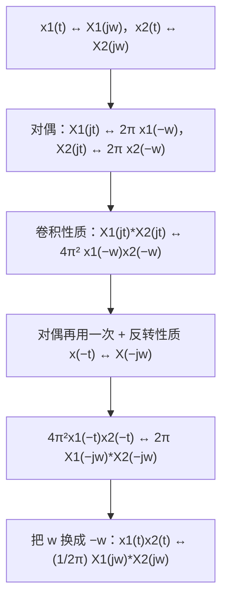

**这条链子值得看一眼，因为它是"性质表可以用来自举"的最好例证**：对偶 → 卷积 → 对偶，三步就把相乘性质推出来了，一次积分都没做。

> [!tip] 复习时的一个自检
> 如果你能默写出这条链子（对偶 ↔ 卷积 ↔ 相乘 三者互相推出），说明这几条性质的**结构**已经装进脑子里了——比死记四行公式牢固得多。

---


### 13 · DTFT · 完整推导、例题与原有讲解


#### C5.4 · 1. 卷积性质（p.32）

##### C5.4 · 1.1 结论

> [!important] 卷积性质
> $$y[n]=x[n]*h[n]\ \xleftrightarrow{\ \text{DTFT}\ }\ Y(e^{j\omega})=X(e^{j\omega})\,H(e^{j\omega})$$
> 其中
> $$H(e^{j\omega})=\sum_{n=-\infty}^{+\infty}h[n]e^{-j\omega n}$$
> 叫系统的**频率响应** Frequency response。

##### C5.4 · 1.2 证明：交换两个求和

$$Y(e^{j\omega})=\sum_{n=-\infty}^{+\infty}\left(\sum_{m=-\infty}^{+\infty}x[m]h[n-m]\right)e^{-j\omega n}.$$

把 $e^{-j\omega n}$ 拆成 $e^{-j\omega(n-m)}e^{-j\omega m}$，然后把内层求和换成对 $n-m$ 的求和：

$$=\sum_{m=-\infty}^{+\infty}x[m]e^{-j\omega m}\underbrace{\sum_{n=-\infty}^{+\infty}h[n-m]e^{-j\omega(n-m)}}_{=\,H(e^{j\omega})}=H(e^{j\omega})\sum_mx[m]e^{-j\omega m}=H(e^{j\omega})X(e^{j\omega}).$$

**关键只有一步**：把 $e^{-j\omega n}$ 拆成两半，一半配 $x$、一半配 $h$。`拆指数 + 换求和次序`，这就是卷积定理的全部技术。

> [!important] 这条性质到底省了什么
> 时域卷积是一个**双重求和**（每个输出样本都要遍历整条输入）；频域相乘只是**逐点相乘**。而且卷积的"长度相加"（$L_x+L_h-1$）在频域完全看不出来——频域只关心"每个频率被乘了几倍"。
> 第 3 章用"复指数是特征函数"讲过同一件事：$e^{j\omega n}$ 进系统只乘一个 $H(e^{j\omega})$，卷积性质就是把这个结论推广到任意输入（任意输入都是复指数的加权和）。

##### C5.4 · 1.3 两条推论：级联与并联

| 互联方式 | 时域 | 频域 |
|---|---|---|
| 级联（串联） | $h_1*h_2$ | $H_1(e^{j\omega})H_2(e^{j\omega})$ |
| 并联 | $h_1+h_2$ | $H_1(e^{j\omega})+H_2(e^{j\omega})$ |

这两条来自卷积的交换律/结合律与线性，在第 2 章已经证过时域版本；频域版本只是把卷积换成乘法、把相加照抄。**滤波器设计中"两级串联"之所以能直接乘起来，靠的就是它。**

---

#### C5.5 · 1. 相乘性质（p.34）

#### C5.5 · 1.1 结论：频域做的是周期卷积

> [!important] 相乘性质
> $$y[n]=x_1[n]\,x_2[n]\ \xleftrightarrow{\ \text{DTFT}\ }\ Y(e^{j\omega})=\frac1{2\pi}\int_{2\pi}X_1(e^{j\theta})X_2\big(e^{j(\omega-\theta)}\big)d\theta=\frac1{2\pi}X_1(e^{j\omega})\circledast X_2(e^{j\omega})$$
> 右边这个运算叫**周期卷积**（periodic convolution）：把 $X_2$ 平移 $\theta$、与 $X_1$ 相乘、在一个 $2\pi$ 上积分，再除以 $2\pi$。

#### C5.5 · 1.2 证明

把 $x_1[n]$ 用反变换写开，再交换求和与积分：

$$Y(e^{j\omega})=\sum_{n=-\infty}^{+\infty}x_1[n]x_2[n]e^{-j\omega n}=\sum_n\left(\frac1{2\pi}\int_{2\pi}X_1(e^{j\theta})e^{j\theta n}d\theta\right)x_2[n]e^{-j\omega n}.$$

括号里那个积分与 $n$ 无关，可以提到求和外面：

$$=\frac1{2\pi}\int_{2\pi}X_1(e^{j\theta})\left(\sum_nx_2[n]e^{-j(\omega-\theta)n}\right)d\theta=\frac1{2\pi}\int_{2\pi}X_1(e^{j\theta})X_2\big(e^{j(\omega-\theta)}\big)d\theta.$$

**与卷积性质的证明完全对称**：那边是"拆指数、交换求和"，这边是"交换求和与积分"。两边的差别只在"一个用 $e^{-j\omega n}$ 拆、一个用 $e^{j\theta n}$ 配"。

> [!warning] 为什么这里是"周期卷积"而不是普通卷积
> 普通卷积的积分限是 $(-\infty,+\infty)$，因为被卷积的两条谱在整条轴上都有定义。可离散端的谱**只在 $\omega$ 的一个 $2\pi$ 周期内有独立信息**，所以：
> - 积分只取一个 $2\pi$（取哪个都行，因为被积函数是 $2\pi$ 周期的）；
> - 平移 $\omega-\theta$ 会自动"绕回"周期里，所以结果仍是 $2\pi$ 周期的。
> 这就是"$\circledast$"与"$*$"的区别：**周期卷积在圆周上做，普通卷积在直线上做。**


## 14. LTI 系统、滤波与微分差分方程求解


四种傅里叶表示回到同一个系统结论：复指数是特征函数，各个频率乘上各自的系统频率响应。周期输入采用离散的谐波权重，非周期输入采用整个频率函数；系统本身的频率响应仍可先由 $h$ 的变换求出。

| 连续系统 | 离散系统 |
|---|---|
| $\sum_{r=0}^{P}\alpha_r y^{(r)}=\sum_{r=0}^{Q}\beta_r x^{(r)}$ | $\sum_{r=0}^{P}\alpha_r y[n-r]=\sum_{r=0}^{Q}\beta_r x[n-r]$ |
| $H(j\Omega)=\dfrac{\sum_r\beta_r(j\Omega)^r}{\sum_r\alpha_r(j\Omega)^r}$ | $H(e^{j\omega})=\dfrac{\sum_r\beta_re^{-j\omega r}}{\sum_r\alpha_re^{-j\omega r}}$ |

这些输入输出频率关系针对零状态的 LTI 描述及可成立的变换；有非零初始储能时，零输入响应需另加。仅给一个有理表达式，通常还要用因果性、稳定性或收敛域才能唯一选择时域 $h$；不能只看分母就宣布系统同时因果稳定。以下保留全部滤波例、方框图、部分分式、原有三组连续与离散系统随堂题。


### 14 · CTFT · 完整推导、例题与原有讲解


#### C4.4 · 0. 开场：逐点扫频，还是写下一个方程

要给一台功放画出频率响应曲线，实验室的标准流程是**逐点扫频**：送 20 Hz 正弦、量输出幅度、记录；再送 21 Hz……一路扫到 20 kHz。几百个频点，几百次测量。

但如果手上有这台功放的**电路方程**——比如一个典型的二阶系统

$$\frac{d^2y}{dt^2}+4\frac{dy}{dt}+3y(t)=\frac{dx}{dt}+2x(t)$$

那么整条曲线可以从方程里**一次算出来**，一个频点都不用测。

这一节要给的，就是这个"一次算出来"的机器：

$$\text{时域：}\ y(t)=x(t)*h(t)\qquad\Longleftrightarrow\qquad\text{频域：}\ Y(j\omega)=X(j\omega)H(j\omega)$$

于是"求系统"变成"求 $H(j\omega)$"，而"求 $H(j\omega)$"在微分方程已知时，**只是把 $\frac{d}{dt}$ 换成 $j\omega$ 再做一次除法**。

> [!question] 停一下，先自己想想
> 为什么把 $\frac{d}{dt}$ 换成 $j\omega$ 是合法的？这个替换的依据是哪一条性质？

---

#### C4.4 · 2. 系统视角：频率响应 $H(j\omega)$（p.36）

把卷积性质放到 LTI 系统上，就得到整个第 4 章最有用的一个式子：

> [!important] LTI 系统的频域描述
> $$y(t)=x(t)*h(t)\ \xleftarrow{\ \ CTFT\ \ }\ Y(j\omega)=X(j\omega)H(j\omega)$$
> 其中
> $$H(j\omega)=\frac{Y(j\omega)}{X(j\omega)}=\mathcal F\{h(t)\}$$
> 叫系统的**频率响应 frequency response**（**系统函数 system function**）。它只由系统自己决定，与输入无关。

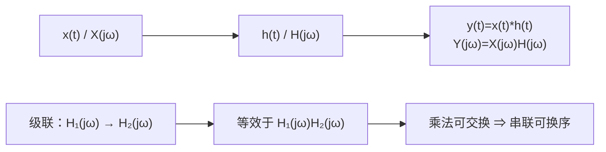

> [!example] 为什么系统中意的是 $H(j\omega)$：把综合式"搬"过系统
> 第 3 章（[[C3.1 复指数是LTI系统的特征函数]]）已经证明：**复指数过 LTI 系统只乘一个复数**：
> $$e^{j\omega t}\ \xrightarrow{\ \text{LTI}\ }\ H(j\omega)e^{j\omega t}$$
> 现在把输入写成综合式的叠加形式 $x(t)=\frac{1}{2\pi}\int X(j\omega)e^{j\omega t}d\omega$。系统是线性的，可以对**每一项**分别作用：
> $$y(t)=\frac{1}{2\pi}\int X(j\omega)\underbrace{\big[H(j\omega)e^{j\omega t}\big]}_{\text{每一项都被乘了 }H(j\omega)}d\omega=\frac{1}{2\pi}\int \underbrace{X(j\omega)H(j\omega)}_{Y(j\omega)}e^{j\omega t}d\omega$$
> 对比综合式，立刻读出 $Y(j\omega)=X(j\omega)H(j\omega)$。

**这段话的信息量**：系统对信号做的事，可以**逐频率拆开看**——每个频率成分进来，幅度被 $|H(j\omega)|$ 缩放、相位被 $\angle H(j\omega)$ 平移，各频率之间互不干扰。**这就是"滤波"的全部内容**：设计 $H(j\omega)$，就是安排"哪些频率放行、放行多少、相位怎么挪"。

> [!tip] 三张图看清三类系统
> - $|H(j\omega)|$ 随 $\omega$ 衰减 ⇒ **低通**（如例 1）；
> - $|H(j\omega)|$ 随 $\omega$ 上升 ⇒ **高通**（如微分器 $j\omega$，见 [[C3.6 傅里叶级数与LTI系统、滤波]]）；
> - $|H(j\omega)|$ 只有在某个频段才大 ⇒ **带通**（收音机选台、第 4.5 节的调制解调）。

---

#### C4.4 · 4. 从微分方程到频率响应（4.7，p.47）

> [!important] 一般结论
> 对线性常系数微分方程
> $$\sum_{k=0}^{N}a_k\frac{d^ky(t)}{dt^k}=\sum_{k=0}^{M}b_k\frac{dx^k(t)}{dt^k}$$
> 两边做傅里叶变换，用**时域微分性质** $\frac{d^k}{dt^k}\leftrightarrow(j\omega)^k$：
> $$\sum_{k=0}^{N}a_k(j\omega)^kY(j\omega)=\sum_{k=0}^{M}b_k(j\omega)^kX(j\omega)$$
> 于是
> $$\boxed{\ H(j\omega)=\frac{Y(j\omega)}{X(j\omega)}=\frac{\sum\limits_{k=0}^{M}b_k(j\omega)^k}{\sum\limits_{k=0}^{N}a_k(j\omega)^k}\ }$$

这就是那个"把 $\frac{d}{dt}$ 换成 $j\omega$"的来历：**它不是规定，而是时域微分性质的直接换算**。整条微分方程变成关于 $j\omega$ 的**代数方程**，未知量从函数 $y(t)$ 变成复数 $Y(j\omega)$。

> [!important] 三条读法
> 1. **$H(j\omega)$ 是一个关于 $j\omega$ 的有理分式**：分子来自输入端的 $b_k$，分母来自输出端的 $a_k$；
> 2. **分母 = 特征多项式**：第 2 章解齐次解时用的特征方程 $\sum a_k s^k=0$（[[C2.4 微分方程与连续时间系统求解]]），在这里就是**极点的位置**——$j\omega$ 让分母为零的那些点。**极点在左半平面 $\Leftrightarrow$ 系统稳定**（与第 2 章的 $\mathrm{Re}\{s\}<0$ 一致）；
> 3. **分子的次数 ≥ 分母的次数时会出现 $\delta(t)$**：长除法分出一个常数项（见下面的例 3）。
>
> **注意这只是零状态响应**：微分方程本身不含初条件，而线性常系数方程的解在频率方法里只能拿到 $y_{zs}=x*h$；要算零输入响应仍需回到 [[C2.4 微分方程与连续时间系统求解]] 的时域方法。这与第 2 章"零输入 + 零状态"的划界完全一致。

> [!tip] 部分分式的"遮盖法"（Cover-up）
> 要把 $H(j\omega)$ 反变换回 $h(t)$，先拆成 $\frac{A_1}{j\omega-p_1}+\frac{A_2}{j\omega-p_2}+\cdots$。求 $A_i$ 时**用手遮住分母里的 $(j\omega-p_i)$，把 $j\omega=p_i$ 代进剩下的部分**即可：
> $$A_i=\Big[(j\omega-p_i)H(j\omega)\Big]_{j\omega=p_i}$$
> 这一步之所以成立，是因为其他项在 $j\omega=p_i$ 处都被 $(j\omega-p_i)$ 乘成零，只剩 $A_i$。**重极点**时这一招只能拿到最高次那一项，低次的要**求导**才能取出来（见例 2）。

---

#### C4.4 · 5. 例 1：从方程到冲激响应（p.48）

> [!example] 例 1
> $$\frac{d^2y(t)}{dt^2}+4\frac{dy(t)}{dt}+3y(t)=\frac{dx(t)}{dt}+2x(t)$$
> 求 $H(j\omega)$ 与 $h(t)$。

**代入 $j\omega$**（$\frac{d^2}{dt^2}\to(j\omega)^2$，$\frac{d}{dt}\to j\omega$）：

$$(j\omega)^2Y+4j\omega Y+3Y=j\omega X+2X\ \Longrightarrow\ H(j\omega)=\frac{j\omega+2}{(j\omega)^2+4j\omega+3}=\frac{j\omega+2}{(j\omega+1)(j\omega+3)}$$

**部分分式**（两个单极点，用遮盖法）：

$$A=\frac{j\omega+2}{j\omega+3}\Big|_{j\omega=-1}=\frac{-1+2}{-1+3}=\frac{1}{2},\qquad B=\frac{j\omega+2}{j\omega+1}\Big|_{j\omega=-3}=\frac{-3+2}{-3+1}=\frac{1}{2}$$

$$H(j\omega)=\frac{1}{2}\Big[\frac{1}{j\omega+1}+\frac{1}{j\omega+3}\Big]\ \Longrightarrow\ \boxed{\ h(t)=\frac{1}{2}\big[e^{-t}+e^{-3t}\big]u(t)\ }$$

![[C4.4-例1的幅频与相频.png]]

- **幅频是一条低通曲线**：$|H(j0)|=\frac23$ 是直流增益（把 $j\omega=0$ 代进 $H$ 就是 $\frac{2}{3}$），随 $\omega$ 增大衰减到零——低频能过、高频被压。
- **相频从 0 单调降到 $-\pi$ 附近**：相位滞后，且高频滞后更多（一阶滞后项 $1/(j\omega+a)$ 贡献 $-\arctan(\omega/a)$，两个一阶项叠加）。
- 时域上 $h(t)$ 是两个衰减指数之和，都很快衰减（时间常数 1 s 与 $\frac13$ s）——**冲激响应衰减越快，通带越宽**，与 [[C4.1 非周期信号的表示：连续时间傅里叶变换]] 例 4.1 的"$-3$ dB 带宽 = 衰减率"完全一致。
- 数值核对：把 $h(t)$ 做数值变换与 $H(j\omega)$ 逐点比较，误差 $1.5\times10^{-4}$（来自 $h$ 的截断）✓。

---

#### C4.4 · 6. 例 2：零状态响应（p.49）

同一个系统，这次给一个具体输入，直接求输出。

> [!example] 例 2
> 系统同例 1，输入 $x(t)=e^{-t}u(t)$，求零状态响应 $y_{zs}(t)$。

**第一步：频域相乘。** $X(j\omega)=\frac{1}{j\omega+1}$，

$$Y(j\omega)=H(j\omega)X(j\omega)=\frac{j\omega+2}{(j\omega+1)(j\omega+3)}\cdot\frac{1}{j\omega+1}=\frac{j\omega+2}{(j\omega+1)^2(j\omega+3)}$$

**第二步：注意 $(j\omega+1)^2$ 是重极点**，展开式必须多带一项：

$$Y(j\omega)=\frac{A_{11}}{j\omega+1}+\frac{A_{12}}{(j\omega+1)^2}+\frac{A_{21}}{j\omega+3}$$

**第三步：逐个定系数。**

$$A_{12}=\Big[(j\omega+1)^2Y\Big]_{j\omega=-1}=\frac{j\omega+2}{j\omega+3}\Big|_{j\omega=-1}=\frac{1}{2}$$

$$A_{11}=\frac{d}{d(j\omega)}\Big[(j\omega+1)^2Y\Big]_{j\omega=-1}=\Big[\frac{1}{j\omega+3}-\frac{j\omega+2}{(j\omega+3)^2}\Big]_{j\omega=-1}=\frac{1}{2}-\frac{1}{4}=\frac{1}{4}$$

$$A_{21}=\Big[(j\omega+3)Y\Big]_{j\omega=-3}=\frac{j\omega+2}{(j\omega+1)^2}\Big|_{j\omega=-3}=\frac{-1}{4}=-\frac{1}{4}$$

**第四步：反变换。** 用到两条基本对（表 4.2）：

$$Y(j\omega)=\frac{1/4}{j\omega+1}+\frac{1/2}{(j\omega+1)^2}-\frac{1/4}{j\omega+3}\ \Longrightarrow\ \boxed{\ y_{zs}(t)=\Big[\frac{1}{4}e^{-t}+\frac{1}{2}te^{-t}-\frac{1}{4}e^{-3t}\Big]u(t)\ }$$

（$\frac{1}{(j\omega+a)^2}\leftrightarrow te^{-at}u(t)$ 来自频域微分性质。）

> [!warning] 重极点最容易出的两种错
> 1. **漏掉 $A_{11}$ 那一项**：只写 $\frac{A_{12}}{(j\omega+1)^2}$ 的话，反变换就少了 $\frac14e^{-t}$，而 $t\to\infty$ 时的行为是对的、$t=0$ 附近却全错——**验算时一定要取特殊时刻**（如 $y_{zs}(0^+)$）。
> 2. **$A_{11}$ 用遮盖法直接代**：$A_{11}$ 必须**先求导再代入**，直接代 $j\omega=-1$ 会得到 $\frac{1}{j\omega+3}=\frac12$，与正确答案 $\frac14$ 差一倍。
>
> 与时域对一下：输入 $e^{-t}u(t)$ 的频率 $s=-1$ **正好撞上系统的极点 $-1$**（$H$ 的分母有 $j\omega+1$），于是频域出现**二阶极点**、时域出现 $te^{-t}$ 这一项。这与 [[C2.4 微分方程与连续时间系统求解]] 里"**特解撞特征根要乘 $t$**"是同一件事——**频域的重极点 = 时域的乘 $t$**。
>
> 数值核对：$y_{zs}$ 的数值变换与 $Y(j\omega)$ 逐点吻合（误差 $7.5\times10^{-9}$）✓。

---

#### C4.4 · 7. 例 3：从方框图到 $h(t)$（p.50）

> [!example] 例 3
> 系统由两个积分器、反馈系数 $-6$ 与 $-8$、前馈系数 $1$、$-1$、$2$ 构成（两个积分器串联，中间节点记 $W(j\omega)$）。
> 求 $H(j\omega)$ 与 $h(t)$。

**第一步：在图上的每个节点写频域关系。** 积分器就是除以 $j\omega$，所以从左往右，节点依次是 $(j\omega)^2W$、$j\omega W$、$W$。

加法器节点（左侧）：输入 $x$ 减去 $6j\omega W$ 与 $8W$，得到 $(j\omega)^2W$：

$$(j\omega)^2W(j\omega)=X(j\omega)-6j\omega W(j\omega)-8W(j\omega)$$

输出节点：把三个前馈分支加起来：

$$Y(j\omega)=2W(j\omega)-j\omega W(j\omega)+(j\omega)^2W(j\omega)$$

**第二步：消去中间变量 $W$。** 由第一式 $W=\frac{X}{(j\omega)^2+6j\omega+8}$，代入第二式：

$$H(j\omega)=\frac{(j\omega)^2-j\omega+2}{(j\omega)^2+6j\omega+8}$$

**第三步：分子分母同阶，先做长除法分出一个常数 1。**

$$H(j\omega)=1+\frac{-7j\omega-6}{(j\omega+2)(j\omega+4)}=1+\frac{A}{j\omega+2}+\frac{B}{j\omega+4}$$

$$A=\frac{-7j\omega-6}{j\omega+4}\Big|_{j\omega=-2}=\frac{14-6}{2}=4,\qquad B=\frac{-7j\omega-6}{j\omega+2}\Big|_{j\omega=-4}=\frac{28-6}{-2}=-11$$

$$\boxed{\ h(t)=\delta(t)+4e^{-2t}u(t)-11e^{-4t}u(t)\ }$$

> [!important] 那个 $\delta(t)$ 从哪来
> 因为**分子与分母同阶**（都是 $(j\omega)^2$），长除法分出一个常数 $1$，而 $\mathcal F\{\delta(t)\}=1$——所以冲激响应里有一根**直通**的冲激。
> 物理含义：方框图里有一条**从输入直通输出的前馈支路**（系数 1 那一条），信号可以不经任何积分器直达输出，**瞬时响应**就表现为 $\delta(t)$。这是"系统有直通项"的频域签名。
> 反过来记：**分子阶数 < 分母阶数 ⇒ $h(t)$ 里没有 $\delta$**（例 1、例 2 就是这种）。
>
> 数值核对：$4e^{-2t}u(t)-11e^{-4t}u(t)$ 的数值变换加上 $1$，与 $H(j\omega)$ 逐点吻合（误差 $1.0\times10^{-3}$，来自截断）✓。
>
> 与 [[C2.6 LTI系统的方框图表示]] 对照：那里在时域用直接形式 I/II 列方程、解 $h$；这里同样一张图，**只要把积分器换成 $1/j\omega$，一次代数消元就出结果**。

---

#### C4.4 · 9. 随堂测

##### C4.4 · 9.1　频谱性质综合题（p.51）

> [!question] 随堂测 1（10 分）
> 已知 $x(t)$ 如图所示（在 $[-1,3]$ 上非零：$[-1,0]$ 上为 2；$(0,1)$ 上从 2 线性降到 1；$(1,2)$ 上从 1 线性升到 2；$[2,3]$ 上为 2），$X(j\omega)$ 是它的傅里叶变换。求：
> (a) $\angle X(j\omega)$　(b) $X(j0)$　(c) $\displaystyle\int_{-\infty}^{+\infty}X(j\omega)d\omega$　(d) $\displaystyle\int_{-\infty}^{+\infty}X(j\omega)\frac{2\sin\omega}{\omega}e^{j2\omega}d\omega$　(e) $\displaystyle\int_{-\infty}^{+\infty}|X(j\omega)|^2d\omega$　(f) 画出 $\mathrm{Re}\{X(j\omega)\}$ 的逆变换的草图。
> **提示：所有计算都不要求显式求出 $X(j\omega)$。**

![[C4.4-随堂测x(t)与它的偶部.png]]

**这道题的价值在于：它逼你用性质，而不是用积分。** 逐个来。

> [!example] (a) 相位谱
> 观察波形：$x(t)$ **关于 $t=1$ 偶对称**（$x(1+\tau)=x(1-\tau)$ 对一切 $\tau$ 成立）。
> 于是 $x(t)=g(t-1)$，其中 $g$ 实且偶。实偶信号的变换**实且偶**（[[C4.3 连续时间傅里叶变换的性质]] §4），所以 $G(j\omega)$ 是实函数；再由**时移性质**：
> $$X(j\omega)=e^{-j\omega}G(j\omega)\ \Longrightarrow\ \boxed{\ \angle X(j\omega)=-\omega\ }$$
> **相位谱是一条过原点的直线（斜率为 $-1$）**——这正是"纯延迟 1 秒"的签名。直观解释：波形在 $t=1$ 处左右对称，相当于把对称图形整体推迟了 1 秒，而延迟只改相位、不改幅度。

> [!example] (b) $X(j0)$
> $j\omega=0$ 就是分析式里 $\omega=0$ 的取值：
> $$X(j0)=\int_{-\infty}^{+\infty}x(t)dt=\text{波形下的面积}$$
> 分段算：$2\times1+\frac{2+1}{2}\times1+\frac{1+2}{2}\times1+2\times1=2+1.5+1.5+2=\boxed{7}$
> 这个式子在后续题目里反复出现：**$X(j0)$ 永远是信号的"总面积"**。

> [!example] (c) $\int X(j\omega)d\omega$
> 用**综合式**在 $t=0$ 处取值：
> $$x(0)=\frac{1}{2\pi}\int_{-\infty}^{+\infty}X(j\omega)e^{j\omega\cdot0}d\omega=\frac{1}{2\pi}\int X(j\omega)d\omega\ \Longrightarrow\ \int X(j\omega)d\omega=2\pi x(0)$$
> 图上 $x(0)=2$，所以
> $$\int_{-\infty}^{+\infty}X(j\omega)d\omega=2\pi\cdot2=\boxed{4\pi}$$

> [!example] (d) 带权积分
> 认出两个零件：$\frac{2\sin\omega}{\omega}=2\mathrm{Sa}(\omega)$ 是**半宽为 1 的矩形脉冲**的变换，$e^{j2\omega}$ 是**在 $t=2$ 取值**的相位因子：
> $$\frac{2\sin\omega}{\omega}\ \xleftarrow{\ \ CTFT\ \ }\ h(t)=\begin{cases}1,&\lvert t\rvert<1\\0,&\lvert t\rvert>1\end{cases},\qquad e^{j2\omega}=e^{j\omega\cdot t}\Big|_{t=2}$$
> 于是这个积分就是**卷积定理的逆用**：
> $$\int X(j\omega)H(j\omega)e^{j\omega t}d\omega=2\pi\,(x*h)(t)\Big|_{t=2}$$
> 而 $(x*h)(2)=\int_{-1}^{3}x(\tau)h(2-\tau)d\tau=\int_{1}^{3}x(\tau)d\tau$（因为 $\lvert2-\tau\rvert<1\Leftrightarrow\tau\in(1,3)$）：
> $$\int_1^3x\,d\tau=1.5+2=3.5\ \Longrightarrow\ \int X(j\omega)\frac{2\sin\omega}{\omega}e^{j2\omega}d\omega=2\pi\cdot3.5=\boxed{7\pi}$$
> **数值核对**：$7\pi\approx21.9911$，数值积分得 $21.9897$ ✓。

> [!example] (e) 能量
> 用**帕塞瓦尔**：
> $$\int|X(j\omega)|^2d\omega=2\pi\int|x(t)|^2dt$$
> 时域分段算能量：
> $$\int_{-1}^{3}x^2dt=\underbrace{4\times1}_{[-1,0]}+\underbrace{\int_1^2u^2du}_{=\frac73}+\underbrace{\int_0^1(2-t)^2dt}_{=\frac73}+\underbrace{4\times1}_{[2,3]}=8+\frac{14}{3}=\frac{38}{3}$$
> $$\int_{-\infty}^{+\infty}|X(j\omega)|^2d\omega=2\pi\cdot\frac{38}{3}=\boxed{\frac{76\pi}{3}\approx79.587}$$
> （数值积分得 $79.5816$ ✓。注意两处线性段的能量换元：$\int_0^1(2-t)^2dt=\int_1^2u^2du=\frac73$。）

> [!example] (f) 画 $\mathrm{Re}\{X(j\omega)\}$ 的逆变换
> 关键是**实部对应偶部**（[[C4.3 连续时间傅里叶变换的性质]] §4）：设 $x(t)=x_e(t)+x_o(t)$，则
> $$x_e(t)\ \xleftarrow{}\ \mathrm{Re}\{X(j\omega)\}$$
> 所以要求的草图就是 $x_e(t)=\frac12[x(t)+x(-t)]$。逐段算（$x$ 只在 $[-1,3]$ 上非零，所以 $x(-t)$ 只在 $[-3,1]$ 上非零）：

| 区间 | $x(t)$ | $x(-t)$ | $x_e(t)=\frac12[x+x(-t)]$ |
|---|---|---|---|
| $(-3,-2)$ | 0 | 2 | $1$ |
| $(-2,-1)$ | 0 | $-t$ | $-t/2$：从 $1$ 降到 $0.5$ |
| $(-1,0)$ | 2 | $2+t$ | $(4+t)/2$：从 $1.5$ 升到 $2$ |
| $(0,1)$ | $2-t$ | 2 | $(4-t)/2$：从 $2$ 降到 $1.5$ |
| $(1,2)$ | $t$ | 0 | $t/2$：从 $0.5$ 升到 $1$ |
| $(2,3)$ | 2 | 0 | $1$ |

要点两条：**① 结果关于 $t=0$ 偶对称**（这是必然的，因为它是"实部对应偶部"的直接后果）；**② 在 $t=\pm1$ 处有跳变**（幅度 1），因为原信号在 $t=-1$、$t=3$ 有跳变，取偶部不会把这些跳变抹平。图上就是这么画的：中间一段是"帐篷 + 台阶"的组合，两侧各压着一块高度 1 的平台。

> [!important] 这一题的通用套路
> 遇到"**不许求 $X(j\omega)$，但要算关于 $X$ 的积分**"这类题，认准四个入口：
> | 想要的东西 | 用什么 |
> |---|---|
> | $X(j0)$ | 面积 $\int x\,dt$ |
> | 相位（线性？） | 波形的对称中心 ⇒ 纯延迟 |
> | $\int Xd\omega$ | $2\pi x(0)$（综合式取 $t=0$） |
> | $\int X\cdot H\cdot e^{j\omega t}d\omega$ | $2\pi(x*h)(t)$（卷积定理逆用） |
> | $\int\lvert X\rvert^2d\omega$ | $2\pi\int\lvert x\rvert^2dt$（帕塞瓦尔） |
> | $\mathrm{Re}\{X\}$ 的逆变换 | $x_e(t)$（实部 ↔ 偶部） |

##### C4.4 · 9.2　三个系统求解题（p.52、p.54）

> [!question] 随堂测 2（10 分）
> (a) 求由 $\dfrac{d^2y}{dt^2}+6\dfrac{dy}{dt}+8y(t)=2x(t)$ 描述的稳定因果 LTI 系统的冲激响应；
> (b) 若 $x(t)=te^{-2t}u(t)$，求响应；
> (c) 对 $\dfrac{d^2y}{dt^2}+\sqrt2\dfrac{dy}{dt}+y(t)=2\dfrac{d^2x}{dt^2}-2x(t)$ 重做 (a)。

> [!example] (a)
> $$H(j\omega)=\frac{2}{(j\omega)^2+6j\omega+8}=\frac{2}{(j\omega+2)(j\omega+4)}=\frac{A}{j\omega+2}+\frac{B}{j\omega+4}$$
> $$A=\frac{2}{j\omega+4}\Big|_{j\omega=-2}=1,\qquad B=\frac{2}{j\omega+2}\Big|_{j\omega=-4}=-1$$
> $$\boxed{\ h(t)=\big[e^{-2t}-e^{-4t}\big]u(t)\ }$$
> 自检：极点在 $-2,-4$（都为负）⇒ 稳定 ✓；$h(0^+)=1-1=0$（分子次数低于分母，无 $\delta$ 项，且 $h$ 从 0 连续起步）✓。数值核对误差 $1.5\times10^{-8}$。

> [!example] (b)
> $x(t)=te^{-2t}u(t)$ 的变换用频域微分（或查表）：$X(j\omega)=\dfrac{1}{(j\omega+2)^2}$。注意输入的频率 $s=-2$ **正好撞上极点 $-2$**，所以会出现三重极点：
> $$Y(j\omega)=H(j\omega)X(j\omega)=\frac{2}{(j\omega+2)^3(j\omega+4)}=\frac{A_{11}}{j\omega+2}+\frac{A_{12}}{(j\omega+2)^2}+\frac{A_{13}}{(j\omega+2)^3}+\frac{A_{21}}{j\omega+4}$$
> $$A_{13}=\frac{2}{j\omega+4}\Big|_{-2}=1,\quad A_{12}=\frac{d}{d(j\omega)}\frac{2}{j\omega+4}\Big|_{-2}=\frac{-2}{(j\omega+4)^2}\Big|_{-2}=-\frac12$$
> $$A_{11}=\frac12\frac{d^2}{d(j\omega)^2}\frac{2}{j\omega+4}\Big|_{-2}=\frac{2}{(j\omega+4)^3}\Big|_{-2}=\frac14,\qquad A_{21}=\frac{2}{(j\omega+2)^3}\Big|_{-4}=-\frac14$$
> 各项反变换（$\frac{1}{(j\omega+a)^n}\leftrightarrow\frac{t^{n-1}}{(n-1)!}e^{-at}u(t)$）：
> $$\boxed{\ y(t)=\Big[\frac14-\frac12t+\frac12t^2\Big]e^{-2t}u(t)-\frac14e^{-4t}u(t)\ }$$
> 自检：$y(0^+)=\frac14-\frac14=0$ ✓（零状态响应从零起步）；$H(j\omega)X(j\omega)$ 的数值变换与上式逐点吻合（误差 $2.8\times10^{-17}$）✓。

> [!example] (c)
> $$H(j\omega)=\frac{2(j\omega)^2-2}{(j\omega)^2+\sqrt2\,j\omega+1}$$
> 分母的零点：$j\omega=\dfrac{-\sqrt2\pm\sqrt{2-4}}{2}=\dfrac{-1\pm j}{\sqrt2}$——**一对共轭极点**，实部 $-\frac{1}{\sqrt2}<0$ ⇒ 稳定。
> 分子分母同阶，先长除：$2\cdot(\text{分母})=2(j\omega)^2+2\sqrt2j\omega+2$，相减得 $-2\sqrt2j\omega-4$，于是
> $$H(j\omega)=2+\frac{-4-2\sqrt2\,j\omega}{(j\omega)^2+\sqrt2j\omega+1}$$
> 两个共轭极点上的系数（记 $p_{1,2}=\frac{-1\pm j}{\sqrt2}$）：
> $$R_1=\frac{-4-2\sqrt2p_1}{p_1-p_2}=\frac{-2-2j}{j\sqrt2}=\sqrt2(-1+j),\qquad R_2=R_1^*=\sqrt2(-1-j)$$
> 反变换时共轭项合起来是 $2\mathrm{Re}\{R_1e^{p_1t}\}$：
> $$2\sqrt2\,e^{-t/\sqrt2}\Big[-\cos\frac{t}{\sqrt2}-\sin\frac{t}{\sqrt2}\Big]$$
> $$\boxed{\ h(t)=2\delta(t)-2\sqrt2\,e^{-t/\sqrt2}\Big[\cos\frac{t}{\sqrt2}+\sin\frac{t}{\sqrt2}\Big]u(t)\ }$$
> **两点检查**：① 分子分母同阶 ⇒ 有 $2\delta(t)$ 直通项 ✓；② 括号里的 $\cos+\sin$ 可以合成一个带相位的余弦 $\sqrt2\cos(\frac{t}{\sqrt2}-\frac\pi4)$，幅度项 $\sqrt2\times2\sqrt2=4$——**经典欠阻尼二阶系统的振荡冲激响应**。数值核对误差 $4.2\times10^{-4}$ ✓。

> [!question] 随堂测 3（10 分）
> 因果 LTI 系统的输入输出满足
> $$\frac{dy(t)}{dt}+10y(t)=\int_{-\infty}^{+\infty}x(\tau)z(t-\tau)d\tau-x(t),\qquad z(t)=e^{-t}u(t)+3\delta(t)$$
> (a) 求频率响应 $H(j\omega)=Y(j\omega)/X(j\omega)$；(b) 求冲激响应。

**第一步：把积分认成卷积**——$\int x(\tau)z(t-\tau)d\tau=x(t)*z(t)$。

**第二步：整个方程做变换**（用卷积性质与微分性质）：

$$j\omega Y+10Y=XZ-X\ \Longrightarrow\ Y(j\omega)\big[j\omega+10\big]=X(j\omega)\big[Z(j\omega)-1\big]$$

**第三步：算 $Z(j\omega)$**：$z(t)=e^{-t}u(t)+3\delta(t)$，逐项查表

$$Z(j\omega)=\frac{1}{j\omega+1}+3$$

于是

$$H(j\omega)=\frac{Z(j\omega)-1}{j\omega+10}=\frac{\frac{1}{j\omega+1}+2}{j\omega+10}=\frac{1+2(j\omega+1)}{(j\omega+1)(j\omega+10)}=\boxed{\ \frac{2j\omega+3}{(j\omega+1)(j\omega+10)}\ }$$

**第四步：部分分式反变换。**

$$A=\frac{2j\omega+3}{j\omega+10}\Big|_{j\omega=-1}=\frac{1}{9},\qquad B=\frac{2j\omega+3}{j\omega+1}\Big|_{j\omega=-10}=\frac{-17}{-9}=\frac{17}{9}$$

$$\boxed{\ h(t)=\Big[\frac19e^{-t}+\frac{17}{9}e^{-10t}\Big]u(t)\ }$$

自检：$A+B=2$，与 $H(j\omega)$ 当 $|j\omega|\to\infty$ 时的极限 $\frac{2j\omega}{(j\omega)^2}\to\frac{2}{j\omega}$ 的系数 2 一致 ✓（这是遮盖法之外的第二个验算手段）。数值核对误差 $3.0\times10^{-4}$ ✓。

> [!warning] 三个随堂测共有的坑
> 1. **$H(j\omega)$ 里的 $\delta$ 项**：只要分子阶数等于分母阶数（例 3、随堂测 2(c)），反变换就会冒出 $\delta(t)$，漏了它 $t=0$ 附近全错。
> 2. **撞极点要加项**：输入频率撞上系统极点时（例 2、随堂测 2(b)），部分分式必须多带一阶，且低阶系数要**求导**。
> 3. **"稳定因果"是选解条件**：同一个 $H(j\omega)$ 的不同收敛域对应不同系统。题目说"稳定因果"，意味着极点必须都在左半平面、且 $h(t)$ 只保留 $t>0$ 的项——本题的极点都在左半平面，所以直接对每个一阶项配上 $u(t)$ 即可。

---


### 14 · DTFT · 完整推导、例题与原有讲解


#### C5.4 · 0. 开场：一段音频的 EQ，为什么可以只看一条曲线

给一段录音做"低切"（high-pass）：把 80 Hz 以下的低频砍掉。你在软件里做的事，本质上是让信号过一个系统，它的单位冲激响应长这样：

$$h[n]=\delta[n]-\alpha\delta[n-1]$$

（就是"当前样本减去上一个样本的一个比例"）。要问"这个滤波器对 1 kHz 的成分放大多少倍"，最笨的办法是把 $e^{j\omega_0 n}$ 代进卷积和，一项一项算：

$$y[n]=\sum_k h[k]e^{j\omega_0(n-k)}=e^{j\omega_0n}\sum_k h[k]e^{-j\omega_0 k}.$$

算完发现：输出就是输入乘上一个数——**这个数只跟频率有关，跟 $n$ 无关**。这个数就是频率响应 $H(e^{j\omega_0})$。

一旦接受"输出 = 输入 × 一个数"，整套做法就变了：不必对每个频率重算卷积，只要把 $H(e^{j\omega})$ 这条曲线画出来，**曲线高就是放大、低就是衰减**。而这条曲线可以由 $h[n]$ 一次算出，也可以由差分方程直接算出（不用先求 $h[n]$）。

这就是这一讲要建立的两条通道：

- **$h[n]\Rightarrow H(e^{j\omega})$**：定义式，卷积性质的左半边；
- **差分方程 $\Rightarrow H(e^{j\omega})$**：代数运算，§5.8 的内容。

两条通道在同一张图上汇合，这就是"用频域分析系统"的全部意思。

---

#### C5.4 · 3. 由差分方程求频率响应（p.48）

##### C5.4 · 3.1 一般形式

一个由线性常系数差分方程 LCCDE 表征的离散 LTI 系统：

$$\sum_{k=0}^{N}a_ky[n-k]=\sum_{k=0}^{M}b_kx[n-k].$$

两边取 DTFT，用**时移性质**（$y[n-k]\leftrightarrow e^{-jk\omega}Y(e^{j\omega})$）：

$$Y(e^{j\omega})\sum_{k=0}^{N}a_ke^{-jk\omega}=X(e^{j\omega})\sum_{k=0}^{M}b_ke^{-jk\omega}.$$

> [!important] 由差分方程直接读出 $H$
> $$\boxed{\ H(e^{j\omega})=\frac{Y(e^{j\omega})}{X(e^{j\omega})}=\frac{\sum\limits_{k=0}^{M}b_ke^{-jk\omega}}{\sum\limits_{k=0}^{N}a_ke^{-jk\omega}}\ }$$
> 分子是输入的系数、分母是输出的系数，每一项带一个 $e^{-jk\omega}$。**看到方程就能写出 $H$，一步代数，不用卷积。**

> [!tip] 两条保证
> - **因果**：$a_0\ne0$ 且方程只含 $n-k$（$k\ge0$）时，$h[n]$ 在 $n<0$ 处为零——这正是 Direct Form 的实现条件；
> - **稳定**：$\sum_n|h[n]|<\infty$。在 $H$ 的分式形式下，这等价于**分母的所有根（极点）都在单位圆内**，即 $|z_i|<1$。
> 这两条与第 2 章 BIBO 的结论是同一个，只是换成了频域语言：**稳定 ⇔ 频率响应在单位圆上处处有限**。

##### C5.4 · 3.2 方框图也是差分方程（p.49）

![[C3–5-并行-C5.4-方框图实现-频率响应.png]]

这个方框图里有两个延迟器、两个加法器和若干系数。**读图的规矩只有一条：每个加法器的输出都写成一个方程，然后逐个换成频域。**

两个节点的方程是（把 $W(e^{j\omega})$ 简写成 $W$）：

$$\begin{cases}W=X+\dfrac34We^{-j\omega}-\dfrac18We^{-j2\omega}\\[2mm]Y=X+2We^{-j\omega}-We^{-j2\omega}\end{cases}$$

第一个方程解出 $W$：

$$W\left(1-\frac34e^{-j\omega}+\frac18e^{-j2\omega}\right)=X\quad\Longrightarrow\quad W=\frac{X}{1-\frac34e^{-j\omega}+\frac18e^{-j2\omega}}.$$

代进第二个：

$$H=\frac{Y}{X}=1+\frac{2e^{-j\omega}-e^{-j2\omega}}{1-\frac34e^{-j\omega}+\frac18e^{-j2\omega}}=\frac{1+\frac54e^{-j\omega}-\frac78e^{-j2\omega}}{1-\frac34e^{-j\omega}+\frac18e^{-j2\omega}}.$$

##### C5.4 · 3.3 把它变成 $h[n]$

把 $q=e^{-j\omega}$ 看成变量。分母可以分解：

$$1-\frac34q+\frac18q^2=\left(1-\frac12q\right)\left(1-\frac14q\right).$$

分子次数等于分母次数，先做**多项式除法**（首项系数比 $\frac{-7/8}{1/8}=-7$）：

$$H=-7+\frac{8-4q}{\left(1-\frac12q\right)\left(1-\frac14q\right)}=-7+\frac{8\left(1-\frac12q\right)}{\left(1-\frac12q\right)\left(1-\frac14q\right)}=-7+\frac{8}{1-\frac14q}.$$

> [!important] 注意这次抵消
> 分子里那个 $8-4q=8(1-\frac q2)$ 恰好和分母的一个因子**约掉**了。这对应"极点 $q=2$（即 $z=\frac12$）被零点抵消"，所以 $h[n]$ 里**没有** $\left(\frac12\right)^n$ 项。
> 方框图的零极点结构不是随意的：$H$ 化简之后只剩一个极点 $z=\frac14$，系统比图上看起来更简单。**做题时如果没做这一步就急着拆部分分式，会拆出一个系数为零的项，白算一遍。**

用查表 $\dfrac{1}{1-\alpha e^{-j\omega}}\leftrightarrow\alpha^nu[n]$，再把常数 $-7$ 对应到 $-7\delta[n]$：

$$\boxed{\ h[n]=-7\delta[n]+8\left(\frac14\right)^nu[n]\ }$$

核对：$H(e^{j0})=-7+8\cdot\frac{1}{1-1/4}=-7+\frac{32}{3}=\frac{11}{3}$；直接代 $q=1$ 进原式得 $\frac{1+5/4-7/8}{1-3/4+1/8}=\frac{11/8}{3/8}=\frac{11}{3}$ ✓。

---

#### C5.4 · 4. 部分分式：三条规矩（p.50–52）

要把 $\frac{\sum b_ke^{-jk\omega}}{\sum a_ke^{-jk\omega}}$ 变成 $h[n]$，唯一通用的手段是**部分分式展开**，再对每一项查表。三种情形，规则不同。

> [!note] 记号说明
> 这三页沿用拉普拉斯变换的写法 $X(s)=\frac{N(s)}{D(s)}$，规则本身与变量无关；放到离散端，把 $s$ 换成 $z$（或直接换成 $q=e^{-j\omega}$）即可，查表用的是 $\frac{1}{1-\alpha z^{-1}}\leftrightarrow\alpha^nu[n]$。

##### C5.4 · 4.1 真分式 + 一阶极点（$m<n$，极点两两不同）

$$X(s)=\frac{N(s)}{(s-p_1)(s-p_2)\cdots(s-p_n)}=\frac{k_1}{s-p_1}+\frac{k_2}{s-p_2}+\cdots+\frac{k_n}{s-p_n},$$

$$k_i=(s-p_i)X(s)\Big|_{s=p_i}.$$

这就是**遮盖法**：把 $(s-p_i)$ 乘回左边，再令 $s=p_i$，其余因子直接算数值。

##### C5.4 · 4.2 真分式 + 重极点（$r$ 重）

$$X(s)=\frac{k_1}{(s-p_1)^r}+\frac{k_2}{(s-p_1)^{r-1}}+\cdots+\frac{k_r}{s-p_1}+\frac{k_{r+1}}{s-p_{r+1}}+\cdots,$$

$$k_i=\frac{1}{(i-1)!}\,\frac{d^{\,i-1}}{ds^{\,i-1}}\Big[(s-p_1)^rX(s)\Big]_{s=p_1},\qquad i=1,2,\dots,r.$$

重极点会在时域产生 $n^{r-1}\alpha^n$ 形式的项（第 2 章"重根乘 $n$"的同一个事实）。

##### C5.4 · 4.3 非真分式（$m\ge n$）

先做多项式除法，把式子拆成"多项式 + 真分式"：

$$\frac{N(s)}{D(s)}=B_0+B_1s+\cdots+B_{m-n}s^{m-n}+\frac{N_1(s)}{D(s)},\qquad\frac{N_1(s)}{D(s)}\ \text{是真分式，按 4.1 / 4.2 处理}.$$

多项式部分在时域是**冲激及其导数**（连续端 $B_0\leftrightarrow B_0\delta(t)$、$B_1s\leftrightarrow B_1\delta'(t)$）；在离散端，常数项对应 $\delta[n]$，其余高次项在单位圆上对应 $\delta[n]$ 的差分。

> [!warning] 顺序不能颠倒
> **必须先判断是不是真分式**。像 §3.3 那个例子，不做除法直接写 $A/(1-\frac q2)+B/(1-\frac q4)$，会解出 $A+B$ 与常数项的方程对不上——因为分子分母次数相同，展开式里本来还有一个常数项 $-7$。
> 判据很简单：分子最高次 ≤ 分母最高次时，先除。

---

#### C5.4 · 5. 随堂测（p.54–56）

##### C5.4 · 5.1 随堂测 1（10 分）：两个方程、一个中间变量

> [!question] 题目
> 一个因果离散 LTI 系统由下面这对含中间变量 $w[n]$ 的差分方程描述：
> $$y[n]+\frac14y[n-1]+w[n]+\frac12w[n-1]=\frac23x[n],$$
> $$y[n]-\frac54y[n-1]+2w[n]-2w[n-1]=-\frac53x[n].$$
> (a) 求频率响应与单位冲激响应；(b) 求一个只含 $x[n]$、$y[n]$ 的差分方程。

**这题的关键是"把 $w$ 消掉"**，而不是急着对某一个方程做变换。取 DTFT，记 $q=e^{-j\omega}$：

$$\begin{cases}\left(1+\frac q4\right)Y+\left(1+\frac q2\right)W=\frac23X\\[1mm]\left(1-\frac{5q}4\right)Y+\left(2-2q\right)W=-\frac53X\end{cases}$$

两式消去 $W$：第一式乘 $(2-2q)$、第二式乘 $(1+\frac q2)$，相减。$Y$ 的系数是

$$\left(1+\frac q2\right)\left(1-\frac{5q}4\right)-\left(2-2q\right)\left(1+\frac q4\right)=\left(1-\frac{3q}4-\frac{5q^2}8\right)-\left(2-\frac{3q}2-\frac{q^2}2\right)=-1+\frac{3q}4-\frac{q^2}8,$$

也就是 $-\left(1-\frac{3q}4+\frac{q^2}8\right)$。右边是

$$-\frac53\left(1+\frac q2\right)-\frac23\left(2-2q\right)=-3+\frac q2=-\left(3-\frac q2\right).$$

于是

$$H(e^{j\omega})=\frac{Y}{X}=\frac{3-\frac q2}{1-\frac34q+\frac18q^2}.$$

分母分解为 $(1-\frac q2)(1-\frac q4)$，部分分式：

$$\frac{3-\frac q2}{\left(1-\frac q2\right)\left(1-\frac q4\right)}=\frac{4}{1-\frac q2}-\frac{1}{1-\frac q4}.$$

> [!important] 答案
> $$H(e^{j\omega})=\frac{3-\frac12e^{-j\omega}}{1-\frac34e^{-j\omega}+\frac18e^{-2j\omega}},\qquad h[n]=\left[4\left(\frac12\right)^n-\left(\frac14\right)^n\right]u[n]$$
> (b) 把 $H$ 的分母乘过去、分子展开：
> $$y[n]-\frac34y[n-1]+\frac18y[n-2]=3x[n]-\frac12x[n-1].$$

核对：$h[0]=4-1=3$；$H(e^{j0})=\frac{3-0.5}{(1-0.5)(1-0.25)}=\frac{5/2}{3/8}=\frac{20}{3}\approx6.667$，而 $\sum_nh[n]=4\cdot2-\frac43=\frac{20}{3}$ ✓（已复算）。

##### C5.4 · 5.2 随堂测 2（10 分）：由 $h[n]$ 反推方程

> [!question] 题目
> 系统冲激响应为 $h[n]=\left(\frac12\right)^nu[n]+\frac12\left(\frac14\right)^nu[n]$，求联系输入输出的线性常系数差分方程。

先取变换：

$$H=\frac{1}{1-\frac q2}+\frac12\cdot\frac{1}{1-\frac q4}=\frac{\left(1-\frac q4\right)+\frac12\left(1-\frac q2\right)}{\left(1-\frac q2\right)\left(1-\frac q4\right)}=\frac{\frac32-\frac q2}{1-\frac34q+\frac18q^2}.$$

> [!important] 答案
> $$y[n]-\frac34y[n-1]+\frac18y[n-2]=\frac32x[n]-\frac12x[n-1]$$
> 注意 $h[n]$ 是两个指数之和，**分子是一个一阶多项式**而不是常数——"分母几次对应多少阶的反馈、分子几次对应多少阶的前馈"。

##### C5.4 · 5.3 随堂测 3（10 分）：从方框图读出一切

> [!question] 题目
> 下图是一个因果 LTI 系统的方框图实现。
> (a) 写出联系 $x[n]$ 与 $y[n]$ 的差分方程；(b) 求频率响应；(c) 求冲激响应。

![[C3–5-并行-C5.4-方框图实现-随堂测.png]]

**读图**：两节结构相同，每节都是"一个加法器 + 一个延迟器"的反馈环，环的输出再经过加权送到下一级。

第一节（左）：设第一个加法器的输出为 $v[n]$，则

$$v[n]=x[n]+\frac13v[n-1],\qquad u[n]=v[n]-\frac12v[n-1].$$

第二节（右）：设它内部加法器的输出为 $z[n]$，则

$$z[n]=u[n]-\frac12z[n-1],\qquad y[n]=\frac14z[n]+z[n-1].$$

> [!tip] 读方框图的三步
> 1. **给每个加法器的输出起个名字**（这里是 $v$ 与 $z$）；
> 2. **沿反馈环写方程**：加法器输出 = 各输入之和，其中反馈支路带一个延迟 $z^{-1}$ 与一个系数；
> 3. **沿前馈支路写输出**：把经过缩放的各节点相加。
> 每一步都只是"加法"和"延时乘 $e^{-j\omega}$"，没有别的机关。

**频域**：把两节各自的传递函数乘起来，

$$H=\underbrace{\frac{1-\frac q2}{1-\frac q3}}_{\text{第一节}}\cdot\underbrace{\frac{\frac14+q}{1+\frac q2}}_{\text{第二节}}=\frac{\left(1-\frac q2\right)\left(\frac14+q\right)}{\left(1-\frac q3\right)\left(1+\frac q2\right)}=\frac{\frac14+\frac78q-\frac12q^2}{1+\frac16q-\frac16q^2}.$$

**差分方程**（把分母乘过去）：

$$y[n]+\frac16y[n-1]-\frac16y[n-2]=\frac14x[n]+\frac78x[n-1]-\frac12x[n-2].$$

**冲激响应**：分母次数 = 分子次数，先做除法（首项比 $\frac{-1/2}{-1/6}=3$）：

$$H=3+\frac{-\frac{11}4+\frac38q}{\left(1-\frac q3\right)\left(1+\frac q2\right)}=3-\frac{13/20}{1-\frac q3}-\frac{21/10}{1+\frac q2}.$$

> [!important] 答案
> $$H(e^{j\omega})=3-\frac{13}{20}\cdot\frac{1}{1-\frac13e^{-j\omega}}-\frac{21}{10}\cdot\frac{1}{1+\frac12e^{-j\omega}}$$
> $$h[n]=3\delta[n]-\frac{13}{20}\left(\frac13\right)^nu[n]-\frac{21}{10}\left(-\frac12\right)^nu[n]$$

核对：$h[0]=3-\frac{13}{20}-\frac{21}{10}=3-0.65-2.1=0.25$；而 $H(e^{j0})=\frac{(1-1/2)(1/4+1)}{(1-1/3)(1+1/2)}=\frac{0.5\times1.25}{(2/3)\times1.5}=0.625$，$\sum_nh[n]=3-\frac{13/20}{2/3}-\frac{21/10}{3/2}=3-0.975-1.4=0.625$ ✓（已用逐点模拟复核，$h[0..5]$ 完全一致）。

> [!warning] 三个极点的位置值得看一眼
> 分母 $1+\frac16q-\frac16q^2=0$ 给出 $q=3$ 与 $q=-2$，换成 $z=1/q$ 就是 $z=\frac13$ 与 $z=-\frac12$——**都在单位圆内**，所以系统稳定。
> 如果某一题的极点跑到单位圆外（$|z|>1$），那它就不是稳定系统，题目一般会明确写"因果且稳定"来排除这一支。

---


### 14 · 系统与两类级数 · 完整推导、例题与原有讲解


#### C3.6 · 0. 开场：修图 App 的两个滑块

修图 App 里常有两个滑块：
- **锐化**：拖一下，头发丝、睫毛、文字边缘立刻清晰起来，但噪点也跟着变明显；
- **磨皮 / 柔化**：拖一下，皮肤上的细纹和斑点消失，但整张图也略微变糊。

两个滑块做的是相反的事：锐化**放大高频**（边缘、细节、噪点都是亮度的快速变化），磨皮**压低高频**、只留下低频（大块的平缓明暗）。

它们都是 LTI 系统（对图像做卷积）。按这一讲的观点，每个滑块背后只是一条**频率响应曲线** $|H|$：锐化是一条往高频翘起的曲线（高通），磨皮是一条往高频压下去的曲线（低通）。

---

#### C3.6 · 1. 系统函数与频率响应

##### C3.6 · 1.1 系统函数（回顾）

> [!important] 系统函数 System function
> $$\text{连续：}\ e^{st}\to\boxed{h(t)}\to H(s)e^{st},\qquad H(s)=\int_{-\infty}^{\infty}h(\tau)e^{-s\tau}d\tau\quad(\text{拉普拉斯变换})$$
> $$\text{离散：}\ z^n\to\boxed{h[n]}\to H(z)z^n,\qquad H(z)=\sum_{k=-\infty}^{\infty}h[k]z^{-k}\quad(\text{z 变换})$$

推导见 [[C3.1 复指数是LTI系统的特征函数]]。

##### C3.6 · 1.2 频率响应

傅里叶分析只用到**纯虚的** $s$、**单位圆上的** $z$：

> [!important] 频率响应 Frequency response
> $$\text{连续（}s=j\omega\text{）：}\quad H(j\omega)=\int_{-\infty}^{\infty}h(t)e^{-j\omega t}dt$$
> $$\text{离散（}z=e^{j\omega}\text{）：}\quad H(e^{j\omega})=\sum_{n=-\infty}^{\infty}h[n]e^{-j\omega n}$$
> $H$ 是复数：$|H|$ 叫**幅频响应**（这个频率被放大 / 衰减多少倍），$\angle H$ 叫**相频响应**（这个频率被延迟多少相位）。

> [!note] 离散频率响应以 $2\pi$ 为周期
> $e^{j(\omega+2\pi)n}=e^{j\omega n}$，所以 $H(e^{j(\omega+2\pi)})=H(e^{j\omega})$。只需看 $(-\pi,\pi]$ 一段。这一点在第 4 节的离散滤波器里很关键。

---

#### C3.6 · 2. 周期信号通过 LTI 系统

> [!question] 停一下，先自己想想
> 输入是 $x(t)=\sum_ka_ke^{jk\omega_0t}$。已知每个 $e^{jk\omega_0t}$ 过系统变成 $H(jk\omega_0)e^{jk\omega_0t}$，输出是什么？需要用到系统的哪条性质？

由**线性**（叠加），各分量分别过系统再加起来：

> [!important] 系统响应 System response
> $$\text{连续：}\ x(t)=\sum_ka_ke^{jk\omega_0t}\ \Longrightarrow\ y(t)=\sum_ka_kH(jk\omega_0)e^{jk\omega_0t}$$
> $$\text{离散：}\ x[n]=\sum_{k=\langle N\rangle}a_ke^{jk\frac{2\pi}Nn}\ \Longrightarrow\ y[n]=\sum_{k=\langle N\rangle}a_kH\big(e^{jk\frac{2\pi}N}\big)e^{jk\frac{2\pi}Nn}$$
> 即输出仍是**同周期**的周期信号，系数
> $$b_k=a_k\cdot H(jk\omega_0)\qquad\text{或}\qquad b_k=a_k\cdot H\big(e^{jk2\pi/N}\big)$$

读法：
- **频率不变**：输入有哪些谐波，输出就只有这些谐波，LTI 系统不会“创造”新频率（非线性系统才会，比如 [[C3.4 连续时间傅里叶级数的性质]] 里的相乘产生和频差频）；
- 每个谐波的**幅度乘 $|H|$，相位加 $\angle H$**；
- 若某个 $H(jk\omega_0)=0$，第 $k$ 次谐波就被完全滤掉。

##### C3.6 · 例 3.16（连续）

> [!example] 例 3.16：一阶低通系统
> $h(t)=e^{-t}u(t)$，输入 $x(t)=\sum_{k=-3}^{3}a_ke^{jk2\pi t}$（$\omega_0=2\pi$），其中 $a_0=1$，$a_{\pm1}=\frac14$，$a_{\pm2}=\frac12$，$a_{\pm3}=\frac13$。求输出的傅里叶系数。

**第一步：频率响应**
$$H(j\omega)=\int_0^{\infty}e^{-t}e^{-j\omega t}dt=\frac{1}{1+j\omega}$$

**第二步：逐项相乘** $b_k=a_kH(jk2\pi)=\dfrac{a_k}{1+j2\pi k}$：

| $k$ | $a_k$ | $H(jk2\pi)$ | $b_k$ | $\lvert b_k\rvert$ |
|---|---|---|---|---|
| 0 | 1 | 1 | 1 | 1 |
| $\pm1$ | $\frac14$ | $\frac1{1\pm j2\pi}$ | $\frac14\cdot\frac1{1\pm j2\pi}$ | 0.0393 |
| $\pm2$ | $\frac12$ | $\frac1{1\pm j4\pi}$ | $\frac12\cdot\frac1{1\pm j4\pi}$ | 0.0397 |
| $\pm3$ | $\frac13$ | $\frac1{1\pm j6\pi}$ | $\frac13\cdot\frac1{1\pm j6\pi}$ | 0.0177 |

$$y(t)=\sum_{k=-3}^{3}b_ke^{jk2\pi t}$$

**读结果**：$|H(j\omega)|=\frac1{\sqrt{1+\omega^2}}$ 随频率下降，是个**低通**系统（它就是 RC 电路，见 [[C1.5 连续时间与离散时间系统]]）。直流原样通过，$k=1,2,3$ 次谐波分别被衰减到约 $\frac1{6.4}$、$\frac1{12.6}$、$\frac1{18.9}$。

![[C3.6-RC低通幅频相频.png]]

上图把这条频率响应画了出来，并标出例 3.16 里三个谐波落在哪里：$\omega_0=2\pi$ 处 $|H|=0.1572$、$2\omega_0$ 处 $0.0793$、$3\omega_0$ 处 $0.0530$；再乘上各自的 $|a_k|$（$\frac14,\frac12,\frac13$），就得到表里 $|b_k|$ 那一列的 $0.0393$、$0.0397$、$0.0177$。**读图要把两张并起来看**：左图回答"谁被放大、谁被压低"（幅频），右图回答"谁被延迟了多少"（相频，$\omega$ 越大相位越落后）。

（$|b_k|$ 一列是 python 验算值；原稿只写了 $b_k$ 的表达式。）

##### C3.6 · 例（离散）：$h[n]=\alpha^nu[n]$

> [!example] 离散一阶低通
> 离散 LTI 系统 $h[n]=\alpha^nu[n]$，$-1<\alpha<1$，输入 $x[n]=\cos\big(\frac{2\pi}Nn\big)$，求 $y[n]$。

**第一步：输入系数**。$x[n]=\frac12e^{j\frac{2\pi}Nn}+\frac12e^{-j\frac{2\pi}Nn}$ ⇒ $a_1=a_{-1}=\frac12$。

**第二步：频率响应**（等比级数，$|\alpha|<1$ 收敛）
$$H(e^{j\omega})=\sum_{n=0}^{\infty}\alpha^ne^{-j\omega n}=\frac{1}{1-\alpha e^{-j\omega}}$$

**第三步：相乘**
$$b_1=\frac12\cdot\frac{1}{1-\alpha e^{-j2\pi/N}},\qquad b_{-1}=\frac12\cdot\frac{1}{1-\alpha e^{j2\pi/N}}$$
$$y[n]=b_1e^{j\frac{2\pi}Nn}+b_{-1}e^{-j\frac{2\pi}Nn}$$

**化成实数形式**：$b_{-1}=b_1^*$，记 $H(e^{j2\pi/N})=re^{j\theta}$，则
$$y[n]=r\cos\Big(\frac{2\pi}{N}n+\theta\Big),\qquad r=\frac{1}{|1-\alpha e^{-j2\pi/N}|},\ \theta=-\arg\big(1-\alpha e^{-j2\pi/N}\big)$$

> [!tip] 通用捷径
> 实系统（$h$ 为实数）输入 $\cos(\omega_1n+\phi)$，输出就是 $|H(e^{j\omega_1})|\cos\big(\omega_1n+\phi+\angle H(e^{j\omega_1})\big)$。**正弦进、正弦出，只改幅度和相位**。$\sin$ 同理。做题时直接用，不必每次拆成两个复指数。

> [!example] 练一道：正弦进、正弦出
> 系统 $h(t)=e^{-2t}u(t)$，输入 $x(t)=\cos 2t$，求稳态输出 $y(t)$。
>
> 频率响应 $H(j\omega)=\dfrac{1}{2+j\omega}$，在 $\omega=2$ 处
> $$H(j2)=\frac1{2+2j},\qquad |H(j2)|=\frac{1}{2\sqrt2}\approx0.354,\qquad \angle H(j2)=-\frac\pi4$$
> 于是
> $$y(t)=\frac{1}{2\sqrt2}\cos\Big(2t-\frac\pi4\Big)$$
> **两件事要记住**：① 输出频率还是 $2$，系统只把幅度乘了 $0.354$、相位推后了 $\frac\pi4$；② 这里算的是**稳态**响应，暂态（$e^{-2t}$ 那一部分）随时间衰减掉，一般不必写进答案。

---

#### C3.6 · 3. 滤波 Filtering

**滤波**：改变信号中各频率分量的相对大小，或者去掉某些频率分量。LTI 系统天然就是滤波器——$b_k=a_kH$，$|H|$ 的形状决定了谁被放大、谁被压低。

##### C3.6 · 3.1 例：微分器 = 高通滤波器 → 图像边缘增强

$$y(t)=\frac{dx(t)}{dt}$$

**频率响应**：输入 $e^{j\omega t}$，输出 $j\omega e^{j\omega t}$，所以
$$H(j\omega)=j\omega,\qquad|H(j\omega)|=|\omega|$$

也可以从冲激响应算：微分器的 $h(t)=\delta'(t)$（见 [[C2.7 奇异函数]]），
$$H(j\omega)=\int\delta'(t)e^{-j\omega t}dt$$
利用 $x(t)\delta'(t)=x(0)\delta'(t)-x'(0)\delta(t)$ 与 $\int\delta'(t)dt=0$：取 $x(t)=e^{-j\omega t}$，$x(0)=1$，$x'(0)=-j\omega$，积分只剩 $-x'(0)=j\omega$ ✓。

> [!important] 读法
> $|H|=|\omega|$：直流被完全挡掉，频率越高放大越多——**高通滤波器** high-pass filter。
> 图像中的**边缘**是亮度的突变，富含高频；大块平坦区域是低频。微分器压低平坦区、放大边缘，于是得到“只剩轮廓”的图。

![[C3-微分滤波器-图像边缘增强.png]]

（上图取自 p.72：(a) 两幅原始图像；(b) 经微分滤波器处理后的结果。）

开场里的“锐化”就是：原图 + 一点点高通结果 = 边缘被加强的图。副作用也来自同一条 $|H|=|\omega|$：噪点也是高频，同样被放大。

##### C3.6 · 3.2 频率选择性滤波器：三种理想滤波器

**频率选择性滤波器** frequency-selective filters：让某一段频率**原样通过**（$|H|=1$，通带），把其余频率**完全挡住**（$|H|=0$，阻带）。

![[C3-三类理想滤波器-连续与离散.png]]

**连续时间**（上排）：
- **低通** lowpass：$|\omega|<\omega_c$ 通过；
- **高通** highpass：$|\omega|>\omega_c$ 通过；
- **带通** bandpass：$\omega_{c1}<|\omega|<\omega_{c2}$ 通过。

注意都是**关于 $\omega=0$ 对称**的（实滤波器 $|H|$ 为偶函数，正负频率成对处理）。

**离散时间**（下排）：
离散频率响应以 $2\pi$ 为周期，所以理想滤波器的图样**每隔 $2\pi$ 重复**。只看一个周期 $(-\pi,\pi)$：
- **低通**：$\omega$ 靠近 0（以及 $2\pi$ 的整数倍）处通过；
- **高通**：$\omega$ 靠近 $\pm\pi$（以及 $\pi$ 的奇数倍）处通过；
- **带通**：中间一段通过。

> [!important] 离散时间的“高频”在哪里
> 离散时间里**最高频率是 $\omega=\pi$**，不是 $\infty$。$e^{j\pi n}=(-1)^n$，每个样本都翻号，是变化最快的序列。$\omega=2\pi$ 反而和 $\omega=0$ 一样慢（就是常数）。
> 从 DTFS 看也是一样：$a_k=a_{k+N}$，$k$ 和 $k+N$ 是同一个分量；在一个周期里取 $k\in\big[-\frac N2,\frac N2\big]$，即 $\omega=k\omega_0\in(-\pi,\pi]$，靠近 0 的是低频，靠近 $\pm\frac N2$（$\pm\pi$）的是高频。

> [!example] 练一道：两点平均是低通还是高通？
> 系统 $y[n]=\frac12\big(x[n]+x[n-1]\big)$。求 $H(e^{j\omega})$，判断它是哪一类滤波器，并说明输入 $x[n]=(-1)^n$ 时输出是什么。
>
> 代入 $x[n]=e^{j\omega n}$：$H(e^{j\omega})=\frac12(1+e^{-j\omega})=e^{-j\omega/2}\cos\frac\omega2$，所以 $|H|=\left|\cos\frac\omega2\right|$。
> $\omega=0$ 处 $|H|=1$（直流原样通过），$\omega=\pi$ 处 $|H|=0$（最高频完全挡住）——**低通**。
> 输入 $(-1)^n=e^{j\pi n}$ 正好是最高频，$H(e^{j\pi})=0$，输出恒为 $0$；直接按差分方程算也一致：$\frac12\big((-1)^n+(-1)^{n-1}\big)=0$ ✓。

##### C3.6 · 3.3 fft 与 fftshift

还有一个必须提醒的工程细节：用计算机（numpy / MATLAB）算频谱时，`fft` 给出的 $N$ 个点对应 $\omega\in[0,2\pi)$，即 $k=0,1,\dots,N-1$；`fftshift` 把后半段挪到前面，变成 $\omega\in[-\pi,\pi)$，即 $k=-\frac N2,\dots,\frac N2-1$。

![[C3-fft与fftshift.png]]

图中信号是 $\cos(2\pi\cdot40t)+0.25\cos(2\pi\cdot15t)$，采样率 100 Hz、1000 点。`fft` 的结果（上）在 60 Hz、85 Hz 处也有峰——它们就是 $-40$ Hz 和 $-15$ Hz 的“周期重复”；`fftshift` 后（下）正负频率对称排列，才是我们习惯的双边谱。

> [!tip] 实用建议
> 画频谱先 `fftshift`（频率轴配 `np.fft.fftshift(np.fft.fftfreq(N, 1/fs))`），否则会把负频率误读成高频。设计离散滤波器时，也是在 $(-\pi,\pi)$ 上想“低频在中间、高频在两边”。

> [!example] 练一道：70 Hz 处的那个峰是真的吗？
> 采样率 $f_s=100$ Hz 的信号做 `fft`，在 **70 Hz** 处出现一个峰。这个信号真的有 70 Hz 成分吗？
>
> **不一定，而且多数情况下不是。** `fft` 给出的 $N$ 个点对应 $[0,f_s)=[0,100)$ Hz；其中**后半段 $(50,100)$ Hz 其实是负频率 $(-50,0)$ Hz**——它只是同一批数据换了个摆放顺序，不是新增的频率成分。
> - 70 Hz 落在后半段，它对应的真实频率是 $70-100=-30$ Hz；
> - 实信号的频谱关于 0 对称，所以 $+30$ Hz 处必然有一个**等高的峰**；
> - 用 `fftshift` 把频率轴摆成 $[-50,50)$ Hz，两个峰立刻对称地出现在 $\pm30$ Hz 处。
>
> **一条通用判据**：采样率 $f_s$ 下能唯一表示的频率只有 $|f|\le f_s/2$（这里 50 Hz）。凡是读到超过 $f_s/2$ 的"频率"，都要按 $f-f_s$ 折回去看——这就是混叠在频谱图上的样子（第 7 章会严格讲）。

---

#### C3.6 · 4. 随堂测

##### C3.6 · 随堂测 1（p.76）

> [!example] 题目
> 已知：(1) $x[n]$ 实且偶；(2) 周期 $N=10$，系数 $a_k$；(3) $a_{11}=5$；(4) $\frac1{10}\sum_{n=0}^{9}|x[n]|^2=50$。证明 $x[n]=A\cos(Bn+C)$，并给出 $A$、$B$、$C$。

**解**：
1. 系数以 10 为周期：$a_1=a_{11}=5$；
2. 实且偶 ⇒ $a_k$ 实且偶：$a_{-1}=a_1=5$；
3. 帕塞瓦尔：$\sum_{k=\langle10\rangle}|a_k|^2=50$。而 $|a_1|^2+|a_{-1}|^2=25+25=50$ 已经用完，**其余 $a_k$ 全为 0**；
4. 合成：
$$x[n]=5e^{j\frac{2\pi}{10}n}+5e^{-j\frac{2\pi}{10}n}=10\cos\Big(\frac{\pi}{5}n\Big)$$

$$A=10,\quad B=\frac\pi5,\quad C=0$$

（$B$ 也可取 $-\frac\pi5$、或加 $2\pi$ 的整数倍，都是同一个序列；标准答案取 $\frac\pi5$。）

> [!question] 停一下，把条件改一改
> 如果条件 (4) 改成 $\frac1{10}\sum_{n=0}^{9}|x[n]|^2=60$，还能确定 $x[n]$ 是单个余弦吗？

**不能。** $|a_1|^2+|a_{-1}|^2=25+25=50$ 是铁定的，多出来的 $10$ 的功率必须分给别的系数，而题目的其他条件并没有限制这些功率落在哪里——可以给 $a_0$（常数项），可以给 $a_{\pm2}$，也可以拆成好几份。**功率守恒只告诉你总量，不告诉你分布**；只有当总额恰好被已知的那一对系数用完时，才能断定"其余全为零"——这正是原题能一步到底的原因。

##### C3.6 · 随堂测 2（p.77）

> [!example] 题目
> 因果离散 LTI 系统：$y[n]-\frac14y[n-1]=x[n]$。求下列输入对应输出的傅里叶级数表示：
> (a) $x[n]=\sin\big(\frac{3\pi}4n\big)$；(b) $x[n]=\cos\big(\frac\pi4n\big)+2\cos\big(\frac\pi2n\big)$。

**频率响应**：代入 $x[n]=e^{j\omega n}$、$y[n]=H(e^{j\omega})e^{j\omega n}$：
$$H(e^{j\omega})\big(1-\tfrac14e^{-j\omega}\big)=1\ \Rightarrow\ H(e^{j\omega})=\frac{1}{1-\frac14e^{-j\omega}}$$
（等价地，$h[n]=\big(\frac14\big)^nu[n]$，就是上一节 $\alpha=\frac14$ 的例子。）

**(a)** 周期 $N=8$，$\omega_0=\frac\pi4$，$\frac{3\pi}4=3\omega_0$。
输入：$a_3=\frac1{2j}$，$a_{-3}=-\frac1{2j}$，其余为 0。
输出：$b_3=\frac1{2j}H(e^{j3\pi/4})$，$b_{-3}=-\frac1{2j}H(e^{-j3\pi/4})$，其余为 0。

数值：$H(e^{j3\pi/4})=\dfrac{1}{1-\frac14e^{-j3\pi/4}}=\dfrac{1}{1.1768+0.1768j}$，$|H|=0.8403$，$\angle H=-0.1491$ rad。于是
$$y[n]=0.8403\sin\Big(\frac{3\pi}4n-0.1491\Big)$$

**(b)** 周期 $N=8$，$\omega_0=\frac\pi4$。
输入：$a_{\pm1}=\frac12$，$a_{\pm2}=1$。
输出：$b_{\pm1}=\frac12H(e^{\pm j\pi/4})$，$b_{\pm2}=H(e^{\pm j\pi/2})$。

数值：
- $H(e^{j\pi/4})=1.1612-0.2494j$，$|H|=1.1877$，$\angle H=-0.2115$ rad；
- $H(e^{j\pi/2})=\dfrac{1}{1+\frac j4}=\dfrac{16-4j}{17}$，$|H|=0.9701$，$\angle H=-0.2450$ rad。

$$y[n]=1.1877\cos\Big(\frac\pi4n-0.2115\Big)+1.9403\cos\Big(\frac\pi2n-0.2450\Big)$$

**验算**（python）：直接用差分方程递推 $y[n]=\frac14y[n-1]+x[n]$ 足够多步（暂态 $(\frac14)^n$ 衰减完）后，与上面两式逐点吻合 ✓。

**读结果**：$|H|$ 在 $\omega=0$ 处为 $\frac1{1-1/4}=\frac43$，在 $\omega=\pi$ 处为 $\frac1{1+1/4}=\frac45$，随频率单调下降——这是一个**低通**系统。所以 $\frac\pi4$ 分量被放大（1.19 倍），$\frac\pi2$ 略衰减（0.97 倍），$\frac{3\pi}4$ 衰减更多（0.84 倍）。

---


## 15. 对偶、采样与四类信号之间的动作


老师在第十二节课强调，口诀还可以读成“动作”：时域周期化使频谱被采样，时域采样使频谱被周期叠加；反方向也有相应关系。动作必须连着幅度、坐标和采样间隔一起记。

对非周期脉冲 $x(t)$ 作周期化 $x_T(t)=\sum_m x(t-mT)$，有 $a_k=X(jk\Omega_0)/T$。对连续信号按间隔 $T_s$ 取样，令 $x_s[n]=x(nT_s)$，则在适当条件下

$$X_s(e^{j\omega})=\frac1{T_s}\sum_{m\in\mathbb Z}X_c\left(j\frac{\omega-2\pi m}{T_s}\right).$$

因此不是简单“把原来那条曲线原样复制”而已，还要换频率单位、乘 $1/T_s$，且副本重叠会发生混叠。完整采样定理是后续内容，本篇保留老师用冲激串预告它的动机。

CTFT 的对偶是 $x(t)\leftrightarrow X(j\Omega)$ 导出 $X(jt)\leftrightarrow2\pi x(-\Omega)$。DTFS 的对偶则是 $x[n]\leftrightarrow a_k$ 导出 $a_n\leftrightarrow x[-k]/N$（均按周期延拓）。DTFT 的对偶联系到 CTFS：把 $X(e^{jt})$ 看成周期为 $2\pi$ 的连续变量函数，其 CTFS 系数为 $x[-k]$。所以四种情形不能统统照抄一条“交换时频后乘 $2\pi$”。


### 15 · CTFT · 完整推导、例题与原有讲解


#### C4.1 · 4. 对偶：矩形与 Sa 的两副面孔（p.12–13）

把例 4.4 与例 4.5 并排放在一起看：

| 时域 | 频域 |
|---|---|
| 矩形（宽 $2T_1$） | $2T_1\mathrm{Sa}(\omega T_1)$（第一零点 $\frac{\pi}{T_1}$） |
| $\frac{W}{\pi}\mathrm{Sa}(Wt)$（第一零点 $\frac{\pi}{W}$） | 矩形（宽 $2W$） |
| $\delta(t)$（无限窄） | $1$（无限宽，平坦） |
| $1$（无限宽） | $2\pi\delta(\omega)$（无限窄） |

**把时域与频域的角色对调，这一对变换基本还是原样子**——只是常数因子要换一下，而且会冒出一个 $2\pi$。这就是**对偶性 Duality**。

> [!important] 一条要带走的话
> **时域越窄，频域越宽；时域越宽，频域越窄。** 上面的四行全是它的极端情形：
> - $\delta$ 是"最窄"（宽度 0）$\Rightarrow$ 频谱"最宽"（所有 $\omega$ 上一样平）；
> - 常数是"最宽"（永远不变）$\Rightarrow$ 频谱"最窄"（只在 $\omega=0$ 一根线上）。
> 这不是巧合，而是变换的固有对称性。做实验时它有一个很实际的推论：**想看清信号里的高频细节，就得用很短的观测窗；观测窗越长，频率分辨越高但时间定位越糊。** 后面第 7 章采样、以及时频分析（短时傅里叶变换、小波）都在跟这条规律讨价还价。

> [!tip] 对偶的另一半：不只是形状，**动作**也会对偶
> 上面几行说的是"形状"的对偶。课堂把同一件事又往前推了一步——**时域上做一个动作，频域上就有一个配套动作**：
>
> | 时域做了什么 | 频域跟着怎么变 |
> |---|---|
> | **周期化**（把一个非周期信号按 $T$ 复制无穷多份） | **离散化**（频谱在一根根 $\omega=k\omega_0$ 上被采样） |
> | **离散化**（按 $T$ 采样） | **周期化**（频谱按 $\omega_0=\frac{2\pi}T$ 复制无穷多份） |
> | 时域非周期且连续 | 频域也非周期且连续（自对偶） |
> | 时域周期且离散 | 频域也周期且离散（自对偶） |
>
> 表可以左右对调着读，两条都是双向的。**第一行就是本篇讲的事**：把周期推到无穷（周期化的逆过程）让离散谱线连成连续谱；**第二行是第 7 章采样定理的全部内容**——采样让频谱周期化，副本一旦重叠就是混叠。
> 老师由此点出**四种矩形信号要放在一起记住**，它们正好是这张表里"周期化 / 离散化"两个动作做没做的四种组合：
>
> | 时域 | 频谱 | 在哪一篇 |
> |---|---|---|
> | 连续 + 周期矩形 | $\mathrm{Sa}$ 的**离散采样**（谱线） | [[C3.2 连续时间傅里叶级数]] §4 |
> | 离散 + 周期矩形 | $\sin/\sin$ 的**离散采样** | [[C3.5 离散时间傅里叶级数DTFS及性质]] §4 |
> | 连续 + 非周期矩形 | $2T_1\mathrm{Sa}(\omega T_1)$，**连续** | 本篇 §3.4 |
> | 离散 + 非周期矩形 | $\sin/\sin$，**连续** | 第 5 章 DTFT（笔记尚未建立，结论暂存在 [[信号与系统 MOC]] 的「第 12 节课的课堂结论」） |
>
> 记住这张表，四种谱的样子就不用分别背：**横着看是"周期化把连续谱变成谱线"，竖着看是"离散化把非周期谱变成周期谱"。**

> [!tip] 对偶的正式形式在下一节
> 严格的对偶性质（$x(t)\leftrightarrow X(j\omega)$ 时，$X(t)\leftrightarrow2\pi x(-j\omega)$）、以及所有性质与变换对的总表，见 [[C4.3 连续时间傅里叶变换的性质]]。

---

#### C4.3 · 9. 对偶：已知一对变换，白得一对（4.3.6，p.29）

> [!important] 对偶 Duality
> $$X(jt)\ \xleftarrow{\ \ CTFT\ \ }\ 2\pi\,x(-\omega)$$
> 等价地：$\dfrac{1}{2\pi}X(jt)\ \xleftarrow{}\ x(-\omega)$。

> [!example] 证明：把 $t$ 与 $\omega$ 的名字换一下
> 从综合式出发：
> $$x(t)=\frac{1}{2\pi}\int_{-\infty}^{+\infty}X(j\omega)e^{j\omega t}d\omega$$
> **交换 $t$ 与 $\omega$ 的位置**：
> $$x(\omega)=\frac{1}{2\pi}\int_{-\infty}^{+\infty}X(jt)e^{j\omega t}dt$$
> 把 $\omega$ 换成 $-\omega$ 并两边乘 $2\pi$：
> $$2\pi x(-\omega)=\int_{-\infty}^{+\infty}X(jt)e^{-j\omega t}dt$$
> 右端的形状，与**分析式** $X(j\omega)=\int x(t)e^{-j\omega t}dt$ 逐字对照——把"$x(t)$"的位置换上"$X(jt)$"，左端就是它的变换。于是 $X(jt)\leftrightarrow2\pi x(-\omega)$。

![[C4.3-对偶-交换t与omega.png]]

上图把"交换 $t$ 与 $\omega$"画出来了：第一对是"时域矩形 $\to$ 频域 $\mathrm{Sa}$"，第二对是"时域 $\mathrm{Sa}\to$ 频域矩形"——**形状完全对调**。

> [!important] 对偶的实用价值：变换对翻倍
> 表 4.2 里每一对，都能靠对偶**白送一对**。最常用的一对：
> $$x(t)=\begin{cases}1,&\lvert t\rvert<T_1\\0,&\lvert t\rvert>T_1\end{cases}\ \xleftarrow{}\ 2T_1\mathrm{Sa}(\omega T_1)\qquad\Longleftrightarrow\qquad \frac{W}{\pi}\mathrm{Sa}(Wt)\ \xleftarrow{}\ \begin{cases}1,&\lvert\omega\rvert<W\\0,&\lvert\omega\rvert>W\end{cases}$$
> （把 $X(j\omega)=2T_1\mathrm{Sa}(\omega T_1)$ 里的 $j\omega$ 换成 $jt$，就对偶出右边那对；注意别忘那个 $2\pi$ 和 $-\omega$。）
> **记一对等于记两对**——这就是表 4.2 明明可以写得更短，却仍然够用的原因。

---


### 15 · DTFT · 完整推导、例题与原有讲解


#### C5.5 · 3. DTFS 的对偶：系数序列也是序列（p.41–43）

##### C5.5 · 3.1 推法

DTFS 的分析式是

$$a_k=\frac1N\sum_{n=\langle N\rangle}x[n]\,e^{-jk\frac{2\pi}{N}n}.$$

注意 $a_k$ 本身**以 $N$ 为周期**——它也是一个周期序列，所以它可以再被当成信号展开。做两步换元：先 $n\to-n$（在一个周期上换元不改变和），再把 $k$ 与 $n$ 的角色对调：

$$a_k=\frac1N\sum_{n=\langle N\rangle}x[-n]e^{jk\frac{2\pi}{N}n}\quad\xrightarrow{\ k\leftrightarrow n\ }\quad a_n=\sum_{k=\langle N\rangle}\frac1Nx[-k]\,e^{jn\frac{2\pi}{N}k}.$$

右边正好是一个 DTFS 的综合式：基底 $e^{jn\frac{2\pi}{N}k}$，系数 $\frac1Nx[-k]$。

> [!important] DTFS 的对偶
> $$\boxed{\ x[n]\ \xleftrightarrow{\ \text{DTFS}\ }\ a_k\qquad\Longleftrightarrow\qquad a_n\ \xleftrightarrow{\ \text{DTFS}\ }\ \frac1Nx[-k]\ }$$
> 把"系数"当信号、把"信号"当系数，变换对仍然成立，只需在一边补一个 $\frac1N$ 与一个时间反转。

##### C5.5 · 3.2 用对偶"生成"性质（p.42–43）

对偶最实用的地方是：**已知一条性质，就免费得到另一条。**

| 已知 | 由对偶得到 |
|---|---|
| 时移：$x[n-n_0]\leftrightarrow a_ke^{-jk\frac{2\pi}{N}n_0}$ | 频移：$x[n]e^{jM\frac{2\pi}{N}n}\leftrightarrow a_{k-M}$ |
| 反转：$x[-n]\leftrightarrow a_{-k}$ | （同一动作，自对偶） |
| 卷积：$x_1*x_2\leftrightarrow N a_kb_k$ | 相乘：$x_1x_2\leftrightarrow a_k\circledast b_k=\sum_{m=\langle N\rangle}a_mb_{k-m}$ |

- **时移 ↔ 频移**的推导：把时移性质的 $x$ 换成 $a$、$a$ 换成 $\frac1Nx[-k]$，就得到 $a_n$ 的"时移"性质，再翻译回 $x$ 就是频移。p.42 上那两行红色箭头写的正是这个对换；
- **卷积 ↔ 相乘**：卷积性质说"时域卷积 ⇒ 系数相乘并乘 $N$"；对偶之后变成"时域相乘 ⇒ 系数做周期卷积"。

> [!warning] 系数卷积要在一个周期内绕回来
> $\sum_{m=\langle N\rangle}a_mb_{k-m}$ 的下标是模 $N$ 的：$b$ 的下标一旦越出 $0\sim N-1$，就用 $b_{k+N}=b_k$ 绕回来。这和相邻的"频域周期卷积"是同一件事的两个层次：**在系数（离散）上绕，在频谱（连续）上积一个 $2\pi$。**

---

#### C5.5 · 4. DTFT 与 CTFS 的对偶（p.44–47）

##### C5.5 · 4.1 把谱当成信号

DTFT 的两条式子摆在一起看：

$$X(e^{j\omega})=\sum_{n=-\infty}^{+\infty}x[n]e^{-j\omega n},\qquad x[n]=\frac1{2\pi}\int_{2\pi}X(e^{j\omega})e^{j\omega n}d\omega.$$

第一条说：$X(e^{j\omega})$ 是 $\omega$ 的**周期函数**（周期 $2\pi$）。第二条的积分恰好是"在一个周期上积分再除以周期"——这就是 **CTFS 的分析式**（周期 $T=2\pi$，基频 $\omega_0=\frac{2\pi}{T}=1$）。

于是把 $X(e^{j\omega})$ 里的 $\omega$ 换成连续时间变量 $t$，得到一个以 $2\pi$ 为周期的连续函数 $X(e^{jt})$，它的 CTFS 系数是

$$a_k=\frac1{2\pi}\int_{2\pi}X(e^{jt})e^{-jkt}dt=x[-k].$$

（最后一步就是第二条式子的 $n\to-k$。）

> [!important] DTFT 与 CTFS 的对偶
> $$\boxed{\ x[n]\ \xleftrightarrow{\ \text{DTFT}\ }\ X(e^{j\omega})\qquad\Longleftrightarrow\qquad X(e^{jt})\ \xleftrightarrow{\ \text{CTFS}\ }\ x[-k]\ }$$
> 一个序列的 DTFT，就是"把这个序列当作 CTFS 系数"拼出来的连续周期函数；反过来，一个连续周期函数的 CTFS 系数，就是一个离散序列。

##### C5.5 · 4.2 同样靠对偶生成两条性质（p.45–46）

**例 1：时域微分 → 频域微分。** 已知 CTFS 的微分性质 $x'(t)\leftrightarrow j\frac{2\pi}{T}ka_k$，对 $X(e^{jt})$ 用一次（此时 $T=2\pi$，$\frac{2\pi}{T}=1$）：

$$\frac{d}{dt}X(e^{jt})\ \longleftrightarrow\ jk\,x[-k].$$

再按对偶翻译回 DTFT：左边对 $t$ 求导对应右边乘 $j\omega$，左边的"系数 $x[-k]$"顺次对应信号 $x[n]$，取反号并整理就得到**频域微分**：

$$-jn\,x[n]\ \longleftrightarrow\ \frac{d}{d\omega}X(e^{j\omega})\quad\Longleftrightarrow\quad n\,x[n]\ \longleftrightarrow\ j\frac{dX(e^{j\omega})}{d\omega}.$$

**例 2：卷积 → 相乘。** CTFS 的卷积性质是 $x_1*x_2\leftrightarrow T a_kb_k$。对 $X_1(e^{jt})$、$X_2(e^{jt})$ 用一次（$T=2\pi$）：

$$X_1(e^{jt})*X_2(e^{jt})\ \longleftrightarrow\ 2\pi\,x_1[-k]x_2[-k].$$

对偶翻译回 DTFT：左边"周期卷积"对应"时域相乘"、右边"系数相乘"对应"谱的周期卷积"，于是

$$2\pi\,x_1[n]x_2[n]\ \longleftrightarrow\ X_1(e^{j\omega})\circledast X_2(e^{j\omega})\quad\Longleftrightarrow\quad x_1x_2\ \longleftrightarrow\ \frac1{2\pi}X_1\circledast X_2.$$

**这两条正是 §1 与 5.3 节 §8 的结论。** 也就是说：这两条性质不需要重新证明，它们是 CTFS 那两条性质在对偶下的镜像。

> [!tip] 对偶为什么值得单独讲一节课
> 因为它是"**记不住时的备用通道**"。四条卷积/相乘性质、四条时移/频移/微分性质，实际只有一半是独立的；剩下的一半靠对偶免费拿到。
> 考试里若想不起来"乘 $n$ 对应什么"，可以从 CTFS 的微分性质出发，按对偶翻过去——**比硬背可靠。**

---

#### C5.5 · 5. 四象限图：采样与对偶把四类信号连成一张网（p.53）

![[C3–5-并行-C5.5-四种信号的采样与对偶.png]]

四个方格分别是四类信号及其变换：

| 方格 | 信号 | 变换 | 谱的形态 |
|---|---|---|---|
| 左上 | 连续 + 周期 $\tilde x(t)$ | CTFS $a_k$ | 离散谱线 |
| 右上 | 离散 + 周期 $\tilde x[n]$ | DTFS $a_k$ | 离散谱线（$N$ 根） |
| 左下 | 连续 + 非周期 $x(t)$ | CTFT $X(j\omega)$ | 连续曲线 |
| 右下 | 离散 + 非周期 $x[n]$ | DTFT $X(e^{j\omega})$ | 连续曲线（$2\pi$ 周期） |

两条横向的红箭头是"**时域采样**"：把连续信号抽样成序列，谱就按 $\omega_s$ **周期化**。两条纵向的黑箭头是"**频域采样**"：

$$a_k=\frac1T X\!\left(k\frac{2\pi}{T}\right)\quad(\text{连续端}),\qquad a_k=\frac1N X\!\left(k\frac{2\pi}{N}\right)\quad(\text{离散端}).$$

**时域周期化 ⇒ 频域离散化；时域离散化 ⇒ 频域周期化。** 两个方向的动作互为镜像，这正是"对偶"这个词在这张图上的具体含义：

- 横着看：采样（离散化）把谱复制成周期；
- 竖着看：周期化（取周期延拓）把谱采样成离散；
- 斜着看：左上与右下、右上与左下互为对偶——一个的"信号"是另一个的"系数"。

> [!important] 这张图就是第 1 章"四种信号分类"的频域完整版
> 第 1 章按"连续/离散 × 周期/非周期"分了四类信号，当时只讲了时域特征；现在每一类都有了配套的变换工具，而且四者之间的关系由两个动作（采样、周期化）与一个对称（对偶）完整确定。
> 后面第 7 章采样定理要做的，就是把"时域采样 ⇒ 频域周期化"这条箭头算精确：**周期化之后的谱副本不能重叠，就得到 $\omega_s>2\omega_M$。**

---


## 16. 性质表、变换表和原有综合题


老师说第 3–5 章要对照看四组性质与常用变换对，课堂概括成八张表。本篇保留原笔记里的性质表、变换表、查表步骤和全部综合题，不用一张短表替代完整推导。考试强调性质的应用；证明帮助记忆，老师在第十三节课说不考性质证明。

做题先定工具和符号，再找一个已知变换对，把时移、尺度、微分或调制按实际顺序作用上去；每一步核对变量、范围、归一化系数。下方题目的分值保留原记录，表示原题标注，不代表这次期中考试题型或配分已经确定。


### 16 · CTFS · 完整推导、例题与原有讲解


#### C3.4 · 0. 开场：播放器上的频谱条

很多音乐播放器会在屏幕上跳动一排“频谱条”，每根条代表一个频段的强弱。

做个思想实验：
- 把同一首歌**晚 2 秒**开始播，频谱条会变吗？——不会。时间平移只改变各分量的**相位**，不改变**大小**。
- 把歌**1.5 倍速**播放，频谱条会怎样？——整体往右（高频）挪，每根条的高度不变。
- 把两首歌**混在一起**播，频谱是什么？——两个频谱相加（线性）。

这三个直觉恰好就是时移、尺度变换、线性三条性质。这一讲把这些直觉一条条写成公式。

---

#### C3.4 · 12. 性质汇总（教材 Table 3.1）

| 性质 | 时域 | 系数 |
|---|---|---|
| 线性 | $Ax(t)+By(t)$ | $Aa_k+Bb_k$ |
| 时移 | $x(t-t_0)$ | $a_ke^{-jk\omega_0t_0}$ |
| 频移 | $e^{jM\omega_0t}x(t)$ | $a_{k-M}$ |
| 共轭 | $x^*(t)$ | $a_{-k}^*$ |
| 时间反转 | $x(-t)$ | $a_{-k}$ |
| 尺度变换 | $x(\alpha t)$，$\alpha>0$（周期 $T/\alpha$） | $a_k$（基频变为 $\alpha\omega_0$） |
| 周期卷积 | $\int_Tx(\tau)y(t-\tau)d\tau$ | $Ta_kb_k$ |
| 相乘 | $x(t)y(t)$ | $\sum_la_lb_{k-l}$ |
| 微分 | $\frac{dx}{dt}$ | $jk\omega_0a_k$ |
| 积分 | $\int_{-\infty}^tx(\tau)d\tau$（仅当 $a_0=0$ 时有限且周期） | $\frac{1}{jk\omega_0}a_k$ |
| 实信号 | $x$ 实 | $a_k=a_{-k}^*$；幅度偶、相位奇；实部偶、虚部奇 |
| 实偶 | $x$ 实且偶 | $a_k$ 实且偶 |
| 实奇 | $x$ 实且奇 | $a_k$ 纯虚且奇 |
| 奇偶分解 | $x_e(t)$ / $x_o(t)$（$x$ 实） | $\mathrm{Re}\{a_k\}$ / $j\,\mathrm{Im}\{a_k\}$ |
| 帕塞瓦尔 | $\frac1T\int_T\lvert x\rvert^2dt$ | $\sum_k\lvert a_k\rvert^2$ |

（积分性质原稿未单独讲，由教材 Table 3.1 补入，它就是微分性质的逆运算。）

---

#### C3.4 · 13. 随堂测

##### C3.4 · 随堂测 1（p.51）：用性质重做 p.27 的题

> [!example] 题目
> 已知 $\frac{2T_1}{T_0}$ 占空比方波 $\leftrightarrow\frac{2T_1}{T_0}\mathrm{Sa}(k\omega_0T_1)$。用它和 Table 3.1 求周期 $T=2$ 的信号
> $$x(t)=\begin{cases}1.5,&0<t<1\\-1.5,&1<t<2\end{cases}$$
> 的傅里叶系数。

**拆解**：设 $g(t)$ 是 $T_0=2$、$T_1=\frac12$ 的 0/1 方波（在 $|t|<\frac12$ 为 1），占空比 $\frac12$，$\omega_0=\pi$：
$$g\leftrightarrow c_k=\frac12\mathrm{Sa}\Big(\frac{k\pi}2\Big)=\frac{\sin(k\pi/2)}{k\pi}$$
$g(t-\frac12)$ 在 $(0,1)$ 为 1、在 $(1,2)$ 为 0。于是
$$x(t)=3g\Big(t-\frac12\Big)-1.5$$

**查表**：时移 $t_0=\frac12$，线性，常数 $-1.5$ 只影响 $k=0$：
$$a_k=3c_ke^{-jk\pi/2}-1.5\,\delta[k]$$

- $k=0$：$a_0=3\times\frac12-1.5=0$；
- $k$ 偶数（$\ne0$）：$\sin\frac{k\pi}2=0$ ⇒ $a_k=0$；
- $k$ 奇数：$a_k=\frac{3\sin(k\pi/2)}{k\pi}e^{-jk\pi/2}$。$k=1$：$\frac3\pi\cdot(-j)=-\frac{3j}\pi$；$k=3$：$\frac{-1}{\pi}\cdot j=-\frac{j}{\pi}$；$k=-1$：$\frac{3j}{\pi}$。

统一写成：$k$ 奇数时 $a_k=\frac{3}{jk\pi}=-\frac{3j}{k\pi}$，与 [[C3.3 傅里叶级数的收敛与吉布斯现象]] 中直接积分的结果完全一致 ✓。

##### C3.4 · 随堂测 2（p.52）：由条件反推信号

> [!example] 题目
> 已知：(1) $x(t)$ 实且奇；(2) 周期 $T=2$，系数 $a_k$；(3) $|k|>1$ 时 $a_k=0$；(4) $\frac12\int_0^2|x(t)|^2dt=1$。给出两个满足条件的不同信号。

**逐条翻译**：
- (3) ⇒ 只可能有 $a_0,a_1,a_{-1}$；
- (1) 实奇 ⇒ $a_k$ 纯虚且奇 ⇒ $a_0=-a_0$ 即 $a_0=0$；设 $a_1=jc$（$c$ 实），则 $a_{-1}=-jc$；
- (4) 帕塞瓦尔 ⇒ $|a_1|^2+|a_{-1}|^2=2c^2=1$ ⇒ $c=\pm\frac1{\sqrt2}$。

$\omega_0=\pi$，合成：
$$x(t)=jc\,e^{j\pi t}-jc\,e^{-j\pi t}=jc\cdot2j\sin\pi t=-2c\sin\pi t$$

两个答案：
$$x_1(t)=\sqrt2\sin(\pi t)\quad(c=-\tfrac1{\sqrt2}),\qquad x_2(t)=-\sqrt2\sin(\pi t)\quad(c=\tfrac1{\sqrt2})$$

**验算**：$\frac12\int_0^22\sin^2(\pi t)dt=\frac12\times2\times1=1$ ✓；$\sin$ 实且奇 ✓。

---


### 16 · DTFS · 完整推导、例题与原有讲解


#### C3.5 · 6. DTFS 的性质

大多数性质与连续时间一一对应（把积分换成求和，$\frac1T$ 换成 $\frac1N$），其中四条有离散特色的要单独讲。

> [!warning] 校正：累加行的解释
> 下表零均值只保证存在周期反差分，不能保证 $\sum_{m=-\infty}^n x[m]$ 的普通和有限。非零频率系数可除以 $1-e^{-jk\omega_N}$；$k=0\pmod N$ 的系数是任意常数，须另给边界或初值。

#### C3.5 · 6.5 性质汇总（教材 Table 3.2）

| 性质 | 时域（周期 $N$） | 系数 |
|---|---|---|
| 线性 | $Ax[n]+By[n]$ | $Aa_k+Bb_k$ |
| 时移 | $x[n-n_0]$ | $a_ke^{-jk\omega_0n_0}$ |
| 频移 | $e^{jM\omega_0n}x[n]$ | $a_{k-M}$ |
| 共轭 | $x^*[n]$ | $a_{-k}^*$ |
| 时间反转 | $x[-n]$ | $a_{-k}$ |
| 内插零 | $x_{(m)}[n]$（周期 $mN$） | $\frac1ma_k$（周期 $mN$ 意义下） |
| 周期卷积 | $\sum_{r=\langle N\rangle}x[r]y[n-r]$ | $Na_kb_k$ |
| 相乘 | $x[n]y[n]$ | $\sum_{l=\langle N\rangle}a_lb_{k-l}$ |
| 一阶差分 | $x[n]-x[n-1]$ | $(1-e^{-jk\omega_0})a_k$ |
| 累加 | $\sum_{m=-\infty}^{n}x[m]$（仅当 $a_0=0$ 时有限且周期） | $\frac{1}{1-e^{-jk\omega_0}}a_k$ |
| 实信号 | $x$ 实 | $a_k=a_{-k}^*$；幅度偶、相位奇 |
| 实偶 / 实奇 | | 实偶 / 纯虚奇 |
| 奇偶分解 | $x_e[n]$ / $x_o[n]$（$x$ 实） | $\mathrm{Re}\{a_k\}$ / $j\,\mathrm{Im}\{a_k\}$ |
| 帕塞瓦尔 | $\frac1N\sum_{\langle N\rangle}\lvert x[n]\rvert^2$ | $\sum_{\langle N\rangle}\lvert a_k\rvert^2$ |

（原稿只讲了相乘、差分、内插、帕塞瓦尔四条；其余几行由教材 Table 3.2 补入，推导方法与 [[C3.4 连续时间傅里叶级数的性质]] 相同。）

---


### 16 · CTFT · 完整推导、例题与原有讲解


#### C4.1 · 5. 随堂测（p.15–16）

两道主观题，都是**直接套定义**的练习。下面是完整解答。

> [!question] 随堂测 1（5 分）
> 用傅里叶变换**分析式**计算 $x(t)=e^{-2|t-1|}$ 的傅里叶变换。

**思路**：定义式要积的是全实轴，而绝对值函数的拐点在 $t=1$，不是原点。**先换元把它挪回原点**，比直接分三段积分干净得多。

令 $\tau=t-1$（即 $t=\tau+1$，$dt=d\tau$）：

$$X(j\omega)=\int_{-\infty}^{\infty}e^{-2|t-1|}e^{-j\omega t}dt=\int_{-\infty}^{\infty}e^{-2|\tau|}e^{-j\omega(\tau+1)}d\tau=e^{-j\omega}\underbrace{\int_{-\infty}^{\infty}e^{-2|\tau|}e^{-j\omega\tau}d\tau}_{\text{例 4.2，}a=2}$$

$$\boxed{\ X(j\omega)=\frac{4e^{-j\omega}}{4+\omega^2}\ }$$

- **第二问式就是例 4.2**（$a=2$ 时 $\frac{2a}{a^2+\omega^2}=\frac{4}{4+\omega^2}$）；
- 多出来的 $e^{-j\omega}$ 是**时移因子**：$x(t)$ 是 $e^{-2|t|}$ 右移 1，于是频域乘 $e^{-j\omega\cdot1}$（§3.3 的结论）；
- **幅度谱不变、相位谱多一条斜线**：$|X|=\frac{4}{4+\omega^2}$，$\angle X=-\omega+\angle\frac{4}{4+\omega^2}=-\omega$。
- 数值验算：$\omega=1$ 时 $X\approx0.4322-0.6732j$，与数值积分逐点吻合（已用 python 核对到 $10^{-8}$）。

> [!question] 随堂测 2（5 分）
> 用**综合式**求下列 $X(j\omega)$ 的逆变换：
> (a) $X_1(j\omega)=\begin{cases}2,&0\le\omega\le2\\-2,&-2\le\omega<0\\0,&|\omega|>2\end{cases}$
> (b) $X_2(j\omega)=2\pi\delta(\omega)+\pi\delta(\omega-4\pi)+\pi\delta(\omega+4\pi)$

**(a)** 在 $[-2,2]$ 上分段积分（积分上下限之外被 0 截断）：

$$x(t)=\frac{1}{2\pi}\left[\int_{-2}^{0}(-2)e^{j\omega t}d\omega+\int_{0}^{2}2e^{j\omega t}d\omega\right]=\frac{1}{2\pi}\cdot\frac{2(e^{2jt}-1)+2(e^{-2jt}-1)}{jt}$$

用 $e^{2jt}+e^{-2jt}=2\cos2t$ 收拾分子：

$$x(t)=\frac{1}{2\pi}\cdot\frac{2(2\cos2t-2)}{jt}=\frac{2(\cos2t-1)}{j\pi t}=\frac{2\cdot(-2\sin^2t)}{j\pi t}$$

$$\boxed{\ x(t)=\frac{4j\sin^2t}{\pi t}=\frac{2j}{\pi}\cdot\frac{1-\cos2t}{t}\ }$$

三点自检（都对上了才算做对）：

- **结果是纯虚数**。$X_1$ 是**实且奇**的函数，实奇频谱对应的时域信号必然是**纯虚且奇**的；而 $\frac{\sin^2t}{t}$ 正是奇函数 ✓
- $t\to0$ 时 $\frac{\sin^2t}{t}\to0$，即 $x(0)=0$；直接按定义算 $x(0)=\frac{1}{2\pi}\big[\int_{-2}^0(-2)d\omega+\int_0^22d\omega\big]=0$ ✓
- 数值验算：$t=0.5$ 时 $x\approx0.5853j$，与数值积分一致（核对到 $10^{-11}$）。

> [!warning] 这里最容易错的两处
> 1. **负频率段的符号**：$X_1$ 在 $\omega<0$ 时是 $-2$，写积分时符号跟着进去，最后才能得到 $e^{-2jt}$ 那一支；漏掉负号就会算出 $x(t)=\frac{4\sin^2t}{j\pi t}$ 的相反数。
> 2. **别把 $\frac{1}{2\pi}$ 丢了**。综合式前面有 $\frac{1}{2\pi}$，而这里的积分区间长度是 $4$（不是无穷），漏掉它会整体差 $2\pi$ 倍。

**(b)** 频域是三个冲激，用**抽样性质**逐个"读数"——$\delta(\omega-\omega_0)$ 在积分里只挑出 $\omega=\omega_0$ 那一点：

$$x(t)=\frac{1}{2\pi}\Big[2\pi e^{j0\cdot t}+\pi e^{j4\pi t}+\pi e^{-j4\pi t}\Big]=1+\frac{e^{j4\pi t}+e^{-j4\pi t}}{2}$$

$$\boxed{\ x(t)=1+\cos4\pi t\ }$$

**读法**：$\omega=0$ 处的冲激面积 $2\pi$ 给出**直流分量** $\frac{2\pi}{2\pi}=1$；$\omega=\pm4\pi$ 处各一根面积 $\pi$ 的冲激，合起来给出**余弦** $\cos4\pi t$（因为 $\frac{\pi}{2\pi}=\frac12$ 是每根谱线的幅度，两根合起来幅度为 1）。
数值验算：$x(0)=2$、$x(0.25)=0$、$x(1)=2$，与 $1+\cos4\pi t$ 一致 ✓

> [!important] 这两小题合起来说明一件事
> (a) 是**连续谱**（一个区间上的矩形），逆变换出来是**无限长的振荡信号**；(b) 是**离散谱**（几根冲激），逆变换出来是**纯周期信号**。
> **频谱是连续的还是冲激串，直接决定时域信号是不是周期的**——这正是下一节 4.2 的主题：周期信号的傅里叶变换，就是把第 3 章的谱线一根根换成 $\delta$。

---

#### C4.3 · 11. 表 4.1 与表 4.2：查表拼装的四步法（p.32–33、45–46）

两页表在原稿里出现了两次（p.32–33 与 p.45–46，内容相同），这里合并成一份，随时回来查。

> [!important] 表 4.1　傅里叶变换的性质 Properties of the Fourier Transform
> | # | 性质 | 时域 | 频域 |
> |---|---|---|---|
> | 4.3.1 | 线性 | $ax(t)+by(t)$ | $aX(j\omega)+bY(j\omega)$ |
> | 4.3.2 | 时移 | $x(t-t_0)$ | $e^{-j\omega t_0}X(j\omega)$ |
> | 4.3.6 | 频移 | $e^{j\omega_0t}x(t)$ | $X(j(\omega-\omega_0))$ |
> | 4.3.3 | 共轭 | $x^*(t)$ | $X^*(-j\omega)$ |
> | | 反转 | $x(-t)$ | $X(-j\omega)$ |
> | 4.3.5 | 尺度变换 | $x(at)$ | $\frac{1}{\lvert a\rvert}X(j\frac{\omega}{a})$ |
> | **4.4** | **卷积** | $x(t)*y(t)$ | $X(j\omega)Y(j\omega)$ |
> | **4.5** | **相乘** | $x(t)y(t)$ | $\frac{1}{2\pi}\int X(j\theta)Y(j(\omega-\theta))d\theta$ |
> | 4.3.4 | 时域微分 | $\frac{d}{dt}x(t)$ | $j\omega X(j\omega)$ |
> | 4.3.4 | 积分 | $\int_{-\infty}^{t}x(\tau)d\tau$ | $\frac{1}{j\omega}X(j\omega)+\pi X(0)\delta(\omega)$ |
> | 4.3.6 | 频域微分 | $tx(t)$ | $j\frac{d}{d\omega}X(j\omega)$ |
> | 4.3.3 | 实信号的共轭对称 | $x(t)$ 实 | $X(j\omega)=X^*(-j\omega)$；$\mathrm{Re}$ 偶、$\mathrm{Im}$ 奇、$\lvert X\rvert$ 偶、$\angle X$ 奇 |
> | 4.3.3 | 实偶信号 | $x(t)$ 实且偶 | $X(j\omega)$ **实且偶** |
> | 4.3.3 | 实奇信号 | $x(t)$ 实且奇 | $X(j\omega)$ **纯虚且奇** |
> | 4.3.3 | 奇偶分解（实信号） | $x_e(t)=\mathrm{Ev}\{x\}$、$x_o(t)=\mathrm{Od}\{x\}$ | $\mathrm{Re}\{X(j\omega)\}$、$j\,\mathrm{Im}\{X(j\omega)\}$ |
> | 4.3.7 | 帕塞瓦尔 | $\int_{-\infty}^{\infty}\lvert x(t)\rvert^2dt$ | $\frac{1}{2\pi}\int_{-\infty}^{\infty}\lvert X(j\omega)\rvert^2d\omega$ |

> [!important] 表 4.2　基本傅里叶变换对 Basic Fourier Transform Pairs
> | 信号 | 傅里叶变换 | （若为周期信号）级数系数 |
> |---|---|---|
> | $\sum\limits_k a_ke^{jk\omega_0t}$ | $2\pi\sum\limits_k a_k\delta(\omega-k\omega_0)$ | $a_k$ |
> | $e^{j\omega_0t}$ | $2\pi\delta(\omega-\omega_0)$ | $a_1=1$，其余 0 |
> | $\cos\omega_0t$ | $\pi[\delta(\omega-\omega_0)+\delta(\omega+\omega_0)]$ | $a_{\pm1}=\frac12$，其余 0 |
> | $\sin\omega_0t$ | $\frac{\pi}{j}[\delta(\omega-\omega_0)-\delta(\omega+\omega_0)]$ | $a_{\pm1}=\mp\frac{1}{2j}$，其余 0 |
> | $x(t)=1$ | $2\pi\delta(\omega)$ | $a_0=1$，其余 0 |
> | 周期方波（$\lvert t\rvert<T_1$ 为 1，周期 $T_0$） | $\sum\limits_k\frac{2\sin k\omega_0T_1}{k}\delta(\omega-k\omega_0)$ | $\frac{\omega_0T_1}{\pi}\mathrm{sinc}\!\big(\frac{k\omega_0T_1}{\pi}\big)=\frac{\sin k\omega_0T_1}{k\pi}$ |
> | 冲激串 $\sum\limits_n\delta(t-nT)$ | $\frac{2\pi}{T}\sum\limits_k\delta\big(\omega-\frac{2\pi k}{T}\big)$ | $a_k=\frac1T$（对一切 $k$） |
> | 矩形脉冲 $\begin{cases}1,&\lvert t\rvert<T_1\\0,&\lvert t\rvert>T_1\end{cases}$ | $\frac{2\sin\omega T_1}{\omega}$ | — |
> | $\frac{\sin Wt}{\pi t}$ | $\begin{cases}1,&\lvert\omega\rvert<W\\0,&\lvert\omega\rvert>W\end{cases}$ | — |
> | $\delta(t)$ | $1$ | — |
> | $u(t)$ | $\frac{1}{j\omega}+\pi\delta(\omega)$ | — |
> | $\delta(t-t_0)$ | $e^{-j\omega t_0}$ | — |
> | $e^{-at}u(t),\ \mathrm{Re}\{a\}>0$ | $\frac{1}{a+j\omega}$ | — |
> | $te^{-at}u(t),\ \mathrm{Re}\{a\}>0$ | $\frac{1}{(a+j\omega)^2}$ | — |
> | $\frac{t^{n-1}}{(n-1)!}e^{-at}u(t),\ \mathrm{Re}\{a\}>0$ | $\frac{1}{(a+j\omega)^n}$ | — |

> [!tip] 查表拼装的四步法
> 拿到一个陌生信号 $x(t)$，别急着积分，按这四步走：
> 1. **拆**：用线性把它拆成表 4.2 里的基本形状（常数、指数、矩形、$\mathrm{Sa}$、冲激、正弦）的线性组合；
> 2. **查**：每个零件查出它的变换；
> 3. **搬**：对每个零件，看它在时域上比"标准件"多做了什么（平移？缩放？乘了 $e^{j\omega_0t}$？乘了 $t$？求了导？），用表 4.1 里对应的性质改它的频谱；
> 4. **合**：把结果加起来（线性），再检查一次对称性（实偶？实奇？）看是否自洽。
>
> **关键心态**：性质表是"改写规则"，不是"新公式"——它让你把积分全部省掉。

> [!example] 走一遍：$x(t)=e^{-3(t-2)}u(t-2)$
> 1. **拆**：它是标准件 $e^{-3t}u(t)$ 的**时移**版本（延迟 $t_0=2$）；
> 2. **查**：$e^{-3t}u(t)\leftrightarrow\frac{1}{3+j\omega}$；
> 3. **搬**：时移 $t_0=2$ ⇒ 频域乘 $e^{-j2\omega}$；
> 4. **合**：$\displaystyle X(j\omega)=\frac{e^{-j2\omega}}{3+j\omega}$。自检：$\lvert X\rvert=\frac{1}{\sqrt{9+\omega^2}}$ 与不延迟时完全一样 ✓（延迟不改幅度谱）。

---

#### C4.3 · 12. 随堂测（p.34）

> [!question] 随堂测（10 分）
> 已知 $x(t)$ 的傅里叶变换如图所示（$\lvert\omega\rvert>1$ 时为 0；$0<\omega<1$ 时为 $j\sqrt\pi$；$-1<\omega<0$ 时为 $-j\sqrt\pi$），
> 求时域表达式在原点处的值 $\displaystyle D=\frac{d}{dt}x(t)\Big|_{t=0}$ = ______？

**第一步：把图读成公式。** 图上的频谱是**纯虚且奇**的：

$$X(j\omega)=j\sqrt\pi\,\mathrm{Sgn}(\omega)\cdot\underbrace{\begin{cases}1,&\lvert\omega\rvert<1\\0,&\lvert\omega\rvert>1\end{cases}}_{\text{宽度 }2\text{ 的矩形}}$$

**第二步：把 $D$ 翻译成频域的话。** 由**时域微分**性质 $x'(t)\leftrightarrow j\omega X(j\omega)$，再用**综合式**取 $t=0$：

$$x'(t)=\frac{1}{2\pi}\int_{-\infty}^{+\infty}j\omega X(j\omega)e^{j\omega t}d\omega\ \Longrightarrow\ D=x'(0)=\frac{1}{2\pi}\int_{-\infty}^{+\infty}j\omega X(j\omega)\,d\omega$$

**第三步：代进去算。** 先整理被积函数（注意 $j\cdot j=-1$，且 $\omega\,\mathrm{Sgn}(\omega)=\lvert\omega\rvert$）：

$$j\omega X(j\omega)=j\omega\cdot j\sqrt\pi\,\mathrm{Sgn}(\omega)=-\sqrt\pi\,\omega\,\mathrm{Sgn}(\omega)=-\sqrt\pi\,\lvert\omega\rvert$$

$$D=\frac{1}{2\pi}\int_{-1}^{1}\big(-\sqrt\pi\lvert\omega\rvert\big)d\omega=\frac{-\sqrt\pi}{2\pi}\cdot2\int_0^1\omega\,d\omega=\frac{-\sqrt\pi}{2\pi}\cdot1$$

$$\boxed{\ D=-\frac{\sqrt\pi}{2\pi}=-\frac{1}{2\sqrt\pi}\approx-0.2821\ }$$

**两点说明**：

- 这里**完全没做时域反变换**。题目只要原点处导数值，而"某个时刻的值"在频域就是一次积分——这就是性质的用法：**要什么就翻译成什么，不必把 $x(t)$ 求出来。**
- 数值核对：按 $D=\frac{1}{2\pi}\int j\omega X(j\omega)d\omega$ 数值积分得 $-0.2820948$，与 $-\frac{1}{2\sqrt\pi}=-0.2820948$ 一致 ✓（已用 python 复核）。
- 想再验一层：$X$ 纯虚且奇 ⇒ $x(t)$ 实且奇 ⇒ $x(0)=0$，所以题目问的 $D$ 正是 $x$ 在原点处的**斜率**；算出负值，说明 $x$ 在 $t=0$ 附近是**下降**的。

> [!warning] 两个易错点
> 1. **别漏那个 $j$**：$\frac{\pi}{j}=-j\pi$ 这类化简一旦写错，最终符号会整体翻转。
> 2. **别忘 $\frac{1}{2\pi}$**：综合式前面的系数在"频域积分取时域值"时总是出现。

---


### 16 · DTFT · 完整推导、例题与原有讲解


#### C5.1 · 6. 随堂测（p.16–17）

##### C5.1 · 6.1 随堂测 1（10 分）：时域反转 + 半角

> [!question] 题目
> 求 $x[n]=2^n\sin\left(\frac\pi4n\right)u[-n]$ 的傅里叶变换。

这道题只有一个地方会翻车：$2^n$ 在 $n\to-\infty$ 时趋于 0，所以求和收敛；但**不能**把它当成"$a^nu[n]$ 那一类"直接套公式，因为 $u[-n]$ 把时间轴撑到了负半轴。

把 $n$ 换成 $-m$（$m\ge0$）：

$$X(e^{j\omega})=\sum_{n=-\infty}^{0}2^n\sin\left(\frac\pi4n\right)e^{-j\omega n}=\sum_{m=0}^{\infty}2^{-m}\sin\left(-\frac\pi4m\right)e^{j\omega m}=-\sum_{m=0}^{\infty}\left(\frac{e^{j\omega}}{2}\right)^{m}\sin\left(\frac\pi4m\right).$$

用 $\sin\theta=\frac{e^{j\theta}-e^{-j\theta}}{2j}$ 把每一项拆成两个等比级数：

$$X(e^{j\omega})=-\frac1{2j}\left[\frac{1}{1-\frac12e^{j(\omega+\pi/4)}}-\frac{1}{1-\frac12e^{j(\omega-\pi/4)}}\right].$$

两个分式通分，分子出现 $e^{j(\omega+\pi/4)}-e^{j(\omega-\pi/4)}=2j\sin\frac\pi4\,e^{j\omega}$：

$$X(e^{j\omega})=-\frac{\frac{\sqrt2}{4}\,e^{j\omega}}{1-\frac{\sqrt2}{2}e^{j\omega}+\frac14e^{2j\omega}}.$$

数值核对：$\omega=0$ 给 $-0.6512$，与直接把前几十项加起来的结果一致（误差 $10^{-16}$ 量级）；$\omega=\frac\pi4$ 给 $-0.2-0.6j$，也吻合。

> [!tip] 三个可以用来检查的记号
> - $\omega=0$：$X(e^{j0})=\sum_nx[n]$，可以直接把序列加起来对答案；
> - $x[n]$ 实 ⇒ $X(e^{-j\omega})=X^*(e^{j\omega})$，实部偶、虚部奇；
> - $x[n]$ 不是偶对称的，所以**谱不是实的**——上面那个式子里还留着 $e^{j\omega}$，就是"非偶"的痕迹。

##### C5.1 · 6.2 随堂测 2（10 分）：由 $X$ 反求 $x[n]$，靠部分分式

> [!question] 题目
> 已知 $X(e^{j\omega})=\dfrac{1-\frac13e^{-j\omega}}{1-\frac14e^{-j\omega}-\frac18e^{-2j\omega}}$，求 $x[n]$。

先因式分解分母（把 $e^{-j\omega}$ 看成一个整体变量 $q$）：

$$1-\frac14q-\frac18q^2=\left(1-\frac12q\right)\left(1+\frac14q\right).$$

检验：$(1-\frac q2)(1+\frac q4)=1+\frac q4-\frac q2-\frac{q^2}{8}=1-\frac q4-\frac{q^2}{8}$ ✓。

于是拆成两个一阶项：

$$\frac{1-\frac13q}{(1-\frac q2)(1+\frac q4)}=\frac{A}{1-\frac q2}+\frac{B}{1+\frac q4},$$

$$A+B=1,\qquad \frac A4-\frac B2=-\frac13\ \Longrightarrow\ A=\frac29,\quad B=\frac79.$$

每一项都对应一个标准变换对 $\dfrac{1}{1-\alpha e^{-j\omega}}\leftrightarrow\alpha^nu[n]$：

$$\boxed{\ x[n]=\frac29\left(\frac12\right)^nu[n]+\frac79\left(-\frac14\right)^nu[n]\ }$$

两处验算：
- **直流**：$X(e^{j0})=\sum_nx[n]=\frac{2/9}{1/2}+\frac{7/9}{5/4}=\frac49+\frac{28}{45}=\frac{16}{15}$；另一边直接代 $q=1$ 得 $\frac{1-\frac13}{1-\frac14-\frac18}=\frac{2/3}{5/8}=\frac{16}{15}$ ✓。
- **首项**：让 $e^{-j\omega}\to0$（形式上 $q\to0$），$X\to1$，而 $\sum_nx[n]q^n$ 在 $q\to0$ 时只剩 $x[0]$，所以 $x[0]=1$，与 $\frac29+\frac79=1$ 一致 ✓。

> [!warning] 两个高频错误
> - 把 $\dfrac{1}{1-\frac12e^{-j\omega}}$ 写成 $\left(\frac12\right)^{-n}u[n]$——**系数是 $a$ 的 $n$ 次方，不是倒数**；
> - 部分分式的两个根来自 $q=e^{-j\omega}$，所以 $1-\frac12q=0$ 给出的极点是 $\alpha=\frac12$。**在 $q$ 上解的根，直接就是 $a$ 的值**，不必再取倒数（这与在 $z=1/q$ 上解再取倒数等价，但别混着算）。

##### C5.1 · 6.3 随堂测 3（5 分）：用综合式反变换，再问零点

> [!question] 题目
> 用综合式求 $X(e^{j\omega})=|X(e^{j\omega})|e^{j\angle X(e^{j\omega})}$ 的反变换，其中
> $$|X(e^{j\omega})|=\begin{cases}1,&0\le|\omega|<\frac\pi4\\0,&\frac\pi4\le|\omega|<\pi\end{cases},\qquad \angle X(e^{j\omega})=-\frac{3\omega}{2}.$$
> 再用结果判断哪些 $n$ 上 $x[n]=0$。

这是一个**理想低通乘上一个纯延迟**：幅度是频率上的矩形，相位是线性的 $-\frac{3\omega}{2}$，对应时域"延迟 $\frac32$ 个样本"。

$$x[n]=\frac1{2\pi}\int_{-\pi/4}^{\pi/4}e^{-j\frac{3\omega}{2}}e^{j\omega n}d\omega=\frac1{2\pi}\int_{-\pi/4}^{\pi/4}e^{j\omega\left(n-\frac32\right)}d\omega=\frac{\sin\left[\frac\pi4\left(n-\frac32\right)\right]}{\pi\left(n-\frac32\right)}.$$

> [!important] 零点落在哪里
> 分子为零要求 $\frac\pi4\left(n-\frac32\right)=k\pi$，即 $n=\frac32+4k$（$k\ne0$）。
> **$n=\frac32+4k$ 永远不是整数**——所以这道题的答案是：**没有任何整数 $n$ 使 $x[n]=0$**。
> 这不是"题目出错了"，恰是半个样本延迟的直接后果：没有延迟时 $\frac{\sin(\pi n/4)}{\pi n}$ 的零点在整数格点 $n=4k$ 上；延迟 $\frac32$ 把整条 sinc 推到半整数格点上，整数点上的值就全部非零了（$n=3$ 处约为 $0.196$，已复算）。

> [!tip] 这类题的两步法
> 1. **先剥相位**：$\angle X=-n_0\omega$ 就是时域延迟 $n_0$（可能非整数）；
> 2. **再算矩形**：剩下的是理想低通的反变换 $\frac{\sin(Wn)}{\pi n}$，$W$ 是截止频率。
> 零点问题最终总是化归为"$\frac{\sin(Wn)}{\pi n}$ 的零点 + 延迟量"这两件事。

---

#### C5.3 · 0. 开场：为什么非要背一张性质表

手上有 $x[n]$，想求 $y[n]=x[n]-x[n-1]$ 的谱。直接代定义：

$$Y(e^{j\omega})=\sum_n\big(x[n]-x[n-1]\big)e^{-j\omega n}=\sum_nx[n]e^{-j\omega n}-e^{-j\omega}\sum_mx[m]e^{-j\omega m}=\left(1-e^{-j\omega}\right)X(e^{j\omega}).$$

三行就完了。但如果每次遇到"差分""时移""乘 $n$"都这样现推，考场上一道题就要多花十分钟，还容易在换元时丢一个负号。

性质表的作用不是让你背结论，而是让你**认出题型**：看到 $x[n]-x[n-1]$ 就该想到 $(1-e^{-j\omega})X(e^{j\omega})$，看到 $nx[n]$ 就该想到对 $\omega$ 求导，看到 $x[n]$ 实就该想到"幅度偶、相位奇"。**表背下来的是"动作—代价"的对应关系，推导只是用来在忘了的时候把它捡回来。**

这一节的十组性质，按"动不动形状"分三类：

| 类别 | 性质 | 频域发生了什么 |
|---|---|---|
| 只搬位置 | 时移、频移、反转 | 乘一个相位因子 / 把 $\omega$ 平移到 $\omega-\omega_0$ / 把 $\omega$ 换成 $-\omega$ |
| 改形状 | 差分、累加、内插、乘 $n$ | 乘 $(1-e^{-j\omega})$、除 $(1-e^{-j\omega})$ 加冲激、$\omega\to k\omega$、对 $\omega$ 求导 |
| 不变式 | 线性、共轭对称、帕塞瓦尔 | 只有系数线性组合；实信号的对称约束；能量守恒 |

---

#### C5.3 · 10. 把十条性质拼成一张表（汇总；原表见 p.36）

| 性质 | 时域 | 频域 |
|---|---|---|
| 周期性 | — | $X(e^{j(\omega+2\pi)})=X(e^{j\omega})$ |
| 线性 | $ax_1+bx_2$ | $aX_1+bX_2$ |
| 时移 | $x[n-n_0]$ | $e^{-j\omega n_0}X(e^{j\omega})$ |
| 频移 | $e^{j\omega_0n}x[n]$ | $X(e^{j(\omega-\omega_0)})$ |
| 共轭 | $x^*[n]$ | $X^*(e^{-j\omega})$ |
| 反转 | $x[-n]$ | $X(e^{-j\omega})$ |
| 内插（时域扩展） | $x_{(k)}[n]$ | $X(e^{jk\omega})$ |
| 差分 | $x[n]-x[n-1]$ | $(1-e^{-j\omega})X(e^{j\omega})$ |
| 累加 | $\sum_{k=-\infty}^{n}x[k]$ | $\frac{X(e^{j\omega})}{1-e^{-j\omega}}+\pi X(e^{j0})\sum_k\delta(\omega-2\pi k)$ |
| 频域微分 | $nx[n]$ | $j\frac{dX(e^{j\omega})}{d\omega}$ |
| 帕塞瓦尔 | $\sum_n\vert x[n]\vert ^2$ | $\frac1{2\pi}\int_{2\pi}\vert X(e^{j\omega})\vert ^2d\omega$ |

这张表与 5.6 节印出的 Table 5.1 逐条对应（p.36）；变换对与对偶的完整版本见 [[C5.5 相乘性质、对偶性与变换表]] §2。

与第 4 章的 CTFT 性质表逐条对照，只有三处不同：

1. **尺度变换**：连续端 $x(at)\leftrightarrow\frac{1}{|a|}X(j\omega/a)$ 有 $\frac1{|a|}$；离散端只有内插 $x_{(k)}\leftrightarrow X(e^{jk\omega})$，**没有幅度因子**；
2. **微分**：连续端是 $x'(t)\leftrightarrow j\omega X$；离散端对应的是**差分** $(1-e^{-j\omega})X$，不是 $j\omega X$；
3. **累加/积分**：连续端补一根 $\pi X(j0)\delta(\omega)$；离散端补**一串** $\pi X(e^{j0})\sum_k\delta(\omega-2\pi k)$。

> [!tip] 解系统题的四步法
> 1. **分解**：把待求信号拆成"已知变换对 + 已知性质的组合"（$u[n]$、$a^nu[n]$、$\delta[n]$、矩形是最常用的四块）；
> 2. **查表**：先把每个小块换成频域，暂时把 $e^{-j\omega}$ 当成一个整体变量，别急着展开；
> 3. **组合**：用线性、时移、频移、差分等性质拼起来，注意每用一次时移就多一个 $e^{-j\omega n_0}$；
> 4. **回代与核对**：用 $\omega=0$（即 $\sum_nx[n]$）和 $\omega=\pi$ 两处值与图对上；若信号是实的，再用共轭对称核一遍。

---

#### C5.5 · 2. 变换表（p.36–37，Table 5.1 / 5.2）

##### C5.5 · 2.1 性质表（Table 5.1 摘要）

| 性质 | 时域 | 频域 |
|---|---|---|
| 线性 | $ax_1+bx_2$ | $aX_1+bX_2$ |
| 时移 | $x[n-n_0]$ | $e^{-j\omega n_0}X(e^{j\omega})$ |
| 频移 | $e^{j\omega_0n}x[n]$ | $X(e^{j(\omega-\omega_0)})$ |
| 共轭 / 反转 | $x^*[n]$ / $x[-n]$ | $X^*(e^{-j\omega})$ / $X(e^{-j\omega})$ |
| 内插 | $x_{(k)}[n]$ | $X(e^{jk\omega})$ |
| 差分 | $x[n]-x[n-1]$ | $(1-e^{-j\omega})X$ |
| 累加 | $\sum_{k\le n}x[k]$ | $\frac{X}{1-e^{-j\omega}}+\pi X(e^{j0})\sum_k\delta(\omega-2\pi k)$ |
| 卷积 | $x_1*x_2$ | $X_1X_2$ |
| **相乘** | $x_1x_2$ | $\frac1{2\pi}X_1\circledast X_2$ |
| 频域微分 | $nx[n]$ | $j\frac{dX}{d\omega}$ |
| 帕塞瓦尔 | $\sum_n\lvert x\rvert^2$ | $\frac1{2\pi}\int_{2\pi}\lvert X\rvert^2d\omega$ |
| 实信号 | $x$ 实 | $X(e^{-j\omega})=X^*(e^{j\omega})$：幅度偶、相位奇 |
| 实且偶 / 实且奇 | | 实且偶 / 纯虚且奇 |

##### C5.5 · 2.2 变换对（Table 5.2 摘要）

| 信号 | DTFT |
|---|---|
| $\delta[n]$ / $\delta[n-n_0]$ | $1$ / $e^{-j\omega n_0}$ |
| $1$ | $2\pi\sum\limits_l\delta(\omega-2\pi l)$ |
| $a^nu[n]$（$\lvert a\rvert<1$） | $\frac{1}{1-ae^{-j\omega}}$ |
| $(n+1)a^nu[n]$（$\lvert a\rvert<1$） | $\frac{1}{(1-ae^{-j\omega})^2}$ |
| $\frac{(n+r-1)!}{n!(r-1)!}a^nu[n]$ | $\frac{1}{(1-ae^{-j\omega})^r}$ |
| $u[n]$ | $\frac{1}{1-e^{-j\omega}}+\pi\sum\limits_l\delta(\omega-2\pi l)$ |
| $\delta[n-kN]$ 的周期延拓（周期 $N$） | $\frac{2\pi}{N}\sum\limits_k\delta\!\left(\omega-\frac{2\pi}{N}k\right)$ |
| 矩形 $\lvert n\rvert\le N_1$ | $\frac{\sin[\omega(N_1+\frac12)]}{\sin(\omega/2)}$ |
| $\frac{\sin Wn}{\pi n}$（$0<W<\pi$） | $1$（$\lvert\omega\rvert<W$），$0$（$W<\lvert\omega\rvert\le\pi$），再按 $2\pi$ 复制 |
| $x[n]=\cos\omega_0n$（$\frac{\omega_0}{2\pi}$ 有理） | $\pi\sum\limits_l[\delta(\omega-\omega_0-2\pi l)+\delta(\omega+\omega_0-2\pi l)]$ |

> [!note] 表怎么用
> 这张表与第 4 章的 Table 4.1/4.2 是对应的：凡是那里出现 $\int$ 的地方，这里换成 $\sum$；凡是那里出现 $2\pi\delta$ 的地方，这里换成"$2\pi$ 间隔的 $\delta$ 串"。**背的时候成对背，比单独背离散端省一半力。**

---


## 17. 原篇导读、完整复盘与阅读线索


这里保留各原篇的阅读任务、路线图、总结、速查、下一讲预告与相关笔记。它们在原篇属于开头或结尾，集中在这里可避免打断前面“同一主题四种情形并行”的阅读。标题中的原篇编号帮助回查；其中所有知识性复述同样没有删去。历史状态与本篇现时确认的状态须分开读。


### 17 · C3.1 · 原篇导读与复盘（历史快照）


以下完整保留原篇的任务导读、历史进度、三句话、速查、预告与相关链接。其“尚未讲授”等说法记录的是原篇当时状态；本讲义的课堂进度以篇首与第 18 节为准。来源材料名集中保留在本讲义来源清单与工作记录中。


#### C3.1 · 原篇导读


#### C3.1 · 3.1–3.2 复指数是 LTI 系统的特征函数

> [!abstract] 这一讲的任务
> 第 2 章把 LTI 系统压缩成一条 $h$，代价是每换一个输入就要重算一次卷积——翻转、滑动、分段积分，很累。
> 这一讲换一个问题：**有没有哪种输入，送进任何 LTI 系统，出来都「不变形」，只是被乘了一个数？**
> 答案是复指数 $e^{st}$（离散是 $z^n$）。这一个事实把卷积变成乘法，也是「特征根」这个名字的来历；它撑起第 3–10 章的全部频域方法。

> [!info] 怎么读这份讲义
> - 第 0 节从一个具体问题切入；第 1 节撞墙（卷积为什么累）；第 2–3 节连续、离散各推一遍；第 4 节讲「变换到底在干什么」；第 5–6 节把结论推到频率上；第 7 节回答「为什么配叫特征」；第 8 节回答「凭什么一条 $h$ 能代表整个系统」；第 9 节是第三章导读；第 10 节把例题与两个易混辨析放在一起。
> - 标有 **（拓展）** 或 **【拓展】** 的段落，是课堂上没有展开、由教材与通行讲法延伸的内容。复习优先级：先把不带标记的主干（推导、$H(s)$ 的意义、为什么是特征函数）吃透，再看拓展。
> - 一句话勘误：本篇涉及的公式与数值均已逐条复算，**未发现印刷错误**；第三章后面 p.42–44 有一处频率区间写法前后不一致（不影响结论），已在 [[C3.4 连续时间傅里叶级数的性质]] 里说明。

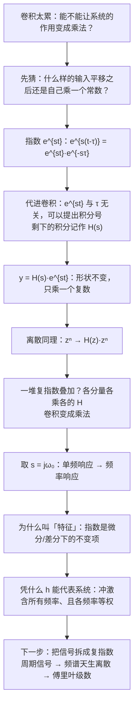

---

#### C3.1 · 这一讲的三句话

1. **复指数是 LTI 系统的特征函数**：$e^{st}\to H(s)e^{st}$，$z^n\to H(z)z^n$——形状不变，只乘一个复数；而 $H(s)$ 就是 $y(t)/x(t)$，把输入除掉就把系统单独捞出来了。
2. **$H$ 与 $h$ 是同一个系统的两个面**：$H(s)=\int h(\tau)e^{-s\tau}d\tau$（拉普拉斯变换，第 9 章）、$H(z)=\sum h[k]z^{-k}$（Z 变换，第 10 章）。取 $s=j\omega_0$ 就得到该频率的单频响应；把 $\omega$ 全扫一遍就是频率响应 $H(j\omega)$。
3. **输入是复指数的组合 ⇒ 输出 = 各分量各乘各的 $H$**，卷积变乘法；下一步就是把信号拆成复指数——周期信号只能拆成基频的整数倍（谐波），所以它的频谱天生离散。

> [!tip] 速查表
> | | 连续 | 离散 |
> |---|---|---|
> | 特征函数 | $e^{st}$，$s=\sigma+j\omega$ | $z^n$，$z=re^{j\omega}$ |
> | 特征值 / 系统函数 | $H(s)=\int h(\tau)e^{-s\tau}d\tau$ | $H(z)=\sum_kh[k]z^{-k}$ |
> | 对应变换 | 拉普拉斯变换（Ch.9） | Z 变换（Ch.10） |
> | 频率响应 | $H(j\omega)$（取 $s=j\omega$） | $H(e^{j\omega})$（取 $z=e^{j\omega}$，周期 $2\pi$） |
> | 组合输入 | $\sum a_ke^{s_kt}\to\sum a_kH(s_k)e^{s_kt}$ | $\sum a_kz_k^n\to\sum a_kH(z_k)z_k^n$ |
> | 延迟 $t_0$ | $H(j\omega)=e^{-j\omega t_0}$ | $H(e^{j\omega})=e^{-j\omega n_0}$ |
> | 为什么叫特征 | $e^{st}$ 求导仍是自己乘 $s$ | $r^n$ 差分仍是自己乘 $(1-1/r)$ |

> [!tip] 下一讲预告
> 我们需要把信号拆成复指数。对**周期**信号，拆法出奇地整齐：只用基频的整数倍 $k\omega_0$ 就够了，每个分量的系数用一个积分就能算出来——靠的是 [[C1.3 指数信号与正弦信号]] 里证过的**正交性**。下一讲，傅里叶级数正式登场：综合公式、分析公式，以及怎么从幅度谱和相位谱读出信号的形状。

---

#### C3.1 · 相关笔记 Related Notes

- 相关：[[C1.3 指数信号与正弦信号]]（谐波集、正交性、特征函数视角）、[[C2.3 LTI系统的性质]]（卷积与级联——特征函数性质与它同源）、[[C2.5 差分方程与离散时间系统求解]]（特征根、$r^n$ 与极坐标写法）、[[L01 绪论 Introduction]]（方波的傅里叶合成）

- 上一讲：[[C2.7 奇异函数]]
- 下一讲：[[C3.2 连续时间傅里叶级数]]
- 返回：[[信号与系统 MOC]]


### 17 · C3.2 · 原篇导读与复盘（历史快照）


以下完整保留原篇的任务导读、历史进度、三句话、速查、预告与相关链接。其“尚未讲授”等说法记录的是原篇当时状态；本讲义的课堂进度以篇首与第 18 节为准。来源材料名集中保留在本讲义来源清单与工作记录中。


#### C3.2 · 原篇导读


#### C3.2 · 3.3 连续时间周期信号的傅里叶级数 CTFS

> [!abstract] 这一讲的任务
> 从这一讲起，我们正式进入**频域**。
> 上一讲说：输入只要是复指数的线性组合，LTI 系统的作用就成了乘法。这一讲兑现前提——**任何（满足条件的）周期信号都能写成复指数的线性组合**，而且只要基频的整数倍 $k\omega_0$ 就够了。
> 我们要拿到两个公式：**综合公式**（怎么用系数拼出信号）和**分析公式**（怎么从信号求出系数），并学会读**幅度谱**和**相位谱**。
> **课堂原话：第一个公式要记住；周期方波那条"占空比 × Sa 函数"的结论要背下来；归一化的 sinc 写法不要求背。**

> [!note] 这一章在第 3–5 章里的位置
> 老师把第 3、4、5 章串起来讲，分工是这样的：
> - **第 3 章**：周期信号的工具——连续时间傅里叶级数 CTFS、离散时间傅里叶级数 DTFS；
> - **第 4 章**：第 3 章**第一部分的延伸**。把周期 $T_0$ 推向无穷大，周期信号变成非周期信号，级数变成**连续时间傅里叶变换 CTFT**；
> - **第 5 章**：DTFS 的延伸，**离散时间傅里叶变换 DTFT**，管离散非周期信号。
>
> 一条主线贯穿这三章：**时域周期 ⇒ 频谱离散**（用级数，式子是求和）；**时域非周期 ⇒ 频谱连续**（用变换，式子是积分）。这一讲先把"离散"这一半说清楚，第 4、5 章做的事就是取极限，把离散的谱线连成连续的谱。

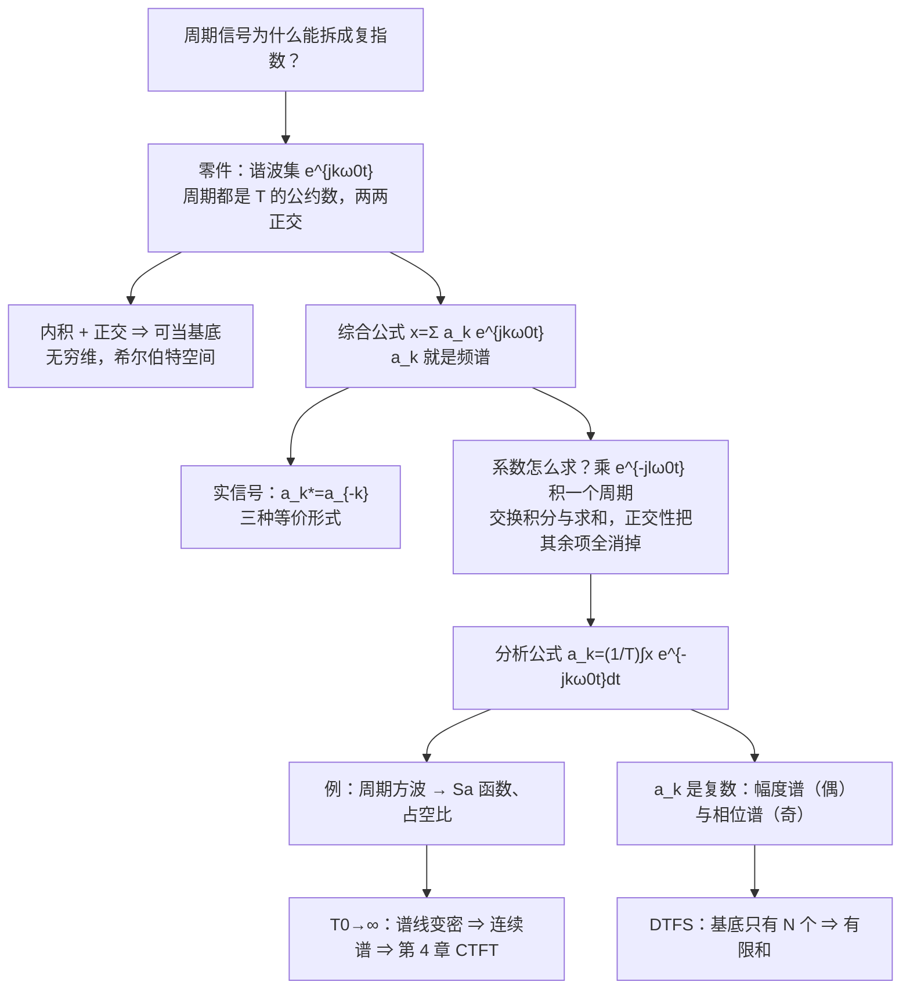

---

#### C3.2 · 这一讲的三句话

1. **周期信号只需要 $k\omega_0$ 这些频率**：谐波集两两正交，可以当一组（无穷维的）基底，$a_k$ 是信号在第 $k$ 根基上的坐标——它就是**频谱**；所以周期信号的谱是**离散**的谱线。
2. **系数靠正交性求**：$a_k=\frac1T\int_Tx(t)e^{-jk\omega_0t}dt$；$a_k$ 一般是复数，实信号满足 $a_k^*=a_{-k}$（幅度谱偶、相位谱奇），所以通常要画**幅度谱和相位谱两张图**。
3. **周期方波的系数是 Sa 函数**：$a_k=\frac{2T_1}{T_0}\mathrm{Sa}(k\omega_0T_1)$（要背）；脉冲越窄频谱越宽，周期越长谱线越密——这是走向傅里叶变换的桥。

> [!tip] 速查表
> | 项目 | 公式 |
> |---|---|
> | 综合公式 | $x(t)=\sum_{k}a_ke^{jk\omega_0t}$，$\omega_0=2\pi/T$ |
> | 分析公式 | $a_k=\frac1T\int_Tx(t)e^{-jk\omega_0t}dt$ |
> | 正交性 | $\int_Te^{jk\omega_0t}e^{-jl\omega_0t}dt=T\delta_{kl}$（内积用负共轭） |
> | 直流分量 | $a_0=\frac1T\int_Tx\,dt$（周期平均值） |
> | 实信号 | $a_k^*=a_{-k}$；$x=a_0+\sum_{k\ge1}2A_k\cos(k\omega_0t+\theta_k)$ |
> | 相位与平移 | $\cos(\omega_0t+\varphi)$ 峰值在 $t=-\varphi/\omega_0$：**加号=提前（左移）** |
> | $\cos(k\omega_0t)$ | $a_{\pm k}=\frac12$ |
> | $\sin(k\omega_0t)$ | $a_k=\frac1{2j}=-\frac j2$，$a_{-k}=\frac j2$ |
> | 周期方波 | $a_k=\frac{2T_1}{T_0}\mathrm{Sa}(k\omega_0T_1)$，占空比 $\frac{2T_1}{T_0}$ |
> | 主瓣边界 | $\mathrm{Sa}$ 第一个零点：$k\omega_0T_1=\pi$ ⇔ $\omega=\pi/T_1$（只由脉宽定） |
> | Sa / sinc | $\mathrm{Sa}(x)=\frac{\sin x}{x}$；$\mathrm{sinc}(x)=\frac{\sin\pi x}{\pi x}=\mathrm{Sa}(\pi x)$ |

> [!tip] 下一讲预告
> 老师在第 11 节课最后说了：**下节课讲傅里叶级数的性质**。
> 阅读链条上的下一篇（收敛性与吉布斯现象）是原稿里排在性质之前的一节，它回答的是"无穷多项加起来真的等于原信号吗"——可方波明明有跳变，光滑的正弦怎么拼出一个断崖？项数加到一百、一千，跳变处的尖峰为什么始终顽固地高出约 9%？读完这一节，正好接上下节课的性质。

---

#### C3.2 · 相关笔记 Related Notes

- 相关：[[C1.3 指数信号与正弦信号]]（谐波集与正交性证明）、[[L01 绪论 Introduction]]（三种形式、方波合成）、[[C3.5 离散时间傅里叶级数DTFS及性质]]（离散版的两个公式与"基底只有 $N$ 个"）

- 上一讲：[[C3.1 复指数是LTI系统的特征函数]]
- 下一讲：[[C3.3 傅里叶级数的收敛与吉布斯现象]]
- 返回：[[信号与系统 MOC]]


### 17 · C3.3 · 原篇导读与复盘（历史快照）


以下完整保留原篇的任务导读、历史进度、三句话、速查、预告与相关链接。其“尚未讲授”等说法记录的是原篇当时状态；本讲义的课堂进度以篇首与第 18 节为准。来源材料名集中保留在本讲义来源清单与工作记录中。


#### C3.3 · 原篇导读


#### C3.3 · 3.4 傅里叶级数的收敛与吉布斯现象

> [!abstract] 这一讲的任务
> 上一讲默认了“无穷多项加起来就等于原信号”。这一讲把这件事问清楚：
> 1. **只取有限项时**，傅里叶系数是不是最好的选择？——是，在**均方误差最小**的意义下；
> 2. **什么样的信号**，级数一定收敛？——平方可积条件、狄利克雷条件；
> 3. **在跳变处**会发生什么？——吉布斯现象：约 9% 的过冲永远消不掉。

> [!info] 授课进度说明
> 课堂转写稿覆盖到**第 12 节课**。第 11 节课讲完了 CTFS 的全部主干（[[C3.2 连续时间傅里叶级数]]）与 DTFS 的公式推导，并在讲周期方波频谱时**顺带点了一句收敛的直观**（见 §2）；第 12 节课在推 CTFT 时也只用到"这个积分必须收敛、必须是一个有限值"这一层（[[C4.1 非周期信号的表示：连续时间傅里叶变换]] §1.2）。**本篇的主体——有限项最优近似、狄利克雷条件、吉布斯现象——尚未在课堂上讲授**，因此这部分暂不逐条标注「拓展」。
> 第 11 节课说过"下节课讲性质"，但第 12 节课先跳到第 4、5 章串讲公式，所以本篇仍然排在阅读链条的中间。

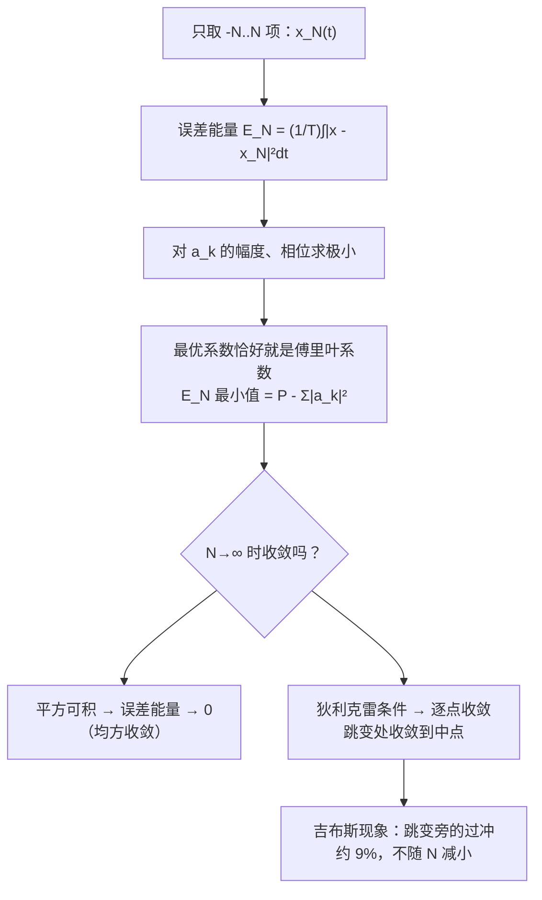

---

#### C3.3 · 这一讲的三句话

1. **傅里叶系数是最佳有限项逼近**：在均方误差最小的意义下，最优系数就是分析公式给出的 $a_k$，且加项时旧系数不变；最小误差 $E_N=P-\sum_{-N}^{N}|a_k|^2$。
2. **收敛有两套充分条件**：平方可积 ⇒ 误差能量 → 0；狄利克雷三条件（绝对可积、极值有限、跳变有限）⇒ 连续点处逐点收敛，跳变点处收敛到中点。
3. **吉布斯现象**：跳变旁的过冲约 9%，不随 $N$ 减小，只是越来越窄——均方收敛不等于一致收敛。

> [!tip] 速查表
> | 项目 | 内容 |
> |---|---|
> | 截断级数 | $x_N=\sum_{-N}^{N}a_ke^{jk\omega_0t}$ |
> | 误差能量 | $E_N=\frac1T\int_T\lvert x-x_N\rvert^2dt$，最小值 $=\frac1T\int_T\lvert x\rvert^2dt-\sum_{-N}^N\lvert a_k\rvert^2$ |
> | 最优系数 | LMS 准则下 = 傅里叶系数（两个自由度：$\varphi_k=\theta_k$，$A_k=B_k/T$） |
> | 平方可积 | $\int_T\lvert x\rvert^2dt<\infty$ ⇒ 均方收敛 |
> | 狄利克雷 1 | $\int_T\lvert x\rvertdt<\infty$（反例 $\frac1t$） |
> | 狄利克雷 2 | 一个周期内极值有限（反例 $\sin\frac{2\pi}t$） |
> | 狄利克雷 3 | 一个周期内跳变有限且有界（反例：无限阶梯） |
> | 跳变点 | 收敛到左右极限的平均值 |
> | 吉布斯过冲 | $\frac1\pi\mathrm{Si}(\pi)-\frac12\approx8.95\%$ ≈ 9% 的跳变高度 |

> [!tip] 下一讲预告
> 每次都用分析公式积分太累了。如果已知 $x(t)$ 的系数，那么 $x(t-t_0)$、$x(-t)$、$\frac{dx}{dt}$、$x(t)y(t)$ 的系数能不能直接写出来？下一讲的**傅里叶级数性质**就是一张“免积分”的对照表，外加帕塞瓦尔定理：时域功率 = 各谐波功率之和。

---

#### C3.3 · 相关笔记 Related Notes

- 相关：[[L01 绪论 Introduction]]（方波合成动画的来源）、[[C3.6 傅里叶级数与LTI系统、滤波]]（理想低通与吉布斯振铃）

- 上一讲：[[C3.2 连续时间傅里叶级数]]
- 下一讲：[[C3.4 连续时间傅里叶级数的性质]]
- 返回：[[信号与系统 MOC]]


### 17 · C3.4 · 原篇导读与复盘（历史快照）


以下完整保留原篇的任务导读、历史进度、三句话、速查、预告与相关链接。其“尚未讲授”等说法记录的是原篇当时状态；本讲义的课堂进度以篇首与第 18 节为准。来源材料名集中保留在本讲义来源清单与工作记录中。


#### C3.4 · 原篇导读


#### C3.4 · 3.5 连续时间傅里叶级数的性质

> [!abstract] 这一讲的任务
> 分析公式每用一次都要积分。这一讲建立一张**“免积分对照表”**：已知 $x(t)\leftrightarrow a_k$，那么对 $x(t)$ 做平移、反转、缩放、求导、相乘、卷积之后，新系数都能**直接写出来**。
> 外加一条功率守恒定律——**帕塞瓦尔定理**：时域平均功率 = 各次谐波功率之和。
> 性质的价值在做题时体现：冲激串、周期方波这两个例子都是“查表 + 两步推导”，一次积分都不用做。

> [!info] 授课进度说明
> 课堂转写稿覆盖到**第 12 节课**，但第 3 章的课堂进度停在 CTFS 主干、DTFS 公式与离散周期方波（[[C3.2 连续时间傅里叶级数]]、[[C3.5 离散时间傅里叶级数DTFS及性质]]）；本篇所讲的性质（p.28 起）**尚未在课堂上讲授**，因此全篇不逐条标注「拓展」。
> 等课堂上讲到这一节，会按与第 1、2 章相同的规则（标题后加 **（拓展）**、段落前加 **【拓展】**）标出课堂尚未讲到的部分。

记号：$x(t)\xleftrightarrow{\mathcal{FS}}a_k$，$y(t)\xleftrightarrow{\mathcal{FS}}b_k$，两者周期都是 $T$，$\omega_0=\frac{2\pi}{T}$。

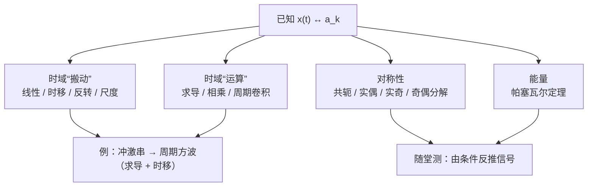

---

#### C3.4 · 这一讲的三句话

1. **时域的搬动与运算，在系数上都有简单对应**：时移乘相位因子、反转翻系数、求导乘 $jk\omega_0$、相乘变卷积、周期卷积变相乘（带 $T$）。
2. **对称性决定系数的“形状”**：实信号共轭对称（幅偶相奇）；实偶 → 实偶系数；实奇 → 纯虚奇系数；偶部管实部、奇部管虚部。
3. **帕塞瓦尔：功率在时域和频域守恒**，$\frac1T\int_T|x|^2dt=\sum|a_k|^2$；方波约 90% 的功率在主瓣内。

> [!tip] 速查表
> | 想求 | 办法 |
> |---|---|
> | 分段常数信号的 $a_k$ | 求导 → 冲激串（$a_k=\frac1T$）+ 时移 → 除以 $jk\omega_0$；$a_0$ 单独算 |
> | 平移过的方波 | 标准方波 $\frac{2T_1}{T_0}\mathrm{Sa}(k\omega_0T_1)$ × $e^{-jk\omega_0t_0}$，再加减常数（只改 $a_0$） |
> | 平均功率 | 时域 $\frac1T\int_T\lvert x\rvert^2dt$ 或频域 $\sum\lvert a_k\rvert^2$，哪个好算用哪个 |
> | 某频带内的功率 | 数出区间内的 $k$，求 $\sum\lvert a_k\rvert^2$ |
> | 由条件反推信号 | 对称性定 $a_k$ 的形式 → 帕塞瓦尔定模长 → 合成 |

> [!tip] 下一讲预告
> 到目前为止都是连续时间。离散时间周期信号 $x[n]$ 也能展开吗？会有一个关键差别：$e^{jk\omega_0n}$ 在 $k$ 上**以 $N$ 为周期重复**，所以离散傅里叶级数只有 **$N$ 项**，是有限和——没有收敛问题，也就没有吉布斯现象。这正是计算机能直接计算的傅里叶变换（DFT/FFT）的起点。

---

#### C3.4 · 相关笔记 Related Notes

- 相关：[[C3.2 连续时间傅里叶级数]]（方波系数与 Sa 函数）、[[C2.7 奇异函数]]（冲激的抽样性质）、[[C1.2 自变量的变换]]（时移、反转、尺度）

- 上一讲：[[C3.3 傅里叶级数的收敛与吉布斯现象]]
- 下一讲：[[C3.5 离散时间傅里叶级数DTFS及性质]]
- 返回：[[信号与系统 MOC]]


### 17 · C3.5 · 原篇导读与复盘（历史快照）


以下完整保留原篇的任务导读、历史进度、三句话、速查、预告与相关链接。其“尚未讲授”等说法记录的是原篇当时状态；本讲义的课堂进度以篇首与第 18 节为准。来源材料名集中保留在本讲义来源清单与工作记录中。


#### C3.5 · 原篇导读


#### C3.5 · 3.6–3.7 离散时间傅里叶级数 DTFS 及其性质

> [!abstract] 这一讲的任务
> 把傅里叶级数搬到离散时间：周期为 $N$ 的序列 $x[n]$ 也能拆成复指数之和。
> 和连续时间相比，最大的不同只有一条：**离散复指数 $e^{jk(2\pi/N)n}$ 在 $k$ 上以 $N$ 为周期重复**，所以本质不同的零件只有 $N$ 个。
> 由此引出三个后果：级数是**有限和**（$N$ 项）；系数 $a_k$ 也**以 $N$ 为周期**；**没有收敛问题，没有吉布斯现象**。

> [!info] 授课进度说明
> 课堂转写稿覆盖到**第 12 节课**。第 11 节课把本篇的**主干**讲完了：谐波集的周期性、正交性、DTFS 的综合与分析公式，以及与 CTFS 的本质区别（无穷维 vs $N$ 维）——老师是把它和 CTFS 放在一起"串讲"的，还教了对比记忆的方法。
> **第 12 节课又补讲了 §4 例 2（离散周期方波）**：取对称的一个周期、等比级数求和、再提出半角因子凑成正弦，得到 $\sin/\sin$ 那条式子；老师把"提出一半指数"当成这门课通用的一个计算技巧专门讲了一遍（见 §4 的「半角技巧」）。
> **尚未讲授**：§3 例 1（余弦序列）、§5 随堂测、§6 的性质部分。这部分仍按原稿整理，暂不逐条标注「拓展」。

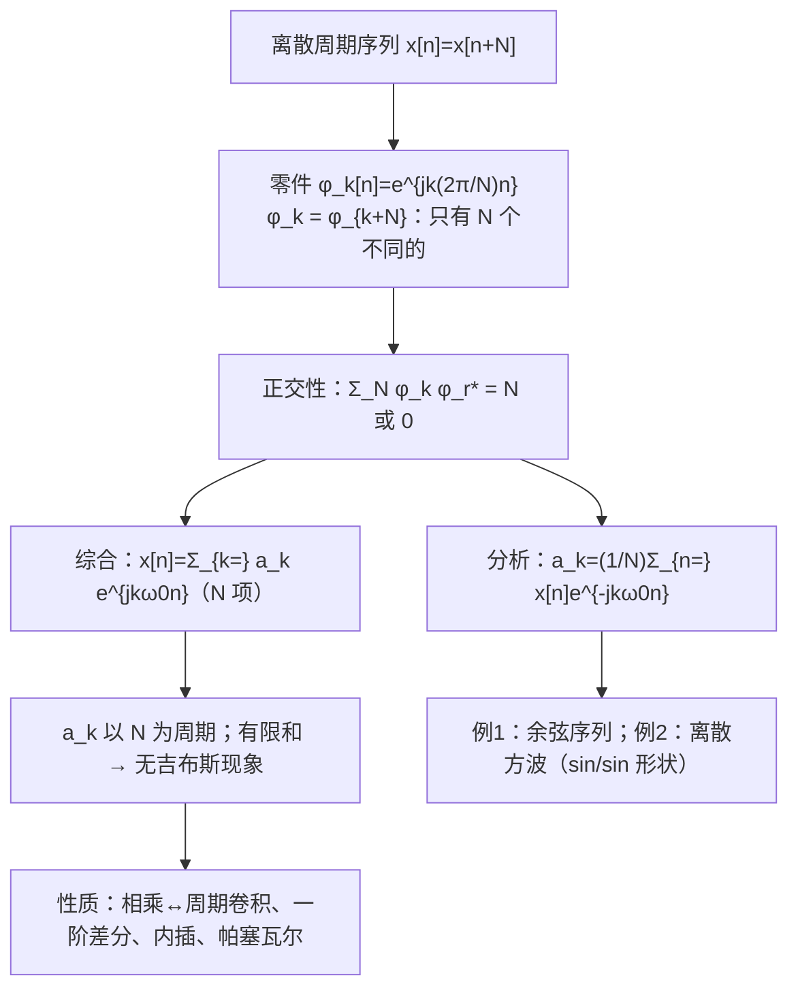

---

#### C3.5 · 这一讲的三句话

1. **离散零件只有 $N$ 个**：$e^{jk(2\pi/N)n}$ 在 $k$ 上以 $N$ 为周期，所以 $x[n]=\sum_{k=\langle N\rangle}a_ke^{jk\omega_0n}$，$a_k=\frac1N\sum_{n=\langle N\rangle}x[n]e^{-jk\omega_0n}$，两边都是 $N$ 项有限和。
2. **系数也以 $N$ 为周期**，谱图要画出重复；有限和精确成立，**没有收敛问题，没有吉布斯现象**。
3. **性质与连续时间基本对应**：相乘 ↔ 系数周期卷积，差分 ↔ 乘 $1-e^{-jk\omega_0}$，内插零 ↔ 系数除以 $m$、周期变 $mN$，帕塞瓦尔照样成立。

> [!tip] 速查表
> | 项目 | 连续时间 CTFS | 离散时间 DTFS |
> |---|---|---|
> | 基频 | $\omega_0=\frac{2\pi}T$ | $\omega_0=\frac{2\pi}N$ |
> | 综合 | $\sum_{k=-\infty}^{\infty}a_ke^{jk\omega_0t}$ | $\sum_{k=\langle N\rangle}a_ke^{jk\omega_0n}$ |
> | 分析 | $\frac1T\int_Tx(t)e^{-jk\omega_0t}dt$ | $\frac1N\sum_{n=\langle N\rangle}x[n]e^{-jk\omega_0n}$ |
> | 系数 | 非周期，一般无穷多 | 以 $N$ 为周期，$N$ 个 |
> | 收敛 | 需要条件，有吉布斯现象 | 有限和，无收敛问题 |
> | 方波 | $\frac{2T_1}{T}\frac{\sin(k\omega_0T_1)}{k\omega_0T_1}$ | $\frac1N\frac{\sin[2\pi k(N_1+1/2)/N]}{\sin(\pi k/N)}$ |
> | 相乘 | $\sum_{l=-\infty}^{\infty}a_lb_{k-l}$ | $\sum_{l=\langle N\rangle}a_lb_{k-l}$ |
> | 微分 / 差分 | $jk\omega_0a_k$ | $(1-e^{-jk\omega_0})a_k$ |
| 帕塞瓦尔 | $\frac1T\int_T\lvert x\rvert^2=\sum\lvert a_k\rvert^2$ | $\frac1N\sum_{\langle N\rangle}\lvert x\rvert^2=\sum_{\langle N\rangle}\lvert a_k\rvert^2$ |

> [!tip] 下一讲预告
> 傅里叶级数终于可以回到第一讲的出发点：**LTI 系统**。输入是 $\sum a_ke^{jk\omega_0t}$，每个分量过系统只乘一个 $H(jk\omega_0)$——输出系数 $b_k=a_kH(jk\omega_0)$。于是“设计一个系统”就变成“设计一条 $H$ 曲线”：让某些频率通过、某些频率被挡住，这就是**滤波**。

---

#### C3.5 · 相关笔记 Related Notes

- 相关：[[C1.3 指数信号与正弦信号]]（离散复指数的周期性）、[[C3.2 连续时间傅里叶级数]]（连续版的推导）、[[C2.1 离散时间LTI系统与卷积和]]（离散卷积）

- 上一讲：[[C3.4 连续时间傅里叶级数的性质]]
- 下一讲：[[C3.6 傅里叶级数与LTI系统、滤波]]
- 返回：[[信号与系统 MOC]]


### 17 · C3.6 · 原篇导读与复盘（历史快照）


以下完整保留原篇的任务导读、历史进度、三句话、速查、预告与相关链接。其“尚未讲授”等说法记录的是原篇当时状态；本讲义的课堂进度以篇首与第 18 节为准。来源材料名集中保留在本讲义来源清单与工作记录中。


#### C3.6 · 原篇导读


#### C3.6 · 3.8–3.9 傅里叶级数与 LTI 系统、滤波

> [!abstract] 这一讲的任务
> 第三章的闭环：[[C3.1 复指数是LTI系统的特征函数]] 说复指数过 LTI 系统只乘一个复数；[[C3.2 连续时间傅里叶级数]] 到 [[C3.5 离散时间傅里叶级数DTFS及性质]] 说周期信号可以拆成复指数之和。两者合起来：
> $$\text{输出系数}=\text{输入系数}\times\text{频率响应在该频率的值}$$
> **卷积变成了乘法。** 再往前一步，“设计系统”就变成“设计频率响应曲线”——哪些频率放行、哪些频率挡住，这就是**滤波**。

> [!info] 授课进度说明
> 课堂转写稿覆盖到**第 12 节课**，但第 3 章的课堂进度停在 CTFS 主干、DTFS 公式与离散周期方波（[[C3.2 连续时间傅里叶级数]]、[[C3.5 离散时间傅里叶级数DTFS及性质]]）；本篇所讲的内容（p.69 起）**尚未在课堂上讲授**，因此全篇不逐条标注「拓展」。
> 等课堂上讲到这一节，会按与第 1、2 章相同的规则（标题后加 **（拓展）**、段落前加 **【拓展】**）标出课堂尚未讲到的部分。

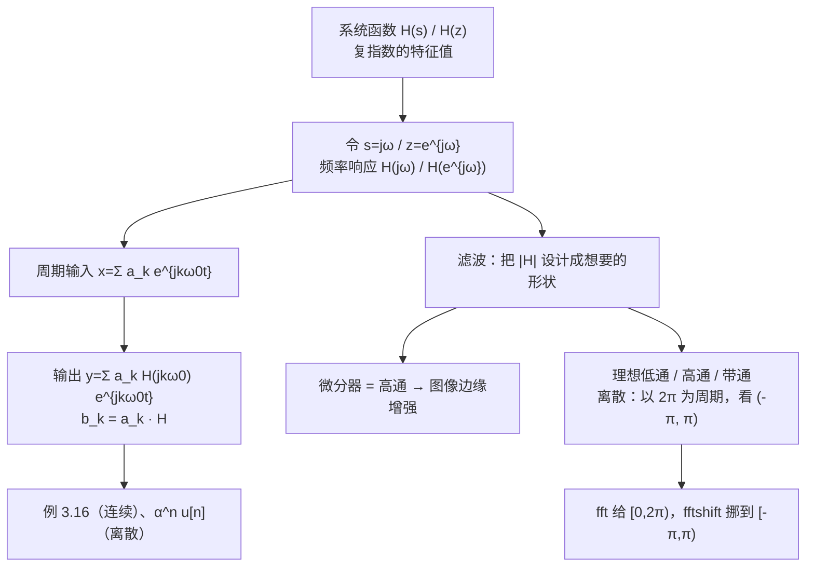

---

#### C3.6 · 这一讲的三句话

1. **周期信号过 LTI 系统：$b_k=a_k\cdot H(jk\omega_0)$**（离散 $b_k=a_k\cdot H(e^{jk2\pi/N})$）。频率不变，每个谐波的幅度乘 $|H|$、相位加 $\angle H$——卷积变成了乘法。
2. **频率响应 $H(j\omega)$ / $H(e^{j\omega})$ 就是系统的“频率档案”**，可由 $h$ 积分 / 求和得到，也可由微分 / 差分方程代入复指数直接得到。
3. **滤波就是设计 $|H|$ 的形状**：微分器 $|H|=|\omega|$ 是高通（边缘增强）；理想低通 / 高通 / 带通；离散时间最高频是 $\pi$，频率响应以 $2\pi$ 为周期。

> [!tip] 速查表
> | 项目 | 连续时间 | 离散时间 |
> |---|---|---|
> | 系统函数 | $H(s)=\int h(\tau)e^{-s\tau}d\tau$ | $H(z)=\sum h[k]z^{-k}$ |
> | 频率响应 | $H(j\omega)=\int h(t)e^{-j\omega t}dt$ | $H(e^{j\omega})=\sum h[n]e^{-j\omega n}$（周期 $2\pi$） |
> | 周期输入的输出 | $b_k=a_kH(jk\omega_0)$ | $b_k=a_kH(e^{jk2\pi/N})$ |
> | 正弦输入 | $\cos(\omega_1t)\to\lvert H\rvert\cos(\omega_1t+\angle H)$ | 同左 |
> | 常用 $H$ | $e^{-at}u(t)\to\frac1{a+j\omega}$；微分器 $j\omega$ | $\alpha^nu[n]\to\frac1{1-\alpha e^{-j\omega}}$ |
> | 由方程求 $H$ | 代 $x=e^{j\omega t}$，$y=He^{j\omega t}$ | 代 $x=e^{j\omega n}$，$y=He^{j\omega n}$ |
> | 最高频率 | $\omega\to\infty$ | $\omega=\pi$ |
> | 计算机频谱 | — | `fft`：$[0,2\pi)$；`fftshift`：$[-\pi,\pi)$ |

> [!tip] 下一章预告
> 第三章只处理了**周期**信号。可现实中的大多数信号——一段语音、一次敲击、一个脉冲——都不是周期的。[[C3.2 连续时间傅里叶级数]] 里已经看到：周期 $T\to\infty$ 时，谱线越来越密，最终连成连续的曲线。第四章把这个极限做出来，得到**连续时间傅里叶变换** $X(j\omega)$，本讲的 $H(j\omega)$ 正是 $h(t)$ 的傅里叶变换。

---

#### C3.6 · 相关笔记 Related Notes

- 本章开头：[[C3.1 复指数是LTI系统的特征函数]]
- 相关：[[C2.7 奇异函数]]（$\delta'(t)$ 的性质）、[[C2.5 差分方程与离散时间系统求解]]（差分方程）、[[C1.5 连续时间与离散时间系统]]（RC 电路）、[[C3.3 傅里叶级数的收敛与吉布斯现象]]（理想低通截断与振铃）

- 上一讲：[[C3.5 离散时间傅里叶级数DTFS及性质]]
- 下一讲：第 4 章《连续时间傅里叶变换》（笔记尚未建立）
- 返回：[[信号与系统 MOC]]


### 17 · C4.1 · 原篇导读与复盘（历史快照）


以下完整保留原篇的任务导读、历史进度、三句话、速查、预告与相关链接。其“尚未讲授”等说法记录的是原篇当时状态；本讲义的课堂进度以篇首与第 18 节为准。来源材料名集中保留在本讲义来源清单与工作记录中。


#### C4.1 · 原篇导读


#### C4.1 · 4.1 非周期信号的表示：连续时间傅里叶变换 CTFT

> [!abstract] 这一讲的任务
> 第 3 章的整套工具都建立在一个前提上：**信号是周期的**——正因为每个零件都得跟着同一个周期 $T$ 重复，可用频率才会被锁死在 $\omega_0$ 的整数倍上，频谱才是一根根离散的谱线。
> 可现实里的信号大多**只发生一次**：一声鼓掌、一次心跳、一段语音里的爆破音，它们没有周期、没有 $\omega_0$，第 3 章那一排推子根本摆不出来。
> 这一讲要干的事只有一件：**把周期推到无穷**，让离散的谱线无限密下去、连成一条连续曲线。这条曲线就是**连续时间傅里叶变换 CTFT** $X(j\omega)$。
> 拿到两个公式之后，一口气算完六个基本变换对，并看清 CTFT 里最反复出现的那条规律：**时域越窄，频域越宽**。

> [!info] 授课进度说明
> 课堂转写稿已覆盖到**第 12 节课**，第 4 章由这一节课开讲，本篇的进度是"讲了一半"：
> - **已讲授**：§1 全节（为什么必须盯 $Ta_k$、三处替换、两个公式、与 CTFS 的换算）、§3.3 冲激、§3.4 矩形脉冲（**两种求法都讲了**）、§4 对偶；§2 的收敛只顺带说了"积分必须有意义（收敛）"这一层，狄利克雷条件没讲。
> - **尚未讲授**：§2 的收敛条件、§3.1 / §3.2 两个指数变换对、§3.5 理想低通、§3.6 常数与复指数、§5 随堂测。老师当堂明确说"第四章就先说这些吧，其他内容我们下节课再讲"。
> 因此本篇仍未逐条标注「拓展」；等第 4 章讲完再回填标记。

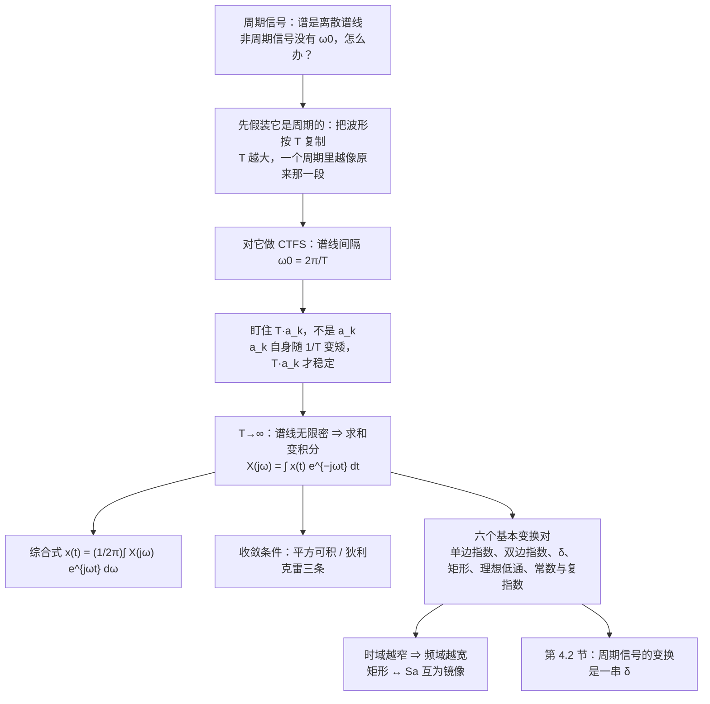

---

#### C4.1 · 这一讲的三句话

1. **非周期信号的频谱是连续的**：把周期推到无穷，谱线无限密 $\Rightarrow$ 求和变积分，得到 $X(j\omega)=\int x(t)e^{-j\omega t}dt$ 与 $x(t)=\frac{1}{2\pi}\int X(j\omega)e^{j\omega t}d\omega$。
2. **级数与变换是同一件事的两个尺度**：$a_k=\frac1T X(j\omega)\big|_{\omega=k\omega_0}$；逐根谱线看不出规律——**$\frac1T$ 把谱线一路压低，只有乘上 $T$ 之后才会收敛到那条固定的包络**。
3. **时域越窄、频域越宽**：$\delta(t)\leftrightarrow1$、矩形 $\leftrightarrow$ Sa、常数 $\leftrightarrow2\pi\delta(\omega)$，全是同一条对偶关系的极端情形。

> [!tip] 速查表
> | 项目 | 公式 |
> |---|---|
> | 分析式 | $X(j\omega)=\int_{-\infty}^{\infty}x(t)e^{-j\omega t}dt$ |
> | 综合式 | $x(t)=\frac{1}{2\pi}\int_{-\infty}^{\infty}X(j\omega)e^{j\omega t}d\omega$ |
> | 与 CTFS 的关系 | $a_k=\frac1TX(j\omega)\big\vert _{\omega=k\omega_0}$；$X(j\omega)=\lim\limits_{T\to\infty}Ta_k$ |
> | 频率变量换成 $f$ | $X(f)=\int x e^{-j2\pi ft}dt$，$x=\int X(f)e^{j2\pi ft}df$（$\frac{1}{2\pi}$ 消失） |
> | 收敛条件 | 平方可积 $\int\lvert x\rvert^2dt<\infty$；狄利克雷三条件（绝对可积、极值有限、间断有限） |
> | $e^{-at}u(t)$ | $\dfrac{1}{a+j\omega}$（$a>0$；半功率点 $\omega=\pm a$） |
> | $e^{-a\lvert t\rvert}$ | $\dfrac{2a}{a^2+\omega^2}$（实且偶 $\Rightarrow$ 频谱实且偶） |
> | $\delta(t)$ / $\delta(t-t_0)$ | $1$ / $e^{-j\omega t_0}$ |
> | 矩形脉冲（半宽 $T_1$） | $2T_1\mathrm{Sa}(\omega T_1)$，第一零点 $\omega=\frac{\pi}{T_1}$ |
> | 理想低通（$W$） | $X=1\,(\lvert\omega\rvert<W)\ \Leftrightarrow\ x(t)=\frac{W}{\pi}\mathrm{Sa}(Wt)$ |
> | $1$ / $e^{j\omega_0t}$ | $2\pi\delta(\omega)$ / $2\pi\delta(\omega-\omega_0)$ |
> | $\cos\omega_0t$ | $\pi\delta(\omega-\omega_0)+\pi\delta(\omega+\omega_0)$ |
> | 宽窄对偶 | 时域宽 $\Leftrightarrow$ 频域窄；矩形 $\leftrightarrow$ Sa，$\delta\leftrightarrow$ 常数 |
> | 自检套路 | 结果代回综合式（或分析式）看能否还原原信号；含 $\delta$ 的结果**不能用数值积分验算** |

> [!tip] 下一讲预告
> 现在有了非周期信号的变换，回头看周期信号反而有点别扭：$\cos\omega_0t$ **明明是最标准的周期信号，可第 3 章说它只有一根谱线，这一章又给它配了两个 $\delta$**。
> 下一节 4.2 就把这件事讲圆：**周期信号的傅里叶变换是一串等间隔的冲激**，冲激的位置是 $k\omega_0$、面积是 $2\pi a_k$。到那时，CTFS 与 CTFT 不再是两套工具，而是同一套工具在"离散频率点"上的取值。

---

#### C4.1 · 相关笔记 Related Notes

- 相关：[[C3.2 连续时间傅里叶级数]]（周期方波的 $\mathrm{Sa}$ 与占空比，本节的出发点）、[[C3.1 复指数是LTI系统的特征函数]]（为什么一条 $h$ 能代表系统）、[[C3.3 傅里叶级数的收敛与吉布斯现象]]（收敛与跳变处的过冲）、[[C1.5 连续时间与离散时间系统]]（RC 电路的 $\frac{1}{1+j\omega RC}$ 与例 4.1 同形）

- 上一讲：[[C3.6 傅里叶级数与LTI系统、滤波]]
- 下一讲：[[C4.2 周期信号的傅里叶变换]]
- 返回：[[信号与系统 MOC]]


### 17 · C4.2 · 原篇导读与复盘（历史快照）


以下完整保留原篇的任务导读、历史进度、三句话、速查、预告与相关链接。其“尚未讲授”等说法记录的是原篇当时状态；本讲义的课堂进度以篇首与第 18 节为准。来源材料名集中保留在本讲义来源清单与工作记录中。


#### C4.2 · 原篇导读


#### C4.2 · 4.2 周期信号的傅里叶变换

> [!abstract] 这一讲的任务
> 上一节刚把周期推到无穷，换来连续的频谱；这一节立刻**掉头往回看**：周期信号自己的傅里叶变换是什么样？
> 结论很短——**一串等间隔的冲激**，落在 $\omega=k\omega_0$ 上，第 $k$ 根的面积是 $2\pi a_k$。
> 但这一步不是多余的：**只有周期信号也有了 CTFT，整套性质（卷积、时移、调制、滤波）才能用同一套语言写下来**。否则每遇到一个正弦输入就得退回第 3 章重推一遍，第 5、6 章的系统分析就没法展开。
> 顺带得到一个漂亮的副产品：**冲激串的变换还是冲激串**——第 7 章采样定理的全部内容，就藏在这条式子里。

> [!info] 授课进度说明
> 课堂转写稿已覆盖到**第 12 节课**。第 12 节课在第 4 章讲了 §4.1 的全部主干，以及本篇的**一个例子**——§3.2 的**冲激串**（从 CTFS 一侧算出 $a_k=\frac1T$，为第 7 章采样定理铺路）。
> **尚未讲授**：§1 的一般推导（把 CTFS 代进综合式）、§2 的谱线对照读法、§3.1 正弦与余弦、§3.3 周期方波。老师当堂说第 4 章的其余内容"下节课再讲"，所以本篇**不逐条标注「拓展」**。

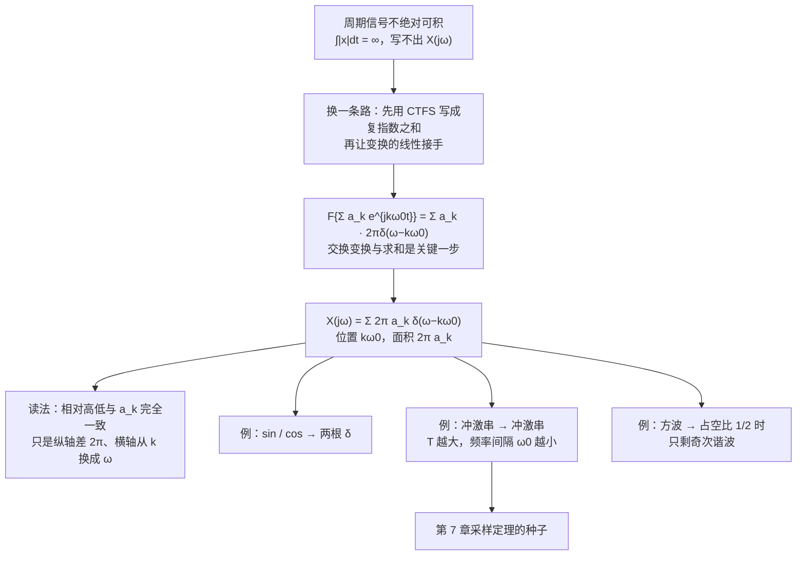

---

#### C4.2 · 这一讲的三句话

1. **周期信号的傅里叶变换是一串等间隔冲激**：$X(j\omega)=\sum\limits_k2\pi a_k\,\delta(\omega-k\omega_0)$——位置在谐波频率 $k\omega_0$，面积等于 $2\pi a_k$。
2. **冲激串的变换还是冲激串**：$\sum_n\delta(t-nT)\leftrightarrow\omega_0\sum_k\delta(\omega-k\omega_0)$，时域间隔与频域间隔成倒数（$T\omega_0=2\pi$）——"时域越宽频域越窄"的极端形态，也是第 7 章采样定理的种子。
3. **统一语言的意义**：只有周期信号也有了 CTFT，卷积、调制、滤波这些性质才能只写一遍；遇到周期输入时，$\delta$ 通过**抽样**把结论取到 $k\omega_0$ 上，就退回第 3 章的结果。

> [!tip] 速查表
> | 信号 | 傅里叶变换 |
> |---|---|
> | $\sum\limits_ka_ke^{jk\omega_0t}$ | $\sum\limits_k2\pi a_k\delta(\omega-k\omega_0)$ |
> | $e^{j\omega_0t}$ | $2\pi\delta(\omega-\omega_0)$ |
> | $\cos\omega_0t$ | $\pi\delta(\omega-\omega_0)+\pi\delta(\omega+\omega_0)$（面积实，相位 0） |
> | $\sin\omega_0t$ | $\frac{\pi}{j}\big[\delta(\omega-\omega_0)-\delta(\omega+\omega_0)\big]$（相位 $\pm\frac\pi2$） |
> | 冲激串 $\sum\limits_n\delta(t-nT)$ | $\omega_0\sum\limits_k\delta(\omega-k\omega_0)$，$\omega_0=\frac{2\pi}{T}$ |
> | 周期方波（脉宽 $2T_1$） | $\sum\limits_k\frac{2\sin(k\omega_0T_1)}{k}\delta(\omega-k\omega_0)$ |
> | 读图口径 | 冲激只有**面积**有意义（$=2\pi a_k$）；相对高低与 $a_k$ 图完全一致 |
> | 与 CTFS 的尺子 | 横轴 $k\to\omega=k\omega_0$；纵轴 $a_k\to2\pi a_k$ |

> [!tip] 下一讲预告
> 到这里我们手里有了两类信号的频谱：非周期的是连续曲线，周期的是冲激串。接下来该问"**这些频谱怎么用**"了。
> 4.3 节把 CTFT 的性质一条条推出来：时移、频移、共轭、尺度、对偶、**卷积**、**相乘**、微分、积分、帕塞瓦尔。这些性质才是后面所有系统分析的手柄——尤其是**卷积性质**，它让"时域卷积"变成"频域乘法"，也让"给一个微分方程、求频率响应"变成一步代数。

---

#### C4.2 · 相关笔记 Related Notes

- 相关：[[C4.1 非周期信号的表示：连续时间傅里叶变换]]（$e^{j\omega_0t}\to2\pi\delta$ 与宽窄对偶）、[[C3.2 连续时间傅里叶级数]]（$a_k$ 与占空比 × $\mathrm{Sa}$）、[[C1.4 单位冲激与单位阶跃函数]]（冲激串与抽样性质）

- 上一讲：[[C4.1 非周期信号的表示：连续时间傅里叶变换]]
- 下一讲：[[C4.3 连续时间傅里叶变换的性质]]
- 返回：[[信号与系统 MOC]]


### 17 · C4.3 · 原篇导读与复盘（历史快照）


以下完整保留原篇的任务导读、历史进度、三句话、速查、预告与相关链接。其“尚未讲授”等说法记录的是原篇当时状态；本讲义的课堂进度以篇首与第 18 节为准。来源材料名集中保留在本讲义来源清单与工作记录中。


#### C4.3 · 原篇导读


#### C4.3 · 4.3 连续时间傅里叶变换的性质

> [!abstract] 这一讲的任务
> 前两节把变换定义出来、又算了一批基本变换对。但真正让傅里叶方法"能干活"的不是定义，而是**性质**。
> 这一节要把 CTFT 的性质一条条推出来：**线性、时移、频移、共轭对称、尺度、反转、微分、积分、频域微分、对偶、帕塞瓦尔**。
> 每一条都是同一件事的两面：**时域里做一个动作，频域里就有一个对应的动作**——而且绝大多数时候，频域那边只是"乘一个因子"或"移动一下位置"。
> 学完的标志是：拿到一个新信号，**不再从定义积分，而是查表 + 用性质拼出来**。表 4.1（性质）与表 4.2（基本变换对）就是这套拼装工具的全部零件。

> [!info] 授课进度说明
> 课堂转写稿已覆盖到**第 12 节课**，但第 12 节课在第 4 章只讲到"把周期推到无穷"与冲激串，对应 [[C4.1 非周期信号的表示：连续时间傅里叶变换]] 与 [[C4.2 周期信号的傅里叶变换]]。
> **本篇的性质表尚未在课堂上讲授**（老师当堂说"第四章就先说这些吧，其他内容我们下节课再讲"），仍按原稿与教材整理，**不逐条标注「拓展」**。

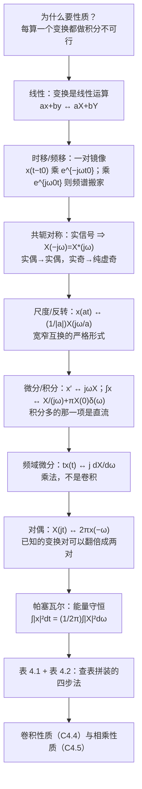

---

#### C4.3 · 这一讲的三句话

1. **每个时域动作在频域都有代价，而且大多只是"乘一个因子"或"挪一个位置"**：时移乘 $e^{-j\omega t_0}$、频移挪位置、微分乘 $j\omega$、积分除 $j\omega$（外加一项 $\pi X(0)\delta(\omega)$ 保住直流）、尺度变换把频谱拉宽压矮。
2. **实信号带来对称性**：$X(-j\omega)=X^*(j\omega)$ ⇒ 幅度谱偶、相位谱奇；实偶信号的频谱实且偶（算一半就够），实奇信号的频谱纯虚且奇——**算完必验一次，能拦下大半符号错误**。
3. **对偶与帕塞瓦尔是一对"白拿"的工具**：对偶让已知变换对翻倍（矩形 ↔ $\mathrm{Sa}$ 双向通吃），帕塞瓦尔让能量在时域与频域之间自由换算（$\int(\frac{\sin t}{t})^2dt=\pi$ 一行解决）。

> [!tip] 速查表
> | 性质 | 时域 | 频域 |
> |---|---|---|
> | 线性 | $ax+by$ | $aX+bY$ |
> | 时移 | $x(t-t_0)$ | $e^{-j\omega t_0}X(j\omega)$ |
> | 频移 | $e^{j\omega_0t}x(t)$ | $X(j(\omega-\omega_0))$ |
> | 共轭 | $x^*(t)$ | $X^*(-j\omega)$ |
> | 反转 | $x(-t)$ | $X(-j\omega)$ |
> | 尺度 | $x(at)$ | $\frac{1}{\lvert a\rvert}X(j\omega/a)$ |
> | 时域微分 | $x'(t)$ | $j\omega X(j\omega)$ |
> | 频域微分 | $tx(t)$ | $j\frac{d}{d\omega}X(j\omega)$ |
> | 积分 | $\int_{-\infty}^{t}x$ | $\frac{1}{j\omega}X(j\omega)+\pi X(0)\delta(\omega)$ |
> | 对偶 | $X(jt)$ | $2\pi x(-\omega)$ |
| 帕塞瓦尔 | $\int\lvert x\rvert^2dt$ | $\frac{1}{2\pi}\int\lvert X\rvert^2d\omega$ |
> | 实偶 / 实奇 | $x$ 实且偶 / 实且奇 | 实且偶 / 纯虚且奇 |
> | 特殊值 | $X(0)=\int x\,dt$ | $x(0)=\frac{1}{2\pi}\int Xd\omega$ |
> | $e^{-at}u(t)$ 族 | $\frac{t^{n-1}}{(n-1)!}e^{-at}u(t)$ | $\frac{1}{(a+j\omega)^n}$ |
> | 计算技巧 | 实偶信号只算 $\int x\cos\omega t\,dt$ | 相位谱是直线 ⇒ 只有纯延迟 |

> [!tip] 下一讲预告
> 性质表里有两行被刻意留空了讲——**卷积**与**相乘**。它们不是普通性质，而是整套傅里叶方法的两台发动机：
> - **卷积**：$x*y\leftrightarrow XY$。有了它，"时域卷积"变成"频域相乘"，而"解微分方程求系统响应"会塌缩成一次**代数除法**；
> - **相乘**：$x\cdot y\leftrightarrow\frac{1}{2\pi}X*Y$。有了它，调制、解调、采样、加窗全都能在频域一眼看懂。
> 下一节先讲卷积，并把"由线性常系数微分方程表征的系统"整块吃掉。

---

#### C4.3 · 相关笔记 Related Notes

- 相关：[[C4.1 非周期信号的表示：连续时间傅里叶变换]]（基本变换对与宽窄对偶）、[[C4.2 周期信号的傅里叶变换]]（冲激串）、[[C3.4 连续时间傅里叶级数的性质]]（级数版的同一批性质与帕塞瓦尔）、[[C2.3 LTI系统的性质]]（卷积的时域性质，可与本节的频域版本对照）

- 上一讲：[[C4.2 周期信号的傅里叶变换]]
- 下一讲：[[C4.4 卷积性质与由微分方程表征的系统]]
- 返回：[[信号与系统 MOC]]


### 17 · C4.4 · 原篇导读与复盘（历史快照）


以下完整保留原篇的任务导读、历史进度、三句话、速查、预告与相关链接。其“尚未讲授”等说法记录的是原篇当时状态；本讲义的课堂进度以篇首与第 18 节为准。来源材料名集中保留在本讲义来源清单与工作记录中。


#### C4.4 · 原篇导读


#### C4.4 · 4.4 卷积性质与由微分方程表征的系统

> [!abstract] 这一讲的任务
> 这一节把傅里叶方法变成一台**解题机器**。
> 第一步：**卷积性质**——$x(t)*h(t)\leftrightarrow X(j\omega)H(j\omega)$。时域里最麻烦的运算（卷积分）在频域里变成最简单的运算（乘法）。
> 第二步：把它用到 LTI 系统上，得到 $Y=XH$，于是"系统"这个黑箱在频域里只剩一条曲线 $H(j\omega)$（频率响应）。
> 第三步：现实中的系统往往是用**微分方程**给的。把 $\frac{d}{dt}$ 全部换成 $j\omega$，方程立刻变成代数式，**求解塌缩成一次有理分式的除法 + 部分分式展开**。
> 这一节就是第 2 章"解微分方程"与第 4 章"变换"合流的地方：原来要分齐次解、特解、初条件，现在只剩代数运算。

> [!info] 授课进度说明
> 课堂转写稿已覆盖到**第 12 节课**，但第 12 节课在第 4 章只讲到"把周期推到无穷"与冲激串，对应 [[C4.1 非周期信号的表示：连续时间傅里叶变换]] 与 [[C4.2 周期信号的傅里叶变换]]。
> **本篇的卷积性质与由微分方程求系统尚未在课堂上讲授**（老师当堂说"第四章就先说这些吧，其他内容我们下节课再讲"），仍按原稿与教材整理，**不逐条标注「拓展」**。

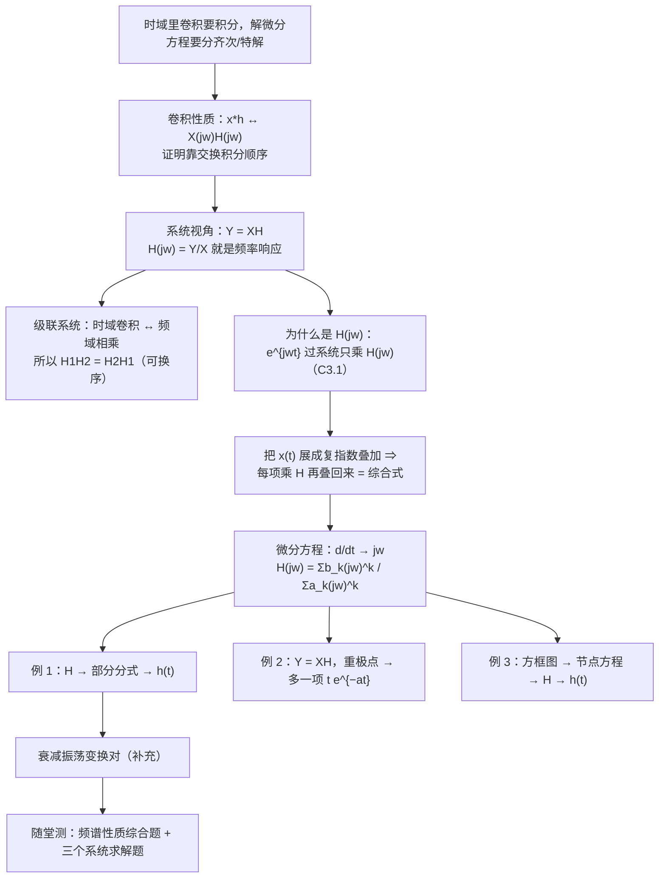

---

#### C4.4 · 这一讲的三句话

1. **卷积性质是整章的发动机**：$x*y\leftrightarrow XY$；时域里要分段积分的卷积，在频域只是一次乘法；级联系统因此变成频率响应相乘，可换序。
2. **微分方程在频域变成代数式**：把 $\frac{d}{dt}$ 换成 $j\omega$，得到 $H(j\omega)=\frac{\sum b_k(j\omega)^k}{\sum a_k(j\omega)^k}$；分母就是特征多项式（极点位置决定稳定性），求解只剩部分分式展开与查表。分子阶数不低于分母阶数时，$h(t)$ 里必然出现 $\delta(t)$。
3. **撞极点 = 乘 $t$**：输入频率撞上系统极点 ⇒ 频域出现重极点 ⇒ 时域多一项 $t^{n}e^{-at}$；这是第 2 章"特解撞特征根乘 $t$"的频域版本，也是例 2 与随堂测 2(b) 唯一的难点。

> [!tip] 速查表
> | 项目 | 公式 |
> |---|---|
> | 卷积性质 | $x(t)*y(t)\leftrightarrow X(j\omega)Y(j\omega)$ |
> | 系统 | $Y=XH$，$H(j\omega)=\mathcal F\{h(t)\}=Y/X$ |
> | 级联 | $h_1*h_2\leftrightarrow H_1H_2$（可换序） |
> | 微分方程 → $H$ | $H(j\omega)=\dfrac{\sum_{k=0}^{M}b_k(j\omega)^k}{\sum_{k=0}^{N}a_k(j\omega)^k}$ |
> | 分子阶 ≥ 分母阶 | $h(t)$ 里出现 $\delta(t)$ |
> | 遮盖法 | $A_i=[(j\omega-p_i)H(j\omega)]_{j\omega=p_i}$ |
> | 重极点 | 低阶系数需 $\frac1{m!}\frac{d^m}{d(j\omega)^m}[\cdots]$；时域多一项 $\frac{t^{m-1}}{(m-1)!}e^{-at}u(t)$ |
> | 一对共轭极点 | $\frac{a+j\omega}{(a+j\omega)^2+\omega_0^2}\leftrightarrow e^{-at}\cos\omega_0t\,u(t)$；$\frac{\omega_0}{\cdots}\leftrightarrow e^{-at}\sin\omega_0t\,u(t)$ |
> | 稳定性 | 极点全在左半平面（$\mathrm{Re}\{j\omega\text{ 的零点}\}<0$） |
> | 频谱性质取巧 | $X(j0)=\int x\,dt$；$\int Xd\omega=2\pi x(0)$；$\int\lvert X\rvert^2d\omega=2\pi\int\lvert x\rvert^2dt$；$\mathrm{Re}\{X\}\leftrightarrow x_e$ |

> [!tip] 下一讲预告
> 卷积性质解决的是"**系统对信号做了什么**"。还有一件同样重要的事：**两个信号相乘**的时候频谱怎么变？
> 答案在 4.5 节：$x(t)y(t)\leftrightarrow\frac{1}{2\pi}X(j\omega)*Y(j\omega)$——又是"卷积与乘法互换"，只不过这次换到了另一半。
> 有了它，就能一次说清**调制**（语音怎么搬上载波）、**同步解调**（收音机怎么把它搬回来）、**频分复用**（为什么一根线里能同时走很多路电话），以及"**加窗**"为什么会让频谱糊开。

---

#### C4.4 · 相关笔记 Related Notes

- 相关：[[C2.3 LTI系统的性质]]（卷积的时域性质：交换 / 分配 / 结合）、[[C2.6 LTI系统的方框图表示]]（同一张方框图的时域解法）、[[C2.4 微分方程与连续时间系统求解]]（零输入 / 零状态与"特解撞特征根乘 $t$"）、[[C3.1 复指数是LTI系统的特征函数]]（$e^{j\omega t}\to H(j\omega)e^{j\omega t}$）、[[C3.6 傅里叶级数与LTI系统、滤波]]（级数版的 $b_k=a_kH$）、[[C4.3 连续时间傅里叶变换的性质]]（时移、微分、频域微分等性质的出处）

- 上一讲：[[C4.3 连续时间傅里叶变换的性质]]
- 下一讲：[[C4.5 相乘性质与调制]]
- 返回：[[信号与系统 MOC]]


### 17 · C4.5 · 原篇导读与复盘（历史快照）


以下完整保留原篇的任务导读、历史进度、三句话、速查、预告与相关链接。其“尚未讲授”等说法记录的是原篇当时状态；本讲义的课堂进度以篇首与第 18 节为准。来源材料名集中保留在本讲义来源清单与工作记录中。


#### C4.5 · 原篇导读


#### C4.5 · 4.5 相乘性质与调制

> [!abstract] 这一讲的任务
> 上一节的**卷积性质**说的是"时域卷积 = 频域相乘"。这一节把镜头转到另一半：**时域相乘的时候，频域发生什么？**
> 答案是一条和卷积性质完全对称的式子：$x_1(t)x_2(t)\leftrightarrow\frac{1}{2\pi}X_1(j\omega)*X_2(j\omega)$——**时域相乘 = 频域卷积**。
> 这条性质看着抽象，落地却是整章最"有用"的一节：
> - **幅度调制**：把语音搬到高频载波上（$\times\cos\omega_0t$，频谱整块平移）；
> - **同步解调**：在接收端把它搬回来（再乘一次 $\cos\omega_0t$，然后用低通滤波）；
> - **频分复用**：一根线里同时跑很多路电话；
> - **可变中心频率的带通滤波器**：用"乘法—低通—乘法"把滤波器整体挪到任意中心频率。
> 最后还会看到它和 **AI** 的直接接口：给信号**加窗**做短时傅里叶变换，本质上就是一次"相乘"。

> [!info] 授课进度说明
> 课堂转写稿已覆盖到**第 12 节课**，但第 12 节课在第 4 章只讲到"把周期推到无穷"与冲激串，对应 [[C4.1 非周期信号的表示：连续时间傅里叶变换]] 与 [[C4.2 周期信号的傅里叶变换]]。
> **本篇的相乘性质与调制尚未在课堂上讲授**（老师当堂说"第四章就先说这些吧，其他内容我们下节课再讲"），仍按原稿与教材整理，**不逐条标注「拓展」**。

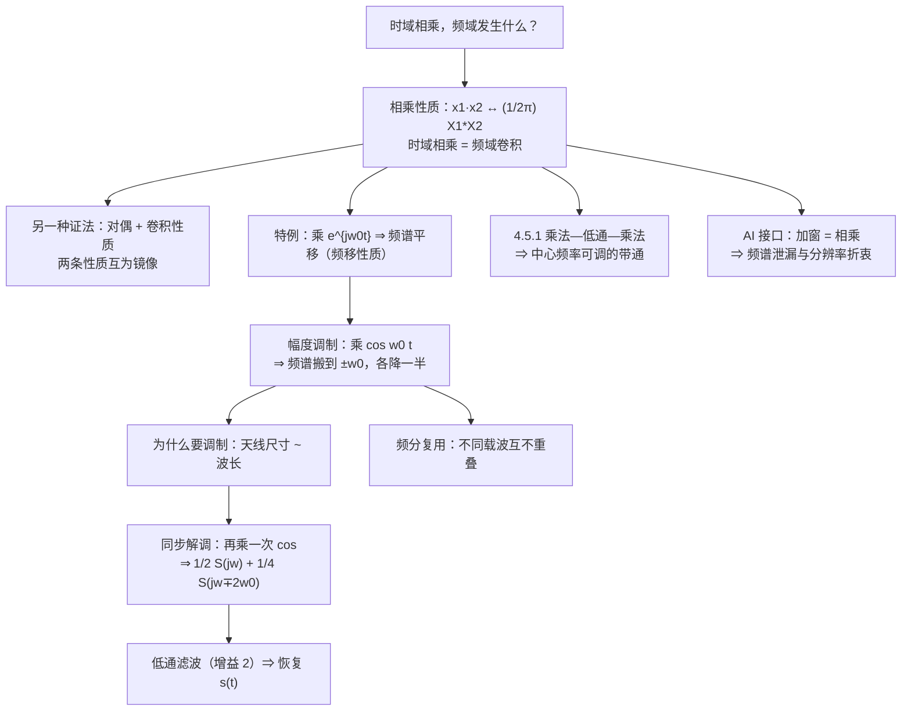

---

#### C4.5 · 这一讲的三句话

1. **时域相乘 = 频域卷积**：$x_1x_2\leftrightarrow\frac{1}{2\pi}X_1*X_2$；它与卷积性质互为镜像，还能由对偶 + 卷积反推出来。
2. **调制与解调都是"乘 $\cos$"**：调制把基带谱复制到 $\pm\omega_0$（各半），解调用 $\cos^2\omega_0t=\frac12+\frac12\cos2\omega_0t$ 造出一份基带（$\frac12S$，增益 2 补回）和二倍频垃圾（$\frac14S$，低通滤掉，要求 $\omega_M<\omega_c<2\omega_0-\omega_M$）；这也是频分复用的全部原理。
3. **"乘法—低通—乘法"能把滤波器整体平移**：$H_{\text{总}}(j\omega)=H(j(\omega+\omega_c))$，中心频率由乘数决定，可现场调谐。

> [!tip] 速查表
> | 项目 | 公式 |
> |---|---|
> | 相乘性质 | $x_1(t)x_2(t)\leftrightarrow\frac{1}{2\pi}X_1(j\omega)*X_2(j\omega)$ |
> | 频移（特例） | $x(t)e^{j\omega_0t}\leftrightarrow X(j(\omega-\omega_0))$ |
> | 与冲激卷积 | $X(j\omega)*\delta(\omega-\omega_0)=X(j(\omega-\omega_0))$（就是平移） |
> | 调制 | $s(t)\cos\omega_0t\leftrightarrow\frac12S(j(\omega-\omega_0))+\frac12S(j(\omega+\omega_0))$ |
> | 解调 | $r(t)\cos\omega_0t\leftrightarrow\frac12S(j\omega)+\frac14S(j(\omega-2\omega_0))+\frac14S(j(\omega+2\omega_0))$ |
> | 时域恒等式 | $\cos^2\omega_0t=\frac12+\frac12\cos2\omega_0t$ |
> | 解调低通要求 | $\omega_M<\omega_c<2\omega_0-\omega_M$，增益取 2 |
> | 不重叠条件 | $\omega_0>\omega_M$（实际要 $\omega_0\gg\omega_M$） |
> | 可变中心频率带通 | $H_{\text{总}}(j\omega)=H(j(\omega+\omega_c))$（中心 $-\omega_c$，带宽不变） |
> | 加窗 | $x(t)w(t)\leftrightarrow\frac{1}{2\pi}X*W$：主瓣变宽、旁瓣泄漏 |
> | 电磁波 | $\lambda=c/\nu$，$c=2.998\times10^8$ m/s；能量 $E=h\nu$ |
> | 5G 主力频段 | 3.5 GHz（$\lambda\approx8.6$ cm）；毫米波 28 / 39 / 60 / 73 GHz |

> [!tip] 下一讲预告
> 到这里，连续时间傅里叶变换的工具箱就齐了：变换的定义与基本变换对（[[C4.1 非周期信号的表示：连续时间傅里叶变换]]）、周期信号的变换（[[C4.2 周期信号的傅里叶变换]]）、全部性质与两张速查表（[[C4.3 连续时间傅里叶变换的性质]]）、卷积与系统（[[C4.4 卷积性质与由微分方程表征的系统]]）、相乘与调制（本篇）。
> 接下来第 5 章要把**同一套戏在离散时间重演一遍**：DTFT 的定义、周期信号的离散谱、以及离散特有的那个讨厌事实——**频率以 $2\pi$ 为周期**，最高频只有 $\omega=\pi$。
> 提醒一句：本篇讲"采样"只是顺带一提（冲激串乘信号），真正的采样定理要等第 7 章，那里才会回答"**多快采样才不丢信息**"。

---

#### C4.5 · 相关笔记 Related Notes

- 相关：[[C4.3 连续时间傅里叶变换的性质]]（频移性质与表 4.1）、[[C4.4 卷积性质与由微分方程表征的系统]]（与本节互为镜像的卷积性质）、[[C4.2 周期信号的傅里叶变换]]（频谱搬运用到的冲激串）、[[C3.6 傅里叶级数与LTI系统、滤波]]（理想低通与带通）、[[C1.5 连续时间与离散时间系统]]（混频与系统的互联）

- 上一讲：[[C4.4 卷积性质与由微分方程表征的系统]]
- 下一讲：第 5 章《离散时间傅里叶变换》（笔记尚未建立）
- 返回：[[信号与系统 MOC]]


### 17 · C5.1 · 原篇导读与复盘（历史快照）


以下完整保留原篇的任务导读、历史进度、三句话、速查、预告与相关链接。其“尚未讲授”等说法记录的是原篇当时状态；本讲义的课堂进度以篇首与第 18 节为准。来源材料名集中保留在本讲义来源清单与工作记录中。


#### C5.1 · 原篇导读


#### C5.1 · 5.1 非周期信号的表示：离散时间傅里叶变换

> [!abstract] 这一讲的任务
> 第 4 章把**连续时间**信号的周期推到无穷，谱线连成了一条曲线，得到 CTFT。这一节对**离散序列**做同一件事，可结果并不平行：谱不但变成连续的，还**必须是以 $2\pi$ 为周期的**。
> 多出来的这条周期性不是巧合，它是"时域离散"的直接后果：让 $N\to\infty$ 时，$k$ 只取 $N$ 个值，而 $\omega=k\omega_0$ 走完 $2\pi$ 就把 $N$ 个值用光了，再往前走只能重复。
> 这一节要拿到三样东西：**DTFT 的分析式与综合式**、**为什么它的谱是 $2\pi$ 周期的**、以及**离散矩形序列的闭式结果**——它和第 3 章离散周期方波的 $a_k$ 长得一模一样，只是"谱线"换成了"曲线"。

> [!info] 授课进度说明
> 课堂转写稿覆盖到**第 12 节课**。这节课在第 5 章讲了 §1 的全部推导（$Na_k$ 的极限、分析与综合公式、$X(e^{j\omega})$ 的记法）、**$2\pi$ 周期性的证明**、反变换的推导，以及 §3 的**矩形序列例**。
> **课堂未展开**：§4 的两个基本变换对（$a^nu[n]$、$a^{|n|}$）与 $\delta[n]\leftrightarrow1$ 的图示、§5 的收敛问题与加窗逼近、§6 的三道随堂测。老师当堂说"时间不太充裕""这个例子的计算过程在这儿"，所以这几处按教材整理，**本篇不逐条标注「拓展」**。

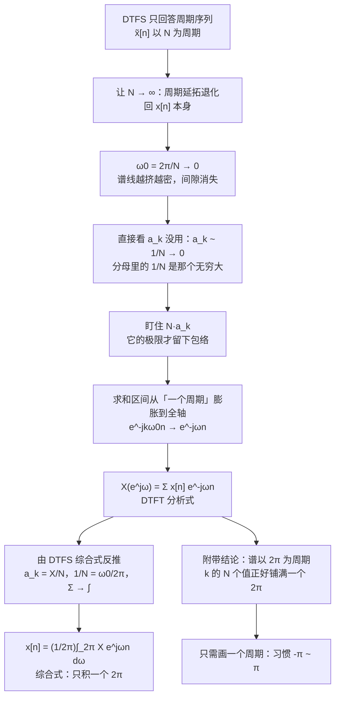

---

#### C5.1 · 这一讲的三句话

1. **DTFT 是 DTFS 在 $N\to\infty$ 时的极限，但必须盯住 $Na_k$**：$a_k$ 本身趋于 0、不含信息；$Na_k$ 的极限才是包络 $X(e^{j\omega})=\sum_n x[n]e^{-j\omega n}$，而 $a_k=\frac1NX(e^{j\omega})\big|_{\omega=k\omega_0}$ 是这条极限的"采样"版本。
2. **离散时域 ⇒ 频域以 $2\pi$ 为周期**：$e^{-j2\pi n}=1$ 一行证完；$k$ 的 $N$ 个取值正好把 $\omega$ 的一个 $2\pi$ 铺满，所以只需要画 $-\pi\sim\pi$，而 $\omega=\pi$ 就是最高频。
3. **矩形序列给出"正弦除正弦"**：$X(e^{j\omega})=\dfrac{\sin[\omega(N_1+\frac12)]}{\sin(\omega/2)}$，峰值 $2N_1+1$、实且偶；它与离散周期矩形的 $a_k$ 只差"采样 + 除以 $N$"。

> [!tip] 速查表
> | 对象 | 结论 |
> |---|---|
> | 分析式 | $X(e^{j\omega})=\sum_{n=-\infty}^{\infty}x[n]e^{-j\omega n}$ |
> | 综合式 | $x[n]=\frac1{2\pi}\int_{2\pi}X(e^{j\omega})e^{j\omega n}d\omega$（积一个 $2\pi$） |
> | 周期性 | $X(e^{j(\omega+2\pi)})=X(e^{j\omega})$，最高频 $\omega=\pi$ |
> | 与 DTFS 的桥 | $a_k=\frac1NX(e^{j\omega})\big\vert _{\omega=k\omega_0}$，$\omega_0=\frac{2\pi}{N}$ |
> | $\delta[n]$ | $1$ |
> | $a^nu[n]$（$\lvert a\rvert<1$） | $\frac{1}{1-ae^{-j\omega}}$，模 $\frac{1}{\sqrt{1+a^2-2a\cos\omega}}$ |
> | $a^{\lvert n\rvert}$（$\lvert a\rvert<1$） | $\frac{1-a^2}{1+a^2-2a\cos\omega}$（实且偶） |
> | 矩形 $\lvert n\rvert\le N_1$ | $\frac{\sin[\omega(N_1+\frac12)]}{\sin(\omega/2)}$，峰 $2N_1+1$ |
> | 收敛 | 绝对可和 ⇒ 一致收敛；平方可和 ⇒ 均方收敛 |
> | 加窗 | $\hat x[n]=\frac{\sin Wn}{\pi n}$，$W\to\pi$ 时趋于 $\delta[n]$，**无吉布斯** |

> [!tip] 下一讲预告
> 到这里，非周期序列的谱有了：一条连续的、以 $2\pi$ 为周期的曲线。可是手里还有另一半没处理——**周期序列**。它不绝对可和，按本节的定义写不出 $X(e^{j\omega})$。
> 下一讲用和第 4 章同样的办法解决：允许谱里出现**冲激**。而对离散信号来说，冲激会**每 $2\pi$ 复制一份**，于是一个 $2\pi$ 里只能站下 $N$ 根——周期序列、冲激串、$(-1)^n$ 这些老朋友都会回来。

---

#### C5.1 · 相关笔记 Related Notes

- 相关：[[C3.5 离散时间傅里叶级数DTFS及性质]]（$a_k$ 与半角技巧）、[[C4.1 非周期信号的表示：连续时间傅里叶变换]]（连续端的同一步推导与四种矩形信号）、[[C1.2 自变量的变换]]（离散频率的 $2\pi$ 周期性）、[[实验1.2 基本信号的产生与序列运算]]（`fft` 与 `fftshift` 给出的是哪一段）

- 上一讲：[[C4.2 周期信号的傅里叶变换]]
- 下一讲：[[C5.2 周期信号的傅里叶变换]]
- 返回：[[信号与系统 MOC]]


### 17 · C5.2 · 原篇导读与复盘（历史快照）


以下完整保留原篇的任务导读、历史进度、三句话、速查、预告与相关链接。其“尚未讲授”等说法记录的是原篇当时状态；本讲义的课堂进度以篇首与第 18 节为准。来源材料名集中保留在本讲义来源清单与工作记录中。


#### C5.2 · 原篇导读


#### C5.2 · 5.2 周期信号的傅里叶变换

> [!abstract] 这一讲的任务
> 上一节给**非周期**序列定义了 DTFT，条件里有一条"绝对可和"。周期序列一条都不满足——它的和永远发散，按上一节的定义根本写不出 $X(e^{j\omega})$。
> 这一节沿着第 4 章开出的路再走一遍：**允许谱里出现冲激**。结果和连续端同构——周期序列的谱是一串冲激，位置在谐波频率、面积正比于 DTFS 系数——但多了一层：因为谱本身以 $2\pi$ 为周期，这串冲激**每 $2\pi$ 要被复制一遍**。
> 于是"一个 $2\pi$ 里到底站几根冲激"成了新的关键：答案恰好是 $N$ 根，位置 $\frac{2\pi}{N}k$，面积 $\frac{2\pi}{N}$。

> [!info] 授课进度说明
> 第 12 节课只讲到 5.1，**本篇尚未在课堂上讲授**。内容按教材与通行讲法整理，暂不逐条区分"课堂讲过"与"拓展补充"；等后续转写稿覆盖到 5.2，再按与第 3、4 章相同的规则标注。

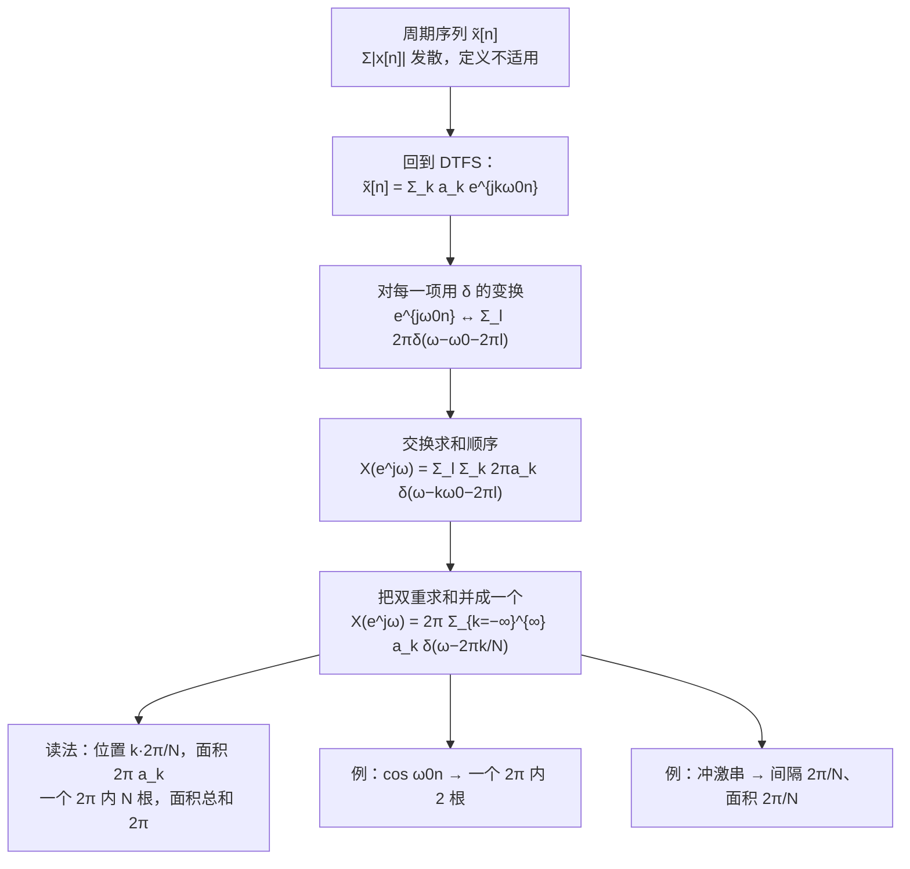

---

#### C5.2 · 这一讲的三句话

1. **周期序列的 DTFT 是一串冲激**：$X(e^{j\omega})=2\pi\sum_ka_k\delta\!\left(\omega-\frac{2\pi}{N}k\right)$，位置在谐波 $\frac{2\pi}{N}k$，面积是 $2\pi a_k$——与连续端同形，只是求和铺到了整条轴。
2. **冲激必须每 $2\pi$ 复制一份**：这是 5.1 节 $2\pi$ 周期性的直接后果；一个 $2\pi$ 内恰好 $N$ 根，面积和 $2\pi$。
3. **冲激串的谱还是冲激串**：$\sum_n\delta[n-kN]\leftrightarrow\frac{2\pi}{N}\sum_k\delta\!\left(\omega-\frac{2\pi}{N}k\right)$，时域间隔与频域间隔成倒数——第 7 章采样定理的全部机关都在这里。

> [!tip] 速查表
> | 信号 | DTFT |
> |---|---|
> | $\sum_k a_ke^{jk\omega_0n}$（周期 $N$） | $2\pi\sum\limits_{k=-\infty}^{\infty}a_k\delta\!\left(\omega-\frac{2\pi}{N}k\right)$ |
> | $e^{j\omega_0n}$ | $\sum\limits_l2\pi\delta(\omega-\omega_0-2\pi l)$ |
> | $\cos\omega_0n$（$\frac{\omega_0}{2\pi}$ 有理） | $\pi\sum\limits_l[\delta(\omega-\omega_0-2\pi l)+\delta(\omega+\omega_0-2\pi l)]$ |
> | $\sin\omega_0n$ | $\frac{\pi}{j}\sum\limits_l[\delta(\omega-\omega_0-2\pi l)-\delta(\omega+\omega_0-2\pi l)]$ |
> | $1$（$k=0$ 的平凡周期信号） | $2\pi\sum\limits_l\delta(\omega-2\pi l)$ |
> | 冲激串（周期 $N$） | $\frac{2\pi}{N}\sum\limits_k\delta\!\left(\omega-\frac{2\pi}{N}k\right)$ |
> | 读图口径 | 冲激只有面积有意义（$=2\pi a_k$）；一个 $2\pi$ 里数得出 $N$ 根 |

> [!tip] 下一讲预告
> 谱的两种形态都有了：非周期是连续曲线，周期是冲激串。接下来该问"**这些谱怎么用**"。
> 5.3 节把 DTFT 的性质一条条推出来。和第 4 章的性质表相比，离散端多了两处必须小心的地方：一是所有式子都在"一个 $2\pi$ 周期"里成立（比如累加性质会多出一串 $2\pi$ 间隔的冲激），二是**时域扩展**在离散端不再是"除以 $|a|$"，而换了名字叫**内插**。

---

#### C5.2 · 相关笔记 Related Notes

- 相关：[[C5.1 非周期信号的表示：离散时间傅里叶变换]]（$2\pi$ 周期性与 $a_k$ 的桥）、[[C4.2 周期信号的傅里叶变换]]（连续端的同一套推导）、[[C3.5 离散时间傅里叶级数DTFS及性质]]（$a_k$ 与 $N$ 项有限和）、[[C1.3 指数信号与正弦信号]]（离散周期判据 $\frac{\omega_0}{2\pi}$ 有理）

- 上一讲：[[C5.1 非周期信号的表示：离散时间傅里叶变换]]
- 下一讲：[[C5.3 离散时间傅里叶变换的性质]]
- 返回：[[信号与系统 MOC]]


### 17 · C5.3 · 原篇导读与复盘（历史快照）


以下完整保留原篇的任务导读、历史进度、三句话、速查、预告与相关链接。其“尚未讲授”等说法记录的是原篇当时状态；本讲义的课堂进度以篇首与第 18 节为准。来源材料名集中保留在本讲义来源清单与工作记录中。


#### C5.3 · 原篇导读


#### C5.3 · 5.3 离散时间傅里叶变换的性质

> [!abstract] 这一讲的任务
> 有了 DTFT 的定义和一对基本变换，接下来要问的是**"时域动一下，频域付什么代价"**。这一节逐条推十组性质，形式与第 4 章的性质表高度平行，但有三处必须为"离散"额外留心：
> 一是所有式子都在**一个 $2\pi$ 周期**里成立，跨周期的地方要补 $l$ 层复制；二是**累加性质**会多出一串 $2\pi$ 间隔的冲激（$u[n]$ 的谱就是这样来的）；三是**时域扩展**在离散端换了名字，叫**内插**，而且没有连续端那个 $\frac{1}{|a|}$。
> 这十条性质是后面所有系统分析的"手柄"：查表做系统题、辨实信号谱的对称性、用帕塞瓦尔算能量，都从这里出发。

> [!info] 授课进度说明
> 第 12 节课只讲到 5.1，**本篇尚未在课堂上讲授**。内容按教材与通行讲法整理，暂不逐条区分"课堂讲过"与"拓展补充"；等后续转写稿覆盖到 5.3，再按与第 3、4 章相同的规则标注。

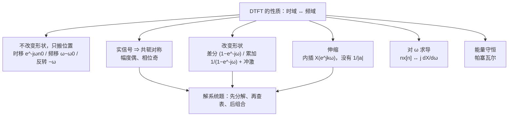

---

#### C5.3 · 这一讲的三句话

1. **"搬位置"的性质不动幅度**：时移只加线性相位 $e^{-j\omega n_0}$，频移只是把整条周期曲线平移到 $\omega-\omega_0$，反转只是 $\omega\to-\omega$——这三条解释了"延迟不改变频率成分"。
2. **实信号一生只有一半自由度**：$X(e^{-j\omega})=X^*(e^{j\omega})$ 逼出"幅度偶、相位奇"；再加偶对称就是实谱，加奇对称就是纯虚谱。
3. **离散端的两处结构性差别**：累加要补一串 $\pi X(e^{j0})\sum_k\delta(\omega-2\pi k)$；时域扩展没有 $\frac{1}{|a|}$，只会把谱压缩——因为插进去的是零，不是拉长的曲线。

> [!tip] 速查表
> | 想求 | 用哪条 |
> |---|---|
> | $x[n-n_0]$ | 乘 $e^{-j\omega n_0}$（幅度不变） |
> | $e^{j\omega_0n}x[n]$ | 谱平移，$\omega\to\omega-\omega_0$ |
> | $x[n]-x[n-1]$ | 乘 $(1-e^{-j\omega})$，模 $2\lvert\sin\frac\omega2\rvert$（高通） |
> | $\sum_{k\le n}x[k]$ | 除 $(1-e^{-j\omega})$，再补 $\pi X(e^{j0})\sum\delta$ |
> | $x_{(k)}[n]$ | $X(e^{jk\omega})$，谱压缩 $k$ 倍，无幅度因子 |
> | $nx[n]$ | $j\frac{dX}{d\omega}$ |
> | 能量 | $\sum_n\lvert x\rvert^2=\frac1{2\pi}\int_{2\pi}\lvert X\rvert^2d\omega$ |

> [!tip] 下一讲预告
> 性质表里缺了最重要的一条：**卷积**。这一条才是整套频域分析的发动机——它让"时域卷积"变成"频域相乘"，也让"给一个差分方程、求频率响应"变成一步代数。
> 5.4 节专门处理它，顺带把 5.8 节的"由差分方程表征的系统"接上：**$H(e^{j\omega})=\frac{\sum b_ke^{-jk\omega}}{\sum a_ke^{-jk\omega}}$ 就是这么来的。**

---

#### C5.3 · 相关笔记 Related Notes

- 相关：[[C5.1 非周期信号的表示：离散时间傅里叶变换]]（本节反复用到的两个例子）、[[C4.3 连续时间傅里叶变换的性质]]（连续端的同一张表）、[[C3.4 连续时间傅里叶级数的性质]]（差分与时移在级数里的版本）、[[C1.2 自变量的变换]]（奇偶分解）

- 上一讲：[[C5.2 周期信号的傅里叶变换]]
- 下一讲：[[C5.4 卷积性质与由差分方程表征的系统]]
- 返回：[[信号与系统 MOC]]


### 17 · C5.4 · 原篇导读与复盘（历史快照）


以下完整保留原篇的任务导读、历史进度、三句话、速查、预告与相关链接。其“尚未讲授”等说法记录的是原篇当时状态；本讲义的课堂进度以篇首与第 18 节为准。来源材料名集中保留在本讲义来源清单与工作记录中。


#### C5.4 · 原篇导读


#### C5.4 · 5.4 卷积性质与由差分方程表征的系统

> [!abstract] 这一讲的任务
> 性质表里最重要的一条在这里：**时域卷积 ⇔ 频域相乘**。它一句话就把"系统对信号做了什么"从卷积和里解放出来——只要知道 $H(e^{j\omega})$，任何输入的输出都是"逐频率乘一个数"。
> 有了它，第 2 章那个"给差分方程、求 $h[n]$"的苦活也换了算法：把 $\frac{d}{dt}$ 换成 $e^{j\omega}$ 的同类操作——**每一项延时 $k$ 就乘 $e^{-jk\omega}$**，差分方程立刻变成一个代数分式 $H(e^{j\omega})$；剩下的工作只是把它拆成几个 $a^nu[n]$。
> 这一讲的两块内容（§5.4 卷积性质、§5.8 由差分方程表征的系统）在教材里隔了三节，但它们是同一条链：**先有"频域相乘"，才有"把差分方程变成代数分式"**。

> [!info] 授课进度说明
> 第 12 节课只讲到 5.1，**本篇尚未在课堂上讲授**。内容按教材与通行讲法整理，暂不逐条区分"课堂讲过"与"拓展补充"；等后续转写稿覆盖到 5.4 / 5.8，再按与第 3、4 章相同的规则标注。

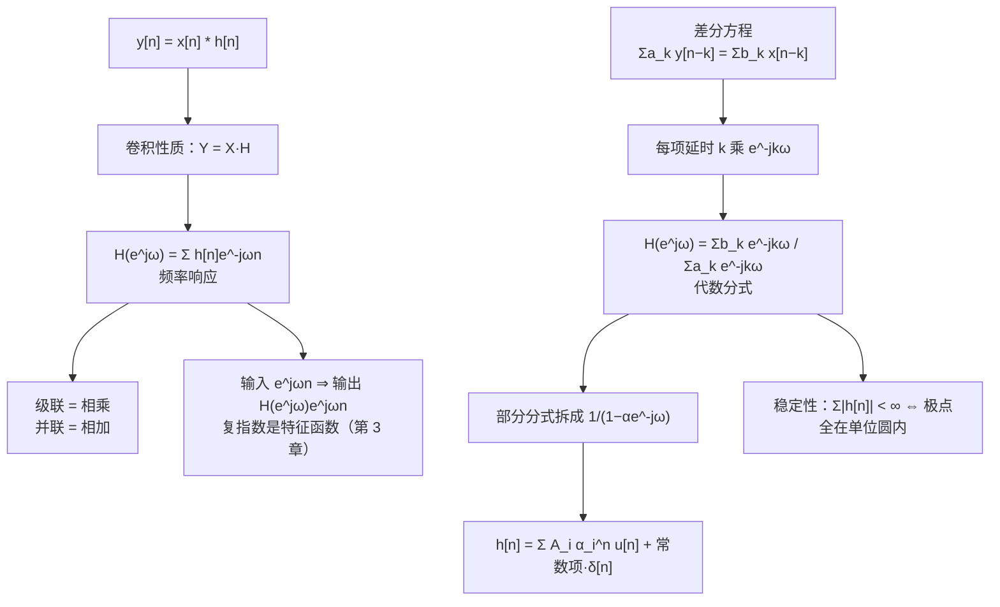

---

#### C5.4 · 这一讲的三句话

1. **卷积性质把系统变成乘法**：$y=x*h\Leftrightarrow Y=XH$，证明只用"拆指数 + 换求和次序"；级联相乘、并联相加，都由此而来。
2. **差分方程可以直接读出 $H$**：$\sum a_ky[n-k]=\sum b_kx[n-k]$ ⇒ $H=\frac{\sum b_ke^{-jk\omega}}{\sum a_ke^{-jk\omega}}$；方框图和方程是同一件事的两种写法。
3. **$h[n]$ 由部分分式给出**：先判真分式（非真先做除法），再按一阶/重极点拆，最后查 $\frac{1}{1-\alpha e^{-j\omega}}\leftrightarrow\alpha^nu[n]$；极点位置同时回答稳定性。

> [!tip] 速查表
> | 对象 | 结论 |
> |---|---|
> | 卷积 | $y=x*h\ \Leftrightarrow\ Y(e^{j\omega})=X(e^{j\omega})H(e^{j\omega})$ |
> | 频率响应 | $H(e^{j\omega})=\sum_nh[n]e^{-j\omega n}$ |
> | 级联 / 并联 | $H_1H_2$ / $H_1+H_2$ |
> | 差分方程 → $H$ | $H=\dfrac{\sum_{k=0}^{M}b_ke^{-jk\omega}}{\sum_{k=0}^{N}a_ke^{-jk\omega}}$ |
> | 基本变换对 | $\delta[n]\leftrightarrow1$；$a^nu[n]\leftrightarrow\frac{1}{1-ae^{-j\omega}}$；$u[n]\leftrightarrow\frac{1}{1-e^{-j\omega}}+\pi\sum_k\delta(\omega-2\pi k)$ |
> | 稳定性 | $\sum_n\lvert h[n]\rvert<\infty$ ⇔ 极点全部在单位圆内 |
> | 部分分式 | 一阶：遮盖法 $k_i=(s-p_i)X\vert _{s=p_i}$；$\ r$ 重：求 $r-1$ 阶导；非真：先做多项式除法 |

> [!tip] 下一讲预告
> 卷积性质管的是"**时域卷积 ⇔ 频域相乘**"。把所有箭头反过来，就得到这一章的最后一块拼图：**时域相乘 ⇔ 频域卷积**。
> 这就是 5.5 节的相乘性质，它的两个直接产物是**调制**（乘一个正弦＝把谱搬走）和 **$(-1)^n$ 的作用**（把低通变高通）。剩下 5.7 节再做一次总收束：**DTFS、DTFT、CTFS、CTFT 四者之间的对偶关系**。

---

#### C5.4 · 相关笔记 Related Notes

- 相关：[[C5.3 离散时间傅里叶变换的性质]]（累加性质与本篇 §2 是同一件事）、[[C4.4 卷积性质与由微分方程表征的系统]]（连续端的同一条链）、[[C2.6 LTI系统的方框图表示]]（Direct Form I / II 的画法）、[[C3.6 傅里叶级数与LTI系统、滤波]]（特征函数与 $b_k=a_kH$）

- 上一讲：[[C5.3 离散时间傅里叶变换的性质]]
- 下一讲：[[C5.5 相乘性质、对偶性与变换表]]
- 返回：[[信号与系统 MOC]]


### 17 · C5.5 · 原篇导读与复盘（历史快照）


以下完整保留原篇的任务导读、历史进度、三句话、速查、预告与相关链接。其“尚未讲授”等说法记录的是原篇当时状态；本讲义的课堂进度以篇首与第 18 节为准。来源材料名集中保留在本讲义来源清单与工作记录中。


#### C5.5 · 原篇导读


#### C5.5 · 5.5 相乘性质、对偶性与变换表

> [!abstract] 这一讲的任务
> 把卷积性质的所有箭头反过来，就得到**相乘性质**：时域两块信号相乘，频域是两条谱做**周期卷积**。它在工程上的名字叫**调制**——乘一个正弦，就是把整条谱搬走；乘 $(-1)^n$，就是把低通搬成高通。
> 剩下的篇幅交给"**对偶**"。这是本课程最漂亮的一处结构：DTFS 与 DTFT 互为对偶（系数序列本身就是信号、信号本身就是系数），CTFS 与 DTFT 也互为对偶（周期函数与序列互为对方的系数）。四类信号（连续/离散 × 周期/非周期）被"采样"和"对偶"两张网连成一个四方格。
> 这一讲也是第 5 章的收尾：变换表（5.6 节）把所有结论压成两页纸，后面第 6–7 章要反复查它。

> [!info] 授课进度说明
> 第 12 节课只讲到 5.1，**本篇尚未在课堂上讲授**。内容按教材与通行讲法整理，暂不逐条区分"课堂讲过"与"拓展补充"；等后续转写稿覆盖到 5.5–5.7，再按与第 3、4 章相同的规则标注。

```mermaid
flowchart TD
    A["卷积性质（5.4）<br/>x1*x2 ↔ X1·X2"] --> B["箭头反过来的对称命题"]
    B --> C["相乘性质（5.5）<br/>x1·x2 ↔ (1/2π)X1⊛X2<br/>周期卷积"]
    C --> D["例：乘 e^jω0n ⇒ 谱平移<br/>乘 (-1)^n ⇒ 平移 π，低通变高通"]
    B --> E["对偶（5.7）"]
    E --> F["DTFS：a_n ↔ (1/N)x[-k]<br/>系数也是序列"]
    E --> G["DTFT ↔ CTFS：X(e^jt) 的 CTFS 系数是 x[-k]"]
    F --> H["时移 ↔ 频移<br/>卷积 ↔ 相乘"]
    G --> H
    E --> I["四象限图：采样把四类信号连起来（5.7.3）"]
```

---

#### C5.5 · 这一讲的三句话

1. **相乘性质是卷积性质的镜像**：$x_1x_2\leftrightarrow\frac1{2\pi}X_1\circledast X_2$，右边在**一个 $2\pi$** 上做周期卷积；它的两个常用特例是"乘 $e^{j\omega_0n}$ 搬谱"与"乘 $(-1)^n$ 搬 $\pi$（低通变高通）"。
2. **DTFS 里信号与系数互为对方的变换**：$x[n]\leftrightarrow a_k$ 与 $a_n\leftrightarrow\frac1Nx[-k]$ 同时成立；时移与频移、卷积与相乘就是这条对偶下的镜像对。
3. **DTFT 与 CTFS 是对偶的**：$X(e^{j\omega})$ 本身是以 $2\pi$ 为周期的连续函数，它的 CTFS 系数是 $x[-k]$；四类信号由"采样""周期化""对偶"三样东西连成一个四方格。

> [!tip] 速查表
> | 动作 | 频域 |
> |---|---|
> | $x_1[n]x_2[n]$ | $\frac1{2\pi}\int_{2\pi}X_1(e^{j\theta})X_2(e^{j(\omega-\theta)})d\theta$（周期卷积） |
> | $x[n]\cos\omega_0n$ | $\frac12X(e^{j(\omega-\omega_0)})+\frac12X(e^{j(\omega+\omega_0)})$ |
> | $(-1)^nx[n]$ | $X(e^{j(\omega-\pi)})$（谱平移 $\pi$） |
> | DTFS 对偶 | $a_n\leftrightarrow\frac1Nx[-k]$ |
> | 由对偶生成 | 时移↔频移、卷积↔相乘、微分↔（-jn） |
> | 频域采样 | $a_k=\frac1NX(k\frac{2\pi}{N})$（离散）、$\frac1TX(k\frac{2\pi}{T})$（连续） |
> | 时域采样 | 谱以 $\omega_s$ 周期化（第 7 章） |

> [!tip] 下一讲预告
> 第 5 章到此结束：非周期有了 DTFT，周期有了冲激谱，性质表与对偶把四类信号织成一张网。
> 第 6 章换个问法：**给了系统函数 $H(e^{j\omega})$，怎么从频率上判断这个系统"干什么"**——滤波器的通带、阻带、相位、群延迟，以及理想滤波器为什么做不出来。那时会发现，本章的性质表就是唯一的手柄。

---

#### C5.5 · 相关笔记 Related Notes

- 相关：[[C5.4 卷积性质与由差分方程表征的系统]]（本节把它的箭头全部反过来）、[[C5.2 周期信号的傅里叶变换]]（$(-1)^n$ 与冲激串的谱）、[[C4.5 相乘性质与调制]]（连续端的调制与解调）、[[C3.4 连续时间傅里叶级数的性质]]（CTFS 的微分与卷积性质，本节对偶的出发点）

- 上一讲：[[C5.4 卷积性质与由差分方程表征的系统]]
- 下一讲：[[信号与系统 MOC]]（第 6 章尚未建篇）
- 返回：[[信号与系统 MOC]]

## 18. 课堂补充、考试安排与证据边界

### 第 10–13 节课的讲授路线

| 讲次 | 这次并行讲义保留与新增的落点 |
|---|---|
| 第 10 节（在第八、九、十节合稿中） | 第 1 节：复指数特征函数的证明、变换换表征面、冲激与全频激发的直观；第 2 节：第三章周期与谐波导读 |
| 第 11 节 | 第 2 节：正交性、内积、希尔伯特空间的直观，CTFS/DTFS 分析综合公式与交换运算；第 3 节：占空比、Sa/sinc、主旁瓣、分别改变宽度和周期；第 4、9 节：直流、欧拉式读系数、复数频谱与幅相图 |
| 第 12 节 | 第 2 节：四套公式与 $Ta_k,Na_k$ 的极限、DTFS 系数周期性和 DTFT 的 $2\pi$ 周期证明；第 3 节：离散矩形等比和、半角技巧与四种矩形；第 4 节：冲激串与筛选；第 15 节：周期化/离散化的动作与采样预告 |
| 第 13 节（新纳入） | 第 2 节复习四套公式；第 5 节四种收敛、三个反例、有限近似、吉布斯、语音分帧加窗和重叠、语谱图、视觉与生成模型类比；第 6–8 节线性、时移、频移；第 7 节二维图像、循环平移、幅度/相位重建实验 |

已确认讲授的是相应主题，不表示原篇每个例题和拓展都已讲。特别是“最小均方最优系数”的完整推导、其余性质、详细调制和系统解题仍按原笔记保留；第十三节课没有证据证明老师当堂把它们全部讲完。原篇中仍标作拓展的内容，只有与转写确实重合的部分才视为已讲，其余保持原身份。

### 老师实际强调的记忆与考试信息

- 四组分析、综合公式必须会写；依据连续/离散、周期/非周期判断积分或求和及其范围，不能混写符号。
- 连续周期矩形的“占空比乘 Sa”须记；连续非周期矩形及离散的“正弦除正弦”也要掌握。归一化 sinc 是另一种写法，第十一节课明确不要求背那一种表达。
- 收敛条件以了解为主，老师说一般不在这里难为大家；**吉布斯现象的结论可能涉及考试**。性质考应用，课堂的性质证明帮助理解，老师说不考证明。后续所有性质还要继续学习，不能把本次只讲到频移误解为考试只有三条性质。
- **期中占总评 10%**。第十三节课口述拟在 **11 月中旬、外出安排结束回来后**进行，提到回来后的周一、若来不及则周三；具体日期尚未定。本篇不把它推成某个确定的日历日。老师此次计划采用**线下、纸面手写答案的堂测**，并说原先线上的全选择题方式这次不沿用；第 3–5 章重要内容讲完后安排。具体范围和日期仍以老师后续通知为准。

### 这次还原能到哪里

第十三节课的原始图像、演示视频与独立板书截图未在转写旁附上。相位两次重建、摄影师图循环平移、语谱图和两种视觉错觉的**操作、观察与结论**均已写回正文；图像内容、原色标和像素数值未作猜测。原有图像全部继续嵌入并在工作记录里逐项核对；对 PDF 的本次回看是针对收敛与线性、时移、频移的 13 个物理页，不是对三份 PDF 全页重新审核，也不对未核查页声称“没有手写”。

## 这一讲的三句话

1. 连续或离散决定积分还是求和，周期决定取一个周期还是全轴；正负指数与 $T,N,2\pi$ 的归一化必须一起核对。
2. 四种表示共用正交分解与复指数特征函数的逻辑，有限维、谱周期和广义冲激谱决定各自的边界。
3. 精确变换、逐点或均方收敛、有限截断、分帧加窗与实际数值计算各有条件，不能把一个例子的直观结论推广到全部信号。

## 速查表

| 名称 | 公式或判据 |
|---|---|
| CTFS / DTFS 系数 | 一个时域周期投影后分别除以 $T$ / $N$ |
| CTFT / DTFT 综合 | 分别在全频率轴 / 一个 $2\pi$ 上积分并除以 $2\pi$ |
| 时移 | 频谱乘 $e^{-j\text{频率}\times\text{延迟}}$ |
| 频移 | 时域乘 $e^{j\text{移频量}\times\text{时间}}$ |
| 周期卷积 | 未归一化时 CTFS 系数为 $Ta_kb_k$，DTFS 系数为 $Na_kb_k$ |
| 时间相乘 | CTFT 频谱为普通卷积除以 $2\pi$，DTFT 为周期卷积除以 $2\pi$ |
| 周期与变换 | $a_k=X(jk\Omega_0)/T$；离散端为 $a_k=X(e^{jk\omega_N})/N$ |
| 吉布斯极限比例 | $G\approx0.0894898722$，相对于跳变量 |

> [!tip] 继续学习
> 沿着四种表示继续练其余性质，再把频移与冲激串接到采样；真正需要判断的是如何避免谱副本重叠，以及从有限样本能恢复什么。

上一讲基础：[[C2.3 LTI系统的性质]]、[[C3.1 复指数是LTI系统的特征函数]] ｜ 后续衔接：[[C5.5 相乘性质、对偶性与变换表]] ｜ 返回：[[信号与系统 MOC]]
