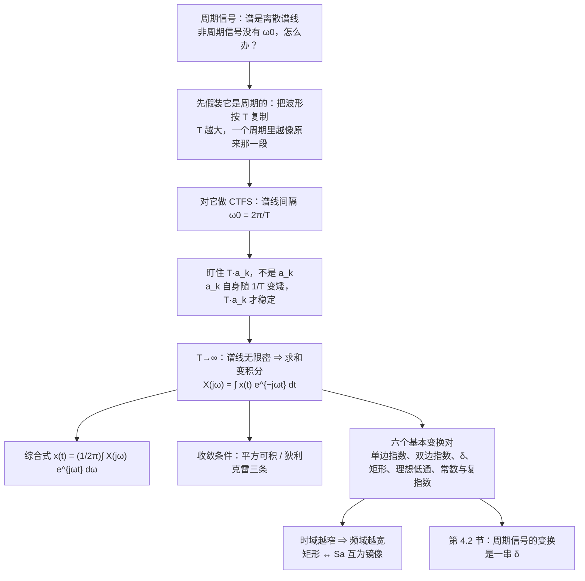

# 4.1 非周期信号的表示：连续时间傅里叶变换 CTFT

> [!abstract] 这一讲的任务
> 第 3 章的整套工具都建立在一个前提上：**信号是周期的**——正因为每个零件都得跟着同一个周期 $T$ 重复，可用频率才会被锁死在 $\omega_0$ 的整数倍上，频谱才是一根根离散的谱线。
> 可现实里的信号大多**只发生一次**：一声鼓掌、一次心跳、一段语音里的爆破音，它们没有周期、没有 $\omega_0$，第 3 章那一排推子根本摆不出来。
> 这一讲要干的事只有一件：**把周期推到无穷**，让离散的谱线无限密下去、连成一条连续曲线。这条曲线就是**连续时间傅里叶变换 CTFT** $X(j\omega)$。
> 拿到两个公式之后，一口气算完六个基本变换对，并看清 CTFT 里最反复出现的那条规律：**时域越窄，频域越宽**。

> [!info] 授课进度说明
> 目前拿到的课堂转写稿覆盖到**第 11 节课**，第三章讲到 CTFS 主干与 DTFS 公式推导为止；**第 4 章尚未在课堂上讲授**，因此本篇内容全部来自**原稿与教材整理**，暂不逐条区分"课堂讲过"与"拓展补充"。
> 等第 4 章的转写稿补进来后，会按与第 1、2 章相同的规则（标题后加 **（拓展）**、段落前加 **【拓展】**）标注出课堂未讲的内容。

---

## 0. 开场：敲一下桌子

一台设备发出"啪、啪"的异响。你要判断这声音里到底是什么频率在作怪——是 50 Hz 的电源哼声，还是某个轴承的共振？

如果声音是**持续不断**的嗡鸣，第 3 章的推子可以直接用：它是周期的，有基频 $\omega_0$，一根根谱线摆出来，看一眼就知道高频成分多不多。

可"啪"这一声**只响一次**。它没有周期，也就没有 $\omega_0$；谱线间隔无从谈起，那一排推子连同整个 CTFS 一起失效了。

工程师的做法很朴素：**先假装它是周期的。** 在很远的地方把这一声"啪"复制一份、再复制一份，间隔 $T$，于是得到一个周期为 $T$ 的信号 $\tilde x(t)$。只要 $T$ 取得足够大，在原始那一声"啪"附近，$\tilde x(t)$ 与真正的 $x(t)$ 一模一样——**添加的复制品都在很远的地方，不影响我们关心的那一段。**

对这个 $\tilde x(t)$ 就可以名正言顺地做 CTFS 了：谱线间隔是 $\omega_0=\frac{2\pi}{T}$。$T$ 越大，间隔越小，谱线越密。

最后一步：**把复制品的间隔推到无穷远**（$T\to\infty$），$\tilde x(t)$ 就退化成原来那个孤零零的 $x(t)$。此时谱线密到连成一片，离散谱变成了**连续谱**——那条连成的曲线，就是傅里叶变换 $X(j\omega)$。

"刚才你做的，就是一次完整的 CTFT 推导。"整节剩下的工作，只是把这个过程每一步的账算清楚。

> [!question] 停一下，先自己想想
> 既然谱线要连成曲线，那"曲线的高度"应该取哪一根谱线？$a_k$ 本身行不行？

---

## 1. 从级数到变换：把周期推到无穷（p.2–4）

### 1.1 第一步：给非周期信号配一个周期

> [!important] 周期延拓 Periodic extension
> $$\tilde x(t)=\sum_{k=-\infty}^{+\infty}x(t-kT)$$
> 把 $x(t)$ 每隔 $T$ 复制一份叠起来，就得到一个周期为 $T$ 的周期信号 $\tilde x(t)$；反过来，在 $T\to\infty$ 的极限下 $\tilde x(t)\to x(t)$。

于是 $\tilde x(t)$ 有一套 CTFS 系数：

$$\tilde x(t)=\sum_{k=-\infty}^{+\infty}a_ke^{jk\omega_0t},\qquad a_k=\frac1T\int_T\tilde x(t)e^{-jk\omega_0t}dt$$

### 1.2 第二步：盯住 $T a_k$，而不是 $a_k$

这是整节最关键、也最容易忽略的一步。

对一个**脉宽固定、周期不断变长**的方波，第 3 章已经算过它的系数：

$$a_k=\frac{2T_1}{T}\,\mathrm{Sa}(k\omega_0T_1)$$

$\frac{1}{T}$ 这个因子意味着：$T$ 每翻一倍，每根谱线的高度就掉一半。**如果直接盯 $a_k$，随着 $T\to\infty$ 它一路趋近于 0，什么也收不到。**

乘上 $T$ 就稳定了：

$$T a_k=2T_1\,\mathrm{Sa}(k\omega_0T_1)=2T_1\,\mathrm{Sa}(\omega T_1)\Big|_{\omega=k\omega_0}$$

$\frac1T$ 被约掉，剩下的部分**只与脉宽 $T_1$ 有关，与周期 $T$ 无关**。也就是说：$T$ 变大时，谱线越来越密、越来越矮，但**每根谱线乘上 $T$ 之后，都精确地落在那同一条曲线上**。

> [!important] 这就是变换的定义
> $$X(j\omega)\triangleq\lim_{T\to\infty}T a_k=\int_{-\infty}^{+\infty}x(t)e^{-j\omega t}dt$$

> [!note] 为什么偏偏是 $T a_k$
> 换个说法：$a_k$ 是"**第 $k$ 个频率上有多少**"，而 $T a_k$ 是"**每单位频率上有多少**"。当频率点无限密起来时，有意义的量是**密度**，不是某一根谱线的高度。
> 所以 $X(j\omega)$ 也叫**频谱密度 spectral density**。它的量纲比 $a_k$ 多一个时间量纲（$X=T a_k$）——把"谱线高度"和"包络高度"画在同一张图里时，先乘 $T$ 再比，否则对不上。

### 1.3 第三步：综合式——求和怎么变成积分

把 $a_k=\frac{X(jk\omega_0)}{T}$ 代回级数，再把 $\frac1T$ 写成 $\frac{\omega_0}{2\pi}$：

$$\tilde x(t)=\sum_{k=-\infty}^{+\infty}a_ke^{jk\omega_0t}=\sum_{k=-\infty}^{+\infty}\frac{X(jk\omega_0)}{T}e^{jk\omega_0t}=\frac{1}{2\pi}\sum_{k=-\infty}^{+\infty}X(jk\omega_0)e^{jk\omega_0t}\,\omega_0$$

最后这一步是整个推导的枢纽：$\sum_k(\cdots)\omega_0$ 正是**黎曼和**的形状——把 $\omega$ 轴按间隔 $\omega_0$ 切成小格，每格宽 $\omega_0$，取值 $X(j\omega)e^{j\omega t}$。令 $T\to\infty$ 即 $\omega_0\to0$，小格宽变成微元 $d\omega$，求和就变成积分：

$$\boxed{\ x(t)=\frac{1}{2\pi}\int_{-\infty}^{+\infty}X(j\omega)e^{j\omega t}\,d\omega\ }$$

三处替换同时发生，记住这个对照表，这类"离散 → 连续"的推导都能自己推出来：

| 周期信号（求和） | $\to$ | 非周期信号（积分） |
|---|---|---|
| $\tilde x(t)$ | $\to$ | $x(t)$ |
| $\omega_0=\frac{2\pi}{T}$ | $\to$ | $d\omega$ |
| $k\omega_0$ | $\to$ | $\omega$（连续变量） |
| $\sum\limits_{k=-\infty}^{+\infty}(\cdots)$ | $\to$ | $\frac{1}{\omega_0}\int_{-\infty}^{+\infty}(\cdots)d\omega$，即 $\sum_k(\cdots)\omega_0\to\int(\cdots)d\omega$ |
| $T a_k$ | $\to$ | $X(j\omega)$ |

> [!important] 连续时间傅里叶变换 CTFT
> $$\text{分析式（Analysis equation）：}\quad X(j\omega)=\int_{-\infty}^{+\infty}x(t)e^{-j\omega t}dt$$
> $$\text{综合式（Synthesis equation）：}\quad x(t)=\frac{1}{2\pi}\int_{-\infty}^{+\infty}X(j\omega)e^{j\omega t}d\omega$$
> 记法：$x(t)\xleftarrow{\ \ CTFT\ \ }X(j\omega)$。**两个式子的分工和 CTFS 完全一样**：分析式从时域取到频域，综合式从频域拼回时域。

> [!note] 那个 $\frac{1}{2\pi}$ 是怎么来的
> 它来自"用角频率 $\omega$ 数频率"这件事：一个周期 $T$ 对应一整个 $2\pi$ 的相位变化，所以用 $\omega$ 计数时，频域的总"长度"多了一个 $2\pi$ 因子。分析式里除的是 $T$，综合式里除的是 $2\pi$——**同一个东西的两种写法**。
> 如果改用普通频率 $f=\frac{\omega}{2\pi}$：
> $$X(f)=\int_{-\infty}^{+\infty}x(t)e^{-j2\pi ft}dt,\qquad x(t)=\int_{-\infty}^{+\infty}X(f)e^{j2\pi ft}df$$
> 两个式子长得**完全对称**，$\frac{1}{2\pi}$ 消失了，代价是每处指数上都多一个 $2\pi$。以后看 FFT 库里的定义（`numpy.fft` 用的是 $f$ 这一套），对不上的往往就是这个 $2\pi$。

### 1.4 两个公式的换算关系：级数与变换是同一件事

由 1.2 的定义直接得到一对换算公式：

$$\boxed{\ a_k=\frac1T X(j\omega)\Big|_{\omega=k\omega_0}\qquad\qquad X(j\omega)=\lim_{T\to\infty}T a_k\Big|_{k\omega_0=\omega}\ }$$

> [!example] 用周期方波验一遍
> 幅度 $A$、脉宽 $2T_1$、周期 $T$ 的方波，第 3 章得到 $a_k=\frac{2AT_1}{T}\mathrm{Sa}(k\omega_0T_1)$。
> - 用 $X(j\omega)=2AT_1\mathrm{Sa}(\omega T_1)$ 在 $\omega=k\omega_0$ 处取值再除 $T$：$\frac{2AT_1}{T}\mathrm{Sa}(k\omega_0T_1)$ ✓
> - 反过来，$T a_k=2AT_1\mathrm{Sa}(k\omega_0T_1)\to 2AT_1\mathrm{Sa}(\omega T_1)$ ✓
>
> **数值验算**（$T=4,T_1=1,A=1$）：$a_0=\frac12$，$a_{\pm1}=\frac1\pi\approx0.3183$，$a_{\pm2}=0$，$a_{\pm3}=-\frac1{3\pi}\approx-0.1061$；乘 $T$ 得 $Ta_{0}=2$、$Ta_{\pm1}\approx1.2732$、$Ta_{\pm3}\approx-0.4244$——与 $2\mathrm{Sa}(\omega)$ 在 $\omega=0,\pm\frac\pi2,\pm\frac{3\pi}2$ 处的取值一致（已用 python 逐点复核）。

![[C4.1-CTFS谱线到CTFT连续谱.png]]

上图把三档周期画在一起：**谱线越密，包络纹丝不动**。所有的谱线（蓝）都落在同一条曲线（灰）上，这条灰线就是 $X(j\omega)$。推到 $T\to\infty$，谱线无限密，剩下的就只有那条曲线——**离散谱变成了连续谱**。

> [!important] 这一步真正改变的东西
> 周期信号的频谱是**离散**的（一根根谱线，可以用 $k$ 编号数出来）；非周期信号的频谱是**连续**的（$\omega$ 是连续变量，$X(j\omega)$ 是一条曲线）。
> 但工具没变：**分析式仍然是"乘 $e^{-j\omega t}$ 再积分"，综合式仍然是"乘 $e^{j\omega t}$ 再求和/积分"**——$\frac1T$ 换成了 $\frac{d\omega}{2\pi}$，$\sum_k$ 换成了 $\int$。
> 第 3–5 章的这一条主线到这里定型：**时域周期 $\Leftrightarrow$ 频谱离散；时域非周期 $\Leftrightarrow$ 频谱连续。**

---

## 2. 收敛条件：什么样的信号才有傅里叶变换（p.5）

第 3 章问过"无穷多项加起来真的等于原信号吗"，这里要问同样的问题：**积分 $\int x(t)e^{-j\omega t}dt$ 什么时候收敛？**

> [!important] 两套条件
> **1. 平方可积条件（有限能量 Quadratic integrable / finite energy）**
> $$\int_{-\infty}^{+\infty}\big|x(t)\big|^2dt<\infty$$
> **2. 狄利克雷条件 Dirichlet condition（三条）**
> (1) $x(t)$ **绝对可积**：$\displaystyle\int_{-\infty}^{+\infty}|x(t)|dt<\infty$；
> (2) 在任何有限区间内，$x(t)$ 的**极大值与极小值个数有限**；
> (3) 在任何有限区间内，$x(t)$ 的**间断点个数有限**，且每个间断点的**跳变幅度有限**。

> [!warning] 两个条件不是一回事，谁也不能推出谁
> "有限能量"与"绝对可积"看着像，实际是两套度量：
> - **平方可积但绝对值不可积**：$x(t)=\mathrm{Sa}(t)=\frac{\sin t}{t}$。$\int_{-\infty}^{\infty}\mathrm{Sa}^2(t)dt=\pi$（收敛，数值积分 $T=10^4$ 时得 $3.1415$），而 $\int|\mathrm{Sa}|$ 按 $\frac{2}{\pi}\ln T$ **对数发散**（数值上每扩大十倍区间，积分只增加约 $2.93$）——它收敛得太慢，慢到绝对可积失败。
> - **绝对可积但平方不可积**：$x(t)=\frac{1}{\sqrt t}$ 在 $(0,1)$ 上，$\int_0^1t^{-1/2}dt=2$ 有限，而 $\int_0^1t^{-1}dt$ 发散。
>
> 结论：**判据要挑对应的那一条**，别拿"能量有限"去论证"绝对可积"。

> [!note] 狄利克雷条件漏掉的信号，后面会找回来
> $\delta(t)$、$x(t)=1$、$\cos\omega_0t$、$u(t)$ 这些信号**一条都不满足**（$\delta$ 不是函数、$1$ 和 $\cos$ 的积分发散、$u(t)$ 不绝对可积），可它们明明有频谱，而且是最常用的几个。
> 办法是**先算极限、再让奇异函数接手**：§3.5 用理想低通 $W\to\infty$ 的极限得到 $\delta(t)$，§3.6 用 $\lim T a_k$ 把常数与复指数收编进来。这也是为什么那几个例子要单独拎出来讲——它们补的是条件表上的洞。

> [!note] 收敛是"能量意义"下的收敛
> 平方可积条件下，成立的是**均方收敛**（$\int|x_N-x|^2dt\to0$），不是逐点收敛：在跳变点处，综合式给出的值是**左右极限的中点**，而且不管加多少项，跳变附近总有约 9% 的过冲（[[C3.3 傅里叶级数的收敛与吉布斯现象]] 的吉布斯现象）。
> 三条狄利克雷条件与 CTFS 那边**一字不差**——这很自然：$\tilde x(t)$ 的每一项都在 $T\to\infty$ 时变成积分，条件自然跟着传过来。

---

## 3. 六个基本变换对（p.6–14）

下面六个例子是这一节的全部零件。前两个是"标准指数型"，中间两个是"矩形与 Sa"，最后两个靠奇异函数补漏。**每一个都要能独立算出来**，因为后面的性质题、系统题几乎都是它们的组合。

### 3.1 单边指数（p.6）

> [!example] 例 4.1　$x(t)=e^{-at}u(t),\ a>0$
> $$X(j\omega)=\int_0^{\infty}e^{-at}e^{-j\omega t}dt=\int_0^{\infty}e^{-(a+j\omega)t}dt=\boxed{\ \frac{1}{a+j\omega}\ }$$
> （用了 $\int_0^\infty e^{-st}dt=\frac1s$，这里 $s=a+j\omega$，$\mathrm{Re}\{s\}=a>0$ 保证收敛。）

拆成幅度和相位：

$$\big|X(j\omega)\big|=\frac{1}{\sqrt{a^2+\omega^2}},\qquad \angle X(j\omega)=-\arctan\frac{\omega}{a}$$

![[C4.1-指数信号幅度谱与相位谱.png]]

- **幅度谱是偶函数、相位谱是奇函数**。因为 $x(t)$ 是实信号，$X(-j\omega)=X^*(j\omega)$——频率取负，模不变、相位取反。
- 峰值在 $\omega=0$ 处，为 $\frac1a$；**$\omega=\pm a$ 处降到 $\frac{1}{\sqrt2 a}$，正好是峰值的 $\frac{1}{\sqrt2}$，即 $-3\,\mathrm{dB}$**。所以 $a$ 就是这条谱的**半功率带宽**：$a$ 越大（时域衰减越快），谱越宽。
- 相位从 $+\frac\pi2$ 单调降到 $-\frac\pi2$，在 $\omega=0$ 处过零。**这个 $-\arctan$ 就是"一阶低通的相频特性"**——RC 电路的 $H(j\omega)=\frac{1}{1+j\omega RC}$ 与它同形（[[C1.5 连续时间与离散时间系统]] 的 RC 电路，把时间尺度归一化之后就是它）。
- 看极点：$X(j\omega)=\frac{1}{j\omega+a}$ 在 $s=a+j\omega=-a$ 处有极点，**极点位置就是衰减率 $a$**。第 9 章拉普拉斯变换会把这件事讲成一般规律。

> [!tip] 顺便记住它的兄弟：$e^{-at}u(t)$ 的变换只有一阶
> 后面求 $te^{-at}u(t)$ 之类的变换时，会用**频域微分**得到 $\frac{1}{(a+j\omega)^2}$（见 [[C4.3 连续时间傅里叶变换的性质]] 的频域微分一小节），不必每次重算积分。

### 3.2 双边指数（p.7）

> [!example] 例 4.2　$x(t)=e^{-a|t|},\ a>0$
> 分段积分，$t<0$ 时 $|t|=-t$：
> $$X(j\omega)=\int_{-\infty}^{0}e^{at}e^{-j\omega t}dt+\int_0^{\infty}e^{-at}e^{-j\omega t}dt=\frac{1}{a-j\omega}+\frac{1}{a+j\omega}=\boxed{\ \frac{2a}{a^2+\omega^2}\ }$$

$\frac{1}{a-j\omega}+\frac{1}{a+j\omega}$ 这一步值得停一下：两项都是复数，虚部**正好抵消**，所以结果是一个**实函数**。

- $x(t)=e^{-a|t|}$ 是**实且偶**信号 $\Rightarrow$ $X(j\omega)$ **实且偶**，于是 $|X(j\omega)|=X(j\omega)$、$\angle X(j\omega)=0$，**一张图就够了**（对照 §3.1：单边指数是实的但不必偶，就必须两张图）。
- 形状是**中间一个钟形，两边拖尾**：峰值 $\frac{2}{a}$ 落在 $\omega=0$，$\omega=\pm a$ 处降到 $\frac1a$（正好是峰值的一半）。而时域那边是**一个尖峰（三角形）**。
- **尖峰 ↔ 钟形**这对形状反复出现：时域越"尖"，频域越"胖"。等会儿的矩形 ↔ Sa、$\delta$ ↔ 常数，都是这一条的不同极端。

### 3.3 冲激：为什么一条 $h$ 能代表整个系统（p.8）

> [!example] 例 4.3　$x(t)=\delta(t)$
> 用抽样性质，$\delta(t)$ 只在 $t=0$ 处"取值"：
> $$X(j\omega)=\int_{-\infty}^{\infty}\delta(t)e^{-j\omega t}dt=e^{-j\omega\cdot0}=\boxed{\ 1\ }$$

**冲激的频谱是一条水平线**：所有频率上的分量**一样多**。这正是 [[C3.1 复指数是LTI系统的特征函数]] 里那句话的频域版本——**冲激把每个频率都等权激发了一次，所以测一次 $h(t)$ 就把 $H(j\omega)$ 在整个频段上全测出来了**，这就是"一条冲激响应能代表整个 LTI 系统"的根据。

顺便记住时移版本（用抽样性质同样一行）：

$$\delta(t-t_0)\ \xleftarrow{\ \ CTFT\ \ }\ e^{-j\omega t_0}$$

一个时移，在频域只是乘一个**纯相位因子** $e^{-j\omega t_0}$，幅度谱一点没变。这是 4.3 节"时移性质"的第一个例子。

### 3.4 矩形脉冲：与第 3 章的方波对上（p.9–10）

> [!example] 例 4.4　$x(t)=\begin{cases}1,&|t|<T_1\\0,&|t|>T_1\end{cases}$
> $$X(j\omega)=\int_{-T_1}^{T_1}e^{-j\omega t}dt=\frac{e^{-j\omega T_1}-e^{j\omega T_1}}{-j\omega}=\frac{2\sin\omega T_1}{\omega}=2T_1\cdot\frac{\sin\omega T_1}{\omega T_1}$$
> $$\boxed{\ X(j\omega)=2T_1\,\mathrm{Sa}(\omega T_1)\ }$$

$$e^{-j\theta}-e^{j\theta}=-2j\sin\theta$$，分母的 $-j$ 与分子的 $-2j$ 各贡献一半，最后剩 $2\sin\theta$——符号别弄丢，这是本题唯一容易错的地方。

**和上一章的方波对上**：周期方波那里是 $a_k=\frac{2T_1}{T}\mathrm{Sa}(k\omega_0T_1)$，这里把 $T$ 乘过来，就是同一条 $\mathrm{Sa}$ 曲线。**同一个 $T_1$、同一条包络，一个用来取离散点（谱线），一个用来画连续曲线。**

> [!important] 宽窄互换：一张图看两件事
> 上图（$T_1=1$，时域宽）的频谱是**窄**的，第一零点在 $\omega=\frac{\pi}{T_1}=\pi$；下图（$T_1=0.5$，时域窄）的频谱是**宽**的，第一零点推到 $\omega=2\pi$。
> - 时域脉宽减半 $\Rightarrow$ 频域主瓣宽度**翻倍**；
> - 主瓣峰值 $2T_1$ 也随之减半，但**主瓣覆盖的"面积"不变**（这正是 $X(0)=\int x\,dt$ 的含义）。

![[C4.1-时域宽频域窄.png]]

### 3.5 理想低通：反过来，从频域看时域（p.11）

> [!example] 例 4.5　$X(j\omega)=\begin{cases}1,&|\omega|<W\\0,&|\omega|>W\end{cases}$（理想低通滤波器 Ideal low-pass filter）
> 用**综合式**从频域积回时域：
> $$x(t)=\frac{1}{2\pi}\int_{-W}^{W}e^{j\omega t}d\omega=\frac{1}{2\pi}\cdot\frac{e^{jWt}-e^{-jWt}}{jt}=\frac{\sin Wt}{\pi t}=\boxed{\ \frac{W}{\pi}\mathrm{Sa}(Wt)\ }$$

这一题的意义在于**换了个方向看同一对变换**：

- 例 4.4 是"时域矩形 $\to$ 频域 Sa"；例 4.5 是"频域矩形 $\to$ 时域 Sa"。**矩形和 Sa 互为对方的变换形状**，这就是下一节的**对偶**。
- **理想低通的冲激响应不是有限长的**，而且拖着无限长的振铃；更麻烦的是它在 $t<0$ 就已经有值——**非因果**。所以"理想低通"只能当基准，物理上做不出来（第 6 章讲滤波器设计时的出发点，[[C3.6 傅里叶级数与LTI系统、滤波]] 已经见过理想滤波器了）。
- 让 $W$ 增大：频域通带变宽，时域主瓣**变高（峰值 $\frac{W}{\pi}$）、变窄（第一零点 $\frac{\pi}{W}$）**，两侧振铃越来越密；到 $W\to\infty$ 时 $X(j\omega)=1$ 对**所有** $\omega$ 成立，时域就退化成 $\delta(t)$——正好接回例 4.3。

### 3.6 常数与复指数：用奇异函数补漏（p.13–14）

> [!example] 例 4.6　$x(t)=1$
> $$1\ \xleftarrow{\ \ CTFT\ \ }\ 2\pi\delta(\omega)$$

推导不能靠 $\int 1\cdot e^{-j\omega t}dt$（发散），要靠**综合式反推**：假设 $X(j\omega)=K\delta(\omega)$，代入综合式必须还原出 $1$：

$$x(t)=\frac{1}{2\pi}\int_{-\infty}^{\infty}K\delta(\omega)e^{j\omega t}d\omega=\frac{K}{2\pi}$$

要它等于 $1$，就得 $K=2\pi$。**常数信号的能量全部集中在 $\omega=0$ 这一根谱线上**——这与直觉一致：$x(t)=1$ 是"直流"，只有一个频率成分。

> [!example] 例 4.7　$x(t)=e^{j\omega_0t}$
> $$e^{j\omega_0t}\ \xleftarrow{\ \ CTFT\ \ }\ 2\pi\delta(\omega-\omega_0)$$

**两条路都能走通，路数的选择本身就是方法**：

1. **先当周期信号算 CTFS**：$e^{j\omega_0t}$ 的周期是 $\frac{2\pi}{\omega_0}$，它的 CTFS 系数里只有一根谱线不为零——$a_1=1$，其余 $a_k=0$。
2. 再用 $X(j\omega)=\lim\limits_{T\to\infty}Ta_k$：$k=1$ 那一支乘以 $T$ 会发散，$k\ne1$ 那支恒为 0，所以极限只能是一个**冲激**。设 $X(j\omega)=K\delta(\omega-\omega_0)$，代回综合式：
   $$e^{j\omega_0t}=\frac{1}{2\pi}\int K\delta(\omega-\omega_0)e^{j\omega t}d\omega=\frac{K}{2\pi}e^{j\omega_0t}\ \Longrightarrow\ \boxed{K=2\pi}$$
3. 令 $\omega_0=0$，立刻退化成例 4.6。

**复指数是单频信号，所以频谱是一根谱线**——这句话在第 3 章是"$e^{jk\omega_0t}$ 是单频"的直觉，在这里有了严格形式。

配角的余弦由欧拉公式拆成两个复指数，两条谱线对称落下：

$$\cos\omega_0t=\frac12\big(e^{j\omega_0t}+e^{-j\omega_0t}\big)\ \xleftarrow{\ \ CTFT\ \ }\ \pi\delta(\omega-\omega_0)+\pi\delta(\omega+\omega_0)$$

（同理 $\sin\omega_0t\xleftarrow{}\frac{\pi}{j}\big[\delta(\omega-\omega_0)-\delta(\omega+\omega_0)\big]$，它出现在下一节的周期信号变换里。）

> [!warning] 这三条不能靠"代入积分"验算
> $\int e^{-j\omega t}dt$ 这类积分是发散的，**别指望用数值积分核对**。它们的正当性来自"极限 + 奇异函数"：先在 $T$ 有限时算 $Ta_k$，再取极限，最后用综合式定型。
> 判断自己有没有写对，最快的自检是**把结果代回综合式**，看能不能还原出原来的时域信号——上面 $K=2\pi$ 就是这么定出来的。

---

## 4. 对偶：矩形与 Sa 的两副面孔（p.12–13）

把例 4.4 与例 4.5 并排放在一起看：

| 时域 | 频域 |
|---|---|
| 矩形（宽 $2T_1$） | $2T_1\mathrm{Sa}(\omega T_1)$（第一零点 $\frac{\pi}{T_1}$） |
| $\frac{W}{\pi}\mathrm{Sa}(Wt)$（第一零点 $\frac{\pi}{W}$） | 矩形（宽 $2W$） |
| $\delta(t)$（无限窄） | $1$（无限宽，平坦） |
| $1$（无限宽） | $2\pi\delta(\omega)$（无限窄） |

**把时域与频域的角色对调，这一对变换基本还是原样子**——只是常数因子要换一下，而且会冒出一个 $2\pi$。这就是**对偶性 Duality**。

> [!important] 一条要带走的话
> **时域越窄，频域越宽；时域越宽，频域越窄。** 上面的四行全是它的极端情形：
> - $\delta$ 是"最窄"（宽度 0）$\Rightarrow$ 频谱"最宽"（所有 $\omega$ 上一样平）；
> - 常数是"最宽"（永远不变）$\Rightarrow$ 频谱"最窄"（只在 $\omega=0$ 一根线上）。
> 这不是巧合，而是变换的固有对称性。做实验时它有一个很实际的推论：**想看清信号里的高频细节，就得用很短的观测窗；观测窗越长，频率分辨越高但时间定位越糊。** 后面第 7 章采样、以及时频分析（短时傅里叶变换、小波）都在跟这条规律讨价还价。

> [!tip] 对偶的正式形式在下一节
> 严格的对偶性质（$x(t)\leftrightarrow X(j\omega)$ 时，$X(t)\leftrightarrow2\pi x(-j\omega)$）、以及所有性质与变换对的总表，见 [[C4.3 连续时间傅里叶变换的性质]]。

---

## 5. 随堂测（p.15–16）

两道主观题，都是**直接套定义**的练习。下面是完整解答。

> [!question] 随堂测 1（5 分）
> 用傅里叶变换**分析式**计算 $x(t)=e^{-2|t-1|}$ 的傅里叶变换。

**思路**：定义式要积的是全实轴，而绝对值函数的拐点在 $t=1$，不是原点。**先换元把它挪回原点**，比直接分三段积分干净得多。

令 $\tau=t-1$（即 $t=\tau+1$，$dt=d\tau$）：

$$X(j\omega)=\int_{-\infty}^{\infty}e^{-2|t-1|}e^{-j\omega t}dt=\int_{-\infty}^{\infty}e^{-2|\tau|}e^{-j\omega(\tau+1)}d\tau=e^{-j\omega}\underbrace{\int_{-\infty}^{\infty}e^{-2|\tau|}e^{-j\omega\tau}d\tau}_{\text{例 4.2，}a=2}$$

$$\boxed{\ X(j\omega)=\frac{4e^{-j\omega}}{4+\omega^2}\ }$$

- **第二问式就是例 4.2**（$a=2$ 时 $\frac{2a}{a^2+\omega^2}=\frac{4}{4+\omega^2}$）；
- 多出来的 $e^{-j\omega}$ 是**时移因子**：$x(t)$ 是 $e^{-2|t|}$ 右移 1，于是频域乘 $e^{-j\omega\cdot1}$（§3.3 的结论）；
- **幅度谱不变、相位谱多一条斜线**：$|X|=\frac{4}{4+\omega^2}$，$\angle X=-\omega+\angle\frac{4}{4+\omega^2}=-\omega$。
- 数值验算：$\omega=1$ 时 $X\approx0.4322-0.6732j$，与数值积分逐点吻合（已用 python 核对到 $10^{-8}$）。

> [!question] 随堂测 2（5 分）
> 用**综合式**求下列 $X(j\omega)$ 的逆变换：
> (a) $X_1(j\omega)=\begin{cases}2,&0\le\omega\le2\\-2,&-2\le\omega<0\\0,&|\omega|>2\end{cases}$
> (b) $X_2(j\omega)=2\pi\delta(\omega)+\pi\delta(\omega-4\pi)+\pi\delta(\omega+4\pi)$

**(a)** 在 $[-2,2]$ 上分段积分（积分上下限之外被 0 截断）：

$$x(t)=\frac{1}{2\pi}\left[\int_{-2}^{0}(-2)e^{j\omega t}d\omega+\int_{0}^{2}2e^{j\omega t}d\omega\right]=\frac{1}{2\pi}\cdot\frac{2(e^{2jt}-1)+2(e^{-2jt}-1)}{jt}$$

用 $e^{2jt}+e^{-2jt}=2\cos2t$ 收拾分子：

$$x(t)=\frac{1}{2\pi}\cdot\frac{2(2\cos2t-2)}{jt}=\frac{2(\cos2t-1)}{j\pi t}=\frac{2\cdot(-2\sin^2t)}{j\pi t}$$

$$\boxed{\ x(t)=\frac{4j\sin^2t}{\pi t}=\frac{2j}{\pi}\cdot\frac{1-\cos2t}{t}\ }$$

三点自检（都对上了才算做对）：

- **结果是纯虚数**。$X_1$ 是**实且奇**的函数，实奇频谱对应的时域信号必然是**纯虚且奇**的；而 $\frac{\sin^2t}{t}$ 正是奇函数 ✓
- $t\to0$ 时 $\frac{\sin^2t}{t}\to0$，即 $x(0)=0$；直接按定义算 $x(0)=\frac{1}{2\pi}\big[\int_{-2}^0(-2)d\omega+\int_0^22d\omega\big]=0$ ✓
- 数值验算：$t=0.5$ 时 $x\approx0.5853j$，与数值积分一致（核对到 $10^{-11}$）。

> [!warning] 这里最容易错的两处
> 1. **负频率段的符号**：$X_1$ 在 $\omega<0$ 时是 $-2$，写积分时符号跟着进去，最后才能得到 $e^{-2jt}$ 那一支；漏掉负号就会算出 $x(t)=\frac{4\sin^2t}{j\pi t}$ 的相反数。
> 2. **别把 $\frac{1}{2\pi}$ 丢了**。综合式前面有 $\frac{1}{2\pi}$，而这里的积分区间长度是 $4$（不是无穷），漏掉它会整体差 $2\pi$ 倍。

**(b)** 频域是三个冲激，用**抽样性质**逐个"读数"——$\delta(\omega-\omega_0)$ 在积分里只挑出 $\omega=\omega_0$ 那一点：

$$x(t)=\frac{1}{2\pi}\Big[2\pi e^{j0\cdot t}+\pi e^{j4\pi t}+\pi e^{-j4\pi t}\Big]=1+\frac{e^{j4\pi t}+e^{-j4\pi t}}{2}$$

$$\boxed{\ x(t)=1+\cos4\pi t\ }$$

**读法**：$\omega=0$ 处的冲激面积 $2\pi$ 给出**直流分量** $\frac{2\pi}{2\pi}=1$；$\omega=\pm4\pi$ 处各一根面积 $\pi$ 的冲激，合起来给出**余弦** $\cos4\pi t$（因为 $\frac{\pi}{2\pi}=\frac12$ 是每根谱线的幅度，两根合起来幅度为 1）。
数值验算：$x(0)=2$、$x(0.25)=0$、$x(1)=2$，与 $1+\cos4\pi t$ 一致 ✓

> [!important] 这两小题合起来说明一件事
> (a) 是**连续谱**（一个区间上的矩形），逆变换出来是**无限长的振荡信号**；(b) 是**离散谱**（几根冲激），逆变换出来是**纯周期信号**。
> **频谱是连续的还是冲激串，直接决定时域信号是不是周期的**——这正是下一节 4.2 的主题：周期信号的傅里叶变换，就是把第 3 章的谱线一根根换成 $\delta$。

---

## 这一讲的三句话

1. **非周期信号的频谱是连续的**：把周期推到无穷，谱线无限密 $\Rightarrow$ 求和变积分，得到 $X(j\omega)=\int x(t)e^{-j\omega t}dt$ 与 $x(t)=\frac{1}{2\pi}\int X(j\omega)e^{j\omega t}d\omega$。
2. **级数与变换是同一件事的两个尺度**：$a_k=\frac1T X(j\omega)\big|_{\omega=k\omega_0}$；逐根谱线看不出规律——**$\frac1T$ 把谱线一路压低，只有乘上 $T$ 之后才会收敛到那条固定的包络**。
3. **时域越窄、频域越宽**：$\delta(t)\leftrightarrow1$、矩形 $\leftrightarrow$ Sa、常数 $\leftrightarrow2\pi\delta(\omega)$，全是同一条对偶关系的极端情形。

> [!tip] 速查表
> | 项目 | 公式 |
> |---|---|
> | 分析式 | $X(j\omega)=\int_{-\infty}^{\infty}x(t)e^{-j\omega t}dt$ |
> | 综合式 | $x(t)=\frac{1}{2\pi}\int_{-\infty}^{\infty}X(j\omega)e^{j\omega t}d\omega$ |
> | 与 CTFS 的关系 | $a_k=\frac1TX(j\omega)\big|_{\omega=k\omega_0}$；$X(j\omega)=\lim\limits_{T\to\infty}Ta_k$ |
> | 频率变量换成 $f$ | $X(f)=\int x e^{-j2\pi ft}dt$，$x=\int X(f)e^{j2\pi ft}df$（$\frac{1}{2\pi}$ 消失） |
> | 收敛条件 | 平方可积 $\int\lvert x\rvert^2dt<\infty$；狄利克雷三条件（绝对可积、极值有限、间断有限） |
> | $e^{-at}u(t)$ | $\dfrac{1}{a+j\omega}$（$a>0$；半功率点 $\omega=\pm a$） |
> | $e^{-a\lvert t\rvert}$ | $\dfrac{2a}{a^2+\omega^2}$（实且偶 $\Rightarrow$ 频谱实且偶） |
> | $\delta(t)$ / $\delta(t-t_0)$ | $1$ / $e^{-j\omega t_0}$ |
> | 矩形脉冲（半宽 $T_1$） | $2T_1\mathrm{Sa}(\omega T_1)$，第一零点 $\omega=\frac{\pi}{T_1}$ |
> | 理想低通（$W$） | $X=1\,(\lvert\omega\rvert<W)\ \Leftrightarrow\ x(t)=\frac{W}{\pi}\mathrm{Sa}(Wt)$ |
> | $1$ / $e^{j\omega_0t}$ | $2\pi\delta(\omega)$ / $2\pi\delta(\omega-\omega_0)$ |
> | $\cos\omega_0t$ | $\pi\delta(\omega-\omega_0)+\pi\delta(\omega+\omega_0)$ |
> | 宽窄对偶 | 时域宽 $\Leftrightarrow$ 频域窄；矩形 $\leftrightarrow$ Sa，$\delta\leftrightarrow$ 常数 |
> | 自检套路 | 结果代回综合式（或分析式）看能否还原原信号；含 $\delta$ 的结果**不能用数值积分验算** |

> [!tip] 下一讲预告
> 现在有了非周期信号的变换，回头看周期信号反而有点别扭：$\cos\omega_0t$ **明明是最标准的周期信号，可第 3 章说它只有一根谱线，这一章又给它配了两个 $\delta$**。
> 下一节 4.2 就把这件事讲圆：**周期信号的傅里叶变换是一串等间隔的冲激**，冲激的位置是 $k\omega_0$、面积是 $2\pi a_k$。到那时，CTFS 与 CTFT 不再是两套工具，而是同一套工具在"离散频率点"上的取值。

---

## 相关笔记 Related Notes

- 相关：[[C3.2 连续时间傅里叶级数]]（周期方波的 $\mathrm{Sa}$ 与占空比，本节的出发点）、[[C3.1 复指数是LTI系统的特征函数]]（为什么一条 $h$ 能代表系统）、[[C3.3 傅里叶级数的收敛与吉布斯现象]]（收敛与跳变处的过冲）、[[C1.5 连续时间与离散时间系统]]（RC 电路的 $\frac{1}{1+j\omega RC}$ 与例 4.1 同形）

- 上一讲：[[C3.6 傅里叶级数与LTI系统、滤波]]
- 下一讲：[[C4.2 周期信号的傅里叶变换]]
- 返回：[[信号与系统 MOC]]
