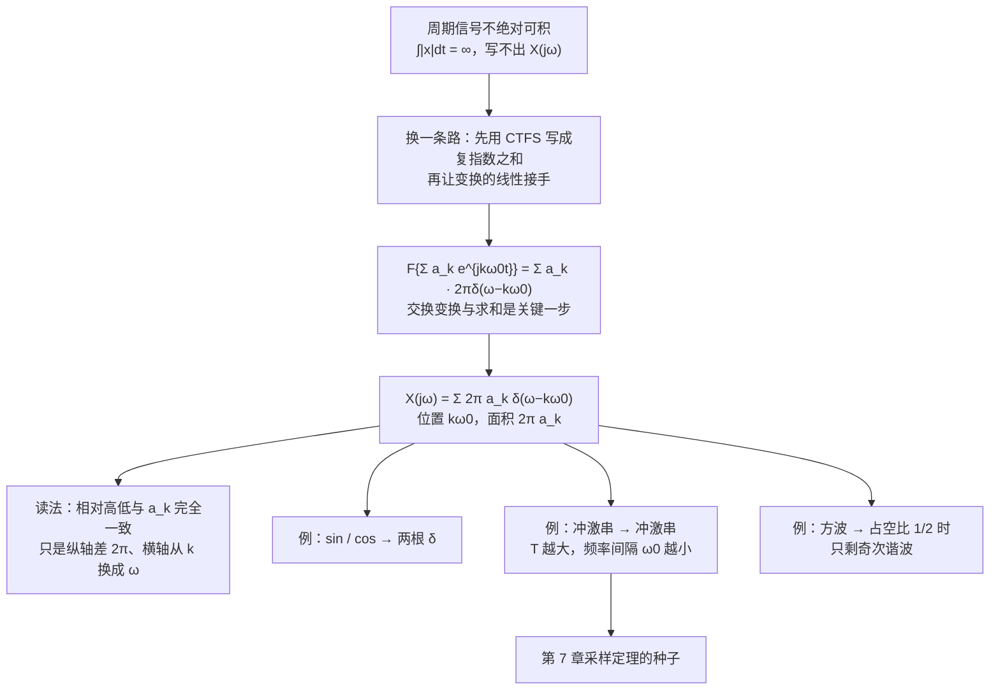

# 4.2 周期信号的傅里叶变换

> [!abstract] 这一讲的任务
> 上一节刚把周期推到无穷，换来连续的频谱；这一节立刻**掉头往回看**：周期信号自己的傅里叶变换是什么样？
> 结论很短——**一串等间隔的冲激**，落在 $\omega=k\omega_0$ 上，第 $k$ 根的面积是 $2\pi a_k$。
> 但这一步不是多余的：**只有周期信号也有了 CTFT，整套性质（卷积、时移、调制、滤波）才能用同一套语言写下来**。否则每遇到一个正弦输入就得退回第 3 章重推一遍，第 5、6 章的系统分析就没法展开。
> 顺带得到一个漂亮的副产品：**冲激串的变换还是冲激串**——第 7 章采样定理的全部内容，就藏在这条式子里。

> [!info] 授课进度说明
> 目前拿到的课堂转写稿覆盖到**第 11 节课**，**第 4 章尚未在课堂上讲授**，因此本篇内容全部来自**原稿与教材整理**，暂不逐条区分"课堂讲过"与"拓展补充"。

---

## 0. 开场：一条规则要想用两次，就得先统一语言

实验室里测一台功放的频率响应，标准做法是**送正弦波进去、量输出幅度**，一路扫频画出一条 $|H(j\omega)|$ 曲线。

同一台功放上还接了另一件事：电源引进来的 50 Hz 哼声是一条**干扰谱**——它在频域上是一根根谱线。你要在同一张图上比较"我的信号在哪儿""干扰在哪儿""功放对哪些频率更敏感"。

麻烦来了：功放的频率响应是一条**连续曲线**（非周期信号 $h(t)$ 的变换），而正弦输入与哼声是**周期信号**——按第 3 章，它们只有 $a_k$，没有 $X(j\omega)$。**一根谱线和一条曲线画不到一张图上。**

要不每次都退回 CTFS 重推？那整套性质（卷积定理、调制、时移）就得写两份——离散频率一份、连续频率一份。第 5、6 章要处理"周期输入 + 一般系统"的组合，两份语言会立刻打架。

所以这一节要办的事很明确：**给周期信号也定义傅里叶变换**，而且要定义得跟非周期信号**无缝对齐**——让它在 $\omega=k\omega_0$ 处恰好等于 $2\pi a_k$，其余地方为零。这样的对象就是**冲激**。

---

## 1. 推导：把变换搬到求和号里面去（p.18）

周期信号不满足绝对可积（$\int|x|dt=\infty$），所以**不能**直接代分析式。走另一条路：先用 CTFS 把它写成复指数之和，再让**变换的线性**接手。

> [!important] 核心一步
> $$\tilde x(t)=\sum_{k=-\infty}^{+\infty}a_ke^{jk\omega_0t}\ \xrightarrow{\ \ \mathcal F\ \ }\ X(j\omega)=\mathcal F\Big\{\sum_ka_ke^{jk\omega_0t}\Big\}=\sum_ka_k\,\mathcal F\big\{e^{jk\omega_0t}\big\}=\sum_ka_k\cdot2\pi\delta(\omega-k\omega_0)$$
> 于是
> $$\boxed{\ \tilde x(t)=\sum_{k}a_ke^{jk\omega_0t}\ \xleftarrow{\ \ CTFT\ \ }\ X(j\omega)=\sum_{k=-\infty}^{+\infty}2\pi a_k\,\delta(\omega-k\omega_0)\ }$$

这一步用了两个已经有的结论：

1. **$\mathcal F\{e^{jk\omega_0t}\}=2\pi\delta(\omega-k\omega_0)$**——上一节例 4.7 刚算过（[[C4.1 非周期信号的表示：连续时间傅里叶变换]]）；
2. **线性**：变换可以逐项进行，所以 $\mathcal F$ 与 $\sum_k$ 可以交换。这里的"逐项"是**无穷多项**，严格性由极限（广义函数）保证，不在本课讨论范围；工程上它成立，而且非常好用。

> [!warning] 别把它当成"普通函数意义下的等式"
> 左边 $\tilde x(t)$ 不绝对可积，右边的 $\sum_k2\pi a_k\delta(\omega-k\omega_0)$ 也不是普通函数——**两边都是广义函数**。因此这条式子的正确用法是"**放进积分里再用**"：
> $$\int X(j\omega)\Phi(\omega)d\omega=\sum_k2\pi a_k\Phi(k\omega_0)$$
> 即"乘一个测试函数再积分"。系统分析里凡是遇到 $\delta$，实际动作都是**抽样**（把 $\Phi$ 在 $\omega=k\omega_0$ 上取出来），这一点在第 6 章的滤波、第 7 章的采样里会反复用到。

> [!important] 怎么读这条结论
> **周期信号的频谱是一串等间隔的冲激**：
> - 位置：$k\omega_0$——只出现在**谐波频率**上，间隔 $\omega_0$，与第 3 章的"谱线离散"完全一致；
> - 面积（强度）：$2\pi a_k$——**正比于 CTFS 系数**，比例常数是 $2\pi$；
> - 形状：$\delta$ 本身没有"宽度"和"高度"，只有**面积**有意义。

---

## 2. 与 CTFS 谱线图对照着读（p.19）

同一个方波信号，用两套语言画出来是这样：

![[C4.2-方波的CTFS谱线与CTFT冲激.png]]

- **上图（CTFS）**：横轴是谐波序号 $k$，纵轴是系数 $a_k$，一根根离散谱线；
- **下图（CTFT）**：横轴是真实频率 $\omega=k\omega_0$，纵轴是冲激的**面积** $2\pi a_k$。

**两图的高低起伏一模一样**——哪根高、哪根矮、哪几根是零、哪几根是负的，完全对应；差别只在两把尺子：

| | CTFS | CTFT |
|---|---|---|
| 横轴 | $k$（序号，无量纲） | $\omega=k\omega_0$（真实频率） |
| 纵轴 | $a_k$（谱线值） | $2\pi a_k$（冲激面积） |
| 频率间隔 | 恒为 1 | $\omega_0=\frac{2\pi}{T}$（$T$ 越大越密） |
| 量纲 | 与信号同量纲 | 多一个时间量纲（面积 = 值×频率） |

> [!warning] 两个刻度不要互相代入
> 最常见的错误是**拿 $a_k$ 和 $2\pi a_k$ 直接比大小**，或者把 $k$ 轴的数值当 $\omega$ 轴的数值用。差一个 $2\pi$ 只是常数，但**横轴的换算取决于 $T$**——同一个方波，$T$ 改成两倍，CTFS 图上的 $k$ 轴看起来没变，CTFT 图上的谱线间隔却少了一半。

**数值对照**（方波 $T_0=4$、$T_1=1$，占空比 $\frac12$）：

| $k$ | 0 | $\pm1$ | $\pm2$ | $\pm3$ | $\pm5$ |
|---|---|---|---|---|---|
| $a_k$ | $0.5$ | $0.3183$ | $0$ | $-0.1061$ | $0.0637$ |
| $2\pi a_k$ | $\pi\approx3.1416$ | $2.0$ | $0$ | $-0.6667$ | $0.4$ |

（已用 python 逐点复核；$k=\pm2,\pm4$ 处系数为零是"占空比 $\frac12$ 只剩奇次谐波"，与第 3 章的结论一致。）

---

## 3. 四个例子（p.20–22）

### 3.1 正弦与余弦：相位也藏在 $\delta$ 的系数里（p.20）

> [!example] 例 1　$x(t)=\sin\omega_0t$
> $$\sin\omega_0t=\frac{1}{2j}\big(e^{j\omega_0t}-e^{-j\omega_0t}\big)\ \xleftarrow{\ \ CTFT\ \ }\ X(j\omega)=\frac{\pi}{j}\big[\delta(\omega-\omega_0)-\delta(\omega+\omega_0)\big]$$

> [!example] 例 2　$x(t)=\cos\omega_0t$
> $$\cos\omega_0t=\frac12\big(e^{j\omega_0t}+e^{-j\omega_0t}\big)\ \xleftarrow{\ \ CTFT\ \ }\ X(j\omega)=\pi\big[\delta(\omega-\omega_0)+\delta(\omega+\omega_0)\big]$$

两式只差一个 $\pm\frac1j$，但它带来一个重要区别：

- **余弦**：$a_{\pm1}=\frac12$（实数）$\Rightarrow$ 两根 $\delta$ 的面积都是 $+\pi$，**相位为零**；
- **正弦**：$a_{\pm1}=\mp\frac{1}{2j}=\pm\frac j2$（**纯虚数**）$\Rightarrow$ 面积是 $\pm\frac{\pi}{j}$，**相位为 $\pm\frac\pi2$**。

**同一个幅度谱，正弦和余弦只差相位。** 如果画图时只画面积的大小、把 $j$ 丢掉，$\sin$ 与 $\cos$ 就变成同一张图了——所以周期信号的频谱图上，**带 $j$（或标出相位）的那一笔不能省**，这与第 3 章"实信号通常要画幅度谱 + 相位谱"是同一件事。

> [!tip] 与第 3 章对一下账
> 余弦的 CTFS 只有 $a_{\pm1}=\frac12$ 两根；这里给它的 CTFT 是两根面积 $\pi$ 的冲激，而 $2\pi\cdot\frac12=\pi$ ✓。**同一件事，只是乘了 $2\pi$。**

### 3.2 冲激串：自相似的信号（p.21）

> [!example] 例 3　冲激串 Impulse train
> $$x(t)=\sum_{n=-\infty}^{+\infty}\delta(t-nT)\ \xleftarrow{\ \ CTFT\ \ }\ X(j\omega)=\frac{2\pi}{T}\sum_{k=-\infty}^{+\infty}\delta(\omega-k\omega_0)=\omega_0\sum_{k=-\infty}^{+\infty}\delta(\omega-k\omega_0)$$

推导只有两行，关键是**冲激串的 CTFS 系数出奇地简单**：

取一个周期 $[-\frac T2,\frac T2]$，里面只有一个 $\delta(t)$：

$$a_k=\frac1T\int_{-T/2}^{T/2}\delta(t)e^{-jk\omega_0t}dt=\frac1T\cdot e^{0}=\frac1T\qquad(\text{对所有的 }k)$$

（用抽样性质：$\delta$ 把被积函数在 $t=0$ 处取出来，$e^{-jk\omega_0\cdot0}=1$。）

代进 §1 的结论：

$$X(j\omega)=\sum_k2\pi\cdot\frac1T\delta(\omega-k\omega_0)=\omega_0\sum_k\delta(\omega-k\omega_0)$$

![[C4.2-冲激串与它的谱.png]]

> [!important] 冲激串的变换还是冲激串
> 这是最"自相似"的一个信号：**时域是等间隔的冲激，频域还是等间隔的冲激**。
> 而且两个间隔**倒数关系**：$T$ 变大 $\Rightarrow$ 时域冲激变稀，频域间隔 $\omega_0=\frac{2\pi}{T}$ 同步变小、冲激变密，两者乘积恒为 $2\pi$。
> 这又是"时域越宽、频域越窄"（[[C4.1 非周期信号的表示：连续时间傅里叶变换]] §4）的一个极端形态：**把"宽窄互换"用到冲激串上，得到的就是频率的倒数关系。**
> 数值核对：$T=1$ 时冲激面积 $\omega_0=2\pi\approx6.2832$；$T=2$ 时 $\omega_0=\pi\approx3.1416$（已复核）。

> [!tip] 记住这一条，第 7 章就轻松了
> **采样**在数学上就是"把信号乘上一个冲激串"：$x_p(t)=x(t)\sum_n\delta(t-nT)$。乘法的变换是**卷积**（第 4.5 节），而"和冲激串卷积"等于**把频谱按 $\omega_0$ 周期延拓**——于是"$\omega_s>2\omega_M$ 才能不混叠"这条采样定理，就是"延拓出来的频谱副本不许互相重叠"。

### 3.3 周期方波：把第 3 章的谱线搬过来（p.22）

> [!example] 例 4　周期方波（幅度 1，$|t|<T_1$ 内为 1，周期 $T_0$）
> 第 3 章已经算出系数，这里直接搬：
> $$a_k=\frac{2T_1}{T_0}\mathrm{Sa}(k\omega_0T_1)=\frac{\sin k\omega_0T_1}{\pi k}$$
> （第二种写法是把 $\mathrm{Sa}(x)=\frac{\sin x}{x}$ 代进去、再用 $\omega_0T_0=2\pi$ 约掉：$\frac{2T_1}{T_0}\cdot\frac{\sin k\omega_0T_1}{k\omega_0T_1}=\frac{2\sin k\omega_0T_1}{k\omega_0T_0}=\frac{\sin k\omega_0T_1}{\pi k}$。）
> 于是
> $$X(j\omega)=\sum_{k=-\infty}^{+\infty}2\pi a_k\delta(\omega-k\omega_0)=\sum_{k=-\infty}^{+\infty}\frac{2\sin(k\omega_0T_1)}{k}\,\delta(\omega-k\omega_0)$$

两点要留意：

- **$k=0$ 这一项要单独看**：$\frac{\sin(k\omega_0T_1)}{k}$ 在 $k=0$ 处是 $\frac00$，取极限得 $a_0\omega_0=\frac{2T_1}{T_0}\cdot\frac{2\pi}{T_0}$，即 $2\pi a_0=\frac{4\pi T_1}{T_0}$——**面积就是 $2\pi a_0$，直流分量照样按同一条规则来**。
- **占空比 $\frac12$ 时（$T_0=4T_1$）**，$k\omega_0T_1=\frac{k\pi}{2}$，$\sin\frac{k\pi}{2}$ 在 $k$ 为偶数时为 0：**偶次谐波整根消失**，频谱上只剩奇次冲激。这就是第 3 章"方波只含奇次谐波"在变换语言里的样子。

**数值核对**（$T_0=4,T_1=1$，占空比 $\frac12$，$\omega_0=\frac\pi2$）：

| $k$ | 0 | 1 | 2 | 3 | 5 |
|---|---|---|---|---|---|
| $a_k$ | $\frac12$ | $\frac1\pi\approx0.3183$ | $0$ | $-\frac1{3\pi}\approx-0.1061$ | $\frac1{5\pi}\approx0.0637$ |
| 冲激面积 $2\pi a_k$ | $\pi\approx3.1416$ | $2$ | $0$ | $-\frac23\approx-0.6667$ | $0.4$ |

冲激面积也可直接由 $\frac{2\sin(k\omega_0T_1)}{k}$ 得到：$k=1$ 得 $2\sin\frac\pi2=2$ ✓，$k=3$ 得 $\frac{2\sin\frac{3\pi}2}{3}=-\frac23$ ✓，$k=5$ 得 $\frac{2\sin\frac{5\pi}2}{5}=0.4$ ✓（三条都已用 python 复核）。

> [!important] 一句话收尾
> **CTFS 与 CTFT 不是两套工具，是同一套工具的两种刻度。** 拿到周期信号的频谱，两种写法都合法：
> - 写 $a_k$：简洁，但只在 $k$ 上有定义；
> - 写 $\sum2\pi a_k\delta(\omega-k\omega_0)$：啰嗦一点，但它**住在连续频率轴上**，于是可以和非周期信号的频谱做加法、做卷积、一起画在同一张图里。
> 工程上永远选后者。

---

## 这一讲的三句话

1. **周期信号的傅里叶变换是一串等间隔冲激**：$X(j\omega)=\sum\limits_k2\pi a_k\,\delta(\omega-k\omega_0)$——位置在谐波频率 $k\omega_0$，面积等于 $2\pi a_k$。
2. **冲激串的变换还是冲激串**：$\sum_n\delta(t-nT)\leftrightarrow\omega_0\sum_k\delta(\omega-k\omega_0)$，时域间隔与频域间隔成倒数（$T\omega_0=2\pi$）——"时域越宽频域越窄"的极端形态，也是第 7 章采样定理的种子。
3. **统一语言的意义**：只有周期信号也有了 CTFT，卷积、调制、滤波这些性质才能只写一遍；遇到周期输入时，$\delta$ 通过**抽样**把结论取到 $k\omega_0$ 上，就退回第 3 章的结果。

> [!tip] 速查表
> | 信号 | 傅里叶变换 |
> |---|---|
> | $\sum\limits_ka_ke^{jk\omega_0t}$ | $\sum\limits_k2\pi a_k\delta(\omega-k\omega_0)$ |
> | $e^{j\omega_0t}$ | $2\pi\delta(\omega-\omega_0)$ |
> | $\cos\omega_0t$ | $\pi\delta(\omega-\omega_0)+\pi\delta(\omega+\omega_0)$（面积实，相位 0） |
> | $\sin\omega_0t$ | $\frac{\pi}{j}\big[\delta(\omega-\omega_0)-\delta(\omega+\omega_0)\big]$（相位 $\pm\frac\pi2$） |
> | 冲激串 $\sum\limits_n\delta(t-nT)$ | $\omega_0\sum\limits_k\delta(\omega-k\omega_0)$，$\omega_0=\frac{2\pi}{T}$ |
> | 周期方波（脉宽 $2T_1$） | $\sum\limits_k\frac{2\sin(k\omega_0T_1)}{k}\delta(\omega-k\omega_0)$ |
> | 读图口径 | 冲激只有**面积**有意义（$=2\pi a_k$）；相对高低与 $a_k$ 图完全一致 |
> | 与 CTFS 的尺子 | 横轴 $k\to\omega=k\omega_0$；纵轴 $a_k\to2\pi a_k$ |

> [!tip] 下一讲预告
> 到这里我们手里有了两类信号的频谱：非周期的是连续曲线，周期的是冲激串。接下来该问"**这些频谱怎么用**"了。
> 4.3 节把 CTFT 的性质一条条推出来：时移、频移、共轭、尺度、对偶、**卷积**、**相乘**、微分、积分、帕塞瓦尔。这些性质才是后面所有系统分析的手柄——尤其是**卷积性质**，它让"时域卷积"变成"频域乘法"，也让"给一个微分方程、求频率响应"变成一步代数。

---

## 相关笔记 Related Notes

- 相关：[[C4.1 非周期信号的表示：连续时间傅里叶变换]]（$e^{j\omega_0t}\to2\pi\delta$ 与宽窄对偶）、[[C3.2 连续时间傅里叶级数]]（$a_k$ 与占空比 × $\mathrm{Sa}$）、[[C1.4 单位冲激与单位阶跃函数]]（冲激串与抽样性质）

- 上一讲：[[C4.1 非周期信号的表示：连续时间傅里叶变换]]
- 下一讲：[[C4.3 连续时间傅里叶变换的性质]]
- 返回：[[信号与系统 MOC]]
