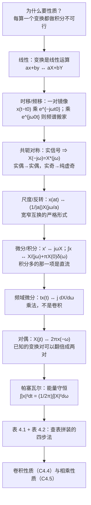

# 4.3 连续时间傅里叶变换的性质

> [!abstract] 这一讲的任务
> 前两节把变换定义出来、又算了一批基本变换对。但真正让傅里叶方法"能干活"的不是定义，而是**性质**。
> 这一节要把 CTFT 的性质一条条推出来：**线性、时移、频移、共轭对称、尺度、反转、微分、积分、频域微分、对偶、帕塞瓦尔**。
> 每一条都是同一件事的两面：**时域里做一个动作，频域里就有一个对应的动作**——而且绝大多数时候，频域那边只是"乘一个因子"或"移动一下位置"。
> 学完的标志是：拿到一个新信号，**不再从定义积分，而是查表 + 用性质拼出来**。表 4.1（性质）与表 4.2（基本变换对）就是这套拼装工具的全部零件。

> [!info] 授课进度说明
> 目前拿到的课堂转写稿覆盖到**第 11 节课**，**第 4 章尚未在课堂上讲授**，因此本篇内容全部来自**原稿与教材整理**，暂不逐条区分"课堂讲过"与"拓展补充"。

---

## 0. 开场：给声音加 5 ms 延迟，音色会变吗

录音棚里做"立体声加宽"的老办法：把左声道整体延迟几毫秒，再和右声道混。有人立刻会担心——**延迟会不会改变音色？**（音色就是频谱分布，改了音色等于换了乐器。）

如果只会用定义式，这就得把整段音频的傅里叶积分重算一遍，还看不出规律。

但只要知道一条性质，答案是**一行**：

$$x(t-t_0)\ \xleftarrow{\ \ CTFT\ \ }\ e^{-j\omega t_0}X(j\omega)$$

$e^{-j\omega t_0}$ 的模恒等于 1，所以

$$\big|e^{-j\omega t_0}X(j\omega)\big|=\big|X(j\omega)\big|$$

**幅度谱一点没变，变的只是相位**——延迟不改音色，只改各频率成分的"对齐方式"。这就是"几毫秒延迟不破坏音色、但会改变空间感"的原理。

整节要干的事就是这个：把"重新积分"换成"查表 + 用性质"。这一节的性质全部列在**表 4.1** 里，配合**表 4.2** 的基本变换对，就能拼出绝大多数工程信号的频谱。

> [!note] 一条贯穿全节的主线
> 每一个性质都在回答同一个问题：**时域做这个动作，频域要付什么代价？** 把答案记成一张"动作 ↔ 代价"的对照表，就是表 4.1。

---

## 1. 线性（4.3.1，p.23）

> [!important] 线性 Linearity
> 若 $x(t)\xleftarrow{}\ X(j\omega)$，$y(t)\xleftarrow{}\ Y(j\omega)$，则
> $$a\,x(t)+b\,y(t)\ \xleftarrow{\ \ CTFT\ \ }\ a\,X(j\omega)+b\,Y(j\omega)$$

因为变换本身就是**积分**，而积分是线性运算。这条性质看着平淡，却是**一切"拼装"的许可证**：

- 把复杂信号拆成简单信号之和，各自的变换分别查表，再加起来；
- 也是第 4.2 节"周期信号 = 一串 $\delta$"能成立的理由——$\mathcal F$ 与 $\sum_k$ 能交换，靠的就是线性。

> [!warning] 线性的边界：只对"和"成立
> $a\,x(t)+b\,y(t)$ 对应 $aX+bY$；但**乘积** $x(t)y(t)$ 不是 $X(j\omega)Y(j\omega)$（那是**卷积**，见 [[C4.5 相乘性质与调制]]），**卷积** $x*y$ 也不是 $XY$ 之外的别的东西（那才是乘法，见 [[C4.4 卷积性质与由微分方程表征的系统]]）。乘法与卷积在这一节里必须是两条性质，不能混。

---

## 2. 时移：频域乘一个纯相位（4.3.2，p.23）

> [!important] 时移 Time shifting
> $$x(t-t_0)\ \xleftarrow{\ \ CTFT\ \ }\ e^{-j\omega t_0}\,X(j\omega)$$

> [!example] 证明（三行）
> 从综合式出发：
> $$x(t)=\frac{1}{2\pi}\int_{-\infty}^{+\infty}X(j\omega)e^{j\omega t}d\omega$$
> 把 $t$ 换成 $t-t_0$：
> $$x(t-t_0)=\frac{1}{2\pi}\int_{-\infty}^{+\infty}X(j\omega)e^{j\omega(t-t_0)}d\omega=\frac{1}{2\pi}\int_{-\infty}^{+\infty}\underbrace{\big[X(j\omega)e^{-j\omega t_0}\big]}_{\text{新的频谱}}e^{j\omega t}d\omega$$
> 把中括号里那一坨读成"新信号的频谱"，立刻得到 $e^{-j\omega t_0}X(j\omega)$——**不需要重新做积分**，只要把综合式里的 $t$ 改掉再对比。

> [!important] 它的物理含义
> - $|e^{-j\omega t_0}|=1$：**幅度谱完全不变**，延迟只改相位；
> - 相位是 $-\omega t_0$：**关于 $\omega$ 是一条过原点的直线**，斜率就是延迟量。反过来，看到相位谱是一条直线，就该想到"这只是一个纯延迟"。
> - 这也解释了为什么"判断两个信号是否只差一个延迟"在频域特别好办：**比幅度谱就够了**。

这条性质在 [[C4.1 非周期信号的表示：连续时间傅里叶变换]] 的随堂测里已经用过一次：$x(t)=e^{-2|t-1|}$ 是 $e^{-2|t|}$ 右移 1，所以 $X(j\omega)=e^{-j\omega}\cdot\frac{4}{4+\omega^2}$——不用做任何积分。

---

## 3. 频移：时域乘复指数 = 频谱搬家（4.3.6，p.32 表）

> [!important] 频移 Frequency shifting
> $$e^{j\omega_0t}x(t)\ \xleftarrow{\ \ CTFT\ \ }\ X\big(j(\omega-\omega_0)\big)$$

时移与频移是一对**镜像**：时域挪位置 ⇒ 频域乘相位；频域挪位置 ⇒ 时域乘复指数。两者都由同一个对偶关系串起来（见 §9）。

**读法**：$x(t)$ 的频谱整块**平移**到 $\omega_0$ 附近。这一步就是"调制"的数学内容——把基带信号搬到载波频率上，第 4.5 节整节都在用它。

> [!tip] 提前记住这个画面
> 打电话、Wi-Fi、广播：**低频的语音/数据（频谱挤在 0 附近）乘上一个高频载波，频谱就整块搬到高频车道上去**。频移性质是这场搬运的申请书。

---

## 4. 共轭与共轭对称：实信号的约束（4.3.3，p.25）

> [!important] 三条结论
> **(1) 共轭**　$x^*(t)\ \xleftarrow{}\ X^*(-j\omega)$
> **(2) 实信号**　若 $x(t)$ 实，即 $x(t)=x^*(t)$，则
> $$X(j\omega)=X^*(-j\omega)\quad\Longleftrightarrow\quad X(-j\omega)=X^*(j\omega)$$
> **(3) 奇偶分解**（$x$ 实）　
> $$\mathrm{Ev}\{x(t)\}=x_e(t)\ \xleftarrow{}\ \mathrm{Re}\{X(j\omega)\}=X_R(j\omega)$$
> $$\mathrm{Od}\{x(t)\}=x_o(t)\ \xleftarrow{}\ j\,\mathrm{Im}\{X(j\omega)\}=jX_I(j\omega)$$

**(1) 的证明**（从综合式取共轭）：把 $x^*(t)$ 写出来，共轭可以搬进积分号，$e^{j\omega t}$ 变 $e^{-j\omega t}$，再把 $\omega$ 换成 $-\omega$ 就回到标准形状：

$$x^*(t)=\left(\frac{1}{2\pi}\int X(j\omega)e^{j\omega t}d\omega\right)^*=\frac{1}{2\pi}\int X^*(j\omega)e^{-j\omega t}d\omega\xrightarrow{\ \omega\to-\omega\ }\frac{1}{2\pi}\int X^*(-j\omega)e^{j\omega t}d\omega$$

**(2) 的读法**：实信号的频谱必须满足 $X(-j\omega)=X^*(j\omega)$，拆成两条：

- $|X(-j\omega)|=|X(j\omega)|$ ⇒ **幅度谱是偶函数**；
- $\angle X(-j\omega)=-\angle X(j\omega)$ ⇒ **相位谱是奇函数**。

第 3 章从 $a_k^*=a_{-k}$ 得到过同样的结论（[[C3.2 连续时间傅里叶级数]]），那里是级数版，这里是变换版。

**(3) 的用法**：**实部 ↔ 偶部，虚部 ↔ 奇部**（注意奇部那边多一个 $j$）。于是：

| 信号的对称性 | 频谱的对称性 |
|---|---|
| $x(t)$ 实且**偶** | $X(j\omega)$ **实且偶**（例：$e^{-a\lvert t\rvert}\leftrightarrow\frac{2a}{a^2+\omega^2}$） |
| $x(t)$ 实且**奇** | $X(j\omega)$ **纯虚且奇**（例：$\mathrm{Sgn}(t)\leftrightarrow\frac{2}{j\omega}$） |
| $x(t)$ 实，一般 | $X(-j\omega)=X^*(j\omega)$ |

> [!tip] 做题时的两个便宜
> 1. **算完顺手验一次**：结果是实数吗？是纯虚数吗？符不符合上表？符号错误大多能被这一验拦下。
> 2. **实偶信号只需算一半**：$X(j\omega)=\int x(t)\cos\omega t\,dt$（虚部的 $\sin$ 积分因为奇函数而消失），计算量减半。图中 $e^{-a|t|}$ 那一题就是这么变简单的。

---

## 5. 例：$u(t)$ 的变换（p.26）

这一题是共轭对称性质最有价值的应用，因为它**不绝对可积**，不能直接代定义式。

> [!example] 例　$x(t)=u(t)$
> 先做**奇偶分解**。$u(t)$ 既不是偶的也不是奇的，但可以拆成一半偶、一半奇：
> $$u(t)=u_e(t)+u_o(t),\qquad u_e(t)=\frac12,\qquad u_o(t)=\frac12\mathrm{Sgn}(t)$$
> 其中 $\mathrm{Sgn}(t)=\begin{cases}1,&t>0\\-1,&t<0\end{cases}$。两边各自求变换：
> - 偶部是常数：$u_e(t)=\frac12\ \xleftarrow{}\ \pi\delta(\omega)$（[[C4.1 非周期信号的表示：连续时间傅里叶变换]] 例 4.6，常数 $\to2\pi\delta(\omega)$，再乘 $\frac12$）；
> - 奇部用**极限逼近**：$\mathrm{Sgn}(t)=\lim\limits_{a\to0}\big[e^{-at}u(t)-e^{at}u(-t)\big]$，于是
>   $$\mathcal F\{\mathrm{Sgn}(t)\}=\lim_{a\to0}\Big[\frac{1}{a+j\omega}-\frac{1}{a-j\omega}\Big]=\lim_{a\to0}\frac{-2j\omega}{a^2+\omega^2}=\frac{2}{j\omega}$$
>   所以 $\mathcal F\{u_o\}=\frac12\cdot\frac{2}{j\omega}=\frac{1}{j\omega}$。
>
> 两者相加：
> $$\boxed{\ u(t)\ \xleftarrow{\ \ CTFT\ \ }\ \frac{1}{j\omega}+\pi\delta(\omega)\ }$$

![[C4.3-u(t)的奇偶分解与频谱.png]]

**四个面板对着看**：阶跃 = 常数 $\frac12$ + 符号函数的一半；而频谱的**实部**是来自偶部的那根冲激 $\pi\delta(\omega)$，**虚部**是来自奇部的 $-1/\omega$。

> [!important] 那根 $\pi\delta(\omega)$ 是什么
> 它就是**直流分量**。$u(t)$ 的平均值是 $\frac12$，一个永远不为零的偏置——按 §7 的积分性质，这个偏置在频域表现为 $\omega=0$ 处的一根冲激。
> **忘了它，答案在物理上就是错的**：没有 $\pi\delta(\omega)$ 的 $1/(j\omega)$ 描述的是一个平均值为零的信号，而 $u(t)$ 明明一直待在 1 上。
>
> 顺带做一次交叉验证：把 [[C4.1 非周期信号的表示：连续时间傅里叶变换]] 例 4.1 的 $e^{-at}u(t)\leftrightarrow\frac{1}{a+j\omega}$ 取 $a\to0^+$：
> $$\frac{1}{a+j\omega}=\underbrace{\frac{a}{a^2+\omega^2}}_{\to\ \pi\delta(\omega)}-j\underbrace{\frac{\omega}{a^2+\omega^2}}_{\to\ 1/\omega}$$
> 实部是一个高度 $\frac1a$、宽度 $a$ 的钟形，面积恒为 $\pi$，$a\to0$ 时正好塌成 $\pi\delta(\omega)$ ✓。**两条路给出同一个答案。**

> [!warning] 与例 4.1 的对照别搞混
> $\frac{1}{a+j\omega}$ 里有 $a$，$a\to0$ 之后才出现 $\pi\delta(\omega)$；**只要 $a>0$（信号真的衰减到零），就没有冲激项**，因为此时信号的平均值为零。冲激项是"不衰减"这一事实的代价。

---

## 6. 尺度变换与反转：宽窄互换的严格形式（4.3.5，p.24）

> [!important] 时域与频域尺度变换 Time and frequency scaling
> $$x(at)\ \xleftarrow{\ \ CTFT\ \ }\ \frac{1}{|a|}\,X\!\Big(j\frac{\omega}{a}\Big)$$
> 特例（$a=-1$）——**反转 Time reversal**：
> $$x(-t)\ \xleftarrow{\ \ CTFT\ \ }\ X(-j\omega)$$

> [!example] 证明：为什么要写成 $\lvert a\rvert$
> 仍从综合式出发，把 $t$ 换成 $at$：
> $$x(at)=\frac{1}{2\pi}\int_{-\infty}^{+\infty}X(j\omega)e^{j\omega at}d\omega$$
> 换元 $\sigma=a\omega$（即 $\omega=\frac{\sigma}{a}$，$d\omega=\frac{d\sigma}{a}$），积分限怎么变，取决于 $a$ 的符号：
> - $a>0$：$\omega:-\infty\to+\infty$ 对应 $\sigma:-\infty\to+\infty$，于是 $x(at)=\frac{1}{2\pi}\int\frac{1}{a}X(j\frac{\sigma}{a})e^{j\sigma t}d\sigma$；
> - $a<0$：**积分限上下颠倒**，$\int_{-\infty}^{+\infty}\to\int_{+\infty}^{-\infty}$，再翻回来要多一个负号，正好与 $\frac1a<0$ 抵消成 $\frac{1}{-a}$。
>
> 两种情形合起来就是 $\frac{1}{|a|}$——**绝对值不是"为了好看"，而是积分限翻转留下的记号。**

![[C4.3-尺度变换的宽窄互换.png]]

**这张图就是第 4.1 节那句"时域越窄频域越宽"的精确版本**：$x(2t)$ 把时域压扁一半，频谱就**横向拉宽一倍、纵向压矮一半**。

> [!important] 两个要点
> - **$a$ 的符号只决定反转，不决定宽窄**：$x(-2t)$ 与 $x(2t)$ 的幅度谱完全一样，只是左右翻了个面。
> - **面积不变**：$X(j0)=\int x(t)dt$，压缩前后总"面积"一样，所以横向一拉宽，纵向必然变矮。这不是巧合，而是同一个事实的两种说法。
> - 工程上的用途：**时间压缩 = 频带展宽**。录音加速播放会变调、雷达用宽带信号换高距离分辨率，都是这条性质。

---

## 7. 微分与积分（4.3.4，p.27）

### 7.1 时域微分

> [!important] 微分 Differentiation in time
> $$x'(t)\ \xleftarrow{\ \ CTFT\ \ }\ j\omega\,X(j\omega)$$

证明一行：综合式两边对 $t$ 求导，$e^{j\omega t}$ 求导吐出一个 $j\omega$：

$$x'(t)=\frac{d}{dt}\frac{1}{2\pi}\int X(j\omega)e^{j\omega t}d\omega=\frac{1}{2\pi}\int \underbrace{j\omega X(j\omega)}_{\text{新频谱}}e^{j\omega t}d\omega$$

**含义**：时域求导 = 频域**乘 $j\omega$**。$|j\omega|=\omega$ 随频率线性增长，所以**求导是高频放大器**——这正是一切"边缘检测""求梯度"操作放大高频的根据。

### 7.2 时域积分

> [!important] 积分 Integration
> $$x^{(-1)}(t)=\int_{-\infty}^{t}x(\tau)d\tau\ \xleftarrow{\ \ CTFT\ \ }\ \frac{1}{j\omega}X(j\omega)+\pi X(0)\,\delta(\omega)$$

> [!example] 证明：积分 = 与阶跃卷积
> $x^{(-1)}(t)=x(t)*u(t)$，而 $\mathcal F\{u(t)\}=\frac{1}{j\omega}+\pi\delta(\omega)$（§5 刚算过）。用**卷积性质**（§[[C4.4 卷积性质与由微分方程表征的系统]] 给证明）：
> $$x(t)*u(t)\ \xleftarrow{}\ X(j\omega)\Big[\frac{1}{j\omega}+\pi\delta(\omega)\Big]=\frac{1}{j\omega}X(j\omega)+\pi X(0)\delta(\omega)$$
> 最后一步用了 $\delta$ 的抽样性质：$X(j\omega)\delta(\omega)=X(j0)\delta(\omega)=X(0)\delta(\omega)$。

> [!important] 为什么积分要多出 $\pi X(0)\delta(\omega)$ 这一项
> 因为**求导会把直流信息彻底丢掉**。看这个例子：
> $$x_1(t)=2t,\qquad x_2(t)=2t+3$$
> 两者导数完全一样（$x_1'=x_2'=2$），可它们的**平均值**差 3。所以"先求导、再查表"这条路，**永远没法把 $x_2$ 那个 3 找回来**——多出来的 $\pi X(0)\delta(\omega)$ 就是那个丢失的直流量的容身之处。
>
> 数值上的自检：对 $x(t)=\mathrm{Sgn}(t)e^{-|t|}$（它的变上限积分 $e^{-|t|}$ 绝对可积，可以数值核对），在 $\omega\ne0$ 处逐点验证 $\mathcal F\{x^{(-1)}\}=\frac{1}{j\omega}X(j\omega)$ ✓（残差 $2\times10^{-8}$，已用 python 复核）。
> **积分性质使用时先问一句：信号的平均值是不是零？** 是零，$\delta$ 项自动消失；不是零，绝不能漏。

> [!warning] 微分与积分不是"互为逆运算"
> 微分再积分，会**丢掉平均值**。这也是 [[C2.4 微分方程与连续时间系统求解]] 里"零输入 / 零状态必须分开处理"在频域里的同一件事：初条件承载的那部分信息，不在频域的乘 $j\omega$ 里。

---

## 8. 频域微分：把 $t$ 乘上去（4.3.6，p.44）

> [!important] 频域微分 Differentiation in frequency
> $$t\,x(t)\ \xleftarrow{\ \ CTFT\ \ }\ j\frac{d}{d\omega}X(j\omega)$$

> [!example] 证明：对 $\omega$ 求导
> $$X(j\omega)=\int x(t)e^{-j\omega t}dt\ \Longrightarrow\ \frac{d}{d\omega}X(j\omega)=\int x(t)(-jt)e^{-j\omega t}dt$$
> 两边同乘 $j$：$\ j\frac{d}{d\omega}X(j\omega)=\int \big[tx(t)\big]e^{-j\omega t}dt$，右边正是 $tx(t)$ 的变换（**乘一个 $j$ 就把 $-j$ 收干净了**）。

**用法：把变换对"往上叠阶数"。** 对 $e^{-at}u(t)\leftrightarrow\frac{1}{a+j\omega}$ 反复用这一条：

$$\begin{aligned}
e^{-at}u(t)\ &\xleftarrow{\ \ CTFT\ \ }\ \frac{1}{a+j\omega}\\[2pt]
t\,e^{-at}u(t)\ &\xleftarrow{\ \ CTFT\ \ }\ \frac{1}{(a+j\omega)^2}\\[2pt]
\frac{t^{n-1}}{(n-1)!}e^{-at}u(t)\ &\xleftarrow{\ \ CTFT\ \ }\ \frac{1}{(a+j\omega)^n}
\end{aligned}\qquad(\mathrm{Re}\{a\}>0)$$

（最后一式用数学归纳法：每次乘 $t$、除以 $n-1$ 的阶乘，形式保持不变。）

> [!note] 这一条和"卷积性质"是两回事
> - $t\,x(t)$ 是**相乘**（时域里乘一个函数 $t$）⇒ 频域**微分**；
> - $x(t)*y(t)$ 是**卷积** ⇒ 频域**相乘**。
> 记忆钩子：**"乘"与"卷"在两边互换**——时域相乘对频域卷积（[[C4.5 相乘性质与调制]]），时域卷积对频域相乘（[[C4.4 卷积性质与由微分方程表征的系统]]）；而"乘 $t$"只是一个特殊的相乘，所以给出的是微分。

---

## 9. 对偶：已知一对变换，白得一对（4.3.6，p.29）

> [!important] 对偶 Duality
> $$X(jt)\ \xleftarrow{\ \ CTFT\ \ }\ 2\pi\,x(-\omega)$$
> 等价地：$\dfrac{1}{2\pi}X(jt)\ \xleftarrow{}\ x(-\omega)$。

> [!example] 证明：把 $t$ 与 $\omega$ 的名字换一下
> 从综合式出发：
> $$x(t)=\frac{1}{2\pi}\int_{-\infty}^{+\infty}X(j\omega)e^{j\omega t}d\omega$$
> **交换 $t$ 与 $\omega$ 的位置**：
> $$x(\omega)=\frac{1}{2\pi}\int_{-\infty}^{+\infty}X(jt)e^{j\omega t}dt$$
> 把 $\omega$ 换成 $-\omega$ 并两边乘 $2\pi$：
> $$2\pi x(-\omega)=\int_{-\infty}^{+\infty}X(jt)e^{-j\omega t}dt$$
> 右端的形状，与**分析式** $X(j\omega)=\int x(t)e^{-j\omega t}dt$ 逐字对照——把"$x(t)$"的位置换上"$X(jt)$"，左端就是它的变换。于是 $X(jt)\leftrightarrow2\pi x(-\omega)$。

![[C4.3-对偶-交换t与omega.png]]

上图把"交换 $t$ 与 $\omega$"画出来了：第一对是"时域矩形 $\to$ 频域 $\mathrm{Sa}$"，第二对是"时域 $\mathrm{Sa}\to$ 频域矩形"——**形状完全对调**。

> [!important] 对偶的实用价值：变换对翻倍
> 表 4.2 里每一对，都能靠对偶**白送一对**。最常用的一对：
> $$x(t)=\begin{cases}1,&\lvert t\rvert<T_1\\0,&\lvert t\rvert>T_1\end{cases}\ \xleftarrow{}\ 2T_1\mathrm{Sa}(\omega T_1)\qquad\Longleftrightarrow\qquad \frac{W}{\pi}\mathrm{Sa}(Wt)\ \xleftarrow{}\ \begin{cases}1,&\lvert\omega\rvert<W\\0,&\lvert\omega\rvert>W\end{cases}$$
> （把 $X(j\omega)=2T_1\mathrm{Sa}(\omega T_1)$ 里的 $j\omega$ 换成 $jt$，就对偶出右边那对；注意别忘那个 $2\pi$ 和 $-\omega$。）
> **记一对等于记两对**——这就是表 4.2 明明可以写得更短，却仍然够用的原因。

---

## 10. 帕塞瓦尔：能量在两边守恒（4.3.7，p.30–31）

> [!important] 帕塞瓦尔关系 Parseval's relation
> $$\int_{-\infty}^{+\infty}\big|x(t)\big|^2dt=\frac{1}{2\pi}\int_{-\infty}^{+\infty}\big|X(j\omega)\big|^2d\omega$$
> 其中 $\lvert X(j\omega)\rvert^2$ 叫**能量密度谱 energy-density spectrum**。

> [!example] 证明：把 $x^*(t)$ 用综合式展开
> $$\int|x(t)|^2dt=\int x(t)x^*(t)dt=\int x(t)\Big[\frac{1}{2\pi}\int X^*(j\omega)e^{-j\omega t}d\omega\Big]dt$$
> 交换积分顺序（前面 §3 的推导已经这么干过一次），把 $x(t)e^{-j\omega t}$ 那一坨认成 $X(j\omega)$：
> $$=\frac{1}{2\pi}\int X^*(j\omega)\underbrace{\Big[\int x(t)e^{-j\omega t}dt\Big]}_{=\,X(j\omega)}d\omega=\frac{1}{2\pi}\int|X(j\omega)|^2d\omega$$

> [!important] 怎么理解"能量密度"
> 左边是**总能量**（时域里"每个时刻有多少能量"，积分起来是总量）；
> 右边是**按频率分配的能量**：$|X(j\omega)|^2$ 是"每单位频率上有多少能量"，所以要乘 $\frac{d\omega}{2\pi}$ 才与能量同量纲。
> **时域算不出来的能量，可以去频域算；频域看不清的总量，可以回时域验证。** 这是信号处理里最常用的交叉验证手段之一。

> [!example] 练一道：$\displaystyle\int_{-\infty}^{\infty}\left(\frac{\sin t}{t}\right)^2dt=?$
> 硬做这个积分很麻烦（$\mathrm{Sa}$ 不是初等函数的原函数）。用帕塞瓦尔一步到位：取 $W=1$，由 [[C4.1 非周期信号的表示：连续时间傅里叶变换]] 例 4.5
> $$\frac{1}{\pi}\mathrm{Sa}(t)\ \xleftarrow{\ \ CTFT\ \ }\ \begin{cases}1,&\lvert\omega\rvert<1\\0,&\lvert\omega\rvert>1\end{cases}$$
> 于是 $\mathrm{Sa}(t)=\frac{\sin t}{t}$ 对应 $\pi\cdot(\text{矩形})$：
> $$\int_{-\infty}^{\infty}\left(\frac{\sin t}{t}\right)^2dt=\frac{1}{2\pi}\int_{-1}^{1}\pi^2d\omega=\frac{\pi^2}{2\pi}\cdot2=\pi$$
> **答案就是 $\pi$**（数值积分核对：$3.14134$ vs $\pi=3.14159$，残差来自截断）。

> [!tip] 与第 3 章的帕塞瓦尔对一下
> | | CTFS（[[C3.4 连续时间傅里叶级数的性质]]） | CTFT（本节） |
> |---|---|---|
> | 形式 | $\frac1T\int_T\lvert x\rvert^2dt=\sum_k\lvert a_k\rvert^2$ | $\int\lvert x\rvert^2dt=\frac{1}{2\pi}\int\lvert X\rvert^2d\omega$ |
> | 左边 | **平均功率**（一个周期上的平均） | **总能量**（全时间轴） |
> | 右边 | 离散求和 | 连续积分（带 $\frac{1}{2\pi}$） |
> | 适用 | 周期信号（功率信号） | 能量信号 |
>
> 一个是"功率守恒"，一个是"能量守恒"——**离散谱用求和，连续谱用积分**，这个区别贯穿第 3–5 章。

---

## 11. 表 4.1 与表 4.2：查表拼装的四步法（p.32–33、45–46）

两页表在原稿里出现了两次（p.32–33 与 p.45–46，内容相同），这里合并成一份，随时回来查。

> [!important] 表 4.1　傅里叶变换的性质 Properties of the Fourier Transform
> | # | 性质 | 时域 | 频域 |
> |---|---|---|---|
> | 4.3.1 | 线性 | $ax(t)+by(t)$ | $aX(j\omega)+bY(j\omega)$ |
> | 4.3.2 | 时移 | $x(t-t_0)$ | $e^{-j\omega t_0}X(j\omega)$ |
> | 4.3.6 | 频移 | $e^{j\omega_0t}x(t)$ | $X(j(\omega-\omega_0))$ |
> | 4.3.3 | 共轭 | $x^*(t)$ | $X^*(-j\omega)$ |
> | | 反转 | $x(-t)$ | $X(-j\omega)$ |
> | 4.3.5 | 尺度变换 | $x(at)$ | $\frac{1}{\lvert a\rvert}X(j\frac{\omega}{a})$ |
> | **4.4** | **卷积** | $x(t)*y(t)$ | $X(j\omega)Y(j\omega)$ |
> | **4.5** | **相乘** | $x(t)y(t)$ | $\frac{1}{2\pi}\int X(j\theta)Y(j(\omega-\theta))d\theta$ |
> | 4.3.4 | 时域微分 | $\frac{d}{dt}x(t)$ | $j\omega X(j\omega)$ |
> | 4.3.4 | 积分 | $\int_{-\infty}^{t}x(\tau)d\tau$ | $\frac{1}{j\omega}X(j\omega)+\pi X(0)\delta(\omega)$ |
> | 4.3.6 | 频域微分 | $tx(t)$ | $j\frac{d}{d\omega}X(j\omega)$ |
> | 4.3.3 | 实信号的共轭对称 | $x(t)$ 实 | $X(j\omega)=X^*(-j\omega)$；$\mathrm{Re}$ 偶、$\mathrm{Im}$ 奇、$\lvert X\rvert$ 偶、$\angle X$ 奇 |
> | 4.3.3 | 实偶信号 | $x(t)$ 实且偶 | $X(j\omega)$ **实且偶** |
> | 4.3.3 | 实奇信号 | $x(t)$ 实且奇 | $X(j\omega)$ **纯虚且奇** |
> | 4.3.3 | 奇偶分解（实信号） | $x_e(t)=\mathrm{Ev}\{x\}$、$x_o(t)=\mathrm{Od}\{x\}$ | $\mathrm{Re}\{X(j\omega)\}$、$j\,\mathrm{Im}\{X(j\omega)\}$ |
> | 4.3.7 | 帕塞瓦尔 | $\int_{-\infty}^{\infty}\lvert x(t)\rvert^2dt$ | $\frac{1}{2\pi}\int_{-\infty}^{\infty}\lvert X(j\omega)\rvert^2d\omega$ |

> [!important] 表 4.2　基本傅里叶变换对 Basic Fourier Transform Pairs
> | 信号 | 傅里叶变换 | （若为周期信号）级数系数 |
> |---|---|---|
> | $\sum\limits_k a_ke^{jk\omega_0t}$ | $2\pi\sum\limits_k a_k\delta(\omega-k\omega_0)$ | $a_k$ |
> | $e^{j\omega_0t}$ | $2\pi\delta(\omega-\omega_0)$ | $a_1=1$，其余 0 |
> | $\cos\omega_0t$ | $\pi[\delta(\omega-\omega_0)+\delta(\omega+\omega_0)]$ | $a_{\pm1}=\frac12$，其余 0 |
> | $\sin\omega_0t$ | $\frac{\pi}{j}[\delta(\omega-\omega_0)-\delta(\omega+\omega_0)]$ | $a_{\pm1}=\mp\frac{1}{2j}$，其余 0 |
> | $x(t)=1$ | $2\pi\delta(\omega)$ | $a_0=1$，其余 0 |
> | 周期方波（$\lvert t\rvert<T_1$ 为 1，周期 $T_0$） | $\sum\limits_k\frac{2\sin k\omega_0T_1}{k}\delta(\omega-k\omega_0)$ | $\frac{\omega_0T_1}{\pi}\mathrm{sinc}\!\big(\frac{k\omega_0T_1}{\pi}\big)=\frac{\sin k\omega_0T_1}{k\pi}$ |
> | 冲激串 $\sum\limits_n\delta(t-nT)$ | $\frac{2\pi}{T}\sum\limits_k\delta\big(\omega-\frac{2\pi k}{T}\big)$ | $a_k=\frac1T$（对一切 $k$） |
> | 矩形脉冲 $\begin{cases}1,&\lvert t\rvert<T_1\\0,&\lvert t\rvert>T_1\end{cases}$ | $\frac{2\sin\omega T_1}{\omega}$ | — |
> | $\frac{\sin Wt}{\pi t}$ | $\begin{cases}1,&\lvert\omega\rvert<W\\0,&\lvert\omega\rvert>W\end{cases}$ | — |
> | $\delta(t)$ | $1$ | — |
> | $u(t)$ | $\frac{1}{j\omega}+\pi\delta(\omega)$ | — |
> | $\delta(t-t_0)$ | $e^{-j\omega t_0}$ | — |
> | $e^{-at}u(t),\ \mathrm{Re}\{a\}>0$ | $\frac{1}{a+j\omega}$ | — |
> | $te^{-at}u(t),\ \mathrm{Re}\{a\}>0$ | $\frac{1}{(a+j\omega)^2}$ | — |
> | $\frac{t^{n-1}}{(n-1)!}e^{-at}u(t),\ \mathrm{Re}\{a\}>0$ | $\frac{1}{(a+j\omega)^n}$ | — |

> [!tip] 查表拼装的四步法
> 拿到一个陌生信号 $x(t)$，别急着积分，按这四步走：
> 1. **拆**：用线性把它拆成表 4.2 里的基本形状（常数、指数、矩形、$\mathrm{Sa}$、冲激、正弦）的线性组合；
> 2. **查**：每个零件查出它的变换；
> 3. **搬**：对每个零件，看它在时域上比"标准件"多做了什么（平移？缩放？乘了 $e^{j\omega_0t}$？乘了 $t$？求了导？），用表 4.1 里对应的性质改它的频谱；
> 4. **合**：把结果加起来（线性），再检查一次对称性（实偶？实奇？）看是否自洽。
>
> **关键心态**：性质表是"改写规则"，不是"新公式"——它让你把积分全部省掉。

> [!example] 走一遍：$x(t)=e^{-3(t-2)}u(t-2)$
> 1. **拆**：它是标准件 $e^{-3t}u(t)$ 的**时移**版本（延迟 $t_0=2$）；
> 2. **查**：$e^{-3t}u(t)\leftrightarrow\frac{1}{3+j\omega}$；
> 3. **搬**：时移 $t_0=2$ ⇒ 频域乘 $e^{-j2\omega}$；
> 4. **合**：$\displaystyle X(j\omega)=\frac{e^{-j2\omega}}{3+j\omega}$。自检：$\lvert X\rvert=\frac{1}{\sqrt{9+\omega^2}}$ 与不延迟时完全一样 ✓（延迟不改幅度谱）。

---

## 12. 随堂测（p.34）

> [!question] 随堂测（10 分）
> 已知 $x(t)$ 的傅里叶变换如图所示（$\lvert\omega\rvert>1$ 时为 0；$0<\omega<1$ 时为 $j\sqrt\pi$；$-1<\omega<0$ 时为 $-j\sqrt\pi$），
> 求时域表达式在原点处的值 $\displaystyle D=\frac{d}{dt}x(t)\Big|_{t=0}$ = ______？

**第一步：把图读成公式。** 图上的频谱是**纯虚且奇**的：

$$X(j\omega)=j\sqrt\pi\,\mathrm{Sgn}(\omega)\cdot\underbrace{\begin{cases}1,&\lvert\omega\rvert<1\\0,&\lvert\omega\rvert>1\end{cases}}_{\text{宽度 }2\text{ 的矩形}}$$

**第二步：把 $D$ 翻译成频域的话。** 由**时域微分**性质 $x'(t)\leftrightarrow j\omega X(j\omega)$，再用**综合式**取 $t=0$：

$$x'(t)=\frac{1}{2\pi}\int_{-\infty}^{+\infty}j\omega X(j\omega)e^{j\omega t}d\omega\ \Longrightarrow\ D=x'(0)=\frac{1}{2\pi}\int_{-\infty}^{+\infty}j\omega X(j\omega)\,d\omega$$

**第三步：代进去算。** 先整理被积函数（注意 $j\cdot j=-1$，且 $\omega\,\mathrm{Sgn}(\omega)=\lvert\omega\rvert$）：

$$j\omega X(j\omega)=j\omega\cdot j\sqrt\pi\,\mathrm{Sgn}(\omega)=-\sqrt\pi\,\omega\,\mathrm{Sgn}(\omega)=-\sqrt\pi\,\lvert\omega\rvert$$

$$D=\frac{1}{2\pi}\int_{-1}^{1}\big(-\sqrt\pi\lvert\omega\rvert\big)d\omega=\frac{-\sqrt\pi}{2\pi}\cdot2\int_0^1\omega\,d\omega=\frac{-\sqrt\pi}{2\pi}\cdot1$$

$$\boxed{\ D=-\frac{\sqrt\pi}{2\pi}=-\frac{1}{2\sqrt\pi}\approx-0.2821\ }$$

**两点说明**：

- 这里**完全没做时域反变换**。题目只要原点处导数值，而"某个时刻的值"在频域就是一次积分——这就是性质的用法：**要什么就翻译成什么，不必把 $x(t)$ 求出来。**
- 数值核对：按 $D=\frac{1}{2\pi}\int j\omega X(j\omega)d\omega$ 数值积分得 $-0.2820948$，与 $-\frac{1}{2\sqrt\pi}=-0.2820948$ 一致 ✓（已用 python 复核）。
- 想再验一层：$X$ 纯虚且奇 ⇒ $x(t)$ 实且奇 ⇒ $x(0)=0$，所以题目问的 $D$ 正是 $x$ 在原点处的**斜率**；算出负值，说明 $x$ 在 $t=0$ 附近是**下降**的。

> [!warning] 两个易错点
> 1. **别漏那个 $j$**：$\frac{\pi}{j}=-j\pi$ 这类化简一旦写错，最终符号会整体翻转。
> 2. **别忘 $\frac{1}{2\pi}$**：综合式前面的系数在"频域积分取时域值"时总是出现。

---

## 这一讲的三句话

1. **每个时域动作在频域都有代价，而且大多只是"乘一个因子"或"挪一个位置"**：时移乘 $e^{-j\omega t_0}$、频移挪位置、微分乘 $j\omega$、积分除 $j\omega$（外加一项 $\pi X(0)\delta(\omega)$ 保住直流）、尺度变换把频谱拉宽压矮。
2. **实信号带来对称性**：$X(-j\omega)=X^*(j\omega)$ ⇒ 幅度谱偶、相位谱奇；实偶信号的频谱实且偶（算一半就够），实奇信号的频谱纯虚且奇——**算完必验一次，能拦下大半符号错误**。
3. **对偶与帕塞瓦尔是一对"白拿"的工具**：对偶让已知变换对翻倍（矩形 ↔ $\mathrm{Sa}$ 双向通吃），帕塞瓦尔让能量在时域与频域之间自由换算（$\int(\frac{\sin t}{t})^2dt=\pi$ 一行解决）。

> [!tip] 速查表
> | 性质 | 时域 | 频域 |
> |---|---|---|
> | 线性 | $ax+by$ | $aX+bY$ |
> | 时移 | $x(t-t_0)$ | $e^{-j\omega t_0}X(j\omega)$ |
> | 频移 | $e^{j\omega_0t}x(t)$ | $X(j(\omega-\omega_0))$ |
> | 共轭 | $x^*(t)$ | $X^*(-j\omega)$ |
> | 反转 | $x(-t)$ | $X(-j\omega)$ |
> | 尺度 | $x(at)$ | $\frac{1}{\lvert a\rvert}X(j\omega/a)$ |
> | 时域微分 | $x'(t)$ | $j\omega X(j\omega)$ |
> | 频域微分 | $tx(t)$ | $j\frac{d}{d\omega}X(j\omega)$ |
> | 积分 | $\int_{-\infty}^{t}x$ | $\frac{1}{j\omega}X(j\omega)+\pi X(0)\delta(\omega)$ |
> | 对偶 | $X(jt)$ | $2\pi x(-\omega)$ |
> | 帕塞瓦尔 | $\int\lvert x\rvert^2dt$ | $\frac{1}{2\pi}\int\lvert X\rvert^2d\omega$ |
> | 实偶 / 实奇 | $x$ 实且偶 / 实且奇 | 实且偶 / 纯虚且奇 |
> | 特殊值 | $X(0)=\int x\,dt$ | $x(0)=\frac{1}{2\pi}\int Xd\omega$ |
> | $e^{-at}u(t)$ 族 | $\frac{t^{n-1}}{(n-1)!}e^{-at}u(t)$ | $\frac{1}{(a+j\omega)^n}$ |
> | 计算技巧 | 实偶信号只算 $\int x\cos\omega t\,dt$ | 相位谱是直线 ⇒ 只有纯延迟 |

> [!tip] 下一讲预告
> 性质表里有两行被刻意留空了讲——**卷积**与**相乘**。它们不是普通性质，而是整套傅里叶方法的两台发动机：
> - **卷积**：$x*y\leftrightarrow XY$。有了它，"时域卷积"变成"频域相乘"，而"解微分方程求系统响应"会塌缩成一次**代数除法**；
> - **相乘**：$x\cdot y\leftrightarrow\frac{1}{2\pi}X*Y$。有了它，调制、解调、采样、加窗全都能在频域一眼看懂。
> 下一节先讲卷积，并把"由线性常系数微分方程表征的系统"整块吃掉。

---

## 相关笔记 Related Notes

- 相关：[[C4.1 非周期信号的表示：连续时间傅里叶变换]]（基本变换对与宽窄对偶）、[[C4.2 周期信号的傅里叶变换]]（冲激串）、[[C3.4 连续时间傅里叶级数的性质]]（级数版的同一批性质与帕塞瓦尔）、[[C2.3 LTI系统的性质]]（卷积的时域性质，可与本节的频域版本对照）

- 上一讲：[[C4.2 周期信号的傅里叶变换]]
- 下一讲：[[C4.4 卷积性质与由微分方程表征的系统]]
- 返回：[[信号与系统 MOC]]
