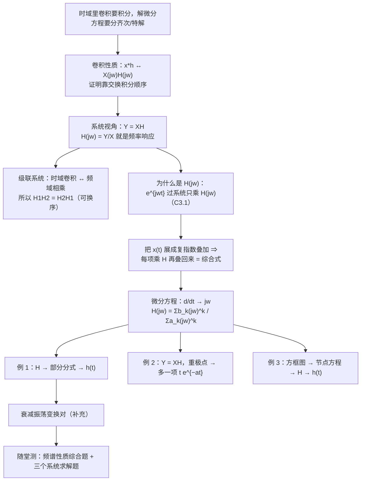
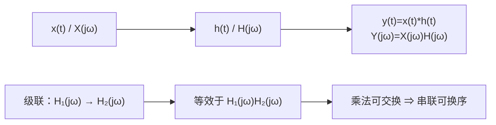

# 4.4 卷积性质与由微分方程表征的系统

> [!abstract] 这一讲的任务
> 这一节把傅里叶方法变成一台**解题机器**。
> 第一步：**卷积性质**——$x(t)*h(t)\leftrightarrow X(j\omega)H(j\omega)$。时域里最麻烦的运算（卷积分）在频域里变成最简单的运算（乘法）。
> 第二步：把它用到 LTI 系统上，得到 $Y=XH$，于是"系统"这个黑箱在频域里只剩一条曲线 $H(j\omega)$（频率响应）。
> 第三步：现实中的系统往往是用**微分方程**给的。把 $\frac{d}{dt}$ 全部换成 $j\omega$，方程立刻变成代数式，**求解塌缩成一次有理分式的除法 + 部分分式展开**。
> 这一节就是第 2 章"解微分方程"与第 4 章"变换"合流的地方：原来要分齐次解、特解、初条件，现在只剩代数运算。

> [!info] 授课进度说明
> 课堂转写稿已覆盖到**第 12 节课**，但第 12 节课在第 4 章只讲到"把周期推到无穷"与冲激串，对应 [[C4.1 非周期信号的表示：连续时间傅里叶变换]] 与 [[C4.2 周期信号的傅里叶变换]]。
> **本篇的卷积性质与由微分方程求系统尚未在课堂上讲授**（老师当堂说"第四章就先说这些吧，其他内容我们下节课再讲"），仍按原稿与教材整理，**不逐条标注「拓展」**。

---

## 0. 开场：逐点扫频，还是写下一个方程

要给一台功放画出频率响应曲线，实验室的标准流程是**逐点扫频**：送 20 Hz 正弦、量输出幅度、记录；再送 21 Hz……一路扫到 20 kHz。几百个频点，几百次测量。

但如果手上有这台功放的**电路方程**——比如一个典型的二阶系统

$$\frac{d^2y}{dt^2}+4\frac{dy}{dt}+3y(t)=\frac{dx}{dt}+2x(t)$$

那么整条曲线可以从方程里**一次算出来**，一个频点都不用测。

这一节要给的，就是这个"一次算出来"的机器：

$$\text{时域：}\ y(t)=x(t)*h(t)\qquad\Longleftrightarrow\qquad\text{频域：}\ Y(j\omega)=X(j\omega)H(j\omega)$$

于是"求系统"变成"求 $H(j\omega)$"，而"求 $H(j\omega)$"在微分方程已知时，**只是把 $\frac{d}{dt}$ 换成 $j\omega$ 再做一次除法**。

> [!question] 停一下，先自己想想
> 为什么把 $\frac{d}{dt}$ 换成 $j\omega$ 是合法的？这个替换的依据是哪一条性质？

---

## 1. 卷积性质（p.28）

> [!important] 卷积性质 Convolution property
> $$x(t)*y(t)\ \xleftarrow{\ \ CTFT\ \ }\ X(j\omega)Y(j\omega)$$
> 一句话：**时域卷积 = 频域相乘。**

> [!example] 证明：交换积分顺序，把 $t$ 与 $\tau$ 分开
> $$X(j\omega)Y(j\omega)=\int_{-\infty}^{+\infty}x(\tau)e^{-j\omega\tau}d\tau\cdot\int_{-\infty}^{+\infty}y(\theta)e^{-j\omega\theta}d\theta=\int_{-\infty}^{+\infty}x(\tau)\Big[\int_{-\infty}^{+\infty}y(\theta)e^{-j\omega\theta}d\theta\Big]e^{-j\omega\tau}d\tau$$
> 换成卷积的形状（把 $\theta$ 换成 $t-\tau$）：
> $$\mathcal F\{x(t)*y(t)\}=\int_{-\infty}^{+\infty}\Big(\int_{-\infty}^{+\infty}x(\tau)y(t-\tau)d\tau\Big)e^{-j\omega t}dt$$
> **把两个积分合并**（$e^{-j\omega t}=e^{-j\omega\tau}e^{-j\omega(t-\tau)}$，其中 $\tau$ 视作固定）：
> $$=\int_{-\infty}^{+\infty}x(\tau)\Big(\int_{-\infty}^{+\infty}y(t-\tau)e^{-j\omega(t-\tau)}d(t-\tau)\Big)e^{-j\omega\tau}d\tau=\int x(\tau)e^{-j\omega\tau}d\tau\cdot Y(j\omega)=X(j\omega)Y(j\omega)$$

> [!note] 证明里最"狡猾"的一步
> 把 $e^{-j\omega t}$ **拆成两半**：$e^{-j\omega\tau}\cdot e^{-j\omega(t-\tau)}$。这样**内层积分正好是 $y$ 的变换**（变量是 $t-\tau$，$y$ 拖着的那个相位因子被完整吸收），外层剩下的 $e^{-j\omega\tau}$ 配上 $x(\tau)$ 就是 $X(j\omega)$。
> 这个"把积分核劈成两半，分别配给两个函数"的手法，是卷积类恒等式证明的通用套路。内层积分对 $t$ 进行而 $\tau$ 固定，所以与 $\tau$ 有关的因子可以自由进出，这一步在原文里专门标了"$\tau$ is fixed"。

> [!important] 三条立刻可用的推论
> 1. **级联系统 = 频率响应相乘**：$h_1*h_2\leftrightarrow H_1H_2$，所以**串联的两个 LTI 系统可以换序**（乘法可交换）；
> 2. **卷积的单位元是 $\delta(t)$**：$\delta\leftrightarrow1$，所以 $X\cdot1=X$，即 $x*\delta=x$（与 [[C2.3 LTI系统的性质]] 的时域结论对上）；
> 3. **时域的"难算"被绕过**：两个矩形脉冲卷积要分段讨论，而频域只是两个 $\mathrm{Sa}$ 相乘。

> [!warning] 别把"卷积"和"相乘"看反
> | 时域 | 频域 |
> |---|---|
> | 卷积 $x*y$ | **相乘** $XY$ |
> | 相乘 $x\cdot y$ | **卷积** $\frac{1}{2\pi}X*Y$ |
> 两个方向都有，正好颠倒。本节讲第一条，[[C4.5 相乘性质与调制]] 讲第二条。

---

## 2. 系统视角：频率响应 $H(j\omega)$（p.36）

把卷积性质放到 LTI 系统上，就得到整个第 4 章最有用的一个式子：

> [!important] LTI 系统的频域描述
> $$y(t)=x(t)*h(t)\ \xleftarrow{\ \ CTFT\ \ }\ Y(j\omega)=X(j\omega)H(j\omega)$$
> 其中
> $$H(j\omega)=\frac{Y(j\omega)}{X(j\omega)}=\mathcal F\{h(t)\}$$
> 叫系统的**频率响应 frequency response**（**系统函数 system function**）。它只由系统自己决定，与输入无关。

> [!example] 为什么系统中意的是 $H(j\omega)$：把综合式"搬"过系统
> 第 3 章（[[C3.1 复指数是LTI系统的特征函数]]）已经证明：**复指数过 LTI 系统只乘一个复数**：
> $$e^{j\omega t}\ \xrightarrow{\ \text{LTI}\ }\ H(j\omega)e^{j\omega t}$$
> 现在把输入写成综合式的叠加形式 $x(t)=\frac{1}{2\pi}\int X(j\omega)e^{j\omega t}d\omega$。系统是线性的，可以对**每一项**分别作用：
> $$y(t)=\frac{1}{2\pi}\int X(j\omega)\underbrace{\big[H(j\omega)e^{j\omega t}\big]}_{\text{每一项都被乘了 }H(j\omega)}d\omega=\frac{1}{2\pi}\int \underbrace{X(j\omega)H(j\omega)}_{Y(j\omega)}e^{j\omega t}d\omega$$
> 对比综合式，立刻读出 $Y(j\omega)=X(j\omega)H(j\omega)$。

**这段话的信息量**：系统对信号做的事，可以**逐频率拆开看**——每个频率成分进来，幅度被 $|H(j\omega)|$ 缩放、相位被 $\angle H(j\omega)$ 平移，各频率之间互不干扰。**这就是"滤波"的全部内容**：设计 $H(j\omega)$，就是安排"哪些频率放行、放行多少、相位怎么挪"。

> [!tip] 三张图看清三类系统
> - $|H(j\omega)|$ 随 $\omega$ 衰减 ⇒ **低通**（如例 1）；
> - $|H(j\omega)|$ 随 $\omega$ 上升 ⇒ **高通**（如微分器 $j\omega$，见 [[C3.6 傅里叶级数与LTI系统、滤波]]）；
> - $|H(j\omega)|$ 只有在某个频段才大 ⇒ **带通**（收音机选台、第 4.5 节的调制解调）。

---

## 3. 练习：把积分认成卷积（p.37）

> [!example] 练习
> 求 $y(t)=\displaystyle\int_{-2}^{t}e^{-2\tau}e^{-5(t-\tau)}d\tau\quad(t>-2)$ 的傅里叶变换。

**第一步：把积分限写成阶跃，让卷积浮出来。** 上限 $t$ 对应 $u(t-\tau)$，下限 $-2$ 对应 $u(\tau+2)$：

$$y(t)=\int_{-\infty}^{+\infty}e^{-2\tau}u(\tau+2)\cdot e^{-5(t-\tau)}u(t-\tau)\,d\tau=e^{-2t}u(t+2)\ *\ e^{-5t}u(t)$$

**第二步：查表 + 用性质。**

- $e^{-5t}u(t)\leftrightarrow\dfrac{1}{j\omega+5}$；
- $e^{-2t}u(t+2)$：先把指数配方成"标准件 + 位移"的形式
  $$e^{-2t}=e^{-2(t+2)}\cdot e^{4}\ \Longrightarrow\ e^{-2t}u(t+2)=e^{4}\cdot e^{-2(t+2)}u(t+2)$$
  括号里是标准件 $e^{-2t}u(t)$ **左移 2**（$t_0=-2$），由**时移性质**（[[C4.3 连续时间傅里叶变换的性质]]）得
  $$e^{-2(t+2)}u(t+2)\ \xleftarrow{}\ e^{-j\omega(-2)}\frac{1}{j\omega+2}=\frac{e^{j2\omega}}{j\omega+2}$$

**第三步：相乘。**

$$\boxed{\ Y(j\omega)=e^{4}\cdot\frac{e^{j2\omega}}{j\omega+2}\cdot\frac{1}{j\omega+5}=\frac{e^{j2\omega+4}}{(j\omega)^{2}+7j\omega+10}\ }$$

**时域交叉检查**：把卷积积出来

$$y(t)=e^{-5t}\int_{-2}^{t}e^{3\tau}d\tau=\frac{e^{-2t}-e^{-6}e^{-5t}}{3}\qquad(t>-2)$$

对 $t$ 做数值积分求变换，与上式逐频点吻合（残差 $1.4\times10^{-7}$），且分段闭式与数值卷积的最大相对误差 $2.3\times10^{-8}$ ✓（已用 python 复核）。

> [!warning] 这里踩过坑的两个地方
> 1. **下限 $-2$ 不是 $0$**：$e^{-2t}u(t+2)$ 是**左移**（$t_0=-2$），相位因子是 $e^{+j2\omega}$，符号容易写反。判别方法：把指数配成 $e^{-2(t+2)}$ 之后，括号里是 $t+2=t-(-2)$，即 $t_0=-2$。
> 2. **别把 $e^4$ 漏掉**：$e^{-2t}=e^4\cdot e^{-2(t+2)}$ 里的常数因子必须补上，它是**幅度**比例，不是相位。

---

## 4. 从微分方程到频率响应（4.7，p.47）

> [!important] 一般结论
> 对线性常系数微分方程
> $$\sum_{k=0}^{N}a_k\frac{d^ky(t)}{dt^k}=\sum_{k=0}^{M}b_k\frac{dx^k(t)}{dt^k}$$
> 两边做傅里叶变换，用**时域微分性质** $\frac{d^k}{dt^k}\leftrightarrow(j\omega)^k$：
> $$\sum_{k=0}^{N}a_k(j\omega)^kY(j\omega)=\sum_{k=0}^{M}b_k(j\omega)^kX(j\omega)$$
> 于是
> $$\boxed{\ H(j\omega)=\frac{Y(j\omega)}{X(j\omega)}=\frac{\sum\limits_{k=0}^{M}b_k(j\omega)^k}{\sum\limits_{k=0}^{N}a_k(j\omega)^k}\ }$$

这就是那个"把 $\frac{d}{dt}$ 换成 $j\omega$"的来历：**它不是规定，而是时域微分性质的直接换算**。整条微分方程变成关于 $j\omega$ 的**代数方程**，未知量从函数 $y(t)$ 变成复数 $Y(j\omega)$。

> [!important] 三条读法
> 1. **$H(j\omega)$ 是一个关于 $j\omega$ 的有理分式**：分子来自输入端的 $b_k$，分母来自输出端的 $a_k$；
> 2. **分母 = 特征多项式**：第 2 章解齐次解时用的特征方程 $\sum a_k s^k=0$（[[C2.4 微分方程与连续时间系统求解]]），在这里就是**极点的位置**——$j\omega$ 让分母为零的那些点。**极点在左半平面 $\Leftrightarrow$ 系统稳定**（与第 2 章的 $\mathrm{Re}\{s\}<0$ 一致）；
> 3. **分子的次数 ≥ 分母的次数时会出现 $\delta(t)$**：长除法分出一个常数项（见下面的例 3）。
>
> **注意这只是零状态响应**：微分方程本身不含初条件，而线性常系数方程的解在频率方法里只能拿到 $y_{zs}=x*h$；要算零输入响应仍需回到 [[C2.4 微分方程与连续时间系统求解]] 的时域方法。这与第 2 章"零输入 + 零状态"的划界完全一致。

> [!tip] 部分分式的"遮盖法"（Cover-up）
> 要把 $H(j\omega)$ 反变换回 $h(t)$，先拆成 $\frac{A_1}{j\omega-p_1}+\frac{A_2}{j\omega-p_2}+\cdots$。求 $A_i$ 时**用手遮住分母里的 $(j\omega-p_i)$，把 $j\omega=p_i$ 代进剩下的部分**即可：
> $$A_i=\Big[(j\omega-p_i)H(j\omega)\Big]_{j\omega=p_i}$$
> 这一步之所以成立，是因为其他项在 $j\omega=p_i$ 处都被 $(j\omega-p_i)$ 乘成零，只剩 $A_i$。**重极点**时这一招只能拿到最高次那一项，低次的要**求导**才能取出来（见例 2）。

---

## 5. 例 1：从方程到冲激响应（p.48）

> [!example] 例 1
> $$\frac{d^2y(t)}{dt^2}+4\frac{dy(t)}{dt}+3y(t)=\frac{dx(t)}{dt}+2x(t)$$
> 求 $H(j\omega)$ 与 $h(t)$。

**代入 $j\omega$**（$\frac{d^2}{dt^2}\to(j\omega)^2$，$\frac{d}{dt}\to j\omega$）：

$$(j\omega)^2Y+4j\omega Y+3Y=j\omega X+2X\ \Longrightarrow\ H(j\omega)=\frac{j\omega+2}{(j\omega)^2+4j\omega+3}=\frac{j\omega+2}{(j\omega+1)(j\omega+3)}$$

**部分分式**（两个单极点，用遮盖法）：

$$A=\frac{j\omega+2}{j\omega+3}\Big|_{j\omega=-1}=\frac{-1+2}{-1+3}=\frac{1}{2},\qquad B=\frac{j\omega+2}{j\omega+1}\Big|_{j\omega=-3}=\frac{-3+2}{-3+1}=\frac{1}{2}$$

$$H(j\omega)=\frac{1}{2}\Big[\frac{1}{j\omega+1}+\frac{1}{j\omega+3}\Big]\ \Longrightarrow\ \boxed{\ h(t)=\frac{1}{2}\big[e^{-t}+e^{-3t}\big]u(t)\ }$$

![[C4.4-例1的幅频与相频.png]]

- **幅频是一条低通曲线**：$|H(j0)|=\frac23$ 是直流增益（把 $j\omega=0$ 代进 $H$ 就是 $\frac{2}{3}$），随 $\omega$ 增大衰减到零——低频能过、高频被压。
- **相频从 0 单调降到 $-\pi$ 附近**：相位滞后，且高频滞后更多（一阶滞后项 $1/(j\omega+a)$ 贡献 $-\arctan(\omega/a)$，两个一阶项叠加）。
- 时域上 $h(t)$ 是两个衰减指数之和，都很快衰减（时间常数 1 s 与 $\frac13$ s）——**冲激响应衰减越快，通带越宽**，与 [[C4.1 非周期信号的表示：连续时间傅里叶变换]] 例 4.1 的"$-3$ dB 带宽 = 衰减率"完全一致。
- 数值核对：把 $h(t)$ 做数值变换与 $H(j\omega)$ 逐点比较，误差 $1.5\times10^{-4}$（来自 $h$ 的截断）✓。

---

## 6. 例 2：零状态响应（p.49）

同一个系统，这次给一个具体输入，直接求输出。

> [!example] 例 2
> 系统同例 1，输入 $x(t)=e^{-t}u(t)$，求零状态响应 $y_{zs}(t)$。

**第一步：频域相乘。** $X(j\omega)=\frac{1}{j\omega+1}$，

$$Y(j\omega)=H(j\omega)X(j\omega)=\frac{j\omega+2}{(j\omega+1)(j\omega+3)}\cdot\frac{1}{j\omega+1}=\frac{j\omega+2}{(j\omega+1)^2(j\omega+3)}$$

**第二步：注意 $(j\omega+1)^2$ 是重极点**，展开式必须多带一项：

$$Y(j\omega)=\frac{A_{11}}{j\omega+1}+\frac{A_{12}}{(j\omega+1)^2}+\frac{A_{21}}{j\omega+3}$$

**第三步：逐个定系数。**

$$A_{12}=\Big[(j\omega+1)^2Y\Big]_{j\omega=-1}=\frac{j\omega+2}{j\omega+3}\Big|_{j\omega=-1}=\frac{1}{2}$$

$$A_{11}=\frac{d}{d(j\omega)}\Big[(j\omega+1)^2Y\Big]_{j\omega=-1}=\Big[\frac{1}{j\omega+3}-\frac{j\omega+2}{(j\omega+3)^2}\Big]_{j\omega=-1}=\frac{1}{2}-\frac{1}{4}=\frac{1}{4}$$

$$A_{21}=\Big[(j\omega+3)Y\Big]_{j\omega=-3}=\frac{j\omega+2}{(j\omega+1)^2}\Big|_{j\omega=-3}=\frac{-1}{4}=-\frac{1}{4}$$

**第四步：反变换。** 用到两条基本对（表 4.2）：

$$Y(j\omega)=\frac{1/4}{j\omega+1}+\frac{1/2}{(j\omega+1)^2}-\frac{1/4}{j\omega+3}\ \Longrightarrow\ \boxed{\ y_{zs}(t)=\Big[\frac{1}{4}e^{-t}+\frac{1}{2}te^{-t}-\frac{1}{4}e^{-3t}\Big]u(t)\ }$$

（$\frac{1}{(j\omega+a)^2}\leftrightarrow te^{-at}u(t)$ 来自频域微分性质。）

> [!warning] 重极点最容易出的两种错
> 1. **漏掉 $A_{11}$ 那一项**：只写 $\frac{A_{12}}{(j\omega+1)^2}$ 的话，反变换就少了 $\frac14e^{-t}$，而 $t\to\infty$ 时的行为是对的、$t=0$ 附近却全错——**验算时一定要取特殊时刻**（如 $y_{zs}(0^+)$）。
> 2. **$A_{11}$ 用遮盖法直接代**：$A_{11}$ 必须**先求导再代入**，直接代 $j\omega=-1$ 会得到 $\frac{1}{j\omega+3}=\frac12$，与正确答案 $\frac14$ 差一倍。
>
> 与时域对一下：输入 $e^{-t}u(t)$ 的频率 $s=-1$ **正好撞上系统的极点 $-1$**（$H$ 的分母有 $j\omega+1$），于是频域出现**二阶极点**、时域出现 $te^{-t}$ 这一项。这与 [[C2.4 微分方程与连续时间系统求解]] 里"**特解撞特征根要乘 $t$**"是同一件事——**频域的重极点 = 时域的乘 $t$**。
>
> 数值核对：$y_{zs}$ 的数值变换与 $Y(j\omega)$ 逐点吻合（误差 $7.5\times10^{-9}$）✓。

---

## 7. 例 3：从方框图到 $h(t)$（p.50）

> [!example] 例 3
> 系统由两个积分器、反馈系数 $-6$ 与 $-8$、前馈系数 $1$、$-1$、$2$ 构成（两个积分器串联，中间节点记 $W(j\omega)$）。
> 求 $H(j\omega)$ 与 $h(t)$。

**第一步：在图上的每个节点写频域关系。** 积分器就是除以 $j\omega$，所以从左往右，节点依次是 $(j\omega)^2W$、$j\omega W$、$W$。

加法器节点（左侧）：输入 $x$ 减去 $6j\omega W$ 与 $8W$，得到 $(j\omega)^2W$：

$$(j\omega)^2W(j\omega)=X(j\omega)-6j\omega W(j\omega)-8W(j\omega)$$

输出节点：把三个前馈分支加起来：

$$Y(j\omega)=2W(j\omega)-j\omega W(j\omega)+(j\omega)^2W(j\omega)$$

**第二步：消去中间变量 $W$。** 由第一式 $W=\frac{X}{(j\omega)^2+6j\omega+8}$，代入第二式：

$$H(j\omega)=\frac{(j\omega)^2-j\omega+2}{(j\omega)^2+6j\omega+8}$$

**第三步：分子分母同阶，先做长除法分出一个常数 1。**

$$H(j\omega)=1+\frac{-7j\omega-6}{(j\omega+2)(j\omega+4)}=1+\frac{A}{j\omega+2}+\frac{B}{j\omega+4}$$

$$A=\frac{-7j\omega-6}{j\omega+4}\Big|_{j\omega=-2}=\frac{14-6}{2}=4,\qquad B=\frac{-7j\omega-6}{j\omega+2}\Big|_{j\omega=-4}=\frac{28-6}{-2}=-11$$

$$\boxed{\ h(t)=\delta(t)+4e^{-2t}u(t)-11e^{-4t}u(t)\ }$$

> [!important] 那个 $\delta(t)$ 从哪来
> 因为**分子与分母同阶**（都是 $(j\omega)^2$），长除法分出一个常数 $1$，而 $\mathcal F\{\delta(t)\}=1$——所以冲激响应里有一根**直通**的冲激。
> 物理含义：方框图里有一条**从输入直通输出的前馈支路**（系数 1 那一条），信号可以不经任何积分器直达输出，**瞬时响应**就表现为 $\delta(t)$。这是"系统有直通项"的频域签名。
> 反过来记：**分子阶数 < 分母阶数 ⇒ $h(t)$ 里没有 $\delta$**（例 1、例 2 就是这种）。
>
> 数值核对：$4e^{-2t}u(t)-11e^{-4t}u(t)$ 的数值变换加上 $1$，与 $H(j\omega)$ 逐点吻合（误差 $1.0\times10^{-3}$，来自截断）✓。
>
> 与 [[C2.6 LTI系统的方框图表示]] 对照：那里在时域用直接形式 I/II 列方程、解 $h$；这里同样一张图，**只要把积分器换成 $1/j\omega$，一次代数消元就出结果**。

---

## 8. 补充：衰减振荡的变换对（p.53）

> [!important] 两个高频使用的变换对
> $$e^{-at}\cos\omega_0t\,u(t)\ \xleftarrow{\ \ CTFT\ \ }\ \frac{a+j\omega}{(a+j\omega)^2+\omega_0^2}$$
> $$e^{-at}\sin\omega_0t\,u(t)\ \xleftarrow{\ \ CTFT\ \ }\ \frac{\omega_0}{(a+j\omega)^2+\omega_0^2}\qquad(a>0)$$

> [!example] 推导：拆成两个复指数，各用一次频移
> $$\cos\omega_0t=\frac12\big(e^{j\omega_0t}+e^{-j\omega_0t}\big)\ \Longrightarrow\ e^{-at}\cos\omega_0t\,u(t)=\frac12e^{-(a-j\omega_0)t}u(t)+\frac12e^{-(a+j\omega_0)t}u(t)$$
> 每一项都是标准件 $e^{-st}u(t)\leftrightarrow\frac{1}{s+j\omega}$（$s$ 换成 $a\mp j\omega_0$）：
> $$\frac12\Big[\frac{1}{(a-j\omega_0)+j\omega}+\frac{1}{(a+j\omega_0)+j\omega}\Big]=\frac12\Big[\frac{1}{(a+j\omega)-\omega_0j}+\frac{1}{(a+j\omega)+\omega_0j}\Big]$$
> 通分即得 $\dfrac{a+j\omega}{(a+j\omega)^2+\omega_0^2}$。$\sin$ 那边差一个 $\frac{1}{2j}$，通分后分子是 $\omega_0$。
> **注意 $a$ 与 $\omega_0$ 的角色**：分母是 $(a+j\omega)^2+\omega_0^2$，**实部 $a$ 决定衰减快慢、$\omega_0$ 决定振荡频率**；极点位于 $j\omega=-a\pm j\omega_0$——一对**共轭极点**，这正是二阶系统（RLC 电路、弹簧阻尼系统）的签名。

> [!tip] 为什么这两个必须记住
> 凡是"二阶系统 + 欠阻尼"的题目，$H(j\omega)$ 的分母都会出 $(j\omega+a)^2+\omega_0^2$，反变换就是这两个式子的组合。第 9 章拉普拉斯变换会把它整理成更通用的"共轭极点对"套路，但结论就是这里这两条。
> 已用 python 数值核对（$a=1.3$、$\omega_0=2$，误差 $1.5\times10^{-4}$）✓。

---

## 9. 随堂测

### 9.1　频谱性质综合题（p.51）

> [!question] 随堂测 1（10 分）
> 已知 $x(t)$ 如图所示（在 $[-1,3]$ 上非零：$[-1,0]$ 上为 2；$(0,1)$ 上从 2 线性降到 1；$(1,2)$ 上从 1 线性升到 2；$[2,3]$ 上为 2），$X(j\omega)$ 是它的傅里叶变换。求：
> (a) $\angle X(j\omega)$　(b) $X(j0)$　(c) $\displaystyle\int_{-\infty}^{+\infty}X(j\omega)d\omega$　(d) $\displaystyle\int_{-\infty}^{+\infty}X(j\omega)\frac{2\sin\omega}{\omega}e^{j2\omega}d\omega$　(e) $\displaystyle\int_{-\infty}^{+\infty}|X(j\omega)|^2d\omega$　(f) 画出 $\mathrm{Re}\{X(j\omega)\}$ 的逆变换的草图。
> **提示：所有计算都不要求显式求出 $X(j\omega)$。**

![[C4.4-随堂测x(t)与它的偶部.png]]

**这道题的价值在于：它逼你用性质，而不是用积分。** 逐个来。

> [!example] (a) 相位谱
> 观察波形：$x(t)$ **关于 $t=1$ 偶对称**（$x(1+\tau)=x(1-\tau)$ 对一切 $\tau$ 成立）。
> 于是 $x(t)=g(t-1)$，其中 $g$ 实且偶。实偶信号的变换**实且偶**（[[C4.3 连续时间傅里叶变换的性质]] §4），所以 $G(j\omega)$ 是实函数；再由**时移性质**：
> $$X(j\omega)=e^{-j\omega}G(j\omega)\ \Longrightarrow\ \boxed{\ \angle X(j\omega)=-\omega\ }$$
> **相位谱是一条过原点的直线（斜率为 $-1$）**——这正是"纯延迟 1 秒"的签名。直观解释：波形在 $t=1$ 处左右对称，相当于把对称图形整体推迟了 1 秒，而延迟只改相位、不改幅度。

> [!example] (b) $X(j0)$
> $j\omega=0$ 就是分析式里 $\omega=0$ 的取值：
> $$X(j0)=\int_{-\infty}^{+\infty}x(t)dt=\text{波形下的面积}$$
> 分段算：$2\times1+\frac{2+1}{2}\times1+\frac{1+2}{2}\times1+2\times1=2+1.5+1.5+2=\boxed{7}$
> 这个式子在后续题目里反复出现：**$X(j0)$ 永远是信号的"总面积"**。

> [!example] (c) $\int X(j\omega)d\omega$
> 用**综合式**在 $t=0$ 处取值：
> $$x(0)=\frac{1}{2\pi}\int_{-\infty}^{+\infty}X(j\omega)e^{j\omega\cdot0}d\omega=\frac{1}{2\pi}\int X(j\omega)d\omega\ \Longrightarrow\ \int X(j\omega)d\omega=2\pi x(0)$$
> 图上 $x(0)=2$，所以
> $$\int_{-\infty}^{+\infty}X(j\omega)d\omega=2\pi\cdot2=\boxed{4\pi}$$

> [!example] (d) 带权积分
> 认出两个零件：$\frac{2\sin\omega}{\omega}=2\mathrm{Sa}(\omega)$ 是**半宽为 1 的矩形脉冲**的变换，$e^{j2\omega}$ 是**在 $t=2$ 取值**的相位因子：
> $$\frac{2\sin\omega}{\omega}\ \xleftarrow{\ \ CTFT\ \ }\ h(t)=\begin{cases}1,&\lvert t\rvert<1\\0,&\lvert t\rvert>1\end{cases},\qquad e^{j2\omega}=e^{j\omega\cdot t}\Big|_{t=2}$$
> 于是这个积分就是**卷积定理的逆用**：
> $$\int X(j\omega)H(j\omega)e^{j\omega t}d\omega=2\pi\,(x*h)(t)\Big|_{t=2}$$
> 而 $(x*h)(2)=\int_{-1}^{3}x(\tau)h(2-\tau)d\tau=\int_{1}^{3}x(\tau)d\tau$（因为 $\lvert2-\tau\rvert<1\Leftrightarrow\tau\in(1,3)$）：
> $$\int_1^3x\,d\tau=1.5+2=3.5\ \Longrightarrow\ \int X(j\omega)\frac{2\sin\omega}{\omega}e^{j2\omega}d\omega=2\pi\cdot3.5=\boxed{7\pi}$$
> **数值核对**：$7\pi\approx21.9911$，数值积分得 $21.9897$ ✓。

> [!example] (e) 能量
> 用**帕塞瓦尔**：
> $$\int|X(j\omega)|^2d\omega=2\pi\int|x(t)|^2dt$$
> 时域分段算能量：
> $$\int_{-1}^{3}x^2dt=\underbrace{4\times1}_{[-1,0]}+\underbrace{\int_1^2u^2du}_{=\frac73}+\underbrace{\int_0^1(2-t)^2dt}_{=\frac73}+\underbrace{4\times1}_{[2,3]}=8+\frac{14}{3}=\frac{38}{3}$$
> $$\int_{-\infty}^{+\infty}|X(j\omega)|^2d\omega=2\pi\cdot\frac{38}{3}=\boxed{\frac{76\pi}{3}\approx79.587}$$
> （数值积分得 $79.5816$ ✓。注意两处线性段的能量换元：$\int_0^1(2-t)^2dt=\int_1^2u^2du=\frac73$。）

> [!example] (f) 画 $\mathrm{Re}\{X(j\omega)\}$ 的逆变换
> 关键是**实部对应偶部**（[[C4.3 连续时间傅里叶变换的性质]] §4）：设 $x(t)=x_e(t)+x_o(t)$，则
> $$x_e(t)\ \xleftarrow{}\ \mathrm{Re}\{X(j\omega)\}$$
> 所以要求的草图就是 $x_e(t)=\frac12[x(t)+x(-t)]$。逐段算（$x$ 只在 $[-1,3]$ 上非零，所以 $x(-t)$ 只在 $[-3,1]$ 上非零）：

| 区间 | $x(t)$ | $x(-t)$ | $x_e(t)=\frac12[x+x(-t)]$ |
|---|---|---|---|
| $(-3,-2)$ | 0 | 2 | $1$ |
| $(-2,-1)$ | 0 | $-t$ | $-t/2$：从 $1$ 降到 $0.5$ |
| $(-1,0)$ | 2 | $2+t$ | $(4+t)/2$：从 $1.5$ 升到 $2$ |
| $(0,1)$ | $2-t$ | 2 | $(4-t)/2$：从 $2$ 降到 $1.5$ |
| $(1,2)$ | $t$ | 0 | $t/2$：从 $0.5$ 升到 $1$ |
| $(2,3)$ | 2 | 0 | $1$ |

要点两条：**① 结果关于 $t=0$ 偶对称**（这是必然的，因为它是"实部对应偶部"的直接后果）；**② 在 $t=\pm1$ 处有跳变**（幅度 1），因为原信号在 $t=-1$、$t=3$ 有跳变，取偶部不会把这些跳变抹平。图上就是这么画的：中间一段是"帐篷 + 台阶"的组合，两侧各压着一块高度 1 的平台。

> [!important] 这一题的通用套路
> 遇到"**不许求 $X(j\omega)$，但要算关于 $X$ 的积分**"这类题，认准四个入口：
> | 想要的东西 | 用什么 |
> |---|---|
> | $X(j0)$ | 面积 $\int x\,dt$ |
> | 相位（线性？） | 波形的对称中心 ⇒ 纯延迟 |
> | $\int Xd\omega$ | $2\pi x(0)$（综合式取 $t=0$） |
> | $\int X\cdot H\cdot e^{j\omega t}d\omega$ | $2\pi(x*h)(t)$（卷积定理逆用） |
> | $\int\lvert X\rvert^2d\omega$ | $2\pi\int\lvert x\rvert^2dt$（帕塞瓦尔） |
> | $\mathrm{Re}\{X\}$ 的逆变换 | $x_e(t)$（实部 ↔ 偶部） |

### 9.2　三个系统求解题（p.52、p.54）

> [!question] 随堂测 2（10 分）
> (a) 求由 $\dfrac{d^2y}{dt^2}+6\dfrac{dy}{dt}+8y(t)=2x(t)$ 描述的稳定因果 LTI 系统的冲激响应；
> (b) 若 $x(t)=te^{-2t}u(t)$，求响应；
> (c) 对 $\dfrac{d^2y}{dt^2}+\sqrt2\dfrac{dy}{dt}+y(t)=2\dfrac{d^2x}{dt^2}-2x(t)$ 重做 (a)。

> [!example] (a)
> $$H(j\omega)=\frac{2}{(j\omega)^2+6j\omega+8}=\frac{2}{(j\omega+2)(j\omega+4)}=\frac{A}{j\omega+2}+\frac{B}{j\omega+4}$$
> $$A=\frac{2}{j\omega+4}\Big|_{j\omega=-2}=1,\qquad B=\frac{2}{j\omega+2}\Big|_{j\omega=-4}=-1$$
> $$\boxed{\ h(t)=\big[e^{-2t}-e^{-4t}\big]u(t)\ }$$
> 自检：极点在 $-2,-4$（都为负）⇒ 稳定 ✓；$h(0^+)=1-1=0$（分子次数低于分母，无 $\delta$ 项，且 $h$ 从 0 连续起步）✓。数值核对误差 $1.5\times10^{-8}$。

> [!example] (b)
> $x(t)=te^{-2t}u(t)$ 的变换用频域微分（或查表）：$X(j\omega)=\dfrac{1}{(j\omega+2)^2}$。注意输入的频率 $s=-2$ **正好撞上极点 $-2$**，所以会出现三重极点：
> $$Y(j\omega)=H(j\omega)X(j\omega)=\frac{2}{(j\omega+2)^3(j\omega+4)}=\frac{A_{11}}{j\omega+2}+\frac{A_{12}}{(j\omega+2)^2}+\frac{A_{13}}{(j\omega+2)^3}+\frac{A_{21}}{j\omega+4}$$
> $$A_{13}=\frac{2}{j\omega+4}\Big|_{-2}=1,\quad A_{12}=\frac{d}{d(j\omega)}\frac{2}{j\omega+4}\Big|_{-2}=\frac{-2}{(j\omega+4)^2}\Big|_{-2}=-\frac12$$
> $$A_{11}=\frac12\frac{d^2}{d(j\omega)^2}\frac{2}{j\omega+4}\Big|_{-2}=\frac{2}{(j\omega+4)^3}\Big|_{-2}=\frac14,\qquad A_{21}=\frac{2}{(j\omega+2)^3}\Big|_{-4}=-\frac14$$
> 各项反变换（$\frac{1}{(j\omega+a)^n}\leftrightarrow\frac{t^{n-1}}{(n-1)!}e^{-at}u(t)$）：
> $$\boxed{\ y(t)=\Big[\frac14-\frac12t+\frac12t^2\Big]e^{-2t}u(t)-\frac14e^{-4t}u(t)\ }$$
> 自检：$y(0^+)=\frac14-\frac14=0$ ✓（零状态响应从零起步）；$H(j\omega)X(j\omega)$ 的数值变换与上式逐点吻合（误差 $2.8\times10^{-17}$）✓。

> [!example] (c)
> $$H(j\omega)=\frac{2(j\omega)^2-2}{(j\omega)^2+\sqrt2\,j\omega+1}$$
> 分母的零点：$j\omega=\dfrac{-\sqrt2\pm\sqrt{2-4}}{2}=\dfrac{-1\pm j}{\sqrt2}$——**一对共轭极点**，实部 $-\frac{1}{\sqrt2}<0$ ⇒ 稳定。
> 分子分母同阶，先长除：$2\cdot(\text{分母})=2(j\omega)^2+2\sqrt2j\omega+2$，相减得 $-2\sqrt2j\omega-4$，于是
> $$H(j\omega)=2+\frac{-4-2\sqrt2\,j\omega}{(j\omega)^2+\sqrt2j\omega+1}$$
> 两个共轭极点上的系数（记 $p_{1,2}=\frac{-1\pm j}{\sqrt2}$）：
> $$R_1=\frac{-4-2\sqrt2p_1}{p_1-p_2}=\frac{-2-2j}{j\sqrt2}=\sqrt2(-1+j),\qquad R_2=R_1^*=\sqrt2(-1-j)$$
> 反变换时共轭项合起来是 $2\mathrm{Re}\{R_1e^{p_1t}\}$：
> $$2\sqrt2\,e^{-t/\sqrt2}\Big[-\cos\frac{t}{\sqrt2}-\sin\frac{t}{\sqrt2}\Big]$$
> $$\boxed{\ h(t)=2\delta(t)-2\sqrt2\,e^{-t/\sqrt2}\Big[\cos\frac{t}{\sqrt2}+\sin\frac{t}{\sqrt2}\Big]u(t)\ }$$
> **两点检查**：① 分子分母同阶 ⇒ 有 $2\delta(t)$ 直通项 ✓；② 括号里的 $\cos+\sin$ 可以合成一个带相位的余弦 $\sqrt2\cos(\frac{t}{\sqrt2}-\frac\pi4)$，幅度项 $\sqrt2\times2\sqrt2=4$——**经典欠阻尼二阶系统的振荡冲激响应**。数值核对误差 $4.2\times10^{-4}$ ✓。

> [!question] 随堂测 3（10 分）
> 因果 LTI 系统的输入输出满足
> $$\frac{dy(t)}{dt}+10y(t)=\int_{-\infty}^{+\infty}x(\tau)z(t-\tau)d\tau-x(t),\qquad z(t)=e^{-t}u(t)+3\delta(t)$$
> (a) 求频率响应 $H(j\omega)=Y(j\omega)/X(j\omega)$；(b) 求冲激响应。

**第一步：把积分认成卷积**——$\int x(\tau)z(t-\tau)d\tau=x(t)*z(t)$。

**第二步：整个方程做变换**（用卷积性质与微分性质）：

$$j\omega Y+10Y=XZ-X\ \Longrightarrow\ Y(j\omega)\big[j\omega+10\big]=X(j\omega)\big[Z(j\omega)-1\big]$$

**第三步：算 $Z(j\omega)$**：$z(t)=e^{-t}u(t)+3\delta(t)$，逐项查表

$$Z(j\omega)=\frac{1}{j\omega+1}+3$$

于是

$$H(j\omega)=\frac{Z(j\omega)-1}{j\omega+10}=\frac{\frac{1}{j\omega+1}+2}{j\omega+10}=\frac{1+2(j\omega+1)}{(j\omega+1)(j\omega+10)}=\boxed{\ \frac{2j\omega+3}{(j\omega+1)(j\omega+10)}\ }$$

**第四步：部分分式反变换。**

$$A=\frac{2j\omega+3}{j\omega+10}\Big|_{j\omega=-1}=\frac{1}{9},\qquad B=\frac{2j\omega+3}{j\omega+1}\Big|_{j\omega=-10}=\frac{-17}{-9}=\frac{17}{9}$$

$$\boxed{\ h(t)=\Big[\frac19e^{-t}+\frac{17}{9}e^{-10t}\Big]u(t)\ }$$

自检：$A+B=2$，与 $H(j\omega)$ 当 $|j\omega|\to\infty$ 时的极限 $\frac{2j\omega}{(j\omega)^2}\to\frac{2}{j\omega}$ 的系数 2 一致 ✓（这是遮盖法之外的第二个验算手段）。数值核对误差 $3.0\times10^{-4}$ ✓。

> [!warning] 三个随堂测共有的坑
> 1. **$H(j\omega)$ 里的 $\delta$ 项**：只要分子阶数等于分母阶数（例 3、随堂测 2(c)），反变换就会冒出 $\delta(t)$，漏了它 $t=0$ 附近全错。
> 2. **撞极点要加项**：输入频率撞上系统极点时（例 2、随堂测 2(b)），部分分式必须多带一阶，且低阶系数要**求导**。
> 3. **"稳定因果"是选解条件**：同一个 $H(j\omega)$ 的不同收敛域对应不同系统。题目说"稳定因果"，意味着极点必须都在左半平面、且 $h(t)$ 只保留 $t>0$ 的项——本题的极点都在左半平面，所以直接对每个一阶项配上 $u(t)$ 即可。

---

## 这一讲的三句话

1. **卷积性质是整章的发动机**：$x*y\leftrightarrow XY$；时域里要分段积分的卷积，在频域只是一次乘法；级联系统因此变成频率响应相乘，可换序。
2. **微分方程在频域变成代数式**：把 $\frac{d}{dt}$ 换成 $j\omega$，得到 $H(j\omega)=\frac{\sum b_k(j\omega)^k}{\sum a_k(j\omega)^k}$；分母就是特征多项式（极点位置决定稳定性），求解只剩部分分式展开与查表。分子阶数不低于分母阶数时，$h(t)$ 里必然出现 $\delta(t)$。
3. **撞极点 = 乘 $t$**：输入频率撞上系统极点 ⇒ 频域出现重极点 ⇒ 时域多一项 $t^{n}e^{-at}$；这是第 2 章"特解撞特征根乘 $t$"的频域版本，也是例 2 与随堂测 2(b) 唯一的难点。

> [!tip] 速查表
> | 项目 | 公式 |
> |---|---|
> | 卷积性质 | $x(t)*y(t)\leftrightarrow X(j\omega)Y(j\omega)$ |
> | 系统 | $Y=XH$，$H(j\omega)=\mathcal F\{h(t)\}=Y/X$ |
> | 级联 | $h_1*h_2\leftrightarrow H_1H_2$（可换序） |
> | 微分方程 → $H$ | $H(j\omega)=\dfrac{\sum_{k=0}^{M}b_k(j\omega)^k}{\sum_{k=0}^{N}a_k(j\omega)^k}$ |
> | 分子阶 ≥ 分母阶 | $h(t)$ 里出现 $\delta(t)$ |
> | 遮盖法 | $A_i=[(j\omega-p_i)H(j\omega)]_{j\omega=p_i}$ |
> | 重极点 | 低阶系数需 $\frac1{m!}\frac{d^m}{d(j\omega)^m}[\cdots]$；时域多一项 $\frac{t^{m-1}}{(m-1)!}e^{-at}u(t)$ |
> | 一对共轭极点 | $\frac{a+j\omega}{(a+j\omega)^2+\omega_0^2}\leftrightarrow e^{-at}\cos\omega_0t\,u(t)$；$\frac{\omega_0}{\cdots}\leftrightarrow e^{-at}\sin\omega_0t\,u(t)$ |
> | 稳定性 | 极点全在左半平面（$\mathrm{Re}\{j\omega\text{ 的零点}\}<0$） |
> | 频谱性质取巧 | $X(j0)=\int x\,dt$；$\int Xd\omega=2\pi x(0)$；$\int\lvert X\rvert^2d\omega=2\pi\int\lvert x\rvert^2dt$；$\mathrm{Re}\{X\}\leftrightarrow x_e$ |

> [!tip] 下一讲预告
> 卷积性质解决的是"**系统对信号做了什么**"。还有一件同样重要的事：**两个信号相乘**的时候频谱怎么变？
> 答案在 4.5 节：$x(t)y(t)\leftrightarrow\frac{1}{2\pi}X(j\omega)*Y(j\omega)$——又是"卷积与乘法互换"，只不过这次换到了另一半。
> 有了它，就能一次说清**调制**（语音怎么搬上载波）、**同步解调**（收音机怎么把它搬回来）、**频分复用**（为什么一根线里能同时走很多路电话），以及"**加窗**"为什么会让频谱糊开。

---

## 相关笔记 Related Notes

- 相关：[[C2.3 LTI系统的性质]]（卷积的时域性质：交换 / 分配 / 结合）、[[C2.6 LTI系统的方框图表示]]（同一张方框图的时域解法）、[[C2.4 微分方程与连续时间系统求解]]（零输入 / 零状态与"特解撞特征根乘 $t$"）、[[C3.1 复指数是LTI系统的特征函数]]（$e^{j\omega t}\to H(j\omega)e^{j\omega t}$）、[[C3.6 傅里叶级数与LTI系统、滤波]]（级数版的 $b_k=a_kH$）、[[C4.3 连续时间傅里叶变换的性质]]（时移、微分、频域微分等性质的出处）

- 上一讲：[[C4.3 连续时间傅里叶变换的性质]]
- 下一讲：[[C4.5 相乘性质与调制]]
- 返回：[[信号与系统 MOC]]
