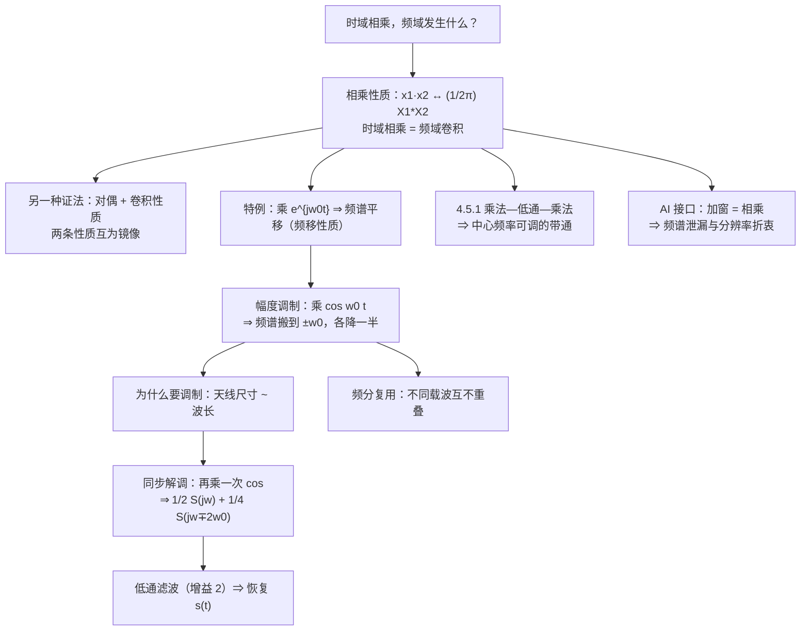
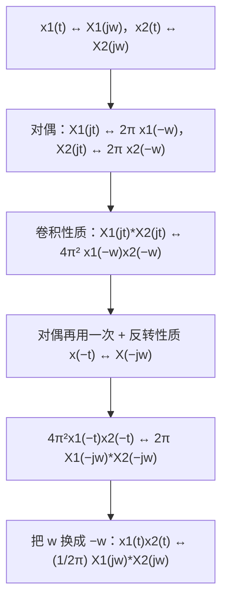

# 4.5 相乘性质与调制

> [!abstract] 这一讲的任务
> 上一节的**卷积性质**说的是"时域卷积 = 频域相乘"。这一节把镜头转到另一半：**时域相乘的时候，频域发生什么？**
> 答案是一条和卷积性质完全对称的式子：$x_1(t)x_2(t)\leftrightarrow\frac{1}{2\pi}X_1(j\omega)*X_2(j\omega)$——**时域相乘 = 频域卷积**。
> 这条性质看着抽象，落地却是整章最"有用"的一节：
> - **幅度调制**：把语音搬到高频载波上（$\times\cos\omega_0t$，频谱整块平移）；
> - **同步解调**：在接收端把它搬回来（再乘一次 $\cos\omega_0t$，然后用低通滤波）；
> - **频分复用**：一根线里同时跑很多路电话；
> - **可变中心频率的带通滤波器**：用"乘法—低通—乘法"把滤波器整体挪到任意中心频率。
> 最后还会看到它和 **AI** 的直接接口：给信号**加窗**做短时傅里叶变换，本质上就是一次"相乘"。

> [!info] 授课进度说明
> 目前拿到的课堂转写稿覆盖到**第 11 节课**，**第 4 章尚未在课堂上讲授**，因此本篇内容全部来自**原稿与教材整理**，暂不逐条区分"课堂讲过"与"拓展补充"。

---

## 0. 开场：为什么语音必须"搬家"

一句话语音，频率成分集中在 **300 Hz – 3.4 kHz**。要把这句话用无线电发出去，最直接的办法是"把声音变成电磁波直接辐射"——可这行不通。

因为**天线的有效辐射尺寸必须和波长同量级**。由 $\lambda=\dfrac{c}{\nu}$（$c=2.998\times10^8$ m/s）：

| 频率 | 波长 | 需要的天线 |
|---|---|---|
| 300 Hz | $999$ m | 约 1 km |
| 3.4 kHz | $88$ km | 不可实现 |
| 3.5 GHz（5G 主力频段） | $8.6$ cm | 几厘米，塞进手机里 |

**语音的频率太低，波长太长。** 于是工程师做了一件事：**把语音的频谱整块"搬"到高频去**，在那边发射；到了接收端，再整块搬回来。

这次"搬家"在数学上就是**时域乘一个 $\cos\omega_0t$**：

$$r(t)=s(t)\cos\omega_0t\ \xleftarrow{\ \ CTFT\ \ }\ R(j\omega)=\frac12S\big(j(\omega-\omega_0)\big)+\frac12S\big(j(\omega+\omega_0)\big)$$

**基带频谱被原样复制到 $\pm\omega_0$ 附近，幅度各降一半。** 这就是**幅度调制 Amplitude Modulation（AM）**，广播电台里的"调幅"两个字，指的就是这一个乘法。

> [!question] 停一下，先自己想想
> 搬过去容易，**怎么搬回来？** 接收端只有 $r(t)$，它并不知道原来的 $s(t)$。

---

## 1. 相乘性质（p.38）

> [!important] 相乘性质 Multiplication property（调制性质）
> $$x_1(t)\cdot x_2(t)\ \xleftarrow{\ \ CTFT\ \ }\ \frac{1}{2\pi}X_1(j\omega)*X_2(j\omega)$$
> 一句话：**时域相乘 = 频域卷积**（并且多带一个 $\frac{1}{2\pi}$）。

> [!example] 证明：把其中一个因子写成综合式，再交换积分顺序
> $$\mathcal F\{x_1(t)x_2(t)\}=\int_{-\infty}^{+\infty}x_1(t)x_2(t)e^{-j\omega t}dt$$
> 把 $x_1$ 用**综合式**展开（这一步和卷积性质的证法正相反——上次是展开 $y$，这次是展开其中一个因子）：
> $$=\int_{-\infty}^{+\infty}\Big(\frac{1}{2\pi}\int_{-\infty}^{+\infty}X_1(j\Omega)e^{j\Omega t}d\Omega\Big)x_2(t)e^{-j\omega t}dt$$
> **交换积分顺序**，把与 $t$ 有关的因子收进内层：
> $$=\frac{1}{2\pi}\int_{-\infty}^{+\infty}X_1(j\Omega)\Big(\underbrace{\int_{-\infty}^{+\infty}x_2(t)e^{-j(\omega-\Omega)t}dt}_{=\,X_2(j(\omega-\Omega))}\Big)d\Omega=\frac{1}{2\pi}\int_{-\infty}^{+\infty}X_1(j\Omega)X_2\big(j(\omega-\Omega)\big)d\Omega$$
> 最后这个积分正是**卷积的定义**（把 $\Omega$ 看作积分变量）：
> $$=\frac{1}{2\pi}X_1(j\omega)*X_2(j\omega)$$

> [!important] 与卷积性质并排看
> | 时域 | 频域 |
> |---|---|
> | $x_1(t)*x_2(t)$ | $X_1(j\omega)X_2(j\omega)$ |
> | $x_1(t)\,x_2(t)$ | $\dfrac{1}{2\pi}X_1(j\omega)*X_2(j\omega)$ |
>
> **两条性质互为镜像：把"乘"和"卷"对调，式子照样成立。** 这个对称性本身就是对偶性的体现（见下一节）。
> 记忆：**"卷"在一边出现，另一边一定是"乘"**；唯一的例外是那个 $\frac{1}{2\pi}$，它总是贴在**频域卷积**旁边（因为综合式里带着 $\frac{1}{2\pi}$）。

---

## 2. 另一种证法：对偶 + 卷积性质（p.39）

相乘性质还有一条更好玩的证明路线，**它只用已经证过的两条性质**：

**这条链子值得看一眼，因为它是"性质表可以用来自举"的最好例证**：对偶 → 卷积 → 对偶，三步就把相乘性质推出来了，一次积分都没做。

> [!tip] 复习时的一个自检
> 如果你能默写出这条链子（对偶 ↔ 卷积 ↔ 相乘 三者互相推出），说明这几条性质的**结构**已经装进脑子里了——比死记四行公式牢固得多。

---

## 3. 最简单的特例：乘复指数 = 频移（p.40）

把相乘性质里的 $x_1(t)$ 取成 $e^{j\omega_0t}$。它的变换是一根冲激 $2\pi\delta(\omega-\omega_0)$，而**与冲激卷积就是平移**：

$$x(t)e^{j\omega_0t}\ \xleftarrow{\ \ CTFT\ \ }\ \frac{1}{2\pi}X(j\omega)*2\pi\delta(\omega-\omega_0)=X\big(j(\omega-\omega_0)\big)$$

**这就是频移性质**（[[C4.3 连续时间傅里叶变换的性质]] §3）——原来它只是相乘性质的一个特例。

> [!important] 为什么"与冲激卷积 = 平移"
> $$X(j\omega)*\delta(\omega-\omega_0)=\int X(j\Omega)\delta(\omega-\Omega-\omega_0)d\Omega=X\big(j(\omega-\omega_0)\big)$$
> 冲激的抽样性质把整条曲线**原样抬起来挪到 $\omega_0$**。这也是为什么**调制就是把频谱"复制粘贴"到载波附近**：乘法几乎总是通过冲激串来搬运频谱。

---

## 4. 幅度调制 AM（p.40）

> [!example] 例 2　幅度调制 Amplitude Modulation
> 设 $s(t)\leftrightarrow S(j\omega)$ 是**基带信号**（带宽 $\omega_M$，即 $S(j\omega)=0,\ |\omega|>\omega_M$），载波 $p(t)=\cos\omega_0t$，调制输出 $r(t)=s(t)p(t)$。
> $$\mathcal F\{\cos\omega_0t\}=\pi\big[\delta(\omega-\omega_0)+\delta(\omega+\omega_0)\big]$$
> $$R(j\omega)=\frac{1}{2\pi}S(j\omega)*\pi\big[\delta(\omega-\omega_0)+\delta(\omega+\omega_0)\big]=\boxed{\ \frac12S\big(j(\omega-\omega_0)\big)+\frac12S\big(j(\omega+\omega_0)\big)\ }$$

![[C4.5-幅度调制的频谱搬移.png]]

**这张图就是 AM 的全部内容**：基带那块三角形谱被"复印"了两份，分别搬到 $\pm\omega_0$ 附近，每份的幅度是原来的 $\frac12$。

- **时域看**：$r(t)$ 是一条高频振荡，它的**包络**正好是 $s(t)$（振荡稀疏处包络低、密集处包络高）——这就是"调幅"名字的来源，也是老式收音机可以用一个二极管检波就能听声的原因；
- **频域看**：信息没有丢，只是**换了地址**。原来的位置（$0$ 附近）让出来了，可以给别的信号用。

> [!important] 由此得到两条工程结论
> 1. **载波频率必须远高于基带带宽**：$\omega_0\gg\omega_M$，否则搬过去的两个副本会**互相重叠**（$-(\omega_0-\omega_M)$ 与 $\omega_0-\omega_M$ 撞在一起），信息被搅乱、再也分不开；
> 2. **频分复用 FDM（Frequency-Division Multiplexing）**：把多路基带信号分别乘上**不同**的载波 $\omega_{01},\omega_{02},\dots$，它们的频谱落在不相交的频段上。**同一根电缆、同一个频段里就能同时跑很多路电话**——只要接收端各自用对应的中心频率把那一段"取出来"。这就是"一根线里有很多频道"的原理。

---

## 5. 同步解调（p.41）

接收端只有 $r(t)=s(t)\cos\omega_0t$。要拿回 $s(t)$，同样只需要**再乘一次 $\cos\omega_0t$**（这叫**同步**，因为接收端必须知道载波的频率与相位）。

> [!example] 例 3　同步解调 Synchronous Demodulation
> $$r(t)\cos\omega_0t=s(t)\cos^2\omega_0t=s(t)\Big[\frac12+\frac12\cos2\omega_0t\Big]=\underbrace{\frac12s(t)}_{\text{要的}}+\underbrace{\frac12s(t)\cos2\omega_0t}_{\text{高频，要滤掉}}$$
> 逐项变换：
> $$\boxed{\ r(t)\cos\omega_0t\ \xleftarrow{\ \ CTFT\ \ }\ \frac12S(j\omega)+\frac14S\big(j(\omega-2\omega_0)\big)+\frac14S\big(j(\omega+2\omega_0)\big)\ }$$

![[C4.5-同步解调与低通恢复.png]]

**时域那条恒等式 $\cos^2\omega_0t=\frac12+\frac12\cos2\omega_0t$ 是这一题的全部机关**：平方之后冒出一个直流项（把 $s(t)$ 原样留下）和一个**二倍频**项（把 $s(t)$ 搬到 $2\omega_0$ 附近）。频域图像里，就是：

- 中心：$\frac12S(j\omega)$——**我们要的基带副本**；
- 两侧：$\frac14S\big(j(\omega\pm2\omega_0)\big)$——**送到二倍载波附近去的垃圾**。

> [!important] 低通滤波器的截止频率怎么定：$\omega_M<\omega_c<2\omega_0-\omega_M$
> - **下限 $\omega_c>\omega_M$**：要的基带副本占据了 $[-\omega_M,\omega_M]$，截止频率必须把它整块放过；
> - **上限 $\omega_c<2\omega_0-\omega_M$**：二倍频副本占据 $[2\omega_0-\omega_M,\ 2\omega_0+\omega_M]$，截止频率必须落在它**开始之前**；
> - **两边留出间隔**（$\omega_M$ 与 $2\omega_0-\omega_M$ 之间那段空白）是**滤波器非理想**的余量——真实滤波器有过渡带，不可能"一刀切"，所以载波要选得比 $\omega_M$ 高得多。
> - 通过后幅度只剩 $\frac12$，所以滤波器**增益取 2** 就能原样恢复：$\hat S(j\omega)=S(j\omega)$。

> [!warning] 三个常见误解
> 1. **"乘两次就回到原点"**——不是。$\cos^2$ 展开后是 $\frac12+\frac12\cos2\omega_0t$，**基带那一份只有原来的一半**，另一半跑到了 $2\omega_0$；靠滤波和增益 2 才能完整恢复。
> 2. **"随便乘一个同频正弦就行"**——不行，必须是 $\cos$ 且**相位对齐**。如果接收端乘的是 $\cos(\omega_0t+\theta)$，恢复出来的基带要乘一个 $\cos\theta$，相位差 $90^\circ$ 时**信号直接消失**。"同步"两个字就是这个意思。
> 3. **"低频那份本来就是基带，不用滤波"**——必须滤。不滤的话，$\frac12s(t)$ 上还叠着 $2\omega_0$ 附近的 $\frac14s$，听感上是刺耳的高频啸叫。

---

## 6. 可变中心频率的带通滤波器（4.5.1，p.43）

相乘性质还有一个漂亮的用法：**把滤波器整体搬到任意中心频率上**。

> [!important] 结构：乘法 → 低通 → 乘法
> $$x(t)\ \longrightarrow\ \times e^{j\omega_ct}\ \longrightarrow\ \boxed{H(j\omega)\ \text{理想低通}}\ \longrightarrow\ \times e^{-j\omega_ct}\ \longrightarrow\ f(t)$$
> 逐级写频域关系（用频移性质）：
> $$Y(j\omega)=X\big(j(\omega-\omega_c)\big),\qquad W(j\omega)=Y(j\omega)H(j\omega),\qquad F(j\omega)=W\big(j(\omega+\omega_c)\big)=X(j\omega)\,H\big(j(\omega+\omega_c)\big)$$
> 所以**整个系统的等效频率响应是**
> $$\boxed{\ H_{\text{总}}(j\omega)=H\big(j(\omega+\omega_c)\big)\ }$$
> **滤波器形状一点没变，只是整体平移了 $-\omega_c$。**

![[C4.5-可变中心频率带通.png]]

上图就是这个结论：里面的滤波器是一个带宽 $2\omega_0$ 的低通（通带在 $0$），整个系统却表现成一个**中心在 $-\omega_c$、带宽 $2\omega_0$ 的带通**。

> [!note] 三点补充说明
> 1. **中心为什么是 $-\omega_c$ 而不是 $+\omega_c$**：第一次乘 $e^{j\omega_ct}$ 把频谱**往右挪**，低通只截取挪到 $0$ 附近的那一段，所以被选中的是原来位于 $-\omega_c$ 附近的内容；出口再乘 $e^{-j\omega_ct}$ 把它挪回原来的位置。**净结果是"选中了 $-\omega_c$ 附近的一段"，同时形状回到原样。**
> 2. **改 $\omega_c$ 就等于改中心频率**：$\omega_c$ 是外部可调的乘法因子，不需要重新设计滤波器——这就是"**中心频率可变**"的含义。通信接收机里"选台"就是这个旋钮。
> 3. **实信号的版本要乘 $\cos$**：这里用的是复指数 $e^{\pm j\omega_ct}$，其实现需要复数运算（工程上用**希尔伯特变换**或双路 IQ 混频实现）。如果改用实信号 $\cos\omega_ct$，那么由 §4 的结论，会同时出现 $\pm\omega_c$ **两段对称通带**——这正是实际中"混频器输出上下两个边带"的来源。
>
> 数值核对：用光滑低通替代理想低通，按上面的链路逐级做数值仿真，$\lvert F(j\omega)-X(j\omega)H(j(\omega+\omega_c))\rvert$ 的相对误差 $3\times10^{-4}$ ✓，且输出频谱的峰值确实出现在 $-\omega_c$ 一侧（已用 python 复核）。

---

## 7. 落到工程上：第 N 代通信技术中的电磁波（p.42）

这一页把"频率"从数学符号拉回到物理世界。

> [!important] 波长与频率
> $$\lambda=\frac{c}{\nu}\qquad c=2.998\times10^8\ \mathrm{m/s}\ (\text{光速，常量})$$
> 光本身就是一种"波长为 $\lambda$ 的正弦波"；通信用的无线电波与可见光、X 射线同属**电磁波谱**，只是频率不同。

| 频率 | 波长 | 光子能量 | 波段 |
|---|---|---|---|
| $3\times10^8$ Hz（0.3 GHz） | $1$ m | $1.24\ \mu\mathrm{eV}$ | Radio / TV |
| $3\times10^9$ Hz（3 GHz） | $10$ cm | $12.4\ \mu\mathrm{eV}$ | 微波 microwaves |
| $3\times10^{10}$ Hz（30 GHz） | $1$ cm | $124\ \mu\mathrm{eV}$ | 微波 |
| $3\times10^{11}$ Hz（300 GHz） | $1$ mm | $1.24\ \mathrm{meV}$ | 微波 / 太赫兹边界 |
| $3\times10^{12}$ Hz（3 THz） | $100\ \mu$m | $12.4\ \mathrm{meV}$ | **太赫兹 THz** |
| $3\times10^{13}$ Hz（30 THz） | $10\ \mu$m | $124\ \mathrm{meV}$ | 红外 IR |
| $3\times10^{14}$ Hz（300 THz） | $1\ \mu$m | $1.24\ \mathrm{eV}$ | 近红外 / 可见光边缘 |

（可见光大约在 $400$–$700$ nm，即 $750$–$428$ THz；能量关系用 $E=h\nu$，$h=4.136\times10^{-15}$ eV·s——已用 python 复核上表全部数字。）

**移动通信的频段演进**（每一代都在往**更高频**走）：

| 代际 | 频段 |
|---|---|
| 2G（1991） | 890–909 MHz、935–954 MHz |
| 3G（1998） | 1880–1900 MHz、2010–2025 MHz |
| 4G（2008） | 1880–1900 MHz、2320–2370 MHz、2575–2635 MHz |
| 5G（2020 前后） | 3300–3400 MHz、3400–3600 MHz、4800–5000 MHz（Sub-6G 以 3.5 GHz 为主；毫米波以 28 / 39 / 60 / 73 GHz 为主） |
| 6G（进行中） | 向**太赫兹**延伸 |

> [!important] "往高频走"的三个理由，都能用这一节的语言解释
> 1. **带宽**：可用频段越宽，能承载的数据率越高。$\omega_0$ 越高，$\pm\omega_0$ 两侧留给多个频分复用信道的"车道"越宽；
> 2. **天线尺寸**：$\lambda=c/\nu$，频率越高波长越短，天线越短——手机里能塞下 3.5 GHz（$\lambda\approx8.6$ cm）的天线，塞不下 300 Hz（$\lambda\approx1$ km）的；
> 3. **分辨率**：频率越高，同样的相对带宽对应更大的绝对带宽，雷达/成像的距离与角度分辨率越高（呼应 [[C4.1 非周期信号的表示：连续时间傅里叶变换]] 的"时域越窄、频域越宽"）。
>
> 代价同样清楚：**频率越高，绕射能力越弱、覆盖越差**（毫米波在雨雾里衰减严重），所以 5G 要靠密集基站（小基站）补覆盖。**"更快"与"更好覆盖"之间的取舍，本质上是在频率轴上选位置。**

---

## 8. 与 AI 的接口：加窗与频谱泄漏

相乘性质在信号处理里最常用的一次出场，是**加窗**。

做短时傅里叶变换（STFT，语音识别、音频特征提取的第一道工序）时，要把长信号切成一段一段、每段乘一个窗函数 $w(t)$（矩形窗、汉宁窗、汉明窗……），再对每段求频谱。由相乘性质：

$$\text{时域：}x(t)w(t)\qquad\Longleftrightarrow\qquad\text{频域：}\frac{1}{2\pi}X(j\omega)*W(j\omega)$$

**乘窗 = 频域与窗的频谱做卷积 = 把真实频谱"糊"开。**

> [!warning] 由此产生两个必知的现象
> 1. **频谱泄漏 leakage**：哪怕信号是纯正弦（频谱是一根冲激），加窗后冲激也会被 $W(j\omega)$ 抹成"主瓣 + 旁瓣"的形状，能量漏到本来没有内容的频率上。矩形窗的旁瓣衰减最慢（第一旁瓣只低约 $-13$ dB），汉宁窗、汉明窗的旁瓣低得多——**这就是选窗函数的全部理由**；
> 2. **时间—频率分辨率折衷**：窗越长，$W(j\omega)$ 的主瓣越窄（频率分辨越好），但时间定位越糊；窗越短则相反。这正是 [[C4.1 非周期信号的表示：连续时间傅里叶变换]] §4 那条"时域越窄、频域越宽"的又一次现身——**它不是新的物理，只是同一个不确定性关系**。
>
> 同一个道理还解释了：为什么给频谱做**硬截断**会带来吉布斯振铃（[[C3.3 傅里叶级数的收敛与吉布斯现象]]）——硬截断等价于在频域乘一个矩形窗。

---

## 这一讲的三句话

1. **时域相乘 = 频域卷积**：$x_1x_2\leftrightarrow\frac{1}{2\pi}X_1*X_2$；它与卷积性质互为镜像，还能由对偶 + 卷积反推出来。
2. **调制与解调都是"乘 $\cos$"**：调制把基带谱复制到 $\pm\omega_0$（各半），解调用 $\cos^2\omega_0t=\frac12+\frac12\cos2\omega_0t$ 造出一份基带（$\frac12S$，增益 2 补回）和二倍频垃圾（$\frac14S$，低通滤掉，要求 $\omega_M<\omega_c<2\omega_0-\omega_M$）；这也是频分复用的全部原理。
3. **"乘法—低通—乘法"能把滤波器整体平移**：$H_{\text{总}}(j\omega)=H(j(\omega+\omega_c))$，中心频率由乘数决定，可现场调谐。

> [!tip] 速查表
> | 项目 | 公式 |
> |---|---|
> | 相乘性质 | $x_1(t)x_2(t)\leftrightarrow\frac{1}{2\pi}X_1(j\omega)*X_2(j\omega)$ |
> | 频移（特例） | $x(t)e^{j\omega_0t}\leftrightarrow X(j(\omega-\omega_0))$ |
> | 与冲激卷积 | $X(j\omega)*\delta(\omega-\omega_0)=X(j(\omega-\omega_0))$（就是平移） |
> | 调制 | $s(t)\cos\omega_0t\leftrightarrow\frac12S(j(\omega-\omega_0))+\frac12S(j(\omega+\omega_0))$ |
> | 解调 | $r(t)\cos\omega_0t\leftrightarrow\frac12S(j\omega)+\frac14S(j(\omega-2\omega_0))+\frac14S(j(\omega+2\omega_0))$ |
> | 时域恒等式 | $\cos^2\omega_0t=\frac12+\frac12\cos2\omega_0t$ |
> | 解调低通要求 | $\omega_M<\omega_c<2\omega_0-\omega_M$，增益取 2 |
> | 不重叠条件 | $\omega_0>\omega_M$（实际要 $\omega_0\gg\omega_M$） |
> | 可变中心频率带通 | $H_{\text{总}}(j\omega)=H(j(\omega+\omega_c))$（中心 $-\omega_c$，带宽不变） |
> | 加窗 | $x(t)w(t)\leftrightarrow\frac{1}{2\pi}X*W$：主瓣变宽、旁瓣泄漏 |
> | 电磁波 | $\lambda=c/\nu$，$c=2.998\times10^8$ m/s；能量 $E=h\nu$ |
> | 5G 主力频段 | 3.5 GHz（$\lambda\approx8.6$ cm）；毫米波 28 / 39 / 60 / 73 GHz |

> [!tip] 下一讲预告
> 到这里，连续时间傅里叶变换的工具箱就齐了：变换的定义与基本变换对（[[C4.1 非周期信号的表示：连续时间傅里叶变换]]）、周期信号的变换（[[C4.2 周期信号的傅里叶变换]]）、全部性质与两张速查表（[[C4.3 连续时间傅里叶变换的性质]]）、卷积与系统（[[C4.4 卷积性质与由微分方程表征的系统]]）、相乘与调制（本篇）。
> 接下来第 5 章要把**同一套戏在离散时间重演一遍**：DTFT 的定义、周期信号的离散谱、以及离散特有的那个讨厌事实——**频率以 $2\pi$ 为周期**，最高频只有 $\omega=\pi$。
> 提醒一句：本篇讲"采样"只是顺带一提（冲激串乘信号），真正的采样定理要等第 7 章，那里才会回答"**多快采样才不丢信息**"。

---

## 相关笔记 Related Notes

- 相关：[[C4.3 连续时间傅里叶变换的性质]]（频移性质与表 4.1）、[[C4.4 卷积性质与由微分方程表征的系统]]（与本节互为镜像的卷积性质）、[[C4.2 周期信号的傅里叶变换]]（频谱搬运用到的冲激串）、[[C3.6 傅里叶级数与LTI系统、滤波]]（理想低通与带通）、[[C1.5 连续时间与离散时间系统]]（混频与系统的互联）

- 上一讲：[[C4.4 卷积性质与由微分方程表征的系统]]
- 下一讲：第 5 章《离散时间傅里叶变换》（笔记尚未建立）
- 返回：[[信号与系统 MOC]]
