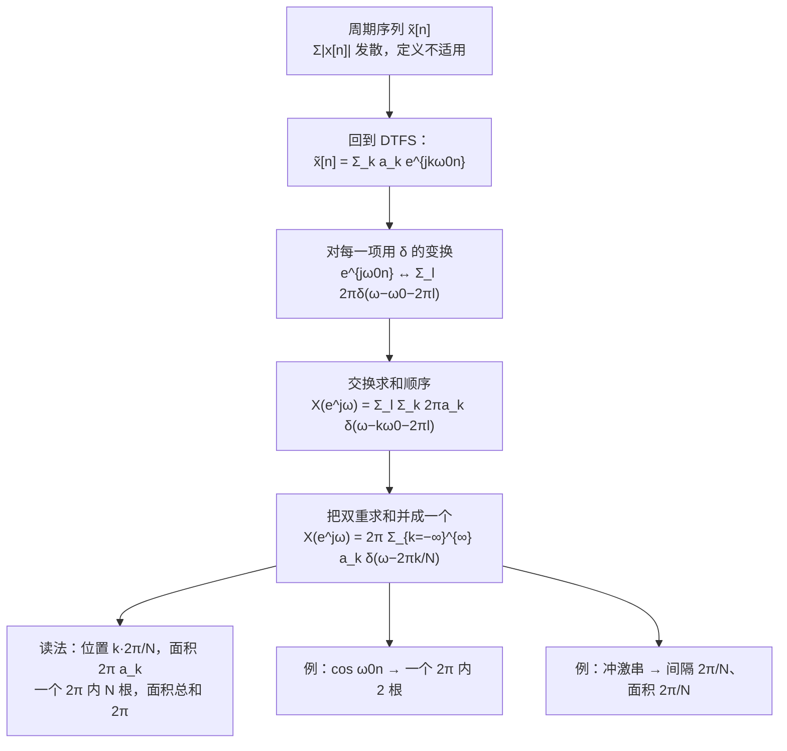

# 5.2 周期信号的傅里叶变换

> [!abstract] 这一讲的任务
> 上一节给**非周期**序列定义了 DTFT，条件里有一条"绝对可和"。周期序列一条都不满足——它的和永远发散，按上一节的定义根本写不出 $X(e^{j\omega})$。
> 这一节沿着第 4 章开出的路再走一遍：**允许谱里出现冲激**。结果和连续端同构——周期序列的谱是一串冲激，位置在谐波频率、面积正比于 DTFS 系数——但多了一层：因为谱本身以 $2\pi$ 为周期，这串冲激**每 $2\pi$ 要被复制一遍**。
> 于是"一个 $2\pi$ 里到底站几根冲激"成了新的关键：答案恰好是 $N$ 根，位置 $\frac{2\pi}{N}k$，面积 $\frac{2\pi}{N}$。

> [!info] 授课进度说明
> 第 12 节课只讲到 5.1，**本篇尚未在课堂上讲授**。内容按教材与通行讲法整理，暂不逐条区分"课堂讲过"与"拓展补充"；等后续转写稿覆盖到 5.2，再按与第 3、4 章相同的规则标注。

---

## 0. 开场：一台电机的振动谱，和一条曲线要放同一张图

车间里给电机做状态监测。加速度计采到的振动序列里，除了宽带的机械噪声，还有几根非常尖锐的谱线：转频 25 Hz、二倍频 50 Hz、轴承故障特征频率约 137 Hz。故障诊断就是看这几根线有没有长高。

同时，厂家的手册给了这套安装方式的**频率响应曲线**——一条连续曲线，说明振动传到传感器上时哪些频率被放大、哪些被压低。

现在要在一张图上判断"这根 137 Hz 的线，是不是正好落在手册里那个共振峰上"。麻烦在于：**噪声的谱是连续曲线（非周期序列），故障谱是尖锐的谱线（近似周期序列）**——按上一节，后者根本不满足绝对可和，写不出 $X(e^{j\omega})$。

要不每次遇到周期成分就退回 DTFS 单独算一遍？那样"同一张图上比较"就永远做不到，卷积、相乘、滤波这些性质也没有一个统一的写法。

所以这一节要办的事和 4.2 节一模一样：**给周期序列也定义 DTFT**，并且定义得能和非周期序列**无缝相加**——在谐波频率上取值、其余地方为零。唯一的工具就是冲激。

---

## 1. 冲激是怎么进场的（p.19）

### 1.1 先看一根复指数

连续端的那一对是

$$e^{j\omega_0t}\ \xleftrightarrow{\ \text{CTFT}\ }\ 2\pi\delta(\omega-\omega_0).$$

离散端的对应物是 $e^{j\omega_0n}$。它和连续复指数的唯一差别是"时间只取整数"，而这一差别在频域上正好表现为**周期化**：

$$e^{j\omega_0n}\ \xleftrightarrow{\ \text{DTFT}\ }\ \sum_{k=-\infty}^{+\infty}2\pi\,\delta(\omega-\omega_0-2\pi k).$$

> [!important] 一句话记住这条
> **把连续端的冲激，在 $\omega$ 轴上每隔 $2\pi$ 复制一份。**
> 理由就是上一节证的 $2\pi$ 周期性：DTFT 的谱只能以 $2\pi$ 为周期，一根孤零零的冲激不满足这个约束，必须补出所有副本。

这也解释了为什么离散端处理周期信号时，"一个 $2\pi$ 里站几根"会成为关键——$2\pi$ 之外的冲激全是前一个周期的复制品，不提供新信息。

### 1.2 一般的周期序列：三行推完

从 DTFS 的综合式出发（$k$ 只取一个周期 $\langle N\rangle$）：

$$\tilde x[n]=\sum_{k=\langle N\rangle}a_ke^{jk\omega_0n},\qquad\omega_0=\frac{2\pi}{N}.$$

把 1.1 节的变换对逐项代进去，**线性**允许我们把求和搬到变换外面：

$$X(e^{j\omega})=\sum_{k=\langle N\rangle}a_k\underbrace{\sum_{l=-\infty}^{+\infty}2\pi\delta(\omega-k\omega_0-2\pi l)}_{\text{每一项的变换}}=\sum_{l=-\infty}^{+\infty}\sum_{k=\langle N\rangle}2\pi a_k\,\delta\!\left(\omega-\frac{2\pi}{N}k-2\pi l\right).$$

到这里冲激的位置由两个整数决定：$k$ 决定它在**一个 $2\pi$ 里的位置**，$l$ 决定它是**第几份复制品**。

### 1.3 双重求和并成一重：这一步最容易看漏

把 $l=0,1,2,\dots$ 的几层摊开写：

$$X=2\pi\sum_{k=\langle N\rangle}a_k\delta\!\left(\omega-\frac{2\pi}{N}k\right)+2\pi\sum_{k=\langle N\rangle}a_k\delta\!\left(\omega-\frac{2\pi}{N}k-2\pi\right)+2\pi\sum_{k=\langle N\rangle}a_k\delta\!\left(\omega-\frac{2\pi}{N}k-4\pi\right)+\cdots$$

第二层里每一项都是 $\omega-\frac{2\pi}{N}k-2\pi=\omega-\frac{2\pi}{N}(k+N)$，所以那一层的冲激落在 $\frac{2\pi}{N}(k+N)$ 上；$k$ 取 $0\sim N-1$ 时正是 $\frac{2\pi}{N}N$ 到 $\frac{2\pi}{N}(2N-1)$ 这 $N$ 个位置。第三层再往右推 $N$ 个位置，依次排下去。

**结论：把 $l$ 摊到各层去看，所有冲激的位置合起来恰好是 $\frac{2\pi}{N}k$，$k$ 取遍全部整数。** 而第 $k$ 根的面积永远是 $2\pi a_k$（因为 $a_k$ 本身以 $N$ 为周期，$a_{k+N}=a_k$，摊到下一层时系数一模一样）。于是

> [!important] 周期序列的 DTFT
> $$\boxed{\ \tilde x[n]\ \xleftrightarrow{\ \text{DTFT}\ }\ X(e^{j\omega})=2\pi\sum_{k=-\infty}^{+\infty}a_k\,\delta\!\left(\omega-\frac{2\pi}{N}k\right)\ }$$
> 对比连续端 $X(j\omega)=2\pi\sum_ka_k\delta(\omega-k\omega_0)$：**形状完全相同，唯一区别是求和从 $k=\langle N\rangle$ 变成了 $k=-\infty\sim+\infty$。** 因为离散端的频率轴本身是周期的，冲激必须沿着整条轴排下去。

> [!tip] 两条必须能自己做的核对
> - **数一数**：一个 $2\pi$ 区间内（例如 $\omega\in[0,2\pi)$）站着 $k=0,1,\dots,N-1$ 共 $N$ 根冲激，间隔 $\frac{2\pi}{N}$；
> - **加一加**：这 $N$ 根的面积之和是 $2\pi\sum_{k=\langle N\rangle}a_k=2\pi x[0]$（把综合式在 $n=0$ 处取值即得）；也可以拿它和 DTFS 的帕塞瓦尔互相对照。
> 这两条只要有一条对不上，就说明求和限漏了 $l$ 或者 $-N/2$ 的负半轴。

---

## 2. 例 1：$\cos\omega_0n$（p.21）

### 2.1 先回答"它到底是不是周期的"

$$\cos\omega_0n=\frac12\left(e^{j\omega_0n}+e^{-j\omega_0n}\right).$$

要把两根复指数合成一个周期序列，必须存在整数 $N$ 使 $e^{j\omega_0N}=1$，也就是

$$\frac{\omega_0}{2\pi}=\frac{k}{N}\quad\text{为有理数}.$$

这是第 1 章就定下的周期判据，这里第一次在"谱"的语境下用到：**只有当 $\frac{\omega_0}{2\pi}$ 是有理数时，这个信号才有 DTFS 系数、才有下面这串冲激谱**。若它是无理数，$\cos\omega_0n$ 根本不是周期序列，只能按 5.1 节处理（那时它不绝对可和，严格说也不能直接求和——教材这一节默认讨论的是有理情形）。

### 2.2 谱

在它的一个周期 $N$ 里，只有 $k=1$ 与 $k=N-1$（即 $k=-1$）两个系数非零，各等于 $\frac12$。代进 §1 的结论：

$$X(e^{j\omega})=\pi\sum_{l=-\infty}^{+\infty}\Big[\delta(\omega-\omega_0-2\pi l)+\delta(\omega+\omega_0-2\pi l)\Big].$$

![[C5.2-周期信号的冲激谱.png]]

左图是余弦的谱：两根面积 $\pi$ 的冲激在 $\pm\omega_0$，然后**每 $2\pi$ 复制一组**。右图是下一例的冲激串。

> [!important] 与连续端余弦的对照
> 连续端：$\cos\omega_0t\leftrightarrow\pi[\delta(\omega-\omega_0)+\delta(\omega+\omega_0)]$，两根就完了。
> 离散端：同样的两根，但**每隔 $2\pi$ 无限重复**。所以离散时间信号没有"唯一的频率"：$\omega_0$ 与 $\omega_0+2\pi$ 描述同一个序列。
> 工程上的后果很直接：只要采样率没选对，两根冲激就会跑到别的频率位置上去——这就是混叠的谱语言。

---

## 3. 例 2：周期冲激串（p.22）

### 3.1 先算 DTFS

$$x[n]=\sum_{k=-\infty}^{+\infty}\delta[n-kN],\qquad\text{周期 }N.$$

在一个周期 $n=0,1,\dots,N-1$ 里，只有 $n=0$ 处有一个单位冲激，其余全为零：

$$a_k=\frac1N\sum_{n=\langle N\rangle}x[n]e^{-jk\omega_0n}=\frac1N\cdot\delta[0]\cdot e^{0}=\frac1N.$$

**所有 $k$ 的系数都相同，等于 $\frac1N$。** 这与连续端冲激串的 $a_k=\frac1T$ 是同一个结论（时间上"每 $N$ 个样本一个冲激"⇒ 每个谐波的权重均等）。

### 3.2 谱

$$X(e^{j\omega})=\frac{2\pi}{N}\sum_{k=-\infty}^{+\infty}\delta\!\left(\omega-\frac{2\pi}{N}k\right).$$

回到 §2 那张图的右半边（周期 $N=6$）：冲激间隔 $\frac{2\pi}{N}=\frac\pi3$，面积同样是 $\frac{2\pi}{N}$，每 $2\pi$ 有 $N=6$ 根，面积总和 $2\pi$。

> [!important] 自相似的极端情形
> **时域是等间隔冲激，频域也是等间隔冲激**，而且两个间隔是倒数关系：时域间隔 $N$ 越大，频域间隔 $\frac{2\pi}{N}$ 越小、冲激越密。两者的乘积恒为 $2\pi$。
> 这是"时域越宽、频域越窄"用在冲激串上的样子——与连续端的 $T\omega_0=2\pi$ 完全平行。

> [!tip] 这个信号为什么值得单独算一遍
> 它是**第 7 章采样定理的原材料**。采样在数学上就是"把信号乘上一个冲激串"，而"乘"对应"频谱做周期卷积"（5.5 节的相乘性质）；冲激串的谱又是一串冲激，卷积的结果就是**把原信号的谱按 $\frac{2\pi}{N}$（对应采样角频率 $\omega_s$）复制**。
> 于是"采样率够不够"变成"复制出来的谱副本会不会重叠"。这一节算出的面积 $\frac{2\pi}{N}$ 和位置 $\frac{2\pi}{N}k$，到第 7 章会原封不动地出现。

---

## 4. 把周期信号的两套写法放在一起（p.19–20）

| 项目 | 连续时间（CTFS / CTFT） | 离散时间（DTFS / DTFT） |
|---|---|---|
| 级数综合式 | $\tilde x(t)=\sum\limits_{k}a_ke^{jk\omega_0t}$ | $\tilde x[n]=\sum\limits_{k=\langle N\rangle}a_ke^{jk\omega_0n}$ |
| 系数 | $a_k$ 无周期性 | $a_{k+N}=a_k$ |
| 变换 | $X(j\omega)=2\pi\sum\limits_k a_k\delta(\omega-k\omega_0)$ | $X(e^{j\omega})=2\pi\sum\limits_{k=-\infty}^{\infty}a_k\delta\!\left(\omega-\frac{2\pi}{N}k\right)$ |
| 冲激的位置 | $k\omega_0$，间隔 $\omega_0=\frac{2\pi}{T}$ | $\frac{2\pi}{N}k$，间隔 $\frac{2\pi}{N}$ |
| 冲激的面积 | $2\pi a_k$ | $2\pi a_k$ |
| 频率轴上的根数 | 只在 $\pm k\omega_0$ 上，别处为零 | 每 $2\pi$ 复制一遍，一个 $2\pi$ 内 $N$ 根 |
| 基波周期 | $T$ | $N$ |

> [!warning] 三个最容易写错的地方
> - **求和限**：连续端是 $k\in\mathbb{Z}$（系数没有周期性，所以只出现一次）；离散端也是 $k\in\mathbb{Z}$，但它的背后是"$l$ 层复制"叠起来的，所以一个 $2\pi$ 里只数得出 $N$ 根；
> - **面积的 $2\pi$**：别把 $2\pi a_k$ 写成 $a_k$。乘 $2\pi$ 是因为综合式里有一个 $\frac1{2\pi}$，做逆运算时它要还回去；
> - **"一个周期"与"一个 $2\pi$"**：DTFS 的 $k$ 是在 $\langle N\rangle$ 上取的，DTFT 的 $\omega$ 是在一个 $2\pi$ 上取的，两者通过 $\omega=\frac{2\pi}{N}k$ 对齐——不要用 $k$ 轴的值直接当 $\omega$ 轴的值。

> [!note] 和 5.1 节的桥
> 5.1 节给的桥梁 $a_k=\frac1NX(e^{j\omega})\big|_{\omega=k\omega_0}$ 在这里依然成立，只是现在 $X$ 是冲激串，必须**放进积分里**才有意义：
> $$\frac1{2\pi}\int_{2\pi}X(e^{j\omega})e^{j\omega n}d\omega=\sum_{k=\langle N\rangle}a_ke^{jk\omega_0n}=\tilde x[n].$$
> "冲激在积分里做抽样"——这一步在第 3、4 章已经用过一次，现在是第二次。

---

## 这一讲的三句话

1. **周期序列的 DTFT 是一串冲激**：$X(e^{j\omega})=2\pi\sum_ka_k\delta\!\left(\omega-\frac{2\pi}{N}k\right)$，位置在谐波 $\frac{2\pi}{N}k$，面积是 $2\pi a_k$——与连续端同形，只是求和铺到了整条轴。
2. **冲激必须每 $2\pi$ 复制一份**：这是 5.1 节 $2\pi$ 周期性的直接后果；一个 $2\pi$ 内恰好 $N$ 根，面积和 $2\pi$。
3. **冲激串的谱还是冲激串**：$\sum_n\delta[n-kN]\leftrightarrow\frac{2\pi}{N}\sum_k\delta\!\left(\omega-\frac{2\pi}{N}k\right)$，时域间隔与频域间隔成倒数——第 7 章采样定理的全部机关都在这里。

> [!tip] 速查表
> | 信号 | DTFT |
> |---|---|
> | $\sum_k a_ke^{jk\omega_0n}$（周期 $N$） | $2\pi\sum\limits_{k=-\infty}^{\infty}a_k\delta\!\left(\omega-\frac{2\pi}{N}k\right)$ |
> | $e^{j\omega_0n}$ | $\sum\limits_l2\pi\delta(\omega-\omega_0-2\pi l)$ |
> | $\cos\omega_0n$（$\frac{\omega_0}{2\pi}$ 有理） | $\pi\sum\limits_l[\delta(\omega-\omega_0-2\pi l)+\delta(\omega+\omega_0-2\pi l)]$ |
> | $\sin\omega_0n$ | $\frac{\pi}{j}\sum\limits_l[\delta(\omega-\omega_0-2\pi l)-\delta(\omega+\omega_0-2\pi l)]$ |
> | $1$（$k=0$ 的平凡周期信号） | $2\pi\sum\limits_l\delta(\omega-2\pi l)$ |
> | 冲激串（周期 $N$） | $\frac{2\pi}{N}\sum\limits_k\delta\!\left(\omega-\frac{2\pi}{N}k\right)$ |
> | 读图口径 | 冲激只有面积有意义（$=2\pi a_k$）；一个 $2\pi$ 里数得出 $N$ 根 |

> [!tip] 下一讲预告
> 谱的两种形态都有了：非周期是连续曲线，周期是冲激串。接下来该问"**这些谱怎么用**"。
> 5.3 节把 DTFT 的性质一条条推出来。和第 4 章的性质表相比，离散端多了两处必须小心的地方：一是所有式子都在"一个 $2\pi$ 周期"里成立（比如累加性质会多出一串 $2\pi$ 间隔的冲激），二是**时域扩展**在离散端不再是"除以 $|a|$"，而换了名字叫**内插**。

---

## 相关笔记 Related Notes

- 相关：[[C5.1 非周期信号的表示：离散时间傅里叶变换]]（$2\pi$ 周期性与 $a_k$ 的桥）、[[C4.2 周期信号的傅里叶变换]]（连续端的同一套推导）、[[C3.5 离散时间傅里叶级数DTFS及性质]]（$a_k$ 与 $N$ 项有限和）、[[C1.3 指数信号与正弦信号]]（离散周期判据 $\frac{\omega_0}{2\pi}$ 有理）

- 上一讲：[[C5.1 非周期信号的表示：离散时间傅里叶变换]]
- 下一讲：[[C5.3 离散时间傅里叶变换的性质]]
- 返回：[[信号与系统 MOC]]
