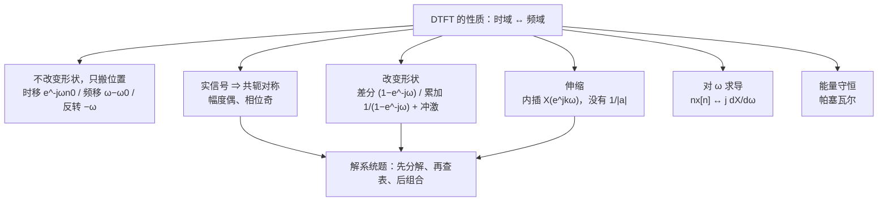

# 5.3 离散时间傅里叶变换的性质

> [!abstract] 这一讲的任务
> 有了 DTFT 的定义和一对基本变换，接下来要问的是**"时域动一下，频域付什么代价"**。这一节逐条推十组性质，形式与第 4 章的性质表高度平行，但有三处必须为"离散"额外留心：
> 一是所有式子都在**一个 $2\pi$ 周期**里成立，跨周期的地方要补 $l$ 层复制；二是**累加性质**会多出一串 $2\pi$ 间隔的冲激（$u[n]$ 的谱就是这样来的）；三是**时域扩展**在离散端换了名字，叫**内插**，而且没有连续端那个 $\frac{1}{|a|}$。
> 这十条性质是后面所有系统分析的"手柄"：查表做系统题、辨实信号谱的对称性、用帕塞瓦尔算能量，都从这里出发。

> [!info] 授课进度说明
> 第 12 节课只讲到 5.1，**本篇尚未在课堂上讲授**。内容按教材与通行讲法整理，暂不逐条区分"课堂讲过"与"拓展补充"；等后续转写稿覆盖到 5.3，再按与第 3、4 章相同的规则标注。

---

## 0. 开场：为什么非要背一张性质表

手上有 $x[n]$，想求 $y[n]=x[n]-x[n-1]$ 的谱。直接代定义：

$$Y(e^{j\omega})=\sum_n\big(x[n]-x[n-1]\big)e^{-j\omega n}=\sum_nx[n]e^{-j\omega n}-e^{-j\omega}\sum_mx[m]e^{-j\omega m}=\left(1-e^{-j\omega}\right)X(e^{j\omega}).$$

三行就完了。但如果每次遇到"差分""时移""乘 $n$"都这样现推，考场上一道题就要多花十分钟，还容易在换元时丢一个负号。

性质表的作用不是让你背结论，而是让你**认出题型**：看到 $x[n]-x[n-1]$ 就该想到 $(1-e^{-j\omega})X(e^{j\omega})$，看到 $nx[n]$ 就该想到对 $\omega$ 求导，看到 $x[n]$ 实就该想到"幅度偶、相位奇"。**表背下来的是"动作—代价"的对应关系，推导只是用来在忘了的时候把它捡回来。**

这一节的十组性质，按"动不动形状"分三类：

| 类别 | 性质 | 频域发生了什么 |
|---|---|---|
| 只搬位置 | 时移、频移、反转 | 乘一个相位因子 / 把 $\omega$ 平移到 $\omega-\omega_0$ / 把 $\omega$ 换成 $-\omega$ |
| 改形状 | 差分、累加、内插、乘 $n$ | 乘 $(1-e^{-j\omega})$、除 $(1-e^{-j\omega})$ 加冲激、$\omega\to k\omega$、对 $\omega$ 求导 |
| 不变式 | 线性、共轭对称、帕塞瓦尔 | 只有系数线性组合；实信号的对称约束；能量守恒 |

---

## 1. 周期性（p.23）

> [!important] 结论
> 若 $x[n]\leftrightarrow X(e^{j\omega})$，则 $X(e^{j(\omega+2\pi)})=X(e^{j\omega})$。
> **DTFT 在 $\omega$ 上永远以 $2\pi$ 为周期**，这不是某类信号的特殊性质，而是定义的直接后果。

证明就是代进去用一次 $e^{-j2\pi n}=1$（5.1 节 §2 已做）。性质表里之所以还要把它列成"第 1 条"，是因为它**约束了后面每一条的写法**：凡是出现"把频率搬走 $\omega_0$"的地方，搬过去的谱会自动在 $\omega_0+2\pi k$ 处都出现一份；凡是写"积分"的地方，积分区间只取一个 $2\pi$。

---

## 2. 线性（p.23）

$$x_1[n]\leftrightarrow X_1(e^{j\omega}),\quad x_2[n]\leftrightarrow X_2(e^{j\omega})\quad\Longrightarrow\quad ax_1[n]+bx_2[n]\leftrightarrow aX_1(e^{j\omega})+bX_2(e^{j\omega}).$$

与所有线性变换一样，它是"叠加"两个字的代数形式。**注意系数 $a,b$ 可以是复数**，这时它管的是"同频率的分量能不能直接相加"——能，因为 $e^{j\omega n}$ 对每个 $\omega$ 都是同一个基底。

---

## 3. 时移与频移（p.24）

### 3.1 时移：只加相位，不改幅度

$$x[n-n_0]\ \xleftrightarrow{\ \text{DTFT}\ }\ e^{-j\omega n_0}X(e^{j\omega}).$$

证明用换元 $n'=n-n_0$：

$$\sum_nx[n-n_0]e^{-j\omega n}=\sum_{n'}x[n']e^{-j\omega(n'+n_0)}=e^{-j\omega n_0}X(e^{j\omega}).$$

> [!important] 这条性质的物理含义
> $|e^{-j\omega n_0}|=1$，所以**幅度谱一根线都不动，只有相位被加了一条直线** $-\omega n_0$。
> 这就是"延迟不改变频率成分，只改变各成分的相对时序"——滤波器设计里"线性相位"之所以重要，正是因为它对应纯延迟、不产生波形失真。

### 3.2 频移：把谱整体搬到 $\omega_0$

$$e^{j\omega_0 n}x[n]\ \xleftrightarrow{\ \text{DTFT}\ }\ X(e^{j(\omega-\omega_0)}).$$

证明同样一行：$e^{j\omega_0n}e^{-j\omega n}=e^{-j(\omega-\omega_0)n}$。

时域乘一个复指数 ⇒ 频域平移。离散端多一句提醒：平移之后谱仍然以 $2\pi$ 为周期，所以"搬到 $\omega-\omega_0$"在图上表现为**整条周期曲线平移**，$-\pi$ 那一头的峰会从 $+\pi$ 绕回来。这一点在 5.5 节用 $(-1)^n$ 做调制时会看得最清楚。

---

## 4. 反转（p.24）

$$x[-n]\ \xleftrightarrow{\ \text{DTFT}\ }\ X(e^{-j\omega}).$$

证明：$\sum_nx[-n]e^{-j\omega n}$，令 $n'=-n$ 得 $\sum_{n'}x[n']e^{-j\omega(-n')}=X(e^{-j\omega})$。

和连续端的 $x(-t)\leftrightarrow X(-j\omega)$ 是同一个动作。**对实信号**，这条与下面的共轭性质合起来会得到非常有用的对称结论。

---

## 5. 共轭与共轭对称（p.25–26）

### 5.1 基本形式

$$x^*[n]\ \xleftrightarrow{\ \text{DTFT}\ }\ X^*(e^{-j\omega}).$$

证明要用到一个事实：对复数取共轭可以和求和交换。

$$F\{x^*[n]\}=\sum_nx^*[n]e^{-j\omega n}=\left(\sum_nx[n]e^{+j\omega n}\right)^{*}=\left(\sum_nx[n]e^{-j(-\omega)n}\right)^{*}=X^*(e^{-j\omega}).$$

### 5.2 四条推论：实信号能省一半的图

对**实**序列 $x[n]$（即 $x^*[n]=x[n]$），代进 5.1 就直接得到

$$X(e^{-j\omega})=X^*(e^{j\omega}).$$

> [!important] 实信号的四条对称性
> 1. **幅度偶**：$|X(e^{j\omega})|=|X(e^{-j\omega})|$；
> 2. **相位奇**：$\angle X(e^{j\omega})=-\angle X(e^{-j\omega})$；
> 3. **实部偶、虚部奇**：$\mathrm{Re}\{X(e^{j\omega})\}=\mathrm{Re}\{X(e^{-j\omega})\}$，$\mathrm{Im}\{X(e^{j\omega})\}=-\mathrm{Im}\{X(e^{-j\omega})\}$；
> 4. 若再叠加偶/奇：
>    - 实且**偶** ⇒ $X(e^{j\omega})$ **实且偶**（相位只取 $0$ 或 $\pi$，图上就是有正有负的实曲线）；
>    - 实且**奇** ⇒ $X(e^{j\omega})$ **纯虚且奇**（相位恒为 $\pm\frac\pi2$）。

> [!example] 用上一节的两个例子验一遍
> - $x[n]=a^{|n|}$ 是实且偶，它的谱 $\frac{1-a^2}{1+a^2-2a\cos\omega}$ 是**实且偶** ✓；
> - $x[n]=a^nu[n]$ 是实但**不偶**，它的谱 $\frac{1}{1-ae^{-j\omega}}$ 既不是实也不是纯虚——但它满足 $X(e^{-j\omega})=X^*(e^{j\omega})$：把分母取共轭就变成 $1-ae^{j\omega}$ ✓。
> 这两条正好说明：实信号只能保证"共轭对称"，想要"谱是实数"还得再加偶对称。

### 5.3 奇偶分解在频域的样子（p.26）

对实信号作奇偶分解 $x[n]=x_e[n]+x_o[n]$，其中

$$x_e[n]=\frac12\big(x[n]+x[-n]\big),\qquad x_o[n]=\frac12\big(x[n]-x[-n]\big),$$

分别对应频域的实部与虚部：

$$x_e[n]\ \longleftrightarrow\ \mathrm{Re}\big\{X(e^{j\omega})\big\},\qquad x_o[n]\ \longleftrightarrow\ j\,\mathrm{Im}\big\{X(e^{j\omega})\big\}.$$

**"时域的偶部管实部、奇部管虚部"**——这是第 1 章奇偶分解与频域之间最直接的一条通道。

---

## 6. 差分与累加（p.27–28）

### 6.1 差分：乘上 $(1-e^{-j\omega})$

$$x[n]-x[n-1]\ \xleftrightarrow{\ \text{DTFT}\ }\ \left(1-e^{-j\omega}\right)X(e^{j\omega}).$$

推导就是线性 + 时移：$x[n-1]\leftrightarrow e^{-j\omega}X(e^{j\omega})$，相减即可。

> [!important] 差分是一个高通
> $$1-e^{-j\omega}=e^{-j\omega/2}\cdot2j\sin\frac\omega2\quad\Longrightarrow\quad\left|1-e^{-j\omega}\right|=2\left|\sin\frac\omega2\right|.$$
> 这个因子的模在 $\omega=0$ 为 $0$、在 $\omega=\pi$ 取最大 $2$：**直流被完全抹掉，高频被放大**。
> 这就是第 3 章"微分器 = 高通"在离散端的对应物：图像处理里求梯度、边缘检测，做的都是"差分"这件事。

### 6.2 累加：除上 $(1-e^{-j\omega})$，还要补一串冲激

$$\sum_{k=-\infty}^{n}x[k]\ \xleftrightarrow{\ \text{DTFT}\ }\ \frac{1}{1-e^{-j\omega}}X(e^{j\omega})+\pi X(e^{j0})\sum_{k=-\infty}^{+\infty}\delta(\omega-2\pi k).$$

> [!warning] 那个 $\pi X(e^{j0})\sum\delta$ 项不能省
> 如果只写 $\frac{X(e^{j\omega})}{1-e^{-j\omega}}$，$\omega=0$ 处就是 $\frac00$ 型——因为累加会把"直流分量累积成一个斜坡"，这部分在频域上必须是冲激，而不是一个有限的数。
> 冲激的**面积**由 $\pi X(e^{j0})$ 决定，也就是说：**只有信号的直流分量才会被累加变成无界，交流成分只是除以 $(1-e^{-j\omega})$。**
> 与连续端对照：$\int_{-\infty}^{t}x\,d\tau\leftrightarrow\frac{X(j\omega)}{j\omega}+\pi X(j0)\delta(\omega)$。形状完全平行，只是离散端的那一串冲激要**每 $2\pi$ 复制一次**。

### 6.3 例：$u[n]$ 的谱

把 $u[n]$ 拆成一个常数加一个符号函数，这一步是这一节最漂亮的地方：

![[C5.3-阶跃序列的偶奇分解.png]]

$$u[n]=\underbrace{\frac12}_{u_e[n]}+\underbrace{\frac12\mathrm{sgn}[n]}_{u_0[n]}$$

- 常数 $\frac12$ 的谱：$2\pi\cdot\frac12\sum_l\delta(\omega-2\pi l)=\pi\sum_l\delta(\omega-2\pi l)$（这是一个"直流"成分，只出现在 $\omega=2\pi l$ 上）；
- $\frac12\mathrm{sgn}[n]$：用 $\alpha^n u[n]-\alpha^{-n}u[-n]+\delta[n]$ 在 $\alpha\to1$ 时的极限去逼近 $2u_0[n]$（中间补那个 $\delta[n]$ 是为了修掉 $n=0$ 处的重复计数），逐项查表再取极限，得到 $\frac{1}{1-e^{-j\omega}}$。

两者相加：

$$\boxed{\ u[n]\ \xleftrightarrow{\ \text{DTFT}\ }\ \frac{1}{1-e^{-j\omega}}+\pi\sum_{k=-\infty}^{+\infty}\delta(\omega-2\pi k)\ }$$

> [!tip] 怎么读这个结果
> - 第一部分 $\frac{1}{1-e^{-j\omega}}$ 在 $\omega\ne2\pi k$ 处给出有限值（幅度随 $\omega$ 变化，像一个低通），它在 $\omega=0$ 处发散；
> - 第二部分是一串冲激，正好把这些发散"吸收"进去；
> - 与连续端的 $u(t)\leftrightarrow\frac{1}{j\omega}+\pi\delta(\omega)$ 逐项对应：**阶跃的谱 = 一个奇异的连续项 + 一个直流冲激**。
> 另外，$u[n]$ 是累加性质在 $x[n]=\delta[n]$ 时的特例：$\delta[n]\leftrightarrow1$，代进 6.2 立刻得到同一个结果。**这也顺便证明了"累加 = 与 $u[n]$ 卷积"**，与 5.4 节的卷积性质自洽。

---

## 7. 时域扩展：内插，没有 $\frac{1}{|a|}$（p.29–30）

连续端 $x(at)\leftrightarrow\frac{1}{|a|}X\!\left(j\frac{\omega}{a}\right)$。离散端不能直接照搬，因为"时间轴"只能取整数，"把时间压缩一倍"根本无处落脚。所以离散端只在**扩展**的方向上定义：

$$x_{(k)}[n]=\begin{cases}x\left[\dfrac nk\right],&n\text{ 是 }k\text{ 的整数倍}\\[2mm]0,&n\text{ 不是 }k\text{ 的整数倍}\end{cases}$$

也就是"每两个样本之间插 $k-1$ 个零"。它的变换短得出奇：

$$X_{(k)}(e^{j\omega})=\sum_nx_{(k)}[n]e^{-j\omega n}=\sum_{r=-\infty}^{+\infty}x[r]e^{-j\omega kr}=X(e^{jk\omega}).$$

![[C5.3-时间扩展与频谱压缩.png]]

> [!important] 时域插零 ⇔ 频域压缩
> $$\boxed{\ x_{(k)}[n]\ \xleftrightarrow{\ \text{DTFT}\ }\ X(e^{jk\omega})\ }$$
> 上排：$N_1=2$ 的矩形序列，以及它插一个零后的 $x_{(2)}[n]$（非零样本被拉开一倍）。下排：谱的形状**不变**，只是水平方向被压了一半——因为 $\omega\to2\omega$，原来在 $\frac\pi2$ 的东西跑到了 $\frac\pi4$。
> 注意两件事：①**没有** $\frac1k$ 的幅度因子（连续端有 $\frac1{|a|}$，那是"面积守恒"的要求；这里插的是零，面积不守恒）；②谱压得更密，于是**一个 $2\pi$ 里塞进了 $k$ 份原来的谱**，看起来就是"频谱被压缩"。

> [!warning] 内插之后频谱会重叠
> $X(e^{jk\omega})$ 把原来的一个 $2\pi$ 周期压成 $\frac{2\pi}{k}$，所以在 $0\sim2\pi$ 里会出现 $k$ 个完整副本。这不是错误，而是"零样本在频域不是零"的后果。
> 实用含义：插零（upsampling）之后必须接一个**低通滤波器**，把多出来的副本滤掉，才能真的把采样率翻倍——这条在第 7 章"内插"一节会正式给出。

---

## 8. 频域微分（p.31）

$$n\,x[n]\ \xleftrightarrow{\ \text{DTFT}\ }\ j\frac{dX(e^{j\omega})}{d\omega}.$$

推导：对定义式两边关于 $\omega$ 求导，

$$\frac{dX(e^{j\omega})}{d\omega}=\sum_nx[n](-jn)e^{-j\omega n}=-j\sum_n\big(nx[n]\big)e^{-j\omega n},$$

两边乘 $j$ 即得。

与连续端的 $tx(t)\leftrightarrow j\frac{d}{d\omega}X(j\omega)$ 平行。用法：遇到带 $n$ 的因子（比如 $na^nu[n]$），不必重新求和，直接对已知的 $X$ 求导即可。

---

## 9. 帕塞瓦尔（p.31）

$$\boxed{\ \sum_{n=-\infty}^{+\infty}\big|x[n]\big|^2=\frac1{2\pi}\int_{2\pi}\big|X(e^{j\omega})\big|^2d\omega\ }$$

右边只在**一个 $2\pi$ 周期**上积分——因为被积函数本身是 $2\pi$ 周期的，多积几遍只是把同一个数重复加。

推导思路与连续端一致：把 $|x[n]|^2$ 写成 $x[n]x^*[n]$，其中一个用反变换展开，交换求和与积分：

$$\sum_nx[n]x^*[n]=\sum_nx[n]\left(\frac1{2\pi}\int_{2\pi}X^*(e^{j\omega})e^{-j\omega n}d\omega\right)=\frac1{2\pi}\int_{2\pi}X^*(e^{j\omega})\left(\sum_nx[n]e^{-j\omega n}\right)d\omega=\frac1{2\pi}\int_{2\pi}\big|X\big|^2d\omega.$$

> [!important] 三个读法
> - $|X(e^{j\omega})|^2$ 叫**能量密度谱**：它描述能量在频率上如何分布；
> - 能量在时域、频域守恒——**一个域算不动就换另一个域算**；
> - DTFS 版本是 $\frac1N\sum_{n=\langle N\rangle}|x[n]|^2=\sum_{k=\langle N\rangle}|a_k|^2$，$|a_k|^2$ 是第 $k$ 次谐波的平均功率（第 3 章已用这条算过方波主瓣占 90% 功率）。

> [!example] 拿 $a^nu[n]$ 验一遍
> 时域能量：$\sum_{n\ge0}a^{2n}=\frac{1}{1-a^2}$。$a=0.5$ 时是 $\frac43\approx1.3333$。
> 频域能量：$\frac1{2\pi}\int_{-\pi}^{\pi}\frac{1}{1+a^2-2a\cos\omega}d\omega$。这个积分有标准结果 $\frac{1}{1-a^2}$（可用留数或 $\tan\frac\omega2$ 换元算出），代入同样得 $\frac43$ ✓（已用数值积分复核，误差 $10^{-6}$ 量级）。

---

## 10. 把十条性质拼成一张表（汇总；原表见 p.36）

| 性质 | 时域 | 频域 |
|---|---|---|
| 周期性 | — | $X(e^{j(\omega+2\pi)})=X(e^{j\omega})$ |
| 线性 | $ax_1+bx_2$ | $aX_1+bX_2$ |
| 时移 | $x[n-n_0]$ | $e^{-j\omega n_0}X(e^{j\omega})$ |
| 频移 | $e^{j\omega_0n}x[n]$ | $X(e^{j(\omega-\omega_0)})$ |
| 共轭 | $x^*[n]$ | $X^*(e^{-j\omega})$ |
| 反转 | $x[-n]$ | $X(e^{-j\omega})$ |
| 内插（时域扩展） | $x_{(k)}[n]$ | $X(e^{jk\omega})$ |
| 差分 | $x[n]-x[n-1]$ | $(1-e^{-j\omega})X(e^{j\omega})$ |
| 累加 | $\sum_{k=-\infty}^{n}x[k]$ | $\frac{X(e^{j\omega})}{1-e^{-j\omega}}+\pi X(e^{j0})\sum_k\delta(\omega-2\pi k)$ |
| 频域微分 | $nx[n]$ | $j\frac{dX(e^{j\omega})}{d\omega}$ |
| 帕塞瓦尔 | $\sum_n|x[n]|^2$ | $\frac1{2\pi}\int_{2\pi}|X(e^{j\omega})|^2d\omega$ |

这张表与 5.6 节印出的 Table 5.1 逐条对应（p.36）；变换对与对偶的完整版本见 [[C5.5 相乘性质、对偶性与变换表]] §2。

与第 4 章的 CTFT 性质表逐条对照，只有三处不同：

1. **尺度变换**：连续端 $x(at)\leftrightarrow\frac{1}{|a|}X(j\omega/a)$ 有 $\frac1{|a|}$；离散端只有内插 $x_{(k)}\leftrightarrow X(e^{jk\omega})$，**没有幅度因子**；
2. **微分**：连续端是 $x'(t)\leftrightarrow j\omega X$；离散端对应的是**差分** $(1-e^{-j\omega})X$，不是 $j\omega X$；
3. **累加/积分**：连续端补一根 $\pi X(j0)\delta(\omega)$；离散端补**一串** $\pi X(e^{j0})\sum_k\delta(\omega-2\pi k)$。

> [!tip] 解系统题的四步法
> 1. **分解**：把待求信号拆成"已知变换对 + 已知性质的组合"（$u[n]$、$a^nu[n]$、$\delta[n]$、矩形是最常用的四块）；
> 2. **查表**：先把每个小块换成频域，暂时把 $e^{-j\omega}$ 当成一个整体变量，别急着展开；
> 3. **组合**：用线性、时移、频移、差分等性质拼起来，注意每用一次时移就多一个 $e^{-j\omega n_0}$；
> 4. **回代与核对**：用 $\omega=0$（即 $\sum_nx[n]$）和 $\omega=\pi$ 两处值与图对上；若信号是实的，再用共轭对称核一遍。

---

## 这一讲的三句话

1. **"搬位置"的性质不动幅度**：时移只加线性相位 $e^{-j\omega n_0}$，频移只是把整条周期曲线平移到 $\omega-\omega_0$，反转只是 $\omega\to-\omega$——这三条解释了"延迟不改变频率成分"。
2. **实信号一生只有一半自由度**：$X(e^{-j\omega})=X^*(e^{j\omega})$ 逼出"幅度偶、相位奇"；再加偶对称就是实谱，加奇对称就是纯虚谱。
3. **离散端的两处结构性差别**：累加要补一串 $\pi X(e^{j0})\sum_k\delta(\omega-2\pi k)$；时域扩展没有 $\frac{1}{|a|}$，只会把谱压缩——因为插进去的是零，不是拉长的曲线。

> [!tip] 速查表
> | 想求 | 用哪条 |
> |---|---|
> | $x[n-n_0]$ | 乘 $e^{-j\omega n_0}$（幅度不变） |
> | $e^{j\omega_0n}x[n]$ | 谱平移，$\omega\to\omega-\omega_0$ |
> | $x[n]-x[n-1]$ | 乘 $(1-e^{-j\omega})$，模 $2\lvert\sin\frac\omega2\rvert$（高通） |
> | $\sum_{k\le n}x[k]$ | 除 $(1-e^{-j\omega})$，再补 $\pi X(e^{j0})\sum\delta$ |
> | $x_{(k)}[n]$ | $X(e^{jk\omega})$，谱压缩 $k$ 倍，无幅度因子 |
> | $nx[n]$ | $j\frac{dX}{d\omega}$ |
> | 能量 | $\sum_n\lvert x\rvert^2=\frac1{2\pi}\int_{2\pi}\lvert X\rvert^2d\omega$ |

> [!tip] 下一讲预告
> 性质表里缺了最重要的一条：**卷积**。这一条才是整套频域分析的发动机——它让"时域卷积"变成"频域相乘"，也让"给一个差分方程、求频率响应"变成一步代数。
> 5.4 节专门处理它，顺带把 5.8 节的"由差分方程表征的系统"接上：**$H(e^{j\omega})=\frac{\sum b_ke^{-jk\omega}}{\sum a_ke^{-jk\omega}}$ 就是这么来的。**

---

## 相关笔记 Related Notes

- 相关：[[C5.1 非周期信号的表示：离散时间傅里叶变换]]（本节反复用到的两个例子）、[[C4.3 连续时间傅里叶变换的性质]]（连续端的同一张表）、[[C3.4 连续时间傅里叶级数的性质]]（差分与时移在级数里的版本）、[[C1.2 自变量的变换]]（奇偶分解）

- 上一讲：[[C5.2 周期信号的傅里叶变换]]
- 下一讲：[[C5.4 卷积性质与由差分方程表征的系统]]
- 返回：[[信号与系统 MOC]]
