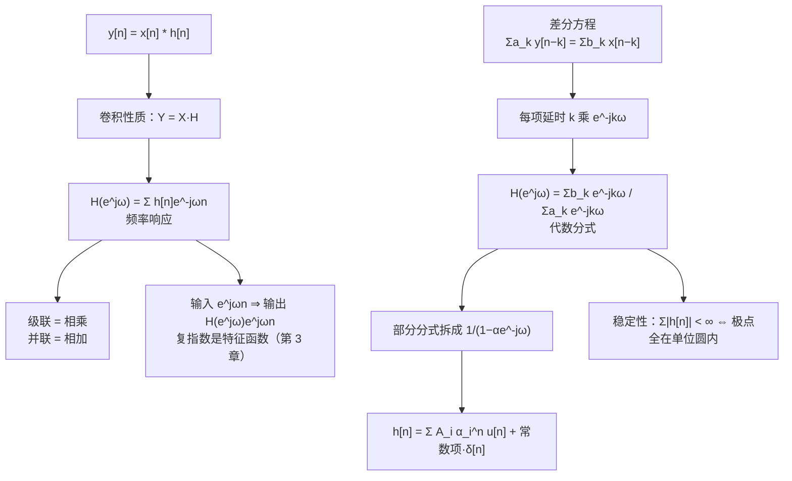

# 5.4 卷积性质与由差分方程表征的系统

> [!abstract] 这一讲的任务
> 性质表里最重要的一条在这里：**时域卷积 ⇔ 频域相乘**。它一句话就把"系统对信号做了什么"从卷积和里解放出来——只要知道 $H(e^{j\omega})$，任何输入的输出都是"逐频率乘一个数"。
> 有了它，第 2 章那个"给差分方程、求 $h[n]$"的苦活也换了算法：把 $\frac{d}{dt}$ 换成 $e^{j\omega}$ 的同类操作——**每一项延时 $k$ 就乘 $e^{-jk\omega}$**，差分方程立刻变成一个代数分式 $H(e^{j\omega})$；剩下的工作只是把它拆成几个 $a^nu[n]$。
> 这一讲的两块内容（§5.4 卷积性质、§5.8 由差分方程表征的系统）在教材里隔了三节，但它们是同一条链：**先有"频域相乘"，才有"把差分方程变成代数分式"**。

> [!info] 授课进度说明
> 第 12 节课只讲到 5.1，**本篇尚未在课堂上讲授**。内容按教材与通行讲法整理，暂不逐条区分"课堂讲过"与"拓展补充"；等后续转写稿覆盖到 5.4 / 5.8，再按与第 3、4 章相同的规则标注。

---

## 0. 开场：一段音频的 EQ，为什么可以只看一条曲线

给一段录音做"低切"（high-pass）：把 80 Hz 以下的低频砍掉。你在软件里做的事，本质上是让信号过一个系统，它的单位冲激响应长这样：

$$h[n]=\delta[n]-\alpha\delta[n-1]$$

（就是"当前样本减去上一个样本的一个比例"）。要问"这个滤波器对 1 kHz 的成分放大多少倍"，最笨的办法是把 $e^{j\omega_0 n}$ 代进卷积和，一项一项算：

$$y[n]=\sum_k h[k]e^{j\omega_0(n-k)}=e^{j\omega_0n}\sum_k h[k]e^{-j\omega_0 k}.$$

算完发现：输出就是输入乘上一个数——**这个数只跟频率有关，跟 $n$ 无关**。这个数就是频率响应 $H(e^{j\omega_0})$。

一旦接受"输出 = 输入 × 一个数"，整套做法就变了：不必对每个频率重算卷积，只要把 $H(e^{j\omega})$ 这条曲线画出来，**曲线高就是放大、低就是衰减**。而这条曲线可以由 $h[n]$ 一次算出，也可以由差分方程直接算出（不用先求 $h[n]$）。

这就是这一讲要建立的两条通道：

- **$h[n]\Rightarrow H(e^{j\omega})$**：定义式，卷积性质的左半边；
- **差分方程 $\Rightarrow H(e^{j\omega})$**：代数运算，§5.8 的内容。

两条通道在同一张图上汇合，这就是"用频域分析系统"的全部意思。

---

## 1. 卷积性质（p.32）

### 1.1 结论

> [!important] 卷积性质
> $$y[n]=x[n]*h[n]\ \xleftrightarrow{\ \text{DTFT}\ }\ Y(e^{j\omega})=X(e^{j\omega})\,H(e^{j\omega})$$
> 其中
> $$H(e^{j\omega})=\sum_{n=-\infty}^{+\infty}h[n]e^{-j\omega n}$$
> 叫系统的**频率响应** Frequency response。

### 1.2 证明：交换两个求和

$$Y(e^{j\omega})=\sum_{n=-\infty}^{+\infty}\left(\sum_{m=-\infty}^{+\infty}x[m]h[n-m]\right)e^{-j\omega n}.$$

把 $e^{-j\omega n}$ 拆成 $e^{-j\omega(n-m)}e^{-j\omega m}$，然后把内层求和换成对 $n-m$ 的求和：

$$=\sum_{m=-\infty}^{+\infty}x[m]e^{-j\omega m}\underbrace{\sum_{n=-\infty}^{+\infty}h[n-m]e^{-j\omega(n-m)}}_{=\,H(e^{j\omega})}=H(e^{j\omega})\sum_mx[m]e^{-j\omega m}=H(e^{j\omega})X(e^{j\omega}).$$

**关键只有一步**：把 $e^{-j\omega n}$ 拆成两半，一半配 $x$、一半配 $h$。`拆指数 + 换求和次序`，这就是卷积定理的全部技术。

> [!important] 这条性质到底省了什么
> 时域卷积是一个**双重求和**（每个输出样本都要遍历整条输入）；频域相乘只是**逐点相乘**。而且卷积的"长度相加"（$L_x+L_h-1$）在频域完全看不出来——频域只关心"每个频率被乘了几倍"。
> 第 3 章用"复指数是特征函数"讲过同一件事：$e^{j\omega n}$ 进系统只乘一个 $H(e^{j\omega})$，卷积性质就是把这个结论推广到任意输入（任意输入都是复指数的加权和）。

### 1.3 两条推论：级联与并联

| 互联方式 | 时域 | 频域 |
|---|---|---|
| 级联（串联） | $h_1*h_2$ | $H_1(e^{j\omega})H_2(e^{j\omega})$ |
| 并联 | $h_1+h_2$ | $H_1(e^{j\omega})+H_2(e^{j\omega})$ |

这两条来自卷积的交换律/结合律与线性，在第 2 章已经证过时域版本；频域版本只是把卷积换成乘法、把相加照抄。**滤波器设计中"两级串联"之所以能直接乘起来，靠的就是它。**

---

## 2. 例：累加 = 与 $u[n]$ 卷积（p.33）

$$\sum_{k=-\infty}^{n}x[k]=x[n]*u[n].$$

两边取变换，用卷积性质：

$$\sum_{k=-\infty}^{n}x[k]\ \xleftrightarrow{\ \text{DTFT}\ }\ X(e^{j\omega})\,U(e^{j\omega})=X(e^{j\omega})\left[\frac{1}{1-e^{-j\omega}}+\pi\sum_{k=-\infty}^{+\infty}\delta(\omega-2\pi k)\right]=\frac{X(e^{j\omega})}{1-e^{-j\omega}}+\pi X(e^{j0})\sum_k\delta(\omega-2\pi k).$$

最后一步用了"$\delta$ 与函数相乘 = 在冲激位置取值"这条冲激性质：$\pi X(e^{j\omega})$ 乘上 $\sum_k\delta(\omega-2\pi k)$，只剩 $\pi X(e^{j0})$ 这些系数。

> [!important] 与 5.3 节的累加性质完全一致
> 上一节直接从 $u[n]$ 的谱出发推出累加公式，这里从卷积性质出发推同样的结果——**两条路必须给出同一个式子**，这本身就是一次自洽性检验。
> 值得多看一眼的是那个 $X(e^{j0})$：它说明"累加会让直流分量变成斜坡"，而交流分量只是被 $\frac{1}{1-e^{-j\omega}}$ 加权。工程上的对应物是"积分器对直流偏置会饱和"。

---

## 3. 由差分方程求频率响应（p.48）

### 3.1 一般形式

一个由线性常系数差分方程 LCCDE 表征的离散 LTI 系统：

$$\sum_{k=0}^{N}a_ky[n-k]=\sum_{k=0}^{M}b_kx[n-k].$$

两边取 DTFT，用**时移性质**（$y[n-k]\leftrightarrow e^{-jk\omega}Y(e^{j\omega})$）：

$$Y(e^{j\omega})\sum_{k=0}^{N}a_ke^{-jk\omega}=X(e^{j\omega})\sum_{k=0}^{M}b_ke^{-jk\omega}.$$

> [!important] 由差分方程直接读出 $H$
> $$\boxed{\ H(e^{j\omega})=\frac{Y(e^{j\omega})}{X(e^{j\omega})}=\frac{\sum\limits_{k=0}^{M}b_ke^{-jk\omega}}{\sum\limits_{k=0}^{N}a_ke^{-jk\omega}}\ }$$
> 分子是输入的系数、分母是输出的系数，每一项带一个 $e^{-jk\omega}$。**看到方程就能写出 $H$，一步代数，不用卷积。**

> [!tip] 两条保证
> - **因果**：$a_0\ne0$ 且方程只含 $n-k$（$k\ge0$）时，$h[n]$ 在 $n<0$ 处为零——这正是 Direct Form 的实现条件；
> - **稳定**：$\sum_n|h[n]|<\infty$。在 $H$ 的分式形式下，这等价于**分母的所有根（极点）都在单位圆内**，即 $|z_i|<1$。
> 这两条与第 2 章 BIBO 的结论是同一个，只是换成了频域语言：**稳定 ⇔ 频率响应在单位圆上处处有限**。

### 3.2 方框图也是差分方程（p.49）

![[C5.4-方框图实现-频率响应.png]]

这个方框图里有两个延迟器、两个加法器和若干系数。**读图的规矩只有一条：每个加法器的输出都写成一个方程，然后逐个换成频域。**

两个节点的方程是（把 $W(e^{j\omega})$ 简写成 $W$）：

$$\begin{cases}W=X+\dfrac34We^{-j\omega}-\dfrac18We^{-j2\omega}\\[2mm]Y=X+2We^{-j\omega}-We^{-j2\omega}\end{cases}$$

第一个方程解出 $W$：

$$W\left(1-\frac34e^{-j\omega}+\frac18e^{-j2\omega}\right)=X\quad\Longrightarrow\quad W=\frac{X}{1-\frac34e^{-j\omega}+\frac18e^{-j2\omega}}.$$

代进第二个：

$$H=\frac{Y}{X}=1+\frac{2e^{-j\omega}-e^{-j2\omega}}{1-\frac34e^{-j\omega}+\frac18e^{-j2\omega}}=\frac{1+\frac54e^{-j\omega}-\frac78e^{-j2\omega}}{1-\frac34e^{-j\omega}+\frac18e^{-j2\omega}}.$$

### 3.3 把它变成 $h[n]$

把 $q=e^{-j\omega}$ 看成变量。分母可以分解：

$$1-\frac34q+\frac18q^2=\left(1-\frac12q\right)\left(1-\frac14q\right).$$

分子次数等于分母次数，先做**多项式除法**（首项系数比 $\frac{-7/8}{1/8}=-7$）：

$$H=-7+\frac{8-4q}{\left(1-\frac12q\right)\left(1-\frac14q\right)}=-7+\frac{8\left(1-\frac12q\right)}{\left(1-\frac12q\right)\left(1-\frac14q\right)}=-7+\frac{8}{1-\frac14q}.$$

> [!important] 注意这次抵消
> 分子里那个 $8-4q=8(1-\frac q2)$ 恰好和分母的一个因子**约掉**了。这对应"极点 $q=2$（即 $z=\frac12$）被零点抵消"，所以 $h[n]$ 里**没有** $\left(\frac12\right)^n$ 项。
> 方框图的零极点结构不是随意的：$H$ 化简之后只剩一个极点 $z=\frac14$，系统比图上看起来更简单。**做题时如果没做这一步就急着拆部分分式，会拆出一个系数为零的项，白算一遍。**

用查表 $\dfrac{1}{1-\alpha e^{-j\omega}}\leftrightarrow\alpha^nu[n]$，再把常数 $-7$ 对应到 $-7\delta[n]$：

$$\boxed{\ h[n]=-7\delta[n]+8\left(\frac14\right)^nu[n]\ }$$

核对：$H(e^{j0})=-7+8\cdot\frac{1}{1-1/4}=-7+\frac{32}{3}=\frac{11}{3}$；直接代 $q=1$ 进原式得 $\frac{1+5/4-7/8}{1-3/4+1/8}=\frac{11/8}{3/8}=\frac{11}{3}$ ✓。

---

## 4. 部分分式：三条规矩（p.50–52）

要把 $\frac{\sum b_ke^{-jk\omega}}{\sum a_ke^{-jk\omega}}$ 变成 $h[n]$，唯一通用的手段是**部分分式展开**，再对每一项查表。三种情形，规则不同。

> [!note] 记号说明
> 这三页沿用拉普拉斯变换的写法 $X(s)=\frac{N(s)}{D(s)}$，规则本身与变量无关；放到离散端，把 $s$ 换成 $z$（或直接换成 $q=e^{-j\omega}$）即可，查表用的是 $\frac{1}{1-\alpha z^{-1}}\leftrightarrow\alpha^nu[n]$。

### 4.1 真分式 + 一阶极点（$m<n$，极点两两不同）

$$X(s)=\frac{N(s)}{(s-p_1)(s-p_2)\cdots(s-p_n)}=\frac{k_1}{s-p_1}+\frac{k_2}{s-p_2}+\cdots+\frac{k_n}{s-p_n},$$

$$k_i=(s-p_i)X(s)\Big|_{s=p_i}.$$

这就是**遮盖法**：把 $(s-p_i)$ 乘回左边，再令 $s=p_i$，其余因子直接算数值。

### 4.2 真分式 + 重极点（$r$ 重）

$$X(s)=\frac{k_1}{(s-p_1)^r}+\frac{k_2}{(s-p_1)^{r-1}}+\cdots+\frac{k_r}{s-p_1}+\frac{k_{r+1}}{s-p_{r+1}}+\cdots,$$

$$k_i=\frac{1}{(i-1)!}\,\frac{d^{\,i-1}}{ds^{\,i-1}}\Big[(s-p_1)^rX(s)\Big]_{s=p_1},\qquad i=1,2,\dots,r.$$

重极点会在时域产生 $n^{r-1}\alpha^n$ 形式的项（第 2 章"重根乘 $n$"的同一个事实）。

### 4.3 非真分式（$m\ge n$）

先做多项式除法，把式子拆成"多项式 + 真分式"：

$$\frac{N(s)}{D(s)}=B_0+B_1s+\cdots+B_{m-n}s^{m-n}+\frac{N_1(s)}{D(s)},\qquad\frac{N_1(s)}{D(s)}\ \text{是真分式，按 4.1 / 4.2 处理}.$$

多项式部分在时域是**冲激及其导数**（连续端 $B_0\leftrightarrow B_0\delta(t)$、$B_1s\leftrightarrow B_1\delta'(t)$）；在离散端，常数项对应 $\delta[n]$，其余高次项在单位圆上对应 $\delta[n]$ 的差分。

> [!warning] 顺序不能颠倒
> **必须先判断是不是真分式**。像 §3.3 那个例子，不做除法直接写 $A/(1-\frac q2)+B/(1-\frac q4)$，会解出 $A+B$ 与常数项的方程对不上——因为分子分母次数相同，展开式里本来还有一个常数项 $-7$。
> 判据很简单：分子最高次 ≤ 分母最高次时，先除。

---

## 5. 随堂测（p.54–56）

### 5.1 随堂测 1（10 分）：两个方程、一个中间变量

> [!question] 题目
> 一个因果离散 LTI 系统由下面这对含中间变量 $w[n]$ 的差分方程描述：
> $$y[n]+\frac14y[n-1]+w[n]+\frac12w[n-1]=\frac23x[n],$$
> $$y[n]-\frac54y[n-1]+2w[n]-2w[n-1]=-\frac53x[n].$$
> (a) 求频率响应与单位冲激响应；(b) 求一个只含 $x[n]$、$y[n]$ 的差分方程。

**这题的关键是"把 $w$ 消掉"**，而不是急着对某一个方程做变换。取 DTFT，记 $q=e^{-j\omega}$：

$$\begin{cases}\left(1+\frac q4\right)Y+\left(1+\frac q2\right)W=\frac23X\\[1mm]\left(1-\frac{5q}4\right)Y+\left(2-2q\right)W=-\frac53X\end{cases}$$

两式消去 $W$：第一式乘 $(2-2q)$、第二式乘 $(1+\frac q2)$，相减。$Y$ 的系数是

$$\left(1+\frac q2\right)\left(1-\frac{5q}4\right)-\left(2-2q\right)\left(1+\frac q4\right)=\left(1-\frac{3q}4-\frac{5q^2}8\right)-\left(2-\frac{3q}2-\frac{q^2}2\right)=-1+\frac{3q}4-\frac{q^2}8,$$

也就是 $-\left(1-\frac{3q}4+\frac{q^2}8\right)$。右边是

$$-\frac53\left(1+\frac q2\right)-\frac23\left(2-2q\right)=-3+\frac q2=-\left(3-\frac q2\right).$$

于是

$$H(e^{j\omega})=\frac{Y}{X}=\frac{3-\frac q2}{1-\frac34q+\frac18q^2}.$$

分母分解为 $(1-\frac q2)(1-\frac q4)$，部分分式：

$$\frac{3-\frac q2}{\left(1-\frac q2\right)\left(1-\frac q4\right)}=\frac{4}{1-\frac q2}-\frac{1}{1-\frac q4}.$$

> [!important] 答案
> $$H(e^{j\omega})=\frac{3-\frac12e^{-j\omega}}{1-\frac34e^{-j\omega}+\frac18e^{-2j\omega}},\qquad h[n]=\left[4\left(\frac12\right)^n-\left(\frac14\right)^n\right]u[n]$$
> (b) 把 $H$ 的分母乘过去、分子展开：
> $$y[n]-\frac34y[n-1]+\frac18y[n-2]=3x[n]-\frac12x[n-1].$$

核对：$h[0]=4-1=3$；$H(e^{j0})=\frac{3-0.5}{(1-0.5)(1-0.25)}=\frac{5/2}{3/8}=\frac{20}{3}\approx6.667$，而 $\sum_nh[n]=4\cdot2-\frac43=\frac{20}{3}$ ✓（已复算）。

### 5.2 随堂测 2（10 分）：由 $h[n]$ 反推方程

> [!question] 题目
> 系统冲激响应为 $h[n]=\left(\frac12\right)^nu[n]+\frac12\left(\frac14\right)^nu[n]$，求联系输入输出的线性常系数差分方程。

先取变换：

$$H=\frac{1}{1-\frac q2}+\frac12\cdot\frac{1}{1-\frac q4}=\frac{\left(1-\frac q4\right)+\frac12\left(1-\frac q2\right)}{\left(1-\frac q2\right)\left(1-\frac q4\right)}=\frac{\frac32-\frac q2}{1-\frac34q+\frac18q^2}.$$

> [!important] 答案
> $$y[n]-\frac34y[n-1]+\frac18y[n-2]=\frac32x[n]-\frac12x[n-1]$$
> 注意 $h[n]$ 是两个指数之和，**分子是一个一阶多项式**而不是常数——"分母几次对应多少阶的反馈、分子几次对应多少阶的前馈"。

### 5.3 随堂测 3（10 分）：从方框图读出一切

> [!question] 题目
> 下图是一个因果 LTI 系统的方框图实现。
> (a) 写出联系 $x[n]$ 与 $y[n]$ 的差分方程；(b) 求频率响应；(c) 求冲激响应。

![[C5.4-方框图实现-随堂测.png]]

**读图**：两节结构相同，每节都是"一个加法器 + 一个延迟器"的反馈环，环的输出再经过加权送到下一级。

第一节（左）：设第一个加法器的输出为 $v[n]$，则

$$v[n]=x[n]+\frac13v[n-1],\qquad u[n]=v[n]-\frac12v[n-1].$$

第二节（右）：设它内部加法器的输出为 $z[n]$，则

$$z[n]=u[n]-\frac12z[n-1],\qquad y[n]=\frac14z[n]+z[n-1].$$

> [!tip] 读方框图的三步
> 1. **给每个加法器的输出起个名字**（这里是 $v$ 与 $z$）；
> 2. **沿反馈环写方程**：加法器输出 = 各输入之和，其中反馈支路带一个延迟 $z^{-1}$ 与一个系数；
> 3. **沿前馈支路写输出**：把经过缩放的各节点相加。
> 每一步都只是"加法"和"延时乘 $e^{-j\omega}$"，没有别的机关。

**频域**：把两节各自的传递函数乘起来，

$$H=\underbrace{\frac{1-\frac q2}{1-\frac q3}}_{\text{第一节}}\cdot\underbrace{\frac{\frac14+q}{1+\frac q2}}_{\text{第二节}}=\frac{\left(1-\frac q2\right)\left(\frac14+q\right)}{\left(1-\frac q3\right)\left(1+\frac q2\right)}=\frac{\frac14+\frac78q-\frac12q^2}{1+\frac16q-\frac16q^2}.$$

**差分方程**（把分母乘过去）：

$$y[n]+\frac16y[n-1]-\frac16y[n-2]=\frac14x[n]+\frac78x[n-1]-\frac12x[n-2].$$

**冲激响应**：分母次数 = 分子次数，先做除法（首项比 $\frac{-1/2}{-1/6}=3$）：

$$H=3+\frac{-\frac{11}4+\frac38q}{\left(1-\frac q3\right)\left(1+\frac q2\right)}=3-\frac{13/20}{1-\frac q3}-\frac{21/10}{1+\frac q2}.$$

> [!important] 答案
> $$H(e^{j\omega})=3-\frac{13}{20}\cdot\frac{1}{1-\frac13e^{-j\omega}}-\frac{21}{10}\cdot\frac{1}{1+\frac12e^{-j\omega}}$$
> $$h[n]=3\delta[n]-\frac{13}{20}\left(\frac13\right)^nu[n]-\frac{21}{10}\left(-\frac12\right)^nu[n]$$

核对：$h[0]=3-\frac{13}{20}-\frac{21}{10}=3-0.65-2.1=0.25$；而 $H(e^{j0})=\frac{(1-1/2)(1/4+1)}{(1-1/3)(1+1/2)}=\frac{0.5\times1.25}{(2/3)\times1.5}=0.625$，$\sum_nh[n]=3-\frac{13/20}{2/3}-\frac{21/10}{3/2}=3-0.975-1.4=0.625$ ✓（已用逐点模拟复核，$h[0..5]$ 完全一致）。

> [!warning] 三个极点的位置值得看一眼
> 分母 $1+\frac16q-\frac16q^2=0$ 给出 $q=3$ 与 $q=-2$，换成 $z=1/q$ 就是 $z=\frac13$ 与 $z=-\frac12$——**都在单位圆内**，所以系统稳定。
> 如果某一题的极点跑到单位圆外（$|z|>1$），那它就不是稳定系统，题目一般会明确写"因果且稳定"来排除这一支。

---

## 这一讲的三句话

1. **卷积性质把系统变成乘法**：$y=x*h\Leftrightarrow Y=XH$，证明只用"拆指数 + 换求和次序"；级联相乘、并联相加，都由此而来。
2. **差分方程可以直接读出 $H$**：$\sum a_ky[n-k]=\sum b_kx[n-k]$ ⇒ $H=\frac{\sum b_ke^{-jk\omega}}{\sum a_ke^{-jk\omega}}$；方框图和方程是同一件事的两种写法。
3. **$h[n]$ 由部分分式给出**：先判真分式（非真先做除法），再按一阶/重极点拆，最后查 $\frac{1}{1-\alpha e^{-j\omega}}\leftrightarrow\alpha^nu[n]$；极点位置同时回答稳定性。

> [!tip] 速查表
> | 对象 | 结论 |
> |---|---|
> | 卷积 | $y=x*h\ \Leftrightarrow\ Y(e^{j\omega})=X(e^{j\omega})H(e^{j\omega})$ |
> | 频率响应 | $H(e^{j\omega})=\sum_nh[n]e^{-j\omega n}$ |
> | 级联 / 并联 | $H_1H_2$ / $H_1+H_2$ |
> | 差分方程 → $H$ | $H=\dfrac{\sum_{k=0}^{M}b_ke^{-jk\omega}}{\sum_{k=0}^{N}a_ke^{-jk\omega}}$ |
> | 基本变换对 | $\delta[n]\leftrightarrow1$；$a^nu[n]\leftrightarrow\frac{1}{1-ae^{-j\omega}}$；$u[n]\leftrightarrow\frac{1}{1-e^{-j\omega}}+\pi\sum_k\delta(\omega-2\pi k)$ |
> | 稳定性 | $\sum_n\lvert h[n]\rvert<\infty$ ⇔ 极点全部在单位圆内 |
> | 部分分式 | 一阶：遮盖法 $k_i=(s-p_i)X|_{s=p_i}$；$\ r$ 重：求 $r-1$ 阶导；非真：先做多项式除法 |

> [!tip] 下一讲预告
> 卷积性质管的是"**时域卷积 ⇔ 频域相乘**"。把所有箭头反过来，就得到这一章的最后一块拼图：**时域相乘 ⇔ 频域卷积**。
> 这就是 5.5 节的相乘性质，它的两个直接产物是**调制**（乘一个正弦＝把谱搬走）和 **$(-1)^n$ 的作用**（把低通变高通）。剩下 5.7 节再做一次总收束：**DTFS、DTFT、CTFS、CTFT 四者之间的对偶关系**。

---

## 相关笔记 Related Notes

- 相关：[[C5.3 离散时间傅里叶变换的性质]]（累加性质与本篇 §2 是同一件事）、[[C4.4 卷积性质与由微分方程表征的系统]]（连续端的同一条链）、[[C2.6 LTI系统的方框图表示]]（Direct Form I / II 的画法）、[[C3.6 傅里叶级数与LTI系统、滤波]]（特征函数与 $b_k=a_kH$）

- 上一讲：[[C5.3 离散时间傅里叶变换的性质]]
- 下一讲：[[C5.5 相乘性质、对偶性与变换表]]
- 返回：[[信号与系统 MOC]]
