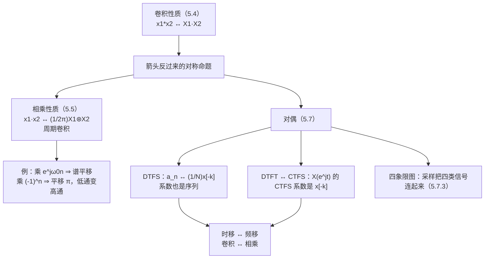

# 5.5 相乘性质、对偶性与变换表

> [!abstract] 这一讲的任务
> 把卷积性质的所有箭头反过来，就得到**相乘性质**：时域两块信号相乘，频域是两条谱做**周期卷积**。它在工程上的名字叫**调制**——乘一个正弦，就是把整条谱搬走；乘 $(-1)^n$，就是把低通搬成高通。
> 剩下的篇幅交给"**对偶**"。这是本课程最漂亮的一处结构：DTFS 与 DTFT 互为对偶（系数序列本身就是信号、信号本身就是系数），CTFS 与 DTFT 也互为对偶（周期函数与序列互为对方的系数）。四类信号（连续/离散 × 周期/非周期）被"采样"和"对偶"两张网连成一个四方格。
> 这一讲也是第 5 章的收尾：变换表（5.6 节）把所有结论压成两页纸，后面第 6–7 章要反复查它。

> [!info] 授课进度说明
> 第 12 节课只讲到 5.1，**本篇尚未在课堂上讲授**。内容按教材与通行讲法整理，暂不逐条区分"课堂讲过"与"拓展补充"；等后续转写稿覆盖到 5.5–5.7，再按与第 3、4 章相同的规则标注。

---

## 0. 开场：为什么"乘一个正弦"能搬动频谱

收音机的中波段从 531 kHz 开始，而你手里的音频信号只到 20 kHz。要让这段音频上车，必须把它搬到高频——工程上就是**把音频乘上一个几百千赫的正弦**。

第 4 章已经算过这个动作的结果：乘余弦 ⇒ 频谱一分为二、分别搬到 $\pm\omega_c$。当时用的是连续端的相乘性质。这一节在离散端把它重做一遍，并且留意一个新增的细节：**离散端的"卷积"必须在 $2\pi$ 里绕回来做**，因为两条谱都是 $2\pi$ 周期的。

第二个问题是理论上的。前面反复用到"$a_k$ 是 DTFS 系数、$X(e^{j\omega})$ 是 DTFT"，现在把它们**互换角色**：

- 把一个周期序列的系数 $a_k$ 看成"一个以 $N$ 为周期的序列"，它自己的 DTFS 系数是什么？
- 把一个 DTFT 谱 $X(e^{j\omega})$ 看成"以 $2\pi$ 为周期的连续函数"，它的 CTFS 系数是什么？

答案会让人发现：**信号与系数互为对方的变换**。这就是对偶，也是"为什么四类信号的公式长得那么对称"的根源。

---

## 1. 相乘性质（p.34）

### 1.1 结论：频域做的是周期卷积

> [!important] 相乘性质
> $$y[n]=x_1[n]\,x_2[n]\ \xleftrightarrow{\ \text{DTFT}\ }\ Y(e^{j\omega})=\frac1{2\pi}\int_{2\pi}X_1(e^{j\theta})X_2\big(e^{j(\omega-\theta)}\big)d\theta=\frac1{2\pi}X_1(e^{j\omega})\circledast X_2(e^{j\omega})$$
> 右边这个运算叫**周期卷积**（periodic convolution）：把 $X_2$ 平移 $\theta$、与 $X_1$ 相乘、在一个 $2\pi$ 上积分，再除以 $2\pi$。

### 1.2 证明

把 $x_1[n]$ 用反变换写开，再交换求和与积分：

$$Y(e^{j\omega})=\sum_{n=-\infty}^{+\infty}x_1[n]x_2[n]e^{-j\omega n}=\sum_n\left(\frac1{2\pi}\int_{2\pi}X_1(e^{j\theta})e^{j\theta n}d\theta\right)x_2[n]e^{-j\omega n}.$$

括号里那个积分与 $n$ 无关，可以提到求和外面：

$$=\frac1{2\pi}\int_{2\pi}X_1(e^{j\theta})\left(\sum_nx_2[n]e^{-j(\omega-\theta)n}\right)d\theta=\frac1{2\pi}\int_{2\pi}X_1(e^{j\theta})X_2\big(e^{j(\omega-\theta)}\big)d\theta.$$

**与卷积性质的证明完全对称**：那边是"拆指数、交换求和"，这边是"交换求和与积分"。两边的差别只在"一个用 $e^{-j\omega n}$ 拆、一个用 $e^{j\theta n}$ 配"。

> [!warning] 为什么这里是"周期卷积"而不是普通卷积
> 普通卷积的积分限是 $(-\infty,+\infty)$，因为被卷积的两条谱在整条轴上都有定义。可离散端的谱**只在 $\omega$ 的一个 $2\pi$ 周期内有独立信息**，所以：
> - 积分只取一个 $2\pi$（取哪个都行，因为被积函数是 $2\pi$ 周期的）；
> - 平移 $\omega-\theta$ 会自动"绕回"周期里，所以结果仍是 $2\pi$ 周期的。
> 这就是"$\circledast$"与"$*$"的区别：**周期卷积在圆周上做，普通卷积在直线上做。**

### 1.3 例：$(-1)^n$ 把低通变高通（p.35）

$$c[n]=(-1)^n=e^{j\pi n}\ \xleftrightarrow{\ \text{DTFT}\ }\ C(e^{j\omega})=2\pi\sum_{k=-\infty}^{+\infty}\delta(\omega-\pi-2\pi k).$$

（5.2 节的直接应用：$c[n]=(-1)^n$ 的周期 $N=2$、$\omega_0=\pi$；它的 DTFS 只有一个非零系数 $a_1=1$（$k$ 奇数时 $a_k=\frac12[1-(-1)^k]$ 得 1，偶数时为 0），于是面积 $2\pi$ 的冲激落在 $\omega=\pi$ 上，再每 $2\pi$ 复制一份。）

![[C5.5-取反调制.png]]

$$Y(e^{j\omega})=\frac1{2\pi}\int_{2\pi}X(e^{j\theta})\,C\big(e^{j(\omega-\theta)}\big)\,d\theta=\frac1{2\pi}\int_{2\pi}X(e^{j\theta})\,2\pi\sum_k\delta(\omega-\theta-\pi-2\pi k)\,d\theta.$$

冲激只在 $\theta=\omega-\pi-2\pi k$ 处抽出被积函数的值，而 $X$ 本身以 $2\pi$ 为周期（沿 $k$ 取值完全相同），所以

$$Y(e^{j\omega})=\sum_kX\big(e^{j(\omega-\pi-2\pi k)}\big)=X\big(e^{j(\omega-\pi)}\big).$$

> [!important] 一个信号的两种读法
> 乘 $(-1)^n$ 等价于**把整条谱平移 $\pi$**：
> - 低通滤波器乘上 $(-1)^n$ 就变成高通（左图三角在 $0$ 附近，右图两座三角跑到 $\pm\pi$）；
> - 反过来，如果设计了一个低通、却想要高通，最省事的办法就是**给系数隔一个变一次号**——这就是滤波器设计中"频谱反转（spectral reversal）"的由来。
> 同一个事实还有第三种说法：$e^{j\omega n}\cdot(-1)^n=e^{j(\omega+\pi)n}$——乘 $(-1)^n$ 就是给**每个**频率成分都加上 $\pi$ 的相位，谱当然整体平移 $\pi$；而 $(-1)^n$ 正是第 1 章说的"离散时间最高频"。

> [!tip] 一般的调制公式
> 乘 $\cos\omega_0n=\frac12(e^{j\omega_0n}+e^{-j\omega_0n})$，用线性 + 频移：
> $$x[n]\cos\omega_0n\ \longleftrightarrow\ \frac12X\big(e^{j(\omega-\omega_0)}\big)+\frac12X\big(e^{j(\omega+\omega_0)}\big).$$
> 音频"上变频"、通信里的"混频"、雷达的"脉冲压缩"，做的都是这件事。离散端要额外记住：搬移之后谱**仍然 $2\pi$ 周期**，所以搬到 $-\pi$ 以外的那部分会从 $+\pi$ 绕回来——想要干净，就必须先限带（第 7 章）。

---

## 2. 变换表（p.36–37，Table 5.1 / 5.2）

### 2.1 性质表（Table 5.1 摘要）

| 性质 | 时域 | 频域 |
|---|---|---|
| 线性 | $ax_1+bx_2$ | $aX_1+bX_2$ |
| 时移 | $x[n-n_0]$ | $e^{-j\omega n_0}X(e^{j\omega})$ |
| 频移 | $e^{j\omega_0n}x[n]$ | $X(e^{j(\omega-\omega_0)})$ |
| 共轭 / 反转 | $x^*[n]$ / $x[-n]$ | $X^*(e^{-j\omega})$ / $X(e^{-j\omega})$ |
| 内插 | $x_{(k)}[n]$ | $X(e^{jk\omega})$ |
| 差分 | $x[n]-x[n-1]$ | $(1-e^{-j\omega})X$ |
| 累加 | $\sum_{k\le n}x[k]$ | $\frac{X}{1-e^{-j\omega}}+\pi X(e^{j0})\sum_k\delta(\omega-2\pi k)$ |
| 卷积 | $x_1*x_2$ | $X_1X_2$ |
| **相乘** | $x_1x_2$ | $\frac1{2\pi}X_1\circledast X_2$ |
| 频域微分 | $nx[n]$ | $j\frac{dX}{d\omega}$ |
| 帕塞瓦尔 | $\sum_n\lvert x\rvert^2$ | $\frac1{2\pi}\int_{2\pi}\lvert X\rvert^2d\omega$ |
| 实信号 | $x$ 实 | $X(e^{-j\omega})=X^*(e^{j\omega})$：幅度偶、相位奇 |
| 实且偶 / 实且奇 | | 实且偶 / 纯虚且奇 |

### 2.2 变换对（Table 5.2 摘要）

| 信号 | DTFT |
|---|---|
| $\delta[n]$ / $\delta[n-n_0]$ | $1$ / $e^{-j\omega n_0}$ |
| $1$ | $2\pi\sum\limits_l\delta(\omega-2\pi l)$ |
| $a^nu[n]$（$\lvert a\rvert<1$） | $\frac{1}{1-ae^{-j\omega}}$ |
| $(n+1)a^nu[n]$（$\lvert a\rvert<1$） | $\frac{1}{(1-ae^{-j\omega})^2}$ |
| $\frac{(n+r-1)!}{n!(r-1)!}a^nu[n]$ | $\frac{1}{(1-ae^{-j\omega})^r}$ |
| $u[n]$ | $\frac{1}{1-e^{-j\omega}}+\pi\sum\limits_l\delta(\omega-2\pi l)$ |
| $\delta[n-kN]$ 的周期延拓（周期 $N$） | $\frac{2\pi}{N}\sum\limits_k\delta\!\left(\omega-\frac{2\pi}{N}k\right)$ |
| 矩形 $\lvert n\rvert\le N_1$ | $\frac{\sin[\omega(N_1+\frac12)]}{\sin(\omega/2)}$ |
| $\frac{\sin Wn}{\pi n}$（$0<W<\pi$） | $1$（$\lvert\omega\rvert<W$），$0$（$W<\lvert\omega\rvert\le\pi$），再按 $2\pi$ 复制 |
| $x[n]=\cos\omega_0n$（$\frac{\omega_0}{2\pi}$ 有理） | $\pi\sum\limits_l[\delta(\omega-\omega_0-2\pi l)+\delta(\omega+\omega_0-2\pi l)]$ |

> [!note] 表怎么用
> 这张表与第 4 章的 Table 4.1/4.2 是对应的：凡是那里出现 $\int$ 的地方，这里换成 $\sum$；凡是那里出现 $2\pi\delta$ 的地方，这里换成"$2\pi$ 间隔的 $\delta$ 串"。**背的时候成对背，比单独背离散端省一半力。**

---

## 3. DTFS 的对偶：系数序列也是序列（p.41–43）

### 3.1 推法

DTFS 的分析式是

$$a_k=\frac1N\sum_{n=\langle N\rangle}x[n]\,e^{-jk\frac{2\pi}{N}n}.$$

注意 $a_k$ 本身**以 $N$ 为周期**——它也是一个周期序列，所以它可以再被当成信号展开。做两步换元：先 $n\to-n$（在一个周期上换元不改变和），再把 $k$ 与 $n$ 的角色对调：

$$a_k=\frac1N\sum_{n=\langle N\rangle}x[-n]e^{jk\frac{2\pi}{N}n}\quad\xrightarrow{\ k\leftrightarrow n\ }\quad a_n=\sum_{k=\langle N\rangle}\frac1Nx[-k]\,e^{jn\frac{2\pi}{N}k}.$$

右边正好是一个 DTFS 的综合式：基底 $e^{jn\frac{2\pi}{N}k}$，系数 $\frac1Nx[-k]$。

> [!important] DTFS 的对偶
> $$\boxed{\ x[n]\ \xleftrightarrow{\ \text{DTFS}\ }\ a_k\qquad\Longleftrightarrow\qquad a_n\ \xleftrightarrow{\ \text{DTFS}\ }\ \frac1Nx[-k]\ }$$
> 把"系数"当信号、把"信号"当系数，变换对仍然成立，只需在一边补一个 $\frac1N$ 与一个时间反转。

### 3.2 用对偶"生成"性质（p.42–43）

对偶最实用的地方是：**已知一条性质，就免费得到另一条。**

| 已知 | 由对偶得到 |
|---|---|
| 时移：$x[n-n_0]\leftrightarrow a_ke^{-jk\frac{2\pi}{N}n_0}$ | 频移：$x[n]e^{jM\frac{2\pi}{N}n}\leftrightarrow a_{k-M}$ |
| 反转：$x[-n]\leftrightarrow a_{-k}$ | （同一动作，自对偶） |
| 卷积：$x_1*x_2\leftrightarrow N a_kb_k$ | 相乘：$x_1x_2\leftrightarrow a_k\circledast b_k=\sum_{m=\langle N\rangle}a_mb_{k-m}$ |

- **时移 ↔ 频移**的推导：把时移性质的 $x$ 换成 $a$、$a$ 换成 $\frac1Nx[-k]$，就得到 $a_n$ 的"时移"性质，再翻译回 $x$ 就是频移。p.42 上那两行红色箭头写的正是这个对换；
- **卷积 ↔ 相乘**：卷积性质说"时域卷积 ⇒ 系数相乘并乘 $N$"；对偶之后变成"时域相乘 ⇒ 系数做周期卷积"。

> [!warning] 系数卷积要在一个周期内绕回来
> $\sum_{m=\langle N\rangle}a_mb_{k-m}$ 的下标是模 $N$ 的：$b$ 的下标一旦越出 $0\sim N-1$，就用 $b_{k+N}=b_k$ 绕回来。这和相邻的"频域周期卷积"是同一件事的两个层次：**在系数（离散）上绕，在频谱（连续）上积一个 $2\pi$。**

---

## 4. DTFT 与 CTFS 的对偶（p.44–47）

### 4.1 把谱当成信号

DTFT 的两条式子摆在一起看：

$$X(e^{j\omega})=\sum_{n=-\infty}^{+\infty}x[n]e^{-j\omega n},\qquad x[n]=\frac1{2\pi}\int_{2\pi}X(e^{j\omega})e^{j\omega n}d\omega.$$

第一条说：$X(e^{j\omega})$ 是 $\omega$ 的**周期函数**（周期 $2\pi$）。第二条的积分恰好是"在一个周期上积分再除以周期"——这就是 **CTFS 的分析式**（周期 $T=2\pi$，基频 $\omega_0=\frac{2\pi}{T}=1$）。

于是把 $X(e^{j\omega})$ 里的 $\omega$ 换成连续时间变量 $t$，得到一个以 $2\pi$ 为周期的连续函数 $X(e^{jt})$，它的 CTFS 系数是

$$a_k=\frac1{2\pi}\int_{2\pi}X(e^{jt})e^{-jkt}dt=x[-k].$$

（最后一步就是第二条式子的 $n\to-k$。）

> [!important] DTFT 与 CTFS 的对偶
> $$\boxed{\ x[n]\ \xleftrightarrow{\ \text{DTFT}\ }\ X(e^{j\omega})\qquad\Longleftrightarrow\qquad X(e^{jt})\ \xleftrightarrow{\ \text{CTFS}\ }\ x[-k]\ }$$
> 一个序列的 DTFT，就是"把这个序列当作 CTFS 系数"拼出来的连续周期函数；反过来，一个连续周期函数的 CTFS 系数，就是一个离散序列。

### 4.2 同样靠对偶生成两条性质（p.45–46）

**例 1：时域微分 → 频域微分。** 已知 CTFS 的微分性质 $x'(t)\leftrightarrow j\frac{2\pi}{T}ka_k$，对 $X(e^{jt})$ 用一次（此时 $T=2\pi$，$\frac{2\pi}{T}=1$）：

$$\frac{d}{dt}X(e^{jt})\ \longleftrightarrow\ jk\,x[-k].$$

再按对偶翻译回 DTFT：左边对 $t$ 求导对应右边乘 $j\omega$，左边的"系数 $x[-k]$"顺次对应信号 $x[n]$，取反号并整理就得到**频域微分**：

$$-jn\,x[n]\ \longleftrightarrow\ \frac{d}{d\omega}X(e^{j\omega})\quad\Longleftrightarrow\quad n\,x[n]\ \longleftrightarrow\ j\frac{dX(e^{j\omega})}{d\omega}.$$

**例 2：卷积 → 相乘。** CTFS 的卷积性质是 $x_1*x_2\leftrightarrow T a_kb_k$。对 $X_1(e^{jt})$、$X_2(e^{jt})$ 用一次（$T=2\pi$）：

$$X_1(e^{jt})*X_2(e^{jt})\ \longleftrightarrow\ 2\pi\,x_1[-k]x_2[-k].$$

对偶翻译回 DTFT：左边"周期卷积"对应"时域相乘"、右边"系数相乘"对应"谱的周期卷积"，于是

$$2\pi\,x_1[n]x_2[n]\ \longleftrightarrow\ X_1(e^{j\omega})\circledast X_2(e^{j\omega})\quad\Longleftrightarrow\quad x_1x_2\ \longleftrightarrow\ \frac1{2\pi}X_1\circledast X_2.$$

**这两条正是 §1 与 5.3 节 §8 的结论。** 也就是说：这两条性质不需要重新证明，它们是 CTFS 那两条性质在对偶下的镜像。

> [!tip] 对偶为什么值得单独讲一节课
> 因为它是"**记不住时的备用通道**"。四条卷积/相乘性质、四条时移/频移/微分性质，实际只有一半是独立的；剩下的一半靠对偶免费拿到。
> 考试里若想不起来"乘 $n$ 对应什么"，可以从 CTFS 的微分性质出发，按对偶翻过去——**比硬背可靠。**

---

## 5. 四象限图：采样与对偶把四类信号连成一张网（p.53）

![[C5.5-四种信号的采样与对偶.png]]

四个方格分别是四类信号及其变换：

| 方格 | 信号 | 变换 | 谱的形态 |
|---|---|---|---|
| 左上 | 连续 + 周期 $\tilde x(t)$ | CTFS $a_k$ | 离散谱线 |
| 右上 | 离散 + 周期 $\tilde x[n]$ | DTFS $a_k$ | 离散谱线（$N$ 根） |
| 左下 | 连续 + 非周期 $x(t)$ | CTFT $X(j\omega)$ | 连续曲线 |
| 右下 | 离散 + 非周期 $x[n]$ | DTFT $X(e^{j\omega})$ | 连续曲线（$2\pi$ 周期） |

两条横向的红箭头是"**时域采样**"：把连续信号抽样成序列，谱就按 $\omega_s$ **周期化**。两条纵向的黑箭头是"**频域采样**"：

$$a_k=\frac1T X\!\left(k\frac{2\pi}{T}\right)\quad(\text{连续端}),\qquad a_k=\frac1N X\!\left(k\frac{2\pi}{N}\right)\quad(\text{离散端}).$$

**时域周期化 ⇒ 频域离散化；时域离散化 ⇒ 频域周期化。** 两个方向的动作互为镜像，这正是"对偶"这个词在这张图上的具体含义：

- 横着看：采样（离散化）把谱复制成周期；
- 竖着看：周期化（取周期延拓）把谱采样成离散；
- 斜着看：左上与右下、右上与左下互为对偶——一个的"信号"是另一个的"系数"。

> [!important] 这张图就是第 1 章"四种信号分类"的频域完整版
> 第 1 章按"连续/离散 × 周期/非周期"分了四类信号，当时只讲了时域特征；现在每一类都有了配套的变换工具，而且四者之间的关系由两个动作（采样、周期化）与一个对称（对偶）完整确定。
> 后面第 7 章采样定理要做的，就是把"时域采样 ⇒ 频域周期化"这条箭头算精确：**周期化之后的谱副本不能重叠，就得到 $\omega_s>2\omega_M$。**

---

## 这一讲的三句话

1. **相乘性质是卷积性质的镜像**：$x_1x_2\leftrightarrow\frac1{2\pi}X_1\circledast X_2$，右边在**一个 $2\pi$** 上做周期卷积；它的两个常用特例是"乘 $e^{j\omega_0n}$ 搬谱"与"乘 $(-1)^n$ 搬 $\pi$（低通变高通）"。
2. **DTFS 里信号与系数互为对方的变换**：$x[n]\leftrightarrow a_k$ 与 $a_n\leftrightarrow\frac1Nx[-k]$ 同时成立；时移与频移、卷积与相乘就是这条对偶下的镜像对。
3. **DTFT 与 CTFS 是对偶的**：$X(e^{j\omega})$ 本身是以 $2\pi$ 为周期的连续函数，它的 CTFS 系数是 $x[-k]$；四类信号由"采样""周期化""对偶"三样东西连成一个四方格。

> [!tip] 速查表
> | 动作 | 频域 |
> |---|---|
> | $x_1[n]x_2[n]$ | $\frac1{2\pi}\int_{2\pi}X_1(e^{j\theta})X_2(e^{j(\omega-\theta)})d\theta$（周期卷积） |
> | $x[n]\cos\omega_0n$ | $\frac12X(e^{j(\omega-\omega_0)})+\frac12X(e^{j(\omega+\omega_0)})$ |
> | $(-1)^nx[n]$ | $X(e^{j(\omega-\pi)})$（谱平移 $\pi$） |
> | DTFS 对偶 | $a_n\leftrightarrow\frac1Nx[-k]$ |
> | 由对偶生成 | 时移↔频移、卷积↔相乘、微分↔（-jn） |
> | 频域采样 | $a_k=\frac1NX(k\frac{2\pi}{N})$（离散）、$\frac1TX(k\frac{2\pi}{T})$（连续） |
> | 时域采样 | 谱以 $\omega_s$ 周期化（第 7 章） |

> [!tip] 下一讲预告
> 第 5 章到此结束：非周期有了 DTFT，周期有了冲激谱，性质表与对偶把四类信号织成一张网。
> 第 6 章换个问法：**给了系统函数 $H(e^{j\omega})$，怎么从频率上判断这个系统"干什么"**——滤波器的通带、阻带、相位、群延迟，以及理想滤波器为什么做不出来。那时会发现，本章的性质表就是唯一的手柄。

---

## 相关笔记 Related Notes

- 相关：[[C5.4 卷积性质与由差分方程表征的系统]]（本节把它的箭头全部反过来）、[[C5.2 周期信号的傅里叶变换]]（$(-1)^n$ 与冲激串的谱）、[[C4.5 相乘性质与调制]]（连续端的调制与解调）、[[C3.4 连续时间傅里叶级数的性质]]（CTFS 的微分与卷积性质，本节对偶的出发点）

- 上一讲：[[C5.4 卷积性质与由差分方程表征的系统]]
- 下一讲：[[信号与系统 MOC]]（第 6 章尚未建篇）
- 返回：[[信号与系统 MOC]]
