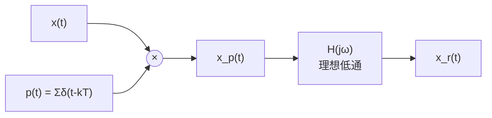

# 7.3 从样本重建信号：内插与保持

> [!abstract] 这一讲的任务
> 采样定理保证了"样本里含着全部信息"，但它没告诉你 **怎么把曲线画回来**。
> 这一节给出那个做法，而且它的形式漂亮得让人意外：把每个样本乘上一个 $\dfrac{\sin x}{x}$ 形状的疙瘩、再全部加起来。之所以能还原，是因为这些疙瘩在 **别的样本点** 上恰好都等于零——加出来的曲线被强行钉在每一个样本上。
> 然后再看工程里的两个廉价版本：**零阶保持**（台阶）与 **一阶保持**（折线）。它们都做不到"完美"，代价可以精确算出来：频率越高，输出越"塌"。

> [!info] 授课进度说明
> 第 7 章的课堂录音尚未拿到（`transcript/` 目前到第 14 节课、第 8 章为止）。本篇按原稿与教材整理，**不逐条标注「拓展」**；等录音到位后再回来核对。

---

## 恢复的本质：把样本串送回一个低通

先把上一节的结论搬到系统框图上。采样→恢复是这么一条链：

$x_r(t)$ 是 $x_p(t)$ 经过 $H(j\omega)$ 的输出。既然 $x_p$ 就是"原谱 + 一堆搬走的副本"，那么 $H$ 的任务只有两个：**保留正本、掐掉副本**。

$$H(j\omega)=\begin{cases}T, & \lvert\omega\rvert<\omega_c\\[2pt] 0, & \lvert\omega\rvert>\omega_c\end{cases},\qquad \omega_M<\omega_c<\omega_s-\omega_M$$

三处细节，每一处都是考点：

**为什么截止频率是那个区间？** 上方要够高——低通必须完整放出正本，所以 $\omega_c>\omega_M$。下方要够低——不能放进最近的副本，副本从 $\omega_s-\omega_M$ 开始，所以 $\omega_c<\omega_s-\omega_M$。这个区间存在的前提正是 $\omega_s>2\omega_M$：**采样定理不够，连滤波器都设计不出来**。

**为什么增益是 $T$ 而不是 1？** 因为采样时谱被压低了 $T$ 倍（$X_p$ 的每份是 $\frac1T X$）。所以

$$X_r(j\omega)=X_p(j\omega)H(j\omega)=\frac{1}{T}X(j\omega)\cdot T=X(j\omega)$$

这个"除以 $T$、再乘回 $T$"的配对，是整条链能完美复原的关键。忘了那个 $T$，重建出来的信号幅度就小 $T$ 倍。

**为什么"理想"？** 因为 $H$ 有垂直的边。实际滤波器做不到，所以真实系统里恢复出来的信号总带一点过渡带的痕迹——这是"理想内插"只存在于纸面的根本原因。

---

## 理想内插：每个样本扛一个 sinc

把 $H$ 变回时域，看看这个低通的冲激响应是什么形状。矩形的反变换是 $\dfrac{\sin x}{x}$：

$$h(t)=\frac{T\omega_c}{\pi}\cdot\frac{\sin\omega_ct}{\omega_ct}=T\cdot\frac{\sin\omega_ct}{\pi t}$$

因为 $x_r=x_p*h$，而 $x_p$ 是一串冲激，与冲激卷积就是 **平移**：

$$x_r(t)=\sum_{n=-\infty}^{\infty}x(nT)\,h(t-nT)=\sum_{n=-\infty}^{\infty}x(nT)\cdot\frac{T\omega_c}{\pi}\cdot\frac{\sin\omega_c(t-nT)}{\omega_c(t-nT)}$$

取最常用的 $\omega_c=\dfrac{\omega_s}{2}=\dfrac{\pi}{T}$，$h$ 就化成标准形状：

$$h(t)=\frac{\sin(\pi t/T)}{\pi t/T},\qquad \boxed{\;x_r(t)=\sum_{n=-\infty}^{\infty}x(nT)\,\frac{\sin\omega_c(t-nT)}{\omega_c(t-nT)}\;}$$

![[C7.3-三种内插函数.png]]

左图黑线就是这个函数。**注意它的零点位置**：在 $t=\pm T,\pm2T,\dots$ 处（即除 0 以外的每个采样时刻）它恰好为零。

> [!important] 为什么这样加出来的曲线一定穿过每一个样本
> 设要算 $t=mT$ 处的值。求和式里第 $n$ 项是 $x(nT)\cdot h\big((m-n)T\big)$。
> - $n=m$ 时 $h(0)=1$，贡献 $x(mT)$；
> - $n\ne m$ 时 $(m-n)T$ 是 $T$ 的非零整数倍，正好是 $h$ 的零点，贡献 $0$。
>
> 所以 $x_r(mT)=x(mT)$，一个不差。这叫 **内插 Interpolation**：用一组平移的基函数把离散点连成连续曲线，系数就是样本值。

**内插 Interpolation** 这个名字值得拆开：**inter**（在……之间）+ **polate**（填）。就是在样本与样本之间填上值。填法有无穷多种，理想内插是其中唯一能保证"填完之后谱正好等于原谱"的那一种。

> [!question] 停一下，先自己想
> 理想内插这么完美，为什么示波器、DAC 不直接这么干？想想 $h(t)$ 的两个性质：它的长度，和它的因果性。

答案在这里：$h(t)$ 从 $-\infty$ 拖到 $+\infty$，而且它在 $t<0$ 一侧也非零——**无限长且非因果**。要精确算出今天这一刻的值，得知道未来所有样本。所以它只能当理论基准，不能当实现方案。

---

## 零阶保持：为什么它先被做出来

采样后的信号 $x_p(t)$ 有个现实毛病：它是 **一串冲激**。要传输它得有一根带宽无限的线，任何真实信道都会把它糊掉。工程上的规避办法很土但有效：**别传冲激，传"台阶"**。

**零阶保持 Zero-Order Hold**：每个采样值先保持一个 $T$，形成阶梯波。它的冲激响应就是一个宽度 $T$、高度 1 的矩形：

$$h_0(t)=u(t)-u(t-T)$$

![[C7.3-零阶保持的频谱下垂与校正.png]]

这个矩形很容易造：拿一根冲激，减去它自己延迟 $T$ 的版本，再积分一次（积分器把 $\delta$ 变成阶跃、把 $-\delta(t-T)$ 变成负阶跃，两者相加就是方波）。

$$x_0(t)=\sum_{n}x(nT)\,h_0(t-nT)$$

**它的频域代价。** 矩形的反变换：

$$H_0(j\omega)=\frac{2\sin(\omega T/2)}{\omega}\,e^{-j\omega T/2}$$

两部分要分开看：

- **幅度**：$\left|\dfrac{2\sin(\omega T/2)}{\omega}\right|$。$\omega\to0$ 时等于 $T$（和理想低通的增益一致，所以直流不被缩放）；但它 **一路下垂**，到 $\omega=\dfrac{\pi}{T}$ 时只有 $T\cdot\dfrac{2}{\pi}\approx0.6366T$——**掉了 36%**。这叫 **孔径效应 aperture effect**，通俗说法是 **droop（下垂）**。
- **相位**：$-\dfrac{\omega T}{2}$，是 **严格线性** 的，等效为 **延迟半个采样周期** $T/2$。所以零阶保持的输出是因果的，但比理想内插晚 $T/2$。

左图把这条下垂画出来了：黑线是 $|H_0|$，绿色虚线是想达到的理想方盒。两者在 $\omega=\pi/T$ 处差 36%，这就是"廉价内插"的代价。

**要救回来怎么办？** 在零阶保持后面再接一个滤波器，把这条下垂除掉：

$$H_r(j\omega)=\frac{H(j\omega)}{H_0(j\omega)}=\frac{T\omega\,e^{j\omega T/2}}{2\sin(\omega T/2)},\qquad\lvert\omega\rvert<\omega_c$$

它的幅度必须 **上扬**（右图红线，从 1 涨到 $\approx1.57$），且带一个 $e^{+j\omega T/2}$ 的相位超前——正好抵消零阶保持的 $T/2$ 延迟。这个"逆 sinc"滤波器在带边要放大约 1.57 倍，会同时放大噪声，所以工程上常常只做到一部分。

> [!warning] 三件事别记混
> 1. 零阶保持的 **增益是 $T$ 而不是 1**（直流处 $|H_0(0)|=T$），因为矩形面积是 $T$；
> 2. 它的零点在 $\omega=\dfrac{2\pi k}{T}$（$k\ne0$），不在 $\pi/T$——$\pi/T$ 处只是 **下垂到 0.6366**，不是零；
> 3. 它的相位是 **负** 的（延迟），所以后面那个校正滤波器的相位是 **正** 的（超前），而超前在物理上等价于"预支未来的样本"。

---

## 一阶保持：把台阶连成斜坡

零阶保持的台阶太"方"，高频拖尾多。把相邻样本用直线连起来，就得到 **一阶保持 First-Order Hold**（也叫 **线性内插 Linear Interpolation**）：

$$h_1(t)=\begin{cases}1-\dfrac{\lvert t\rvert}{T}, & \lvert t\rvert<T\\[2pt]0,&\lvert t\rvert>T\end{cases},\qquad x_1(t)=\sum_nx(nT)\,h_1(t-nT)$$

三角是矩形与自身的卷积，所以频域是 sinc 的 **平方**：

$$H_1(j\omega)=T\left[\frac{\sin(\omega T/2)}{\omega T/2}\right]^{2}=\frac{1}{T}\left[\frac{\sin(\omega T/2)}{\omega/2}\right]^{2}$$

回到上面那张对比图的红线（右图）看它的谱。两点对比值得记住：

**幅度下垂更快。** 零阶保持的旁瓣按 $1/\omega$ 衰减，一阶保持按 $1/\omega^{2}$ 衰减——它的谱更"干净"，离理想方盒更近（红线在 $\pi/T$ 处也下降，但拖尾小得多）。所以一阶保持的输出看起来 **光滑得多**，这也是音频 DAC 常用"线性内插/多项式内插"的原因。零阶保持的旁瓣按 $1/\omega$ 衰减，一阶保持按 $1/\omega^{2}$ 衰减——它的谱更"干净"，离理想方盒更近（右图红线在 $\pi/T$ 处也下降了，但拖尾小得多）。所以一阶保持的输出看起来 **光滑得多**，这也是音频 DAC 常用"线性内插/多项式内插"的原因。

**因果性反过来了。** 三角是关于 $t=0$ **对称** 的，所以 $H_1$ 是 **实函数**——相位为零，没有延迟。但对称意味着它需要 $x\big((n+1)T\big)$，也就是 **未来的那个样本**：零阶保持因果但有 $T/2$ 延迟，一阶保持零延迟但 **非因果**。要真正做出来，必须把整条三角右移半个样本（或引入一拍缓冲），于是又回到延迟上。**因果与延迟，总要付一个。**

---

## 三种内插摆在一起

| | 理想（sinc） | 零阶保持 | 一阶保持 |
|---|---|---|---|
| $h(t)$ | $\dfrac{\sin(\pi t/T)}{\pi t/T}$ | 宽 $T$ 的矩形 | 宽 $2T$ 的三角 |
| $H(j\omega)$ | $T$（方盒，$\lvert\omega\rvert<\pi/T$） | $\dfrac{2\sin(\omega T/2)}{\omega}e^{-j\omega T/2}$ | $T\left[\dfrac{\sin(\omega T/2)}{\omega T/2}\right]^2$ |
| 幅度 | 带内 **严格平** | 下垂，带边 $-36\%$ | 下垂更快，但旁瓣小 |
| 相位 | 零 | $-{\omega T}/{2}$（延迟 $T/2$） | 零（但非因果） |
| 能完美复原吗 | 能 | 不能，要靠 $H_r$ 补 | 不能，要靠更深的高频补偿 |
| 实现代价 | 无限长、非因果、不可实现 | 一个电容 | 一个加法器 + 一个延时 |

一句话：**理想内插告诉你"理论上该怎么画"，零阶/一阶保持告诉你"实际上只能这么画"，而两者的差距可以精确到那条 $\dfrac{\sin x}{x}$ 曲线上。**

---

## 随堂测：从零阶保持跳到一阶保持

> [!question] 题目
> $x(t)$ 以周期 $T$ 经零阶保持得到 $x_0(t)$；对同一样本做 **一阶保持** 得到 $x_1(t)=\sum_nx(nT)h_1(t-nT)$，其中 $h_1$ 是宽 $2T$、峰 1 的三角。求一个滤波器，使 **以 $x_0(t)$ 为输入** 时输出恰好是 $x_1(t)$。

关键在于两者都源自同一批样本：$x_0=x_p*h_0$、$x_1=x_p*h_1$，所以 $x_1$ 就是 $x_0$ 再经过"$h_1/h_0$"这个滤波器：

$$H(j\omega)=\frac{H_1(j\omega)}{H_0(j\omega)}$$

代进去：

$$H(j\omega)=\frac{T\left[\dfrac{\sin(\omega T/2)}{\omega T/2}\right]^{2}}{\dfrac{2\sin(\omega T/2)}{\omega}e^{-j\omega T/2}}=\frac{4\sin^{2}(\omega T/2)}{T\omega^{2}}\cdot\frac{\omega e^{j\omega T/2}}{2\sin(\omega T/2)}=\frac{2\sin(\omega T/2)}{T\omega}\,e^{j\omega T/2}$$

$$\boxed{\;H(j\omega)=\frac{2}{\omega T}\sin\!\Big(\frac{\omega T}{2}\Big)\,e^{j\omega T/2}\;}$$

三个检查点，考试时用来验算：

- $\omega\to0$：$\dfrac{2}{\omega T}\cdot\dfrac{\omega T}{2}=1$。**直流增益 1**——两种保持的直流增益都是 $T$，比值就是 1，符合预期。
- $\lvert H\rvert$ 随频率 **下降**（$\dfrac{\sin x}{x}$ 的形状），相位是 $\dfrac{\omega T}{2}$——**超前**。也就是说：要把台阶变成折线，必须"提前"一点把下一级拉起来。这与"一阶保持需要未来样本"是同一件事的两种说法。
- 在 $\omega=\dfrac{\pi}{T}$ 处：$H=\dfrac{2}{\pi}\cdot\dfrac{\pi}{2}\cdot e^{j\pi/2}$——幅度 $\dfrac{2}{\pi}\approx0.6366$，相位 $90^\circ$。

> [!note] 这道题的真实身份
> 它问的不是"设计一个滤波器"，而是 **"内插 = 低通"这件事的代数证明**：两个内插器的输出都来自同一批样本，所以它们之间一定差一个线性时不变系统，而这个系统的频率响应就是两个内插函数的谱之比。
> 把这条想通，以后遇到"用 A 内插的结果去近似 B 内插"的题，都不用重新推。

---

## 课堂实录

（待补：本节暂无转写稿。第 7 章的课堂录音尚未拿到。）

---

## 速查

> [!tip] 重建与内插
> | 名称 | 时域 | 频域 | 备注 |
> |---|---|---|---|
> | 理想低通 | $h(t)=T\dfrac{\sin\omega_ct}{\pi t}$ | $H=T$，$\lvert\omega\rvert<\omega_c$ | 增益必须是 $T$，抵消采样的 $1/T$ |
> | 截频范围 | — | $\omega_M<\omega_c<\omega_s-\omega_M$ | 区间存在即采样定理 |
> | 理想内插 | $x=\sum x(nT)\dfrac{\sin\omega_c(t-nT)}{\omega_c(t-nT)}$ | 方盒 | $\omega_c=\pi/T$ 时退化为 sinc |
> | 零阶保持 | $h_0=u(t)-u(t-T)$ | $\dfrac{2\sin(\omega T/2)}{\omega}e^{-j\omega T/2}$ | 因果；延迟 $T/2$；$\pi/T$ 处 $-36\%$ |
> | 一阶保持 | 宽 $2T$ 的三角 | $T\left[\dfrac{\sin(\omega T/2)}{\omega T/2}\right]^2$ | 零相位但非因果 |
> | 零阶保持的校正 | — | $H_r=\dfrac{H}{H_0}$，带边约 $1.57$ | 需正相位（超前 $T/2$） |
>
> **内插能成立的唯一理由**：$h(t)$ 在每个非零采样时刻为零，所以求和式在 $t=mT$ 处只剩 $x(mT)$ 一项。
>
> **三个数值**：$2/\pi\approx0.6366$（零阶保持在 $\pi/T$ 处的下垂）；$\pi/2\approx1.5708$（对应的补偿增益）；三角内插到 $x_1$ 的滤波器在 $\pi/T$ 处幅度也是 $2/\pi$。

---

## 下一讲预告

到这里，"采—恢复"这条链本身已经闭合了。可它还有个前提：中间那台机器得 **真的对样本做事**。

工程上我们真正想要的往往不是"把连续信号采下来再原样放回去"，而是" **用一台数字计算机去处理连续信号**"——采样之后接一个离散时间系统，处理完再变回连续时间。整条链合起来，等效成 **一个连续时间滤波器**。这一节末尾已经露过一次面：那个"数字微分器"就是它最典型的例子。下一节把这条链拆开算清楚，并给出一个反直觉的结论：**离散时间滤波器能实现的连续时间响应，会在 $\omega_s/2$ 之后自己"折回来"，所以它天生只能做带限于 $\omega_s/2$ 的连续时间滤波。**

---

## 相关笔记 Related Notes

- 前置：[[C7.1 采样与采样定理：从快照到频谱周期化]]（$X_p$ 的周期化、增益 $1/T$）、[[C4.1 非周期信号的表示：连续时间傅里叶变换]]（矩形 $\leftrightarrow$ sinc 的变换对）、[[C3.3 傅里叶级数的收敛与吉布斯现象]]（截断与旁瓣的老问题）
- 后续：[[C7.4 用离散时间系统处理连续时间信号]]（把这条链整体看成一个连续时间滤波器）、[[C7.5 离散时间信号的抽取与内插，及频域采样]]（离散侧的同款"塞零 + 低通"）
- 相邻：[[C7.2 混叠、抗混叠与欠采样的代价]]（为什么必须先把带宽定义清楚）

- 上一讲：[[C7.2 混叠、抗混叠与欠采样的代价]]
- 下一讲：[[C7.4 用离散时间系统处理连续时间信号]]
- 返回：[[信号与系统 MOC]]
