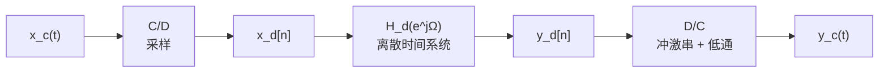
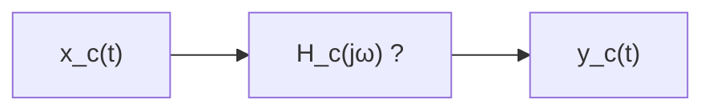

# 7.4 用离散时间系统处理连续时间信号

> [!abstract] 这一讲的任务
> 这一节把前三节的零件装成一台机器：**连续信号进、连续信号出，中间是数字系统。**
> 装法只有三步——采样（C/D）、跑一段离散程序（$H_d$）、再变回连续（D/C）。看起来像在绕路，但这条绕路换来的是"用软件实现滤波器"：改系数就是改滤波特性，不用动电路。
> 这一节要拿到的是 **整体的账**：整条链等价于一个连续时间滤波器 $H_c(j\omega)$，而它与数字滤波器 $H_d$ 的关系只有一行代换 $\Omega=\omega T$。以及它的代价——这条链能实现的连续时间响应 **必然带限于 $\omega_s/2$**。

> [!info] 授课进度说明
> 第 7 章的课堂录音尚未拿到（`transcript/` 目前到第 14 节课、第 8 章为止）。本篇按原稿与教材整理，**不逐条标注「拓展」**；等录音到位后再回来核对。

---

## 三步链：为什么值得绕这一圈

对连续信号做滤波，用模拟电路也能做。可模拟电路有三个改不掉的问题：电感电容的容差、温度漂移、以及"想改特性就得换元件"。数字实现把这三条一次解决——**滤波特性写在系数里，改一行代码就换了台机器**。

代价是多两个转换环节：

整条链画成一个黑盒，就是我们要算的东西：

问题很清楚：**$H_d$ 给了，$H_c$ 是什么？** 三步分别算，最后乘起来。

---

## 第一步 C/D：采样之外，还偷偷改了横轴

C/D 转换器里其实有两件事：

$$x_p(t)=x_c(t)\sum_n\delta(t-nT),\qquad x_d[n]=x_c(nT)$$

前者是"采样"（保留冲激），后者是"把冲激的面积记成一串数"（扔掉时间轴）。上一节算过 $X_p$：

$$X_p(j\omega)=\frac{1}{T}\sum_{k}X_c\big(j(\omega-k\omega_s)\big)$$

而序列的谱是它的 **离散时间版本**。两个式子并排看，只差一处替换：

$$X_d(e^{j\Omega})=\sum_nx_c(nT)e^{-j\Omega n},\qquad X_p(j\omega)=\sum_nx_c(nT)e^{-j\omega nT}$$

所以

$$\boxed{\;X_d(e^{j\Omega})=X_p\Big(j\frac{\Omega}{T}\Big)\;}\qquad \Omega=\omega T$$

**这一步的物理含义，比公式本身重要**：$x_d[n]$ 与 $x_p(t)$ 装的是同一份数据，只是 **横轴的单位换了**。时间轴上"每个样本隔 $T$ 秒"变成了"每个样本隔 1 个数"，于是频率轴上"每 $2\pi/T$ 一个副本"变成了"每 $2\pi$ 一个副本"。

- 具体地：$\omega$ 轴上的 $\omega_s$ 对应 $\Omega$ 轴上的 $2\pi$；
- 原信号的带宽 $\omega_M$ 在 $\Omega$ 轴上变成 $\Omega_M=\omega_MT$；
- 采样定理 $f_s>2f_M$ 在 $\Omega$ 轴上变成 $\Omega_M<\pi$。

这句话可以当成一条口诀：**时间轴压缩 $1/T$ 倍，频率轴就拉伸 $T$ 倍**。以后看到 $X(e^{j\Omega})$ 的横轴从 $-\pi$ 到 $\pi$，心里要自动翻译成"这半个区间对应连续域的 $\pm\omega_s/2$"。

代进去得

$$X_d(e^{j\Omega})=\frac{1}{T}\sum_{k}X_c\Big(j\frac{\Omega-2\pi k}{T}\Big)$$

注意这个和式：$X_d$ 是 $X_c$ 在 $\Omega$ 轴上 **以 $2\pi$ 为周期** 的复现。这不是多余的——离散序列的谱天生是 $2\pi$ 周期的（第 5 章讲过），这里只是从采样角度看它为什么必然如此。

---

## 第二步 D/C：把序列变回冲激串，再低通

D/C 是 C/D 的逆操作，顺序反过来：

$$y_p(t)=\sum_ny_d[n]\,\delta(t-nT)\;\Longrightarrow\;Y_p(j\omega)=Y_d(e^{j\omega T})$$

然后一个理想低通把冲激串"糊"成连续曲线：

$$H(j\omega)=\begin{cases}T,&\lvert\omega\rvert<\omega_s/2\\0,&\text{otherwise}\end{cases}$$

还是那个 $T$：采样时谱被压了 $1/T$，这里乘回 $T$。这是 **第二次** 见到这个配对（上一节重建时是第一次），记住它就够了。

---

## 第三步：整条链的账

现在把三段乘成一段。中间那段的输入是 $x_d$、输出是 $y_d$：

$$Y_d(e^{j\Omega})=H_d(e^{j\Omega})\,X_d(e^{j\Omega})$$

换回连续域的频率标签 $\Omega=\omega T$，再乘上 D/C 的低通：

$$Y_c(j\omega)=Y_p(j\omega)H(j\omega)=T\,Y_d(e^{j\omega T})\,H(j\omega)=T\,H_d(e^{j\omega T})\,X_p(j\omega)\,H(j\omega)$$

在 $\lvert\omega\rvert<\omega_s/2$ 内，$T\,X_p(j\omega)=X_c(j\omega)$（这一步用的正是"副本都在带外"），于是

$$\boxed{\;H_c(j\omega)=H_d(e^{j\omega T}),\qquad\lvert\omega\rvert<\frac{\omega_s}{2}\;}\qquad\text{等价写法：}\quad H_c\Big(j\frac{\Omega}{T}\Big)=H_d(e^{j\Omega}),\;\lvert\Omega\rvert<\pi$$

整条链等于 **把离散滤波器的频率响应按 $\omega=\Omega/T$ 拉回连续频率轴**，外面再套一个"$\lvert\omega\rvert<\omega_s/2$ 之外为零"的方框。

> [!warning] 这条式子里藏着一个必须记住的限制
> $H_d(e^{j\Omega})$ 是 $2\pi$ 周期的，而 $\omega$ 轴上的 $2\pi$ 对应 $\omega_s$。也就是说：**离散滤波器在 $\Omega$ 上的每一个周期，都对应连续频率轴上宽度为 $\omega_s$ 的一段。** 而 D/C 那个低通只放出 $\lvert\omega\rvert<\omega_s/2$ 那一段——**其余的重复全被切掉了**。
>
> 后果有两条，都是考试爱问的：
> 1. **这条链只能实现带限于 $\omega_s/2$ 的连续时间滤波。** 你想要一个在 $\omega_s/2$ 之外还非零的 $H_c$？做不到：要么被低通切掉，要么在采样时已经折进带内变脏。
> 2. **反过来，任何 $H_d$ 都能"当成"一个连续时间滤波器用**，只是它的作用范围被限制在一个 $\omega_s$ 周期里。所以"数字滤波器"和"连续时间滤波器"之间不是一一对应的，是 **一个周期内的一段** 对应关系。
>
> 这也是为什么数字滤波器的设计总是在归一化频率 $\Omega\in(-\pi,\pi)$ 里做，最后再乘 $T$ 换算——**$\pi$ 就是那道天花板**。

---

## 例子：数字微分器

微分是最简单的"滤波"，正好拿它当试刀石。想要的连续时间响应是

$$H_c(j\omega)=\begin{cases}j\omega,&\lvert\omega\rvert<\omega_c\\0,&\lvert\omega\rvert>\omega_c\end{cases}$$

幅度是 $\lvert\omega\rvert$（频率越高放大越多），相位是 $+90^\circ$（正频率）与 $-90^\circ$（负频率）。取 $\omega_c=\dfrac{\omega_s}{2}$ 把天花板顶满，代进上面的换算式：

$$H_d(e^{j\Omega})=H_c\Big(j\frac{\Omega}{T}\Big)=j\frac{\Omega}{T},\qquad\lvert\Omega\rvert<\pi$$

三个特征：

- **幅度线性**：从 $-\pi$ 到 $\pi$ 一路涨到 $\pm\dfrac{\pi}{T}$。它把高频抬得比低频高得多，所以微分器本质上是 **高通**（也常被直接这么叫）。
- **相位恒为 $\pm90^\circ$**：只改相位、不改形状的这一类运算，在频域里就是"乘 $j$"。
- **在 $\pm\pi$ 处不连续**：$j\Omega/T$ 这条直线到了 $\pm\pi$ 之后必须跳回去重新开始（因为 $H_d$ 必须 $2\pi$ 周期）。这个"锯齿状"的响应意味着时域上的 $h[n]$ **无限长**——理想微分器不能用有限长 FIR 精确实现。

> [!note] 用第 4 章的眼光看这个例子（延伸）
> $H_c=j\omega$ 就是"时域求导"在频域的样子，而它对应的时域有 $\delta'(t)$ 这种奇异函数。数字侧对应的是 $\Omega$ 上的一条直线，两条直线都要求无限长的冲激响应。所以"微分器难做"不是这门课的偶然结论，而是"$j\omega$ 不是有理函数、没有有限阶实现"的直接后果。第 9、10 章用拉普拉斯/$z$ 变换讨论可实现性时，会从另一个角度再遇到同一件事。

---

## 随堂测：微分再延迟半个样本

> [!question] 题目
> 图中系统为"采样（周期 $T$）→ 离散滤波器 $H_d(e^{j\Omega})$ → D/C（理想低通，增益 $T$）"，输入 $x_c(t)$ 带限于 $\lvert\omega\rvert<\pi/T$。若整体满足
> $$y_c(t)=\frac{d}{dt}x_c\Big(t-\frac{T}{2}\Big)$$
> 求离散滤波器的单位脉冲响应 $h[n]$。

**第一步，写出 $H_c$。** "延迟 $T/2$"在频域乘 $e^{-j\omega T/2}$，"求导"乘 $j\omega$，两者串联相乘：

$$H_c(j\omega)=j\omega\,e^{-j\omega T/2},\qquad\lvert\omega\rvert<\frac{\pi}{T}$$

（带限条件保证了 $H_c$ 在这之外为零，正好符合上一节那条"必须在 $\omega_s/2$ 内"的限制。）

**第二步，换算成 $H_d$。** 用 $\Omega=\omega T$：

$$H_d(e^{j\Omega})=j\frac{\Omega}{T}\,e^{-j\Omega/2},\qquad\lvert\Omega\rvert<\pi$$

**第三步，反变换。** 直接按 DTFT 定义积回去：

$$h[n]=\frac{1}{2\pi}\int_{-\pi}^{\pi}H_d(e^{j\Omega})e^{j\Omega n}\,d\Omega=\frac{j}{2\pi T}\int_{-\pi}^{\pi}\Omega\,e^{j\Omega(n-1/2)}\,d\Omega$$

记 $m=n-\dfrac12$。用分部积分（$\int\Omega e^{j\Omega m}d\Omega=\dfrac{\Omega e^{j\Omega m}}{jm}-\dfrac{e^{j\Omega m}}{(jm)^{2}}$），第一项在 $\pm\pi$ 的取值相互抵消（因为 $e^{\pm j\pi m}=\mp j(-1)^{n}$，两项同值反号），只剩第二项：

$$\int_{-\pi}^{\pi}\Omega e^{j\Omega m}d\Omega=-\frac{2j(-1)^{n}}{m^{2}}$$

乘上前面的 $\dfrac{j}{2\pi T}$：$j\cdot(-2j)=2$，于是

$$\boxed{\;h[n]=\frac{(-1)^{n}}{\pi T\left(n-\frac12\right)^{2}}=\frac{4(-1)^{n}}{\pi T(2n-1)^{2}}\;}$$

**第四步，验算两个值。** $h[0]=\dfrac{4}{\pi T}$，$h[1]=-\dfrac{4}{\pi T}$，$h[2]=\dfrac{4}{9\pi T}$。手算与数值积分（对 $H_d$ 做数值反变换）逐点一致。

> [!important] 这个结果值得多看两眼
> 1. **它不是有限长的**，而且衰减只有 $1/n^{2}$——比 $1/n$ 好（绝对可和 ⇒ 系统稳定），但尾巴很长。这再次说明"理想微分器"只能近似。
> 2. **符号交替** $(-1)^{n}$ 是高频成分的标志：交替序列的谱集中在 $\Omega=\pm\pi$ 附近，而微分器恰好在那里增益最大。
> 3. **$\left(n-\frac12\right)$ 而不是 $n$**：那个半样本延迟并没有消失，它变成了"冲击响应的中心挪到了 $n=\frac12$"——一个 **非整数位置的峰**。这正是"半样本延迟"这个名字的来历：它在离散域里根本落不到整数点上，所以只能靠一整条长尾来"实现"。

---

## 课堂实录

（待补：本节暂无转写稿。第 7 章的课堂录音尚未拿到。）

---

## 速查

> [!tip] 用离散系统处理连续信号
> | 环节 | 时域 | 频域 |
> |---|---|---|
> | C/D | $x_d[n]=x_c(nT)$ | $X_d(e^{j\Omega})=X_p(j\Omega/T)=\frac1T\sum_kX_c\big(j\frac{\Omega-2\pi k}{T}\big)$ |
> | 离散系统 | $y_d=h_d*x_d$ | $Y_d=H_d(e^{j\Omega})X_d(e^{j\Omega})$ |
> | D/C | $y_p=\sum y_d[n]\delta(t-nT)$ | $Y_p(j\omega)=Y_d(e^{j\omega T})$ |
> | 整体 | — | $H_c(j\omega)=H_d(e^{j\omega T})$，$\lvert\omega\rvert<\omega_s/2$ |
>
> **换算三件套**：$\Omega=\omega T$；$\omega_s\leftrightarrow2\pi$；$\omega_M\leftrightarrow\Omega_M<\pi$。
>
> **两个增益**：C/D 让谱被压 $1/T$；D/C 的低通乘回 $T$。一压一补，净效果是 1。
>
> **数字微分器**：$H_c=j\omega\Rightarrow H_d=j\Omega/T$（$\lvert\Omega\rvert<\pi$）；幅度线性、相位 $\pm90^\circ$、$\pm\pi$ 处跳变 ⇒ $h[n]$ 无限长。
>
> **天花板**：这条链实现的 $H_c$ 必须带限于 $\omega_s/2$，因为 $H_d$ 的每个 $2\pi$ 周期都对应 $\omega_s$，而低通只留中间那一段。

---

## 下一讲预告

到这里，连续时间那一侧的采样故事讲完了。可是"采样"这个动作本身跟连续、离散 **没有关系**——一串数也可以被采样，采样率也可以被改变。

把同一套推理搬到离散序列上，就得到两个日常工具：**抽取 Decimation**（降采样，省存储省算力）和 **内插 Interpolation**（升采样，把低采样率的信号补到高采样率上）。它们的谱变化规律与本节几乎逐字对应，只是 $\omega_s$ 换成了 $2\pi$、$T$ 换成了 $N$。最后一个漂亮的收尾是 **对偶**：把采样动手在频域，时域就周期化——这正是第 4、5 章那张"四象限图"的第四根轴。

---

## 相关笔记 Related Notes

- 前置：[[C7.1 采样与采样定理：从快照到频谱周期化]]、[[C7.3 从样本重建信号：内插与保持]]（D/C 里的那个低通与增益 $T$）、[[C5.1 非周期信号的表示：离散时间傅里叶变换]]（$X(e^{j\Omega})$ 的 $2\pi$ 周期性）
- 后续：[[C7.5 离散时间信号的抽取与内插，及频域采样]]（同一套推理搬到序列上）
- 相邻：[[C3.6 傅里叶级数与LTI系统、滤波]]（频率响应的意义）、[[C2.3 LTI系统的性质]]（$h$ 与稳定性：$h[n]\sim1/n^2$ 为什么可接受）

- 上一讲：[[C7.3 从样本重建信号：内插与保持]]
- 下一讲：[[C7.5 离散时间信号的抽取与内插，及频域采样]]
- 返回：[[信号与系统 MOC]]
