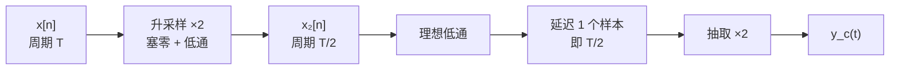

# 7.5 离散时间信号的抽取与内插，及频域采样

> [!abstract] 这一讲的任务
> 采样这件事跟"连续还是离散"无关：一串数也可以再被采样。把同一套推理搬到序列上，就得到两个天天在用的工具——**抽取**（降低采样率，省存储省算力）与 **内插**（提高采样率，把两组不同速率的数据接起来）。
> 它们的谱变化规律与上一节几乎逐字对应，只需把 $\omega_s$ 换成 $2\pi$、把 $T$ 换成 $N$。最后再把采样"搬到频域"做一遍：**频域采样 ⇔ 时域周期化**，这一步补上了第 4、5 章那张四象限图的最后一根轴。

> [!info] 授课进度说明
> 第 7 章的课堂录音尚未拿到（`transcript/` 目前到第 14 节课、第 8 章为止）。本篇按原稿与教材整理，**不逐条标注「拓展」**；等录音到位后再回来核对。

---

## 为什么要改一串数自己的采样率

先看两个真实需求：

- **省资源**：一段语音用 16 kHz 存，可下游只需要 8 kHz 的带宽（电话音质）。直接隔一个丢一个，文件小一半、算力省一半。
- **对接口**：一段音频是 44.1 kHz，另一套设备跑 48 kHz。要让它们在同一个时间轴上对齐，必须 **改采样率**——这就是音频软件里那个 "resample" 按钮。

两个方向的术语先定死：

| 操作 | 别名 | 动作 | 采样率 |
|---|---|---|---|
| 抽取 Decimation | 降采样 downsampling | 每 $N$ 个样本留一个 | 降低 $N$ 倍 |
| 内插 Interpolation | 升采样 upsampling | 样本之间塞零再低通 | 提高 $N$ 倍 |

> [!warning] 名字的坑
> 教材里的 "decimation" 严格指" **先低通、再降采样**"这两步合起来，而 "downsampling" 只指"丢掉样本"那一步。差别不是文字游戏：**不先低通就直接丢样本，一定混叠**。本节后面会把这条讲透。

---

## 先算"离散采样"的谱：$2\pi$ 里挤进 $N$ 份

对序列"采样"，最自然的模型是 **每 $N$ 个点保留一个**。数学上还是一句话：乘一个 **离散冲激串**

$$p[n]=\sum_{k=-\infty}^{\infty}\delta[n-kN],\qquad x_p[n]=x[n]\,p[n]$$

这个冲激串在 $n$ 上是周期 $N$ 的，所以它有离散傅里叶级数。一个周期里只有一个 1，于是所有谐波系数都是 $1/N$；换成 DTFT 就是

$$P(e^{j\omega})=\frac{2\pi}{N}\sum_{k=0}^{N-1}\delta\Big(\omega-\frac{2\pi k}{N}\Big)$$

在 $2\pi$ 里立了 $N$ 根等距的冲激。时域相乘 ⇒ 频域 **周期卷积**（离散情形下是卷积再除以 $2\pi$，见 [[C5.5 相乘性质、对偶性与变换表]]）：

$$X_p(e^{j\omega})=\frac{1}{2\pi}\int_{2\pi}X(e^{j\theta})P\big(e^{j(\omega-\theta)}\big)d\theta=\frac{1}{N}\sum_{k=0}^{N-1}X\Big(e^{j(\omega-\frac{2\pi k}{N})}\Big)$$

$$\boxed{\;X_p(e^{j\omega})=\frac{1}{N}\sum_{k=0}^{N-1}X\Big(e^{j\big(\omega-\frac{2\pi k}{N}\big)}\Big)\;}$$

这跟连续域的 $X_p=\frac1T\sum_kX(j(\omega-k\omega_s))$ 是 **同一个句式**：

- 连续域：副本间距 $\omega_s=\dfrac{2\pi}{T}$，每份乘 $\dfrac1T$；
- 离散域：副本间距 $\dfrac{2\pi}{N}$，每份乘 $\dfrac1N$。

连"周期从哪来"也一样：离散域本来就只有 $2\pi$ 一圈可放，所以 $N$ 份必须挤在同一个 $2\pi$ 里——$N$ 越大，每份越挤。

---

## 抽取：丢掉中间的零，谱被拉伸回来

$x_p[n]$ 里除了 $n=kN$ 全是零，丢掉它们不损失信息：

$$x_d[n]=x_p[nN]=x[nN]$$

这就是 **抽取**。它的谱怎么变？把定义式里的 $n$ 换成 $nN$：

$$X_d(e^{j\omega})=\sum_n x_p[nN]e^{-j\omega n}=\sum_m x_p[m]e^{-j\omega m/N}=X_p\big(e^{j\omega/N}\big)$$

$$\boxed{\;X_d(e^{j\omega})=X_p\big(e^{j\omega/N}\big)\;}$$

**频率轴被拉伸 $N$ 倍。** 原来挤在 $2\pi$ 里的 $N$ 份，现在摊开成一个周期一份，周期回到了 $2\pi$。

![[C7.5-抽取的谱变化.png]]

三行图从上到下就是这个过程（$N=3$）：原谱 $X$ 只在 $\lvert\omega\rvert<\omega_M$；采样后 $2\pi$ 内出现三份、各矮到 $1/3$；抽取后一份摊开、占据 $\lvert\omega\rvert<N\omega_M$，高度仍是 $1/3$。

**代价在哪一行？** 摊开之后，原来互不相邻的副本被拉近了三倍。如果 $N\omega_M>\pi$，摊开的主瓣会 **跨过 $\pi$ 折回来**——这就是离散域的混叠。所以不混叠的条件是

$$N\omega_M<\pi\quad\Longleftrightarrow\quad \omega_M<\frac{\pi}{N}\quad\Longleftrightarrow\quad \frac{2\pi}{N}>2\omega_M$$

最后那个式子的左边 $\dfrac{2\pi}{N}$ 正是"抽取之后的采样率"（等效采样角频率）。所以这条条件跟第 7.1 节的 $\omega_s>2\omega_M$ 是 **同一条定理**，只是换了单位。

> [!important] 抽取前必须低通，否则一定后悔
> 想抽 $N$ 倍，先把信号的带宽压到 $\dfrac{\pi}{N}$ 以内（在 $\Omega$ 轴上做，就是截止 $\pi/N$ 的离散低通），再丢样本。
> 顺序不能反：先丢后滤，折进来的高频已经在带内，滤不掉了。这与连续域"先抗混叠再采样"是同一句话。
> **最大可抽取倍数**：$N<\dfrac{\pi}{\omega_M}$。

> [!example] 应用：一段 2:1 抽取的完整链路
> 采样 → 2 倍内插 → 理想低通 → 延迟 1 个样本 → 2 倍抽取 → D/C。这条链看着绕，实际是在做 **半样本延迟**（下面单独讲）。
> 更常见的形态是" **先降采样再升采样**"的语音压缩：把 16 kHz 降到 8 kHz（先低通到 4 kHz 以内），传过去，再升回 16 kHz 播放。中间损失的高频回不来，这就是"电话音质"的由来。

---

## 内插：塞零，再低通把镜像滤掉

反方向要更小心。**直接"把每个样本复制 N 份"是错的**——那会把每个样本变成一个宽度 $N$ 的矩形，谱上等于乘了一个 sinc，等于给信号额外做了低通。

正确做法是 **塞零 Zero-insertion**：

$$x_u[n]=\begin{cases}x[n/N],&n=kN\\[2pt]0,&\text{otherwise}\end{cases}$$

它的谱直接由定义得到：把 $n$ 换成 $Nm$，

$$X_u(e^{j\omega})=\sum_m x[m]e^{-j\omega Nm}=X(e^{jN\omega})$$

$$\boxed{\;X_u(e^{j\omega})=X\big(e^{jN\omega}\big)\;}$$

**频率轴被压缩 $N$ 倍。** 原来一个周期占满 $2\pi$，现在只占 $\dfrac{2\pi}{N}$——于是在 $[-\pi,\pi]$ 里出现了 $N$ 份 **镜像**（形状相同、左右并排）。

接下来用低通留下中间那一份、扔掉其余镜像，就完成了"真的提高采样率"：

$$H(e^{j\omega})=\begin{cases}N,&\lvert\omega\rvert<\dfrac{\pi}{N}\\[2pt]0,&\text{otherwise}\end{cases}$$

**增益为什么是 $N$？** 因为塞零把 $N$ 个样本里 $N-1$ 个变成零，平均功率降到 $1/N$；低通前先乘 $N$ 补回来，输出幅度才和原信号一致。（这一条与连续域"D/C 增益 $T$"是同一件事：补的是密度。）

**时域看是什么？** 低通的冲激响应是 sinc，所以塞零再低通 = 在样本之间 **用 sinc 插值补出 $N-1$ 个新点**。所以"升采样"和"内插"是同一件事的两种说法：谱上叫滤镜像，时域上叫补点。

> [!note] 一句话对比两个方向
> - **抽取**：先滤后丢（滤掉将要折进来的高频），谱 **拉伸**；
> - **内插**：先塞零后滤（滤掉塞零造出的镜像），谱先 **压缩** 再切掉多余副本。
>
> 两个方向都是"滤 + 改采样率"，只是顺序相反；而且 **两个低通的截止频率都是 $\pi/N$**——同一个数，一个在对丢弃前、一个在塞零后。

---

## 把两者接起来：半样本延迟

离散系统有个天生的限制：**延迟只能是整数个样本**。想要"延迟半个样本"（阵列处理、波束成形、定时恢复里都必须），就得借采样率来造。

整条链的净效果：

$$y_c(t)=x_c(t-\Delta),\qquad\Delta=\frac{T}{2}$$

读法：升采样把"1 个样本"的物理时长从 $T$ 变成 $\dfrac{T}{2}$，于是"延迟 1 个样本"就变成了"延迟 $\dfrac{T}{2}$"；再抽取回原来的速率，延迟量就被固定下来了。

**为什么值得做？** 因为它把"延迟"这个操作的分辨率从 $T$ 提高到了 $T/2$、$T/4$、$T/8$……只要升采样的倍数够高，就能造出任意精细的分数延迟。这是数字音频里"采样率转换"、雷达里"波束精确指向"、通信里"定时恢复"的共同起点。

---

## 频域采样：把对偶的那一半走完

前面所有内容都在说"时域采样 ⇒ 频域周期化"。现在把动手的位置换到频域：**采频谱的样**。

$$P(j\omega)=\sum_{k=-\infty}^{\infty}\delta(\omega-k\omega_0),\qquad \tilde X_p(j\omega)=X(j\omega)P(j\omega)=\sum_kX(k\omega_0)\,\delta(\omega-k\omega_0)$$

频域相乘 ⇒ 时域 **卷积**。而冲激串的时域形式是（周期 $2\pi/\omega_0$、每个周期一根面积 $1/\omega_0$ 的冲激）：

$$p(t)=\frac{1}{\omega_0}\sum_{k}\delta\Big(t-\frac{2\pi k}{\omega_0}\Big)\quad\Longrightarrow\quad \tilde x_p(t)=\frac{1}{\omega_0}\sum_{k}x\Big(t-\frac{2\pi k}{\omega_0}\Big)$$

![[C7.5-频域采样与时域周期化.png]]

**谱被"打成点"，时域就被"复印"成周期重复的副本。** 左边是谱被采样（红棒是采样值），右边是时域里那无穷多份副本——而一个宽度 $\dfrac{2\pi}{\omega_0}$ 的矩形窗（绿框）只放行其中一份，就能把 $x(t)$ 取回来。

于是 **频域采样定理** 与它的时域版本完全对称：

| | 时域采样定理 | 频域采样定理 |
|---|---|---|
| 前提 | $x(t)$ **带限** 于 $\omega_M$ | $x(t)$ **时限** 于 $\lvert t\rvert<T_M$ |
| 采样间隔 | $T$（时间） | $\omega_0$（频率） |
| 条件 | $\omega_s=\dfrac{2\pi}{T}>2\omega_M$ | $2T_M<\dfrac{2\pi}{\omega_0}$ |
| 对偶结果 | 频域周期化 | 时域周期化 |
| 重建用的内插函数 | $\dfrac{\sin(\pi t/T)}{\pi t/T}$ | $\dfrac{\sin(\pi\omega/\omega_0)}{\pi\omega/\omega_0}$ |

重建公式也一样对称：

$$X(j\omega)=\sum_{k}X(k\omega_0)\,\frac{\sin\big(\pi(\omega-k\omega_0)/\omega_0\big)}{\pi(\omega-k\omega_0)/\omega_0}$$

那个内插函数不是硬凑的：它是 **时域矩形窗的谱**——窗的宽度就是 $2\pi/\omega_0$，正好是"一次只放行一份副本"的那个框。

> [!important] 四象限记法（接第 3–5 章）
> 把这四条摆在一起，整章的记忆负担就塌成一句话：
>
> | 时域 | 频域 |
> |---|---|
> | **采样**（乘冲激串，间隔 $T$） | **周期化**（副本间距 $\omega_s=2\pi/T$） |
> | **周期化**（副本间距 $T_0$） | **离散化**（谱线间距 $2\pi/T_0$） |
>
> 两个方向、同一台机器：**一边变成离散，另一边就变成周期**。本章四节讲的采样、重建、抽取/内插、频域采样，全部是这张表的不同走法；[[C3–5 四种傅里叶表示并行讲义]] 里那张"采样与对偶网络"讲的就是同一件事。

---

## 随堂测：塞零、低通、再抽取

> [!question] 题目
> 系统为：$x[n]$ → 零插入（每两个样本之间插两个零，即倍率 3）→ $H(e^{j\omega})$（$\lvert\omega\rvert<\pi/5$ 内增益 1，其外为 0）→ 抽取（$y[n]=w[5n]$）。输入
> $$x[n]=\frac{\sin\omega_1n}{\pi n}$$
> 求 (a) $\omega_1\le\dfrac{3\pi}{5}$ 与 (b) $\omega_1>\dfrac{3\pi}{5}$ 两种情形下的输出 $y[n]$。

先把输入认清楚：$\dfrac{\sin\omega_1n}{\pi n}$ 是理想低通的冲激响应，它的谱是 **一个方盒**：

$$X(e^{j\omega})=\begin{cases}1,&\lvert\omega\rvert<\omega_1\\0,&\text{otherwise}\end{cases}$$

**(a) 三步走。**

1. **塞零（×3）**：谱压缩 3 倍，$X_u(e^{j\omega})=X(e^{j3\omega})=1$（$\lvert\omega\rvert<\omega_1/3$）。$[-\pi,\pi]$ 里出现三份镜像，但只有中间那份落在 $\lvert\omega\rvert<\pi/3$ 内。
2. **低通（截止 $\pi/5$，增益 1）**：当 $\omega_1\le\dfrac{3\pi}{5}$ 时，$\dfrac{\omega_1}{3}\le\dfrac{\pi}{5}$，主瓣整个落在通带里，**一点没被切**：

$$V(e^{j\omega})=1,\qquad\lvert\omega\rvert<\frac{\omega_1}{3}$$

3. **抽取（×5）**：$Y(e^{j\omega})=\dfrac15\sum_{k=0}^{4}V\big(e^{j(\omega-2\pi k)/5}\big)$。因为 $V$ 的支撑只有 $\lvert\omega\rvert<\dfrac{\omega_1}{3}\le\dfrac{\pi}{5}$，五份副本摊开之后互不重叠，只剩 $k=0$ 那一项落在 $[-\pi,\pi]$：

$$Y(e^{j\omega})=\frac15V\Big(e^{j\omega/5}\Big)=\frac15,\qquad\lvert\omega\rvert<\frac{5\omega_1}{3}$$

反变换回一个方盒（高 $\frac15$、半宽 $\frac{5\omega_1}{3}$）：

$$\boxed{\;y[n]=\frac15\cdot\frac{\sin\big(\frac{5\omega_1}{3}n\big)}{\pi n}\;}$$

**物理含义**：输出还是同一个 $x[n]$，只是被"放慢"了——频率变成原来的 $\dfrac53$ 倍、幅度变成 $\dfrac15$。这正是"输出采样率是输入的 $\dfrac53$ 倍"的写法。

**(b) $\omega_1>\dfrac{3\pi}{5}$ 时，低通先切了一刀。**

这时 $\dfrac{\omega_1}{3}>\dfrac{\pi}{5}$，主瓣比通带宽，所以低通把方盒削成了 **恰好宽 $\pi/5$**：

$$V(e^{j\omega})=1,\qquad\lvert\omega\rvert<\frac{\pi}{5}$$

再抽取 ×5。关键就在这个 **"恰好"**：$\dfrac{\pi}{5}=\dfrac{\pi}{N}$，正是临界情况。五份副本摊开后，每份占 $\lvert\omega\rvert<\pi$，**首尾相接、不重叠也不留缝，正好铺满整个 $[-\pi,\pi]$**。于是

$$Y(e^{j\omega})=\frac15\cdot 1=\frac15,\qquad\text{对一切 }\omega$$

一个"在所有频率上恒为常数"的谱，对应的序列是 **单个冲激**：

$$\boxed{\;y[n]=\frac15\delta[n]\;}$$

> [!warning] 这个答案乍看像算错了，其实很有道理
> 输入的带宽一旦超过 $\dfrac{3\pi}{5}$，低通的截止 $\dfrac{\pi}{5}$ 就变成了 **唯一决定输出** 的东西——原信号的信息已经被切掉了，剩下的只是一个"带宽恰好等于 $\pi/5$ 的方盒"。
> 而带宽恰好 $\pi/5$ 的信号，在 5 倍抽取之后副本刚好铺满、无处可躲，于是谱变平、时域塌成一个冲激。**它不是"丢了信号"，而是"信号被换成了采样函数本身"**：任何带宽不小于 $\pi/5$ 的输入，只要被这个低通削到 $\pi/5$，输出都长一个样。
>
> 顺带验证一致性：把 (a) 的答案令 $\omega_1=\dfrac{3\pi}{5}$，得 $y[n]=\dfrac15\dfrac{\sin(\pi n)}{\pi n}=\dfrac15\delta[n]$，与 (b) 无缝衔接。**临界点两侧的答案自动咬合**，说明 (a)(b) 是同一个公式的两段。

---

## 课堂实录

（待补：本节暂无转写稿。第 7 章的课堂录音尚未拿到。）

---

## 速查

> [!tip] 抽取、内插与频域采样
> | 操作 | 时域 | 频域 | 条件 |
> |---|---|---|---|
> | 离散采样（乘冲激串） | $x_p[n]=x[n]p[n]$ | $\frac1N\sum_{k=0}^{N-1}X\big(e^{j(\omega-2\pi k/N)}\big)$ | — |
> | 抽取（降采样 $N$） | $x_d[n]=x[nN]$ | $X_d(e^{j\omega})=X_p(e^{j\omega/N})$ | $N\omega_M<\pi$，先低通截止 $\pi/N$ |
> | 内插（升采样 $N$） | 塞 $N-1$ 个零 | $X_u(e^{j\omega})=X(e^{jN\omega})$ | 低通截止 $\pi/N$，增益 $N$ |
> | 频域采样 | $\tilde x_p=\frac{1}{\omega_0}\sum_kx(t-\frac{2\pi k}{\omega_0})$ | $\sum_kX(k\omega_0)\delta(\omega-k\omega_0)$ | 时限 $2T_M<\frac{2\pi}{\omega_0}$ |
>
> **两个方向一句话**：抽取 = 先低通再丢样本（谱拉伸）；内插 = 先塞零再低通（谱先压缩后滤镜像）。
>
> **四象限**：时域采样 ⇔ 频域周期化；时域周期化 ⇔ 频域离散化；频域采样 ⇔ 时域周期化。
>
> **最大抽取倍数**：$N<\dfrac{\pi}{\omega_M}$（即抽取后的采样率仍要大于 $2\omega_M$）。
>
> **半样本延迟**：升采样 ×2 → 低通 → 延迟 1 个样本 → 抽取 ×2，净效果 $y_c(t)=x_c(t-T/2)$。

---

## 下一讲预告

第 7 章到这里收口。回头看，这一章其实只做了一件事：**在"离散"与"周期"之间来回换位**——时域采样就让频域周期化，频域采样就让时域周期化，抽取与内插只是在调那个"周期"的长短。

而所有这些讨论都建立在"我们能用 $j\omega$ 描述系统"的基础上。推广到 **复频率** $s=\sigma+j\omega$，就是下一章的主题：拉普拉斯变换。它要回答的是这一章一直绕开的问题——**一个系统到底能不能实现**（收敛域、因果性与稳定性），以及第 7 章里那些"理想滤波器做不到"的抱怨，在 $s$ 平面上究竟长什么样。

---

## 相关笔记 Related Notes

- 前置：[[C7.1 采样与采样定理：从快照到频谱周期化]]、[[C7.4 用离散时间系统处理连续时间信号]]（$\Omega=\omega T$ 的归一化）、[[C5.5 相乘性质、对偶性与变换表]]（周期卷积、离散相乘性质）
- 相邻：[[C3–5 四种傅里叶表示并行讲义]]（四象限的采样/对偶网络）、[[C5.2 周期信号的傅里叶变换]]（周期化 ⇔ 冲激串）
- 应用：[[实验2.2 用 DFT 分析离散信号频谱]]（补零、栅栏、抽取与调制都在这份实验里真的做过）

- 上一讲：[[C7.4 用离散时间系统处理连续时间信号]]
- 下一讲：（第 9 章 拉普拉斯变换，笔记待建）
- 返回：[[信号与系统 MOC]]
