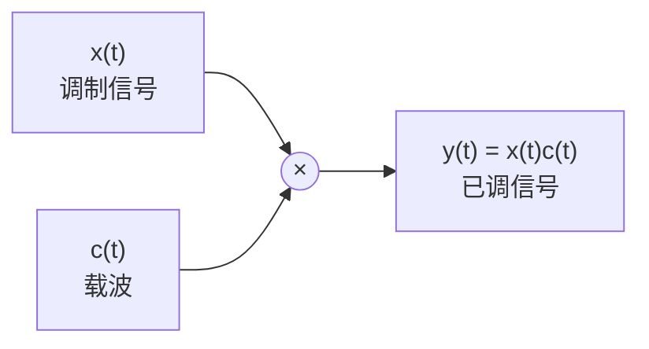
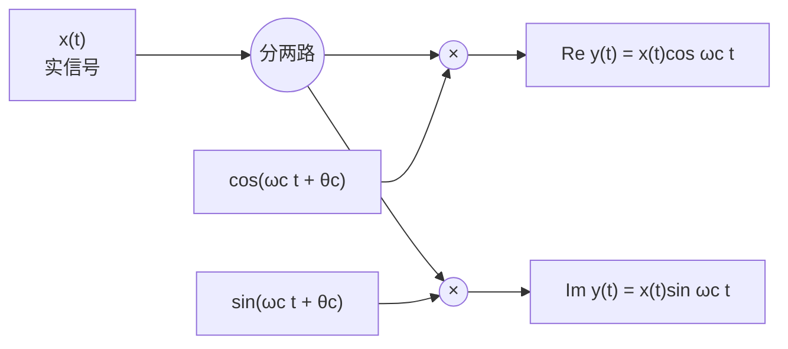

# 8.1 幅度调制：把频谱搬到载波附近

> [!abstract] 这一讲的任务
> 前面五章把信号拆成了"一堆频率分量"，也学会了看它的频谱。这一章开始拿这套工具干活：**让信号坐上一条高频载波，搬到空中去**。
> 搬家的动作只有一个——**乘一个余弦**。乘法在频域是卷积，与冲激卷积就是平移，所以"乘一个载波"等于"把整条频谱原样搬到 $\pm\omega_c$ 附近"。
> 这一节要拿到四样东西：通信链路的三个环节各干什么；复指数载波为什么是最干净的搬移；正弦载波为什么搬出**两份**、每份**矮一半**；以及一个硬条件——**载波频率必须高于信号带宽**，否则两份搬过去的谱会撞在一起，谁也救不回来。

> [!info] 授课进度说明
> 第 8 章已在课堂上讲完，但**这次拿到的录音是从 8.2 的中间开始的**（第一句就接在"抑制载波与带载波的区别"上），本篇 8.0–8.1 这一段没有录到。所以本篇仍按原稿、教材与通行讲法整理，**无法用录音逐句核对**，也不据录音做「拓展」标注；等补到前半段的录音再回来校一遍。

---

## 通信在做什么：把信号搬进一条通道

先看一条完整的链路。它的每一个方框都在做同一件事的不同版本：**换一个"地址"存放信息**。

- **调制 Modulation**：把携带信息的信号**嵌入**到第二个信号里（embedding an information-bearing signal into a second signal）；
- **解调 Demodulation**：把携带信息的信号**取出来**（extracting the information-bearing signal）。

被嵌入的那个原始信号叫**调制信号**（modulating signal，记 $x(t)$），承载它的高频振荡叫**载波**（carrier，记 $c(t)$），乘出来的结果叫**已调信号**（modulated signal，记 $y(t)$）。

> [!question] 停一下：信号本来就在，为什么非得搬到高频上去
> 三条理由，一条比一条硬。
>
> **一是天线。** 电磁波的有效辐射尺寸要和波长同量级，而 $\lambda=c/\nu$：语音的 $3\ \mathrm{kHz}$ 对应波长约 $100\ \mathrm{km}$，直接辐射需要一座几百公里高的天线。搬到 $100\ \mathrm{MHz}$ 量级，波长变成 $3\ \mathrm{m}$，一根拉杆天线就够。这件事在 [[C4.5 相乘性质与调制]] 里已经算过一遍。
>
> **二是频带可以重复使用。** 全世界的语音信号频谱都挤在 $0\sim4\ \mathrm{kHz}$ 这一小块里，如果都直接发射，所有人的信号会叠成一团。给每一路分配一个**不同的载波**，它们就各占一段互不重叠的高频区间——同一片天空能同时跑几万路电话。这就是 8.3 节的频分复用。
>
> **三是信道本身挑食。** 电缆、光纤、自由空间对不同频率的传输损耗差别巨大，有的只肯在某个频段上工作。搬家是去"信道肯让你走"的那一段。

### 调制有哪几种，这一章只做其中一种

按"改载波的哪个参数"分，调制有三类：

| 调制方式 | 改的是载波的什么 | 数学上是什么运算 |
|---|---|---|
| 幅度调制 AM（Amplitude Modulation） | 幅度 | $x(t)$ **乘**载波——线性 |
| 频率调制 FM（Frequency Modulation） | 瞬时频率 | 非线性（相位里含 $x$） |
| 相位调制 PM（Phase Modulation） | 瞬时相位 | 非线性（相位里含 $x$） |

再按"载波本身发不发出去"分，幅度调制又有两种：

- **带载波 AM/wc**（AM with carrier）：$[A+x(t)]\cos\omega_ct$，除了边带还带着一根纯载波谱线，接收端可以用最便宜的包络检波（8.2.2）；
- **抑制载波 AM/sc**（AM with suppressed carrier）：$x(t)\cos\omega_ct$，谱里只剩边带，省功率但接收端必须自己恢复载波（8.2.1）。

抑制载波的情形再按"保留几个边带"分：**双边带 DSB**（Double Side-Band）、**单边带 SSB**（Single Side-Band）、**残留边带 VSB**（Vestigial Side-Band）。其中"正弦幅度调制"（sinusoidal amplitude modulation）是最常见的一种，也是这一章唯一展开的形式。

> [!warning] 只展开 AM 的原因
> FM 与 PM 的相位里装着 $x(t)$，频谱与 $x$ 的关系不是一次乘法能算清的，整套分析要换工具（贝塞尔展开那一套，本课程不做）。而 AM 是**乘一个已知载波**，只用到第 4 章的相乘性质，**线性、可算、可画**。所以"通信系统"这一章在信号与系统课上就等价于"乘法与滤波"。

---

## 一个乘法器就是一台频谱搬移机

把所有修饰去掉，调制系统的模型只有一个圆圈：

正弦幅度调制取的载波是 $c(t)=\cos(\omega_ct+\theta_c)$。$\theta_c$ 是载波的**初相**，它在这一节先被置于 0——**不是因为它不重要，而是因为它要在解调那一节才显出威力**（见 [[C8.2 解调：同步解调与包络解调]]：相位差直接折成幅度损失）。所以下面一律先取 $\theta_c=0$。

为什么"乘"等于"搬"？把第 4 章的相乘性质搬过来一行就够：

$$y(t)=x(t)c(t)\ \xleftarrow{\ \ \mathrm{CTFT}\ \ }\ Y(j\omega)=\frac{1}{2\pi}X(j\omega)*C(j\omega)$$

**载波的谱越"瘦"，搬得越干净。** $\cos$ 的谱是两根冲激，与两根冲激卷积就是把 $X$ 复印两份、分别挪到 $\pm\omega_c$；$e^{j\omega_ct}$ 的谱只有一根冲激，那就只挪一份，连复印都省了。这就是为什么先讲复指数载波、再讲正弦载波——**顺序按"搬得干不干净"排，不按数学复杂度排。**

先看一眼时域长什么样，心里有个底：

![[C8-调制波形与包络.png]]

上图画了两件事，后面每一节都会回来用它：

- (a) 是抑制载波的 $y(t)=x(t)\cos\omega_ct$。高频振荡的**包络**（那两条虚线）就是 $x(t)$ 与 $-x(t)$——"调幅"这个名字就是这么来的：**信息装在了高频振荡的振幅上**，频率没变。
- (b) 是带载波的 $y(t)=[A+x(t)]\cos\omega_ct$，包络抬到了 $A+x(t)$ 与 $A-x(t)$ 两条线之间。只要 $A\ge\lvert x(t)\rvert_{\max}$，**两条包络都不会穿过零轴**，于是"包络"始终是一个正数——这正是 8.2.2 那个二极管检波器能工作的全部前提。

---

## 复指数载波：整块搬运，形状和高度都不变（8.1.1）

复指数载波取 $c(t)=e^{j(\omega_ct+\theta_c)}$，同样先令 $\theta_c=0$：

$$c(t)=e^{j\omega_ct}\quad\Longleftrightarrow\quad C(j\omega)=2\pi\delta(\omega-\omega_c)$$

代入相乘性质，与单根冲激卷积：

$$Y(j\omega)=\frac{1}{2\pi}X(j\omega)*2\pi\delta(\omega-\omega_c)=X\big(j(\omega-\omega_c)\big)$$

**整条谱原样右移 $\omega_c$**，形状不变、高度不变，只是地址换了：

![[C8.1-复指数载波的频谱搬移.png]]

注意三件事，它们合起来说明"复指数是最干净的搬移"：

1. **只搬一份**，没有镜像副本。代价是 $Y(j\omega)$ 在负频率一侧空着——**这就意味着 $y(t)$ 是复信号**；
2. **高度不变**：原来的峰值 $1$ 搬过去还是 $1$。正弦载波那里会掉一半，差别就来自这里：$C=2\pi\delta$ 乘上 $\frac{1}{2\pi}$ 正好是 $1$，而 $\cos$ 的 $C(j\omega)=\pi\delta(\omega-\omega_c)+\pi\delta(\omega+\omega_c)$ 是两根，每根乘上 $\frac{1}{2\pi}$ 只剩 $\frac12$；
3. **搬的量就是载频**：想搬多远就调 $\omega_c$，乘法器本身不用改。**载频可调**这个性质，正是后面频分复用的基础。

### 复信号怎么发出去：拆成两路实信号

$e^{j\omega_ct}$ 没法直接辐射（天线上的电流是实数）。把 $y(t)$ 按欧拉公式拆开：

$$y(t)=x(t)e^{j\omega_ct}=x(t)\cos\omega_ct+j\,x(t)\sin\omega_ct$$

实部一路、虚部一路，各自乘一个**相位差 $90^\circ$** 的载波，然后分别往 I、Q 两个通道送：

这一对正交载波不是数学游戏，它是**现代通信发射机的基本结构**（IQ 调制）：两路分别携带"同相"与"正交"分量，接收端再合起来就恢复了复包络。8.4 节的希尔伯特法、以及后面随堂测里的"90° 移相网络"，用的都是这同一个零件。

---

## 正弦载波：搬两份，每份矮一半（8.1.2）

换成能发射的实载波 $c(t)=\cos\omega_ct$。它的谱是**一对**冲激：

$$C(j\omega)=\pi\big[\delta(\omega-\omega_c)+\delta(\omega+\omega_c)\big]$$

代进相乘性质，卷积的分配律把两项分开：

$$Y(j\omega)=\frac{1}{2\pi}X(j\omega)*\pi\big[\delta(\omega-\omega_c)+\delta(\omega+\omega_c)\big]=\frac12X\big(j(\omega-\omega_c)\big)+\frac12X\big(j(\omega+\omega_c)\big)$$

于是得到与复指数载波正好相反的两处差别：

![[C8.1-正弦载波的频谱搬移.png]]

> [!important] 复指数载波 vs 正弦载波：一张表说清
> | | 复指数 $e^{j\omega_ct}$ | 正弦 $\cos\omega_ct$ |
> |---|---|---|
> | 载波谱 $C(j\omega)$ | $2\pi\delta(\omega-\omega_c)$，一根 | $\pi[\delta(\omega-\omega_c)+\delta(\omega+\omega_c)]$，一对 |
> | 搬出几份 | **1 份**（右边） | **2 份**（左右对称） |
> | 每份的高度 | $1$（不变） | $\frac12$ |
> | 已调信号的取值范围 | 复数 | 实数（能发射） |
> | 实用价值 | 分析工具、IQ 的数学形式 | 实际通信用的形式 |

**"矮一半"不是失误，是记账。** 一份谱被劈成两份，每份只有一半高；两份的功率加起来恰好是原来的一半——**这就是正弦载波调制要付的功率代价**。这一点做题时最容易忘：**只要载波里有 $\cos$，答案里就一定会出现 $\frac12$。**

搬过去的两份里，每一份都被载波频率 $|\omega|=\omega_c$ 切成两段——靠近载波的那一半叫**下边带**（lower sideband），远离载波的那一半叫**上边带**（upper sideband）。这个区分到 8.4 节讲单边带时才会变成主角；这里先记住一句话：**上、下边带装的是同一份信息**（因为实信号的谱必然共轭对称），所以丢掉一个并不会丢掉信息——那正是单边带省带宽的原理。

---

## 载波频率不能低于信号带宽

搬家的前提是"搬过去之后还分得清"。分得清的条件只有一个：**两份谱不能重叠**。

设 $x(t)$ 是带宽有限的（band-limited），即

$$X(j\omega)=0,\qquad \lvert\omega\rvert>\omega_M$$

那么搬到 $+\omega_c$ 的那一份占据 $[\omega_c-\omega_M,\ \omega_c+\omega_M]$，搬到 $-\omega_c$ 的那一份占据 $[-\omega_c-\omega_M,\ -\omega_c+\omega_M]$。

> [!important] 两个区域不重叠的条件：$\omega_c>\omega_M$
> - 中心间隔是 $2\omega_c$，每份的半宽是 $\omega_M$，两份刚要碰上是 $2\omega_c=2\omega_M$，即 $\omega_c=\omega_M$；
> - 所以**只要 $\omega_c>\omega_M$**，中间就留出一条以 $\omega=0$ 为中心的空白缝隙，两份谱彼此可分辨；
> - 工程上从不取等号：$\omega_c$ 要比 $\omega_M$ 大得多，理由与解调的低通有关（8.2 节会看到，那条空白缝隙就是滤波器的过渡带余量）。

反过来看违反它的后果。下图取了 $\omega_c=\omega_M/2$，两份谱在中间**叠了起来**：

![[C8.1-载频低于带宽时的重叠.png]]

看下半张图：中间那一块**变成了平的**。这不是画错了，而是两份三角在叠加——以 $\omega=0$ 为例，

$$Y(j0)=\frac12X\big(j(-\omega_c)\big)+\frac12X\big(j\omega_c\big)=X(j\omega_c)$$

用三角谱算一遍就知道：$X(j\omega_c)=1-\omega_c/\omega_M$，所以当 $\omega_c=\omega_M/2$ 时恰好等于 $\frac12$，图上的平台高度 $\frac12$ 就是这么来的（**换个 $\omega_c$，平台高度就跟着变**）。

> [!warning] 重叠的后果：不是"稍微糊一点"，而是不可逆
> 重叠之后，$Y(j\omega)$ 已经**不再是 $X$ 的任何一次平移**。任何滤波器都只能保留或丢弃某些频率，无法把"两份已经加在一起的东西"拆开。
> 反过来说，**"位移之后不许交叠"是本课程里反复出现的一条判据**：第 3 章谐波集的完整性、第 4 章冲激串的谱线间距、下一节解调的低通截止，检查的都是同一句话。

---

## 课堂实录

这一节的内容**没有录到**。录音是从 8.2 的中间开始的，讲到最后只回头提过一句：本节课的调制部分"前面已经讲过了"，没有再回头复述。

所以本篇的正文、图与例题全部来自原稿与教材的整理，没有课堂口述可对照。**唯一可确认的课堂口径**落在 8.2 的那句对比上（见 [[C8.2 解调：同步解调与包络解调]]）：带载波与抑制载波的选择，是被"用哪种解调方式"倒逼出来的——想用包络检波就必须加 $A$。这句话反过来印证了本篇 8.1.2 里"带载波 vs 抑制载波"那两行分类不是并列的两种口味，而是一条因果链的两端。

---

## 速查

> [!tip] 调制一览
> | 载波 $c(t)$ | $C(j\omega)$ | 已调谱 $Y(j\omega)$ | 每份高度 |
> |---|---|---|---|
> | $e^{j(\omega_ct+\theta_c)}$ | $2\pi e^{j\theta_c}\delta(\omega-\omega_c)$ | $e^{j\theta_c}X\big(j(\omega-\omega_c)\big)$ | $1$ |
> | $\cos(\omega_ct+\theta_c)$ | $\pi\big[e^{j\theta_c}\delta(\omega-\omega_c)+e^{-j\theta_c}\delta(\omega+\omega_c)\big]$ | $\frac12e^{j\theta_c}X\big(j(\omega-\omega_c)\big)+\frac12e^{-j\theta_c}X\big(j(\omega+\omega_c)\big)$ | $\frac12$ |
>
> **记忆钩子**：$\cos$ 是"两根冲激"，卷积两次 ⇒ 复印两份；$\frac{1}{2\pi}\times\pi=\frac12$，于是每份只有一半高。
>
> **判据**：$\omega_c>\omega_M$ 才不重叠；$\omega_c<\omega_M$ 时中心区出现平台，高度为 $X(j\omega_c)$。
>
> **包络**：抑制载波时包络是 $\lvert x(t)\rvert$；带载波时包络是 $A\pm x(t)$，条件 $A\ge\lvert x(t)\rvert_{\max}$。
>
> **术语**：$\lvert\omega\rvert<\omega_c$ 的那一半叫下边带，$\lvert\omega\rvert>\omega_c$ 的那一半叫上边带。

---

## 下一讲预告

现在信息已经坐上载波，可接收端拿到的只有 $y(t)=x(t)\cos\omega_ct$ 这一条高频振荡。要把它还原，办法朴素得让人意外：**再乘一次 $\cos\omega_ct$**。

两个 $\cos$ 相乘会冒出一个直流项和一个二倍频项，前者正是我们要的信号、后者是垃圾，用低通滤掉就完事。听起来毫无难度——真正的麻烦藏在"同步"两个字里：**接收端凭什么知道载波的相位？** 差一点点，幅度就掉一成；差 $90^\circ$，信号直接消失。这是下一节最要命的一处。

---

## 相关笔记 Related Notes

- 前置：[[C4.5 相乘性质与调制]]（相乘性质与频移的推导、调制的动机与频率换算）、[[C4.3 连续时间傅里叶变换的性质]]（时移与频移两张性质表）
- 后续：[[C8.2 解调：同步解调与包络解调]]、[[C8.3 频分复用与带通信道]]、[[C8.4 单边带幅度调制]]

- 上一讲：[[C5.5 相乘性质、对偶性与变换表]]
- 下一讲：[[C8.2 解调：同步解调与包络解调]]
- 返回：[[信号与系统 MOC]]
