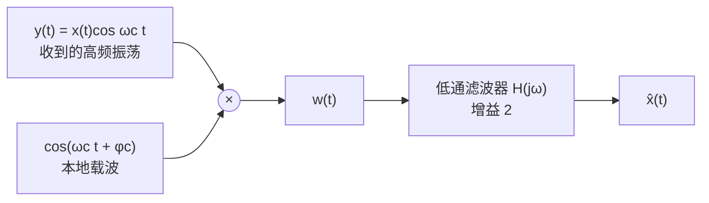

# 8.2 解调：同步解调与包络解调

> [!abstract] 这一讲的任务
> 上一节把 $x(t)$ 的谱搬到了 $\pm\omega_c$，现在要把它搬回来。接收端手里只有一条高频振荡 $y(t)=x(t)\cos\omega_ct$，别的什么都没有。
> 办法只有一步：**再乘一次同样的余弦**。$\cos^2$ 展开会冒出一个直流项（要的）和一个二倍频项（垃圾），低通一滤就完了。听起来没有任何技术含量，真正的难题全在"**同样的**"这三个字上——**接收端凭什么知道载波的频率与相位？**
> 这一节要拿到三样东西：同步解调的完整推导与低通截止条件；相位误差怎样按 $\cos(\theta_c-\varphi_c)$ 折成幅度损失（差 $90^\circ$ 直接归零）；以及一个绕开相位的办法——**包络解调**，它让收音机便宜到几块钱就能做出来。

> [!info] 授课进度说明
> 第 8 章已在课堂上讲完，转写稿是 `transcript/第八章-已合并.txt`。**但录音是从 8.2 的中间开始的**——第一句就接在"抑制载波与带载波的区别"上，8.0–8.1 与本节 8.2.1 的同步解调、相位误差那一段都没录到。所以本篇前半部分仍按原稿与教材整理，**不逐条标注「拓展」**；8.2.2 包络检波有课堂口述，已融进正文。篇末那道随堂测的解答是按题面推出来的完整过程，不在录音里。

---

## 解调就是再乘一次载波（8.2.1 同步解调）

结构只有两个方框：一个乘法器，一个低通滤波器。

本地载波写成 $\cos(\omega_ct+\varphi_c)$，$\varphi_c$ 是接收端自己产生的初相——**这一节的最后会看到，$\varphi_c$ 能不能等于发端的 $\theta_c$，决定了解调成不成功。** 先假设它对得上。

时域一步就到底：

$$w(t)=y(t)\cos\omega_ct=x(t)\cos^2\omega_ct=x(t)\Big[\frac12+\frac12\cos2\omega_ct\Big]=\frac12x(t)+\frac12x(t)\cos2\omega_ct$$

**那个 $\frac12+\frac12\cos2\omega_ct$ 是全部机关**：平方之后，$x(t)$ 被同时放在两个地方——**基带**（直流项，要的）和**二倍载频**（$2\omega_c$ 附近，垃圾）。逐项做变换：

$$W(j\omega)=\frac12X(j\omega)+\frac14X\big(j(\omega-2\omega_c)\big)+\frac14X\big(j(\omega+2\omega_c)\big)$$

![[C8.2-同步解调的频谱.png]]

图里有三处值得停下来看：

1. **收到的 $Y(j\omega)$** 是两份高 $\frac12$ 的副本，分别在 $\pm\omega_c$；
2. **乘过之后**，每一份又被劈成两半（再乘一次 $\cos$，等于再卷一次那对冲激）：一份落回 **基带**、高 $\frac12$；一份跑到 $\pm2\omega_c$、只剩 $\frac14$。原来在 $-\omega_c$ 的那一份也同时往两个方向搬，所以图上 $\pm2\omega_c$ 两侧各有一块 $\frac14$；
3. **基带那一份只有原来的一半高**。所以低通滤波器不能只是"把高频滤掉"，它必须同时把幅度补回来——**增益取 2**。滤完恰好回到 $X(j\omega)$。

---

## 低通滤波器的截止频率怎么定

截止频率 $W$ 有一个上界和一个下界，两个都不能碰：

> [!important] $\omega_M<W<2\omega_c-\omega_M$
> - **下界 $W>\omega_M$**：要的基带副本占据 $[-\omega_M,\omega_M]$，滤波器必须把它整块放过，一个角都不能削；
> - **上界 $W<2\omega_c-\omega_M$**：二倍频副本从 $2\omega_c-\omega_M$ 开始，滤波器必须在这一步之前就截断；
> - **中间那条缝** $(2\omega_c-\omega_M)-\omega_M=2(\omega_c-\omega_M)$ 就是**余量**。理想的矩形滤波器可以贴着两边取，真实的滤波器有过渡带，所以 $\omega_c$ 必须选得比 $\omega_M$ 大得多——**这正是上一节"载频要远高于带宽"那条要求在解调端的对应。**

> [!warning] 三个常见误解
> 1. **"乘两次就回到原地"**——不对。$\cos^2$ 展开后基带只占一半，另一半跑到 $2\omega_c$。靠低通加增益 2 才补得回来。少了增益 2，输出就是 $\frac12x(t)$，听起来音量小一半。
> 2. **"低频那一份本来就是基带，不滤也行"**——不行。不滤的话，基带上还叠着 $2\omega_c$ 附近那两块 $\frac14$，听感上是刺耳的高频啸叫；在示波器上看，是一条粗毛线。
> 3. **"随便乘一个同频正弦就行"**——不行，必须是余弦，而且相位要对齐。这一条下一小节专门算。

---

## "同步"值多少钱：相位差直接折成幅度

现在把发端与收端的载波相位都留着：发的是 $\cos(\omega_ct+\theta_c)$，本地乘的是 $\cos(\omega_ct+\varphi_c)$。展开乘积：

$$w(t)=x(t)\cos(\omega_ct+\theta_c)\cdot\cos(\omega_ct+\varphi_c)=\frac12x(t)\cos(\theta_c-\varphi_c)+\frac12x(t)\cos(2\omega_ct+\theta_c+\varphi_c)$$

第二项是二倍频，低通滤掉；**第一项里的 $\cos(\theta_c-\varphi_c)$ 是个常数**，它跟着 $x(t)$ 一起活了下来。滤波器增益取 2，输出就是

$$\hat{x}(t)=\cos(\theta_c-\varphi_c)\,x(t)$$

![[C8.2-相位误差导致的衰减.png]]

> [!important] 相位差不是误差，是增益
> - $\theta_c=\varphi_c$：$\cos0=1$，**完全恢复**——这时才配叫"同步解调"（synchronous demodulation）；
> - 差 $30^\circ$：幅度掉到 $0.87$ 倍，**相当于信号被削弱了 $1.2\ \mathrm{dB}$**，耳朵几乎听不出来；
> - 差 $90^\circ$（正交）：$\cos90^\circ=0$，**输出恒为零**——收到的信号再强也听不到，这不是"信号弱"，是"乘出来的东西正好互相抵消"；
> - 差 $180^\circ$：幅度复原但**整体反相**，对语音无感，对数字判决是致命错误。

所以"同步"这两个字值一个**载波恢复**（carrier recovery）电路：接收端必须从 $y(t)$ 本身把 $\omega_c$ 与 $\theta_c$ 估出来。常用的两种做法是**平方环**（把 $y$ 平方，$2\omega_c$ 分量里带着 $2\theta_c$，除二即得）和 **Costas 环**（用两路正交本振做相位跟踪）。这两样在通信原理课上才展开，这里只需要记住一句话：**同步解调的代价不是电路复杂，而是必须知道相位。**

---

## 包络解调：根本不去碰相位（8.2.2）

既然相位这么麻烦，有没有办法绕过去？有，代价是**多发一根纯载波**。

> [!important] 一眼分辨两种调制：谱里能不能看见 $\omega_c$
> **带载波**（AM/wc）的谱比抑制载波多两根东西：$\pm\omega_c$ 处各一根面积 $\pi A$ 的冲激，那就是那根纯载波。接收端**在谱上看得见载波频率**，因为它自己就站在那儿。
> **抑制载波**（AM/sc）的谱在 $\pm\omega_c$ 处是**空的**：两份边带之间留着一个宽 $2\omega_M$ 的缺口，$+\omega_c$ 在哪只能靠**事先约定**（说好你的频段与载频），或者靠载波恢复电路去估。
> 这个差别决定了能不能省掉相位：**看得见载波**，就能用"峰有多高"这种与相位无关的量把信息取出来；**看不见载波**，就必须自己造一条同频同相的余弦。前者是包络检波，后者是同步解调——两种解调方式的分水岭在这里，而不在电路复杂度。

把调制改成带载波的形式：

$$y(t)=\big[A+x(t)\big]\cos\omega_ct,\qquad A\ge\lvert x(t)\rvert_{\max}$$

上一节的图 (b) 已经把这层意思画出来了：**只要 $A$ 足够大，两条包络 $A+x(t)$ 与 $A-x(t)$ 就都不会穿过零轴**，于是 $y(t)$ 的包络是一个恒正的函数。而"恒正"意味着——**取包络这件事，不需要知道载波的相位，只需要知道它什么时候是正的**。整流二极管天生就会干这个活。

![[C8.2-包络检波器与检波波形.png]]

上图左边是电路，右边是电压波形，它们是一一对应的：

- **二极管**只让正半周通过，负半周被挡掉；
- **电容 $C$** 在正半周被充到当前峰值，负半周没有输入，只能通过**电阻 $R$** 慢慢放电；
- 于是电容电压 $w(t)$ 变成一条**锯齿**：每个载波周期充一次、放一点，锯齿的上轮廓就跟着包络走；
- 最后隔掉直流 $A$（用一个串联电容），剩下的 $r(t)$ 就是 $x(t)$ 的近似。

**为什么一条锯齿就等于包络。** 电容上的电压只有一个自由度，却被两件事轮流推着走：$y(t)$ 冲到峰点的瞬间二极管导通，电压被拉到当时的包络高度；峰点一过二极管截止，电容只能通过 $R$ 放电。只要 $RC$ 比载波周期长得多，两次充电之间电压还没掉下去，下一个峰又把它顶上来——于是输出是一条**只在峰点接触包络、其余时间缓慢下滑的锯齿**。它"记住"的是刚才那个峰有多高，这就是包络的近似。取的是 $R$ 两端电压，也就是电容两端电压，两者是同一个数。

**它到底有多便宜。** 一个二极管、一个电容、一个电阻，没有振荡器，也没有乘法器。老式收音机、野战电台走的都是这条路。到了数字通信，同步解调才成为主流——不是因为包络检波不好，而是数字信号普遍不带载波（要省那部分功率）。

> [!important] 时间常数只能落在中间：$\dfrac{1}{\omega_c}\ll RC\ll\dfrac{1}{\omega_M}$
> - **左边**：$RC$ 要远大于载波周期，否则每次放电放得太狠，两个峰值之间电容已经掉下去一大截，输出是巨大的三角波纹波；
> - **右边**：$RC$ 要远小于包络自己变化的周期，否则电容跟不上包络的下坡，输出会**贴着包络的直线段往下掉**，这叫**对角线切割**（diagonal clipping），听起来是严重的失真；
> - 两个不等式能不能同时满足，取决于 $\omega_c\gg\omega_M$——**又回到同一条要求**。

> [!warning] 包络检波的代价，写清楚
> 1. **功率浪费**：那根纯载波不携带任何信息，却要占用 $A^2/2$ 的功率。载波功率占总功率的比例越高，效率越低（标准中波广播的载波占了总功率的一大半）；
> 2. **抗噪差**：噪声会直接叠在包络上，信噪比比同步解调差约 $3\ \mathrm{dB}$；
> 3. **条件硬**：$A\ge\lvert x(t)\rvert_{\max}$ 一旦被违反（过调制），包络穿过零轴，检波器输出的就不只是失真，而是**包络的绝对值**——波形被"翻折"，彻底救不回来。
>
> 换来的是：**接收机里没有振荡器、没有乘法器**，一个二极管、一个电容、一个电阻就够了。收音机、早期的电视伴音都走这条路。

> [!tip] 两种解调并排看
> | | 同步解调 | 包络解调 |
> |---|---|---|
> | 发端 | 抑制载波 $x(t)\cos\omega_ct$ | 带载波 $[A+x(t)]\cos\omega_ct$ |
> | 收端需要知道 | **载频与相位** | 什么都不用知道 |
> | 核心器件 | 乘法器 + 低通（增益 2） | 二极管 + RC + 隔直 |
> | 输出 | $\cos(\theta_c-\varphi_c)\,x(t)$ | $A+x(t)$，隔直后 $\approx x(t)$ |
> | 主要缺陷 | 相位误差折成幅度损失 | 功率浪费、抗噪差、怕过调制 |
> | 典型场合 | 数字通信、单边带 | 中波广播、模拟电视伴音 |

---

## 随堂测：为什么平方之后就不需要知道 $\theta_c$

> [!question] 题目（主观题 10 分）
> 信号 $x(t)$ 带限于 $\omega_m$，即 $X(j\omega)=0,\ \lvert\omega\rvert>\omega_m$。$x(t)$ 送入下图系统，其中 $A$ 足够大使得 $x(t)+A>0$，$\theta_c$ 为常数但**未知**；两个低通滤波器的截止频率都是 $\omega_c$，且 $\omega_m<\omega_c$。
> (1) 求并画出 $y(t)$ 的傅里叶变换 $Y(j\omega)$；
> (2) 求并画出输出 $r(t)$ 的傅里叶变换 $R(j\omega)$。
>
> 系统结构：$x(t)$ 与 $\cos(\omega_ct+\theta_c)$ 相乘、加 $A$ 得 $y(t)$；$y(t)$ 分两路，分别乘 $\cos\omega_ct$ 与 $\sin\omega_ct$，各自低通、各自平方，两路相加后开方，输出 $r(t)$。

**第一步：写 $y(t)$ 并求 $Y(j\omega)$。** 这是一次标准的带载波调制，只是载波带着未知相位：

$$y(t)=\big[x(t)+A\big]\cos(\omega_ct+\theta_c)$$

用 $\cos(\omega_ct+\theta_c)=\frac12\big[e^{j(\omega_ct+\theta_c)}+e^{-j(\omega_ct+\theta_c)}\big]$，两项分别对应 $\pm\omega_c$ 的搬移：

$$Y(j\omega)=\frac12e^{j\theta_c}X\big(j(\omega-\omega_c)\big)+\frac12e^{-j\theta_c}X\big(j(\omega+\omega_c)\big)+\pi A e^{j\theta_c}\delta(\omega-\omega_c)+\pi A e^{-j\theta_c}\delta(\omega+\omega_c)$$

也就是"**带限的那一份 + 一根纯载波谱线**"，两根谱线的面积都是 $\pi A$，相位因子 $e^{\pm j\theta_c}$ 挂在每一项前面。

**第二步：两路相乘。** 上路乘 $\cos\omega_ct$，用积化和差：

$$y(t)\cos\omega_ct=\frac12\big[x+A\big]\cos\theta_c+\frac12\big[x+A\big]\cos(2\omega_ct+\theta_c)$$

下路乘 $\sin\omega_ct$：

$$y(t)\sin\omega_ct=\frac12\big[x+A\big]\sin(2\omega_ct+\theta_c)-\frac12\big[x+A\big]\sin\theta_c$$

**第三步：低通。** 截止频率 $\omega_c$ 既大于 $\omega_m$（放过基带）又小于 $2\omega_c$（挡住二倍频），于是二倍频项被清掉，只剩两个**常数加权**的基带项：

$$w_1(t)=\frac12\big[x(t)+A\big]\cos\theta_c,\qquad w_2(t)=-\frac12\big[x(t)+A\big]\sin\theta_c$$

**第四步：平方再相加。** 这一手是为了把 $\theta_c$ 消掉：

$$w_1^2+w_2^2=\frac14\big[x(t)+A\big]^2\big(\cos^2\theta_c+\sin^2\theta_c\big)=\frac14\big[x(t)+A\big]^2$$

**第五步：开方。** 因为 $x(t)+A>0$，开方不用取绝对值：

$$r(t)=\sqrt{w_1^2+w_2^2}=\frac12\big[x(t)+A\big]$$

于是

$$\boxed{\ R(j\omega)=\frac12X(j\omega)+\pi A\,\delta(\omega)\ }$$

![[C8.2-随堂测-包络检波的两路正交结构.png]]

> [!important] 这道题真正教的东西
> **$\theta_c$ 是未知的，但结果不依赖它。** 原因不在电路，而在三角恒等式：一路拿到 $\cos\theta_c$、一路拿到 $\sin\theta_c$，平方相加之后 $\cos^2+\sin^2=1$——**未知相位被"正交"这个结构吃掉了**。
> 这正是包络检波的**数学版本**：8.2.2 那个二极管电路用"单向导电"实现了同一件事，这一题用"两路正交本振 + 平方"实现。两条路的共同点是——**它们都只关心包络（幅度），不关心相位。**
> 另外注意结果：$r(t)=\frac12[x(t)+A]$，多出来的 $\frac12$ 与那根 $\pi A\delta(\omega)$ 的载波谱线都是"带载波"的痕迹；隔直、再乘 2，就是 $x(t)$。

---

## 课堂实录

录音从这一节的末尾接上，两个来回：

- **两种调制的分水岭**：能不能在接收端的谱里看见 $\omega_c$。带载波的在 $\pm\omega_c$ 有两根谱线，抑制载波的那里是断的、空的——所以后者的载频只能靠"说好"（哪个频段、哪个载频）或者靠载波恢复电路去估。选哪一种调制，实际是被解调方式倒逼的：想用包络检波，就必须加 $A$。
- **包络检波为什么便宜**：一个电阻加一个电容的并联就够了，没有振荡器、没有乘法器；输出取 $R$ 两端的电压，靠电容的"记性"把峰值留住，输出一条锯齿。老式收音机、野战电台靠的就是它。

这两点课本正文都写了，课堂上的分量在于把它们排成一条因果链：**想省钱 → 用包络检波 → 必须带载波 → 必须加 $A$ 且 $A\ge\lvert x\rvert_{\max}$**。反过来，从抑制载波出发，就只能一路走到同步解调与相位误差。

---

## 勘误

> [!bug] 原稿的小问题（不影响解题）
> | 位置 | 原稿写的 | 说明 |
> |---|---|---|
> | p.30 题干 | `band-limitted`、`frequcncy` | 英文拼写笔误，分别应为 `band-limited`、`frequency`；题面意思不受影响 |
> | p.13 输出标注 | 低通增益 2 后面写的是 $\cos(\theta_c-\phi_c)x(t)$ | 记号上 $\phi_c$ 与 $\varphi_c$ 混用，本篇统一写成 $\varphi_c$；公式本身正确 |

---

## 速查

> [!tip] 同步解调
> | 环节 | 时域 | 频域 |
> |---|---|---|
> | 相乘 | $w=x\cos^2\omega_ct=\frac12x+\frac12x\cos2\omega_ct$ | $W=\frac12X+\frac14X\big(j(\omega-2\omega_c)\big)+\frac14X\big(j(\omega+2\omega_c)\big)$ |
> | 低通（增益 2，$\omega_M<W<2\omega_c-\omega_M$） | $\hat{x}=x$ | $\hat{X}=X$ |
> | 带相位差 | $w=\frac12x\cos(\theta_c-\varphi_c)+\frac12x\cos(2\omega_ct+\theta_c+\varphi_c)$ | 输出 $\cos(\theta_c-\varphi_c)x(t)$ |
>
> **记忆钩子**：乘 → 劈两半（基带 $\frac12$、二倍频 $\frac14$）；低通补 2；相位差换成 $\cos$ 衰减，$90^\circ$ 归零。
>
> **包络解调三条件**：$A\ge\lvert x(t)\rvert_{\max}$；$\dfrac{1}{\omega_c}\ll RC\ll\dfrac{1}{\omega_M}$；$\omega_c\gg\omega_M$。
>
> **一眼分辨两种调制**：谱里 $\pm\omega_c$ 处有面积 $\pi A$ 的冲激 ⇒ 带载波，可用包络检波；那里是空缺口 ⇒ 抑制载波，必须同步解调（或事先知道载频）。
>
> **随堂测结论**：两路正交本振 + 平方 + 开方 ⇒ $r(t)=\frac12[x(t)+A]$，与 $\theta_c$ 无关。

---

## 下一讲预告

解调一条链路算是走通了，可我们一直默认"一根信道只跑一路信号"。现实是一根电缆要跑几千路电话、一片空域要容纳几百个电台——**凭什么互不干扰？**

答案就在已经学过的两个动作里：发端给每一路配一个**不同**的载波，把它们的谱排到互不重叠的高频段上；收端先用**带通**把属于自己那一段挑出来，再走一遍刚才的解调流程。这就是**频分复用**。而它一旦跑起来，马上会暴露一个新问题：每一路都占了两倍带宽（上下两个边带），可信息其实只装了一份——下一节就来砍掉一半。

---

## 相关笔记 Related Notes

- 前置：[[C8.1 幅度调制：把频谱搬到载波附近]]（调制与频谱搬移）、[[C4.5 相乘性质与调制]]（同步解调的第一次出现）
- 后续：[[C8.3 频分复用与带通信道]]、[[C8.4 单边带幅度调制]]（单边带的解调会用到本节结论）

- 上一讲：[[C8.1 幅度调制：把频谱搬到载波附近]]
- 下一讲：[[C8.3 频分复用与带通信道]]
- 返回：[[信号与系统 MOC]]
