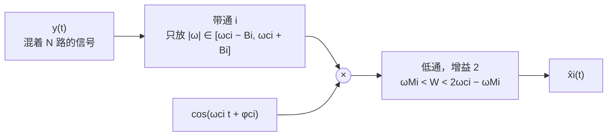
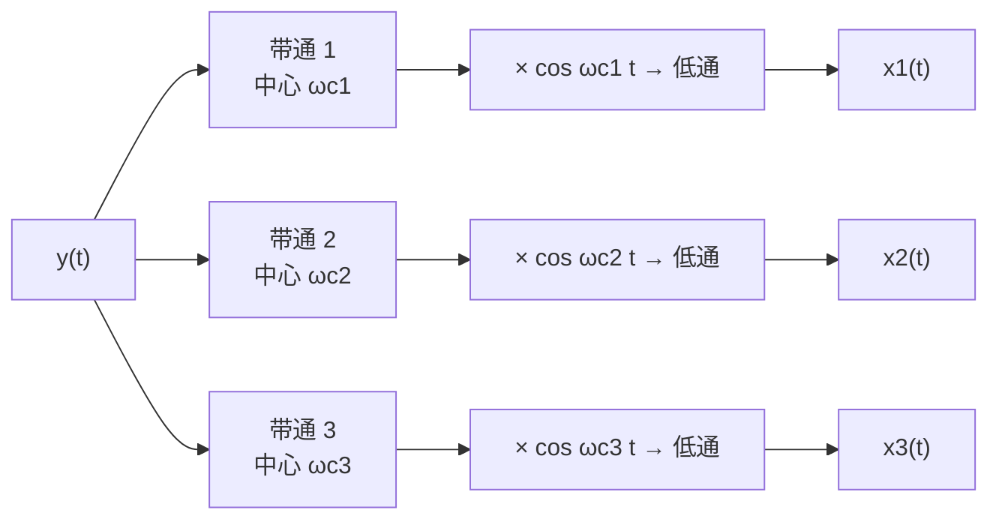

# 8.3 频分复用与带通信道

> [!abstract] 这一讲的任务
> 前两节把"一路信号怎么搬上去、怎么搬回来"走通了。可现实是一根电缆要跑几千路电话、一片空域要容纳几百个电台——**凭什么互不干扰？**
> 答案只用两个已经学过的动作：发端给每一路配一个**不同**的载波，把它们的谱排到互不重叠的高频段上；收端先用**带通**把属于自己那一段挑出来，再走一遍上一节的解调流程。
> 这一节要把"不重叠"写成不等式（相邻频带之间要留多宽的缝）、把解复用的三步画清楚（带通 → 相乘 → 低通，少一步都不行），并算清这个方案真正的代价。

> [!info] 授课进度说明
> 本篇的主干——合并、解复用的三步、保护间隔与"为什么必须留缝"——都已在课堂上讲过，**没有未讲的小节**。只有"交调"和"各路载波要不要等间隔"两处属于教材与工程上的延伸，课堂没有展开，正文里已就地注明。

---

## 一根电缆里放很多路：给每一路配一个载波

**先看一个最贴切的比方：高速公路。** 修好的路如果只放一台车跑，那是浪费；所以修成双向八车道，一台车占一条，车道之间画上线，谁都不碰谁。频带就是这条路——**信道资源极其昂贵，你买到的是一段频率，不是整片天空**。于是做法很自然：把这条"路"切成若干条车道，每条车道上跑一路信号，各用各的载波。

设要同时传 $N$ 路互不相关的信号 $x_1(t),\dots,x_N(t)$，第 $i$ 路的带宽为 $B_i$（即 $X_i(j\omega)=0,\ \lvert\omega\rvert>B_i$）。**每一路配一个自己的载波**，频率各不相同：

$$y(t)=\sum_{i=1}^{N}x_i(t)\cos\omega_{ci}t$$

频域上由线性性直接相加：

$$Y(j\omega)=\sum_{i=1}^{N}\frac12\Big[X_i\big(j(\omega-\omega_{ci})\big)+X_i\big(j(\omega+\omega_{ci})\big)\Big]$$

每一路都被搬成"一对副本"，落在 $\pm\omega_{ci}$ 附近。**只要这些副本互不搭界，$Y(j\omega)$ 里就还认得出每一路。**

![[C8.3-频分复用的频带分配.png]]

上图上半是三个基带信号，下半是调制并相加之后的谱。注意三件事：

1. **每份都被砍了一半高度**（正弦载波的代价，上一节已经算过），这一半靠收端低通增益 2 补回来；
2. **负频率那半边同样排满了**——实信号的谱一定成对出现，实信号不会因为"信息只在正频率"就省掉半边带宽。所以第 $i$ 路实际占用的是两条宽 $2B_i$ 的带子；
3. **三段的形状、宽度各不相同**（一个是平顶、一个是三角、一个是半圆）。这不是为了好看：排频带时**只按宽度排，不管形状**，形状不同恰好说明"每一路的内容确实不一样"。

**这条"路"能切出多少车道，取决于每一路有多窄。** 语音信号只要 $3\ \mathrm{kHz}$ 左右就能听懂，$8\ \mathrm{kHz}$ 就足够分得出是谁在说；而一路模拟电视就要几兆赫兹。基带越窄，同一段频带里排得下的车道越多——**复用的密度是被每一路的带宽限住的**。

**"宽带所以速度快"也就是这件事。** 一个人说话，信息只能从一条车道上慢慢流；把同一批数据分到几十条载波上同时发出去，收端再各归各位，单位时间送过去的东西自然多。所以工程上说的"带宽宽"、"速率高"，本质上就是本节这套并行搬移：**用频率资源换同时**。

---

## 解复用：带通选台，再搬回基带

接收端拿到的是一条混在一起的 $y(t)$。要取出第 $i$ 路，**三步缺一不可**：

> [!important] 三步各自解决一个问题，一步都不能省
> 1. **带通**：把别的路全部扔掉。它输出的仍然是一个**带通信号**（谱在 $\pm\omega_{ci}$ 附近，不在零附近），所以还不能直接听；
> 2. **相乘**：把这段谱搬回零附近。这一步与上一节的同步解调完全一样——**带通选的是"哪一路"，相乘做的是"搬回基带"**；
> 3. **低通**：滤掉相乘产生的 $2\omega_{ci}$ 分量，同时用增益 2 把幅度补回来。
>
> 常见的错误是以为"带通选出来就完了"。**带通之后如果不相乘，输出是中心在 $\omega_{ci}$ 的窄带信号**，人耳听不见，示波器上是一团高频振荡——信息在，但地址不对。
> 另一个方向的错误是**省掉带通、直接拿 $\cos\omega_{ci}t$ 去乘整条 $y(t)$**。这时别的路并不消失：它们被搬到各自的差频 $\lvert\omega_{cj}-\omega_{ci}\rvert$ 上，那一堆差频都落在低通通带里，收下来的是一片混响。**带通的作用不是"让信号更强"，而是"让别的信号到不了差频"**——这就是解复用必须先选台的原因。

所有 $N$ 路并联起来，就是一台解复用器：

**"选台"就是换带通滤波器的中心频率**。老式收音机那个旋钮、手机里的信道选择，本质上都是在改这个中心频率——而载波频率可调，正是乘法器的固有性质（[[C8.1 幅度调制：把频谱搬到载波附近]]）。

---

## 相邻频带之间必须留缝

"不重叠"不能只写成 $\omega_{ci}\ne\omega_{cj}$，要写成宽度比较。第 $i$ 路占两条带子，正频率那条是

$$\big[\omega_{ci}-B_i,\ \omega_{ci}+B_i\big]$$

要让第 $i$ 路与第 $i+1$ 路互不侵入，最紧的排法是让它们首尾相接；实际工程一定再留一条**保护间隔**（guard band）$\Delta_i>0$：

$$\omega_{c(i+1)}-B_{i+1}\ \ge\ \omega_{ci}+B_i+\Delta_i$$

> [!important] 为什么必须有 $\Delta_i$
> **因为带通滤波器不是矩形。** 真实的滤波器有过渡带：通带边缘之外还要拉开一段才衰减到足够小。如果两路首尾相接，那过渡带一定骑在邻道的频带上——邻道的强信号就会**漏进**本道，这叫**串扰**（crosstalk）。语音的串扰听感是"背景里有人在说话"，图像的串扰是画面里叠着另一个台的影子。
>
> 保护间隔的宽度由**滤波器的过渡带宽度**决定：过渡带越宽，缝就要留得越宽，频带浪费越多。这就是"滤波器做不陡"要付的频谱代价。

教材里那个标准数字值得记住：**一路语音占 $300\sim3400\ \mathrm{Hz}$（约 $3.1\ \mathrm{kHz}$），而工程上按 $4\ \mathrm{kHz}$ 一路来排**。多出来的那 $0.9\ \mathrm{kHz}$ 就是保护间隔与滤波器过渡带的余量。**"信号带宽"与"信道间隔"是两个数，不要把前者当成后者。**

> [!warning] 两个容易混的点
> 1. **频分复用不要求各路载波等间隔**，只要求各段带宽互不重叠。等间隔只是排起来最省事、也最省总带宽的排法；
> 2. **复用之后总带宽不是各路带宽之和的两倍那么简单**：$N$ 路的基带一共只要 $\sum2B_i$（都在零附近），复用之后要 $\sum(2B_i)+$ 各段间隔，还得把整块搬到高频上去。**用频带换"同时传"，这就是复用的本质。**

---

## 频分复用的代价，以及它的替代方案

频分复用把"同时"做出来了，代价写在三个地方：

- **频带浪费**：保护间隔是纯浪费；而且每一路都占了上下两个边带（双边带），可信息其实只装了一份——这一条下一节就要砍掉一半；
- **滤波器要求高**：信道越多、间隔越窄，带通滤波器就越难做陡；
- **对非线性敏感**（此条为延伸，课堂未展开）：信道或放大器一旦有非线性，各路之间会产生**交调**（intermodulation），产生落在别人频带里的新频率分量，这种干扰靠滤波救不回来。

对照另外两种复用方式，更容易看清它"贵在哪"：

| 复用方式 | 分割什么 | 每路占什么资源 | 典型场景 |
|---|---|---|---|
| 频分复用 FDM | 频率 | 一段互不重叠的频带 | 模拟广播、老式载波电话、有线电视 |
| 时分复用 TDM | 时间 | 一帧里的一段时隙 | 数字电话、光纤传输 |
| 码分复用 CDM | 码型 | 全体共享同一段频带与时间 | 3G、卫星导航 |

**一句话记法：频分是"把路修宽、并排走"，时分是"轮流走"，码分是"同时走、各说各的语言"。** 无论哪一种，信号与系统这门课关心的始终是同一件事：**用乘法搬、用滤波选。**

---

## 配套实验：把这条链在 MATLAB 里跑一遍

实验题里有一道正是本节的全流程：**基带信号里放三个不同的频率成分**，用**三个不同的载波**分别搬上去，先看信道里合起来的谱，再用三个带通分别切出来、各自单独同步解调、低通还原，最后与原来的三路对比。

这一步一步都能在图上看到：信道里的谱是三簇互不重叠的块；带通切出来只剩一簇；相乘之后每簇变成"基带一块 + 二倍频一块"；低通之后只剩基带。**做这道题的价值在于它把"选台"和"搬回"两件事分开了**——看图就知道哪一步该出现什么。

---

## 课堂实录

这一节讲得比前两节都快，几处是口头补的：

- **车道线就是保护间隔**。切频带不是把谱紧挨着摆，车道之间要画线；谱上那条"缝"的宽度由滤波器过渡带决定，不是随便留的。
- **语音的带宽小得惊人**：$3\ \mathrm{kHz}$ 能听懂，$8\ \mathrm{kHz}$ 能分辨人，所以同一段频带里塞得下很多路。这也解释了为什么"带宽越宽速度越快"——多路并行。
- **接收端的顺序不能反**：信道里一波过来是一大包混在一起的信号，**必须先带通把各自切出来再解调**，一起解调只会混成一团。（为什么一起解调会混，正文那段"省掉带通"的补充就是把这个直觉算清楚。）

---

## 勘误

> [!bug] 原稿的三处读图提示
> | 位置 | 原稿画的 | 说明 |
> |---|---|---|
> | p.16 的 $Y(j\omega)$ | 只画了 $\omega>0$ 一侧的三段，坐标从 $0$ 起 | 实信号的谱必然有负频率镜像，负半边省略未画；排频带时两边要一起算，总占用是所画宽度的两倍 |
> | p.16 的 $Y(j\omega)$ | 三段的高度与各自的基带谱一样高，纵轴无刻度 | 按调制结论，每段高度应为基带的一半（正弦载波的 $\frac12$）；图上是示意，**不要据它判断幅度** |
> | p.17 的解复用框图 | 带通之后直接画出 $x_i(t)$，省略了相乘与低通 | 框图把后两步合在了箭头里；严格写要补 $×\cos\omega_{ci}t$ 与低通两步 |

---

## 速查

> [!tip] 频分复用一览
> | 量 | 式子或条件 |
> |---|---|
> | 发端合成 | $y(t)=\sum_ix_i(t)\cos\omega_{ci}t$ |
> | 第 $i$ 路占的频带 | 正频率段 $[\omega_{ci}-B_i,\ \omega_{ci}+B_i]$，负频率段镜像 |
> | 不重叠（含保护间隔） | $\omega_{c(i+1)}-B_{i+1}\ \ge\ \omega_{ci}+B_i+\Delta_i$ |
> | 解复用三步 | 带通（选台）→ 乘 $\cos\omega_{ci}t$ → 低通（增益 2） |
> | 低通截止 | $\omega_{Mi}<W_i<2\omega_{ci}-\omega_{Mi}$ |
> | 语音的工程数字 | 信号 $300\sim3400\ \mathrm{Hz}$，信道间隔 $4\ \mathrm{kHz}$ |
>
> **两条判据**：载频要高于带宽（$\omega_{ci}>B_i$）；相邻段之间要留出滤波器过渡带的宽度（$\Delta_i>0$）。
>
> **对照**：FDM 分频率、TDM 分时间、CDM 分码型；信号与系统的视角里永远是"乘法搬、滤波选"。

---

## 下一讲预告

回到那张频带分配图，眼睛盯住每一路占的两条带子上：一段高的、一段矮的——可这两段装的是**同一份信息**。

原因不难找：实信号的谱必须共轭对称，$X(-j\omega)=X^*(j\omega)$，所以把 $X$ 搬到 $+\omega_c$ 之后，那一段的左右两半互为镜像。**既然一半就够，为什么两半都发？** 砍掉一半，频带立刻省一倍，滤波器也不用做那么陡——这就是**单边带**。代价是：接收端再也看不出"原来的谱长什么样"，必须另想办法把它拼回来。两种拼法，下一节各给一个。

---

## 相关笔记 Related Notes

- 前置：[[C8.1 幅度调制：把频谱搬到载波附近]]（频谱搬移与不重叠条件）、[[C8.2 解调：同步解调与包络解调]]（解复用的最后两步）
- 后续：[[C8.4 单边带幅度调制]]（把每路的带宽再砍一半）
- 相关：[[C4.5 相乘性质与调制]]（频分复用在那里第一次出现）、[[C4.4 卷积性质与由微分方程表征的系统]]（带通滤波器的频率响应）

- 上一讲：[[C8.2 解调：同步解调与包络解调]]
- 下一讲：[[C8.4 单边带幅度调制]]
- 返回：[[信号与系统 MOC]]
