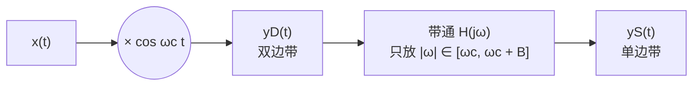
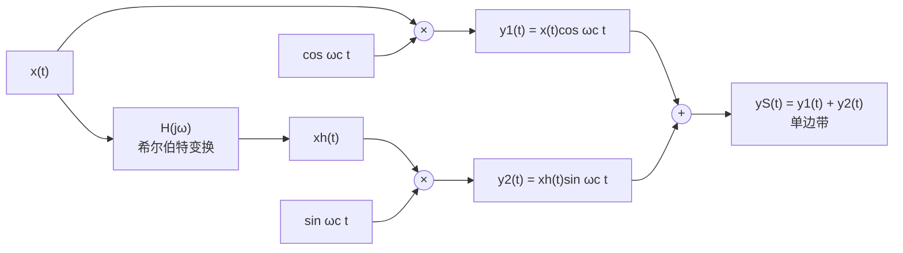

# 8.4 单边带幅度调制

> [!abstract] 这一讲的任务
> 频分复用把每一路都摆进自己的频带，可每一路都占着**两条**带子——上下两个边带。上一节结尾留下的问题是：这两个边带装的是**同一份信息**，凭什么发两遍？
> 砍掉一半，频带立刻省一倍，这是**单边带**（Single-Sideband, SSB）。代价是接收端再也看不到"原来的谱"，必须另想办法把信号拼回来。
> 这一节要把两件事讲到底：**只留一个边带，同步解调还能不能还原 $x(t)$**（能，但幅度只剩一半）；以及**怎么把另一个边带切掉**——两条路，一条靠滤波器（越陡越好），一条靠**希尔伯特变换**（把两路信号错开 $90^\circ$ 再相加，让不要的那一半自己抵消掉）。最后用一道"调制—带通—解调"的综合例题和一道 90° 移相网络的随堂测把整章收口。

> [!info] 授课进度说明
> 第 8 章已在课堂上讲完，`transcript/第八章-已合并.txt` 覆盖了本篇的主干：**边带的划分、只留一边还能不能还原、滤波法为什么不可行、希尔伯特法的两路相消**，以及配套实验的要求。**没有录到的是例题与那道 90° 移相网络的随堂测**，这两处仍按题面推出完整过程；滤波法的"矩形窗→吉布斯"那一段是课堂上花了不少时间讲、但属延伸的内容，已单独标出。

---

## 双边带：每个副本都被载频切成两段

先把"两个边带"看清楚。设基带谱是一个峰值 $A$、带宽 $\omega_m$ 的三角形，载频 $\omega_c>\omega_m$。

![[C8.4-双边带与两个边带.png]]

> [!important] 上边带与下边带的定义
> 每个副本都被 $|\omega|=\omega_c$ 切成两段：
> - **下边带**（lower sideband）：$\lvert\omega\rvert<\omega_c$ 的那一段，也就是**靠近载波**的那一半；
> - **上边带**（upper sideband）：$\lvert\omega\rvert>\omega_c$ 的那一段，也就是**远离载波**的那一半。
>
> 记两个边带各自的谱为 $Y_{\mathrm{dn}}(j\omega)$ 与 $Y_{\mathrm{up}}(j\omega)$，显然 $Y=Y_{\mathrm{dn}}+Y_{\mathrm{up}}$，且每份的峰值都是 $\frac{A}{2}$（正弦载波的老规矩）。

**为什么两个边带可以互相代替？** 因为 $x(t)$ 是实信号，它的谱一定满足共轭对称 $X(-j\omega)=X^*(j\omega)$。搬到 $+\omega_c$ 之后，那一段谱的左右两半就是彼此的镜像——**知道了左边，右边就被唯一确定**。所以：

- 双边带 DSB 每路占 **$2\omega_m$**；
- 单边带 SSB 每路只占 **$\omega_m$**。

换一个更直白的进入方式：**幅度调制动的是幅度，相位一点没动。** 幅度谱是偶函数，搬到载波两边之后仍然是"以载波为轴左右对称"的两块；一块靠里、频率更低（下边带），一块靠外、频率更高（上边带）。**对称意味着两块互为镜像：知道一块，另一块就被共轭对称唯一确定。所以只发一块，信息一点没少，少的只是那一半的幅度。** 这句话是整节单边带的出发点，也是后面那笔 $2$ 倍幅度账的根源。

频带减半，这是通信里最值钱的一半。**代价**：单边带信号不再具有"对称的两个副本"，接收端再也无法靠简单的低通把谱拼回原样——它必须用**同步解调**，并且要接受一个 $2$ 倍的幅度账。

---

## 只留一个边带，同步解调还能拼回去吗

先不看怎么切，只回答"能不能还原"。假设手上有纯净的下边带 $y_{\mathrm{dn}}(t)$，走一遍上一节的同步解调：乘 $\cos\omega_ct$，低通。

$$x_0(t)=y_{\mathrm{dn}}(t)\cos\omega_ct\quad\Longleftrightarrow\quad X_0(j\omega)=\frac12\Big[Y_{\mathrm{dn}}\big(j(\omega+\omega_c)\big)+Y_{\mathrm{dn}}\big(j(\omega-\omega_c)\big)\Big]$$

![[C8.4-单边带的频谱选择与解调.png]]

四张图连起来读：

1. (a) 双边带，橙色虚线标出要保留的那一半；
2. (b) 切完之后只剩**靠近载波**的两块三角（峰 $\frac{A}{2}$）；
3. (c) 乘 $\cos\omega_ct$ 之后，每块又被劈成两份：一份落回基带（峰 $\frac{A}{4}$），一份跑到 $\pm2\omega_c$（灰色）；
4. (d) 低通（增益 2）滤掉 $\pm2\omega_c$，得到**一个完整的三角形，但峰值是 $\frac{A}{2}$**。

> [!important] 结论：能还原形状，只剩一半幅度
> - **形状完全对**：$\lvert\omega\rvert<\omega_m$ 上的谱与 $X(j\omega)$ 一模一样，一个点都不缺。原因是两个副本各贡献一半——$+\omega_c$ 那份的下边带搬回后填满了 $[-\omega_m,0]$，$-\omega_c$ 那份填满了 $[0,\omega_m]$，拼起来正好是完整的 $X$；
> - **幅度只有一半**：滤波法的单边带信号本身峰值就是 $\frac{A}{2}$（双边带 $\frac{A}{2}$ 的一半带宽被扔掉了，幅度没变），解调时又挨一刀 $\frac12$，所以低通增益 2 之后只剩 $\frac{A}{2}$。**要拿回原幅度，低通增益得取 4。**
>
> 这一条在框图题里特别容易算错：**先数清一共几个 $\frac12$**——调制一个、单边带本身一个、解调一个，但单边带那个不改变高度（它只是把一半频谱扔掉），所以净剩两个 $\frac12$。

> [!warning] 一处标注要留神
> 上图 (d) 的标题按原稿写的是 $X(j\omega)$，但幅值标的是 $\frac{A}{2}$——**严格应写 $\frac12X(j\omega)$**。考试时按"低通增益 2、输出 $\frac12X$"来算，不要被标题里的符号骗到（见本篇勘误）。

---

## 方法一：带通滤波器把另一半切掉

最直接的办法：先做双边带，再用一个**带通滤波器**把不要的那份滤掉。

频域两行就写完了：

$$Y_D(j\omega)=\frac12\Big[X\big(j(\omega-\omega_c)\big)+X\big(j(\omega+\omega_c)\big)\Big],\qquad Y_S(j\omega)=Y_D(j\omega)H(j\omega)$$

通带取在 $[\omega_c,\ \omega_c+B]$ 与 $[-\omega_c-B,\ -\omega_c]$ 时，保住的是**上边带**；取在 $[\omega_c-B,\ \omega_c]$ 与对称位置时，保住的是**下边带**——两种取法都叫单边带，框图的差别只在滤波器通带放在载波的哪一侧。上图 (a) 里的橙色虚线框就是后一种：保留靠近载波的那一半。

> [!warning] 难在哪：过渡带要"陡"，而带宽偏偏很"窄"
> 带通滤波器不是矩形：通带边缘外面有过渡带。要让邻边带（宽 $\omega_m$）不被带进来，过渡带必须比 $\omega_m$ 窄得多，也就是**归一化陡度**（过渡带宽度 ÷ 通带宽度）要非常小。
>
> - 载频高、基带窄（语音：$300\sim3400\ \mathrm{Hz}$，相对带宽不到 $10\%$）时，这个要求极其苛刻，实际滤波器做不到干净切割；
> - 于是工程上常用折中：**残留边带 VSB**（vestigial side-band）——不切干净，故意留一小段另一侧的边带，配合接收端的补偿滤波把失真抵掉。电视图像传输用的就是 VSB。
>
> 换句话说，**滤波器法的问题不在原理，而在"做不出来"**：频率越高、带宽越窄，所需的 $Q$ 值就越高。这才逼出了第二种方法。

**把这条链条写完整，滤波法被判死刑的理由就三条**（课堂上是按这个顺序推的）：

1. **理想的方盒子滤波器不存在。** 通带增益 1、带外 0、边界一刀切——这样的通带在时域对应一个拖到无穷远的 $\mathrm{Sa}$ 型冲激响应，不卷积无穷长就做不出来；能做出来的滤波器，通带之后总有一段从 $1$ 缓慢降到 $0$ 的**过渡带**。
2. **过渡带一出现，"切一半"就不再成立。** 双边带的两个边带在 $\omega_c$ 处是**紧挨着**的，中间没有缝。理想方盒子可以从 $\omega_c$ 一刀切；有过渡带时，过渡带里的增益既不是 $1$ 也不是 $0$，**"上边带残留多少、下边带损失多少"同时发生**。
3. **后果是混叠，不可逆。** 漏进来的邻边带与留下的边带在频率上重叠，重叠之后没有任何滤波器能把它们分开——**这不是"稍微糊一点"，而是信息被不可逆地搅在一起**。

> [!note] 延伸：为什么"频域方盒子"一定做不到——矩形窗、吉布斯与泄漏
> 这一段讲得比原稿多，且**不在第 8 章的主线上**（考试不作要求），但它把"做不出来"三个字坐实了，值得看一眼。
> - **时域截断 = 乘矩形窗，频域就是与 $\mathrm{Sa}$ 卷积。** 矩形窗的谱主瓣窄、旁瓣按 $1/\omega$ 慢慢衰减，卷积之后原本干净的两根谱线外会多出一片东西，这就是**频谱泄漏**；窗的端点越"硬"（方盒），漏得越多。
> - **反过来的道理一样。** 想让频域是个方盒子，时域就得是无限长的 $\mathrm{Sa}$——截不了、也算不完。工程上退一步用"端点渐变到零"的窗（汉宁、海明），断点没有了，泄漏被压低，代价是主瓣变宽：**频率分辨率和泄漏是同一个旋钮的两头**。
> - **断点为什么危险。** 不是整周期截断时，接缝处把两段信号硬接起来，形成一个断点；断点附近必然出现过冲与振荡，这就是吉布斯。用窗把端点压到零，接缝就"接得上"，振荡随之消失；语音分帧之所以要**留重叠**，就是为了把被窗压小的那两段补回来。
> - 这些在 [[实验2.1 窗函数的特性分析]] 与 [[C3.3 傅里叶级数的收敛与吉布斯现象]] 里都有对照图。**回到单边带：滤波器法要求的是"频域方盒子"，而方盒子做不到——这就是要把战场从频率转到相位的全部理由。**

---

## 方法二：希尔伯特变换——不切频率，改相位

### 先回答一个更基本的问题：这个变换是什么

> [!question] 停一下：如果滤波器做不陡，还能不能只发一个边带
> 能。思路要换：**不再靠"频率选择"扔掉一半，而是让两路信号相加，在不要的那一半上正好反号相消、在要的那一半上同号相加。**
> 要做到"反号相消"，需要一条与 $\cos\omega_ct$ 错开 $90^\circ$ 的载波 $\sin\omega_ct$；要让两路"配得平"，需要先把 $x(t)$ 本身也转 $90^\circ$。把信号整体转 $90^\circ$ 的那个操作，就是**希尔伯特变换**（Hilbert transform）。

**一句话人话定义：希尔伯特变换把信号里每个频率分量原地转 $90^\circ$，幅度一点不变。** 不是搬到别的频带，也不是滤掉什么，而是**每个频率各自在原地转向**：正频率分量滞后 $90^\circ$，负频率分量超前 $90^\circ$（这个符号相反是有原因的，下面马上讲）。

**名字怎么来的。** "希尔伯特"是人名（David Hilbert，20 世纪初的数学家）；"变换"在这里指一个**线性时不变系统**对信号的作用——凡是"用一条 $h(t)$ 描述的系统"对输入做的事，都可以叫某个变换。所以希尔伯特变换不是某种新数学，它就是一个特殊的频率响应：

$$H(j\omega)=-j\,\mathrm{sgn}(\omega)=\begin{cases}-j,&\omega>0\\[2pt] +j,&\omega<0\end{cases}$$

$-j$ 的模是 $1$、辐角是 $-90^\circ$，$+j$ 的模是 $1$、辐角是 $+90^\circ$。**模恒为 1** 这一条最关键：所有频率分量的幅度都不变，只有相位被拧了 $-90^\circ$（正频率）。这正是一个理想的"90° 移相器"。

> [!important] 三条立刻能验证的性质
> 1. $\cos\omega_0t\ \longrightarrow\ \sin\omega_0t$（正频率滞后 $90^\circ$）；$\sin\omega_0t\ \longrightarrow\ -\cos\omega_0t$。**转两次回到原信号的反相**，即 $H^2=-1$；
> 2. 它**不改变能量**：$\lvert H(j\omega)\rvert=1$，帕塞瓦尔两边一样（[[C4.3 连续时间傅里叶变换的性质]]）；
> 3. 它是**全通**的：任何频率都过，只是相位被改。所以"90° 移相网络"在工程上是一个**全通网络**（用两路近似的全通滤波器分别对正、负频率实现），不是带通。

**"全通"三个字用三句话就能记住：** 低通是"通带内增益 1、通带外 0"，高通反过来，**全通是处处 1**——每个频率成分的幅度都原封不动地过去，动的只有相位。所以希尔伯特变换器既不放大、也不衰减、更不选频，它唯一做的事是**给正频率加 $-90^\circ$、给负频率加 $+90^\circ$**。

**为什么 $j$ 就是"转 90°"。** $j=e^{j\pi/2}$，$-j=e^{-j\pi/2}$（[[C1.3 指数信号与正弦信号]]）。把频响乘到谱上，等于给每个频率分量加一个相位：$\omega>0$ 加 $-\pi/2$，$\omega<0$ 加 $+\pi/2$。**符号在正负频率上相反，正是"余弦变正弦"的必要条件**——$\cos\omega_0t$ 的两根谱线方向相同，转 $90^\circ$ 后才配得出 $\sin\omega_0t$ 那对**方向相反**的谱线。

**它自己的时域长什么样。** $H(j\omega)$ 的反变换是 $h(t)=\dfrac{1}{\pi t}$：一条在 $t=0$ 处**断开**的奇函数（$t\to0^-$ 时趋于 $-\infty$，$t\to0^+$ 时趋于 $+\infty$），左右两半分别对应 sgn 的两个取值。这说明它在零点上是**分两段**定义的，计算时要跳过 $t=0$。实验里要画它，通常只能取一个足够小的下限截断——这也正是它"理想但不可物理实现"的地方。

**它依赖哪个前置工具？** 只依赖两件事，都在前面学过：一是频率响应 $H(j\omega)$ 与"乘频响 = 改幅度与相位"（[[C4.4 卷积性质与由微分方程表征的系统]]），二是欧拉公式与复指数（[[C1.3 指数信号与正弦信号]]）。**没有额外的数学负担。**

### 把两路信号错开 90° 再相加

结构是标准的两路正交结构（与 [[C8.1 幅度调制：把频谱搬到载波附近]] 那个"复指数载波的实现"是同一套零件）：

频域逐步写清楚（记 $X_h(j\omega)=X(j\omega)H(j\omega)=-j\,\mathrm{sgn}(\omega)X(j\omega)$）：

$$Y_1(j\omega)=\frac12\Big[X\big(j(\omega-\omega_c)\big)+X\big(j(\omega+\omega_c)\big)\Big]$$

$$Y_2(j\omega)=\mathcal{F}\{x_h(t)\sin\omega_ct\}=\frac{1}{2j}\Big[X_h\big(j(\omega-\omega_c)\big)-X_h\big(j(\omega+\omega_c)\big)\Big]$$

$$Y_S(j\omega)=Y_1(j\omega)+Y_2(j\omega)$$

![[C8.4-希尔伯特法生成单边带.png]]

五张图就是这条链的账：

- (a) 基带谱；(b) 转 $90^\circ$ 之后：**幅度谱没变，但它变成了纯虚的**（正频率 $-j$、负频率 $+j$）——这正是"只改相位"的样子；
- (c) $Y_1$ 是普通双边带（两份，各 $\frac{A}{2}$）；
- (d) $Y_2$ 的每一份也是 $\frac{A}{2}$，但**符号在载频两侧反了过来**：靠载波那半边是正的、外侧那半边是负的（绿色实线；灰色虚线是 $Y_1$ 的样子，方便对比）；
- (e) 两者相加：**一侧同号相加、另一侧反号相消**，于是只剩靠近载波的一半，峰值回到原高度 $A$。

**为什么相加恰好"一侧加倍、另一侧归零"：三个因子配对就看出来了。**

- $\cos\omega_ct$ 的谱是 $\pm\omega_c$ 处**同号**的两根（各 $\frac12$）；
- $\sin\omega_ct$ 的谱是**反号**的两根：$\frac{\pi}{j}\delta(\omega-\omega_c)$ 与 $-\frac{\pi}{j}\delta(\omega+\omega_c)$——**外侧那根与内侧那根方向相反**（余弦的两根是同号的）；
- 希尔伯特把基带谱乘上 $\mp j$，而 $\sin$ 那一路的系数里本来就带着 $\frac{1}{j}$。**两者相乘，$j$ 与 $\frac1j$ 抵消**，相位因子整体不见，只剩一个实数的正负号。

所以 $Y_1$ 与 $Y_2$ 落在同一位置上的两块，**符号要么相同、要么相反，没有中间状态**：同侧同号就叠成两倍，同侧反号就相消为零。**要留哪一边，只由 $X_h$ 前面那个 $\pm j$ 决定**，与幅度、频率都无关。这正是"不切频率、只改相位"能做到单边带的原因。

> [!important] 为什么只留一个边带
> 看 (d) 的符号：$Y_2$ 在**靠近载波**的一侧与 $Y_1$ **同号**（两块叠起来变高），在**离开载波**的一侧与 $Y_1$ **反号**（彼此抵消）。所以 $Y_1+Y_2$ 只有靠近载波的一侧存活。
> **这里没有滤波，全靠相位关系。** 而相位关系只取决于 $X_h$ 的符号约定——所以选哪个符号，就决定了留哪个边带：
>
> | 希尔伯特滤波器的频响 | 相加后保留 | 名称 |
> |---|---|---|
> | $H(j\omega)=-j\,\mathrm{sgn}(\omega)$ | 下边带（$\lvert\omega\rvert<\omega_c$） | 下边带调制 |
> | $H(j\omega)=+j\,\mathrm{sgn}(\omega)$ | 上边带（$\lvert\omega\rvert>\omega_c$） | 上边带调制 |
>
> 另外注意 $y_2$ 前面配的是 $\sin\omega_ct$ 而不是 $\cos$——**$90^\circ$ 的两道：一路在基带转（希尔伯特），一路在载波转（$\sin$ 对 $\cos$）**。两处都转，最后才凑成"一侧相消"。

> [!warning] 幅度账：两种方法差一个 $2$
> 同一个基带谱、同一个载频：
> - **滤波法**输出的单边带峰值是 $\frac{A}{2}$（双边带的一半带宽，幅度不变）；
> - **希尔伯特法**输出的峰值是 $A$（两路相加把幅度补回去了）。
>
> 数值复核：取峰值 $A=2$ 的三角谱，滤波法输出峰值 $1.000$，希尔伯特法输出峰值 $1.9998$，相差 $2$ 倍 ✓。
>
> 所以要写"与教科书一致的 $y=\frac12\big[x(t)\cos\omega_ct\mp x_h(t)\sin\omega_ct\big]$"时，前面那个 $\frac12$ 就是用来和滤波法对齐的。**做题时先看框图给的增益，再决定用哪个版本**；两条路的功率也不同，不能混用。

---

## 例题：调制—带通—解调，一条链走完

> [!example] 题目
> 已知 $x(t)\leftrightarrow X(j\omega)$，$X(j\omega)$ 是峰值 $2$、占据 $\lvert\omega\rvert\le10$ 的三角形。系统如下：$x(t)$ 先乘 $\cos100t$ 得 $B$；$B$ 过带通 $H_1(j\omega)$（通带 $80\le\lvert\omega\rvert\le100$，增益 $1$）得 $C$；$C$ 再乘 $\cos100t$ 得 $D$；$D$ 过低通 $H_2(j\omega)$（截止 $15$，增益 $1$）得 $y(t)$。
> (1) 求 $A,B,C,D$ 各点与 $y(t)$ 的频谱并画图；(2) $y(t)$ 与 $x(t)$ 是什么关系？

**第 0 步：把载波的谱写出来。** $A$ 点就是载波本身：

$$X_A(j\omega)=\mathcal{F}\{\cos100t\}=\pi\big[\delta(\omega-100)+\delta(\omega+100)\big]$$

**第 1 步：调制（$B$ 点）。** 用相乘性质，与两根冲激卷积就是把 $X$ 复印两份、各降一半：

$$X_B(j\omega)=\frac{1}{2\pi}X(j\omega)*X_A(j\omega)=\frac12\Big[X(\omega-100)+X(\omega+100)\Big]$$

三角形峰 $2$ 压一半变 $1$，各自占据 $[90,110]$ 与 $[-110,-90]$。

**第 2 步：带通（$C$ 点）。** $H_1$ 只放 $80\le\lvert\omega\rvert\le100$，于是每个副本只留下**靠近载波的那一半**：

$$X_C(j\omega)=X_B(j\omega)H_1(j\omega)$$

$+100$ 那份只剩 $[90,100]$：从 $0$ 一路上升到 $\omega=100$ 处的 $1$，然后被滤波器一刀切断（图上是一段竖直边）。$-100$ 那份对称地只剩 $[-100,-90]$。**注意：这一步就是"单边带"的实现**，切掉的正是上边带。

**第 3 步：再乘一次 $\cos100t$（$D$ 点）。**

$$X_D(j\omega)=\frac12\Big[X_C(\omega-100)+X_C(\omega+100)\Big]$$

把每块碎片各搬两份：

- $C$ 在 $[-100,-90]$ 的那块往右搬 $100$，落到 $[0,10]$，幅度再减半（峰 $1$ 变 $\frac12$）；
- $C$ 在 $[90,100]$ 的那块往左搬 $100$，落到 $[-10,0]$，峰值 $\frac12$；
- 两块在 $\omega=0$ 处首尾相接，**拼成一个完整的、峰值 $\frac12$、底宽 $\pm10$ 的三角形**；
- 同时每块还各往反方向搬了一份，落到 $\pm[190,200]$，峰值 $\frac12$。

**第 4 步：低通（输出）。** $H_2$ 截止 $15$，把 $\pm200$ 那份全扔掉，只留基带三角：

$$Y(j\omega)=X_D(j\omega)H_2(j\omega)=\frac14X(j\omega),\qquad y(t)=\frac14x(t)$$

![[C8.4-例题-调制带通解调一条链.png]]

> [!important] 这道题要读出三件事
> 1. **为什么是 $\frac14$**：两个 $\frac12$ 相乘——调制一个（$X_B$ 减半）、解调一个（$X_D$ 再减半）；带通与低通的增益都是 $1$，不再添系数。**遇到"几个 $\frac12$"的问题，就把每一次乘法各记一笔。**
> 2. **为什么只留一个边带还能拼回完整的 $X$**：上一步已经算过，$+100$ 那份的保留段搬回来填 $[-10,0]$，$-100$ 那份的保留段填 $[0,10]$，**两块互补**。这就是"单边带足够携带全部信息"在这道题里的具体样子。
> 3. **$\omega=0$ 处那个尖点不用慌**：两块碎片在此相接，各自从一侧逼近 $\frac12$；若严格按公式在 $\omega=0$ 取值，两项都落在了各自的跳变点上，相加会得到 $1$。**那是单点的取值约定，测度为零，不影响 $y(t)$**，画图时按平台的 $\frac12$ 画即可。
>
> 数值复核：按解析式在 $\pm300$ 的网格上逐点比较，$\max\lvert Y(j\omega)-\frac14X(j\omega)\rvert<5\times10^{-16}$（$\omega=0$ 那个跳变点除外）✓

---

## 随堂测：90° 移相网络做出的单边带

> [!question] 题目（主观题 10 分）
> 下图用 $90^\circ$ 移相网络做单边带调制。$x(t)$ 是输入，其傅里叶变换 $X(j\omega)$ **纯虚**，形状如右图（$\omega<0$ 一侧为正的虚部，$\omega>0$ 一侧为负的虚部）。移相网络的频响为
> $$H(j\omega)=\begin{cases}+j,&\omega>0\\[2pt]-j,&\omega<0\end{cases}$$
> 即 $H(j\omega)=j\,\mathrm{sgn}(\omega)$。结构：上路 $y_1=x\cos\omega_ct$；下路先过 $H(j\omega)$ 得 $x_p(t)$，再乘 $\sin\omega_ct$ 得 $y_2$；$y=y_1+y_2$。
> (1) 画出 $Y_1(j\omega)$、$Y_2(j\omega)$ 与 $Y(j\omega)$；(2) 证明**只保留了上边带**。

**第一步：$Y_1$ 是标准双边带。**

$$Y_1(j\omega)=\frac12\Big[X\big(j(\omega-\omega_c)\big)+X\big(j(\omega+\omega_c)\big)\Big]$$

**第二步：$x_p$ 与 $Y_2$。** 注意这里的 $H(j\omega)=j\,\mathrm{sgn}(\omega)$，与上一小节的 $-j\,\mathrm{sgn}(\omega)$ **差一个负号**，所以它留下的是另一个边带。代进去：

$$X_p(j\omega)=H(j\omega)X(j\omega)=j\,\mathrm{sgn}(\omega)X(j\omega)$$

$$Y_2(j\omega)=\mathcal{F}\{x_p(t)\sin\omega_ct\}=\frac{1}{2j}\Big[X_p\big(j(\omega-\omega_c)\big)-X_p\big(j(\omega+\omega_c)\big)\Big]$$

**第三步：证明只留上边带。** 关键条件是"$X(j\omega)$ **纯虚**"。纯虚意味着 $X^*(j\omega)=-X(j\omega)$；再配上实信号必有的共轭对称 $X(-j\omega)=X^*(j\omega)$，两条合起来就是

$$X(-j\omega)=-X(j\omega)\qquad(\text{纯虚 }X\text{ 是奇的})$$

于是对任意小的 $\delta>0$，在 $\omega=\omega_c+\delta$（**载波外侧**）与 $\omega=\omega_c-\delta$（**载波内侧**）两处分别算：

- **外侧** $\omega=\omega_c+\delta$：$Y_1$ 只有第一项存活，$\frac12X(j\delta)$；$Y_2$ 中 $X_p(j\delta)=j\,\mathrm{sgn}(\delta)X(j\delta)=jX(j\delta)$，代入 $\frac{1}{2j}$ 得 $+\frac12X(j\delta)$。**两项同号相加，留下**；
- **内侧** $\omega=\omega_c-\delta$：$Y_1$ 的第一项是 $\frac12X(-j\delta)=-\frac12X(j\delta)$；$Y_2$ 中 $X_p(-j\delta)=j\,\mathrm{sgn}(-\delta)X(-j\delta)=(-j)\cdot(-X(j\delta))=jX(j\delta)$，代入 $\frac{1}{2j}$ 得 $+\frac12X(j\delta)$。**两项恰好反号，抵消**。

负频率一侧由共轭对称镜像得到同样的结论：**保留的是 $\lvert\omega\rvert>\omega_c$ 的段落，也就是上边带。**

![[C8.4-随堂测-90度移相网络生成单边带.png]]

> [!important] 这道题真正考的是"符号"
> 两条链路唯一的差别是 $H(j\omega)$ 前面那个 $\pm j$，而它决定了留哪一边。**记住这张小表就不会错**：
> - $H=-j\,\mathrm{sgn}(\omega)$ ⇒ 保留下边带；
> - $H=+j\,\mathrm{sgn}(\omega)$ ⇒ 保留上边带。
>
> 另外，题目给"$X(j\omega)$ 纯虚"不是装饰：**纯虚（再配上共轭对称）才让 $X(j\delta)$ 与 $X(-j\delta)$ 差一个符号**，内外两侧才会一加一减。若换成实谱（实的偶函数），这个相消就不成立——那正是为什么题目要把它画成虚轴上的形状。
>
> 数值复核：按上式在 $\lvert\omega\rvert<\omega_c$ 上取最大值，得 $0.0$（严格相消）；在 $\lvert\omega\rvert>\omega_c$ 上取最大值，得 $1.0$ ✓。

---

## 配套实验与作业：两组，都要"手搓 + 调函数对比"

这一章的实验是**两组**，都要求先用基本原理自己写一遍，再调现成函数对一遍——**两边对不上就说明哪一步理解错了**：

1. **调制与解调**（抑制载波 + 带载波两种各做一遍）。自己乘 $\cos\omega_ct$、自己低通，观察"三簇谱"：信道里两簇边带、解调后再冒出一簇基带；带载波那组还要在 $\pm\omega_c$ 看到两根冲激。然后把同一套流程换成 `modulate` / `demodulate` 再跑一次，两条曲线应当重合。
2. **希尔伯特法单边带**。一路 $x\cos\omega_ct$，一路先 `hilbert` 再乘 $\sin\omega_ct$，两路相加；与 `modulate(x, fc, fs, 'amssb')` 对比。**注意 `hilbert` 返回的是解析信号：实部就是原来的 $x$，虚部才是希尔伯特变换的结果**——取错一半，单边带就变成双边带。
3. 另外还有一道**频分复用全流程**题（见 [[C8.3 频分复用与带通信道]]）。

两个函数的关键参数：`fc` 是载频、`fs` 是抽样率（决定一秒钟取多少个点，也就决定了 FFT 的点数），第四个数选调制种类（`amdsb-sc` 抑制载波双边带、`amdsb-tc` 带载波、`amssb` 单边带）。**不要只跑一遍参考代码**：换载频、换基带频率、换滤波器截止，看哪条曲线先坏，比背结论有用。

---

## 课后延伸：从卷积的记忆长度到序列模型

课堂上最后聊了一段与本章无关、但和这门课关系最深的话，简单记三点。

**第一，卷积里那个"翻转"是在量记忆。** 给系统一个冲激，响应 $h$ 从零时刻开始衰减，衰减到零的那一段长度就是**记忆长度** $N_0$：$0$ 时刻的输入，只影响到 $N_0$ 步之后。把 $h$ 翻过来与 $x$ 逐点相乘，相当于问"当前输出受前面几步的影响、各占多大权重"——**离得越远，权重越小**。图像里叫**感受野**，序列里叫记忆长度，其实是同一个量。

**第二，有没有反馈，决定记忆是有限还是无限。** 前向型 $y[n]=a_0x[n]+a_1x[n-1]+a_2x[n-2]$ 的冲激响应只有三个非零点，叫**有限长冲激响应**（FIR），记忆长度被系数个数锁死；只要加一个反馈项

$$y[n]-\tfrac12y[n-1]=x[n]\quad\Longleftrightarrow\quad H(e^{j\omega})=\frac{1}{1-\tfrac12e^{-j\omega}}\quad\Longleftrightarrow\quad h[n]=\Big(\tfrac12\Big)^n u[n]$$

一个参数就换来**无限长冲激响应**（IIR）——代价是它有反馈，会积累误差（这正是循环网络训练不稳定的根源）。

**第三，现在的序列模型就是在拉长这个记忆。** 卷积核越大、层数越深，感受野越大（两个 $3\times3$ 叠起来约等于一个 $5\times5$，乘法 $18<25$）；Transformer 用注意力一跳直达远处；Mamba 一类**状态空间模型**干脆回到 IIR 式的反馈结构，用很少的参数换无限长记忆。**这门课里的"卷积、冲激响应、记忆性"，就是这些东西的地基**（对照 [[C2.3 LTI系统的性质]] 的记忆性与 [[C5.4 卷积性质与由差分方程表征的系统]]）。

---

## 课堂实录

单边带这一节是整章讲得最久的一节，顺序大致是：

1. 先用"幅度谱偶对称"把**为什么可以只发一半**说成一句常识，再把靠里的叫 lower、靠外的叫 upper；
2. 接着验证**只留一边还能不能还原**：搬回去之后两边各贡献一块，在基带首尾相接，拼出来只剩半个幅度——**给 4 倍增益才回到原来，2 倍增益就是你看到的样子**；
3. 然后问"怎么只留一边"，先走**滤波法**，再把理想方盒子、过渡带、混叠一路推到底，判定它在工程上不可行；
4. 最后换成**希尔伯特法**：先把 90° 移相说成"全通、只改相位"，再用正弦载波那对反号的谱线解释两路为什么能一加一减。

课上还特别提醒了两处实操细节：`hilbert` 要用虚部；画 $1/(\pi t)$ 时零点要跳过，否则曲线会断成两截。

---

## 勘误

> [!bug] 原稿的问题（四处，做题以修正值为准）
> | 位置 | 原稿写的 | 核对结果 |
> |---|---|---|
> | p.19 末图 | 低通输出标成 $X(j\omega)$，峰值却标 $\frac{A}{2}$ | 增益 2 之后输出是 $\frac12X(j\omega)$；**标号与幅值对不上**，正文按 $\frac12X$ 理解 |
> | p.19 与 p.24 | 同为"单边带"，一处峰 $\frac{A}{2}$、一处峰 $A$ | 不是笔误，而是**两种实现的幅度约定差 $2$ 倍**：滤波法保留 $\frac{A}{2}$，希尔伯特法两路相加得 $A$。要与滤波法对齐，希尔伯特法须写成 $\frac12[x\cos\omega_ct\mp x_h\sin\omega_ct]$ |
> | p.24 四张频谱图 | 未标各图的峰值 | 按 $H(j\omega)=-j\,\mathrm{sgn}(\omega)$ 复算：$Y_1$ 峰 $\frac{A}{2}$、$Y_2$ 峰 $\pm\frac{A}{2}$、$Y_S$ 峰 $A$（图题写的是下边带调制） |
> | p.25–29 例题 | 未标 $X_C$ 在 $\omega=100$ 处为何是竖直边 | 那是带通 $H_1$ 的截止造成的**跳变**（不是画错）；$\omega=0$ 处的尖点同理 |

---

## 速查

> [!tip] 单边带一览
> | 项目 | 式子或结论 |
> |---|---|
> | 双边带谱 | $Y=\frac12\Big[X\big(j(\omega-\omega_c)\big)+X\big(j(\omega+\omega_c)\big)\Big]$，每份峰 $\frac{A}{2}$ |
> | 边带划分 | 下边带 $\lvert\omega\rvert<\omega_c$；上边带 $\lvert\omega\rvert>\omega_c$；**两者同信息** |
> | 带宽 | DSB 占 $2\omega_m$；SSB 占 $\omega_m$ |
> | 单边带解调 | $X_0=\frac12\big[Y_S(j(\omega+\omega_c))+Y_S(j(\omega-\omega_c))\big]$，低通增益 2 ⇒ 输出 $\frac12X$ |
> | 滤波法 | $y_D=x\cos\omega_ct$ 过后接带通；输出峰 $\frac{A}{2}$；难点是过渡带要远窄于 $\omega_m$ |
> | 希尔伯特法 | $y_S=x\cos\omega_ct\pm x_h\sin\omega_ct$；$H=-j\,\mathrm{sgn}$ 得下边带，$+j\,\mathrm{sgn}$ 得上边带；输出峰 $A$ |
> | 希尔伯特变换本身 | $h(t)=\dfrac{1}{\pi t}$（$t=0$ 断开）；$\lvert H\rvert\equiv1$ 全通，相位 $\pm90^\circ$；把 $\cos$ 变 $\sin$、$\sin$ 变 $-\cos$，$H^2=-1$ |
> | 幅度记账 | 每个乘法记一个 $\frac12$；带通/低通只改通带、不改高度（增益另计） |
>
> **判据**：两条路差 $2$ 倍；先看框图增益再定系数。
>
> **实验速记**：`hilbert(x)` 的**虚部**才是变换结果；`modulate(x, fc, fs, 'amssb')` 可直接给单边带，`'amdsb-sc'` 是抑制载波双边带、`'amdsb-tc'` 是带载波。
>
> **例题结论**：调制 → 带通选边带 → 再乘 → 低通，得到 $y=\frac14x(t)$（两个 $\frac12$、两个单位增益滤波器）。

---

## 下一讲预告

到这里，第 8 章的四个动作已经连成一条线：**乘载波把谱搬上去（8.1）→ 再乘一次把它搬回来（8.2）→ 多路并排靠频带错开（8.3）→ 每路只发一半边带（8.4）**。全章只用了一个运算（相乘）和一个元件（滤波器）。

但这条线上一直有个东西被我们悄悄用掉了：**"用乘法把频谱搬走"这件事，其实等价于"采样"**。给 $x(t)$ 乘一个冲激串，频域就是无限次搬家——搬出来的那些副本一旦相互重叠，就再也分不开。什么时候不重叠？**答案是一个不等式，叫采样定理**，它是下一章（第 7 章）的主角，也是整个数字信号处理的入场券。第九章起还要换个视角：把 $j\omega$ 推广成复变量 $s$，那就是拉普拉斯变换。

---

## 相关笔记 Related Notes

- 前置：[[C8.1 幅度调制：把频谱搬到载波附近]]（复指数载波与两路正交实现）、[[C8.2 解调：同步解调与包络解调]]（同步解调与相位误差）、[[C8.3 频分复用与带通信道]]（带通选台）
- 相关：[[C4.5 相乘性质与调制]]（相乘性质与频移）、[[C4.3 连续时间傅里叶变换的性质]]（共轭对称、帕塞瓦尔）、[[C4.2 周期信号的傅里叶变换]]（冲激串与采样定理的伏笔）

- 上一讲：[[C8.3 频分复用与带通信道]]
- 下一讲：（第 7 章采样与第 9 章拉普拉斯变换尚未整理）
- 返回：[[信号与系统 MOC]]
