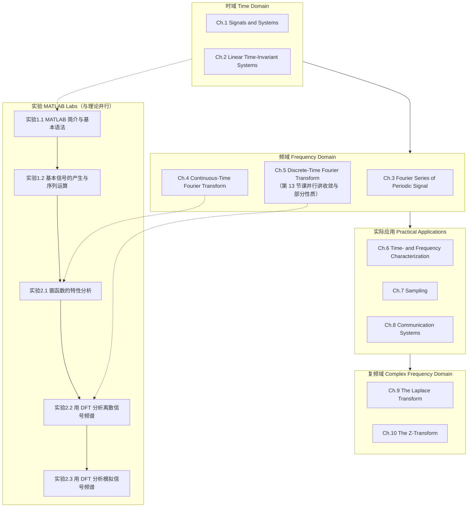
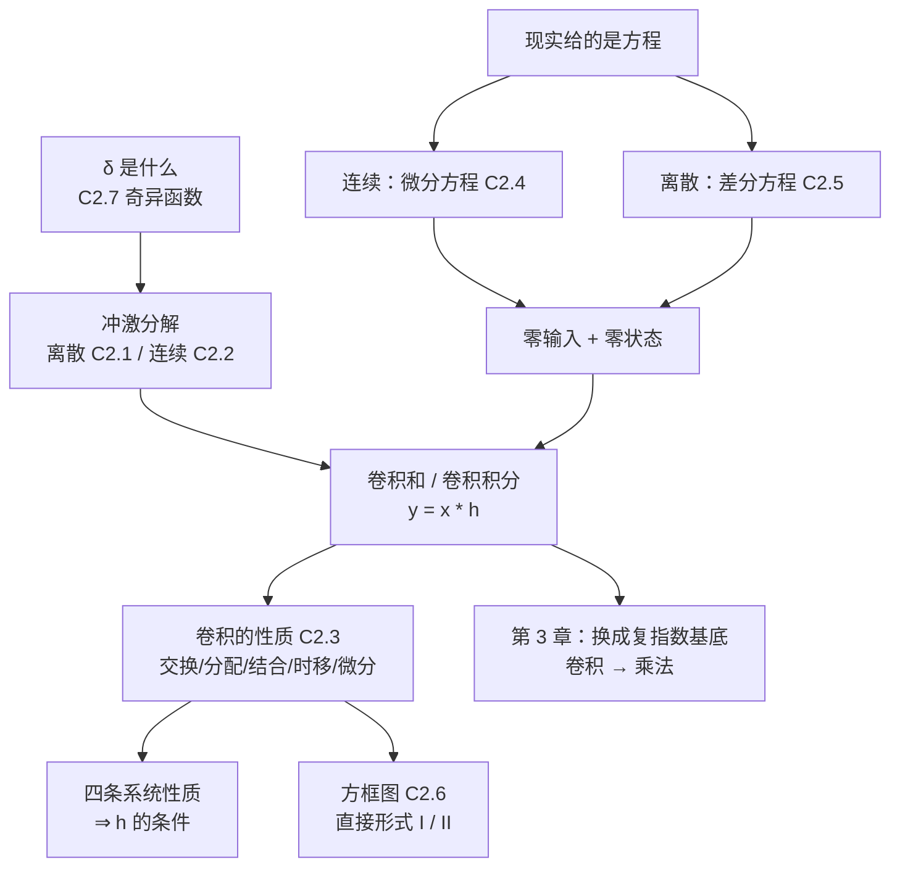
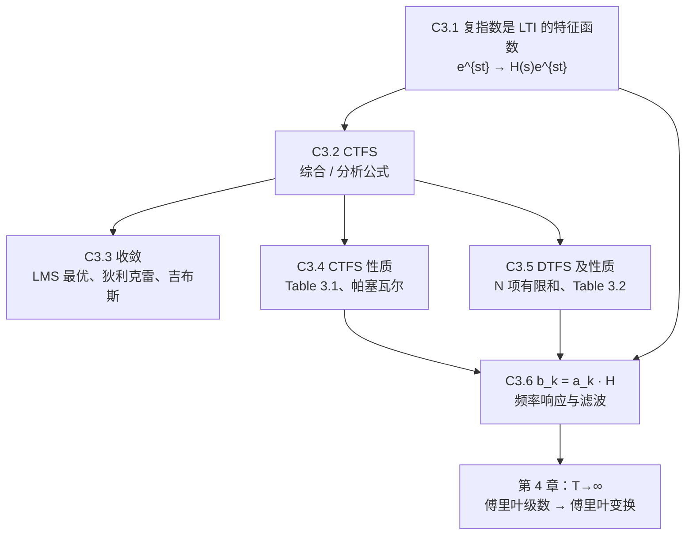
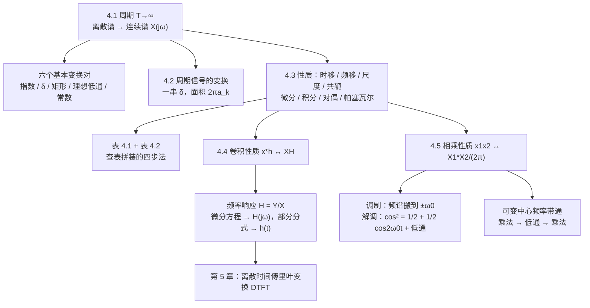
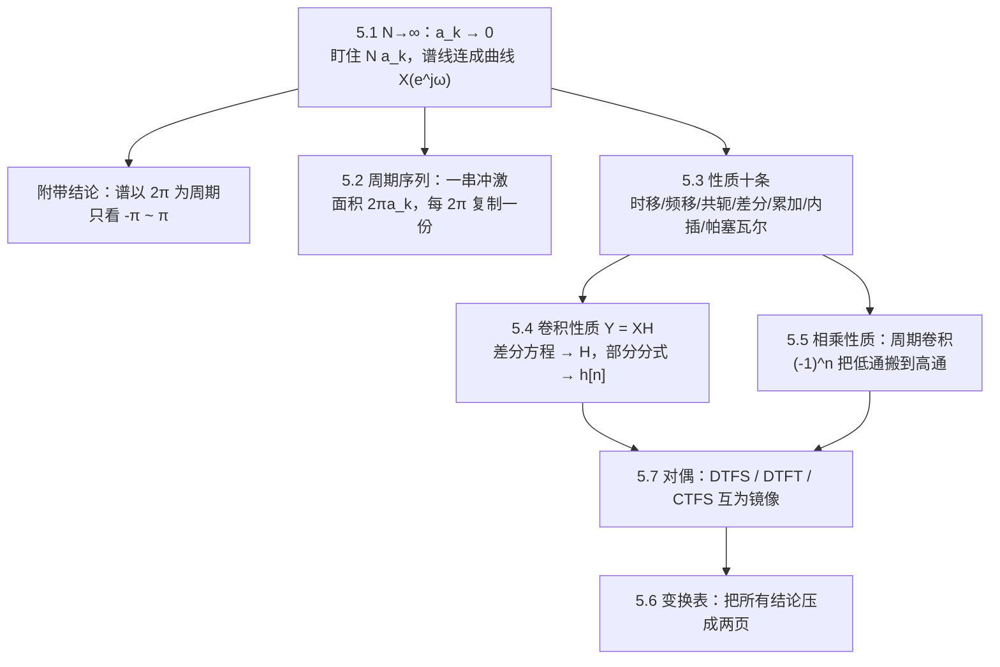

# 信号与系统 Signals and Systems — 课程索引 MOC

> [!info] 课程速览
> - **授课**：杨俊美（华南理工大学 电子与信息学院 副教授）｜yjunmei@scut.edu.cn｜13600497910
> - **开课单位**：未来技术学院 School of Future Technology
> - **课程网站**：https://ecourse.scut.edu.cn/web/gt/1/index.html?id=64312
> - **QQ 群**：信号与系统-25 人工智能，群号 1108991618
> - **教材**：Oppenheim《Signals and Systems》(2nd ed.)
> - **成绩**：考勤+作业 30 %｜期中 10 %｜期末 60 %

---

## 第 3–5 章并行阅读入口

优先读 [[C3–5 四种傅里叶表示并行讲义]]：按老师的授课方式，将 CTFS、DTFS、CTFT、DTFT 在同一主题下比较。原 16 篇分章笔记完整保留，新讲义也收入了它们的全部正文、例题、随堂题与 59 张图，并加入第十三节课。原分章篇首的进度记录仍是当时的快照，现时状态以新讲义第 18 节为准。

| 阅读问题 | 并行讲义落点 | 为什么接着读 |
|---|---|---|
| 为什么选复指数 | [[C3–5 四种傅里叶表示并行讲义#1. 共同起点：复指数、特征函数与频率响应\|第 1 节]] | 从 LTI 的特征函数得到逐频率乘权重 |
| 四套公式与四种矩形 | [[C3–5 四种傅里叶表示并行讲义#2. 四套公式：正交、有限维与周期趋于无穷\|第 2 节]]、[[C3–5 四种傅里叶表示并行讲义#3. 四种矩形并排：占空比、半角技巧与时宽带宽\|第 3 节]] | 先会分解与反演，再比较条件和操作 |
| 收敛、吉布斯、语音分帧 | [[C3–5 四种傅里叶表示并行讲义#5. 收敛与有限近似：四种情形到底各需要什么条件\|第 5 节]] | 区分无限表示与有限运算的误差 |
| 性质并排，尤其时移与频移 | [[C3–5 四种傅里叶表示并行讲义#6. 线性：同一组基底上的权重怎样组合\|第 6–12 节]] | 看清指数符号、变量与归一化 |
| 卷积、系统与对偶 | [[C3–5 四种傅里叶表示并行讲义#13. 卷积与相乘：普通卷积、周期卷积及归一化\|第 13–16 节]] | 从性质进入滤波、方程与采样 |
| 本学期实际进度、考试安排 | [[C3–5 四种傅里叶表示并行讲义#18. 课堂补充、考试安排与证据边界\|第 18 节]] | 不把旧篇“未讲”状态或未定日期当成新通知 |

| 公式速查 | 条件与落点 |
|---|---|
| $a_k=X(jk\Omega_0)/T$；离散端 $a_k=X(e^{jk\omega_N})/N$ | 周期化与频域采样，见并行讲义第 2、3、15 节 |
| 时移乘 $e^{-j\text{频率}\times\text{延迟}}$；频移在时域乘正复指数 | 级数的频移按谐波编号，DTFT 按 $2\pi$ 回绕，见第 7、8 节 |
| 未归一化周期卷积对应 $Ta_kb_k$ / $Na_kb_k$ | 普通全轴卷积与周期卷积须先分清，见第 13 节 |
| 周期看平均功率，有限能量信号看总能量 | 四种帕塞瓦尔并列，见第 12 节 |

---

## 讲次笔记 Lecture Notes

| # | 笔记 | 主题 | 日期 |
|---|---|---|---|
| 01 | [[L01 绪论 Introduction]] | 课程说明、时域与频域、傅里叶级数三形式、频谱、对 AI 的意义 | 2026-08-31 |
| 02 | 并入 [[C1.1 连续时间与离散时间信号]]、[[C1.2 自变量的变换]] | 信号分类、能量与功率、三种基本变换、离散周期性、奇偶分解 | — |
| 03 | 并入 [[C1.3 指数信号与正弦信号]]、[[C1.4 单位冲激与单位阶跃函数]] | 指数信号与正交基底、CTFS/DTFS、冲激与第三种信号分解 | — |
| 04 | 并入 [[C1.4 单位冲激与单位阶跃函数]]、[[C1.5 连续时间与离散时间系统]]、[[C1.6 系统的基本性质]] | 连续冲激与阶跃（狄拉克函数、断点求导、$\delta(at)$ 书外结论与考试题型）、系统定义与三种互联、记忆性（开头） | — |
| 05 | 并入 [[C1.5 连续时间与离散时间系统]]、[[C1.6 系统的基本性质]] | 反馈与控制视角（闭环=控制基础、定速巡航）、**RC 电路例（Example 1.8 实际在第五节课讲，不是第四节）**、记忆性（回声例、记忆长度、广义记忆）、可逆（恒等系统、累加↔差分）、因果（在线 / 离线、滑动平均=去噪）、稳定（BIBO、摩天大楼抗风、RNN 梯度爆炸）、时不变三步法与线性四步法、LTI ⇔ 常系数方程 | — |
| 06 | 并入 [[C2.1 离散时间LTI系统与卷积和]]、[[C2.2 连续时间LTI系统与卷积积分]] | 卷积和的由来与五步法、**列表法**、卷积积分与分段计算 | — |
| 07 | 并入 [[C2.1 离散时间LTI系统与卷积和]]（§9 CNN）、[[C2.3 LTI系统的性质]]、[[C2.7 奇异函数]] | CNN = 相关、感受野；交换 / 分配 / 结合律、串联是卷积不是乘法、时移与微分性质、冲激偶 $\delta'(t)$ | — |
| 08 | 并入 [[C2.3 LTI系统的性质]]、[[C2.4 微分方程与连续时间系统求解]] | **微分不变性 / 积分不变性**；用求导法算卷积（方波求导 = 两个冲激）；由 $x_1\to y_1$ 推 $y_2$ 的综合题（课堂原话：这类题经常拿来考试）；2.3.4 起四条系统性质塌成 $h$ 的条件、BIBO 的充分性推导、阶跃响应 $s$ 与 $h$ | — |
| 09 | 并入 [[C2.4 微分方程与连续时间系统求解]]、[[C2.5 差分方程与离散时间系统求解]] | 经典解法的缺陷（输入一变全部重解）；**零输入 + 零状态的剥离动机**、增量线性 $y=2x+3$；特征根三型；差分方程迭代法的优劣；特解撞特征根乘 $n$；离散"等效初始条件" | — |
| 10 | 并入 [[C2.5 差分方程与离散时间系统求解]]、[[C2.6 LTI系统的方框图表示]]、[[C2.7 奇异函数]]、[[C3.1 复指数是LTI系统的特征函数]] | **复指数是特征函数的完整证明**；为什么 $h$ 能代表系统（冲激含全频段）；离散零输入 / 零状态；方框图 Direct Form I / II 与积分器；§2.5 奇异函数表；**第三章导读**（周期信号 → 离散谱） | — |
| 11 | 并入 [[C3.2 连续时间傅里叶级数]]、[[C3.5 离散时间傅里叶级数DTFS及性质]] | **CTFS 全部主干**：谐波集与正交性（负共轭内积、可当基底、无穷维希尔伯特空间）、综合与分析公式、例 3.2 与带相位余弦、周期方波 → Sa 函数与**占空比**、幅度谱 / 相位谱、两种参数变化与 $T_0\to\infty$ 的极限；**DTFS 与 CTFS 串讲**：基底只有 $N$ 个 ⇒ 有限维，以及课堂教的对比记法 | — |
| 12 | 并入 [[C3.5 离散时间傅里叶级数DTFS及性质]]、[[C4.1 非周期信号的表示：连续时间傅里叶变换]]、[[C4.2 周期信号的傅里叶变换]]、[[C5.1 非周期信号的表示：离散时间傅里叶变换]] | **第 3/4/5 章串讲**：先复习 CTFS/DTFS 的公式与对偶；补讲**离散周期矩形**（例 2）的完整推导与**半角技巧**；再开第 4 章——把周期推到无穷、为什么必须盯 $Ta_k$、三处替换、矩形脉冲的**两种求法**、对偶的"动作"版本与**四种矩形信号**；**冲激串** $a_k=\frac1T$ 与采样定理铺垫；最后开第 5 章 **DTFT**（定义、$2\pi$ 周期性及证明、反变换推导、离散非周期矩形） | — |
| 13 | 并入 [[C3–5 四种傅里叶表示并行讲义]]，按主题并行整合；原分章笔记保留 | 四套公式复习；四种收敛、吉布斯；语音分帧、语谱图、加窗重叠；视觉与生成模型类比；线性、时移、频移；二维循环平移与幅度/相位实验；期中拟在 11 月中旬、线下手写、占 10%（具体日期未定） | — |

> [!note] 截至第 12 节课的第 4、5 章分章状态（历史记录）
> 第十三节课的新增讲授已进入 [[C3–5 四种傅里叶表示并行讲义]] 第 5–8 节；下两段保留第十二节课结束时的记录。
> **第 12 节课已经开讲第 4 章**，所以 [[C4.1 非周期信号的表示：连续时间傅里叶变换]] 与 [[C4.2 周期信号的傅里叶变换]] 现在算"讲过一半"；C4.3–C4.5 仍未讲授（老师当堂说"第四章就先说这些吧，其他内容我们下节课再讲"）。
> **第 12 节课也开讲了第 5 章 DTFT**（课件 `Chapter 5 The Discrete-time Fourier Transform.pdf`，p.1–17 正是 5.1）。这节课讲到的 DTFT 定义、$X(e^{j\omega})$ 的记法、$2\pi$ 周期性及其证明、反变换推导与离散非周期矩形，已整理成 [[C5.1 非周期信号的表示：离散时间傅里叶变换]]；C5.2–C5.5 是尚未讲授的部分，按课件与教材整理。

---

## Chapter 1　Signals and Systems 信号与系统

| 节 | 笔记 | 核心内容 |
|---|---|---|
| 1.1 | [[C1.1 连续时间与离散时间信号]] | 信号举例与数学表示（维度/通道）、连续 vs 离散、能量与功率、能量信号 / 功率信号判别 |
| 1.2 | [[C1.2 自变量的变换]] | 时移 / 时间反转 / 尺度变换、$x(at+b)$ 作图两条路径、周期信号、离散频率的 $2\pi$ 周期性、奇偶分解 |
| 1.3 | [[C1.3 指数信号与正弦信号]] | **频域的基底信号**：$e$ 的由来（连续复利极限）、欧拉公式与单频信号、谐波集与**正交性证明**、无穷维基底（希尔伯特空间）→ **CTFS**；一般复指数（包络×振荡）；离散实指数四形态、周期判据（$2\pi/\omega_0$ 有理）、基波频率 vs 谐波、离散谐波集只有 $N$ 个成员 → **DTFS** |
| 1.4 | [[C1.4 单位冲激与单位阶跃函数]] | **时域的基底信号**：$\delta[n]$ 与移位冲激、**第三种信号分解** $x[n]=\sum x[k]\delta[n-k]$（$x[k]$ 是值不是信号）；$\delta[n]$ / $u[n]$ 的差分与求和关系、抽样性质、$\delta(t)$ 的极限构造与近似、尺度性质 $\delta(at)=\delta(t)/\lvert a\rvert$ |
| 1.5 | [[C1.5 连续时间与离散时间系统]] | 系统定义与框图、RC 电路（微分方程）、银行账户（差分方程）、串联 / 并联 / 反馈互联 |
| 1.6 | [[C1.6 系统的基本性质]] | 记忆性、可逆性、因果性、稳定性（BIBO）、时不变性（三步判别法）、线性（叠加性）、**LTI 系统** |

> [!note] 本次合并：第 1 章语音稿补进来的重点（课件上没有的）
> 六篇都已按第 1–5 节课的转写稿重写为讲义体，下面只列**只听录音才拿得到**的部分：
> - [[C1.1 连续时间与离散时间信号]]：影院"7D"的 D 是 **channel 不是 dimension**；量化为什么取 $2^n$（电子计算机只有两态、量子不是）；有限功率的隐含条件 $P\ne0$；单位阶跃 $u(t)$ 在第 2 节课就先"借来用"。
> - [[C1.2 自变量的变换]]：三段课堂音频对应三种变换（倒放=反转、2 倍速=尺度、延迟 2 秒=时移）；"倍速听剧会变声"要等第 7 章采样才能解释；离散周期先做三个**口头例子**再谈"$N$ 必须整数"。
> - [[C1.3 指数信号与正弦信号]]：用复利故事把 $e$ 逼出来（$1\to2\to2.25\to2.613\to2.7146$）；离散没有 $e$ = "连续滚利 vs 整数步跳"；**基波频率陷阱**（$\pi/4$ 与 $3\pi/4$ 不能都直接抄前面的 $n$）。
> - [[C1.4 单位冲激与单位阶跃函数]]：$x[n]\delta[n-n_0]\ne x[n_0]$ 的"信号 vs 数值"辨析；$u(0)$ 无定义而 $u[0]=1$；断点求导=冲激；老师自己当场漏了系数 2 又纠正；含冲激积分**考试占 2 分**、负系数是考点。
> - [[C1.5 连续时间与离散时间系统]]：反馈=闭环=控制的基础、定速巡航；**RC 电路例实际在第五节课讲**；银行账户的复利账（60 个月 245 009 vs 朴素 180 000）。
> - [[C1.6 系统的基本性质]]：**记忆长度**与回声（抽头数可到 1024）；在线必定因果、离线才可以不因果；滑动平均=去噪；稳定性接到摩天大楼抗风与 **RNN 梯度爆炸**；时不变三步法被点名"黄金方法、一步都不能省"。

---

## Chapter 2　Linear Time-Invariant Systems 线性时不变系统

| 笔记 | 课件页码 | 对应课件小节 | 核心内容 |
|---|---|---|---|
| [[C2.1 离散时间LTI系统与卷积和]] | p.1–16 | 2.1 | 冲激分解 → 时不变 + 线性 → **卷积和**；五步计算法（换元/反转/平移/相乘/求和）；三个标准例题（$u*a^nu$、$R_N*R_N$ 三角、$\alpha^nu*\beta^nu$）；有限长卷积 $L_y=L_x+L_h-1$ |
| [[C2.2 连续时间LTI系统与卷积积分]] | p.17–29 | 2.2 | 窄脉冲搭台阶 → $\Delta\to0$ → **卷积积分**；筛选性质；方波自卷积=三角、不等宽方波=梯形；面积关系 $\int y=\int x\cdot\int h$ |
| [[C2.3 LTI系统的性质]] | p.30–48 | 2.3 | 交换/分配/结合律（对应输入系统对等 / 并联 / 串联可换序）；时移与微分性质；**四条系统性质塌成 $h$ 的条件**（无记忆 $h=k\delta$、可逆 $h*h_1=\delta$、因果 $h(t)=0\ (t<0)$、稳定 $\int\lvert h\rvert<\infty$）；阶跃响应 $s=h*u$，$h=s'$ |
| [[C2.4 微分方程与连续时间系统求解]] | p.49–67 | 2.4 / 2.4.1 | LCCDE；经典法（齐次解+特解、特征根三型、撞车乘 $t$）；**零输入 + 零状态**；$y_h\ne y_{zi}$；只有 $y_{zs}=x*h$；$y=3x+2$ 为何不是 LTI |
| [[C2.5 差分方程与离散时间系统求解]] | p.68–87 | 2.4.2 | 差分方程；**迭代法**（计算机的做法，得不到闭式解）；经典法（$r^n$、重根乘 $n$、$\rho^n$）；零输入/零状态三例；连续↔离散对照表（$\mathrm{Re}\{s\}<0\leftrightarrow\lvert r\rvert<1$） |
| [[C2.6 LTI系统的方框图表示]] | p.88–96, 99 | 2.4.3 | 三种零件（加法器/乘常数/延迟器或积分器）；递归=反馈=记忆；**直接形式 I（$N+M$ 个 D）vs II（$\max(N,M)$ 个 D）**，省存储器靠交换律；为什么用积分器不用微分器 |
| [[C2.7 奇异函数]] | p.97–98 | 2.5 | $\delta$ 是脉冲族的极限（形状无关、面积为本）；$\delta=\delta*\delta$；**11 条公式**（相乘类“取值” vs 卷积类“搬移”）；$\delta(at)=\delta(t)/\lvert a\rvert$ 连续独有 |
> [!note] 本次合并：第 2 章语音稿补进来的重点（课件上没有的）
> 七篇已按第 6–10 节课转写稿重写为讲义体。这一章"课件是提词板"的问题最严重——下面这些**只存在于录音里**：
> - [[C2.1 离散时间LTI系统与卷积和]]：**列表法**（教材上没有、课上另补）与"反对角线相加"；平移锚点口诀（$h[0]$ 必落在 $k=n$）；$R_N*R_N$ 峰值在 $n=N-1$；CNN 那个窗口 $-1\times75+2\times75+1\times80=155$ 正是 Sobel 竖直算子；感受野 $9+9$ vs $25$。
> - [[C2.2 连续时间LTI系统与卷积积分]]：连续分解"就是微积分最初的概念"（$k\Delta$ 是位置、$\Delta$ 是一份多小）；课堂思考题**一宽一窄卷积是梯形**（宽窗包住窄窗那段时间面积不变）；平台端点的经验结论。
> - [[C2.3 LTI系统的性质]]：**微分不变性 / 积分不变性**这条统一视角；求导法算卷积（方波求导→两个冲激→积分回 5 段）；由 $x_1\to y_1$ 推 $y_2$ 的综合题（**课堂原话：这类题经常拿来考试**，某年考研用过）；恒等系统坑 $h=\delta$ 而不是 1；阶跃响应与"换到导数空间解题"的方法论。
> - [[C2.4 微分方程与连续时间系统求解]]：经典法的**缺陷演示**（换个输入 $e^{-3t}$ 就要全部重解）；零输入/零状态的**剥离动机**；增量线性（$y=2x+3$ 不是 LTI）；延迟输入 $2e^{-(t-1)}u(t-1)$ 的对照。
> - [[C2.5 差分方程与离散时间系统求解]]：特征根为什么"往**底**上放"（$2^{n-1}=\frac12 2^n$ 是不变项）；迭代法 vs 解析解（**无穷多个数 vs 三个系数**）与神经网络/PCA/计算数学那段；特解撞特征根乘 $n$ 的代数原因（$0\cdot c=1$）；**离散等效初始条件**（老师原话"书上没有、一般考试不考"）。
> - [[C2.6 LTI系统的方框图表示]]：三种零件；Direct Form I/II 的存储量（$N+M$ vs $\max(N,M)$）；**区分课堂例子的 $b_1=+3$ 与随堂测的 $-3$**；为什么用积分器不用微分器；老师原话"**方框图一定会考**"。
> - [[C2.7 奇异函数]]：§2.5 那页公式表逐条过（抽样、尺度、延迟可堆叠、积分再求导抵消）；冲激偶的课堂定位"了解就行"；离散版最易混处。

> [!warning] Chapter 2 的阅读顺序说明（重要）
> 课件 2.4 一节长达 39 页，同时装着连续求解、离散求解、方框图三块内容，所以笔记**按知识依赖拆成了三篇**，编号与课件小节号不完全一致：
> - 笔记 **C2.4** = 课件 2.4 / 2.4.1（连续时间求解）
> - 笔记 **C2.5** = 课件 2.4.2 及其后的离散时间求解
> - 笔记 **C2.6** = 课件 2.4.3（方框图）
> - 笔记 **C2.7** = 课件 2.5（奇异函数）
>
> **建议阅读顺序就是笔记编号顺序 C2.1 → C2.7**。若想先补 $\delta$ 的基础，可以把 C2.7 提到 C2.1 之前读。

> [!tip] Chapter 2 的主线
> **$\delta$ 是什么（2.7）→ 用 $\delta$ 拆信号（2.1 / 2.2）→ 卷积 → 卷积的性质 = 电路的接法（2.3 / 2.6）→ 现实给的是方程，解方程（2.4 / 2.5）**
> 一句话：**一个 LTI 系统就是一条 $h$。**

> [!warning] Chapter 2 课件勘误（已复算验证，做题以修正值为准）
> | 课件页 | 课件写的 | 复算结果 |
> |---|---|---|
> | p.25–27 | $\int_{-0.5}^{0.5+t}\mathrm{d}t$ | 积分变量应为 $\mathrm{d}\tau$ |
> | p.13 | $N-1\le n<2N-2$，且 $n\ge2N-2$ 时 $y=0$ | $n=2N-2$ 时两矩形仍共享一个非零点，$y=1$（$N=3,5,7$ 复算），应以 p.14 汇总为准：$N-1<n\le2N-2$，$n>2N-2$ 才为 0 |
> | p.62 | $K_1=2,\ K_2=3$ | 由课件自列的两式应得 $K_1=1,\ K_2=5$ |
> | p.72–73 | $y[1]=2C_1+3C_2-2$，答案 $-2^n+3^n-n2^{n+1}$ | $y_p[1]=-4$，应为 $y[n]=-3\cdot2^{n}+3^{\,n+1}-n2^{\,n+1}$ |
> | p.78 | $-\frac{C_1}{2}+\frac{C_2}{4}=-1$，得 $C_1=C_2=4$ | 题设 $y[-2]=\frac12$，应得 $C_1=C_2=-2$ |
> | p.79 | $C_5=5$ | 排版笔误，应为 $C_3=5$ |
> | p.94 | $\int[bx(\tau)-ay(t)]d\tau$ | 应为 $ay(\tau)$ |
> | p.98 (11) | $\int\delta'(t)\,d(t)$ | 应为 $dt$ |
> | p.47 | 多选题显示“此题未设置答案” | 按判据复算答案为 **A、B、D** |
> | p.51 | 求和式右端 $\frac{dx^k(t)}{dt^k}$ | 应为 $\frac{d^kx(t)}{dt^k}$（导数记号的 $k$ 该在 $d$ 上） |
> | p.68 | 初值集合 $\{y[-1],y[-2],y[-2],\cdots,y[-n]\}$ | 重复了 $y[-2]$，末项应为 $y[-N]$ |
> | p.74 | 第 2 问（$y[0]=y[1]=1$）只给问题 | 已补解 $y[n]=-2^{n+1}+3^{n+1}-n2^{n+1}$，并反解出对应的真实初状态 $(y[-1],y[-2])=(1,\frac56)$ 自洽 |
> | 第八节课口述 | 冲击平衡法举例给出 $a+b=0,\ 3a+2b=1$ | 老师当场说明这是"不一定"的占位数字；正确配平为 $a+b=0,\ 4a+2b=1$ ⇒ $h(t)=\frac12(e^{-2t}-e^{-4t})u(t)$（按 $3a+2b=1$ 解出的 $a=1,b=-1$ 代回不满足方程） |

## Chapter 3　Fourier Series Representation of Periodic Signals 周期信号的傅里叶级数

| 笔记 | 课件页码 | 对应课件小节 | 核心内容 |
|---|---|---|---|
| [[C3.1 复指数是LTI系统的特征函数]] | p.1–5 | 3.1–3.2 | 傅里叶的历史；$e^{st}$ / $z^n$ 是 LTI 的**特征函数**，$H(s)$ / $H(z)$ 是特征值；输入为复指数的线性组合时，**卷积变成乘法**；**含第 10 节课讲的「第三章导读」**（时域周期性 ↔ 频谱离散、谐波、$a_k$ 是各频率的加权） |
| [[C3.2 连续时间傅里叶级数]] | p.5–20 | 3.3 | **第 11 节课已讲授全部主干**。谐波集与正交性（负共轭内积、可当基底、无穷维希尔伯特空间）；**综合 / 分析公式**及推导中被强调的两步（分配律、交换积分与求和顺序）；例 3.2（$a_0$ = 均值 / 直流）与带相位余弦；周期方波 → $\mathrm{Sa}$ 的**主瓣 / 旁瓣**、**占空比**；幅度谱偶、相位谱奇；**$\varphi$ 正负对应"左移"的口述勘误** |
| [[C3.3 傅里叶级数的收敛与吉布斯现象]] | p.21–27 | 3.4 | 最小均方误差 ⇒ 傅里叶系数最优；平方可积 vs **狄利克雷三条件**（三个反例）；**吉布斯现象**过冲约 9% |
| [[C3.4 连续时间傅里叶级数的性质]] | p.28–52 | 3.5 | Table 3.1：线性 / 时移 / 反转 / 尺度 / 相乘 / 共轭对称 / 奇偶分解 / 频移 / 微分 / 周期卷积；**帕塞瓦尔定理**（方波主瓣约 90% 功率）；冲激串 → 方波（微分 + 时移） |
| [[C3.5 离散时间傅里叶级数DTFS及性质]] | p.53–68 | 3.6–3.7 | **第 11 节课讲了公式与推导，第 12 节课补讲了例 2（离散周期方波）的完整推导**（余弦序列与性质仍按课件整理）。离散零件只有 $N$ 个 ⇒ **有限和、$a_k$ 以 $N$ 为周期、无吉布斯**；前提 $\frac{2\pi}{\omega_0}$ 为有理数；离散方波（$\sin/\sin$）与**半角技巧**；Table 3.2：相乘 ↔ 周期卷积、一阶差分、内插零、帕塞瓦尔 |
| [[C3.6 傅里叶级数与LTI系统、滤波]] | p.69–77 | 3.8–3.9 | 频率响应 $H(j\omega)$ / $H(e^{j\omega})$；**$b_k=a_kH(jk\omega_0)$**；微分器 = 高通（图像边缘增强）；理想低通 / 高通 / 带通，离散最高频是 $\pi$；`fft` vs `fftshift` |

> [!note] 截至第 12 节课的第 3 章状态（历史记录）
> 第十三节课已补讲收敛、吉布斯及线性、时移、频移，新内容见 [[C3–5 四种傅里叶表示并行讲义]]；下列“仍未讲授”仅指第十二节课结束时。
> 课堂转写稿覆盖到**第 12 节课**，第 3 章的进度推进了一大截：
> - **第 10 节课已覆盖**：[[C3.1 复指数是LTI系统的特征函数]]——老师完整推导了 $e^{st}\to H(s)e^{st}$、$z^n\to H(z)z^n$，讲了"变换就是换一个投影面"、取 $s=j\omega_0$ 得到的单频响应，还用**除颤仪电击**（课堂宽频类比；医学机制不能据此推出，限制见并行讲义第 1 节校正）与白噪声解释了"为什么一条 $h$ 就能代表整个系统"，最后给了第三章导读：**谐波只能是基频的整数倍 ⇒ 周期信号的频谱天然离散**、连续基底无穷维 vs 离散基底只有 $N$ 个成员。
> - **第 11 节课新增覆盖**：[[C3.2 连续时间傅里叶级数]] 的**全部主干**（综合式、正交性与"为什么能当基底"、分析式推导、例 3.2、带相位余弦、周期方波 → Sa 与占空比、幅度谱 / 相位谱、两种参数变化与 $T_0\to\infty$ 极限），以及 [[C3.5 离散时间傅里叶级数DTFS及性质]] 的**公式与推导**（有限维基底、求和版正交性、DTFS 两个公式、与 CTFS 的对偶记法）。老师是把 CTFS 与 DTFS 放在一起串讲的。
> - **第 12 节课新增覆盖**：先是**复习**——把 CTFS / DTFS 两套公式并排重讲一遍（"一个周期上的累加"、基函数差一个负号、$k$ 取无穷还是取满 $N$ 个），点出四种矩形信号与"时域动作 ↔ 频域动作"的对偶表；再**补讲 [[C3.5 离散时间傅里叶级数DTFS及性质]] §4 例 2（离散周期方波）**的完整推导，并把"提出一半指数"单独拎出来当作通用计算技巧（半角技巧）。
> - **仍未讲授**：[[C3.3 傅里叶级数的收敛与吉布斯现象]] 的主体（有限项最优、狄利克雷条件、吉布斯现象）、[[C3.4 连续时间傅里叶级数的性质]]、[[C3.6 傅里叶级数与LTI系统、滤波]]，以及 [[C3.5 离散时间傅里叶级数DTFS及性质]] 的例 1（余弦序列）与性质部分。这几处篇首保留「授课进度说明」，**不逐条标注「拓展」**。
> - 第 11 节课说过"下节课讲性质"，但第 12 节课改成先把第 4、5 章的公式串下来（老师当堂说"今天咱们班讲慢了"，并说第 4 章其余内容"下节课再讲"），所以性质表仍然排在后面。
> - 课堂原话：第三章、第四章、第五章"串起来讲，那块讲明白就行"——所以这三章的进度会一起推进。第 4 章是第 3 章第一部分的延伸（周期 → 非周期、离散谱 → 连续谱），第 5 章是 DTFS 的延伸。

> [!tip] Chapter 3 的主线
> **复指数进 LTI 只乘一个数（3.2）→ 周期信号能拆成复指数（3.3–3.4 连续、3.6 离散）→ 拆法的性质（3.5 / 3.7）→ 两者合体：$b_k=a_kH$，滤波（3.8–3.9）**
> 一句话：**卷积在频域变成乘法。**

> [!note] Chapter 3 课件核对
> 已逐题用 python 复算全部例题与随堂测，**未发现计算错误**。p.42–44 帕塞瓦尔例题三页的频率区间写法不同（$0\sim\frac\pi{T_1}$、$-\frac\pi{T_1}\sim\frac\pi{T_1}$、$0\sim\frac{2\pi}\tau$），但指的是同一区间 $|\omega|\le40\pi$，见 [[C3.4 连续时间傅里叶级数的性质]]。
> **页码勘误（本次更正）**：旧索引把 C3.2 记作 p.6–20、C3.3 记作 p.21–29、C3.4 从 p.30 起。实测 p.5 才是例 3.2（傅里叶级数正文的起点），p.27 是本节的随堂测，**p.28–29 已经是 3.5「性质」的封面与 3.5.1 线性**。现更正为 **C3.2 = p.5–20、C3.3 = p.21–27、C3.4 = p.28–52**。

## Chapter 4　The Continuous-Time Fourier Transform 连续时间傅里叶变换

| 笔记 | 课件页码 | 对应课件小节 | 核心内容 |
|---|---|---|---|
| [[C4.1 非周期信号的表示：连续时间傅里叶变换]] | p.1–16 | 4.1 | **第 12 节课已讲授 §1 与 §3.3 / §3.4、§4**（§2 的收敛条件、§3.1 / §3.2、§3.5、§3.6、§5 随堂测仍未讲）。**周期推到无穷 ⇒ 连续谱**；盯住 $Ta_k$ 才收得到包络（只看 $a_k$ 是"有限值 ÷ 无穷大"，不含信息）；分析与综合公式、与 CTFS 的换算、收敛条件；**六个基本变换对**（单边 / 双边指数、$\delta$、矩形、理想低通、常数与复指数）；矩形的**两种求法**（硬积 / $\lim Ta_k$）；时域宽 ⇔ 频域窄；对偶的"动作"版本与**四种矩形信号** |
| [[C4.2 周期信号的傅里叶变换]] | p.17–22 | 4.2 | **第 12 节课只讲了 §3.2 冲激串**（§1 推导、§2 谱线对照、§3.1 正弦余弦、§3.3 周期方波仍未讲）。**周期信号的变换是一串冲激** $X(j\omega)=\sum_k2\pi a_k\delta(\omega-k\omega_0)$，面积 $=2\pi a_k$；冲激串（自相似、$a_k=\frac1T$ 恒定、为采样定理铺路）、$\sin/\cos$、周期方波；CTFS 与 CTFT 只是两把尺子 |
| [[C4.3 连续时间傅里叶变换的性质]] | p.23–27, 29–34, 44–46 | 4.3 + 4.6 | 线性 / 时移 / 频移 / 共轭对称 / 尺度 / 反转 / 微分 / 积分（含 $\pi X(0)\delta(\omega)$）/ 频域微分 / 对偶 / 帕塞瓦尔；$u(t)$ 的变换；**表 4.1 + 表 4.2** 与查表四步法 |
| [[C4.4 卷积性质与由微分方程表征的系统]] | p.28, 35–37, 47–54 | 4.4 + 4.7 | **卷积性质** $x*h\leftrightarrow XH$ 及证明；频率响应与级联；**微分方程 → $H(j\omega)=\frac{\sum b_k(j\omega)^k}{\sum a_k(j\omega)^k}$**；部分分式与遮盖法、重极点、方框图；衰减振荡变换对 |
| [[C4.5 相乘性质与调制]] | p.35, 38–43 | 4.5 | **相乘性质** $x_1x_2\leftrightarrow\frac1{2\pi}X_1*X_2$；频移是它的特例；**幅度调制**与频分复用；**同步解调**（$\cos^2$ 与低通滤波）；可变中心频率带通；电磁波谱与 2G–5G 频段；加窗与频谱泄漏 |

> [!warning] Chapter 4 的阅读顺序说明
> 课件的 4.4–4.6 是"卷积与相乘性质"的合并小节，而 4.6 只是两张表，所以笔记**按知识依赖合并**，编号与课件小节号不完全一致：
> - 笔记 **C4.3** = 课件 4.3（性质）**+ 4.6（表 4.1 / 4.2）+ p.44 的频域微分**——放一起才是一张完整的性质表；
> - 笔记 **C4.4** = 课件 4.4（卷积性质，含 p.28 的证明）**+ 4.7（由线性常系数微分方程表征的系统）**——两者是一条链：先有"频域相乘"，才有"把 $\frac{d}{dt}$ 换成 $j\omega$ 解方程"；
> - 笔记 **C4.5** = 课件 4.5（相乘性质与调制，含 4.5.1 可变中心频率带通）。
>
> **建议阅读顺序就是 C4.1 → C4.5。**

> [!tip] Chapter 4 的主线
> **周期推到无穷 ⇒ 谱线连成曲线（4.1）→ 周期信号也能写成一串冲激（4.2）→ 性质表：时域动一下，频域付什么代价（4.3）→ 卷积变乘法，于是微分方程变代数（4.4）→ 相乘变卷积，于是有了调制与解调（4.5）**
> 一句话：**第 3 章的离散谱线在这里连成了曲线；"卷积 ↔ 相乘"这一对镜像，撑起了整套系统分析与通信。**

> [!note] Chapter 4 课件核对
> 全章 54 页**注释层无任何墨迹、无整页空白页**；所有例题、随堂测与"补充"内容均已用 python 逐个复算，**未发现计算错误**（逐条验算写在各篇正文里）。

> [!info] 「拓展」标注约定
> 已补充课堂转写稿的笔记里，标有 **（拓展）** / **【拓展】** 的段落 = **课堂上没有讲、由课件与教材延伸补充**的内容。
> 复习优先级：先吃透未标注的主干，再看拓展。尚未有转写稿的小节，篇首会注明「授课进度说明」，全篇不作标注。

> [!info] 授课进度
> - **Chapter 1**：已合并第 1–5 节课的转写稿，**全章讲完**。
> - **Chapter 2**：已合并第 6–10 节课的转写稿，**全章讲完**（含 2.3.4–2.5 的四条系统性质、阶跃响应、微分 / 差分方程求解、方框图表示、奇异函数）。
> - **Chapter 3**：第 10–12 节课建立特征函数、CTFS/DTFS 主公式、四种矩形及半角技巧；第十三节课补讲四种表示的收敛、三个反例、有限截断与吉布斯，并开始线性、时移、频移。最小均方最优证明、其余性质与全部滤波例题未据此认定已讲完。新内容及原 16 篇完整内容见 [[C3–5 四种傅里叶表示并行讲义]]；分章原篇保留历史快照。
> - **Chapter 4**：第十二节课开讲 CTFT 的极限推导、矩形两种求法、冲激串与对偶动作；第十三节课继续讲收敛以及线性、时移、频移，并联系二维图像和相位重建。完整系统求解、调制、其他性质仍按原笔记保留为后续阅读内容，见 [[C3–5 四种傅里叶表示并行讲义]] 第 5–16 节。
> - **Chapter 5**：第十二节课建立 DTFT 定义、反演、$2\pi$ 周期性与离散矩形；第十三节课并行讨论 DTFT 收敛、有限计算、分帧加窗，以及线性、时移、频移。周期冲激谱、其余性质与差分方程等原有知识全部保留于 [[C3–5 四种傅里叶表示并行讲义]]，不据新稿把它们统统标为已讲。
> - **「拓展」标记现状**：第 1、2 章沿用原约定；第 3–5 章分章旧稿的标记与篇首进度保留为历史状态。并行讲义按第十三节课证据区分已讲与保留延伸，不能仅因章名相同就把整章都退役成“已讲”。
> - `transcript/` 目录现有 **9 份**，均已标注“已合并”。第十三节课此次合入 [[C3–5 四种傅里叶表示并行讲义]]；第一至十二节课既有合并记录仍有效，第十至十二节课又按并行主题重新核对。
> - **实验（MATLAB）**：现有 **5 份**实验幻灯片，分两个实验块，全部整理完：
>   - 实验块一（MATLAB 入门）：`1_1 Matlab简介.ppt`、`1_2 基本信号的产生.ppt` → [[实验1.1 MATLAB 简介与基本语法]]、[[实验1.2 基本信号的产生与序列运算]]；
>   - 实验块二（用 DFT 分析频谱）：`实验一 窗函数的特性分析.ppt`、`实验二 利用DFT分析离散时间信号的频谱.ppt`、`实验三 利用DFT分析模拟信号频谱.ppt` + 作业 `Experiment 2_ Assignment.pdf`（三节任务）→ [[实验2.1 窗函数的特性分析]]、[[实验2.2 用 DFT 分析离散信号频谱]]、[[实验2.3 用 DFT 分析模拟信号频谱]]。**实验块二的幻灯片标题仍沿用书里的「实验一/二/三」，笔记统一按「实验2.x」编号**（同一个实验块的三部分：先生成窗、再看离散谱、最后接到模拟信号）。
>   **实验课没有转写稿**，五篇全按材料与配套教材整理，不逐条标注「拓展」。

> [!warning] 课件问题清单（逐条核对过）
> 1. **第一节课（绪论）的课件 PDF 缺失**：[[L01 绪论 Introduction]] 的 `source` 指向 `Lecture 1 Introduction_2026_08_31.pdf`，但 `pdfs/` 里没有这份文件。该篇以课堂转写稿（第 1 节课）与既刊笔记为准整理，**无法与课件逐页核对**；若日后补到该 PDF，可再校一遍。
> 2. **笔迹体检结论（含一处更正）**：`pdfs/` 下 5 份 PDF（Ch1–Ch5）的**注释层没有任何墨迹**（`/Ink`、`/Highlight`、`/FreeText`、`/Underline` 等注释字典计数全为 0），**也没有整页空白的页**。
>   - **更正**：之前据此写过"没有墨迹"，这个说法不够准确。逐页读图后发现 **Chapter 1 p.26 下半页有红/蓝手写批注**（Solution 2 旁手写 "left"，$+6$、$-t$、$-2$ 各划红线）——它是**压平在页面内容上的手写标注**，不属于注释对象，所以注释字典查不到。这类笔迹只能靠逐页读图发现，已融进 [[C1.2 自变量的变换]] 的正文叙述。
>   - 还有一层风险要记住：若原始课件是 `.pptx`，手写笔迹存放在 `ppt/ink/*.xml` 中，**转成 PDF 时会整份丢弃**；本课程只拿到 PDF、没有 pptx 原件，所以"PDF 注释层为空"同样不等于"老师没用笔写"。凡课上靠板书讲的推导，本套笔记以**转写稿口述 + 课件印刷页 + 逐页读图可见的压平批注**复原。
> 3. **Chapter 2 的印刷 / 计算勘误**：见本章的课件勘误表（已用 python 复算）。
> 4. **Chapter 3 的核对结论**：已逐题用 python 复算例题与随堂测，未发现计算错误；p.42–44 帕塞瓦尔例题三页的频率区间写法不同（属同一区间 $|\omega|\le40\pi$），见 [[C3.4 连续时间傅里叶级数的性质]]。
> 5. **导出与裁切瑕疵**：课件 PDF 渲染图上个别中文会变成方框（字仍在文本层），少数嵌在 OLE 对象里的文字整块丢失；笔记以文本层与课堂口述为准。另外旧版附件里有两处裁切把内容切掉了——`attachments/C1-冲激的尺度性质-图示.png` 左侧公式被切、`attachments/C1-连续实指数信号-增长与衰减.png` 底部 "Two types of behavior" 标题被切，本次已用重绘/重裁的新图补足（旧图仍留在 `attachments/` 未删）。
> 6. **孤儿附件（待用户决定）**：`attachments/C2-微分性质简化卷积.png`、`attachments/C1-冲激的尺度性质-图示.png` 已被新图取代，`attachments/Pasted image 20260907110059.png`、`Pasted image 20260907110135.png` 是你自己粘贴过、现在没有笔记引用的图。四张都保留未删。
> 7. **课堂口述勘误（第 11 节课）**：讲 $3\cos(\omega_0t+4)$ 时说"相位把波形往右偏了一下"，按定义核对是**往左（提前）**——$\cos(\omega_0t+\varphi)$ 的峰值在 $t=-\varphi/\omega_0$，$\varphi=4>0$ 时峰值落在负时间方向。已在 [[C3.2 连续时间傅里叶级数]] 正文标为口述勘误，配图也按"左移"画。**课件印刷页本身没有算错**（例 3.2 的系数与两个频谱例子已用 python 复算）。
> 8. **Chapter 4 的核对结论**：54 页的注释层**没有任何墨迹**，也没有整页空白页；例题与随堂测全部用 python 复算通过（含 $u(t)$ 的 $\pi\delta(\omega)$ 项、对偶、帕塞瓦尔、四道系统求解题）。唯一要在读的时候留神的是 p.43 的**可变中心频率带通**用的是复指数乘法，等效通带中心落在 $-\omega_c$；若改用实信号 $\cos$ 相乘，会得到 $\pm\omega_c$ 两段对称通带（详见 [[C4.5 相乘性质与调制]]）。
> 9. **Chapter 4 的图形一律自绘**：第 4 章 PDF 里的谱图与曲线都是分辨率有限的印刷位图，凡是承担「规律 / 对比 / 结构」的图（谱线变密、宽窄互换、对偶、调制与解调的频谱搬移、方框图等效）都按体例重画，英文标注；
>    只有随堂测原题的波形（p.51 的 $x(t)$）因题目依赖原图，按原样重绘后收入 [[C4.4 卷积性质与由微分方程表征的系统]]。
> 10. **实验两讲的课件格式与笔迹体检**：这两份是 **`.ppt`（97–2003 二进制格式）**，既不是前几章的 PDF，也不是 pptx。体检做了三重：① 原始 `.ppt` 的 OLE 复合文档里**没有任何 Ink 相关记录**（UTF-16 的 `Ink`/`InkML`/`Annotation` 命中文档计数为 0；字节层面 `ink` 的命中全部落在主题 XML 的 `hlink`/`folHlink` 上）；② 用 LibreOffice 转成 pptx 后跑 `pptx_ink.py check` → **0 处笔迹**；③ **66 页逐页读图**，未发现压平的手写批注。**结论：两份课件均无可见手写笔迹。** 保留一句风险提示：`.ppt → pptx` 这条路径与 pptx 原生 `ppt/ink` 检查并不等价，所以"无笔迹"应读作"**这一份导出件里看不到笔迹**"。
> 11. **实验两讲的导出问题（读图时必须留神）**：LibreOffice 直出的 PDF 里**中文全部变成方框**（它默认找不到中文字体，只能嵌 Liberation 系列）；用一份把 `/System/Library/Fonts` 显式指进去的自定义 fontconfig 重转之后中文才正常。另外 `.ppt` 里的**公式对象是 WMF/EMF**，纯 Python 渲染器解析不了（曾出现整页图形丢失），而 LibreOffice 能正确渲染——两套渲染结果**互补**；笔记以「LibreOffice 出图 + pptx XML 文本层」交叉核对为准。还有一处细节：`.ppt` 内部用私有区字符 `U+F02D` 表示减号、`U+F070` 表示 $\pi$，直接读 XML 会看到缺字，需按映射还原。
> 12. **实验1.2 原稿的四处问题（正文已逐条点名）**：① p.9 / p.14 的正文把函数名写成 `rectpulse` / `tripulse`，**正确是 `rectpuls` / `tripuls`**（代码里用的是对的；而 `rectpulse` 确实存在，是 Communications Toolbox 里的上采样函数，照文字敲会**静默调错函数**）；② p.30 例句"产生幅度为 1、基频 __ rad、占空比为 50% 的周期方波"中**"基频"后缺一个数值**，按紧随其后的代码 `omega=pi/4` 应补 $\pi/4$；③ p.35 第三个子图标题写成 `title('奇分量 fe(t)')`，**应为 `fo(t)`**；④ p.37 的互相关代码照抄了自相关的滞后轴公式 `m=(length(y)-1)/2`——该式只对**等长**（自相关）成立；$x$ 长 6、$h$ 长 3 时正确滞后是 $-2\sim5$，硬套会得到半整数轴并把每个滞后整体平移 $-1.5$（已复算，见 [[实验1.2 基本信号的产生与序列运算]] §12）。
> 13. **实验两讲的数值复算结论**：`while` 循环的实际误差（$1.0\times10^{-3}$，比它自己设的 $10^{-6}$ 大一千倍）、阶跃在 $t=0$ 的取值随步长变化（`0.02` 步长命中 $+1.78\times10^{-15}$，`0.03` 步长整个躲开 0）、离散卷积 $[1,1,0,2,0,-2,3,-3]$、自相关峰值 $16=\sum x^2$、连续卷积的峰值 1.0000 / 峰位 $1-dt$ / 面积 1.000000、`sinc` 与 $\mathrm{Sa}$ 的换算——**全部用 python 复算通过，未发现材料算错**。
> 14. **第 12 节课（转写稿）的核对结论**：这节课**英文授课、英文 ASR 转写**（中英夹杂），共 1064 段、从 `00:00:52` 到 `01:35:53`，**时间戳严格单调递增 ⇒ 只有一遍识别结果**，不必按 7.3 剔重。高频误识已按上下文纠正后再用（`ctfs` / `dtfs` / `ctft` / `dtft` 原样保留；`sample 零函数` / `三跑零函数` / `萨函数` / `上函数` / `380 函数` 都是 $\mathrm{Sa}$ 函数；`机理空间` = 基空间；`A 票` / `April week` = aperiodic；`the man` = domain；`欧米伽` = $\omega$；`冲击串` = 冲激串；`复列级数` = 傅里叶级数）。**老师当堂给出的结论与课件一致，没有发现算错**（冲激串 $a_k=\frac1T$、矩形 $2T_1\mathrm{Sa}(\omega T_1)$、DTFT 以 $2\pi$ 为周期三处已独立复核）。第 5 章的部分已经整理成 [[C5.1 非周期信号的表示：离散时间傅里叶变换]]，不再是暂存。

> 15. **Chapter 5 的核对结论**：56 页的注释层**无墨迹、无整页空白页**；例 1–例 3 与三道随堂测全部用 python 复算通过（DTFT 矩形与 DTFS 的采样关系、$a^nu[n]$ 的模相、$2\pi$ 周期性、三道随堂测、两个方框图系统的 $h[n]$ 已逐点模拟核对）。两处印刷小问题：p.11 与 p.14 的两个不同例子都编号成 "Example 3"；p.30 第三子图的 $X_{(2)}(e^{j\omega})=X(e^{j3\omega})$ 应为 $X_{(3)}$。p.50–52 的部分分式沿用 $X(s)$ 记法，属通用规则、非笔误。

> 16. **第十三节课与并行讲义的校正**：原稿“平方/绝对可积互不包含”须区分全轴、有限周期与离散序列；吉布斯峰在跳变附近而非跳变点本身，离散截断也可出现振铃；DTFT 绝对可和不自动保证逐项求导；周期零均值不保证从负无穷普通累加收敛；$2\pi$ 是通用周期，不一定是最小周期。相位实验、循环平移和加窗重叠的条件已补入并行讲义第 5、7、11 节。第十三节课无时间戳且未附演示原图，按内容顺序定位；考试日期尚未确定。完整问题—原位置—处理落点见本次工作记录。
> 17. **实验块二的笔迹体检（与实验块一不同：确有笔迹）**：三份幻灯片转换后逐页读图。`实验二`（23 页）里 **p.3、p.9、p.11、p.12、p.13、p.14、p.16、p.17、p.19、p.21 有笔迹**（p.13、p.16 是粉色荧光高亮，其余为红/蓝笔），其中 **p.9、p.17、p.21 是整页手写纸**（把讲稿样页直接插进幻灯片）；p.22 是雨课堂答题页截图，只有界面、无内容。`实验三`（24 页）里 **p.3–p.9、p.13、p.14、p.21 有大段红/蓝笔标注**（p.3 与 p.8 是整页手写，p.4–p.7 是抽样定理推导、p.9 是四象限归一化图、p.13 是谱图标注）；p.23 是雨课堂答题页截图。`实验一 窗函数`（9 页）**无笔迹**。这些笔迹一律按「内容」融进正文（不描述画面），图以裸嵌入放在结论之后：`实验2.2-板书-采样与归一化`、`实验2.2-板书-补零与谱的周期`、`实验2.2-板书-两频率落在栅栏上的取法`、`实验2.3-板书-抽样与频谱周期化`。
> 18. **实验块二的三处原稿问题**：① `实验二` p.19 的有限长脉冲序列在**中文幻灯片里是 $[2,3,3,1,0,5]$（六个数、六个下标）**，英文作业 PDF 误写成 $[2,3,3,1,0.5]$（五个数配六个下标）——**以六个数为准**，见 [[实验2.2 用 DFT 分析离散信号频谱]] §8.3；② `实验二` p.11 右上角有一处笔迹被幻灯片右边缘截断（画了一段坐标轴与台阶），**判读不出含义，未收入正文**；③ `实验二` p.13 的相位谱在“没有谱线”的频点上乱跳，那是 `angle` 对 $10^{-15}$ 量级浮点残差取相角，**不是错误**——正文已改成“只画有谱线的点”，见 §6。
> 19. **实验块二的数值复算结论**：窗的主瓣/旁瓣（$2.00/4.08/4.16/4.01/6.13$ 个 $2\pi/N$ 与 $-13.25/-31.47/-42.31/-26.43/-58.11$ dB）、$N=16$ 例（$|a_1|=0.5$、$|a_7|=0.25$、相位 $\pm60^\circ$）、$[2,3,3,1,0,5]$ 的 6 点 DFT、$N=32$ 三频率落在 $m=7,8,9$、64 点与 256 点补零、抽取与调制、连续周期例（$|a_5|=0.5$、$|a_9|=1$、$\angle a_9=-90^\circ$）、$e^{-t}u(t)$ 的 $0.75\%$ 偏差分解（截短 $-0.25\%$ + 求和 $+1.0\%$）、$e^{-2t}$ 两组参数（误差 $0.0101/0.0048$）、三角波 $a_k=2/(\pi^2k^2)$、100/110 Hz 与 50/120 Hz 检测——**全部用 python 复算通过，未发现材料算错**。

> [!info] 笔记来源
> 每篇笔记的 frontmatter `source` 列出了它的材料来源（课件 PDF + 对应的课堂转写稿）。
> 所有材料已按知识脉络**融合进正文**，不区分出处——读起来是一份完整讲义。

> [!tip] 贯穿全章的一条线：三种信号分解
> | # | 名称 | 域 | 分解式 | 出处 |
> |---|---|---|---|---|
> | ① | 奇偶分解 | 时域 | $x=x_e+x_o$ | [[C1.2 自变量的变换]] |
> | ② | 傅里叶分解 CTFS / DTFS | **频域** | $x(t)=\sum_k a_k e^{jk\omega_0 t}$ | [[C1.3 指数信号与正弦信号]] → 第 3 章 |
> | ③ | 冲激分解 | **时域** | $x[n]=\sum_k x[k]\delta[n-k]$ | [[C1.4 单位冲激与单位阶跃函数]] → **第 2 章卷积（已兑现）** |
>
> 1.3 与 1.4 分别给出**频域**与**时域**的基底信号，②③ 就是同一个信号的两套坐标。
> 第 2 章走完了 ③ 这条路（冲激 → 卷积）；第 3 章走 ② 那条路（复指数 → 频谱，C3.1–C3.6），**时域的卷积变成了频域的乘法**。

> [!warning] Chapter 1 课件勘误与材料问题
> | 位置 | 原稿写的 | 核对结果 |
> |---|---|---|
> | p.28 | `Ture` | 印刷笔误，应为 `True` |
> | p.66 | "No capacitor, no **conductor**, no delayer" | 与"电容、延迟器"并列时 conductor（导体）说不通，按上下文（储能元件）疑为 **inductor（电感）**；正文按"电容、电感、延迟器"写 |
> | p.26 | Solution 2 旁有红/蓝手写批注（"left"、$+6$、$-t$、$-2$ 划红线） | 属**压平在页面上的手写标注**，注释字典查不到，内容已融进 [[C1.2 自变量的变换]] |
> | p.60 | $v_s(t)\sim v_c(t)$ 里的 $\sim$ | 表示"构成一对输入输出"，不是"约等于" |
> | p.41(b) | 低分辨率下 $8\pi n/31$ 看上去像 $3\pi n/31$ | 4× 放大裁切确认是 $8\pi n/31$（与 $2\pi/\omega_0=31/4$、$N=31$ 自洽），**不是笔误**，但读图容易看错 |
> | p.29–31 | 离散周期口诀"把 $8/3$ 取分子得 $N=8$" | 按 $\omega_0/2\pi=k/N$ 应取**分母**；"取分子"只在用 $2\pi/\omega_0$ 时成立，答案 $N=8$ 不受影响 |
> | 旧 C1.6 | 三处 LaTeX 被写坏（`rac13ig`、`	frac12` 等缺反斜杠） | 已随重写修正 |

> [!tip] Chapter 1 的主线
> **信号怎么描述（1.1–1.4）→ 系统怎么描述（1.5）→ 系统怎么分类（1.6）**，
> 最后收敛到 **LTI 系统**——第 2 章起的唯一研究对象。

---

## Chapter 5　The Discrete-Time Fourier Transform 离散时间傅里叶变换

| 笔记 | 课件页码 | 对应课件小节 | 核心内容 |
|---|---|---|---|
| [[C5.1 非周期信号的表示：离散时间傅里叶变换]] | p.1–17 | 5.1 | **第 12 节课已讲授 §1 的推导、$2\pi$ 周期性的证明、反变换推导与 §3 的矩形例**（§4 两个基本变换对、§5 收敛与加窗、§6 三道随堂测课堂未展开）。$a_k\to0$ 无意义 ⇒ 盯住 $Na_k$；分析与综合公式；$X(e^{j\omega})$ 的记法（$e^{j\omega}$ 是代入的那个量）；$2\pi$ 周期性及"$k$ 的 $N$ 个值正好铺满一个 $2\pi$"；矩形序列 $\frac{\sin[\omega(N_1+\frac12)]}{\sin(\omega/2)}$；$a_k=\frac1NX\big|_{k\omega_0}$ 的采样关系；冲激逼近例的无过冲（不可泛化为离散无吉布斯，见并行讲义第 5 节） |
| [[C5.2 周期信号的傅里叶变换]] | p.18–22 | 5.2 | **未讲授**。$e^{j\omega_0n}\leftrightarrow\sum_l2\pi\delta(\omega-\omega_0-2\pi l)$；周期序列 $X=2\pi\sum_ka_k\delta(\omega-\frac{2\pi}{N}k)$；双重求和并成一重的那一步；$\cos\omega_0n$ 与冲激串 |
| [[C5.3 离散时间傅里叶变换的性质]] | p.23–31 | 5.3 | **未讲授**。Table 5.1 的十条；实信号四条对称性；差分是高通（模 $2\lvert\sin\frac\omega2\rvert$）；累加要补 $\pi X(e^{j0})\sum_k\delta$，$u[n]$ 的谱由奇偶分解得到；内插没有 $\frac{1}{\lvert a\rvert}$；频域微分；帕塞瓦尔 |
| [[C5.4 卷积性质与由差分方程表征的系统]] | p.32–33, 48–52, 54–56 | 5.4 + 5.8 | **未讲授**。$y=x*h\Leftrightarrow Y=XH$；差分方程 ⇒ $H=\frac{\sum b_ke^{-jk\omega}}{\sum a_ke^{-jk\omega}}$；方框图两例（含随堂测）的完整求解；部分分式三种情形；三道随堂测详解 |
| [[C5.5 相乘性质、对偶性与变换表]] | p.34–37, 41–47, 53 | 5.5–5.7 | **未讲授**。相乘 ⇒ 周期卷积；$(-1)^n$ 把低通搬到高通；变换表；DTFS 对偶 $a_n\leftrightarrow\frac1Nx[-k]$；DTFT 与 CTFS 对偶及由它生成的两条性质；四象限的采样/对偶网络 |

> [!warning] Chapter 5 的阅读顺序说明
> 课件小节号与笔记编号**不对应**，按知识依赖重组：
> - 笔记 **C5.4** = 课件 5.4（卷积性质）**+ 5.8（由差分方程表征的系统）**——先有"频域相乘"，才有"把差分方程变成代数分式"；
> - 笔记 **C5.5** = 课件 5.5（相乘性质）**+ 5.6（两张表）+ 5.7（对偶）+ p.53 的四象限图**——它们都在回答"四类信号怎么互相换算"。
>
> **建议阅读顺序就是 C5.1 → C5.5。**

> [!tip] Chapter 5 的主线
> **$N\to\infty$ 得到连续谱（5.1）→ 周期序列的谱是冲激串（5.2）→ 性质表：时域动一下的代价（5.3）→ 卷积变乘法，差分方程变代数（5.4）→ 相乘变周期卷积，于是有调制与 $(-1)^n$（5.5）→ 对偶把四类信号织成一张网（5.7）**
> 一句话：**第 4 章在连续时间上做的事，第 5 章在离散时间上重做一遍；差别只有一条——离散时域的谱必须以 $2\pi$ 为周期。**

> [!note] Chapter 5 课件核对
> 全章 56 页**注释层无任何墨迹、无整页空白页**；例 1–例 3 与三道随堂测均已用 python 复算，**未发现计算错误**（各处验算写在各篇正文里）。两处印刷上的小问题：
> - p.11 与 p.14 的两个不同例子都编号成 "Example 3"（矩形序列与 $\delta[n]$），正文按"矩形序列"与"$\delta[n]\leftrightarrow1$"分开叙述；
> - p.30 第三个子图标注写成 $X_{(2)}(e^{j\omega})=X(e^{j3\omega})$，按上下文应为 $X_{(3)}(e^{j\omega})=X(e^{j3\omega})$（时间扩展 3 倍），属笔误。
> p.50–52 部分分式三页沿用拉普拉斯变换的符号 $X(s)$，规则本身与变量无关，见 [[C5.4 卷积性质与由差分方程表征的系统]] §4。

---

## 实验 Lab　MATLAB 仿真实验

实验材料是**独立于讲次**的幻灯片（实验教材的配套讲稿），用 MATLAB 把第 1–5 章的信号、运算与频谱真的造出来、画出来、算出来。目前两个实验块、五篇：先学语法与信号生成，再学**用 DFT 分析频谱**（窗 → 离散谱 → 模拟信号谱）。

| 笔记 | 对应课件 | 核心内容 |
|---|---|---|
| [[实验1.1 MATLAB 简介与基本语法]] | `1_1 Matlab简介.ppt` 全部（p.1–25） | 命令窗口 vs M 文件；变量 / 数值 / 算术·关系·逻辑·冒号四类运算符；数组构造与**点运算**（`*` 与 `.*` 的区别）；函数文件与「**掩码 × 包络**」造分段信号；`for` / `while`（含"`while` 判的是下一项、不是误差"）；`plot`（连点成线）与 `stem`（离散信号的正统画法）；MATLAB ↔ NumPy 对照 |
| [[实验1.2 基本信号的产生与序列运算]] | `1_2 基本信号的产生.ppt` 全部（p.1–41） | 造连续信号的三步法（时间轴 + 初等函数 + 掩码/点运算）；阶跃（含 $t=0$ 取值随步长变化）、指数、正弦、`rectpuls`/`square`/`tripuls`/`sawtooth`、抽样信号（$\mathrm{Sa}$ 与 `sinc` 差一个 $\pi$）、复指数四联图；离散序列的索引与时间轴、$\delta$/阶跃/指数/正弦/方波/白噪声序列；基本运算总表、奇偶分解（`fliplr` 的前提）、**卷积**（长度 $N+M-1$、起点相加、连续卷积要乘 $dt$）、**相关**（滞后轴不等长）；实验思考题逐题解析 |
| [[实验2.1 窗函数的特性分析]] | `实验一 窗函数的特性分析.ppt` 全部（p.1–9，无笔迹）+ 作业 §1 | 截断即乘矩形窗；六种窗的时域式与 MATLAB 实现（`boxcar`/`hann`/`hamming`/`blackman`/`bartlett`/`kaiser`）；**主瓣宽度与旁瓣电平**（$2/-13.3$、$4/-31.5$、$4.2/-42.7$、$6/-58.1$，凯塞 $\beta$ 为旋钮）；$N=51$ 矩形窗的谱；**吉布斯**与图像上的理想低通振铃；窗长与整周期截断；思考题 5 题 |
| [[实验2.2 用 DFT 分析离散信号频谱]] | `实验二 利用DFT分析离散时间信号的频谱.ppt` 全部（p.1–23，**含手写笔迹**）+ 作业 §2 | 四种谱函数与 **$X[m]=N a_k$**；两条对偶关系；采样与归一化 $\Omega=\omega T_s$；DFT/IDFT、`fft`/`ifft`/`fftshift`；**周期序列三步**（$N$ 取整周期）；非周期序列的截短与 $N\ge M$；**补零只加密栅栏、不提高分辨率**；实验内容 6 题（含抽取与调制）；思考题 5 题 |
| [[实验2.3 用 DFT 分析模拟信号频谱]] | `实验三 利用DFT分析模拟信号频谱.ppt` 全部（p.1–24，**含手写笔迹**）+ 作业 §3 | 抽样定理与 $X_p(j\omega)$ 的推导；时间轴除 $T_s$ / 频率轴乘 $T_s$ 的双向换算；**幅值乘 $T_s$、频率除 $T_s$、$a_k=X[m]/N$**；连续周期信号五步（$N\ge2p+1$）；连续非周期信号五步（$f_s>2f_m$、$T_p$ 定分辨率）；$e^{-t}u(t)$ 的 $0.75\%$ 偏差分解；噪声中检测双峰；思考题 6 题 |

> [!warning] 实验系列与原讲次的关系
> - 实验材料**不占讲次表里的行**：它不是某一节课的讲稿，而是实验教材配套的幻灯片，供给整门课的 MATLAB 实验用。
> - `transcript/` 里的课堂转写稿**没有实验课内容**，所以五篇全按材料与配套教材整理，**不逐条标注「拓展」**。
> - **阅读顺序是硬的**：[[实验1.1 MATLAB 简介与基本语法]]（语法）→ [[实验1.2 基本信号的产生与序列运算]]（信号与卷积）→ [[实验2.1 窗函数的特性分析]]（截断的代价）→ [[实验2.2 用 DFT 分析离散信号频谱]]（离散谱）→ [[实验2.3 用 DFT 分析模拟信号频谱]]（接回连续）。前一篇的每个工具都是后一篇的前提。
> - **实验块二的编号与幻灯片标题不一致**：幻灯片按书里的顺序叫「实验一/二/三」，笔记按**实验块**编号叫 2.1/2.2/2.3（窗 → 离散 → 连续），因为作业 `Experiment 2_ Assignment.pdf` 正是把这三节合成一次实验。看笔记时以**内容**为准，不要被幻灯片标题的「一/二/三」带偏。
> - 实验教材与理论教材不是同一本：理论用 Oppenheim，实验用陈后金《信号分析与处理实验》（见「参考资料」）。所以**符号约定要对齐**，最典型的就是 $\mathrm{Sa}$ 与 `sinc` 差一个 $\pi$（实验1.2 §6 专门讲），以及实验块二用 $k$ 做离散下标、用 $\Omega$ 做离散频率。

---

## 课程结构 Course Structure

### Chapter 2 内部地图

### Chapter 3 内部地图

### Chapter 4 内部地图

### Chapter 5 内部地图

---

## 公式速查表（跨章累积）

### 信号与变换（Ch.1）

| 名称 | 公式 |
|---|---|
| 奇偶分解 | $x_e=\frac12[x(t)+x(-t)]$，$x_o=\frac12[x(t)-x(-t)]$ |
| 离散周期判据 | $\dfrac{\omega_0}{2\pi}$ 为有理数；$N$ 取最简分数的分子 |
| 冲激分解 | $x[n]=\sum_kx[k]\delta[n-k]$ |
| 冲激尺度性质 | $\delta(at)=\dfrac{1}{\lvert a\rvert}\delta(t)$（**连续独有**） |

### 卷积（Ch.2）

| 名称 | 连续 | 离散 |
|---|---|---|
| 信号分解 | $x(t)=\int x(\tau)\delta(t-\tau)d\tau$ | $x[n]=\sum_kx[k]\delta[n-k]$ |
| 卷积 | $y(t)=\int x(\tau)h(t-\tau)d\tau$ | $y[n]=\sum_kx[k]h[n-k]$ |
| 方波自卷积 | 三角：底宽 $2T$、峰值 $T$ | 三角：底宽 $2N-1$、峰值 $N$ |
| 不等宽方波 | 梯形：升 $T_1$ / 平 $T_2-T_1$ / 降 $T_1$ | 梯形序列 |
| 支撑 | $T_x+T_h$ | $L_x+L_h-1$，起点相加 |
| 面积/总和 | $\int y=\int x\cdot\int h$ | $\sum y=\sum x\cdot\sum h$ |

### 常用卷积结果

| 卷积 | 结果 |
|---|---|
| $u[n]*a^nu[n]$ | $\dfrac{1-a^{n+1}}{1-a}u[n]$ |
| $\alpha^nu[n]*\beta^nu[n]$ | $\dfrac{\beta^{n+1}-\alpha^{n+1}}{\beta-\alpha}u[n]$；$\alpha=\beta$ 时 $(n+1)\alpha^nu[n]$ |
| $e^{-at}u(t)*u(t)$ | $\dfrac{1-e^{-at}}{a}u(t)$ |
| $x*\delta(t-t_0)$ | $x(t-t_0)$ |
| $x*\delta'(t)$ | $x'(t)$ |
| $x*u(t)$ | $\int_{-\infty}^tx(\tau)d\tau$ |

### LTI 系统性质（Ch.2.3）

| 性质 | 判据 | 框图含义 |
|---|---|---|
| 无记忆 | $h=k\delta$ | — |
| 可逆 | $\exists h_1,\ h*h_1=\delta$ | 串联抵消 |
| 因果 | $h(t)=0\ (t<0)$；$h[n]=0\ (n<0)$ | 不看未来 |
| 稳定 (BIBO) | $\int\lvert h\rvertdt<\infty$；$\sum\lvert h[k]\rvert<\infty$（**充要**） | — |
| 并联 | $h_1+h_2$ | 分配律 |
| 串联 | $h_1*h_2$，可换序 | 结合律 + 交换律 |
| 阶跃响应 | $s=h*u$；$h=s'$ 或 $s[n]-s[n-1]$ | 实验里测 $s$ 更容易 |

### 方程求解（Ch.2.4 / 2.5）

| 项目 | 连续 | 离散 |
|---|---|---|
| 试探解 | $e^{st}$ | $r^{\,n}$ |
| 重根补 | 乘 $t^{k}$ | 乘 $n^{k}$ |
| 复根 | $e^{\sigma t}(K_1\cos\omega t+K_2\sin\omega t)$ | $\rho^{\,n}(C_1\cos\omega_0n+C_2\sin\omega_0n)$ |
| 衰减条件 | $\mathrm{Re}\{s\}<0$ | $\lvert r\rvert<1$ |
| 全响应 | $y=y_h+y_p=y_{zi}+y_{zs}$ | 同 |
| 零状态 | $y_{zs}=x*h$ | $y_{zs}=x*h$ |
| 零状态初值 | $y(0^-)=\cdots=0$ | $y[-1]=\cdots=y[-N]=0$ |
| 记忆元件 | 积分器 | 延迟器 D |
| 直接形式 I / II 的存储单元 | $N+M$ / $\max(N,M)$ | 同 |

### 傅里叶级数（Ch.3）

| 项目 | 连续 CTFS | 离散 DTFS |
|---|---|---|
| 基频 | $\omega_0=2\pi/T$ | $\omega_0=2\pi/N$ |
| 综合 | $x(t)=\sum_{k=-\infty}^{\infty}a_ke^{jk\omega_0t}$ | $x[n]=\sum_{k=\langle N\rangle}a_ke^{jk\omega_0n}$ |
| 分析 | $a_k=\frac1T\int_Tx(t)e^{-jk\omega_0t}dt$ | $a_k=\frac1N\sum_{n=\langle N\rangle}x[n]e^{-jk\omega_0n}$ |
| 系数周期性 | 无 | $a_{k+N}=a_k$ |
| 方波 | $\frac{2T_1}{T}\mathrm{Sa}(k\omega_0T_1)$ | $\frac1N\frac{\sin[2\pi k(N_1+1/2)/N]}{\sin(\pi k/N)}$，$k=0$ 时 $\frac{2N_1+1}N$ |
| 正交性 | $\int_Te^{jk\omega_0t}e^{-jl\omega_0t}dt=T\delta_{kl}$（内积用负共轭） | $\sum_{n=\langle N\rangle}e^{jk\omega_0n}e^{-jr\omega_0n}=N\delta_{kr}$ |
| 直流 / 均值 | $a_0=\frac1T\int_Tx(t)dt$ | $a_0=\frac1N\sum_{n=\langle N\rangle}x[n]$ |
| 主瓣边界（方波） | $\mathrm{Sa}$ 第一个零点 $k\omega_0T_1=\pi$ ⇔ $\omega=\pi/T_1$（只由脉宽决定） | 同（离散端用 $\sin/\sin$，峰在 $k=0$） |
| 冲激串 | $\sum\delta(t-kT)\leftrightarrow\frac1T$ | — |
| 帕塞瓦尔 | $\frac1T\int_T\lvert x\rvert^2dt=\sum\lvert a_k\rvert^2$ | $\frac1N\sum_{\langle N\rangle}\lvert x\rvert^2=\sum_{\langle N\rangle}\lvert a_k\rvert^2$ |
| 收敛 | 狄利克雷条件；跳变处取中点，吉布斯过冲 ≈ 9% | 有限和，无收敛问题 |

### 第 11 节课的课堂结论（课件上没有、靠语音稿补入）

| 结论 | 内容 |
|---|---|
| **为什么能当基底** | 复内积用**负共轭**、在一个整周期上积分 ⇒ 谐波集两两正交 ⇒ 可以张成一个空间；基底有**无穷多个**，所以是**无穷维的希尔伯特空间**，不是欧氏空间 |
| **$a_k$ 的物理含义** | $a_k$ 是信号在第 $k$ 根基（频率 $k\omega_0$）上的**坐标 / 权重**；$a_k$ 越大，说明这个频率的成分越强 |
| **推导里被强调的两步** | 乘 $e^{-jl\omega_0t}$ 之后可以**乘进求和号里**（分配律）；再把**积分与求和交换顺序**（积分是线性的） |
| **积分区间怎么挑** | $\int_T$ 是任意一个整周期，**挑好算的那段**：对称区间 $[-\frac{T_0}2,\frac{T_0}2]$ 与对称方波最配，而且非零段只有 $[-T_1,T_1]$，区间可以一路缩短 |
| **Sa 的主瓣与旁瓣** | $\mathrm{Sa}(x)=\frac{\sin x}x$：零点在 $x=k\pi$，$x=0$ 取 1（洛必达）；$[-\pi,\pi]$ 是**主瓣**，往外是**旁瓣** |
| **主瓣宽度只由脉宽定** | 第一个零点 $k\omega_0T_1=\pi$ ⇔ $\omega=\frac{\pi}{T_1}$：固定 $T_0$ 时脉冲越窄主瓣越宽（里面谱线条数变多）；固定 $T_1$ 时周期越长谱线越密而主瓣纹丝不动 |
| **一张图还是两张图** | $a_k$ 一般是复数，实信号的谱也可能是复数谱 ⇒ 常规要画**幅度谱 + 相位谱**；只有"实且偶"这类信号才一张图搞定 |
| **DTFS 为什么只有 $N$ 维** | 离散端 $e^{j2\pi n}=1$，$k$ 与 $k+N$ 落在单位圆**同一点**；连续端 $e^{j2\pi t/T}$ 随 $t$ 一直在变、永不恒等于 1，所以连续的每个 $k$ 都是新频率 |
| **对偶记法** | 积分换求和、$\frac1T$ 换 $\frac1N$；分析式基函数的负号来自**负共轭**；真正本质的区别是 $k$ 的范围（无穷维 vs $N$ 维） |
| **考核提示（课堂原话）** | CTFS 第一个公式要记住；周期方波"占空比 × Sa"要背；归一化 $\mathrm{sinc}$ 不要求背 |

### 第 12 节课的课堂结论（课件上没有、靠语音稿补入）

> [!note] 这一节课的定位
> 第 12 节课是**第 3/4/5 章的串讲**（老师原话是 "let's talk about chapter 3 4 5 together… we mainly focus on the formulas"）：先用十几分钟复习 CTFS / DTFS 并对齐"时域 ↔ 频域"的对应关系，再开第 4 章，最后直接推进到第 5 章的 DTFT。
> 内容已经归位：第 3 章的部分进了 [[C3.5 离散时间傅里叶级数DTFS及性质]]，第 4 章的部分进了 [[C4.1 非周期信号的表示：连续时间傅里叶变换]] 与 [[C4.2 周期信号的傅里叶变换]]，第 5 章的部分进了 [[C5.1 非周期信号的表示：离散时间傅里叶变换]]。

**① 四组公式的对照（整节课反复回到它）**

| 时域 | 频域 | 工具 | 用求和还是积分 | 在什么范围上取 |
|---|---|---|---|---|
| 连续 + 周期 | 离散 + 非周期 | CTFS | 求和（无穷项） | 一个周期 |
| 离散 + 周期 | 离散 + 周期（以 $N$ 为周期） | DTFS | 求和（$N$ 项） | 一个周期 |
| 连续 + 非周期 | 连续 + 非周期（自对偶） | CTFT | 积分 | 全轴 $(-\infty,+\infty)$ |
| 离散 + 非周期 | 连续 + 周期（以 $2\pi$ 为周期） | DTFT | 求和（无穷项） | 全轴；谱在 $2\pi$ 上 |

- **判断用积分号还是求和号、取一个周期还是全轴，只看信号自己的性质**：时域连续 ⇒ 频域用积分；时域离散 ⇒ 频域用求和；时域周期 ⇒ 只取一个周期；时域非周期 ⇒ 全部拿过来。
- **考核提示（课堂原话）**：考试里最常见的低级错误就是"离散的写成积分、连续的写成求和"，或者把一个周期写成全轴——"我一看就知道你根本没理解这门课学了什么"。
- 老师还提示：**四种矩形信号都要能默写**（连续周期 / 离散周期 / 连续非周期 / 离散非周期），它们的谱就在上面这张表的四个格子里，见 [[C4.1 非周期信号的表示：连续时间傅里叶变换]] §4。

**② 第 5 章 DTFT（已搬进 [[C5.1 非周期信号的表示：离散时间傅里叶变换]]）**

> [!tip] 这里只留一条指向
> 这节课讲到的 DTFT 定义、$X(e^{j\omega})$ 的记法、$2\pi$ 周期性及其证明、反变换推导、离散非周期矩形的结果，现在都写进了 [[C5.1 非周期信号的表示：离散时间傅里叶变换]] §1–§3，比原来这张表更完整；本节不再重复，避免两处各存一份而对不上。

### 傅里叶级数性质（Table 3.1 / 3.2）

| 性质 | 时域 | 系数 |
|---|---|---|
| 时移 | $x(t-t_0)$ / $x[n-n_0]$ | $a_ke^{-jk\omega_0t_0}$ / $a_ke^{-jk\omega_0n_0}$ |
| 频移 | $e^{jM\omega_0t}x$ | $a_{k-M}$ |
| 反转 | $x(-t)$ | $a_{-k}$ |
| 共轭 | $x^*$ | $a_{-k}^*$ |
| 尺度 / 内插零 | $x(\alpha t)$ / $x_{(m)}[n]$ | $a_k$（基频 $\alpha\omega_0$）/ $\frac1ma_k$（周期 $mN$） |
| 相乘 | $xy$ | $\sum_la_lb_{k-l}$（离散只在一个周期上求和） |
| 周期卷积 | $\int_Tx(\tau)y(t-\tau)d\tau$ / $\sum_{\langle N\rangle}$ | $Ta_kb_k$ / $Na_kb_k$ |
| 微分 / 差分 | $x'(t)$ / $x[n]-x[n-1]$ | $jk\omega_0a_k$ / $(1-e^{-jk\omega_0})a_k$ |
| 实信号 | $x$ 实 | $a_{-k}=a_k^*$：幅度偶、相位奇 |
| 实偶 / 实奇 | | 实偶 / 纯虚奇 |
| 偶部 / 奇部（实信号） | $x_e$ / $x_o$ | $\mathrm{Re}\{a_k\}$ / $j\,\mathrm{Im}\{a_k\}$ |

### LTI 系统与频率响应（Ch.3.8）

| 项目 | 连续 | 离散 |
|---|---|---|
| 系统函数 | $H(s)=\int h(\tau)e^{-s\tau}d\tau$ | $H(z)=\sum h[k]z^{-k}$ |
| 频率响应 | $H(j\omega)=\int h(t)e^{-j\omega t}dt$ | $H(e^{j\omega})=\sum h[n]e^{-j\omega n}$（周期 $2\pi$） |
| 周期输入 | $b_k=a_kH(jk\omega_0)$ | $b_k=a_kH(e^{jk2\pi/N})$ |
| 常用 | $e^{-at}u(t)\to\frac1{a+j\omega}$；微分器 $j\omega$ | $\alpha^nu[n]\to\frac1{1-\alpha e^{-j\omega}}$ |
| $\mathrm{Sa}$ / $\mathrm{sinc}$ | $\mathrm{Sa}(x)=\frac{\sin x}{x}$ | $\mathrm{sinc}(x)=\frac{\sin\pi x}{\pi x}$ |

### 第 8–10 节课的课堂结论（课件上没有、靠语音稿补入）

| 结论 | 内容 |
|---|---|
| **微分不变性** | $x^{(n)}(t)*h(t)=x(t)*h^{(n)}(t)=y^{(n)}(t)$；离散对应一阶差分。求导是"换到导数空间去解题" |
| **积分不变性** | $x^{(-1)}*h=x*h^{(-1)}=y^{(-1)}$；离散对应累加和（running sum） |
| **无记忆 LTI** | $h=k\delta$ ⇒ $y=kx$；等价地"冲激是卷积单位元" $x*\delta=x$ |
| **BIBO 充要** | 连续 $\int\lvert h\rvert<\infty$，离散 $\sum\lvert h\rvert<\infty$。充分性用三角不等式放大；必要性用 $x[n]=\mathrm{sgn}(h[-n])$ 反证 |
| **阶跃响应** | $s=h*u$，$h=s'$（离散 $h[n]=s[n]-s[n-1]$）。工程上测 $s$ 容易、测 $h$ 难，所以"测 $s$ 再求导" |
| **特解撞特征根** | 与齐次解同形时必须乘一个因子：连续乘 $t$、离散乘 $n$（否则系数会被合并掉、$c$ 解不出来） |
| **离散等效初始条件** | 通解只对 $n\ge0$ 成立；题给的 $y[0],y[1]$ 往往已含输入作用，真正的初状态是输入作用前的 $y[-1],y[-2]$，须用方程推到正时间再用 |
| **增量线性** | 非零初状态会让系统只在"增量"意义下线性（$y=2x+3$ 不是 LTI）；零输入响应就是那个"增量" |
| **$\delta'$ 相乘性质** | $x(t)\delta'(t)=x(0)\delta'(t)-x'(0)\delta(t)$（卷积类 $x*\delta'=x'$ 不要与它混） |
| **方框图存储量** | Direct Form I：$N+M$ 个延迟器；Direct Form II：$\max(N,M)$ 个（靠交换律共用延迟链）；连续时间一律用积分器，不用微分器 |
| **特征函数** | $e^{st}\to H(s)e^{st}$，$z^n\to H(z)z^n$；$h$ 能代表系统的理由：冲激含全频段、各频率被等权激发，一次就把 $H$ 全测出来 |
| **离散频率的周期** | $H(e^{j\omega})$ 以 $2\pi$ 为周期；最高频是 $\omega=\pi$（即 $(-1)^n$）；`fft` 给 $[0,2\pi)$，`fftshift` 给 $[-\pi,\pi)$ |

### 傅里叶变换（Ch.4）

| 项目 | 公式 / 说明 |
|---|---|
| 分析式 | $X(j\omega)=\int_{-\infty}^{\infty}x(t)e^{-j\omega t}dt$ |
| 综合式 | $x(t)=\frac{1}{2\pi}\int_{-\infty}^{\infty}X(j\omega)e^{j\omega t}d\omega$ |
| 与 CTFS 的关系 | $a_k=\frac1TX(j\omega)\big|_{\omega=k\omega_0}$；$X(j\omega)=\lim\limits_{T\to\infty}Ta_k$ |
| 收敛 | 平方可积 $\int\lvert x\rvert^2dt<\infty$；狄利克雷三条件（绝对可积、极值有限、间断有限） |
| 周期信号 | $X(j\omega)=\sum\limits_k2\pi a_k\delta(\omega-k\omega_0)$（冲激的面积是 $2\pi a_k$） |
| 冲激串 | $\sum\limits_n\delta(t-nT)\leftrightarrow\omega_0\sum\limits_k\delta(\omega-k\omega_0)$，$\omega_0=\frac{2\pi}{T}$ |
| 宽窄对偶 | 时域宽 ⇔ 频域窄；矩形 $\leftrightarrow$ $\mathrm{Sa}$，$\delta\leftrightarrow$ 常数 |
| $\mathrm{Sa}$ 与 $\mathrm{sinc}$ | $\mathrm{Sa}(x)=\frac{\sin x}{x}$；$\mathrm{sinc}(x)=\frac{\sin\pi x}{\pi x}=\mathrm{Sa}(\pi x)$ |

### 基本变换对（Ch.4，Table 4.2 摘要）

| 信号 | 变换 |
|---|---|
| $\delta(t)$ / $\delta(t-t_0)$ | $1$ / $e^{-j\omega t_0}$ |
| $e^{-at}u(t)$（$a>0$） | $\frac{1}{a+j\omega}$（半功率点 $\omega=\pm a$） |
| $e^{-a\lvert t\rvert}$ | $\frac{2a}{a^2+\omega^2}$（实且偶） |
| $\frac{t^{n-1}}{(n-1)!}e^{-at}u(t)$ | $\frac{1}{(a+j\omega)^n}$ |
| $e^{-at}\cos\omega_0t\,u(t)$ / $e^{-at}\sin\omega_0t\,u(t)$ | $\frac{a+j\omega}{(a+j\omega)^2+\omega_0^2}$ / $\frac{\omega_0}{(a+j\omega)^2+\omega_0^2}$ |
| 矩形（半宽 $T_1$） | $2T_1\mathrm{Sa}(\omega T_1)$，第一零点 $\omega=\frac{\pi}{T_1}$ |
| $\frac{\sin Wt}{\pi t}$ / 理想低通 | 矩形（$\lvert\omega\rvert<W$） / $\frac{W}{\pi}\mathrm{Sa}(Wt)$ |
| $1$ / $e^{j\omega_0t}$ / $\cos\omega_0t$ | $2\pi\delta(\omega)$ / $2\pi\delta(\omega-\omega_0)$ / $\pi[\delta(\omega-\omega_0)+\delta(\omega+\omega_0)]$ |
| $u(t)$ | $\frac{1}{j\omega}+\pi\delta(\omega)$ |

### 变换性质（Ch.4，Table 4.1 摘要）

| 性质 | 时域 | 频域 |
|---|---|---|
| 线性 | $ax+by$ | $aX+bY$ |
| 时移 / 频移 | $x(t-t_0)$ / $e^{j\omega_0t}x(t)$ | $e^{-j\omega t_0}X(j\omega)$ / $X(j(\omega-\omega_0))$ |
| 反转 / 尺度 | $x(-t)$ / $x(at)$ | $X(-j\omega)$ / $\frac{1}{\lvert a\rvert}X(j\frac{\omega}{a})$ |
| 微分 / 积分 | $x'(t)$ / $\int_{-\infty}^{t}x$ | $j\omega X(j\omega)$ / $\frac{1}{j\omega}X(j\omega)+\pi X(0)\delta(\omega)$ |
| 频域微分 | $tx(t)$ | $j\frac{d}{d\omega}X(j\omega)$ |
| 卷积 / 相乘 | $x*y$ / $x\,y$ | $XY$ / $\frac{1}{2\pi}X*Y$ |
| 对偶 | $X(jt)$ | $2\pi x(-\omega)$ |
| 帕塞瓦尔 | $\int\lvert x\rvert^2dt$ | $\frac{1}{2\pi}\int\lvert X\rvert^2d\omega$ |
| 实信号 | $x$ 实 | $X(-j\omega)=X^*(j\omega)$：$\lvert X\rvert$ 偶、$\angle X$ 奇 |
| 实偶 / 实奇 | $x$ 实且偶 / 实且奇 | 实且偶 / 纯虚且奇 |
| 特殊取值 | $X(j0)=\int x\,dt$ | $x(0)=\frac{1}{2\pi}\int Xd\omega$ |

### 调制与解调（Ch.4.5）

| 项目 | 公式 |
|---|---|
| 调制 | $s(t)\cos\omega_0t\leftrightarrow\frac12S(j(\omega-\omega_0))+\frac12S(j(\omega+\omega_0))$ |
| 解调 | $r(t)\cos\omega_0t\leftrightarrow\frac12S(j\omega)+\frac14S(j(\omega-2\omega_0))+\frac14S(j(\omega+2\omega_0))$ |
| 时域机关 | $\cos^2\omega_0t=\frac12+\frac12\cos2\omega_0t$ |
| 解调低通 | $\omega_M<\omega_c<2\omega_0-\omega_M$，增益 2 |
| 可变中心频率带通 | 乘法 → 低通 → 乘法：$H_{\text{总}}(j\omega)=H(j(\omega+\omega_c))$ |
| 电磁波 | $\lambda=c/\nu$，$c=2.998\times10^8$ m/s；5G 主力 3.5 GHz（$\lambda\approx8.6$ cm） |

### 傅里叶变换（Ch.5，离散时间）

| 项目 | 公式 / 说明 |
|---|---|
| 分析式 | $X(e^{j\omega})=\sum_{n=-\infty}^{\infty}x[n]e^{-j\omega n}$ |
| 综合式 | $x[n]=\frac{1}{2\pi}\int_{2\pi}X(e^{j\omega})e^{j\omega n}d\omega$（只积一个 $2\pi$） |
| 周期性 | $X(e^{j(\omega+2\pi)})=X(e^{j\omega})$；最高频 $\omega=\pi$（即 $(-1)^n$） |
| 与 DTFS 的关系 | $a_k=\frac1NX(e^{j\omega})\big|_{\omega=k\frac{2\pi}{N}}$；$Na_k\to X(e^{j\omega})$ |
| 收敛 | 绝对可和 ⇒ 一致收敛；平方可和 ⇒ 均方收敛；部分和**无吉布斯** |

### 基本变换对（Ch.5，Table 5.2 摘要）

| 信号 | DTFT |
|---|---|
| $\delta[n]$ / $\delta[n-n_0]$ | $1$ / $e^{-j\omega n_0}$ |
| $a^nu[n]$（$\lvert a\rvert<1$） | $\frac{1}{1-ae^{-j\omega}}$，模 $\frac{1}{\sqrt{1+a^2-2a\cos\omega}}$ |
| $a^{\lvert n\rvert}$（$\lvert a\rvert<1$） | $\frac{1-a^2}{1+a^2-2a\cos\omega}$（实且偶） |
| $(n+1)a^nu[n]$ | $\frac{1}{(1-ae^{-j\omega})^2}$ |
| $u[n]$ | $\frac{1}{1-e^{-j\omega}}+\pi\sum_k\delta(\omega-2\pi k)$ |
| 矩形 $\lvert n\rvert\le N_1$ | $\frac{\sin[\omega(N_1+\frac12)]}{\sin(\omega/2)}$，峰 $2N_1+1$ |
| $\frac{\sin Wn}{\pi n}$（理想低通） | 矩形（$\lvert\omega\rvert<W$），按 $2\pi$ 复制 |
| 周期序列（周期 $N$） | $2\pi\sum_k a_k\delta(\omega-\frac{2\pi}{N}k)$ |
| 冲激串（周期 $N$） | $\frac{2\pi}{N}\sum_k\delta(\omega-\frac{2\pi}{N}k)$ |
| $\cos\omega_0n$（$\frac{\omega_0}{2\pi}$ 有理） | $\pi\sum_l[\delta(\omega-\omega_0-2\pi l)+\delta(\omega+\omega_0-2\pi l)]$ |

### 变换性质（Ch.5，Table 5.1 摘要）

| 性质 | 时域 | 频域 |
|---|---|---|
| 时移 / 频移 | $x[n-n_0]$ / $e^{j\omega_0n}x[n]$ | $e^{-j\omega n_0}X$ / $X(e^{j(\omega-\omega_0)})$ |
| 共轭 / 反转 | $x^*[n]$ / $x[-n]$ | $X^*(e^{-j\omega})$ / $X(e^{-j\omega})$ |
| 内插 | $x_{(k)}[n]$ | $X(e^{jk\omega})$（**无** $\frac{1}{k}$ 因子） |
| 差分 / 累加 | $x[n]-x[n-1]$ / $\sum_{k\le n}x[k]$ | $(1-e^{-j\omega})X$ / $\frac{X}{1-e^{-j\omega}}+\pi X(e^{j0})\sum_k\delta(\omega-2\pi k)$ |
| 卷积 / 相乘 | $x_1*x_2$ / $x_1x_2$ | $X_1X_2$ / $\frac{1}{2\pi}X_1\circledast X_2$（周期卷积） |
| 频域微分 | $nx[n]$ | $j\frac{dX}{d\omega}$ |
| 帕塞瓦尔 | $\sum_n\lvert x\rvert^2$ | $\frac{1}{2\pi}\int_{2\pi}\lvert X\rvert^2d\omega$ |

### 对偶与采样（Ch.5.7）

| 关系 | 内容 |
|---|---|
| DTFS 对偶 | $x[n]\leftrightarrow a_k$ ⇔ $a_n\leftrightarrow\frac1Nx[-k]$ |
| DTFT ↔ CTFS | $X(e^{jt})$ 的 CTFS 系数是 $x[-k]$ |
| 由对偶生成 | 时移 ↔ 频移；卷积 ↔ 相乘；CTFS 微分 ↔ 频域微分 |
| 频域采样 | 连续 $a_k=\frac1TX(k\frac{2\pi}{T})$；离散 $a_k=\frac1NX(k\frac{2\pi}{N})$ |
| 四象限 | 时域采样 ⇔ 频域周期化；时域周期化 ⇔ 频域离散化 |

### DFT 与频谱分析（实验二）

**三个长度各管什么**（这三行混用是实验里最常见的错误）：

| 名字 | 符号 | 由谁定 | 决定 |
|---|---|---|---|
| 数据长度 | $M$ | 实际取了多少样本 | 真分辨率 $\Delta\Omega\approx2\pi/M$（或 $\Delta f\approx1/T_p$） |
| FFT 点数 | $N$ | `fft(x,N)` | 栅栏间隔 $2\pi/N$；补零只改这一行 |
| 记录时长 | $T_p=M T_s$ | 时间轴长度 | $\Delta f=1/T_p$ |

**五条换算**：

| 关系 | 式子 | 说明 |
|---|---|---|
| DFT ↔ DTFS 系数 | $X[m]=N a_m$ | `fft` 给总和，$a_k$ 是平均，要除 $N$ |
| 幅值换算 | $X(j\omega)\approx T_s X[m]$ | 求和变积分，乘 $T_s$；忘乘就差 $f_s$ 倍 |
| 频率换算 | $\omega_m=2\pi m/(NT_s)$ | 归一化频率 $\Omega=2\pi m/N$ 除以 $T_s$ |
| 采样定理 | $f_s>2f_m$，$\omega_s>2\omega_m$ | 等号不安全，工程取 $2.5\sim5$ 倍 |
| 频域取样定理 | $N\ge M$ | 否则时域环绕混叠 |

**窗的两个指标**（主瓣以 $2\pi/N$ 计）：

| 窗 | 主瓣 | 峰值旁瓣 |
|---|---|---|
| 矩形 | 2 | $-13.3$ dB |
| 三角 / 汉宁 | 4 | $-26.5$ / $-31.5$ dB |
| 哈明 | 4.2 | $-42.7$ dB |
| 布莱克曼 | 6 | $-58.1$ dB |
| 凯塞 | 随 $\beta$ 变 | $\beta$ 越大越低（$-14.7$ 至 $-82$ dB 已实测） |

**分辨率判据**：能分开的最小间隔 $\Delta f_{\min}\approx\dfrac{2\sim4}{T_p}$（矩形约 $2/T_p$，哈明/凯塞约 $4/T_p$）；**补零不改变这个数**。

### 常用数值

| 量 | 值 |
|---|---|
| $e^{-1}$ | 0.3679 |
| $e^{-2}$ | 0.1353 |
| $e^{-3}$ | 0.0498 |
| $\sum_{k\ge0}a^k$（$\lvert a\rvert<1$） | $\dfrac{1}{1-a}$ |
| $\sum_{k=0}^{n}a^k$ | $\dfrac{1-a^{n+1}}{1-a}$；$a=1$ 时为 $n+1$ |
| $\int_0^\infty e^{-at}dt$ | $1/a$ |
| 吉布斯过冲 | $\frac1\pi\mathrm{Si}(\pi)-\frac12\approx0.0895$（跳变高度的约 9%） |

---

## 参考资料 References

- **教材**：Oppenheim, A. V.; Willsky, A. S.; Nawab, S. H. — *Signals and Systems*, 2nd ed.
- 徐科军 等《信号分析与处理》(3rd ed.)，清华大学出版社，2022
- Oppenheim & Schafer《离散时间信号处理》(3rd ed.)，黄建国 译，电子工业出版社，2015
- Haykin & Van Veen《信号与系统》(2nd ed.)，林秩盛 译，电子工业出版社，2013
- **辅导书**：《信号与系统辅导与题解》（第二版），宋琪、陆三兰 译，华中科技大学出版社，ISBN 9787560979595
- **实验**：《信号与系统仿真教程及实验指导》，安成锦、王雪莹、吴京，清华大学出版社，ISBN 9787302612124
- **实验（本套幻灯片的出处）**：《信号分析与处理实验》，陈后金 主编，郝晓莉、钱满义、高海林 编，高等教育出版社，2006（`1_1 Matlab简介.ppt`、`1_2 基本信号的产生.ppt`、`实验一 窗函数的特性分析.ppt`、`实验二 利用DFT分析离散时间信号的频谱.ppt`、`实验三 利用DFT分析模拟信号频谱.ppt` 均出自此书配套讲稿；封面页见各件 p.1–4）

---

## 面向 AI 的重点 Learning Focus for AI

> [!important] 必须吃透 Master These
> 离散卷积 Discrete Convolution｜DFT/FFT｜采样定理与抗混叠 Sampling Theorem (anti-aliasing)｜LTI 系统

> [!tip] 理解为主 Conceptual Grasp
> Z 变换 Z-Transform｜拉普拉斯变换 Laplace Transform（重直觉，跳过繁重手算）

> [!tip] 第 2 章与 AI 的具体接口
> - **卷积长度公式** $L_y=L_x+L_h-1$ = `np.convolve(..., 'full')` 的输出长度，也是 CNN 输出尺寸/padding 计算的来源；
> - **矩形 * 矩形 = 三角、反复卷积趋于钟形** = 多次滑动平均 ≈ 高斯模糊，堆叠小卷积核的等效感受野；
> - **级联可换序只对 LTI 成立** = conv-conv 可合并、conv-ReLU-conv 不可——激活函数存在的理由；
> - **直接形式 II** = `scipy.signal.lfilter` 的内部结构（转置直接 II 型），`sos` 二阶节级联依据结合律；
> - **BIBO 稳定 ⇔ $\sum\lvert h\rvert<\infty$** = IIR 滤波器设计的第一道门槛。

> [!tip] 第 3 章与 AI 的具体接口
> - **DTFS = DFT / FFT**：`np.fft.fft(x)/N` 就是 $a_k$；`fftshift` 把 $[0,2\pi)$ 挪到 $[-\pi,\pi)$，画频谱前必做；
> - **$b_k=a_kH$ = 卷积定理**：大卷积核用 FFT 算更快（`scipy.signal.fftconvolve`）；
> - **帕塞瓦尔**：能量 / 功率在时域和频域守恒，是频域损失函数、谱分析能量占比的依据；
> - **吉布斯现象**：频域硬截断带来振铃（JPEG、MRI 伪影），加窗 / 平滑截断是对策；
> - **微分 = 高通**：图像梯度、边缘检测算子（Sobel 等）都在放大高频。

> [!tip] 第 5 章与 AI 的具体接口
> - **DTFT 是 FFT 那条曲线的极限**：`np.fft.fft(x)/N` 给出的是 $X(e^{j\omega})$ 在 $\frac{2\pi}{N}k$ 各点的采样，点数变多只是把同一条曲线画细；
> - **$\lvert H(e^{j\omega})\rvert$ 就是滤波器的"形状"**：`scipy.signal.freqz` 画的就是它，IIR 设计的首要门槛是极点必须留在单位圆内；
> - **相乘性质 = 加窗与 STFT**：给信号乘窗就是在频域做周期卷积，频谱泄漏与主瓣宽度都从这条性质来；
> - **$(-1)^n$ 反转频谱**：实现上就是"隔一个变一次号"，把低通变高通；
> - **帕塞瓦尔**：谱能量占比（语音端点检测、频带能量特征）的依据。

> [!tip] 实验（MATLAB）与 AI 的具体接口
> - **点运算的方向正好相反**：MATLAB 里"逐元素"要加点（`.*`），NumPy 里"矩阵乘"才要特殊记号（`@`）。从 MATLAB 往 Python 搬代码时 **`.*`→`*`、`*`→`@` 各改一次**，漏一个都是静默错误（尺寸合法时不报错，只是算出来是另一回事）。
> - **`conv` 与 `np.convolve(...,'full')` 长度完全一致**（$N+M-1$），而且**都不返回时间轴**——这正是 CNN 里"输出尺寸 = 输入 + 核 − 1"（`valid` 卷积）那条公式的来源。
> - **`xcorr` = `np.correlate(...,'full')`，而 CNN 的卷积层做的其实是相关**（核不翻转）：第 2 章讲过的"CNN = 相关"在实验台上就是这两行代码的区别。
> - **`sinc` 在 MATLAB 与 NumPy 里定义完全相同**（$\sin\pi x/\pi x$），与教材的 $\mathrm{Sa}$ 差一个 $\pi$——跨语言搬运在这一处不会出错，出错永远在"教材公式 ↔ 代码"那一跳。
> - **"造不出严格的 $\delta(t)$、只能造成面积 1 的窄脉冲"** = 数值计算里"用有限精度网格近似广义函数"的第一课；后面做频域采样、谱估计时同一件事会再出现一次。
