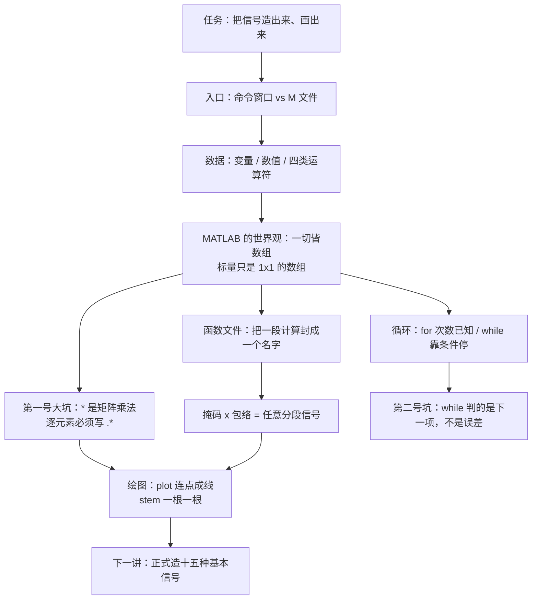

# 实验1.1 MATLAB 简介与基本语法 MATLAB Basics

> [!abstract] 这一讲的任务
> 后面十几个实验，都要用 MATLAB 把信号**造出来、画出来、算出来**。所以这一讲不解决任何信号问题，它只解决一件事：**把 MATLAB 当成一支顺手的笔**。
> 具体是六件事：它怎么接你的话（命令窗口 / M 文件）、它怎么表示数（变量、数值、四类运算符）、它怎么表示"一串数"（数组——这是 MATLAB 的默认世界观）、怎么把一段计算封成一个名字（函数文件）、怎么重复做一件事（循环）、怎么把结果画出来（`plot` / `stem`）。
> 材料是按"例子 + 结果"给的，规则藏在例子里。**本篇的主要工作就是把规则抽出来**：每一条语法都先问它要解决什么问题，再写出它的一般形式，最后用本课程后面真要用的波形验证一遍。

> [!info] 怎么读这份讲义
> - 这份材料属于**实验课**，和讲次转写稿不是一回事：转写稿里没有实验课内容，所以本篇按材料与配套教材整理，**不逐条标注「拓展」**。
> - 材料只给例子不给规则，凡是我把规则补全、把例子一般化的地方，都会明写"一般形式是……"；凡是我自己补的例子，会说明为什么补。
> - 本篇所有数值与行为都用 python / 等价计算复算过（例如 `while` 循环的真实误差、`conv` 的输出长度），对不上的地方在正文里点名。
> - 计划配合阅读：[[实验1.2 基本信号的产生与序列运算]]（用到的每一条语法都在本篇里）。



---

## 0. 开场：六个点，画一个方波

第一堂实验课的任务很朴素：**在屏幕上画出一个方波**。

你手上没有函数发生器，只有纸上的六个点：

$$t=[-1\ \ 0\ \ 0\ \ 1\ \ 1\ \ 3],\qquad f=[0\ \ 0\ \ 1\ \ 1\ \ 0\ \ 0]$$

把这六对数字敲进去，`plot(t,f)`，屏幕上的方波出现了：竖边、平顶，和你脑子里那个方波长得一样。

于是你以为"画图"这件事已经会了。直到第二次，你顺手把 t 写成 `[-1 0 1 3]`——**少敲了两个数**——屏幕上出现的不是方波，是一条从 0 爬到 1 的**斜线**。

你刚才撞上的，是 MATLAB 的第一条世界观：

> [!important] plot 不做插值
> `plot(x,y)` 只做一件事：**把相邻的两个点用直线连起来**。
> 它不知道你要画的是方波、三角波还是心电图；它甚至不知道"相邻"在连续时间上是什么意思。屏幕上那条"连续曲线"，是无数条极短的直线段拼出来的。
> 所以上面那个方波的竖边，**不是画出来的，是"两个点重合"逼出来的**：t 在 0 处出现了两次，MATLAB 只好在原地从 0 竖直爬到 1。

![[实验1.1-连点成线.png]]

一句话总结这段撞墙：**在 MATLAB 里，"连续信号"从来不是它自己认识到的东西，而是你把点给得足够密之后，你的眼睛产生的错觉。**

这一讲就是把这一类"例子里藏着、但没人明说"的规则，一条一条挖出来。

> [!question] 停一下，先自己想想
> 如果我要画的不是方波，而是一个**单点跳变**（比如单位阶跃 $u(t)$），而那一点恰好没有任何一个采样落在 $t=0$ 上，`plot` 会画出什么？
> 先记住这个问题，第 3 节和第 6 节会各回答一半，[[实验1.2 基本信号的产生与序列运算]] 里会给出实验上真正会遇到的后果。

---

## 1. 两种工作方式：命令窗口与 M 文件（p.5–p.7）

### 1.1 命令窗口：一台"什么都立刻回答"的计算器

在命令窗口敲 `1+1` 回车，它立刻回你 `ans = 2`。敲 `help plot`，它把 `plot` 的用法打给你。

这一层没什么可讲的，只要记住一条：**命令窗口里的一切都是"一次性的"**。你敲的每一行都会立刻执行、立刻回显，而关掉窗口就全没了。它适合试探：不确定某个函数怎么用，敲进去试一下，试对了再搬进文件。

### 1.2 M 文件：把命令存下来反复跑

要重复做的事，就得写进以 `.M` 为扩展名的磁盘文件（现代 MATLAB 里扩展名统一写成小写 `.m`，Windows 上不区分大小写，Linux 上区分）。比如建一个 `my_file.m`：

```matlab
% 用 plot 函数画一个方波
t = [-1 0 0 1 1 3];
f = [0 0 1 1 0 0];
plot(t,f);
xlabel('t'); ylabel('f(t)');
axis([-1 3 0 2]);
```

然后在命令窗口**输入文件名**（`my_file`，不带扩展名）回车，它就把这几行从头到尾跑一遍。（p.7）

这里有两条材料没写、但每天都要用的规则：

> [!important] 脚本的两条基本规则
> 1. **`%` 后面是本行注释**，MATLAB 不执行。注释是写给人看的，但 `help 函数名` 时，函数文件开头那一段连续注释会被当作帮助文本打出来——所以写注释是"顺便写文档"。
> 2. **行尾加 `;` 表示"执行但不回显"**。上面这段代码里 `plot(t,f);` 和 `axis(...);` 都带分号，只有中间结果才需要看的时候才不加。**不加分号的循环会把几百行数字刷满屏幕**——第 5 节的 `for` 循环里你会看到这个现象。

### 1.3 两种方式的分工

一般化的说法是：

| | 命令窗口 | M 文件 |
|---|---|---|
| 适合 | 试探、查帮助、临时算一个数 | 成型的计算、要交的实验报告、要反复改参数的实验 |
| 变量 | 存在"基本工作区"里，一直留着 | 脚本跑完，变量同样留在基本工作区；函数文件里的变量是局部的（见第 4 节） |
| 可重复 | 关机就没 | 可反复运行、可版本管理 |

一条实用经验：**任何你打算敲第二遍的命令，都应该立刻搬进 M 文件。** 实验报告里要交的是 M 文件，不是命令窗口的截图。

> [!note] 关于"工作路径"
> MATLAB 只会运行**当前工作路径**（current folder）下的 M 文件。文件建在别处、双击能打开、输入文件名却报 `Undefined function or variable`，九成是路径不对。这是实验课上最常见的第一个报错。

---

## 2. 表达式：变量、数值、四类运算符（p.9–p.14）

### 2.1 变量：不用声明类型，但有四条命名规则

材料的四条规则是（p.9）：不需要类型说明；变量名第一个字符必须是字母；长度不超过 31 个字符；大小写敏感。

把这四条一般化，再加上几条它没写的：

> [!important] MATLAB 变量命名的一般规则
> - **首字符必须是字母**，之后可以是字母、数字、下划线（`num_students`、`x1`、`f_0` 都合法）。
> - **大小写敏感**：`x` 和 `X` 是两个不同的变量。这也是 MATLAB 内置函数全用小写的原因（`sum` 不是 `Sum`）。
> - **不能与保留字冲突**：`for`、`end`、`if`、`function`、`while` 这些不能当变量名。
> - **不要覆盖内置名**：`pi`、`i`、`j`、`eps`、`sum`、`length`、`size`、`abs`、`angle`、`plot` 都是内置的。给它们赋值在语法上**允许**，但会把内置功能顶掉——这是本课程最真实的一个坑，第 5 节会现场撞一次。
> - 命名习惯：实验报告里变量名要能自解释（`f0`、`w0`、`Ts`），一个字母的 `a`、`b`、`c` 只在推导里用。

材料写"变量名长度不超过 31 个字符"。**这一条是过时的**：现代 MATLAB 的 `namelengthmax` 返回 **63**（R2025a 起进一步放宽到 2048）。31 是很早版本的限制，材料 2006 年成稿时就已经跟不上当时的版本了。实际写代码时谁也不会去卡这个数，但**"只用前 `namelengthmax` 个字符来区分不同的名字"这条语义值得知道**：两个前 63 个字符完全相同的长名字，在 MATLAB 看来是同一个。

> [!example] 材料给的变量例子
> ```matlab
> num_students = 25
> ```
> 没有任何类型声明——你直接写名字，MATLAB 自己决定它是双精度数、字符、还是数组。**类型是跟着值走的，不是跟着名字走的**，所以同一个变量这一行是数、下一行可以被赋成一个字符串，它不会抗议（但这是个坏习惯）。

**特殊变量**（p.9）——它们不可能是普通变量，因为它们的值由运行环境决定：

| 变量    | 含义               | 值                       |
| ----- | ---------------- | ----------------------- |
| `pi`  | 圆周率 $\pi$        | 3.141592653589793       |
| `inf` | 无穷大              | 溢出、`1/0`、`log(0)` 的结果   |
| `NaN` | Not a Number，不定量 | `0/0`、`inf-inf`、`0*inf` |
| `eps` | 双精度的机器精度         | $2.2204\times10^{-16}$  |
| `ans` | 最近一次没赋给变量的结果     | 随时被覆盖                   |

> [!warning] `NaN` 的特殊行为
> `NaN` 一旦出现就会传染：`NaN+1` 是 `NaN`，`NaN>0` 是**假**，`NaN==NaN` 也是**假**。
> 所以判断一个量是不是 `NaN`，不能写 `x==NaN`（永远为假），要写 `isnan(x)`。这是调试数值算法时最常查的一件事。

### 2.2 数值：双精度浮点 + 复数后缀

材料的两条（p.10）：用常规十进制表示；用 `i` 或 `j` 作后缀表示虚部。

一般化：

- **默认类型是双精度浮点**（`double`，IEEE 754 的 64 位）。所以 `0.1+0.2` 不等于 `0.3`，比较浮点数要用 `abs(a-b)<tol` 而不是 `a==b`。
- **科学计数法**：`1.235e5` 就是 $1.235\times10^5=123500$；`1e-6` 是 $10^{-6}$。
- **复数**：`x = 2+3j` 或 `x = 2+3i` 都可以，`i`/`j` 谁用都行。此时 `abs(x)` 是模 $=\sqrt{2^2+3^2}=3.6056$，`angle(x)` 是相角（**弧度**）$=\arctan(3/2)=0.9828$。

材料的五个复数函数，一般化为一句"取复数的四个零件加一个共轭"：

| 函数 | 含义 |
|---|---|
| `abs(x)` | 模 $\lvert x\rvert$ |
| `angle(x)` | 相角（弧度，范围 $[-\pi,\pi]$） |
| `real(x)` | 实部 |
| `imag(x)` | 虚部 |
| `conj(x)` | 共轭 $x^*$ |

> [!important] 这一组函数作用在数组上时是逐元素的
> 如果 `ft` 是一整条复指数信号的采样（第 7 节会造），那么 `real(ft)`、`abs(ft)`、`angle(ft)` 得到的都是**同样长度的实数数组**。`abs(x).^2 == real(x).^2 + imag(x).^2` 是它们的恒等关系——这也是后面算信号能量 $\sum\lvert x[k]\rvert^2$ 的写法依据。

### 2.3 四类运算符

材料把运算符分成算术、逻辑、关系、冒号四类（p.11–p.14）。这个分类法很好用，但**每类都要补上"作用在数组上会怎样"**，因为 MATLAB 里几乎没有标量。

**算术运算符**（p.11）：

| 符号 | 含义 | 作用在数组上 |
|---|---|---|
| `+` `-` | 加、减 | 数组与标量加减：逐元素；两个同尺寸数组：逐元素 |
| `*` | **矩阵乘法**（不是逐元素！） | 内维必须匹配 |
| `/` | **矩阵右除** | 解线性方程用的，初学阶段不要用它做"除法" |
| `^` | **矩阵乘方** | 方阵自乘 |
| `'` | **复共轭转置** | 对矩阵转置并取共轭 |

材料把 `'` 写成"矩阵的复共轭转置"，这条要拆开讲：

> [!warning] `'` 里藏着共轭
> 对实数矩阵，`A'` 就是转置。但对**复数**矩阵，`A'` 顺手帮你取了共轭：$A' = (A^*)^T$。
> 如果只想要转置、不要共轭，必须写成 `A.'`（带点）。处理复指数信号时这个区别是实打实的错误来源。

**关系运算符**（p.13）：`<` `>` `<=` `>=` `==` `~=`（不等于写成 `~=`，不是 `!=`，也不是 `<>`）。

它的关键性质材料没写，但它是整个实验课最重要的一条机制：

> [!important] 关系运算的结果是 0/1
> `t >= 0` 不是在问"t 是不是大于等于 0"，而是**对 t 的每一个元素问一遍，把答案写成 1 或 0**。
> 当 `t` 是 401 个采样点时，`t>=0` 返回的是**一条同样 401 长、由 0 和 1 组成的数组**——那正好就是单位阶跃信号。
> **本课程所有阶跃信号都是这么造出来的**。这条规则在 [[实验1.2 基本信号的产生与序列运算]] 第 3 节会立刻兑现。

**逻辑运算符**（p.12）：`A & B` 与、`A | B` 或、`~A` 非。材料补了一句关键的话：**值为 0 时表示逻辑假，其它任何非零值表示逻辑真**。

这句话的含义比它看起来重：**逻辑运算的输入可以是任意数值**，不限于 0/1。`3 & 5` 是"真与真"，结果是 1（真）。所以判断"x 非零"可以直接写 `~x`，不必先转成逻辑值。

顺带一说，MATLAB 还有短路版本 `&&` 和 `||`，它们只吃标量、且会短路求值，用在 `if` 条件里更安全（数组用 `&`/`|`）。

**冒号运算符**（p.14）：`1:10` 得到 `1 2 3 ... 10`，`10:-2:1` 得到 `10 8 6 4 2`。

一般形式是——这是全篇最常用的一个语法：

$$\boxed{\ \text{start}:\text{step}:\text{stop}\ }$$

从 `start` 开始，每次加 `step`，直到超过（步长为正时）或低于（步长为负时）`stop` 为止。**`stop` 只是个界，不保证被取到**：`0:0.3:1` 得到 `0 0.3 0.6 0.9`，没有 1。

`step` 省略时默认为 1（`1:10`）。`step` 必须显式给出符号：`10:-2:1` 里的 `-2` 不能省，写成 `10:1` 会得到空数组。

### 2.4 四类运算符的优先级

材料没给优先级表，但算错的时候第一个怀疑对象就是它。MATLAB 的优先级从高到低大致是：

```
( )  →  .' ^ .^ '   →  一元 + - ~   →   * / .* ./   →   + -   →   :   →   < > <= >= == ~=   →   &   →   |
```

两条实战结论：

1. **括号永远不嫌多**。`1/(n*n)` 与 `1/n*n` 是两回事：前者是先平方再取倒数，后者是 $n/n$。
2. **关系运算比逻辑运算优先**：`t>=0 & t<1` 会被解释成 `(t>=0) & (t<1)`，这正是你要的；但 `a<b<c` 在 MATLAB 里是 `(a<b)<c`，不是数学上的区间——**区间必须写两个条件**。

---

## 3. 数组：MATLAB 的默认世界观（p.15–p.17）

### 3.1 数组的构造

材料给了四种构造方式（p.15–p.16），一般化如下：

| 写法 | 结果 | 什么时候用 |
|---|---|---|
| `x = [2 3 4 5]` | 逐个列出的行向量 | 手工给的几个点（开场那六个点就是） |
| `x = 2:5` | 用冒号，步长默认 1 | 等差、步长已知 |
| `x = 0:0.02:6` | 三参数冒号：起、步长、止 | **本课程造连续信号时间轴的标准写法** |
| `x = linspace(0,2,11)` | 从 0 到 2 **均匀取 11 个点** | 步长不重要、只关心"取够多少个点" |
| `z = [1 2; 3 4]` | 分号分行，造 $2\times2$ 矩阵 | 二维数组（本课程少用） |
| `zeros(1,n)` | $1\times n$ 的全零向量 | 造"一段 0"（单位脉冲序列就靠它） |
| `ones(1,n)` | $1\times n$ 的全 1 向量 | 造"一段 1"（阶跃序列、窗） |
| `rand(1,n)` | $[0,1]$ 均匀分布随机数 | 白噪声 |
| `randn(1,n)` | 均值 0、方差 1 的正态随机数 | 高斯白噪声 |

> [!important] `a:b:c` 与 `linspace` 的分工
> `0:0.02:6` 与 `linspace(0,6,301)` 得到的是**同一组点**（$301$ 个），但它们的**思考方式**不同：
> - 用冒号时，你规定的量是**步长** $\Delta t$，点数 $=(\text{stop}-\text{start})/\Delta t+1$，是算出来的；
> - 用 `linspace` 时，你规定的量是**点数** $N$，步长 $=(\text{stop}-\text{start})/(N-1)$，是算出来的。
>
> 造信号时两者都常用，取舍标准是：**答案对步长敏感（怕混叠、怕分辨率不够）就用冒号，明确知道自己要多少个点就用 `linspace`。** 第 6 节的例子会看到，同一个正弦用不同步长画出来，"连续"的观感完全不同。
>
> 另外注意 `linspace` 的第三个参数是**点数不是步长**，`linspace(0,2,11)` 给 11 个数（含两个端点），不是 11 个间隔。

材料那句"给二维数组赋值时用分号表示一行的结束，如 `z=[1 2; 3 4]`"（p.15）要读准：**分号在这里不是"不回显"，是"换行"**。同一个符号在不同位置有两个完全不同的含义，这是 MATLAB 里少见的符号重载。

### 3.2 点运算：MATLAB 最容易翻车的地方

这一条材料只用了一行字带过（p.17：`2 个数组的对应元素相乘除 .* ./`），但它是**初学者 90% 报错的来源**。

先看它的问题是什么。你有两个数组，想"对应位相乘"：

```matlab
x = [1 2 3];
y = [4 5 6];
z = x*y      % 报错：Inner matrix dimensions must agree.
```

`x` 是 $1\times3$，`y` 是 $1\times3$，内维（3 与 1）不匹配，**矩阵乘法**没法做。MATLAB 完全没有"你想要对应位相乘"这个猜测。

要逐元素相乘，得在运算符前面加一个点：

```matlab
z = x.*y     % z = [4 10 18]
```

![[实验1.1-点运算与矩阵运算.png]]

> [!important] 点运算的一般规则
> `.*`、`./`、`.^` 分别表示**逐元素**的乘、除、乘方。两个数组尺寸必须完全相同（或其中一个是标量）。
> | 表达式 | 含义 |
> |---|---|
> | `x*y` | 矩阵乘法，需要 `size(x,2)==size(y,1)` |
> | `x.*y` | 逐元素相乘，需要两个数组形状一样 |
> | `x^2` | 矩阵自乘 $xx$（`x` 必须是方阵） |
> | `x.^2` | 每个元素各自平方 |
> | `x/y` | 矩阵右除（解方程） |
> | `x./y` | 每个元素各自相除 |
>
> **判据**：你想要的答案是不是"每个元素各自算一遍、不互相通信"？是——加点。
> 本课程里 `.*` 和 `.^` 的出现频率远高于 `*` 和 `^`：造信号几乎全是"逐元素"的运算。

回想开场那个三角波函数 `y=[abs(t)<=1].*(1-abs(t))`：逻辑掩码（0/1 数组）与包络（数组）**逐元素**相乘，所以必须写 `.*`。写成 `*` 会直接报错——这正是它安全的地方。

### 3.3 size 与 length

材料给了两个函数（p.17），区别要分清楚：

| 函数 | 返回 | 注意 |
|---|---|---|
| `size(A)` | 行数和列数（二维返回两个值） | `[m,n] = size(A)`；`size(A,1)` 是行数 |
| `length(B)` | **最长那个维的长度** | 一维向量时就是元素个数 |

> [!warning] `length` 对矩阵是含糊的
> `length([1 2; 3 4])` 返回 2，它问的是"最长边有多长"，不是"有多少个元素"。
> 要数元素总数用 `numel(A)`。本课程的信号都是一维行向量，`length` 够用；但一旦数组被你无意中写成了二维，`length` 会给你一个"看起来对、其实不是你要的"数字。

---

## 4. 函数文件：把一段计算封成一个名字（p.18–p.19）

### 4.1 一般形式

材料只说了一句"M 文件的第一行包含 `function`，就可以像库函数一样使用"（p.18）。一般形式是这样：

```matlab
function [out1, out2] = myfunc(in1, in2)
% MYFUNC 一句话说明（这行会被 help myfunc 打出来）
% 再写详细说明、参数含义、示例
    ...            % 函数体：用 in1、in2 算出 out1、out2
end                % 现代 MATLAB 建议写 end，老版本可省
```

几条必须知道的规则：

> [!important] 函数文件的铁律
> 1. **文件名必须等于函数名**（`tri.m` 里只能有 `function ... = tri(...)`）。这是初学者最常犯的错：存成 `myfunc1.m` 就调不到。
> 2. **函数内部的变量是局部的**：函数里叫 `t` 的变量，与命令窗口里叫 `t` 的变量互不相干。这是函数比脚本安全的原因——脚本会污染工作区，函数不会。
> 3. **输入输出都是"值传递"**：函数改了 `in1`，外面的变量不受影响。
> 4. **函数可以接受数组输入**。这是本课程的用法：函数不是"算一个数"，而是"**吃一条时间轴，吐一条信号**"。

第 2 条有个反面含义值得点明：**脚本（没有 `function` 行的 M 文件）里的变量和命令窗口共享同一个工作区**。所以跑完脚本，工作区里会多出一堆名字；如果脚本里恰好写了 `i=1`，之后命令窗口里的 `i` 就不再是虚数单位了。

### 4.2 例：一个三角波函数

材料给的例子（p.19）：要画的波形是一个底宽 2、顶点在 $(0,1)$ 的三角形。

```matlab
function y = tri(t)
y = [abs(t)<=1].*(1-abs(t));
```

然后调用它：

```matlab
t = -2:0.05:2;
plot(t, tri(t));
```

短短一行，值得逐段拆开：

- `abs(t)<=1` → 一条**逻辑掩码**：$\lvert t\rvert\le1$ 的地方是 1，其余是 0。它是一扇**窗**。
- `1-abs(t)` → 一条**包络**：在 $t=0$ 处为 1，向两边线性降到 0（在 $\lvert t\rvert=1$ 处），再往外变负。
- 两者 `.*` 相乘 → 窗把包络"负的那一半"和"外面的部分"全部关掉，只留中间那个三角形。

![[实验1.1-掩码乘包络得到三角形.png]]

### 4.3 把 tri 的写法一般化（本讲最有价值的一条）

上面那个一行函数不是特例，它是一个**通用套路**：

$$\boxed{\ y(t) = \underbrace{[\ \text{条件}\ ]}_{\text{掩码：0 或 1}}\ .*\ \underbrace{\text{包络}(t)}_{\text{形状}}\ }$$

- **掩码**回答"这段信号在哪一段里活着"，由关系运算产生；
- **包络**回答"活着的时候长什么样"，是你写出来的公式；
- `.*` 把两者合起来。

有了这个套路，**任何分段信号都能用一行写出来**，不必写 `if`、不必循环：

```matlab
% 一个从 t=0 开始、在 t=1 结束的三角形脉冲
y = [(t>=0)&(t<=1)].*(1-t);

% 一个"矩形 + 尾巴"的复合波形：0~2 段上升，2~4 段衰减
y = [(t>=0)&(t<2)].*t + (t>=2).*2.*exp(-(t-2));
```

第二行里两个掩码段落直接相加——因为掩码在各自区间外是 0，加号天然完成了"分段拼接"。这是本课程后面造分段波形（绝对收敛的三角脉冲、有限长窗、分段线性信号）的标准手法。

> [!question] 课堂追问：为什么不写 if？
> 因为在 MATLAB 里写 `if` 必须**逐点**判断，只能用循环一个个元素过（第 5 节），代码既长又慢。而掩码写法是**整条时间轴一次算完**的向量化写法。等你看到第 5 节结尾"什么时候不要用循环"，这里就回收了。

> [!note] 掩码写法的两个前提
> 1. 包络在掩码为 0 的地方**可以取任何值**（哪怕变成复数或 `inf`），因为乘 0 会把它清掉——但 `inf*0` 得到的是 `NaN` 不是 0。所以包络里有除法时，要留神分母为 0 的点。
> 2. 掩码必须是**逻辑数组或 0/1 数组**。`[abs(t)<=1]` 外面的方括号在现代 MATLAB 里可省（`abs(t)<=1.*(...)` 会因优先级出错，所以要写清括号），写成 `(abs(t)<=1).*(1-abs(t))` 更清楚。

---

## 5. 循环：for 与 while（p.20–p.21）

### 5.1 for：次数已知

材料例子是算 $s=1+2+\cdots+100$（p.20）：

```matlab
s = 0;
for n = 1:100
    s = s + n;
end
```

一般形式：

```matlab
for 循环变量 = 数组
    循环体
end
```

关键点：**右边的"数组"不必是 `1:n`**。`for v = [2 4 8 16]` 会依次把 `v` 取成这四个数；`for t = 0:0.1:1` 也行。循环变量名叫什么无所谓，但别用 `i` 或 `j`（会顶掉虚数单位）。

这里的答案校验一下：$1+2+\cdots+100 = 100\times101/2 = 5050$。程序跑完 `s` 就是 5050。

（顺带一句：这个例子在 MATLAB 里其实不该用循环——`sum(1:100)` 一行就够了。材料用它是为了演示语法。）

### 5.2 while：次数未知，靠条件停

材料的例子是算 $s=\frac{1}{1^2}+\frac{1}{2^2}+\frac{1}{3^2}+\cdots$，要求"误差小于 $10^{-6}$"（p.21）：

```matlab
s = 0;
n = 1;
eps = 1e-6;
while 1/(n*n) > eps
    s = s + 1/(n*n);
    n = n + 1;
end
fprintf('s=%.5f\n', s)
```

一般形式：

```matlab
while 条件
    循环体
end
```

条件为真就继续转，为假就退出。与 `for` 的区别只有一句话：**次数是不是事先知道**。

**这段代码里埋了两个真实的坑，两个都要讲清楚。**

#### 坑一：eps = 1e-6 把内置的 eps 顶掉了

`eps` 是 MATLAB 的内置量（双精度机器精度 $2.2204\times10^{-16}$，第 2 节表格里有）。这一行 `eps = 1e-6` 在语法上完全合法，但它把内置的那个 `eps` 覆盖成了 $10^{-6}$。

后果不是立刻报错，而是**后面所有依赖 `eps` 的代码都悄悄变了行为**。正确写法是换个名字：

```matlab
tol = 1e-6;          % tolerance，习惯上叫 tol
while 1/(n*n) > tol
```

> [!warning] 判断"能不能用作变量名"的实用方法
> 在命令窗口敲 `exist('名字')`：返回 0 表示没人用，返回 2 或 5 表示它是已有函数/内置——**换一个名字**。

#### 坑二（更重要）：while 判的是"下一项"，不是"误差"

代码的条件是 `1/(n*n) > eps`，退出时 $n=1000$（因为 $1/1000^2=10^{-6}$ 不再大于 $10^{-6}$）。

问题来了：$n=1000$ 时剩下的尾巴

$$\sum_{k=1001}^{\infty}\frac{1}{k^2}\approx\int_{1000}^{\infty}\frac{dk}{k^2}=\frac{1}{1000}=10^{-3}$$

所以**真实误差约 $10^{-3}$，比 `eps` 大了整整 1000 倍**。程序确实"收敛到 $10^{-6}$"了吗？没有——它只是"每一项都小于 $10^{-6}$"而已。

数值复算（python，同样的判据）：

| 量 | 值 |
|---|---|
| 停止时的 $n$ | 1000 |
| 部分和 $s$ | 1.643934 |
| 真值 $\pi^2/6$ | 1.644934 |
| 实际误差 | $1.0\times10^{-3}$ |
| `fprintf('s=%.5f\n',s)` 打印 | `s=1.64393`（真值五位是 1.64493） |

![[实验1.1-while循环的误差判据.png]]

> [!important] 用"下一项"当判据，误差量级要自己算
> `while` 里放"下一项很小"是最常见的写法，但它保证的是**逐项收敛**，不是**总和误差**。两者差多少，取决于级数的尾巴掉得多快：
> - 尾巴像 $\sum 1/k^2$ 这样（$O(1/n)$）：误差 $\approx$ 最后一项 $\times n$，比阈值大 $n$ 倍；
> - 尾巴像 $\sum 1/k!$ 或几何级数那样（衰减比 1 快得多）：误差 $\approx$ 最后一项，阈值基本可信。
>
> 所以**写迭代终止条件时，要么换成"相邻两次结果之差 < tol"（$|s_n-s_{n-1}|<\text{tol}$，抓的是增量），要么自己估一下尾巴**。这是数值实验里非常真实的判断，后面做数值积分、数值卷积都会再遇到。

顺带记住 `fprintf` 这个用法：`fprintf('s=%.5f\n', s)` —— `%.5f` 是"保留 5 位小数"，`\n` 是换行。想把数字排成表格交实验报告，就靠它。

### 5.3 什么时候**不要**用循环

MATLAB 的循环很慢（它是解释执行），而内置函数是编译过的 C。经验法则是：**能用数组运算表达的，就不要写循环。**

```matlab
s = 0; for n = 1:100, s = s+n; end   % 循环写法
s = sum(1:100);                      % 向量化写法
```

第 4.3 节的掩码写法就是向量化：它一次处理整条时间轴，而不是一个点一个点地过。本课程后面所有造信号、算能量的代码都是向量化的，循环只用在"迭代到收敛"这类**真的没法一次算完**的场合。

---

## 6. 绘图：plot 与 stem（p.22–p.25）

### 6.1 plot：连点成线

材料的 `plot` 例子（p.22）：

```matlab
t = linspace(0,4*pi,512);
plot(t,sin(t),t,cos(t),'-.');
title('my figure'); xlabel('t'); legend('sin(t)','cos(t)');
```

一般形式：

```matlab
plot(x1, y1, '线型', x2, y2, '线型', ...)
```

**同一对小括号里可以塞进任意多组 `x,y,线型` 三元组**，每组画一条线；`legend` 按出现的顺序给它们命名。

回到开场那个问题——`plot` 画出来的"连续曲线"到底是什么？把同一个信号用三种步长画出来最清楚：

![[实验1.1-连续信号其实是密集采样连出来的.png]]

三张图画的是同一个 $x(t)=2e^{-t}$。左图只取了 11 个点，肉眼能看出它是一段段直线；右图取了 5001 个点，"看起来就是一条曲线"。

> [!important] "连续信号"在计算机里的真实身份
> MATLAB 里**没有连续时间信号这个数据类型**。一条"连续曲线"是：**一条足够密的时间轴 + 逐点算出来的值数组 + `plot` 把相邻点连起来**。
> 这带来两个必须记住的后果：
> 1. **步长 $\Delta t$ 是你选的，它决定了"多像连续"**。步长太大，快变化的信号会被画错（第 7 节的阶跃就是活例）。
> 2. **所有运算都是逐个采样点做的**。所以第 3.2 节的点运算才是常态，而不是特例。
> 这套"时间轴 + 值数组"的表示法，正是第 1 章讲的**离散时间信号**；实验里所谓的"模拟信号"，是用它近似出来的。

### 6.2 plot 的配套函数

材料用到的几个（p.7、p.22、p.24），按用途分三类：

| 用途 | 函数 | 说明 |
|---|---|---|
| 标注标题与坐标轴 | `title('...')`、`xlabel('...')`、`ylabel('...')` | 字符串要用**单引号** |
| 图例与网格 | `legend('a','b')`、`grid on` | 图例顺序 = 画线顺序 |
| 定坐标范围 | `axis([xmin xmax ymin ymax])` | **四元向量**，顺序别记错 |
| 分割图窗 | `subplot(m,n,p)` | 切成 $m\times n$，当前画第 $p$ 块 |

`axis` 那四个数的顺序是最容易记混的：它是 `[xmin xmax ymin ymax]`，**先左右再上下**。开场那段代码里的 `axis([-1 3 0 2])` 就是"横轴 -1 到 3，纵轴 0 到 2"。

`subplot(m,n,p)` 的编号规则：**从左到右、从上到下**，$p$ 从 1 数起。`subplot(2,2,3)` 是左下那一块。（p.20 的复指数例子就是用它把实部、虚部、模、相角摆成 $2\times2$。）

### 6.3 stem：离散信号的正统画法

材料的 `stem` 例子（p.24）：

```matlab
k = 0:39;
stem(k, cos(0.9*pi*k));
title('cos(0.9\pik)');
```

同一个序列，用 `plot` 和用 `stem` 的差别是根本性的：

![[实验1.1-plot与stem画同一个序列.png]]

> [!important] 连续用 plot，离散用 stem
> - `plot(n,x)` 会把相邻样本用直线连起来，**暗示"样本之间有值"**——对离散时间信号这是假信息；
> - `stem(n,x)` 每个样本画一根竖线加一个圆点，**明确表示"只有这些整数点上有值"**。
>
> 判据很简单：**这条信号的横轴是不是只取整数（或等间隔的离散序号）？** 是——用 `stem`。本课程离散序列一律 `stem`，连续信号一律 `plot`。
>
> 另外注意 `title('cos(0.9\pik)')` 里的 `\pi`：MATLAB 的文本字符串支持一小部分 TeX 记号，`\pi` 会渲染成 $\pi$，`\omega` 渲染成 $\omega$。这不是 LaTeX，只是"带几个希腊字母的纯文本"。

### 6.4 线型、颜色、标记速查

| 类别 | 取值 |
|---|---|
| 线型 | `-` 实线（默认）、`--` 虚线、`:` 点线、`-.` 点划线、`none` 不画线 |
| 颜色 | `r` 红、`g` 绿、`b` 蓝、`c` 青、`m` 品红、`y` 黄、`k` 黑、`w` 白 |
| 标记 | `.` 点、`o` 圆、`x` 叉、`*` 星、`s` 方块、`d` 菱形 |

这三类可以拼成一个字符串：`plot(t,y,'r--o')` 就是"红线、虚线、每个样本加一个圆圈"。材料里 `'r*'`（p.38 的图）就是这个用法。

### 6.5 把"画图"拆成三层

一段画图代码看着零散，其实只有三层，写完自查一遍就不会漏东西：

| 层 | 干什么 | 函数 |
|---|---|---|
| 显示 | 画什么、用什么线型 | `plot` / `stem` / `subplot` |
| 标注 | 这条线是谁、横轴纵轴是什么 | `title` / `xlabel` / `ylabel` / `legend` / `grid` |
| 定界 | 视野取多大 | `axis` |

实验报告里三张图放一起，**只有第一层做对、后两层全缺的图是不能看的**——阅卷的人不知道哪条是哪条。

---

## 7. 把这些语法接到后面的实验上

这一讲的语法，在下一讲会一套一套地用上。先把"哪个语法对应哪个需求"钉死：

| 下一讲要做的事 | 用到的语法 | 出处 |
|---|---|---|
| 给"连续信号"造一条时间轴 | `t = 0:0.001:5` 或 `linspace` | 3.1 |
| 造单位阶跃 | `(t>=0)` | 2.3（关系运算返回 0/1） |
| 造指数 / 正弦 / 复指数 | `exp`、`sin`、`cos`、`j`、`pi` | 2.2 |
| 造分段波形（三角、窗、脉冲） | 掩码 `.*` 包络 | 4.3 |
| 造离散序列的索引 | `k = -4:20` | 2.3 / 3.1 |
| 造单位脉冲序列 | `[zeros(1,7), 1, zeros(1,17)]` | 3.1（数组拼接） |
| 逐元素算信号的值 | `.*` `./` `.^` | 3.2 |
| 离散信号画图 | `stem` | 6.3 |
| 一张图里摆四张子图 | `subplot(2,2,p)` | 6.2 |
| 算能量 / 卷积 / 相关 | `sum(abs(x).^2)`、`conv`、`xcorr` | 3.3 / 下一讲第 9–12 节 |
| 打印结果进报告 | `fprintf('%.5f\n', s)` | 5.2 |

> [!important] MATLAB 与 NumPy 的对照（顺手给 AI 方向）
> 这门课后面所有的 MATLAB 代码，在 Python 里都有几乎一模一样的写法。把上表翻成 NumPy：
>
> | MATLAB | NumPy |
> |---|---|
> | `t = 0:0.01:5` | `t = np.arange(0, 5+0.01, 0.01)`（注意末端要不要带上） |
> | `linspace(0,2,11)` | `np.linspace(0,2,11)` |
> | `zeros(1,n)` / `ones(1,n)` | `np.zeros(n)` / `np.ones(n)` |
> | `x.*y` / `x.^2` | `x*y` / `x**2`（**NumPy 默认就是逐元素**，点可以省） |
> | `x*y`（矩阵乘） | `x @ y` 或 `np.dot`（**NumPy 里 `*` 不是矩阵乘**，语义正好相反） |
> | `size(A)` / `length(B)` | `A.shape` / `len(B)` |
> | `sum(abs(x).^2)` | `np.sum(np.abs(x)**2)` |
> | `plot` / `stem` | `plt.plot` / `plt.stem` |
> | `conv(x,h)` | `np.convolve(x,h,'full')` |
> | `xcorr(x,y)` | `np.correlate(x,y,'full')`（滞后轴要从长度推） |
> | `sinc(x)` | `np.sinc(x)`（**两边都是 $\sin(\pi x)/(\pi x)$，这个坑两边一起踩**） |
>
> 最值得记的一条差异是**点运算**：MATLAB 里"逐元素"要加 `.`，NumPy 里"矩阵乘"才要特殊记号。所以从 MATLAB 往 Python 搬代码时，`.*` 要改成 `*`，`*` 要改成 `@`——**两边各改一次，漏一个都是静默错误**（矩阵乘在尺寸合法时不报错，只是算出来是另一回事）。

---

## 这一讲的三句话

> [!important] 三句话
> 1. **MATLAB 里没有"连续信号"这个类型**：一条"连续曲线"就是一条足够密的时间轴加一串值，`plot` 只会把相邻点连成直线。开场那个方波之所以是方的，全靠 t 在两个点上写了两遍。
> 2. **一切皆数组，于是"逐元素"要靠点运算**：`*` 是矩阵乘法，`.*` 才是对应位相乘；关系运算 `t>=0` 不是判断，而是**逐元素产出 0/1 数组**——这正是本课程造阶跃、造窗、造分段信号的机制。
> 3. **`while` 的判据要对着"误差"写，不是对着"下一项"写**：材料里那段的实际误差是 $10^{-3}$，比它自己设的 $10^{-6}$ 大了一千倍；顺带记住 `eps`、`i`、`pi` 这些内置名不要拿来当变量。

> [!tip] 下一讲预告
> 语法齐了，可以正式开工了。下一讲《基本信号的产生》要造十五种信号：阶跃、指数、正弦、矩形脉冲、周期方波、三角脉冲、锯齿波、抽样信号、复指数，以及它们的离散版本——脉冲序列、阶跃序列、指数序列、正弦序列、周期方波序列、白噪声。
> 你会看到：**它们全都只用这一讲的四件工具**——时间轴（`0:0.001:5`）、初等函数（`exp`/`sin`）、逻辑掩码（`t>=0`）、点运算（`.*`）。而那一讲真正要小心的，是三个数字：**步长 $\Delta t$、那个和 $\pi$ 有关的常数、以及 `conv` 输出的长度**。

---

## 相关笔记 Related Notes

- 相关：[[实验1.2 基本信号的产生与序列运算]]（本篇每一条语法的兑现）、[[C1.1 连续时间与离散时间信号]]（"连续 vs 离散"在理论课里的定义，与本篇 6.1 的结论对照）、[[C1.4 单位冲激与单位阶跃函数]]（阶跃与冲激在理论上的身份，实验里只能用近似）

- 下一讲：[[实验1.2 基本信号的产生与序列运算]]
- 返回：[[信号与系统 MOC]]
