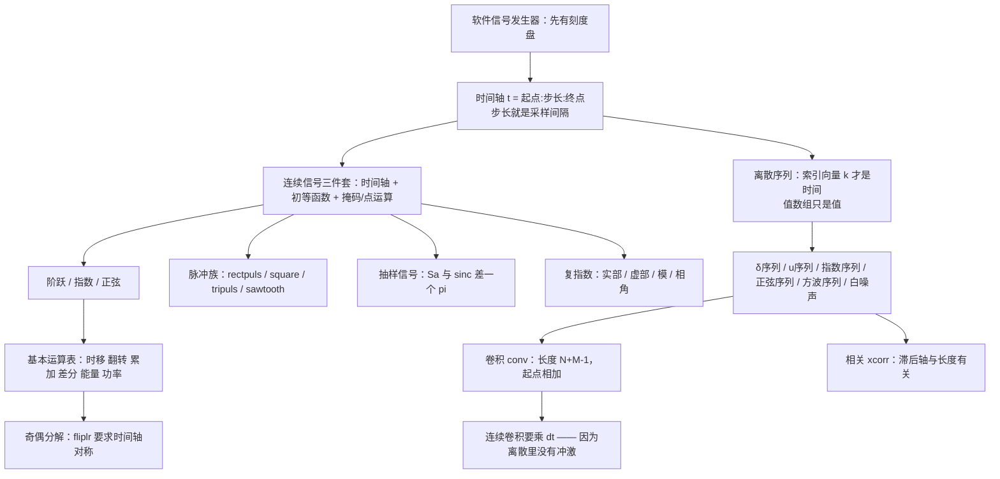

# 实验1.2 基本信号的产生与序列运算 Generating Basic Signals

> [!abstract] 这一讲的任务
> 上一讲把 MATLAB 当笔用了；这一讲开始**用它造信号**。
> 目标是一台"软件信号发生器"：面板上能拧出阶跃、指数、正弦、矩形脉冲、周期方波、三角脉冲、锯齿波、抽样信号、复指数——以及它们在离散时间里的对应物：脉冲序列、阶跃序列、指数序列、正弦序列、周期方波序列、白噪声。
> 造完之后，还要对信号做**基本运算**：时移、翻转、累加、差分、求和、算能量与功率、相加、相乘、卷积、相关；其中**卷积**与**相关**是第 2 章的理论在实验台上的落地。
> 全篇的隐藏主线只有一条：**你造的从来不是"连续信号"，而是一条时间轴加一串数。** 所有看起来莫名其妙的规矩（为什么阶跃要写成 `(t>=0)`、为什么 `conv` 的结果要乘 `dt`、为什么 `t=0` 那一点取几要看步长），都是这一条推出来的。

> [!info] 怎么读这份讲义
> - 语法部分（时间轴、点运算、掩码、`stem`、`subplot`）在 [[实验1.1 MATLAB 简介与基本语法]] 里已经讲过，本篇直接用，不再重复。
> - 材料把十五种信号平铺成十五段"程序 + 图"，规则同样藏在例子里。本篇把**每一族信号的一般形式**写出来，并说明哪个参数管什么。
> - **原稿有四处要留神**（正文里逐条点名）：① `rectpulse` / `tripulse` 两个函数名的拼写；② p.30 例句里"基频"后面的数值空缺；③ p.35 第三个子图的标题写成 `fe(t)`；④ p.37 互相关的滞后轴公式照抄了自相关那一行。
> - 本篇的每个例子、每张图、每个数字都用 python 复算过；凡是与材料不一致的地方，正文里写明"原稿写 X、实际 Y"。



---

## 0. 开场：造一台"软件信号发生器"

实验台上那台信号发生器有三个旋钮：**幅度、频率、相位**。拧一拧，示波器上就出现相应的正弦。这一讲要做的，是把它搬到 MATLAB 里——面板换成代码，示波器换成 `plot` 与 `stem`。

但你很快会发现，软件发生器比硬件多了一个旋钮，而且是**最要命的那个**：**时间刻度盘**。

硬件发生器的时间是"真"的：电流一直在流，屏幕上的横轴是示波器自己扫出来的。而在 MATLAB 里，**时间也是你造的**——你写 `t = 0:0.001:5`，就等于宣布"我这 5 秒里每 1 毫秒取一个样"。之后所有的信号都长在这条 `t` 上。

这一讲的全部麻烦，都从这个刻度盘来：

- 刻度盘给得太粗，变化快的信号会被画成折线（阶跃的竖边会被画成斜坡）；
- 刻度盘上的某个刻度**恰好落在跳变点上**还是**恰好躲开它**，会让 `(t>=0)` 在 $t=0$ 处的取值凭空变掉；
- 离散时间里连刻度盘都要另算：`k = -4:20` 是 25 个刻度，而"第 8 个数是 1"和"$k=3$ 处是 1"描述的是同一个信号——**你必须自己想清楚这两句话的换算**。

先把刻度盘立稳，再往上放信号。

---

## 1. 实验目的与实验原理（p.1–p.2）

> [!important] 实验目的
> 学习使用 MATLAB **产生基本信号、绘制信号波形、实现信号的基本运算**，为信号分析和系统设计奠定基础。

> [!note] 实验原理
> MATLAB 提供了许多函数用于产生常用的基本信号：阶跃信号、脉冲信号、指数信号、正弦信号、周期矩形波信号等；这些基本信号是信号处理的基础。
> ——这段话说得很平，但它背后的分量在于：**第 1 章讲的所有"基本信号"，在实验台上都是可以真的造出来、画出来、算出来的。** 理论课里 $\delta(t)$ 是个理想化的极限，实验里你只能造它的近似——这件事本身（第 11.2 节）就是这一讲最值钱的一课。

---

## 2. 先立规矩：造一个连续信号只有三步（p.3 起）

材料从"连续阶跃信号的产生"开始，一段程序一张图地排下去。把这十五段程序叠在一起看，会发现它们全是同一个套路：

> [!important] 造连续信号的三步法
> 1. **立时间轴**：`t = 起点:步长:终点`。步长 $\Delta t$ 是全篇最重要的一个数，它决定了"多像连续"。
> 2. **算值数组**：用初等函数（`exp`/`sin`/`cos`）、逻辑掩码（`t>=0`）、点运算（`.*` `.^`）逐点算出 $x$。
> 3. **画图与定界**：`plot(t,x)` 打底，配 `title` / `xlabel` / `axis` / `grid`。
>
> 后面的脉冲族、抽样信号、复指数、乃至离散序列，都只是第 2 步换了个算式。**没有第六步。**

先把第 1 步的刻度盘讲透，再往下走。

> [!important] 时间轴的两个参数与三个导出量
> 写 `t = 0:0.001:5`，你实际规定了两个量：**步长 $\Delta t=0.001$ s** 与 **总时长 $T_p=5$ s**。由它们导出：
> - **采样点数** $N=T_p/\Delta t+1=5001$（**加一是因为两端都算**）；
> - **采样率** $F_s=1/\Delta t=1000$ Hz；
> - **奈奎斯特上限** $F_s/2=500$ Hz——信号里高于这个频率的成分会被**混叠**，画出来是错的。
>
> 所以实验报告里"我用了什么采样率"必须写明，否则波形不可信。第 4 节的正弦与第 11.2 节的卷积都会用到这条。

---

## 3. 阶跃与指数：逻辑掩码与 exp（p.3–p.6）

### 3.1 连续阶跃信号

材料程序（p.3）：

```matlab
t = -2: 0.02: 6;
x = (t>=0);
plot(t,x);
axis([-2,6,0,1.2]);
```

一般形式：

$$u(t-t_0)\ \Longleftrightarrow\ \texttt{x = (t>=t0);}$$

**这里没有任何专门的"阶跃函数"**——`x` 就是一条由 0 和 1 组成的数组，只不过它长得正好是阶跃。第 1.1 讲讲过的"关系运算逐元素返回 0/1"，在这里第一次兑现。

想造带时延的阶跃就写 `(t>=t0)`；想造下降沿就写 `(t<t0)`；想造矩形窗就写 `(t>=0)&(t<1)`。

### 3.2 撞墙：t=0 那一点到底取几？

现在看一个材料不会提、但你一定会遇到的事。

`t = -2:0.02:6` 是一条 401 个点的时间轴。第 101 个点**理论上**是 $t=-2+100\times0.02=0$。所以 `x(101)` 应该取 1（$0\ge0$ 为真）。

但双精度浮点里，`0.02` 并不精确等于 $1/50$。实际算出来第 101 个点是

$$t_{101}=+1.78\times10^{-15}$$

**它是一个正得几乎没有的正数，而不是 0。** 于是 `t>=0` 为真，取 1——**结论是对的，但纯属浮点误差帮了忙**：如果那次累加落到了 $-1.78\times10^{-15}$，这个点就会取 0，阶跃会整体"晚一个采样"。

换一个步长就不是运气问题了。把步长改成 `0.03`：

```matlab
t = -2: 0.03: 6;      % 267 个点
x = (t>=0);
```

这条轴上离 0 最近的两个采样是 $t=-0.02$ 和 $t=+0.01$——**没有任何一个点落在 0 上**。于是阶跃的"竖边"出现在 $t=+0.01$ 处，看起来就是**跳变位置被挪动了**。

![[实验1.2-阶跃在0点的取值取决于步长.png]]

> [!warning] 阶跃的跳变位置受步长摆布
> `(t>=0)` 的跳变**落在时间轴上第一个 $\ge0$ 的采样点**上，而这个点在哪里完全由步长决定。
> - 步长能把 0 恰好命中（像 0.02 那样，且还需要浮点运气）——跳变看起来在 0；
> - 步长躲开了 0——跳变整体挪到"那之后的第一个采样"。
>
> **后果是实打实的**：算阶跃与别的信号的卷积、比较两个信号的时延、量脉冲宽度时，误差就是"一个采样点"。要减小它就减小步长，但**不能指望它变成 0**。
> 想让结果稳定、可复现，就**显式把 0 放进时间轴**，或者干脆按 $t\ge t_0$ 的定义去核对跳变点，而不是"看着像在 0 就当它在 0"。

> [!question] 停一下，先自己想想
> 材料里写"产生阶跃信号的 MATLAB 程序"，但 MATLAB 里根本没有 `step` 这个基础函数。为什么不能像下面这样直接调用？
> ```matlab
> x = step(t);        % 没有这个函数
> ```
> 因为 $u(t)$ 在 $t=0$ 处是**跳变**，任何"逐点算值"的函数在这一点上都要替你做决定（取 0？取 1？取 $1/2$？），而三种决定都会让某些应用出错。**MATLAB 把这个决定交还给你**：你写 `t>=0` 就是"取 1"，写 `t>0` 就是"取 0"。这不是缺陷，是让你自己承担定义。

### 3.3 连续指数信号

材料程序（p.5）：

```matlab
t = 0: 0.001: 5;
x = 2*exp(-1*t);
plot(t,x);
```

一般形式：

$$x(t)=Ae^{at}\ \Longleftrightarrow\ \texttt{x = A*exp(a*t);}$$

| 参数 | 作用 |
|---|---|
| $A$ | $t=0$ 处的值（幅度） |
| $a<0$ | 衰减；$a$ 的绝对值越大衰减越快；时间常数 $\tau=1/\lvert a\rvert$ 是"衰减到 $1/e$ 所需时间" |
| $a>0$ | 增长（`exp` 会很快溢出到 `inf`，这时要么缩短时间轴、要么换对数纵轴） |
| $a$ 为复数 | 衰减振荡，见第 7 节 |

材料写 `-1*t` 而不是 `-t`，两者等价（`*` 与标量相乘是逐元素的），写出来只是为了提醒"这里有一个系数 $a$"。工程上直接写 `exp(-t)` 更清楚。

> [!note] 时间常数与"图上看起来衰减完了"的判据
> 材料把时间轴取到 $t=5$，取的就是"5 个时间常数"：$e^{-5}=0.0067$，只剩不到 0.7%。**实验报告里给衰减信号选时间轴长度，标准做法就是取 $3\tau\sim5\tau$**——取太短看不出"趋于 0"，取太长只是把横轴拉长、右边一段全是贴近 0 的直线。

---

## 4. 正弦：三个参数与"角频率"（p.7–p.8）

材料程序（p.7），要造一个幅度 2、频率 4 Hz、相位 $\pi/6$ 的正弦：

```matlab
f0 = 4;
w0 = 2*pi*f0;
t = 0: 0.001: 1;
x = 2*sin(w0*t + pi/6);
plot(t,x);
```

一般形式：

$$x(t)=A\sin(2\pi f_0t+\varphi)\ \Longleftrightarrow\ \texttt{x = A*sin(2*pi*f0*t + phi);}$$

> [!important] 正弦的三个旋钮与一个换算
> - **幅度** $A$：`A` 直接写。
> - **频率**：MATLAB 的 `sin`/`cos` 吃的是**弧度**，所以必须把 Hz 换成角频率 $\omega_0=2\pi f_0$。**这是初学阶段最高频的错误**：直接写 `sin(4*t)` 得到的是 $4$ rad/s（约 0.64 Hz），不是 4 Hz。
> - **相位** $\varphi$：直接加在括号里，单位也是弧度。$\varphi>0$ 使波形**左移**（峰值提前），$\varphi<0$ 右移——这一点在第 3 章的 CTFS 里已经核对过（$\cos(\omega_0t+\varphi)$ 的峰值在 $t=-\varphi/\omega_0$）。
>
> 一句话记法：**Hz 是"每秒几圈"，rad/s 是"每秒几弧度"，差一个 $2\pi$。**

再看第 2 节留下的刻度盘问题：频率 4 Hz 意味着周期 0.25 s。步长取 0.001 s，一个周期有 250 个采样点，画出来足够光滑。**如果把步长放大到 0.5 s，一个周期只剩两个点**，`plot` 会把这两点连成直线，屏幕上会出现一个"频率完全不对"的假正弦——这就是混叠在实验中的最直白表现。

> [!warning] 采样率的三条经验线
> 要画出一条像样的正弦，采样率至少取频率的 **20 倍以上**（一个周期 20 个点只是"能看出是正弦"）；而**保证不混叠的理论下限是奈奎斯特率 $F_s>2f_{\max}$**（一个周期 2 个点，但那时画出来的东西已经和原信号无关了）。
> 实验报告里两者都要满足：**理论下限管"信息没丢"，经验倍数管"图上好看"。**

---

## 5. 脉冲四兄弟：rectpuls / square / tripuls / sawtooth（p.9–p.17）

这一族最容易搞混，因为它们都叫"脉冲/方波/三角"，但**参数的物理含义各不相同**。先把四者摆在一张表里，再逐个讲。

| 函数 | 造什么 | 一般形式 | 关键参数 |
|---|---|---|---|
| `rectpuls` | **非周期**矩形脉冲 | `rectpuls(t-t0, w)` | `w` 是**宽度**，`t0` 是中心 |
| `square` | **周期**矩形波 | `square(w0*t, DUTY)` | `DUTY` 是**百分数**（0–100） |
| `tripuls` | **非周期**三角脉冲 | `tripuls(t, w, skew)` | `skew∈[-1,1]` 决定**顶点位置** |
| `sawtooth` | **周期**三角/锯齿波 | `sawtooth(w0*t, width)` | `width∈[0,1]` 决定**峰的位置比例** |

> [!note] 这一族函数来自 Signal Processing Toolbox
> `rectpuls`、`tripuls`、`square`、`sawtooth`（以及第 6 节的 `sinc`）都**不在基础 MATLAB 里**，它们属于 Signal Processing Toolbox。只装基础 MATLAB 的机器上调用会报 `Undefined function`——MathWorks 社区里"Undefined function 'sinc'"这类提问很常见。实验室与机房的版本都带这个工具箱。
> 万一没有：这一族全都可以用**掩码表达式手写**（见 §5.1 的提示、§5.5 的表格），只是多写几行而已。

> [!warning] 原稿的两处函数名拼写有误
> 原稿 p.9 写"函数 **rectpulse**(t,w)"、p.14 写"y = **tripulse**(t,width,skew)"，但两页下面给的**代码里用的都是正确的名字** `rectpuls(t-2,4)` 与 `tripuls(t,4,-0.5)`。
> 正确函数名是 **`rectpuls`** 与 **`tripuls`**（都是"puls"，没有 e）。原稿把 `-s` 写成了 `-se`。
> 更麻烦的是 `rectpulse` **确实存在**：它在 Communications Toolbox 里是"把每个样本重复若干次"的上采样函数，与矩形脉冲毫无关系。**照着文字敲会调到一个完全不相干的函数**，而且不报错——所以这一处必须按代码里的名字写。

### 5.1 非周期矩形脉冲：rectpuls(t-t0, w)

材料程序（p.9）要造"高度 1、宽度 4、延时 2 秒"的脉冲：

```matlab
t = -2: 0.02: 6;
x = rectpuls(t-2, 4);
plot(t,x);
```

一般形式：

$$x(t)=\mathrm{rect}\\!\left(\frac{t-t_0}{w}\right)\ \Longleftrightarrow\ \texttt{x = rectpuls(t-t0, w);}$$

- `rectpuls(t, w)` 默认**关于 $t=0$ 对称**，宽 $w$，也就是在 $\lvert t\rvert<w/2$ 处为 1；
- 要移到 $t_0$，就写成 `rectpuls(t-t0, w)`——**"里面减多少，外面就往右移多少"**，和所有函数的平移规则一致；
- 幅度是固定的 1，要别的幅度就乘上去：`A*rectpuls(t-t0,w)`。

![[实验1.2-矩形脉冲的宽度与延时.png]]

> [!tip] 用掩码也能造矩形脉冲
> `rectpuls` 只是方便写法，等价于一条掩码表达式：
> ```matlab
> x = (abs(t-2) < 4/2);        % 与 rectpuls(t-2,4) 等价
> ```
> 两者的差别只在于**边界点取不取**（`<` 还是 `<=`），以及 `rectpuls` 会把结果转成双精度。**知道这一点很重要**：如果手头没有 Signal Processing Toolbox，用掩码照样能造出所有脉冲。

### 5.2 周期矩形波：square(w0*t, DUTY) 与"占空比"

材料的说明（p.11）值得逐句翻译成公式：

- `square(w0*t)` 产生**基频** $\omega_0$ 的周期矩形波，周期 $T=2\pi/\omega_0$；
- `square(w0*t, DUTY)` 多一个**占空比** $DUTY=\dfrac{\tau}{T}\times100$，其中 $\tau$ 是**一个周期里信号为正的时间长度**；
- 材料补了一句：$\tau=T/2$ 时 $DUTY=50$，`square(w0*t,50)` 等同于 `square(w0*t)`。

一般化：

$$x(t)=\mathrm{sq}\\!\left(\omega_0t,\ \frac{\tau}{T}\times100\right),\qquad \omega_0=2\pi f_0,\ \ T=\frac{2\pi}{\omega_0}=\frac{1}{f_0}$$

材料程序（p.12）造幅度 1、基频 2 Hz、占空比 50% 的方波：

```matlab
f0 = 2;
t = 0:.0001:2.5;
w0 = 2*pi*f0;
y = square(w0*t, 50);        % duty cycle = 50%
plot(t,y); axis([0,2.5,-1.5,1.5]);
```

![[实验1.2-方波的占空比.png]]

> [!warning] 三个容易记错的细节
> 1. **`square` 输出的是 $\pm1$，不是 $0/1$。** 材料说"幅度为 1 的周期方波"，指的是**峰值**为 1。这与 §3.1 那个 `(t>=0)` 造出来的 $0/1$ 阶跃是两种东西，做卷积或算功率时结果差很多（$0/1$ 版本的均值是占空比，$\pm1$ 版本的均值是 $0$）。
> 2. **`DUTY` 是百分数（0–100），不是小数。** 写 `square(w0*t, 0.5)` 会得到一个占空比 0.5%（近乎全负）的波形，而不是 50%。
> 3. **`square` 与 `sawtooth` 都是"角频率登场"的函数**：它们的自变量必须是 $\omega_0t$（弧度），不能直接写频率。这一点与 `sin`/`cos` 相同，与 `rectpuls`/`tripuls`（吃真实时间）**相反**。这是四个函数里最容易搞混的一处。

### 5.3 非周期三角脉冲：tripuls(t, width, skew)

材料的说明（p.14）比较长，翻译成公式：

- 幅度 1、宽度 `width`，以 $t=0$ 为中心、左右各展开 `width/2`；
- `width` 默认值 1；
- `skew` 的取值范围 $[-1,1]$；
- **最大幅度 1 出现在 $t=\dfrac{\text{width}}{2}\times\text{skew}$ 处**；`skew=0` 时是对称三角波。

最后这条就是全部的关键。把三个 `skew` 画在一起：

![[实验1.2-三角脉冲的斜度.png]]

> [!important] `skew` 在做什么
> `skew` **不改变底宽**（`width` 管底宽），它只把顶点在 $[-w/2,\ w/2]$ 之间滑动：
> | `skew` | 顶点位置 | 形状 |
> |---|---|---|
> | $-1$ | $-w/2$ | 直角三角形，缓升陡降 |
> | $0$ | $0$ | 对称三角 |
> | $+1$ | $+w/2$ | 直角三角形，陡升缓降 |
>
> 所以 `skew` 是"**偏斜度**"：同一个三角形底边不动，只把尖顶往左或往右推。材料程序用 `tripuls(t,4,-0.5)`，顶点就在 $t=(4/2)\times(-0.5)=-1$，与图完全对得上。

材料程序（p.15）：

```matlab
t = -3:0.01:3;
ft = tripuls(t,4,-0.5);
plot(t,ft), grid on
axis([-3 3 -0.5 1.5]);
title('三角波脉冲信号')
```

注意 `plot(t,ft), grid on` 这一行：**逗号只是语句分隔符**，等同于分两行写（`plot` 后面没写分号，所以图会画出来）。材料里这种"逗号连写"的写法在 MATLAB 里很常见，别误读成 `plot` 的参数。

### 5.4 周期三角波 / 锯齿波：sawtooth(t, width)

材料说明（p.16）：产生周期 $2\pi$、峰值 $\pm1$ 的周期三角波或锯齿波；`width` 是 $0\sim1$ 的标量，**指定一个周期内 $y$ 最大值出现的位置**，是位置横坐标与周期的比值。

一般化：

$$x(t)=\mathrm{sawtooth}\\!\left(\omega_0t,\ \text{width}\right),\qquad \omega_0=\frac{2\pi}{T}$$

![[实验1.2-锯齿波的width参数.png]]

> [!important] `strip` 与 `width` 的两种极端
> - `width = 0.5` → 对称三角波；
> - `width → 1` → 锯齿波（锯齿"直立"在周期末端）；
> - `width → 0` → 反向锯齿。
>
> **注意这里的自变量是 `sawtooth(pi*t, 0.5)` 这种写法**（材料 p.17）：$\omega_0=\pi$ 意味着周期 $T=2\pi/\pi=2$ s，与图上"每 2 秒一个周期"一致。材料要造的就是"峰值为 $\pm1$、周期为 2 的周期三角波"。

### 5.5 四个函数放在一起看：参数到底是"宽度"还是"比例"

这是本节的收尾。四个函数都有"一个参数在管形状"，但它们的**量纲和取值范围完全不同**：

| 函数 | 形状参数 | 量纲 | 范围 | 一句话 |
|---|---|---|---|---|
| `rectpuls(t-t0,w)` | `w` | **秒**（时间） | $>0$ | 脉冲宽多少秒 |
| `tripuls(t,w,skew)` | `w` | **秒** | $>0$；`skew` 无量纲 $[-1,1]$ | 底宽多少秒，尖顶偏哪边 |
| `square(w0*t,DUTY)` | `DUTY` | **百分数** | $0\sim100$ | 一周期里正的占比 |
| `sawtooth(w0*t,width)` | `width` | **比例** | $0\sim1$ | 峰值在周期的几分之几处 |

> [!warning] 三个"比例"参数用了两套单位
> `square` 用**百分数**（50 表示 50%），`sawtooth` 用**小数**（0.5 表示一半）。两者含义其实一样，**数值差了 100 倍**。
> `square(w0*t, 0.5)` 与 `sawtooth(w0*t, 0.5)` 里那个 `0.5` 完全不是一回事。这是抄代码时最容易静默出错的地方之一。

---

## 6. 抽样信号：Sa 与 sinc 差一个 $\pi$（p.18–p.19）

材料的话是："可使用函数 `sinc(x)` 计算抽样信号 $x(t)=\sin(t)/t$，函数 `sinc(x)` 的定义为 $\mathrm{sinc}(x)=\sin(\pi x)/(\pi x)$。"

**这两句话放在一起是自相矛盾的**——如果 `sinc` 的定义里有 $\pi$，它就不可能直接等于 $\sin(t)/t$。材料后面给的代码说明它其实知道这件事：

```matlab
t = -10:1/500:10;
x = sinc(t/pi);
plot(t,x);
```

`x = sinc(t/pi)` 才是关键：**把 $\pi$ 除进去，才把 MATLAB 的 `sinc` 变成教材里的 Sa。**

> [!important] 两个函数的准确关系
> $$\mathrm{Sa}(x)=\frac{\sin x}{x},\qquad \mathrm{sinc}(x)=\frac{\sin \pi x}{\pi x}$$
> 于是
> $$\boxed{\ \mathrm{Sa}(t)=\mathrm{sinc}\!\left(\frac{t}{\pi}\right)\ }$$
> - **Sa 的零点**在 $t=\pm\pi,\pm2\pi,\pm3\pi,\dots$（因为 $\sin t=0$）；
> - **sinc 的零点**在 $t=\pm1,\pm2,\pm3,\dots$（因为 $\sin\pi t=0$）；
> - 同一个形状、同一个主瓣，只是横轴刻度差 $\pi$ 倍。

![[实验1.2-Sa与sinc差一个pi.png]]

数值复算（python，与 MATLAB 的 `sinc` 定义一致）：

| $x$ | `sinc(x)` | $\mathrm{Sa}(x)$ |
|---|---|---|
| 0 | 1 | 1 |
| 0.5 | 0.636620 | 0.958851 |
| 1.0 | 0 | 0.841471 |
| 1.5 | $-0.212207$ | 0.664997 |
| 2.0 | 0 | 0.454649 |

再验一次换算：$t=2$ 时 $\mathrm{Sa}(2)=\sin2/2=0.454649$，而 $\mathrm{sinc}(2/\pi)$ 也是 0.454649 ✓。

> [!warning] 本课程符号约定的坑
> 理论课（Oppenheim 体系）用 $\mathrm{Sa}(x)=\dfrac{\sin x}{x}$，第 3、4 章的方波频谱 $2T_1\mathrm{Sa}(\omega T_1)$ 用的就是这个；MATLAB 与 NumPy 的 `sinc` 都是 $\dfrac{\sin\pi x}{\pi x}$。
> **两者相差一个 $\pi$ 的缩放。** 所以：
> - 从公式搬到代码，凡是 $\mathrm{Sa}(\cdot)$ 都要写成 `sinc((.)./pi)`；
> - 从代码读回公式，`sinc(u)` 对应的是 $\mathrm{Sa}(\pi u)$。
> 好消息是 MATLAB 和 NumPy 的 `sinc` 定义**完全一致**，所以这一处跨语言搬运不会出问题；出问题的永远是"教材公式 ↔ 代码"这一跳。

> [!note] 关于"抽样信号"这个名字
> $\mathrm{Sa}(t)=\sin t/t$ 被叫做抽样信号（或取样函数），是因为它**就是理想低通滤波器的冲激响应**，而理想低通正是"从采样值恢复连续信号"的那一步（第 4.1 节的理想低通变换对，$W/\pi\cdot\mathrm{Sa}(Wt)$）。这一讲先把它造出来，等到采样定理那一讲它会重新出现。

---

## 7. 复指数信号：一张图看四个零件（p.20–p.21）

材料给了一个综合练习：画出复指数信号

$$f(t)=2e^{(-1.5+j10)t}$$

的实部、虚部、模及相角，并观察其时频特性。

```matlab
t = 0:0.01:3;
k = 2; a = -1.5; b = 10;
ft = k*exp((a+j*b)*t);
subplot(2,2,1); plot(t,real(ft)); title('实部'); axis([0,3,-2,2]); grid on;//subplot表示两行两列的图，显示在第一个位置。grid是网格
subplot(2,2,2); plot(t,imag(ft)); title('虚部'); axis([0,3,-2,2]); grid on;
subplot(2,2,3); plot(t,abs(ft));  title('模');   axis([0,3,0,2]);  grid on;
subplot(2,2,4); plot(t,angle(ft));title('相角'); axis([0,3,-4,4]); grid on;
```

![[实验1.2-复指数信号的实部虚部模相角.png]]

> [!important] 一个复指数 = 两个实数振荡 + 两条包络
> 把 $f(t)=2e^{(-1.5+j10)t}$ 拆开：
> $$f(t)=\underbrace{2e^{-1.5t}}_{\text{模}\ \lvert f\rvert}\cdot\underbrace{e^{j10t}}_{\text{纯旋转}}\cdot\underbrace{e^{0}}_{\text{相位}}$$
> - **模** $\lvert f(t)\rvert=2e^{-1.5t}$：一条纯衰减的指数，与振荡无关——图 (c) 里那条光滑下降的曲线就是它，图上另加的虚线是它的解析式；
> - **相角** $\angle f(t)=10t$ 被 `angle` **折回** $[-\pi,\pi]$：所以图 (d) 看起来是锯齿——不是信号在跳，是**相位的表示在绕圈**（每走 $2\pi/10=0.628$ s 就绕回一次）；
> - **实部/虚部**是"衰减包络 $\times$ 余弦/正弦"：$\mathrm{Re}=2e^{-1.5t}\cos10t$，$\mathrm{Im}=2e^{-1.5t}\sin10t$。两者的振荡频率相同、相位差 $90^\circ$。

> [!warning] 相角图的锯齿是表示问题，不是信号问题
> 这是初学阶段最容易误读的一张图。$10t$ 是单调上升的，但 `angle` 只能返回主值 $[-\pi,\pi]$，于是每过 $2\pi$ 就"掉一刀"。
> 想看到真实的线性相位，得自己 `unwrap(angle(ft))`——MATLAB 的 `unwrap` 会把那些 $2\pi$ 跳变接回去。**同样的坑在 FFT 相位谱里也会遇到**（第 3 章讲 `fftshift` 时提过）。

> [!tip] 为什么这一题安排在最后
> 材料把它编号为"9."却放在离散序列之前，其实它是**前八个小节的综合练习**：`exp`（§3.3）、复数后缀与参数在 `t` 上的点乘（§4 的角频率）、`subplot` 摆四张图（[[实验1.1 MATLAB 简介与基本语法]] §6.2）、`real`/`imag`/`abs`/`angle`（§2.2）。
> 换句话说，**能把这一题独立写出来，连续信号部分就过关了。**

---

## 8. 离散序列：先有索引，才有序列（p.22–p.33）

从这里开始换世界。离散序列不是"步长很小的连续信号"，它是**一串按整数编号的值**，而且 MATLAB 里有一个必须自己承担的责任：**记住每个值对应哪个 $k$。**

### 8.1 索引从 1 开始，时间从 k 向量来

看材料怎么造单位脉冲序列（p.22）：

```matlab
k = -4: 20;
x = [zeros(1,7), 1, zeros(1,17)];
stem(k,x)
```

- `k` 是**索引向量**，25 个数：$-4,-3,\dots,20$；
- `x` 是**值向量**，25 个数：7 个 0、一个 1、17 个 0。**`x` 里没有任何时间信息**；
- `zeros(1,7)` 是 $1\times7$ 的全零向量，`[a, b, c]` 把三段**首尾拼起来**，得到长度 $7+1+17=25$——**和 `k` 一样长，这是硬条件**。

**为什么拆成 7 和 17？** 因为要让那个 1 落在 $k=3$ 上。数一下：$k$ 从 $-4$ 开始，$k=-4$ 排在第 1 位，所以 $k=3$ 排在第 $3-(-4)+1=8$ 位。于是前面放 7 个 0，第 8 个放 1，后面剩下 $25-8=17$ 个 0。

![[实验1.2-离散序列的时间轴.png]]

> [!important] 离散信号的"两句话"必须能互相翻译
> - **"第 8 个数是 1"**：这是从**值数组**的角度说的（MATLAB 里数组下标从 **1** 开始）；
> - **"$k=3$ 处是 1"**：这是从**时间**的角度说的。
>
> 换算公式：若 $k$ 从 $k_1$ 开始，那么 $k=k_0$ 对应的数组下标是
> $$\text{index}=k_0-k_1+1$$
> 这里 $k_1=-4$、$k_0=3$，得 $\text{index}=8$ ✓。
>
> **这是全篇最容易错、最没有提示的一处**：`zeros(1,7)` 里的 7 不是"7 个零"这么随意，它是"让脉冲落在 $k=3$"算出来的。改一个数，脉冲就挪一格。

> [!warning] MATLAB 的下标没有 0，更没有负数
> `x(0)`、`x(-1)` 都是非法下标。所以**离散时间的负半轴只能靠一个额外的 `k` 向量表达**，不能用下标本身表达。
> 这也意味着：任何"按时间索引"的操作（时移、翻转）都不能靠改下标来做，必须**改 `k` 向量**或者**改值数组的排列**。第 10 节的 `fliplr` 和材料表里的"信号时移 `Y=[zeros(1,k),x]`"都是这个道理。

### 8.2 单位阶跃序列

材料程序（p.24）：

```matlab
k = -4:20;
x = [zeros(1,7), ones(1,18)];
stem(k,x)
```

同样是拼接：前 7 个 0（对应 $k=-4,\dots,-2$），后 18 个 1（对应 $k=-1,\dots,20$）？**等一下，这样数不对。** 我们要的是 $u[k]$ 从 $k=0$ 起为 1，即前 7 个是 0（$k=-4,-3,-2,-1,0,1,2$ 中只有 $k<0$ 的才该是 0）——

数清楚：$k=-4$ 到 $k=-1$ 共 4 个点该是 0，但要放 7 个 0 才让 1 从第 8 位开始，而第 8 位对应 $k=3$。所以材料这一段的拼接与"$u[k]$ 从 0 起"**并不完全对应**：它给的序列在 $k=-4,\dots,2$ 全为 0、$k=3$ 起为 1。

> [!warning] 原稿的阶跃序列起点与它的说明不一致
> 材料说"函数 `ones(1,n)` 可以生成单位阶跃序列"，但代码 `[zeros(1,7), ones(1,18)]` 配 `k=-4:20` 得到的阶跃**起点在 $k=3$**，不是 $k=0$。
> 想让阶跃在 $k=0$ 处起跳，应该写成：
> ```matlab
> k = -4:20;
> x = [zeros(1,4), ones(1,21)];    % k=-4..-1 为 0，k=0..20 为 1
> ```
> **更好的写法是根本不用数**：
> ```matlab
> k = -4:20;
> x = (k>=0);                       % 逻辑掩码，长度自动与 k 一致
> ```
> 这一行与 `[zeros(1,4),ones(1,21)]` 完全等价，而且改 `k` 时**不会数错**。**只要能用掩码，就不要手写 `zeros`/`ones` 拼接**——这是本篇最实用的一条工程建议。

### 8.3 指数序列

材料程序（p.26）：

```matlab
k = -5:15;
x = 0.3*(1/2).^k;
stem(k,x);
```

一般形式：

$$x[k]=A\,a^{k}\ \Longleftrightarrow\ \texttt{x = A*a.\^{}k;}$$

**注意这里是 `.^` 不是 `^`**：`k` 是一个数组，要逐元素求幂。写成 `(1/2)^k` 会报错（矩阵幂要求方阵）。

数值验一下这个例子：$k=-5$ 时 $0.3\times2^{5}=0.3\times32=9.6$。图上的最高点正是 9.6 ✓（这个例子很典型：$k<0$ 的半边在指数上"翻上去"，增长得非常快）。

> [!important] 离散实指数的四种形态
> 与连续时间不同，$a^k$ 的行为**由 $a$ 的符号和大小共同决定**（这正是第 1.3 节讲过的四形态）：
> | $a$ | 形态 |
> |---|---|
> | $a>1$ | 单调增长 |
> | $0<a<1$ | 单调衰减（材料的例子，$a=1/2$） |
> | $-1<a<0$ | 交替衰减（正负交替着变小） |
> | $a<-1$ | 交替增长 |
> 连续时间的 $e^{at}$ 只有"增长/衰减"两种，因为 $e^{at}>0$ 恒成立。**离散的负 $a$ 会在相邻样本间"翻符号"，这是连续时间没有的现象。**

### 8.4 正弦序列与它的周期

材料程序（p.28）：

```matlab
k = -10:10;
omega = pi/3;
x = 0.5*sin(omega*k + pi/5);
stem(k,x);
```

一般形式：

$$x[k]=A\sin(\Omega_0k+\varphi)\ \Longleftrightarrow\ \texttt{x = A*sin(Omega0*k + phi);}$$

注意 $k$ 是**整数序号**，所以这里的 $\Omega_0$ 是**数字角频率**（rad/sample），不是 $\omega=2\pi f$ 那个连续角频率。**这一点在两门课之间最容易混淆**，第 6 章的 DTFT 会反复用到。

这个例子的周期可以当场算：周期条件是 $\dfrac{2\pi}{\Omega_0}$ 为整数（$\Omega_0/2\pi$ 为有理数），

$$\frac{2\pi}{\pi/3}=6\ \Longrightarrow\ \text{周期}\ N=6$$

对着图数：$k=0$ 处 $0.5\sin(\pi/5)=0.294$，$k=6$ 处 $0.5\sin(2\pi+\pi/5)=$ 同一个值 ✓——**6 个样本一循环**。

### 8.5 离散周期矩形波序列

材料程序（p.30）：

```matlab
omega = pi/4;
k = -10:10;
x = square(omega*k,50);
stem(k,x);
```

**这里有一个细节值得单独说**：`square` 是连续时间的函数，把它作用在整数 $k$ 上，得到的其实是**采样过的方波**。$\omega=\pi/4$ 时一个周期 $2\pi/(\pi/4)=8$ 个样本，占空比 50% 就是**前 4 个样本为正、后 4 个为负**。图上正是如此。

> [!warning] 原稿 p.30 例句缺了一个数值
> 原稿这句话是"产生幅度为 1、基频 **rad**、占空比为 50% 的周期方波"，**"基频"与"rad"之间空缺了一个数值**（原稿里那处本来该是 $\pi/4$）。
> 从紧跟其后的代码 `omega=pi/4` 可以确定：**基频是 $\pi/4$ rad/sample**，对应周期 8 个样本。正文按 $\pi/4$ 理解。

### 8.6 白噪声序列

材料程序（p.32）：

```matlab
N = 20; k = 0:N-1;
x = rand (1,N)
stem(k,x);
```

一般形式与两者的区别：

| 函数 | 分布 | 一般形式 |
|---|---|---|
| `rand` | $[0,1]$ **均匀**分布 | `rand(1,N)` |
| `randn` | 均值 0、方差 1 的**正态**分布 | `randn(1,N)` |

三点补充：

1. **`rand` 取的是开区间 $(0,1)$**。材料写"在 $[0,1]$ 区间均匀分布"，但 MATLAB 文档给的区间是开区间 $(0,1)$——两端点取不到。这不影响使用，只是说明"恰好取到 0"这种边界情况在这里不会发生。要造 $[-1,1]$ 的均匀噪声，写 `2*rand(1,N)-1`。
2. **`rand(1,N)` 与 `rand(N)` 不同**：前者是 $1\times N$ 的行向量，后者是 $N\times N$ 的矩阵。材料里那个 `rand (1,N)` 中间多了一个空格（MATLAB 容忍，但难看，且容易被误读成两个参数）。
3. `randn` 的方差是 1、标准差也是 1；想要标准差 $\sigma$ 就乘 $\sigma$。

> [!note] 白噪声与"随机种子"
> `rand`/`randn` 默认从"当前时间"取种子，所以**每次跑结果都不一样**。实验报告要可复现，就在开头加一句 `rng(0)`（老版本用 `rand('seed',0)`）把种子固定下来。**"我的图和你不一样"这件事，十有八九是种子没固定。**

### 8.7 离散部分的收尾：zeros/ones 到底怎么用

材料在 §10、§11 两处都用 `zeros(1,n)` / `ones(1,n)` 拼接，把一般规则写清：

| 写法 | 结果 |
|---|---|
| `zeros(1,n)` | $1\times n$ 的行向量，全 0 |
| `zeros(m,n)` | $m\times n$ 矩阵，全 0 |
| `zeros(n)` | $n\times n$ 方阵（**不是 $1\times n$！这是最常见的写法错误**） |
| `ones(...)` | 同上，全是 1 |

> [!tip] 造离散序列的优先级
> **掩码 > 拼接 > 循环**：
> 1. `x = (k>=0)` —— 阶跃；`x = (k==3)` —— 在 $k=3$ 处的脉冲。**改 `k` 不用改任何常数**；
> 2. `[zeros(1,a), 1, zeros(1,b)]` —— 当序列的形状确实需要"一段一段"拼时；
> 3. 循环 —— 只有在值之间真的互相依赖（递归）时才用。

---

## 9. 序列基本运算总表（p.34）

材料给了一张 13 行的表，把"运算名称 / 数学表达式 / MATLAB 实现"三栏对齐。这是这一讲最该背下来的一页，我把它补全成一版可直接查的表（第 4 列是我加的"在哪见过"）：

| 运算 | 数学式 | MATLAB | 备注 |
|---|---|---|---|
| 信号幅度变化 | $y[k]=Ax[k]$ | `Y=A*x` | 标量乘，逐元素 |
| 信号时移 | $y[k]=x[k-n]$ | `Y=[zeros(1,k),x]` | **更稳妥的写法见下** |
| 信号翻转 | $y[k]=x[-k]$ | `Y=fliplr(x)` | 需要时间轴对称，见第 10 节 |
| 信号累加 | $y[k]=\sum\limits_{n=-\infty}^{k}x[n]$ | `Y=cumsum(x)` | 累积和，长度不变 |
| 信号差分（近似微分） | $y[k]=x[k+1]-x[k]$ | `Y=diff(x)` | **输出比输入少一个** |
| 信号求和 | $y=\sum\limits_{n_1}^{n_2}x[k]$ | `Y=sum(x(n1:n2))` | 一个数 |
| 信号能量 | $E_x=\sum\limits_{k=-\infty}^{\infty}\lvert x[k]\rvert^2$ | `E=sum(abs(x).^2)` | 见下方验算 |
| 信号功率 | $P_x=\dfrac{1}{N}\sum\limits_{k}\lvert x[k]\rvert^2$ | `E=sum(abs(x).^2)/N` | 材料第 4 列写成 `E=...`，其实是功率 $P_x$ |
| 两个信号相加 | $y[k]=x_1[k]+x_2[k]$ | `Y=x1+x2` | 长度必须相同 |
| 两个信号相乘 | $y[k]=x_1[k]x_2[k]$ | `Y=x1.*x2` | **点乘，不是矩阵乘** |
| 两个信号卷积 | $y[k]=\sum\limits_n x[n]h[k-n]$ | `Y=conv(x,h)` | 长度 $N+M-1$，见第 11 节 |
| 两个信号相关 | $R_{xy}[k]=\sum\limits_k x[k]y[k+n]$ | `R=xcorr(x,y)` | 滞后轴不对称，见第 12 节 |

用材料的卷积例题验算能量那一行：$x=[1,2,1,1,0,-3]$，

$$E_x=1^2+2^2+1^2+1^2+0^2+(-3)^2=1+4+1+1+0+9=16$$

而 $x$ 的自相关**峰值也是 16**——这不是巧合：$R_{xx}[0]=\sum_k\lvert x[k]\rvert^2=E_x$。**自相关的零滞后值就是能量**，第 12 节会用到这条。

> [!warning] 表里三处要小心
> 1. **`diff` 会缩短数组**：`diff(x)` 返回 $N-1$ 个"相邻差"，所以它的时间轴比原来的短一格。用它近似微分时要记得同步缩短 `k`，否则后面画图会报"向量长度不一致"。
> 2. **时移那一行 `Y=[zeros(1,k),x]` 只在"右移"且"时间轴从 0 开始"时对**。更一般的写法是**直接改时间向量**，而不是改值：
>    ```matlab
>    k2 = k + n;      % 时移就是把 k 加 n；x 原封不动
>    stem(k2, x)
>    ```
>    这才是"时移"的本来含义（同一个信号，换一个时间起点）。用 `zeros` 补零的写法在信号本身不为零的地方补零，会**悄悄改变信号**。
> 3. **功率那一行的变量名**：材料第 4 列写成 `E=sum(abs(x).^2)/N`，但左栏是"信号功率"。这里符号与含义不一致，应当写成 `P = sum(abs(x).^2)/N`。拿材料的例子算：$x$ 长度 6，$P=16/6=2.6667$。

---

## 10. 奇偶分解：fliplr 与它的前提（p.35）

材料给了一道综合题：先在 MATLAB 工作路径下建一个 `uCT` 的 M 文件，再对图示的分段波形做奇偶分解。

```matlab
function f = uCT(t)
f = (t>=0);
```

```matlab
t = -3:0.01:3;
f = (t+1).*(uCT(t+1)-uCT(t)) + (uCT(t)-uCT(t-1)) + (2-t).*(uCT(t-1)-uCT(t-2));
subplot(3,1,1); plot(t,f); grid; axis([-3 3 0 1.5]); title('信号 f(t)')
f1 = fliplr(f);
fe = (f+f1)/2;  fo = (f-f1)/2;
subplot(3,1,2); plot(t,fe); grid; axis([-3 3 0 1.5]); title('偶分量 fe(t)');
subplot(3,1,3); plot(t,fo); grid; axis([-3 3 -1 1.2]); title('奇分量 fe(t)');
```

### 10.1 先看 f 是怎么写出来的

那一行长表达式是**第 4.3 节"掩码 × 包络"的连续分段版本**，拆成三段看：

| 区间 | 表达式 | 得到 |
|---|---|---|
| $-1\le t<0$ | $(t+1)\cdot\big(u(t+1)-u(t)\big)$ | 从 $(-1,0)$ 线性升到 $(0,1)$ |
| $0\le t<1$ | $1\cdot\big(u(t)-u(t-1)\big)$ | 平顶 1 |
| $1\le t<2$ | $(2-t)\cdot\big(u(t-1)-u(t-2)\big)$ | 从 $(1,1)$ 线性降到 $(2,0)$ |

三个掩码**各管一段**，而每段的包络在外面对应区间取什么值都无所谓（掩码是 0）。三个乘积直接相加，就完成了分段拼接——**这就是"用一行写分段信号"的完整配方**：

$$\boxed{\ f(t)=\sum_i \underbrace{\big[u(t-a_i)-u(t-b_i)\big]}_{\text{第 }i\text{ 段的窗}}\cdot\underbrace{g_i(t)}_{\text{第 }i\text{ 段的形状}}\ }$$

### 10.2 再看奇偶分解用的两条公式

$$\boxed{\ f_e(t)=\frac{f(t)+f(-t)}{2},\qquad f_o(t)=\frac{f(t)-f(-t)}{2}\ }$$

在 MATLAB 里，$f(-t)$ 被写成了 `fliplr(f)`——把值数组**前后倒过来**。

这一步对不对，全看时间轴：

![[实验1.2-奇偶分解要求时间轴对称.png]]

> [!important] `fliplr` 等于 $f(-t)$ 的条件
> `fliplr(f)` 把数组首尾对调。它等价于 $f(-t)$ **当且仅当**时间轴 $t$ 满足：
> 1. **关于 0 对称**（$t_1=-t_N$）；
> 2. **均匀采样**。
>
> 材料用的 `t = -3:0.01:3` 正好满足，所以 `fliplr(f)` 就是 $f(-t)$ ✓。
> 如果时间轴是 `t = 0:0.01:6`（只取正半轴），`fliplr(f)` 得到的是 $f(6-t)$——**关于 $t=3$ 的镜像**，与 $f(-t)$ 毫无关系；而 $f(-t)=e^{t}$ 在这条轴上根本画不出来（它会涨到 $e^6\approx403$）。图 (b) 就是这么演示的。

> [!question] 课堂追问：如果时间轴不对称，怎么算偶分量？
> 两条路：① 把时间轴重建成对称的（通常是 `t = -Tp:dt:Tp` 重算一遍信号）；② 用插值把 $f(-t)$ 采到原来的网格上（`interp1(t, f, -t)`）。
> **实验里第一条路更常用**：造信号的时候就取对称轴，后面所有奇偶分解都省事。这也是为什么材料这个例子的时间轴是 `-3:0.01:3` 而不是 `0:0.01:6`。

> [!warning] 原稿 p.35 第三个子图的标题写错了
> 原稿最后一行是 `title('奇分量 fe(t)')`——**奇分量应该写 `fo(t)`**，`fe` 是偶分量。这是排版笔误，图本身是对的（画的是奇分量）。正文按 `fo(t)` 理解。

---

## 11. 卷积：长度、时间轴与 $dt$（p.36–p.40）

卷积是这一讲的核心。材料先用一道离散题把 `conv` 的输出看清楚，再用一个连续信号的数值例子说明"为什么要乘 `dt`"。

### 11.1 离散卷积：conv 输出的 8 个数

材料的题（p.36）：

$$x[n]=[1,2,1,1,0,-3],\ n=0,\dots,5;\qquad h[n]=[1,-1,1],\ n=0,\dots,2$$

```matlab
x = [1,2,1,1,0,-3]; h = [1,-1,1];
y = conv(x,h);                  % 计算离散卷积和
stem([0:length(y)-1], y, 'r*');
```

手算（也就是"列表法"，第 2.1 节讲过）：

$$\begin{aligned}
y[0]&=1\\
y[1]&=1\cdot(-1)+2\cdot1=1\\
y[2]&=1\cdot1+2\cdot(-1)+1\cdot1=0\\
y[3]&=2\cdot1+1\cdot(-1)+1\cdot1=2\\
y[4]&=1\cdot1+1\cdot(-1)+0\cdot1=0\\
y[5]&=1\cdot1+0\cdot(-1)+(-3)\cdot1=-2\\
y[6]&=0\cdot1+(-3)\cdot(-1)=3\\
y[7]&=(-3)\cdot1=-3
\end{aligned}$$

$$\boxed{\ y=\texttt{conv}(x,h)=[1,\ 1,\ 0,\ 2,\ 0,\ -2,\ 3,\ -3]\ }$$

python 复算一致 ✓。

![[实验1.2-卷积的长度与时间轴.png]]

> [!important] 卷积的两条"长度与时间"规则
> 设 $x$ 有 $N$ 个样本、起点 $n_{x1}$、终点 $n_{x2}$；$h$ 有 $M$ 个样本、起点 $n_{h1}$、终点 $n_{h2}$，则
> $$\text{长度}:\ L_y=N+M-1,\qquad \text{起点}:\ n_{y1}=n_{x1}+n_{h1},\qquad \text{终点}:\ n_{y2}=n_{x2}+n_{h2}$$
> 本题：$L_y=6+3-1=8$，起点 $0+0=0$，终点 $5+2=7$ ✓。
> **"起点相加"这条是本课程考题里的常客**：只要两个序列的起点不是 0，`conv` 的输出起点就必须自己算；算错起点，整条波形就平移了。

> [!warning] `conv` 只管值，不管时间轴——这正是材料思考题第 1 问
> `conv` 返回的是一条**长度 $N+M-1$ 的值数组**，它**不知道也不返回**对应的时间向量。所以下面这种写法是错的：
> ```matlab
> y = conv(x,h);
> stem(0:length(x)-1, y)      % 长度都不对，直接报错
> ```
> 正确做法是自己把时间轴造出来：
> ```matlab
> nx = 0:5;  nh = 0:2;
> y  = conv(x,h);
> ny = (nx(1)+nh(1)) : (nx(end)+nh(end));     % 起点相加、终点相加
> stem(ny, y)                                  % 长度自动相符
> ```
> 教材给的"更省事写法"是 `ny = nx(1)+nh(1) + (0:length(y)-1)`——**只要间距是 1**，两者等价。
> 若间距不是 1（比如两条都用 `k=0:2:10` 的时间轴），卷积输出的间距会变成 $2$，就不能用这个技巧了，得重新按 `dt` 造轴。

### 11.2 连续卷积的数值做法：为什么必须乘 dt

材料最后一段（p.39）是这一讲最值得琢磨的地方，它先给了结论性的一句注释：

> 离散卷积把所有点的乘积累加在一起，而连续卷积求面积，把两个信号的乘积（高）乘以区间宽度，所以需要通过微积分的定义，用一个点对应一个 $t_s$ 区间来输出积分结果。

翻译成公式。连续卷积的定义是

$$y(t)=\int_{-\infty}^{\infty}x(\tau)h(t-\tau)\,d\tau$$

把积分用**矩形法**离散化：把 $\tau$ 分成间隔 $\Delta t$ 的小格，第 $k$ 格的被积函数值记作 $x[k]h[n-k]$，则

$$y[n]\approx\sum_k x[k]h[n-k]\cdot\Delta t=\Delta t\cdot\texttt{conv}(x,h)$$

**所以 `conv` 的结果要乘 $dt$**——不多不少，就是那个 $\Delta t$。

材料程序（p.39）：

```matlab
clc; close; clear;
t1a = -0.5; t1b = 1.5; t2a = -0.5; t2b = 1.5; dt = 0.01;   % 定义信号取值区间和采样步长
t1 = t1a:dt:t1b;  t2 = t2a:dt:t2b;                          % 时间轴被离散为 301 个点
N1 = (t1b-t1a)/dt+1;  N2 = (t2b-t2a)/dt+1;
n = 0:(N1+N2-1)-1;   T = (t1a+t2a) + n*dt;
f1 = uCT(t1)-uCT(t1-1);   f2 = uCT(t2)-uCT(t2-1);
f = conv(f1,f2)*dt;
subplot(2,2,1); plot(t1,f1); axis([t1a t1b 0 1.2]); title('信号 f_1(t)'); ...
subplot(2,2,[3 4]); plot(T,f); title('卷积 f_1(t)*f_2(t)'); ...
```

这段代码有四处值得逐条讲清楚——**它其实就是"连续卷积数值化"的完整配方**：

| 步骤 | 代码 | 在做什么 |
|---|---|---|
| ① 采样 | `t1 = t1a:dt:t1b` | 把连续时间换成 $N_1$ 个采样点 |
| ② 造信号 | `f1 = uCT(t1)-uCT(t1-1)` | 两个阶跃相减 = 宽 1 的矩形窗（第 10.1 节的掩码配方） |
| ③ 卷积 | `conv(f1,f2)*dt` | 离散卷积 **乘 $\Delta t$**，才是连续卷积的近似 |
| ④ 造时间轴 | `T = (t1a+t2a) + n*dt` | **起点相加**（第 11.1 节），间距仍是 $dt$ |

③ 和 ④ 正是两个最常被漏掉的步骤：漏了 $\Delta t$，幅值就差了 100 倍（$dt=0.01$ 时）；漏了起点相加，整条卷积波形就平移了。

材料的例子是两个"从 0 开始、宽 1"的矩形窗（图里 $f_1$、$f_2$ 都是 [0,1] 上的方波）。理论上它们的卷积是一个三角形：支撑 $[0,2]$，峰在 $t=1$、峰高 $=\int f_1\cdot\int f_2=1\times1=1$。

数值复算（python）：

| $dt$ | 输出点数 | 峰值 | 峰位 | 数值积分 $\int y\,dt$ | 窗内样本数 |
|---|---|---|---|---|---|
| 0.1 | 41 | 1.0000 | 0.900 | 1.000000 | 10 |
| 0.05 | 81 | 1.0000 | 0.950 | 1.000000 | 20 |
| 0.02 | 201 | 1.0000 | 0.980 | 1.000000 | 50 |
| 0.01 | 401 | 1.0000 | 0.990 | 1.000000 | 100 |
| 0.005 | 801 | 1.0000 | 0.995 | 1.000000 | 200 |
| 0.001 | 4001 | 1.0000 | 0.999 | 1.000000 | 1000 |

> [!important] 数值卷积的三条规律（用材料这个例子逐档验过）
> 1. **面积是精确的**：$\int y\,dt$ 在任何 $dt$ 下都是 1.000000。离散卷积满足 $\sum(x*h)\cdot dt^2=\big(\sum x\cdot dt\big)\big(\sum h\cdot dt\big)$，只要两个窗各自的"离散面积"恰好是 1，结果就恰好是 1——**这正是"乘 $dt$"那一步在保证的东西**。
> 2. **峰高也是精确的**：各档都取到 1.0000。因为两个窗的样本数都是 $1/dt$，在完全重合的那个位移上正好取满。
> 3. **峰位系统性偏一个采样间隔**：理论峰位 $t=1$，数值落在 $t=1-dt$（$dt=0.01$ 时是 $0.990$）。这不是随机误差，是**离散化把"连续的边缘"粗暴地当成"采样点集合"**留下的痕迹：$[0,1)$ 这个窗在网格上只有 $1/dt$ 个点，完全重合的位移出现在 $t=1-dt$ 而不是 $t=1$。
>
> 结论：**用 `conv` 做连续卷积是"面积可信、形状近似"，而且峰位带一个方向固定的 $dt$ 偏移。** 报告里要做两件事：给出 $dt$，并说明把它减半之后峰位偏移也减半（0.990 → 0.995）——**这就证明误差确实来自离散化，而不是信号本身有问题**。

> [!question] 停一下，先自己想想
> 能不能干脆让 $dt\to0$，一次算准？
> 不能。因为 `conv` 处理的是**有限长的数组**——$dt$ 越小，数组越长，内存与计算量按 $1/dt^2$ 增长（两个长度都是 $1/dt$ 量级的数组做卷积）。实验室里做数值卷积，$dt$ 的选择永远是"精度"与"算得动"之间的折中。真正精确的做法是**求解析卷积**（第 2.2 节那套分段积分），数值卷积用来验证与画图。

### 11.3 与思考题第 3 问的呼应

材料思考题第 3 问是"**能够利用 MATLAB 产生单位冲激信号吗？**"

答案是：**严格的 $\delta(t)$ 不能，它的近似可以**。理由：

- $\delta(t)$ 的定义是"宽度为 0、幅值为无穷、面积为 1"——这三个条件在有限精度的数值数组里一个都放不下；
- 数值上能做的是"**面积为 1 的窄脉冲**"：宽度取一个采样间隔 $\Delta t$，高度取 $1/\Delta t$，于是面积恰好是 1。写成代码：
  ```matlab
  k0 = 0;  dt = 0.01;
  x = zeros(1, 401);
  x(k0/dt + 1) = 1/dt;        % 位置 k0 处放一个"面积 1"的尖峰
  ```
  （用掩码写也一样：`x = (t==0)/dt;`）

> [!important] 为什么"乘 $dt$"和"造不了 $\delta$"是同一件事
> 连续卷积 $y=x*h$ 里的 $h$ 如果取成 $\delta$，结果应当是 $y=x$。用数值近似：把 $h$ 做成"高 $1/dt$、宽一格"的尖峰，`conv(x,h)*dt` 一下就还原成 $x$——**`*dt` 和 `1/dt` 正好抵消**。
> 反过来，如果你忘了乘 $dt$，那个 $1/dt$ 就会留在结果里，$y$ 变成原信号的 $1/dt=100$ 倍。**实验里"忘了乘 dt"的表现就是幅值离谱地大**，认准这个症状。

---

## 12. 相关：滞后轴不等长（p.36–p.38）

材料的题（p.36）在同一道题里问了三件事：卷积和、自相关、互相关。代码（p.37）用同一个套路写了两遍：

```matlab
y = xcorr(x,x);              % 自相关
m = (length(y)-1)/2;
stem([-m:m], y);

y = xcorr(x,h);              % 互相关
m = (length(y)-1)/2;         % <-- 这一行照抄了上面
stem([-m:m], y);
```

### 12.1 自相关：对称，所以公式成立

$x$ 有 6 个样本，`xcorr(x,x)` 返回 $2\times6-1=11$ 个数，滞后从 $-5$ 到 $5$，**关于 0 对称**。于是 $m=(11-1)/2=5$，`[-m:m]` 得到 `[-5 -4 ... 5]` ✓ **完全正确**。

数值复算：

$$R_{xx}=[\underbrace{-3}_{-5},\ \underbrace{-6}_{-4},\ \underbrace{-2}_{-3},\ \underbrace{0}_{-2},\ \underbrace{5}_{-1},\ \underbrace{16}_{0},\ \underbrace{5}_{1},\ \underbrace{0}_{2},\ \underbrace{-2}_{3},\ \underbrace{-6}_{4},\ \underbrace{-3}_{5}]$$

零滞后值 $16=\sum_k x[k]^2$，正好是第 9 节算出来的**能量** ✓（自相关的物理含义：自己与自己最像，相似度就是能量）。图上也对称。

### 12.2 互相关：不对称，公式就错了

$h$ 只有 3 个样本，所以 `xcorr(x,h)` 返回 $6+3-1=8$ 个数，滞后范围是 $-(M-1)$ 到 $N-1$，也就是

$$k=-2,\,-1,\,0,\,1,\,2,\,3,\,4,\,5$$

**这是一段不对称的区间**（负边只有 2 格，正边有 5 格）。而代码里的 `m=(8-1)/2=3.5`，于是 `[-m:m]` 得到 `[-3.5 ... 3.5]`：

- 滞后轴变成了**半整数**；
- 每一个真实的滞后 $k$ 都被**平移了 $-1.5$**（真实 $k$ 被画在 $k-1.5$ 处）。

![[实验1.2-相关的滞后轴.png]]

数值复算，$R_{xh}$（按 $R_{xh}[k]=\sum_n x[n+k]h[n]$）：

$$\begin{array}{c|cccccccc}
k & -2 & -1 & 0 & 1 & 2 & 3 & 4 & 5\\\hline
R_{xh} & 1 & 1 & 0 & 2 & 0 & -2 & 3 & -3
\end{array}$$

> [!warning] 原稿 p.37 的滞后轴公式只能用于自相关
> `m=(length(y)-1)/2` 隐含了"**输出长度是奇数、且关于 0 对称**"这个前提，而这只在**两个信号等长**（自相关是最典型的特例）时成立。
> 一般规则是：
> | `xcorr` 的输出长度 | 滞后范围 |
> |---|---|
> | 等长（$N=N$，自相关或同长互相关） | 奇数 $2N-1$，滞后 $-（N-1)\sim(N-1)$，**对称** |
> | 不等长（$N\neq M$） | $N+M-1$，滞后 $-(M-1)\sim(N-1)$，**不对称** |
>
> 稳妥的写法是**自己算滞后轴**：
> ```matlab
> [R, lag] = xcorr(x, h);      % 让 xcorr 把滞后向量一起返回
> stem(lag, R)
> ```
> `xcorr` 的第二个输出就是滞后向量，**永远不要手算它**。这是本节最实用的一条。

> [!note] 相关的物理含义（材料思考题第 2 问的一半）
> $R_{xy}[k]=\sum_n x[n]y[n+k]$ 量的是"把 $y$ 平移 $k$ 之后与 $x$ 有多像"。
> - 峰值位置给出**两个信号的相对时延**——雷达测距、GPS 伪码同步、音频对齐都靠它；
> - 峰值高度给出**相似程度**（注意要用等长归一化版本，否则长信号天然得高分）；
> - 自相关 $R_{xx}$ 的零滞后值就是能量，且**偶对称**：$R_{xx}[k]=R_{xx}[-k]$（图上能看到）。
>
> 这也是第 2 章讲过的"**CNN 的卷积层其实做的是相关**"那件事的实验版：把 `conv` 与 `xcorr` 摆在一起看，差别只是**有没有把核翻转**。

---

## 13. 实验思考题逐题解析（p.41）

材料最后给了 4 道思考题。它们不是装饰，正好把整讲的骨架串了一遍。

> [!example] 第 1 题：卷积的定义、作用，以及"时间向量怎么对上"
> **定义**：
> $$y(t)=\int_{-\infty}^{\infty}x(\tau)h(t-\tau)\,d\tau\qquad\text{（连续）}$$
> $$y[n]=\sum_{k=-\infty}^{\infty}x[k]h[n-k]\qquad\text{（离散）}$$
> **作用**：对 LTI 系统，**输出 = 输入 * 冲激响应**。物理上它是"把输入拆成无数个移位冲激、各自被系统响应后叠加起来"的结果；工程上它是"滑动加权平均"，权由 $h$ 给出（记忆、平滑、滤波都从这里来）。
> **时间向量怎么对上**：`conv` 只给值，长度 $N+M-1$；时间轴要自己造，规则是**起点相加、终点相加**：
> ```matlab
> nx = n1x:n2x;  nh = n1h:n2h;
> y  = conv(x,h);
> ny = (nx(1)+nh(1)) : (nx(end)+nh(end));     % 或 (nx(1)+nh(1)) + (0:length(y)-1)*dt
> ```
> 如果两个信号的时间轴都是以 $dt$ 均匀采样的连续时间近似，**还要记得乘 $dt$**（第 11.2 节）。

> [!example] 第 2 题：相关的定义与作用
> $$R_{xy}(t)=\int x(\tau)y(\tau+t)\,d\tau,\qquad R_{xy}[k]=\sum_n x[n]y[n+k]$$
> **作用**：量"两个信号有多像"以及"差多少时间"。与卷积的关系：$R_{xy}[k]=x[k]*y[-k]$——**相关 = 卷积一个翻转过的副本**，所以卷积的性质（交换、结合）相关没有，但"用 FFT 快速算"两者一样能用。工程用途是时延估计、同步、匹配滤波、模式识别。

> [!example] 第 3 题：能不能用 MATLAB 产生单位冲激信号？
> **严格的 $\delta(t)$ 不能**：它是广义函数（宽 0、幅 $\infty$、面积 1），有限精度数组表达不了。
> **近似可以**：做一条"面积恰好为 1"的窄脉冲——宽度取一个采样间隔 $dt$，高度取 $1/dt$：
> ```matlab
> dt = 0.01;
> x = zeros(1,401);  x(1) = 1/dt;      % 位于 t=0 的近似冲激
> ```
> 这个近似与第 11.2 节的 `*dt` 是同一件事的两面（见 11.3 的说明）。**离散时间里的 $\delta[n]$ 倒是可以严格造出来**（`x = (k==0)`），因为它本来就是"值为 1 的单点"，不需要面积。

> [!example] 第 4 题：`t = 0:T:Tp` 里的 `T` 和 `Tp` 是什么？
> - **`T` = 采样间隔**（步长），单位秒。它的倒数 $F_s=1/T$ 是**采样率**；它决定"时间轴有多密"。
> - **`Tp` = 信号的时间长度**（总时长 / 记录长度），单位秒。它决定"我们观察多久"。
> 由两者导出：
> $$N=\frac{T_p}{T}+1\ \text{（采样点数，两端都算）},\qquad F_s=\frac{1}{T},\qquad \text{奈奎斯特上限}=\frac{1}{2T}$$
> 两个参数管的事完全不同，实验报告里**两个都要交代**：
> - `T` 太小（采样太密）→ 数组太长、算得慢、内存吃紧；`T` 太大 → 高频成分混叠、波形失真；
> - `Tp` 太短 → 看不到完整周期或稳态；`Tp` 太长 → 图上一堆无用信息。
> 本课程实验的常规取值：连续信号 $T\sim10^{-3}\sim10^{-2}$ s，$T_p$ 取 3~5 个时间常数（或 4~5 个周期）。

---

## 这一讲的三句话

> [!important] 三句话
> 1. **你造的从来不是连续信号，而是"时间轴 + 值数组"**：`t = 0:0.001:5` 里的 $0.001$ 决定了"多像连续"，也决定了阶跃的跳变落在哪个采样点上（$t=0$ 取几，全看这一步长踩得准不准）。
> 2. **每一族信号都只有一个"形状旋钮"要记**：`rectpuls` 的 `w` 是秒、`square` 的 `DUTY` 是百分数、`tripuls` 的 `skew` 决定顶点位置 $=(w/2)\cdot\text{skew}$、`sawtooth` 的 `width` 是 $0\sim1$ 的比例——**两套"比例"单位（百分数 vs 小数）是抄代码时最容易静默出错的地方**；另外 $\mathrm{Sa}(t)=\texttt{sinc}(t/\pi)$，中间那个 $\pi$ 不能省。
> 3. **`conv` 只给值，时间轴要自己补**：长度 $N+M-1$、起点相加；连续卷积还要乘 $dt$——而"乘 $dt$"与"造不出严格的 $\delta(t)$"是同一件事的两面。`xcorr` 同理，而且**不等长时滞后轴不对称**，`m=(length(y)-1)/2` 那个公式只对自相关成立，**永远用 `xcorr` 的第二个输出来拿滞后轴**。

> [!tip] 下一讲预告
> 信号和它的一堆运算都会了，接下来要**把信号送进系统**。
> 你已经摸到了两件关键工具：`conv`（时域的"系统作用"）与 `xcorr`（相似度与时延）。下一讲起，我们用第 2 章的卷积把 LTI 系统跑起来，再用第 3、4 章的变换**从频域看同一个系统**——那时你会发现，实验台上"乘一个 $dt$"这种小心的动作，正是理论里"$h$ 是连续冲激响应"那句话在数值世界的投影。

---

## 相关笔记 Related Notes

- 相关：[[实验1.1 MATLAB 简介与基本语法]]（本篇用到的每一条语法都在那里：时间轴、掩码、点运算、`subplot`、`stem`）、[[C1.3 指数信号与正弦信号]]（离散实指数四形态、离散周期判据 $\frac{2\pi}{\omega_0}$ 有理）、[[C1.4 单位冲激与单位阶跃函数]]（$\delta$ 与 $u$ 的理论身份，与本篇"造不出严格 $\delta$"对照）、[[C2.1 离散时间LTI系统与卷积和]]（卷积和的五步法与列表法）、[[C2.3 LTI系统的性质]]（相关与卷积的关系、CNN 做的是相关）、[[C4.1 非周期信号的表示：连续时间傅里叶变换]]（$\mathrm{Sa}$ 与理想低通的变换对）

- 上一讲：[[实验1.1 MATLAB 简介与基本语法]]
- 返回：[[信号与系统 MOC]]
