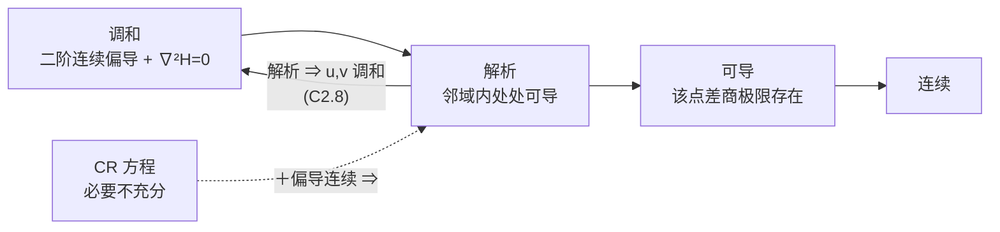

# C2 复习提纲 Review Outline（完整版·不漏知识点）

> [!abstract] 使用说明
> 本提纲由第二章全部笔记（[[复变函数 MOC]] 的 C2 部分 + C2.1–C2.9）整理而成，**覆盖教材 Sec.13–29、课本 37–86 页的全部知识点**，按"考前极简版 → 知识地图 → 分节详解 → 必背表 → 题型套路 → 术语表 → 复习路线"组织。
> - 每节末尾的「必记例与反例」「易错点」是考试最容易失分的地方，优先看。
> - **术语与答题用英文**（[[复变函数 MOC]] 记录的考核要求：老师以英文学的名词，中文译名他本人也不熟）。
> - **图片来源**：本章 16 张插图（图 19–34）全部按 Python 重绘，见 `attachments/C2-*.png`。

> [!note] 授课进度说明
> 第 3 讲转写稿已合并，课堂实际覆盖到 **Sec.17（含无穷远点的极限、扩充复平面与黎曼球）**为止；**Sec.18 连续性及其后各节尚未讲授**。按 vault 约定，第二章各篇**不逐条标「拓展」**，只在篇首放一条进度说明，因此本提纲也不作「拓展」标记——所有列出的内容都来自教材主线。等后续转写稿到位，再回来按课堂实际覆盖范围补标。

> [!warning] 考试口径（沿用第一章公布的规则）
> - 平时作业 30% + 期末 70%；**作业里出现过的题型期末会出现**（老师原话）。
> - 本章目前**尚无作业与错题记录**（[[作业与错题 MOC]] 只有 C1）。
> - **C2.9（Sec.28–29）教材自己说明"可以先跳到第 3 章、需要时再回来"**——理论价值高但不是后续主线，考试权重通常较低，复习优先级放最后。

---

## 0. 考前极简版（考前 5 分钟）

第二章只讲了一件事：**把"点可导"升级成"邻域内处处可导"（解析），然后榨出它的全部后果。** 全章的枢纽是一对方程

$$u_x=v_y,\qquad u_y=-v_x$$

以及一句需要背死的辨析：**CR 方程是必要条件，不是充分条件**（反例 $\bar z^2/z$）；**可导 ≠ 解析**（$|z|^2$ 在原点可导但处处不解析）。

**必须能默写出来的硬货**：

1. 极限定义 $|f(z)-w_0|<\varepsilon$ 当 $0<|z-z_0|<\delta$；**去心**邻域、量词顺序 $\forall\varepsilon\exists\delta\forall z$。
2. 翻译定理：$\lim f=w_0\iff\lim u=u_0$ 且 $\lim v=v_0$。
3. 三条无穷远点换算公式（把 $\infty$ 换成 $0$）。
4. 导数定义 $f'(z_0)=\lim\limits_{\Delta z\to0}\dfrac{f(z_0+\Delta z)-f(z_0)}{\Delta z}$；**方向敏感因子** $\dfrac{\overline{\Delta z}}{\Delta z}=e^{-i2\varphi}$。
5. CR 方程 + $f'=u_x+iv_x=v_y-iu_y$；**充分条件**（偏导在邻域内存在、在该点连续、在该点满足 CR）。
6. 极坐标 CR：$r\,u_r=v_\theta$、$u_\theta=-r\,v_r$；$f'(z_0)=e^{-i\theta}(u_r+iv_r)$。
7. 解析 = 在**某邻域内处处可导**；整函数 entire = 全平面解析。
8. 三条刚性定理：$f'\equiv0$ 于域 ⇒ 常数；$f$ 与 $\bar f$ 同时解析 ⇒ 常数；$|f|$ 常数 ⇒ $f$ 常数。
9. 解析 ⇒ 分量调和（$u_{xx}+u_{yy}=0$）；$u=c_1$ 与 $v=c_2$ 两族等值线正交（需 $f'\ne0$）。
10. 唯一性定理 / 重合原理 / 解析延拓（唯一但依赖路径）/ 反射原理 $\overline{f(z)}=f(\bar z)\iff f$ 在实轴段上实值。

**四条主线（下面第 2 节展开）**：路径任意性 · 苛刻换来刚性 · 一见共轭解析性就死 · 可导 vs 解析。

---

## 1. 全章知识地图

> [!abstract] 逻辑链：一条规则 → 一对方程 → 两类函数 → 三种刚性
> ```mermaid
> graph TD
>     A["C2.1 函数与映射<br/>Sec.13-14"] --> B["C2.2 极限<br/>Sec.15-16"]
>     B --> C["C2.3 无穷远点与连续性<br/>Sec.17-18"]
>     C --> D["C2.4 导数与求导法则<br/>Sec.19-20"]
>     D --> E["C2.5 柯西-黎曼方程<br/>Sec.21-22"]
>     E --> F["C2.6 充分条件与极坐标<br/>Sec.23-24"]
>     F --> G["C2.7 解析函数<br/>Sec.25-26"]
>     G --> H["C2.8 调和函数<br/>Sec.27"]
>     G --> I["C2.9 唯一性与反射原理<br/>Sec.28-29"]
>     H --> J["第3章 初等函数<br/>第4章 复积分"]
>     I --> J
> ```

| 提纲节 | 笔记 | 教材节 | 页码 | 核心内容 | 图 |
|---|---|---|---|---|---|
| §2 | [[C2.1 函数与映射]] | Sec.13–14 | 37–44 | $f=u+iv$ 分解、多值函数与取分支、映射词汇、平移/旋转/反射、$w=z^2$ 完整分析 | 19–21 |
| §3 | [[C2.2 极限]] | Sec.15–16 | 44–49 | $\varepsilon$–$\delta$ 定义、唯一性、路径依赖反例、复极限 $\iff$ 两个实极限、四则运算 | 22–24 |
| §4 | [[C2.3 无穷远点与连续性]] | Sec.17–18 | 50–54 | 黎曼球与球极投影、扩充复平面、三条换算公式、连续性四定理 | 25–26 |
| §5 | [[C2.4 导数与求导法则]] | Sec.19–20 | 55–62 | 导数定义、$\bar z$ 处处不可导、$\lvert z\rvert^2$ 只在 0 可导、求导法则、链式法则 | 27–29 |
| §6 | [[C2.5 柯西-黎曼方程]] | Sec.21–22 | 62–65 | CR 方程推导、$f'=u_x+iv_x$、必要非充分、反例 $\bar z^2/z$ | — |
| §7 | [[C2.6 可微的充分条件与极坐标形式]] | Sec.23–24 | 65–72 | 充分条件定理、$e^z$ 首次露面、极坐标 CR、$f'=e^{-i\theta}(u_r+iv_r)$、平方根分支 | — |
| §8 | [[C2.7 解析函数]] | Sec.25–26 | 72–77 | 解析/整函数/奇点、运算封闭、$f'\equiv0\Rightarrow$ 常数、$\lvert f\rvert$ 常数 | 30 |
| §9 | [[C2.8 调和函数]] | Sec.27 | 77–80 | 拉普拉斯方程、解析 ⇒ 分量调和、共轭调和、等值线正交 | 31–32 |
| §10 | [[C2.9 唯一确定的解析函数与反射原理]] | Sec.28–29 | 80–86 | 唯一性定理、重合原理、解析延拓、反射原理 | 33–34 |

---

## 2. 四条主线（贯穿全章，先记住这四条再进细节）

> [!important] 主线 1｜路径任意性——复分析与实分析的分水岭
> 实轴上"趋近"只有左右两条路；平面上有无穷多条，而极限要求**殊途同归**。
> 兑现链：极限不存在的判据（$z/\bar z$，C2.2 例 2）→ $\bar z$ 处处不可导（C2.4 例 2）→ CR 只看两条路故只是必要条件（C2.5 例 3）→ **偏导连续**补上漏洞（C2.6 定理）。
> **照妖镜**：$\dfrac{\overline{\Delta z}}{\Delta z}=e^{-i2\varphi}$。

> [!important] 主线 2｜苛刻换来刚性
> 复可导极苛刻，回报是一连串实分析没有的刚性结论：
> - $f'\equiv0$ 于域 $\Rightarrow$ $f$ 常数（C2.7 定理）
> - $f$ 与 $\bar f$ 同时解析 $\Rightarrow$ 常数（C2.7 例 3）
> - $|f|$ 常数 $\Rightarrow$ $f$ 常数（C2.7 例 4）
> - 在一小段线段上 $\equiv0$ $\Rightarrow$ 全域 $\equiv0$（C2.9 引理）
> - 解析 $\Rightarrow$ 分量调和（C2.8 定理）
> 第 4 章继续推向刘维尔定理、最大模原理、代数基本定理。

> [!important] 主线 3｜一见共轭，解析性就死
> 只要式子里出现 $\bar z$、$|z|$、$\operatorname{Re}z$、$\operatorname{Im}z$，就立刻怀疑不可导。
> 严格根据：CR 的复形式 $\dfrac{\partial f}{\partial\bar z}=0$（C2.6 习题 8），即"**解析 = 不依赖 $\bar z$**"。
> 对照记忆：$e^xe^{iy}=e^z$ 是整函数；$e^xe^{-iy}=\overline{e^z}$ 处处不可导。

> [!important] 主线 4｜可导 vs 解析（最常考的辨析）
> | 函数 | 可导点 | 是否解析 |
> |---|---|---|
> | $\lvert z\rvert^2$ | 只有 $z=0$ | 处处不解析 |
> | $x^2+iy^2$ | 直线 $y=x$ 上 | 处处不解析 |
> | $x^3+i(1-y)^3$ | 只有 $z=i$ | 处处不解析 |
> | $\bar z^2/z$ | 处处不可导（原点满足 CR） | 处处不解析 |
> | $1/z$ | 所有 $z\ne0$ | 在 $z\ne0$ 处解析 |
>
> **解析要求在一个开圆盘内处处可导**；孤立点、一条线段都不够。

---

## 3. C2.1 函数与映射 Functions and Mappings（Sec.13–14）

### 3.1 函数的定义（必背）

- **函数 function**：定义在集合 $S$ 上的一条**规则**，给每个 $z\in S$ 指派一个复数 $w$；$w$ 称为 $f$ 在 $z$ 处的**值 value**，$S$ 称为**定义域 domain of definition**。
- **关键**：*both a domain of definition and a rule are needed in order for a function to be well defined*——**函数 = 规则 + 定义域，缺一不可**。同一条规则配不同定义域就是**不同的函数**。
- 约定：不说定义域时默认取**使规则有意义的最大集合**。
- 记号松弛：严格说 $f$ 是函数、$f(z)$ 是值，但通常混用（教材明说是为了方便，不必纠结）。

### 3.2 分量分解（整章技术主线）

$$f(z)=u(x,y)+i\,v(x,y)\tag{1}$$
$$f(z)=u(r,\theta)+i\,v(r,\theta)\tag{2}$$

- $u,v$ 称为**分量函数 component functions**（$u$ 实部函数、$v$ 虚部函数）。
- 这一步把"一个复函数"翻译成"**一对二元实函数**"，代价是丢掉复数乘法的优雅，收益是多元微积分工具（偏导、连续、拉普拉斯方程）立刻全部可用。
- **兑现链**：极限定理（C2.2 定理 1）→ CR 方程（C2.5）→ 调和性（C2.8）。

> [!warning] 易错点：$u(x,y)$ 与 $u(r,\theta)$ 是两个不同的函数，共用一个字母
> 写偏导时尤其当心：$u_x$ 与 $u_r$ 完全是两码事。这正是 C2.6 要用链式法则专门换算的原因。

### 3.3 两类基本函数

- **多项式 polynomial**：$P(z)=a_0+a_1z+\cdots+a_nz^n$（$a_n\ne0$，$n$ 为正整数）。**项数有限**，定义域是**整个 $z$ 平面**。
- **有理函数 rational function**：$P(z)/Q(z)$，在每个 $Q(z)\ne0$ 的点有定义。
- **复变量的实值函数 real-valued function of a complex variable**：如 $f(z)=|z|^2=x^2+y^2+i0$（$v\equiv0$）。记住它——C2.4 例 3 会说它只在原点可导。

> [!note] 为什么强调"项数有限"
> 第 5 章会出现**幂级数** $\sum a_n(z-z_0)^n$，形式上像"无穷次多项式"，但只在收敛圆内有定义，性质完全不同。线索：**多项式 → 幂级数 → 任何解析函数局部等于幂级数**（第 5 章核心定理）。

### 3.4 多值函数与取分支（第一章埋的雷开始响）

- **多值函数 multiple-valued function**：一条规则给一个 $z$ 指派**不止一个**值；研究时通常**按某种系统的方式**在候选中只挑一个，构造出**单值函数**。
- **例 5（平方根主分支）**：非零 $z$ 的 $z^{1/2}=\pm\sqrt r\exp(i\Theta/2)$，$\Theta=\operatorname{Arg}z\in(-\pi,\pi]$。只取正号

$$f(z)=\sqrt r\exp\!\left(i\frac{\Theta}{2}\right)\qquad(r>0,\ -\pi<\Theta\le\pi)\tag{3}$$

  再补 $f(0)=0$，就得到全平面的单值函数。挑的这支叫**主分支 principal branch**。
- **代价**：$\operatorname{Arg}z$ 在负实轴跳跃 $2\pi$，所以 $f$ 在负实轴**不连续**（从上方趋 $-1$ 得 $i$，从下方得 $-i$）。断裂的那条线（负实轴）叫**支割线 branch cut**。
- C2.6 例 2 会证明：只要避开割线，$\sqrt r e^{i\theta/2}$ 在定义域内**处处可导**，$f'=\dfrac{1}{2f(z)}$。
- **工程接口**：`numpy.sqrt` 复数版取主分支，`numpy.angle` 返回 $\operatorname{Arg}\in(-\pi,\pi]$；相位跳 $2\pi$ 就是支割线，`np.unwrap` 干的就是手工补割线。

### 3.5 函数即映射 mapping（词汇表，必背）

复函数画不出图像（$z,w$ 各占一个平面 = 四维），改为**把 $z$ 平面和 $w$ 平面分开画**，追踪点、曲线、区域的对应。

| 术语 | 含义 |
|---|---|
| 映射 mapping / 变换 transformation | 把 $f$ 看成平面到平面的搬运 |
| 像 image | $w=f(z)$；集合 $T$ 的像是 $T$ 中所有点的像之集 |
| 值域 range | 整个定义域 $S$ 的像 |
| 原像 inverse image | 所有以 $w$ 为像的点之集；可为**一个点、多个点或空集** |

> [!warning] 易错点：原像是一个**集合**，不是一个点
> $w=z^2$ 中 $w=4$ 的原像是 $\{2,-2\}$；第三章 $w=e^z$ 中 $w=1$ 的原像是 $\{2k\pi i\}$（无穷多点）。复变里"反函数"天然多值——这正是 3.4 要先讲多值函数的原因。

### 3.6 三种最简单的搬运

| 映射 | 写开 | 几何动作 |
|---|---|---|
| $w=z+b$ | $(x+b_x)+i(y+b_y)$ | **平移 translation** |
| $w=az\ (a\ne0)$ | $\lvert a\rvert r\,e^{i(\theta+\arg a)}$ | **旋转 rotation**（转角 $\arg a$）+ 放缩 $\lvert a\rvert$ |
| $w=\bar z$ | $x-iy$ | **反射 reflection**：关于实轴翻折 |

- $w=az+b$ 称为**线性变换**，是第 8 章共形映射的第一块砖。
- $w=iz$ 是旋转 $90^\circ$：因为 $i=e^{i\pi/2}$，而"乘法 = 模相乘、幅角相加"。
- $w=\overline{iz}$ = 先转 $90^\circ$ 再关于实轴翻折 = **一次反射**；含共轭的映射**不保持定向**，这正是 $\bar z$ 不可导的几何根源。

### 3.7 范例：映射 $w=z^2$（务必能独立复述）

**笛卡尔视角**：$w=z^2$ 就是实变换

$$u=x^2-y^2,\qquad v=2xy\tag{1}$$

| 结论 | 内容 |
|---|---|
| 结论 1 | 双曲线 $x^2-y^2=c_1\ (c_1>0)$ 的**每一支**都**一对一地**映成竖直线 $u=c_1$ |
| 结论 2 | 双曲线 $2xy=c_2\ (c_2>0)$ 的**每一支**都被映成水平线 $v=c_2$ |

- 找曲线像的**标准套路**：在 $z$ 平面挑一族曲线，让分量公式的右端在这族上取常数——**等值线的像必是坐标线**。
- 右支参数式：$u=c_1,\ v=2y\sqrt{y^2+c_1}\ (-\infty<y<\infty)$；因 $v(y)$ **严格递增**且 $v\to\pm\infty$，故铺满且不重复（"one to one manner onto"的全部含义）。
- 左支：$u=c_1,\ v=-2y\sqrt{y^2+c_1}$——**定向翻转**：点沿左支**向下**走时像才向上跑。

> [!example] 例 1（区域的像，完整示范）
> 域 $x>0,\ y>0,\ xy<1$ 被双曲线族 $2xy=c\ (0<c<2)$ 的**上支**填满，故映成**水平带 $0<v<2$**；**闭**区域 $x\ge0,y\ge0,xy\le1$ 映成**闭**带 $0\le v\le2$。
> - 边界走向：$(0,y)\mapsto(-y^2,0)$（沿负 $u$ 轴向右到原点）；$(x,0)\mapsto(x^2,0)$（沿正 $u$ 轴向右）；$xy=1$ 的上支 $\mapsto$ 水平线 $v=2$。
> - **易错**：$xy<1\iff v<2$（不是 $v<1$）——多出的因子 2 来自 $v=2xy$。**边界条件对不上时，第一件事是检查分量公式里的常数因子。**

**极坐标视角（一行看穿）**：$z=re^{i\theta}\Rightarrow w=r^2e^{i2\theta}$，即

$$\rho=r^2,\qquad \phi=2\theta\tag{5}$$

**模平方、幅角加倍。**

| 结论 | 内容 |
|---|---|
| 第一象限 | $r\ge0,\ 0\le\theta\le\pi/2$ **一对一**映成**上半平面** $\rho\ge0,\ 0\le\phi\le\pi$，且 $0\mapsto0$ |
| 上半平面 | 映成**整个 $w$ 平面**，但**不是一对一**（正实轴与负实轴都映到正实轴） |
| 圆 | $r=r_0\mapsto$ 圆 $\rho=r_0^2$ |
| 射线 | $\theta=\theta_0\mapsto$ 射线 $\phi=2\theta_0$ |

> [!warning] 关键反差：换个定义域，一对一就没了
> **想让 $z^2$ 可逆（从而定义 $\sqrt w$），必须把定义域切到一个张角 $<\pi$ 的扇形里——这就是支割线的来历。**

**推广到 $w=z^n$（$n>2$）**：

- 整个 $z$ 平面映成整个 $w$ 平面，**每个非零 $w$ 恰有 $n$ 个原像**（$n$ 对一）；
- 圆 $r=r_0\mapsto$ 圆 $\rho=r_0^n$；
- 扇形 $r\le r_0,\ 0\le\theta\le 2\pi/n$ 映成圆盘 $\rho\le r_0^n$，但**不是一对一**（两条边都映到正实轴）。
- "方根有 $n$ 个"与"$z^n$ 是 $n$ 对一"是**同一件事的两种说法**。

### 3.8 必记例与反例（C2.1）

| 题目 | 答案/结论 |
|---|---|
| $f(z)=1/(z^2+1)$ 的定义域 | $z\ne\pm i$ |
| $f(z)=\operatorname{Arg}(1/z)$ 的定义域 | $\operatorname{Re}z\ne0$（因 $\operatorname{Arg}$ 主值在负实轴无良定义） |
| $f(z)=z/(z+\bar z)$ 的定义域 | $\operatorname{Re}z\ne0$（分母 $=2\operatorname{Re}z$） |
| $f(z)=1/(1-\lvert z\rvert^2)$ 的定义域 | $\lvert z\rvert\ne1$ |
| $z^3+z+1$ 的分量 | $(x^3-3xy^2+x+1)+i(3x^2y-y^3+y)$ |
| $\bar z^2/z$ 的分量（$z\ne0$） | $\dfrac{x^3-3xy^2}{x^2+y^2}+i\,\dfrac{y^3-3x^2y}{x^2+y^2}$ ← **C2.5 例 3 的反例主角** |
| $x^2-y^2-2y+i(2x-2xy)$ 化简 | $\bar z^2+2iz$ |
| $z+\dfrac1z$ 的极坐标分量 | $\left(r+\dfrac1r\right)\cos\theta+i\left(r-\dfrac1r\right)\sin\theta$ ← **Joukowski 变换**（机翼绕流，第 10 章） |

- 习题 9：另一种解释是**向量场 vector field**（每点放一个分量 $(u,v)$ 的向量）；流体力学里叫复速度场，物理上常用 $\overline{f(z)}$，第 10 章讲为什么。

---

## 4. C2.2 极限 Limits（Sec.15–16）

### 4.1 定义（必背，逐符号拆解）

$f$ 需在 $z_0$ 的**某个去心邻域**内处处有定义。

$$\lim_{z\to z_0}f(z)=w_0\ \overset{\text{def}}{\iff}\ \forall\varepsilon>0\ \exists\delta>0:\ \lvert f(z)-w_0\rvert<\varepsilon\quad\text{whenever}\quad 0<\lvert z-z_0\rvert<\delta\tag{2}$$

| 记号 | 含义 |
|---|---|
| $0<\lvert z-z_0\rvert$ | **排除 $z=z_0$ 本身**：$f$ 在 $z_0$ 处有无定义、取什么值，与极限无关 |
| $\lvert z-z_0\rvert<\delta$ | $z$ 落在 $z_0$ 的 $\delta$ 去心邻域 |
| $\lvert f(z)-w_0\rvert<\varepsilon$ | 像落在 $w_0$ 的 $\varepsilon$ 邻域 |
| 量词顺序 | $\forall\varepsilon\,\exists\delta\,\forall z$：**$\delta$ 可依赖 $\varepsilon$ 与 $z_0$，不可依赖 $z$** |
| $\lvert\cdot\rvert$ | 复数的模 = 平面上距离，所以定义**字面上就是二维的** |

- **像不必填满** $\varepsilon$ 邻域（常值函数的像只是一个点）；**$\delta$ 找到后任何更小的正数也行**，"求最大 $\delta$"没有意义。
- **边界点的推广**：若 $z_0$ 是区域 $R$ 的边界点、$f$ 只定义在 $R$ 上，则只要求不等式对那些**同时落在 $R$ 与去心邻域里**的 $z$ 成立。

### 4.2 唯一性定理及证明骨架

**定理**：若 $f$ 在 $z_0$ 处极限存在，则**唯一**。

**证明思路（必会复述）**：
1. 设 $\lim f=w_0$ 且 $\lim f=w_1$，分别有 $\delta_0,\delta_1$；
2. **恒等变形** $w_1-w_0=[f(z)-w_0]+[w_1-f(z)]$；
3. 三角不等式：$\lvert w_1-w_0\rvert\le\lvert f(z)-w_0\rvert+\lvert f(z)-w_1\rvert<2\varepsilon$（取 $\delta=\min(\delta_0,\delta_1)$）；
4. $\lvert w_1-w_0\rvert$ 是**固定非负常数**而 $\varepsilon$ 任意小 ⇒ 只能为 $0$。

> [!warning] 常见漏洞：$\lvert w_1-w_0\rvert$ **不随 $\varepsilon$ 变化**这一点必须强调——"$A<2\varepsilon$ 对任意 $\varepsilon>0$ 成立 ⇒ $A=0$"只在 $A$ 是常数时成立。这是所有 $\varepsilon$ 论证的命门。
> **唯一性是本章后面每一个"不可导"证明的武器**：两条路给出两个值 ⇒ 与唯一性矛盾 ⇒ 极限不存在。

### 4.3 例 1：亲手做一次 $\varepsilon$–$\delta$

$f(z)=\dfrac{i\bar z}{2}$ 定义在 $\lvert z\rvert<1$ 上（点 $1$ 是边界点，用 4.1 的推广），证明 $\lim\limits_{z\to1}f(z)=\dfrac i2$。

**标准套路**：先把 $\lvert f(z)-w_0\rvert$ 化成含 $\lvert z-z_0\rvert$ 的式子，再反解 $\delta$。

$$\left\lvert f(z)-\frac i2\right\rvert=\frac{\lvert i\rvert\,\lvert\bar z-1\rvert}{2}=\frac{\lvert\overline{z-1}\rvert}{2}=\frac{\lvert z-1\rvert}{2}$$

用的两条第一章性质：$\bar z-1=\overline{z-1}$、$\lvert\bar\zeta\rvert=\lvert\zeta\rvert$。故取 $\delta=2\varepsilon$ 即可。

### 4.4 例 2：路径依赖（本讲真正的主角）

**关键原则**：若极限存在，则 $z\to z_0$ 意味着 $z$ 可以**以任意方式**趋近，不限于某个特定方向。

$f(z)=\dfrac{z}{\bar z}$ 在 $z\to0$ 时**极限不存在**：沿实轴得 $1$，沿虚轴得 $-1$；由唯一性矛盾。$\blacksquare$

**极坐标重算**：$f(re^{i\theta})=\dfrac{re^{i\theta}}{re^{-i\theta}}=e^{i2\theta}$——**与 $r$ 无关，只取决于方向 $\theta$**，绕一圈把整个单位圆走遍。

> [!warning] 最重要的方法论（习题 5 专考）
> **"沿实轴和虚轴都得到同一个值"不能证明极限存在。**
> 反例：$f(z)=\left(\dfrac{z}{\bar z}\right)^2$ 沿两轴都得 $1$，但沿 $y=x$（$\theta=\pi/4$）得 $(e^{i\pi/2})^2=e^{i\pi}=-1$，极限仍不存在。
> **只有"找到两条路给出不同值"能证伪；要证实必须回到 $\varepsilon$–$\delta$ 或用下面的定理 1。**

### 4.5 定理 1：复极限 $\iff$ 两个二元实极限（翻译器）

设 $f=u+iv$、$z_0=x_0+iy_0$、$w_0=u_0+iv_0$，则

$$\lim_{(x,y)\to(x_0,y_0)}u=u_0\ \text{且}\ \lim_{(x,y)\to(x_0,y_0)}v=v_0\iff\lim_{z\to z_0}f(z)=w_0$$

**证明两条桥梁**（必背）：
- 正向：$\lvert(u+iv)-(u_0+iv_0)\rvert\le\lvert u-u_0\rvert+\lvert v-v_0\rvert$（三角不等式）；且 $\sqrt{(x-x_0)^2+(y-y_0)^2}=\lvert(x+iy)-(x_0+iy_0)\rvert$（**二元点距离 = 复数模**）。
- 反向：$\lvert u-u_0\rvert\le\lvert(u-u_0)+i(v-v_0)\rvert$，$\lvert v-v_0\rvert\le(\cdots)$（$\lvert\operatorname{Re}\zeta\rvert\le\lvert\zeta\rvert$、$\lvert\operatorname{Im}\zeta\rvert\le\lvert\zeta\rvert$）。

> [!note] 这个定理买到了什么
> 复极限**完全归约**为多元微积分极限：夹逼、极坐标换元、路径检验全部可用。
> 但**"归约"不是"等同"**：二元极限的病态例子翻译过来就是 $z/\bar z$ 那种反例。**复分析的奇迹不在极限这一层，而在下一层——求导。**

### 4.6 定理 2：四则运算与多项式极限

若 $\lim\limits_{z\to z_0}f=w_0$、$\lim\limits_{z\to z_0}F=W_0$，则

$$\lim(f+F)=w_0+W_0,\qquad \lim(fF)=w_0W_0,\qquad \lim\frac fF=\frac{w_0}{W_0}\ (W_0\ne0)$$

**证明只需借定理 1**：写 $f=u+iv$、$F=U+iV$，乘积 $fF=(uU-vV)+i(vU+uV)$，对实虚部分别用**二元实函数**的极限四则运算，再用定理 1 拼回去。

> [!question] 定理 2 的证明里哪一步是"复分析特有"的？
> **一步也没有。** 复数只贡献了"怎么把实虚部拼回去"的记账规则。**极限层面上，复分析 = 打包好的二元实分析。**

**基本极限**（由定义立得）与**多项式极限**：

$$\lim_{z\to z_0}c=c,\qquad \lim_{z\to z_0}z=z_0,\qquad \lim_{z\to z_0}z^n=z_0^n\ (n=1,2,\dots),\qquad \lim_{z\to z_0}P(z)=P(z_0)\tag{11}$$

- $z^n$ 用**数学归纳法** + 乘积性质：$z^{n+1}=z^n\cdot z$。
- (11) 表面平淡，实际是在说"**多项式处处连续**"，进而"处处可导"、"是整函数"。链条终点（第 4 章）：整函数 + 有界 ⇒ 常数（刘维尔）⇒ **代数基本定理**。

### 4.7 习题要点（Sec.15–16）

1. (a) $\lim\operatorname{Re}z=\operatorname{Re}z_0$、**(b) $\lim\bar z=\bar z_0$**、**(c) $\lim\limits_{z\to0}\dfrac{\bar z^2}{z}=0$**（提示：$\left\lvert\bar z^2/z\right\rvert=\lvert z\rvert$，取 $\delta=\varepsilon$）。**这题与例 2 长得像、结论相反——分子多一次方就把方向依赖压下去了。**
2. (a) $\lim(az+b)=az_0+b$；(b) $\lim(z^2+c)=z_0^2+c$；(c) $\lim\limits_{z\to1-i}[x+i(2x+y)]=1+i$。
3. (a) $\lim\limits_{z\to z_0}\dfrac{1}{z^n}=\dfrac{1}{z_0^n}$；(b) $\lim\limits_{z\to i}\dfrac{iz^3-1}{z+i}=0$（分子在 $i$ 处也为 $0$，分母 $2i\ne0$）；(c) $\lim\dfrac{P(z)}{Q(z)}=\dfrac{P(z_0)}{Q(z_0)}$。
5. $\left(\dfrac{z}{\bar z}\right)^2$ 的路径反例（本讲最重要的一道题）。
7. 若 $\lim f=w_0$，则 $\lim\lvert f\rvert=\lvert w_0\rvert$（用**反向三角不等式** $\lvert\lvert f\rvert-\lvert w_0\rvert\rvert\le\lvert f-w_0\rvert$）。
8. 换元等价：$\lim\limits_{z\to z_0}f(z)=w_0\iff\lim\limits_{\Delta z\to0}f(z_0+\Delta z)=w_0$（**C2.4 导数两种写法全靠它**）。
9. **无穷小 × 有界 = 无穷小**：若 $\lim f=0$ 且 $\lvert g(z)\rvert\le M$ 在某邻域内，则 $\lim fg=0$。注意 $g$ **不要求有极限**（$z/\bar z$ 这种有界无极限的也能用）。估计余项时非常好使。

---

## 5. C2.3 无穷远点与连续性（Sec.17–18）

### 5.1 为什么要把 $\infty$ 变成真正的点

高数做法（"对任意 $M$ 存在 $X$"）每加一种情形就要新写一套定义。复分析的做法：**把复平面卷成球**，让北极扮演 $\infty$，于是 $\varepsilon$–$\delta$ 一个字都不用改。

### 5.2 黎曼球与球极投影（必背）

- 把复平面穿过以原点为心的**单位球面的赤道**；平面上每点 $z$ 对应球面上唯一一点 $P$（连线 $Nz$ 与球面的另一个交点）；球面上除北极 $N$ 外每点也恰好对应平面上一点。
- 让 **$N\leftrightarrow\infty$**，得到一一对应。这个球叫**黎曼球 Riemann sphere**，这个对应叫**球极投影 stereographic projection**。
- 合起来称**扩充复平面 extended complex plane**，$\infty$ 称**无穷远点 point at infinity**。

| 平面上的集合 | 球面上的像 |
|---|---|
| $\lvert z\rvert<1$（单位圆内部） | 下半球 |
| $\lvert z\rvert=1$（单位圆） | 赤道（唯一不动的圈） |
| $\lvert z\rvert>1$（单位圆外部） | 上半球（不含 $N$）；$\lvert z\rvert$ 越大越靠近 $N$ |

球极投影公式（$z=x+iy$，$N=(0,0,1)$）：

$$P=\left(\frac{2x}{\lvert z\rvert^2+1},\ \frac{2y}{\lvert z\rvert^2+1},\ \frac{\lvert z\rvert^2-1}{\lvert z\rvert^2+1}\right)$$

**两条漂亮性质**：① **保角**（平面上相交曲线的夹角不变）；② **圆变圆**——平面上的圆映成球面上的圆，平面上的**直线**映成**过北极的圆**，所以"直线只是穿过无穷远点的圆"。这解释了第 8 章 Möbius 变换为什么能**把圆与直线统一地映成圆与直线**。

### 5.3 $\infty$ 的邻域与三条换算公式（必背）

**$\infty$ 的邻域**：$\left\{z:\lvert z\rvert>\dfrac1\varepsilon\right\}$。

> [!question] 为什么是 $\lvert z\rvert>1/\varepsilon$ 而不是 $> \varepsilon$？
> 为了让"$\varepsilon$ 小 $\Leftrightarrow$ 邻域小"这条语感一致：有限点邻域 $\lvert z-z_0\rvert<\varepsilon$ 是 $\varepsilon$ 越小越小；$\infty$ 的邻域是外部区域，要变小就得让门槛变大。**取倒数正是为了让 $\infty$ 用上和有限点完全相同的语法。**

**定理（三条换算公式，全部用 $z\mapsto1/z$ 化归）**：

$$\lim_{z\to z_0}f(z)=\infty\iff\lim_{z\to z_0}\frac{1}{f(z)}=0\tag{1}$$
$$\lim_{z\to\infty}f(z)=w_0\iff\lim_{z\to0}f\!\left(\frac1z\right)=w_0\tag{2}$$
$$\lim_{z\to\infty}f(z)=\infty\iff\lim_{z\to0}\frac{1}{f(1/z)}=0\tag{3}$$

**证明里唯一的技巧**：**取倒数把 $<\varepsilon$ 变成 $>1/\varepsilon$**（$0<\lvert1/z\rvert<\delta\iff\lvert z\rvert>1/\delta$）。$\infty$ 的邻域门槛取 $1/\varepsilon$ 的全部理由就在这一步。

> [!warning] 易错点：在扩充复平面上，$\infty$ **没有加减乘除**
> $\infty+\infty$、$\infty/\infty$、$0\cdot\infty$ 全都无定义。它只是一个用来谈邻域和极限的点。任何时候都老老实实做 $z\mapsto1/z$ 的代换，**不要做"约掉无穷"的形式演算**。

**三个例子**：
- $\lim\limits_{z\to-1}\dfrac{iz+3}{z+1}=\infty$（用 (1)，分母 $\to0$、分子 $\to3-i\ne0$）；
- $\lim\limits_{z\to\infty}\dfrac{2z+i}{z+1}=2$（用 (2)，同乘 $z$ 清掉负幂 → $\dfrac{2+iz}{1+z}$）；
- $\lim\limits_{z\to\infty}\dfrac{2z^3-1}{z^2+1}=\infty$（用 (3)，同乘 $z^3$）。

### 5.4 连续性的定义（必背）

$f$ 在 $z_0$ **连续 continuous** $\iff$ 三条同时成立：

$$\lim_{z\to z_0}f(z)\ \text{存在};\qquad f(z_0)\ \text{存在};\qquad \lim_{z\to z_0}f(z)=f(z_0)\tag{3}$$

（(3) 已经蕴含前两条，因为要写下等号两边都必须存在。）等价的 $\varepsilon$–$\delta$ 形式：

$$\lvert f(z)-f(z_0)\rvert<\varepsilon\quad\text{whenever}\quad\lvert z-z_0\rvert<\delta\tag{4}$$

> [!warning] 易错点：(4) 里**没有 $0<$**
> 对比极限定义：那里是 $0<\lvert z-z_0\rvert<\delta$。少掉的这个 $0<$ 正是"连续"与"有极限"的**全部差别**：连续要求 $z=z_0$ **也参加考试，并且考出的成绩正好是 $f(z_0)$**。

- 由 C2.2 定理 2 直接得到：两个连续函数的**和**、**积**连续；**商**在分母非零处连续。**多项式在整个平面上连续。**

### 5.5 连续性四条定理（本章后半段反复引用）

> [!important] 定理 1｜复合函数的连续性
> **连续函数的复合仍然连续。**
> 证明逻辑：先由 $\varepsilon$（$W$ 平面）定出 $\gamma$（$w$ 平面），再由 $\gamma$ 定出 $\delta$（$z$ 平面）——**"倒着找、顺着验"**，是所有复合型 $\varepsilon$–$\delta$ 证明的通用套路（链式法则的证明用的也是它）。

> [!important] 定理 2｜连续且非零 ⇒ 附近都非零
> 若 $f$ 在 $z_0$ 连续且 $f(z_0)\ne0$，则 $f(z)\ne0$ 在 $z_0$ 的**某个邻域内处处**成立。
> **证明的关键取法**：取 $\varepsilon=\dfrac{\lvert f(z_0)\rvert}{2}$（确定的正数）。若邻域内某点 $f(z)=0$，代入得 $\lvert f(z_0)\rvert<\dfrac{\lvert f(z_0)\rvert}{2}$，矛盾。
> **加强版（顺手得到）**：$\lvert f(z)\rvert>\dfrac{\lvert f(z_0)\rvert}{2}$——不只是"非零"，而是"离零有确定的距离"，做估计时有用得多。
> **用途**：判断商 $f/g$ 的连续性/可导性（分母在一邻域内不为零）；C2.7 里"$P/Q$ 在 $Q\ne0$ 的域上解析"；第 6 章**零点孤立性**定理的最初级版本。

> [!important] 定理 3｜$f$ 连续 $\iff$ $u,v$ 连续
> 由 C2.2 定理 1 立刻得到。**连续性这一层，复分析仍然完全等价于二元实分析。**

> [!important] 定理 4｜闭有界区域上连续 ⇒ 有界且取到最大模
> 若 $f$ 在**既闭又有界**的区域 $R$ 上连续，则存在非负实数 $M$ 使 $\lvert f(z)\rvert\le M$ 对 $R$ 中所有 $z$ 成立，且**至少有一点**取等号。
> 证明：由定理 3，$u,v$ 连续 ⇒ $\sqrt{u^2+v^2}=\lvert f(z)\rvert$ 是 $R$ 上的**连续实值函数**；由多元微积分（Taylor & Mann, *Advanced Calculus*, 3d ed., pp.125–126, 529），**闭有界集上的连续实值函数必在某点取到最大值**。

> [!warning] 三个条件一个都不能少
> - **闭**：$f(z)=\dfrac{1}{1-z}$ 在**开**圆盘 $\lvert z\rvert<1$ 上连续但无界。
> - **有界**：$f(z)=z$ 在闭的整个平面上连续但无界。
> - **连续**：显然。
>
> 对照高数：**一维的闭区间 $[a,b]$，在二维就是"闭且有界"（紧致 compact）。**

**定理 4 通向哪里**：① **ML 不等式**（第 4 章 Sec.47）：$\left\lvert\int_C f\,dz\right\rvert\le ML$，围道是闭有界集，$M$ 的存在性正由定理 4 保证；② **最大模原理**（Sec.59）：定理 4 保证最大值存在，最大模原理再说它在**边界**上；③ 刘维尔定理 → 代数基本定理。

### 5.6 习题要点（Sec.15–18 的 10–13 题）

10. (a) $\lim\limits_{z\to\infty}\dfrac{4z^2}{(z-1)^2}=4$；(b) $\lim\limits_{z\to1}\dfrac{1}{(z-1)^3}=\infty$；(c) $\lim\limits_{z\to\infty}\dfrac{z^2+1}{z-1}=\infty$。
11. **Möbius 变换** $T(z)=\dfrac{az+b}{cz+d}\ (ad-bc\ne0)$：(a) $c=0$ 时 $\lim\limits_{z\to\infty}T(z)=\infty$；(b) $c\ne0$ 时 $\lim\limits_{z\to\infty}T(z)=\dfrac ac$ 且 $\lim\limits_{z\to-d/c}T(z)=\infty$。
    **结论**：在扩充复平面上 $T$ 是**球面到球面的一一映射**（把 $\infty$ 与 $-d/c$ 互换）；$ad-bc\ne0$ 保证它不退化成常数。第 8 章共形映射的主角。
12. 涉及 $\infty$ 的极限也是**唯一**的：因为 $\infty$ 在扩充复平面里就是普通一点，唯一性证明只用到"两个不同点有互不相交的邻域"，球面上对 $N$ 同样成立。
13. 集合 $S$ **无界** $\iff$ $\infty$ 的每个邻域都至少含 $S$ 的一个点。**即 $\infty$ 是无界集的一个聚点。**

---

## 6. C2.4 导数与求导法则 Derivatives（Sec.19–20）

### 6.1 定义与两种写法（必背）

设 $f$ 的定义域包含 $z_0$ 的某个邻域 $\lvert z-z_0\rvert<\varepsilon$。$f$ 在 $z_0$ 处的**导数 derivative**

$$f'(z_0)=\lim_{z\to z_0}\frac{f(z)-f(z_0)}{z-z_0}\tag{1}$$

存在时称 $f$ 在 $z_0$ **可导 differentiable**。增量形式（$\Delta z=z-z_0$，$\Delta w=f(z+\Delta z)-f(z)$）：

$$f'(z_0)=\lim_{\Delta z\to0}\frac{f(z_0+\Delta z)-f(z_0)}{\Delta z}\tag{2}$$
$$\frac{dw}{dz}=\lim_{\Delta z\to0}\frac{\Delta w}{\Delta z}\tag{3}$$

> [!warning] 定义里的"邻域"不是废话
> 要求 $f$ 在 $z_0$ 的**整个邻域**上有定义（**不是去心邻域，也不是某条曲线上**）。因为差商里的 $z$ 必须能从**任意方向**逼近 $z_0$。若 $f$ 只定义在一条曲线上，差商只有一个方向可走，这个定义根本用不了。
> **这一点是"复可导"与"沿某方向的方向导数"的本质区别。**

### 6.2 三个必须记住的例子（全章最重要）

> [!example] 例 1｜$f(z)=\dfrac1z$：正常可导
> $$\frac{\Delta w}{\Delta z}=\left(\frac{1}{z+\Delta z}-\frac1z\right)\frac{1}{\Delta z}=\frac{-1}{(z+\Delta z)z}\to-\frac{1}{z^2}\qquad(z\ne0)$$
> **关键**：$\Delta z$ **被整体约掉**，剩下的表达式**与方向无关**，所以极限存在。这正是"能否约掉 $\Delta z$"与"是否可导"之间的联系。下面两个例子的 $\Delta z$ 都约不干净，会留下方向敏感因子。

> [!example] 例 2｜$f(z)=\bar z$：**处处不可导**
> $$\frac{\Delta w}{\Delta z}=\frac{\overline{z+\Delta z}-\bar z}{\Delta z}=\frac{\overline{\Delta z}}{\Delta z}$$
> - 水平路径（$\Delta z=(\Delta x,0)$，$\overline{\Delta z}=\Delta z$）：差商 $=1$；
> - 竖直路径（$\Delta z=(0,\Delta y)$，$\overline{\Delta z}=-\Delta z$）：差商 $=-1$。
>
> 由唯一性，$\dfrac{dw}{dz}$ **在任何地方都不存在**。
> **极坐标**：$\Delta z=\rho e^{i\varphi}\Rightarrow\dfrac{\overline{\Delta z}}{\Delta z}=e^{-i2\varphi}$——与 $\rho$ 无关，**差商在单位圆上无休止地转**。
> **深层原因**：$\bar z$ 的毛病不是"不光滑"，而是**它反转定向**；复可导几何上等价于"局部旋转 + 放缩"，**保持定向**。翻折做不到，所以从根上不可能复可导。

> [!example] 例 3｜$f(z)=\lvert z\rvert^2$：**只在 $z=0$ 可导，$f'(0)=0$**
> $$\frac{\Delta w}{\Delta z}=\frac{\lvert z+\Delta z\rvert^2-\lvert z\rvert^2}{\Delta z}=\bar z+\overline{\Delta z}+z\,\frac{\overline{\Delta z}}{\Delta z}$$
> - 水平趋近：$\to\bar z+\Delta z+z$；竖直趋近：$\to\bar z-\Delta z-z$。
> - 若导数存在必有 $\bar z+z=\bar z-z\Rightarrow 2z=0\Rightarrow z=0$；
> - 在 $z=0$ 处差商化为 $\overline{\Delta z}\to0$，故 $f'(0)=0$。

### 6.3 三个反直觉的事实（教材专门总结）

> [!warning] (a) 可以只在一点可导、附近处处不可导
> $f$ 可以在 $z$ 可导，但在该点以外**任何地方**都不可导。$|z|^2$ 一点都不病态（对比实分析的 $f(x)=x^2D(x)$ 很病态）。
> **这一条直接催生了"解析"这个概念**：光在一点可导太弱、没用；C2.7 会要求"在某个邻域内**处处**可导"。

> [!warning] (b) 分量可以无限光滑，函数却不可导
> $\lvert z\rvert^2$ 的分量 $u=x^2+y^2$、$v=0$ **任意阶偏导处处连续**，可是 $f$ 在非零点不可导。
> **这条把"复可导"与"实可微"彻底分开**：实可微只要求局部有线性逼近；复可导还要求这个线性逼近是**复数乘法**（旋转 + 放缩）——强了整整两条偏微分方程。

> [!warning] (c) 连续推不出可导；但**可导一定连续**
> 证明：$\lim[f(z)-f(z_0)]=\lim\dfrac{f(z)-f(z_0)}{z-z_0}\cdot\lim(z-z_0)=f'(z_0)\cdot0=0$（用了 C2.2 乘积定理，前提是两个极限都存在），故 $\lim f(z)=f(z_0)$。

- **几何解释**：教材明说推迟到**第 9 章**。实导数 = 切线斜率；复导数的几何含义（**局部旋转 $\arg f'$、局部放缩 $\lvert f'\rvert$、从而保角**）到共形映射才正式展开。

### 6.4 求导法则表（与高数一字不差）

$$\frac{d}{dz}c=0,\qquad \frac{d}{dz}z=1,\qquad \frac{d}{dz}[cf(z)]=cf'(z)\tag{1}$$
$$\frac{d}{dz}z^n=nz^{n-1}\qquad(n\ \text{为正整数；}n\ \text{为负整数时仍成立，只要}\ z\ne0)\tag{2}$$
$$\frac{d}{dz}[f+g]=f'+g'\tag{3}$$
$$\frac{d}{dz}[fg]=fg'+f'g\tag{4}$$
$$\frac{d}{dz}\left[\frac fg\right]=\frac{gf'-fg'}{g^2}\qquad(g(z)\ne0)\tag{5}$$

> [!question] 这些法则的证明也和高数一模一样吗？
> **是的，一字不改。** 因为证明只用到**极限的四则运算**（C2.2 定理 2）和代数恒等变形，这两样在复数域与实数域上完全相同。
> **但适用范围完全不同**：高数里 $f(x)=\lvert x\rvert^2=x^2$ 处处可导；复变里 $f(z)=\lvert z\rvert^2$ 只在一点可导。**法则说的是"若可导，则导数这么算"；可导与否是另一回事**（那是 C2.5 的问题）。

**乘积法则证明骨架**：$\Delta(fg)=f(z)[g(z+\Delta z)-g(z)]+[f(z+\Delta z)-f(z)]g(z+\Delta z)$（**加一项减一项**）；除以 $\Delta z$ 后令 $\Delta z\to0$：第一项 $\to fg'$；第二项差商 $\to f'$，而 $g(z+\Delta z)\to g(z)$——**这里用到 $g$ 连续，而 $g$ 连续是因为 $g'$ 存在**（6.3 (c)）。

### 6.5 链式法则及证明（本讲唯一需要技巧的证明）

$$F(z)=g[f(z)],\qquad F'(z_0)=g'[f(z_0)]\,f'(z_0)\tag{6}\qquad \frac{dW}{dz}=\frac{dW}{dw}\frac{dw}{dz}$$

**例**：$\dfrac{d}{dz}(1-4z^2)^3$，令 $w=1-4z^2$、$W=w^3$ ⇒ $3w^2(-8z)=-24z(1-4z^2)^2$。

**证明难点**：最自然的写法 $\dfrac{g[f(z)]-g[f(z_0)]}{z-z_0}=\dfrac{g[f(z)]-g[f(z_0)]}{f(z)-f(z_0)}\cdot\dfrac{f(z)-f(z_0)}{z-z_0}$ **非法**——$f(z)-f(z_0)$ 可能等于 $0$。

**教材的办法（Carathéodory 型改写）**：取 $w_0=f(z_0)$，定义辅助函数

$$\Phi(w_0)=0,\qquad \Phi(w)=\frac{g(w)-g(w_0)}{w-w_0}-g'(w_0)\quad(w\ne w_0)\tag{7}$$

由导数定义 $\lim\limits_{w\to w_0}\Phi(w)=0$，即 **$\Phi$ 在 $w_0$ 处连续**。整理得

$$g(w)-g(w_0)=[g'(w_0)+\Phi(w)](w-w_0)\qquad(\lvert w-w_0\rvert<\varepsilon)\tag{9}$$

**注意 (9) 在 $w=w_0$ 时也成立**（两边都是 $0$）——洞补上了。再把 $w$ 换成 $f(z)$、$w_0$ 换成 $f(z_0)$，除以 $z-z_0$ 取极限；$\Phi[f(z)]\to0$ 靠复合连续性（C2.3 定理 1）。

> [!important] 关键一步是 (9)
> 它把"分式形式的导数定义"改写成"**乘积形式的恒等式**"，绕开了分母为零的风险。
> **记住这句话：凡是差商的分母可能为零，就把差商乘回去、改写成恒等式。** 这个技巧在证明反函数求导、隐函数定理时都会再见到。

### 6.6 习题要点（Sec.19–20）

2. (a) $6z-2$；(b) $20z(2z^2+i)^4$；(c) $\dfrac{3}{(2z+1)^2}$；(d) $\dfrac{2(1+z^2)^3(3z^2-1)}{z^3}$。
3. (a) 多项式处处可导，$P'(z)=a_1+2a_2z+\cdots+na_nz^{n-1}$；(b) **泰勒系数公式的雏形**：$a_0=P(0),\ a_1=\dfrac{P'(0)}{1!},\ \dots,\ a_n=\dfrac{P^{(n)}(0)}{n!}$（第 5 章推广到任意解析函数 = 泰勒定理）。
4. **洛必达法则的复版本（最简情形）**：$f(z_0)=g(z_0)=0$，$f'(z_0),g'(z_0)$ 存在且 $g'(z_0)\ne0$ ⇒ $\lim\limits_{z\to z_0}\dfrac{f}{g}=\dfrac{f'(z_0)}{g'(z_0)}$。**注意：复分析里没有中值定理，一般形式的洛必达法则不能照搬。**
6. 两种方法证 $(z^n)'=nz^{n-1}$：归纳法 + 乘积法则；或定义 + 二项式公式。
7. 负整数情形：令 $m=-n$，对 $z^{-m}=1/z^m$ 用商法则。
8. $\operatorname{Re}z$ 处处不可导（水平路得 $1$、竖直路得 $0$）；$\operatorname{Im}z$ 处处不可导（水平 $0$、竖直 $\dfrac{\Delta y}{i\Delta y}=-i$）。
9. **（重要）** $f(z)=\bar z^2/z\ (z\ne0)$，$f(0)=0$：沿实轴、虚轴差商都为 $1$，沿对角线 $\Delta y=\Delta x$ 为 $-1$ ⇒ $f'(0)$ 不存在。极坐标验算 $\dfrac{\overline{\Delta z}^2}{\Delta z^2}=e^{-i4\varphi}$。教材提醒：*it is not sufficient to consider only horizontal and vertical approaches*。**这道题是全章最重要的习题之一**——它的主角就是 C2.5 例 3 那个"满足 CR 却不可导"的函数。
10. 勒让德多项式 $P_n(z)=\dfrac{1}{n!2^n}\dfrac{d^n}{dz^n}(z^2-1)^n$（**Rodrigues 公式**）；工程接口：球谐函数、球面 CNN、3D 点云 SH 编码。

---

## 7. C2.5 柯西-黎曼方程 Cauchy–Riemann Equations（Sec.21–22）

### 7.1 推导（必会自己推一遍）

**基本表达式**（$\Delta z=\Delta x+i\Delta y$）：

$$\frac{\Delta w}{\Delta z}=\frac{u(x_0+\Delta x,y_0+\Delta y)-u(x_0,y_0)}{\Delta x+i\Delta y}+i\,\frac{v(x_0+\Delta x,y_0+\Delta y)-v(x_0,y_0)}{\Delta x+i\Delta y}\tag{2}$$

**水平路径**（$\Delta y=0$，分母是实数 $\Delta x$）：

$$f'(z_0)=u_x(x_0,y_0)+i\,v_x(x_0,y_0)\tag{3}$$

**副产品**：这同时证明了 $u_x,v_x$ 在该点**必然存在**。

**竖直路径**（$\Delta x=0$，分母是 $i\Delta y$，用 $\dfrac1i=-i$）：

$$f'(z_0)=v_y(x_0,y_0)-i\,u_y(x_0,y_0)\tag{4}$$
也可以写成
$$f'(z_0)=-i\,[u_y+iv_y]\tag{5}$$

> [!warning] 易错点：(4) 里的负号在 $u_y$ 上，不在 $v_y$ 上
> 记忆法：**竖直路径多除了一个 $i$，而 $1/i=-i$，这个 $-i$ 把 $u,v$ 的位置对调并给 $u$ 添了负号。**
> 自己现场推更安全：$\dfrac{A+iB}{i}=-i(A+iB)=B-iA$。

### 7.2 核心定理（必背）

(3) 与 (4) 都是同一个 $f'(z_0)$，由唯一性必须相等；**复数相等 $\iff$ 实部相等且虚部相等**（第一章"一个复方程 = 两个实方程"再次兑现）：

$$\boxed{u_x(x_0,y_0)=v_y(x_0,y_0),\qquad u_y(x_0,y_0)=-v_x(x_0,y_0)}\tag{6}$$

> [!important] 定理｜可导的必要条件
> 设 $f(z)=u(x,y)+iv(x,y)$ 且 $f'(z_0)$ 在 $z_0=x_0+iy_0$ 存在，则：
> 1. $u,v$ 的一阶偏导数在 $(x_0,y_0)$ **必然存在**；
> 2. 它们在该点**必须满足** CR 方程 $u_x=v_y,\ u_y=-v_x$；
> 3. 且 $f'(z_0)=u_x+iv_x$（偏导在 $(x_0,y_0)$ 处取值）。

> [!warning] 这是**必要条件，不是充分条件**
> - **反着用（最常用、最可靠）**：CR 在某点不成立 ⇒ 该点**一定不可导**。判死刑立刻生效。
> - **正着用（要小心）**：CR 成立只能说"这里**可能**可导"，必须再补条件（C2.6：偏导数还要**连续**）。

### 7.3 CR 方程的三种记忆方式

| 记法 | 内容 |
|---|---|
| 对称记法 | $u_x=v_y$（一顺），$u_y=-v_x$（一反）；**负号永远在"$u$ 对 $y$"这一条上** |
| 梯度记法 | $\nabla v=(-u_y,u_x)=\nabla u$ **逆时针转 $90^\circ$**，立刻推出 $\nabla u\cdot\nabla v=0$——**$u$ 与 $v$ 的等值线处处正交**（C2.8 习题 2） |
| 复形式（最漂亮） | 定义 $\dfrac{\partial}{\partial\bar z}=\dfrac12\left(\dfrac{\partial}{\partial x}+i\dfrac{\partial}{\partial y}\right)$，则 CR 等价于 $\dfrac{\partial f}{\partial\bar z}=0$，即"**$f$ 不依赖 $\bar z$**"（推导见 C2.6 习题 8） |

> [!note] 与 AI 的接口
> 复值神经网络里满足 CR 的函数叫**全纯激活**；但刘维尔定理说"有界整函数必为常数"，所以全纯激活不可能同时有界又非平凡——这就是复值网络普遍改用 **Wirtinger 导数**（$\partial/\partial z,\ \partial/\partial\bar z$）做反向传播、不强求全纯的根本原因。PyTorch 的复数自动微分用的正是 Wirtinger 微积分。

### 7.4 三个例子

> [!example] 例 1｜$z^2$：一切正常
> $u=x^2-y^2,\ v=2xy$ ⇒ $u_x=2x=v_y$，$u_y=-2y=-v_x$；$f'(z)=u_x+iv_x=2x+i2y=2z$ ✓
> 用竖直式复核：$f'=v_y-iu_y=2x-i(-2y)=2z$ ✓。**做题时用 (3) 还是 (4) 随便挑，哪个偏导好算用哪个。**

> [!example] 例 2｜$\lvert z\rvert^2$：用 CR 一眼定位
> $u=x^2+y^2,\ v=0$；$u_x=v_y\Rightarrow2x=0$，$u_y=-v_x\Rightarrow2y=0$ ⇒ 只有 $(0,0)$。
> 故**任何非零点都不可导**——与 C2.4 例 3 一致，但**只花两行**。
> **但注意教材的严谨措辞**：CR 在原点成立**只是没有排除**原点可导，并不能保证它可导。$f'(0)=0$ 靠的是 C2.4 例 3 的直接计算；要用定理保证存在性，得等 C2.6。

> [!example] 例 3｜$f(z)=\dfrac{\bar z^2}{z}\ (z\ne0),\ f(0)=0$：**满足 CR 却不可导**
> 分量（来自 C2.1 习题 2(b)）：$u=\dfrac{x^3-3xy^2}{x^2+y^2}$，$v=\dfrac{y^3-3x^2y}{x^2+y^2}$，且 $u(0,0)=v(0,0)=0$。
> **在原点必须用定义算偏导**（不能对分式求导再代入）：
> $$u_x(0,0)=\lim_{\Delta x\to0}\frac{(\Delta x)^3/(\Delta x)^2}{\Delta x}=1,\qquad v_y(0,0)=1,\qquad u_y(0,0)=0,\qquad v_x(0,0)=0$$
> 故两条 CR 方程在 $z=0$ 处**都成立**。**但** $f'(0)$ **不存在**（沿对角线差商 $-1$，沿两轴 $+1$，C2.4 习题 9）。
>
> **这个例子在说什么**：**CR 方程只检查了两条路径（水平、竖直）**。一个函数完全可以在这两条路上表现良好、在第三条路上露馅。所以 CR 作为必要条件**结构性地不完整**。
> **极坐标一眼看穿**：$f(re^{i\theta})=re^{-i3\theta}$，模 $\to0$（连续），但差商 $\dfrac{f(z)-f(0)}{z}=e^{-i4\theta}$ **只依赖方向**。水平（$\theta=0$）与竖直（$\theta=\pi/2$）恰好都给 $1$——**$e^{-i4\theta}$ 的周期是 $\pi/2$，而两条坐标轴之间正好差 $\pi/2$**。这个函数是被"精心设计"来欺骗 CR 方程的。

### 7.5 课堂追问：把 CR 当"筛子"用

判断下列函数在哪些点**可能**可导（= C2.6 习题 1 的 (a)(b)(c)）：

| 函数 | 计算 | 结论 |
|---|---|---|
| $f(z)=\bar z$ | $u=x,v=-y$：$u_x=1\ne v_y=-1$ | 恒不成立 ⇒ **处处不可导** |
| $f(z)=z-\bar z=2iy$ | $u=0,v=2y$：$u_x=0\ne v_y=2$ | 恒不成立 ⇒ **处处不可导** |
| $f(z)=2x+ixy^2$ | $u=2x,v=xy^2$：$u_x=2=v_y=2xy\Rightarrow xy=1$；$u_y=0=-v_x=-y^2\Rightarrow y=0$ | 两者矛盾 ⇒ **处处不可导** |

**套路总结**：把两条 CR 方程当方程组解，**解集就是"可能可导点"的全部候选**；解集为空就直接宣判处处不可导。

### 7.6 习题要点（Sec.21–24 的 1、3 题）

1. 证明 $f'$ 处处不存在：(a) $\bar z$；(b) $z-\bar z$；(c) $2x+ixy^2$；**(d) $e^xe^{-iy}$**。
   (d)：$u=e^x\cos y,\ v=-e^x\sin y$；$u_x=v_y$ 需 $\cos y=0$，$u_y=-v_x$ 需 $\sin y=0$，不能同时成立 ⇒ 处处不可导。
   **对比记忆**：$e^xe^{iy}=e^z$ 是整函数，把指数上的 $i$ 换成 $-i$ 就变成处处不可导——**共轭一出现，解析性就死**。
3. 判定 $f'$ 在哪里存在并求值：
   - (a) $f=1/z$ ⇒ $f'=-1/z^2\ (z\ne0)$；
   - **(b) $f=x^2+iy^2$** ⇒ 只在直线 $y=x$ 上可能可导，$f'=u_x+iv_x=2x$。**注意这是"在一条直线上可导"——这条直线不含任何开圆盘，所以 $f$ 在任何点都不解析。**
   - (c) $f=z\operatorname{Im}z$ ⇒ $f'(0)=0$。

---

## 8. C2.6 可微的充分条件与极坐标形式（Sec.23–24）

### 8.1 充分条件定理（必背）

> [!important] 定理（Sec.23）
> 设 $f(z)=u(x,y)+iv(x,y)$ 在点 $z_0=x_0+iy_0$ 的某个 $\varepsilon$ 邻域内有定义，并且
> **(a)** $u,v$ 关于 $x$ 与 $y$ 的一阶偏导数**在该邻域内处处存在**；
> **(b)** 这些偏导数在 $(x_0,y_0)$ 处**连续**，且在该点满足 CR 方程，
> 则 $f'(z_0)$ **存在**，且 $f'(z_0)=u_x+iv_x$。

> [!warning] 三个条件的层次要分清（常见错误）
> - (a) 是**邻域**上的条件（偏导存在）；
> - (b) 有**两部分**：偏导在**那一点**连续 + CR 在**那一点**成立。
> - 常见错误一：把"连续"也要求成邻域上的（不必要）；常见错误二：漏掉 (a)，只检查那一点。

### 8.2 证明：漏洞是怎么补上的（务必看懂）

**为什么加"连续"就够**：因为 CR 方程天生只看水平、竖直两个方向（例 3 从对角线溜掉），而**偏导连续能保证 $\Delta u,\Delta v$ 的一阶展开对所有方向一致成立**。

**一阶增量展开**（由偏导在 $(x_0,y_0)$ 连续，依据 Kaplan, *Advanced Calculus*, 5th ed., pp.86ff）：

$$\Delta u=u_x\Delta x+u_y\Delta y+\varepsilon_1\Delta x+\varepsilon_2\Delta y\tag{2}$$
$$\Delta v=v_x\Delta x+v_y\Delta y+\varepsilon_3\Delta x+\varepsilon_4\Delta y\tag{3}$$

其中 $\varepsilon_1,\dots,\varepsilon_4$ 在 $(\Delta x,\Delta y)\to(0,0)$ 时**都趋于零**。

> [!question] 为什么"偏导只是存在"不够？
> 因为"偏导存在"只保证**沿坐标轴方向**有线性逼近；(2) 要的却是**沿任意方向**都有线性逼近，且余项被同一组 $\varepsilon_i$ 控制。这正是多元微积分里"**可微**"与"偏导存在"的差别，而"偏导连续 ⇒ 可微"是高数标准定理。
> **C2.5 例 3 的函数，其偏导在原点存在但不连续**，所以写不出 (2)(3)，也就挡不住对角线方向的反例。**漏洞就补在这里。**

**第二步：用 CR 消元。** 把 $u_y\to-v_x$、$v_y\to u_x$ 代入并整体除以 $\Delta z$：

$$\frac{\Delta w}{\Delta z}=u_x+iv_x+(\varepsilon_1+i\varepsilon_3)\frac{\Delta x}{\Delta z}+(\varepsilon_2+i\varepsilon_4)\frac{\Delta y}{\Delta z}\tag{5}$$

> [!note] 代数细节（教材略过）
> 换元后主部 $=u_x\Delta x-v_x\Delta y+i(v_x\Delta x+u_x\Delta y)=u_x(\Delta x+i\Delta y)+iv_x(\Delta x+i\Delta y)=(u_x+iv_x)\Delta z$。
> **所以主部除以 $\Delta z$ 正好得到与方向无关的常数 $u_x+iv_x$——CR 方程的全部作用就是让这一步"凑得出 $\Delta z$"。**

**第三步：余项趋于零。** 由 $\lvert\Delta x\rvert\le\lvert\Delta z\rvert$、$\lvert\Delta y\rvert\le\lvert\Delta z\rvert$，得 $\left\lvert\Delta x/\Delta z\right\rvert\le1$、$\left\lvert\Delta y/\Delta z\right\rvert\le1$，故两个余项分别 $\le\lvert\varepsilon_1\rvert+\lvert\varepsilon_3\rvert$ 与 $\lvert\varepsilon_2\rvert+\lvert\varepsilon_4\rvert\to0$。

> [!important] 一句话总结
> **CR 方程负责把主部凑成 $(u_x+iv_x)\Delta z$（与方向无关），偏导数连续负责把余项压成一致的无穷小。两者缺一不可。**

### 8.3 三个例子

> [!example] 例 1｜指数函数第一次露面
> $f(z)=e^xe^{iy}=e^x\cos y+i\,e^x\sin y$：处处有 $u_x=v_y$、$u_y=-v_x$ 且偏导处处连续 ⇒ **处处可导**，且
> $$f'(z)=u_x+iv_x=e^x\cos y+i\,e^x\sin y=f(z)$$
> 这就是 $e^z$（第三章的定义 $e^z=e^x(\cos y+i\sin y)$）：**① 是整函数；② $\dfrac{d}{dz}e^z=e^z$**。
> 与欧拉公式 $e^{i\theta}=\cos\theta+i\sin\theta$ 完全相容（取 $x=0$）——当时它只是记号约定，现在成了**真正可导的函数**在虚轴上的限制。
> 对比 C2.5 习题 1(d)：$e^xe^{-iy}=\overline{e^z}$ **处处不可导**。一个共轭，天壤之别。

> [!example] 例 2｜$\lvert z\rvert^2$ 的结案陈词
> 由定理也能推出 $\lvert z\rvert^2$ 在 $z=0$ **可导**，$f'(0)=0$；再由 CR 排除所有非零点。
> **三讲工作流**：C2.4 例 3 用**定义**硬算发现只在原点可导 → C2.5 例 2 用 **CR** 两行排除非零点（但无法确认原点）→ 本节用**充分条件**确认原点。**"必要条件排除、充分条件确认"的标准范式。**

> [!warning] 例 3｜必须先验条件、后用公式
> $f(z)=x^3+i(1-y)^3$。若冒冒失失说"$f'$ 处处存在且 $f'=u_x+iv_x=3x^2$"，**就错了**。
> 实际：$u_x=v_y\Rightarrow 3x^2=-3(1-y)^2\iff x^2+(1-y)^2=0\iff x=0,y=1$；第二条 CR 恒成立。
> 故 $f'$ **只在 $z=i$ 存在**，且 $f'(i)=0$。
> **平方和为零的推理**在本章反复出现（C2.5 例 2 也是），务必熟练。

> [!warning] 易错点排行榜
> 1. **先验条件、后用公式**。$f'=u_x+iv_x$ 只在定理条件满足处有效。
> 2. **CR 方程是"在一点"的等式，不是"恒等式"**——解出来的往往是曲线或孤立点。
> 3. **在孤立点/曲线上可导 $\ne$ 解析**。例 3 的 $f$ 只在 $z=i$ 一点可导，所以在**任何点都不解析**。

### 8.4 极坐标形式（幂、根式、对数一律用它）

**动机**：$1/z^2$ 的笛卡尔分量求四个偏导是一场硬仗；极坐标下 $f=\dfrac{1}{r^2}e^{-i2\theta}$ 轻松得多。

**换元（链式法则）**：$x=r\cos\theta,\ y=r\sin\theta$，

$$u_r=u_x\cos\theta+u_y\sin\theta,\qquad u_\theta=-u_xr\sin\theta+u_yr\cos\theta\tag{2}$$

（$v$ 同理 (3)）。代入笛卡尔 CR 并对照，得

> [!important] 极坐标 CR 方程（等价形式）
> $$r\,u_r=v_\theta,\qquad u_\theta=-r\,v_r\tag{6}\qquad(z_0\ne0)$$
> 反之（习题 5）若 (6) 在 $z_0$ 成立，则笛卡尔 CR 也成立——所以 (6) 是 CR 的**等价形式**。

> [!warning] 易错点：$r$ 放在哪一边
> 记忆法：**$r$ 总是陪着 $r$-导数**——$ru_r=v_\theta$、$-rv_r=u_\theta$。
> 量纲检查也能帮忙：$\theta$ 无量纲、$r$ 有长度量纲，所以 $\partial/\partial\theta$ 与 $r\,\partial/\partial r$ 才是同一量纲。
> **另一个易错点：$r=0$（原点）必须排除**，公式在那里无意义（$\theta$ 在原点没有定义）。

> [!important] 极坐标形式的充分条件定理
> 设 $f=u(r,\theta)+iv(r,\theta)$ 在非零点 $z_0=r_0e^{i\theta_0}$ 的某 $\varepsilon$ 邻域内有定义，且 (a) $u,v$ 关于 $r,\theta$ 的一阶偏导在该邻域内处处存在；(b) 这些偏导在 $(r_0,\theta_0)$ 处连续，且在该点满足 $ru_r=v_\theta$、$u_\theta=-rv_r$，则
> $$f'(z_0)=e^{-i\theta}(u_r+iv_r)=\frac{-i}{z_0}(u_\theta+iv_\theta)$$

$e^{-i\theta}$ 因子的来历（习题 6）：$u_r+iv_r=e^{i\theta}(u_x-iu_y)=e^{i\theta}f'(z_0)$。
**直观理解**：$u_r,v_r$ 是**沿径向**的变化率，而径向相对于 $x$ 轴转了 $\theta$；乘 $e^{-i\theta}$ 就是**把转角转回去**。

### 8.5 两个极坐标例子

> [!example] 例 1｜$1/z^2$
> $f=\dfrac{1}{r^2}(\cos2\theta-i\sin2\theta)$，$u=\dfrac{\cos2\theta}{r^2}$，$v=-\dfrac{\sin2\theta}{r^2}$。
> 验证：$ru_r=-\dfrac{2\cos2\theta}{r^2}=v_\theta$ ✓；$u_\theta=-\dfrac{2\sin2\theta}{r^2}=-rv_r$ ✓。
> 故 $f'(z)=e^{-i\theta}\left(-\dfrac{2\cos2\theta}{r^3}+i\dfrac{2\sin2\theta}{r^3}\right)=-2e^{-i\theta}\dfrac{e^{-i2\theta}}{r^3}=-\dfrac{2}{z^3}$。
> （当然用幂法则一行可得。**这里的价值不在结果，在于演示极坐标定理怎么用。**）

> [!important] 例 2｜平方根分支终于可导了
> $z^{1/2}$ 的**任何一支** $f(z)=\sqrt r\,e^{i\theta/2}\ (r>0,\ \alpha<\theta<\alpha+2\pi)$ 在其定义域内**处处可导**，且
> $$f'(z)=\frac{1}{2\sqrt r\,e^{i\theta/2}}=\frac{1}{2f(z)}$$
> **三个要点**：
> 1. **定义域必须是开的、张角 $2\pi$ 的扇形**（$\alpha<\theta<\alpha+2\pi$，**严格不等号**）。挖掉 $\theta=\alpha$ 那条射线（**支割线 branch cut**），函数才连续、才可导。
> 2. $r>0$：原点（**支点 branch point**）也必须挖掉。
> 3. $f'=\dfrac{1}{2f}$ 与实数情形 $(\sqrt x)'=\dfrac{1}{2\sqrt x}$ 形式完全一致。
>
> **这回收了 C2.1 的伏笔**（"主分支在负实轴不连续" → "避开割线后处处可导"）。这套"**挖掉一条割线换取解析性**"的手法，第三章对 $\log z$、$z^c$ 原样重演。

### 8.6 习题要点（Sec.21–24）

1. (d) $e^xe^{-iy}$ 处处不可导（见 §7.6）。
2. 证明 $f'$ 与 $f''$ 处处存在并求 $f''$：(a) $iz+2$；(b) $e^{-x}e^{-iy}$ ⇒ **$f''=f$**；(c) $z^3$；(d) $\cos x\cosh y-i\sin x\sinh y$ ⇒ **$f''=-f$**（这就是 $\cos z$）。
3. (a)(b)(c) 见 §7.6。
4. 用极坐标定理：(a) $1/z^4$；(b) $e^{-\theta}\cos(\ln r)+ie^{-\theta}\sin(\ln r)$ ⇒ $f'(z)=i\dfrac{f(z)}{z}$（其实是 $z^i$，第三章的复幂）。
5. 解出逆变换 $u_x=u_r\cos\theta-u_\theta\dfrac{\sin\theta}{r}$、$u_y=u_r\sin\theta+u_\theta\dfrac{\cos\theta}{r}$，补全 (6) 与 (4) 的等价性。
6. 把 $f'=u_x+iv_x$ 改写成 $e^{-i\theta}(u_r+iv_r)$。
7. (a) 推出另一形式 $f'(z_0)=\dfrac{-i}{z_0}(u_\theta+iv_\theta)$；(b) 用它验证 $(1/z)'=-1/z^2$。
8. **（复形式 CR 方程，非常重要）**：由 $x=\dfrac{z+\bar z}{2}$、$y=\dfrac{z-\bar z}{2i}$ 形式地应用链式法则，导出
   $$\frac{\partial F}{\partial\bar z}=\frac12\left(\frac{\partial F}{\partial x}+i\frac{\partial F}{\partial y}\right)$$
   并证明 $\dfrac{\partial f}{\partial\bar z}=\dfrac12[(u_x-v_y)+i(v_x+u_y)]=0$。
   **地位**：把"可导 = 不依赖 $\bar z$"这句口诀变成严格命题，也解释了为什么 $\bar z,\lvert z\rvert^2,\operatorname{Re}z$ 统统不可导。$\partial/\partial z$、$\partial/\partial\bar z$ 称 **Wirtinger 导数**，PyTorch 对复张量做反向传播用的就是它们。

---

## 9. C2.7 解析函数 Analytic Functions（Sec.25–26）

### 9.1 定义（必背）

| 概念 | 定义 |
|---|---|
| $f$ 在**开集 $S$ 上解析 analytic** | $f$ 在 $S$ 中每一点都可导 |
| $f$ 在**点 $z_0$ 处解析** | $f$ 在 $z_0$ 的**某个邻域内处处可导**（等价：在该邻域内解析） |
| $f$ 是**整函数 entire** | $f$ 在**整个平面**上解析 |

- 其他叫法：**regular（正则）**、**holomorphic（全纯）**。
- 由定义立即有：$f$ 在 $z_0$ 解析 ⇒ $f$ 在 $z_0$ 的某邻域内**每一点**都解析。
- 若说"$f$ 在一个**不开**的集合 $S$ 上解析"，约定含义是：$f$ 在某个**包含 $S$ 的开集**上解析。

> [!warning] 最重要的辨析：可导 vs 解析
> | | 要求 | 例子 |
> |---|---|---|
> | 在 $z_0$ **可导** | 差商极限在 $z_0$ 存在 | $\lvert z\rvert^2$ 在 $0$ 可导 |
> | 在 $z_0$ **解析** | 在 $z_0$ 的**整个邻域**内处处可导 | $\lvert z\rvert^2$ **在任何点都不解析** |
>
> **解析严格强于可导。** 考试最爱考这一条：$\lvert z\rvert^2$ 在原点可导但不解析；$x^2+iy^2$ 在整条直线 $y=x$ 上可导，但仍**处处不解析**——**一条直线不含任何开圆盘**。

**课件给的三个例子**：$1/z$ 在每个非零点解析（$f'=-1/z^2$）；$\lvert z\rvert^2$ 处处不解析；**每个多项式都是整函数**。

> [!note] 其他整函数（第三章预告）
> $e^z$（C2.6 例 1 已证）、$\sin z$、$\cos z$、$\sinh z$、$\cosh z$（都可用 $e^z$ 表出）、多项式。
> **不是整函数**的常见例子：$1/z$（原点坏）、$\tan z$（$\cos z=0$ 处坏）、$\log z$ 的任何分支（支割线坏）、$\sqrt z$ 的任何分支。

### 9.2 解析性的必要/充分条件与运算封闭性

- **必要但远不充分**：解析 ⇒ 连续（C2.4 19.5(c)）。
- **必要但不充分**：满足 CR 方程（C2.5）。
- **充分条件**：CR 方程 + 偏导数连续（C2.6 定理）。

> [!important] 运算封闭性
> - 两个在域 $D$ 内解析的函数，其**和**与**积**在 $D$ 内解析；**商**在 $D$ 内解析只要分母在 $D$ 内处处不为零。
> - 特别地：**有理函数 $P(z)/Q(z)$ 在任何使 $Q(z)\ne0$ 的域内解析**。
> - 由**链式法则**：**两个解析函数的复合是解析的**，且 $\dfrac{d}{dz}g[f(z)]=g'[f(z)]f'(z)$。

### 9.3 核心定理：导数恒为零的函数必为常数（必会证明）

> [!important] 定理
> 若 $f'(z)=0$ 在**域** $D$ 内处处成立，则 $f(z)$ 在整个 $D$ 上是**常数**。

> [!question] 高数里靠中值定理证，复分析里没有中值定理，怎么办？
> **降回实数去做**：把 $u,v$ 沿一条**线段**看成一元实函数，用方向导数把它压成零，再用域的"**任意两点可用折线连接**"把整个域串起来。

**证明三步**：

1. **四个偏导全为零**：由 $f'=u_x+iv_x=0$ 得 $u_x=v_x=0$；再由 CR 得 $u_y=-v_x=0$、$v_y=u_x=0$。故 $u_x=u_y=v_x=v_y=0$ 在 $D$ 内处处成立。
2. **沿线段 $u$ 是常数**：设线段 $L\subset D$，$s$ 为弧长、$\mathbf U$ 为单位方向向量，则方向导数 $\dfrac{du}{ds}=(\operatorname{grad}u)\cdot\mathbf U$，而 $\operatorname{grad}u=u_x\mathbf i+u_y\mathbf j=\mathbf 0$，故 $\dfrac{du}{ds}=0$，**一元函数导数恒为零 ⇒ 常数**。同理 $v$。
3. **沿折线传递到全域**：域是**连通开集**，$D$ 内任意两点可用**有限条首尾相接的线段**（折线）连接且折线落在 $D$ 内。每段上常数、相邻段共享端点 ⇒ 常数相同 ⇒ $u(P)=u(Q)$，$v(P)=v(Q)$。故 $f\equiv c$。$\blacksquare$

> [!warning] "域"这个条件不能省
> 若 $D$ 不连通，结论变成"**在每个连通分支上分别是常数**"，各分支常数可不同。
> 反例：$D=\{\lvert z\rvert<1\}\cup\{\lvert z-5\rvert<1\}$，令 $f=0$ 在左盘、$f=1$ 在右盘，则 $f'\equiv0$ 但 $f$ 不是常数。
> **这是"domain 三要素：非空、开、连通"里连通性第一次真的被用上**——而且不可替代地用在了第三步。

### 9.4 奇点 singular point

> [!important] 定义
> 若 $f$ 在点 $z_0$ **不解析**，但在 $z_0$ 的**每一个邻域内都存在使 $f$ 解析的点**，则称 $z_0$ 是 $f$ 的**奇点 singular point / singularity**。

- $z=0$ 是 $1/z$ 的奇点（原点不解析，但邻域内有非零点）。
- $\lvert z\rvert^2$ **没有任何奇点**——它处处不解析，找不到"附近有解析点"的点。

> [!warning] 易错点：不解析 $\ne$ 奇点
> 奇点定义有**两个**要求：(i) 在该点不解析；(ii) 该点的每个邻域内都有解析点。
> **"奇点"这个词只对"大体上解析、个别点坏掉"的函数才有意义。**

> [!note] 奇点通向哪里
> 第 6 章把**孤立奇点**分三类：**可去奇点 / 极点 pole / 本性奇点 essential singularity**；**留数定理**把围道积分归结为奇点处的留数。
> **工程接口**：控制论里传递函数的**极点**决定稳定性；DSP 里 $z$ 变换的极点决定滤波器频率响应形状与稳定性（极点必须在单位圆内）。极点—零点图的理论根据就在这一章。

### 9.5 三个必会例题

> [!example] 例 1｜有理函数：看分母就够了
> $f(z)=\dfrac{z^2+3}{(z+1)(z^2+5)}$ 在除**奇点** $z=-1$ 与 $z=\pm\sqrt5 i$ 之外的整个平面上解析。
> **$z^2+5=0$ 的根是 $\pm\sqrt5 i$**（不是 $\pm\sqrt5$）——这就是复变里"有理函数的奇点比实变多"的原因。
> **重大后果**：实分析里 $\dfrac{1}{1+x^2}$ 的泰勒级数只在 $\lvert x\rvert<1$ 收敛，实轴上看不出理由；复平面上理由一目了然——**收敛半径被最近的奇点 $\pm i$ 卡住**（第 5 章）。

> [!example] 例 2｜用 CR 判定整函数
> $f(z)=\sin x\cosh y+i\cos x\sinh y$：$u_x=\cos x\cosh y=v_y$、$u_y=\sin x\sinh y=-v_x$ 处处成立且偏导连续 ⇒ **整函数**，$f'(z)=\cos x\cosh y-i\sin x\sinh y$。
> 再对 $f'$ 用 CR 得 $f''(z)=-f(z)$。
> **这就是 $\sin z$**（第三章），(1) 就是 $\cos z$，$f''=-f$ 正是 $\sin''=-\sin$。
> **重要观察**：$\cosh y$ 在 $y\to\pm\infty$ 时爆炸，所以 $\lvert\sin z\rvert$ **在复平面上无界**——与实轴上 $\lvert\sin x\rvert\le1$ 强烈对比，也解释了刘维尔定理为什么不与 $\sin z$ 矛盾。
> **顺带记住**：本例演示了"$f$ 解析 ⇒ $f'$ 也解析"。这**在实分析里是彻底错误的**；复分析里对，但本章证不了——需要第 4 章柯西积分公式。**这是复分析最惊人的性质之一：一次可导 ⇒ 无穷次可导。**

> [!example] 例 3｜$f$ 与 $\bar f$ 同时解析 ⇒ 常数
> 写 $\overline{f(z)}=U+iV$，其中 $U=u,\ V=-v$。由 $f$ 解析：$u_x=v_y$、$u_y=-v_x$；由 $\bar f$ 解析：$U_x=V_y$、$U_y=-V_x$，代入得 $u_x=-v_y$、$u_y=v_x$。两组合并：$2u_x=0$、$2v_x=0$，故 $f'=u_x+iv_x=0$，由 9.3 得 $f$ 常数。
> **一行直觉**：解析 $\iff\dfrac{\partial f}{\partial\bar z}=0$（只依赖 $z$）；$\bar f$ 解析等价于"$f$ 只依赖 $\bar z$"。两者同时成立 ⇒ $f$ 既不依赖 $z$ 也不依赖 $\bar z$ ⇒ **什么都不依赖 = 常数**。

> [!example] 例 4｜$\lvert f\rvert$ 为常数 ⇒ $f$ 为常数
> - **情形一 $c=0$**：$f\equiv0$，已是常数。
> - **情形二 $c\ne0$**：由 $z\bar z=\lvert z\rvert^2$ 得 $f\overline f=c^2\ne0$，故 $f$ 处处非零，从而 $\overline{f(z)}=\dfrac{c^2}{f(z)}$——右端是两个解析函数之商、分母处处非零，故 $\bar f$ 在 $D$ 内解析。由例 3，$f$ 常数。
>
> 课件注明：*This result is needed to obtain an important result later on in Chap. 4 (Sec. 59)*——即**最大模原理**。

> [!note] 例 3、例 4 的地位
> 它们是本章仅有的两个"**从局部条件推出全局刚性**"的结论，正是复分析与实分析最大的气质差别：
> 实分析里 $\lvert g(x)\rvert=1$ 完全推不出 $g$ 常数；复分析里 $\lvert f\rvert$ 常数就把 $f$ 钉死。
> **原因**：解析性是极强的约束（两条偏微分方程），再加一点信息，自由度立刻用尽。

### 9.6 习题要点（Sec.25–26）

1. 验证整函数：(b) $\cosh x\cos y+i\sinh x\sin y$ 是 $\sinh z$；(c) $e^{-y}\sin x-ie^{-y}\cos x$（其**实部就是 C2.8 例 1 的温度函数**）；**(d) $(z^2-2)e^{-x}e^{-iy}$**——注意 $e^{-x}e^{-iy}=e^{-(x+iy)}=e^{-z}$（**不是** $\overline{e^z}$！），所以是 $(z^2-2)e^{-z}$，当然是整函数。
2. 证明处处不解析：(a) $xy+iy$；(b) $2xy+i(x^2-y^2)$；(c) $e^ye^{ix}$。
3. 两个整函数的复合是整函数；线性组合 $c_1f_1+c_2f_2$ 也是整函数。
4. 求奇点：(a) $z=0,\pm i$；(b) $z=1,2$；(c) $z=-2,\ -1\pm i$（$z^2+2z+2=0$ 配方：$(z+1)^2=-1$）。
5. $g(z)=\sqrt r e^{i\theta/2}\ (r>0,-\pi<\theta<\pi)$ 解析、$g'=\dfrac{1}{2g}$；证 $G(z)=g(2z-2+i)$ 在**半平面 $x>1$** 内解析，$G'=\dfrac{1}{g(2z-2+i)}$（链式法则的因子 2 正好把 $g'$ 里的 $1/2$ 约掉）。
6. $g(z)=\ln r+i\theta\ (r>0,0<\theta<2\pi)$ 解析、$g'=\dfrac1z$（**这就是 $\log z$ 的一支**）；$G(z)=g(z^2+1)$ 在第一象限解析，$G'=\dfrac{2z}{z^2+1}$。关键：$x,y>0$ 时 $\operatorname{Im}(z^2+1)=2xy>0$，保证 $z^2+1$ 落在上半平面、幅角在 $(0,\pi)$，**避开支割线**。
7. **若 $f$ 在域 $D$ 内解析且处处取实值，则 $f$ 常数。**（$v\equiv0\Rightarrow v_x=v_y=0$ ⇒ CR ⇒ $u_x=u_y=0$ ⇒ $f'=0$。）
   **重要**：解析函数除非是常数，**不可能只取实值**——"实值解析函数"在复变里基本等于"常数"。

---

## 10. C2.8 调和函数 Harmonic Functions（Sec.27）

### 10.1 定义与物理背景

> [!important] 定义（调和函数 harmonic）
> 二元实函数 $H$ 在 $xy$ 平面的某个给定域内称为**调和的**，如果在该域内：
> - 具有**连续的一阶与二阶偏导数**；
> - 满足**拉普拉斯方程 Laplace's equation** $H_{xx}(x,y)+H_{yy}(x,y)=0$。

- **"连续二阶偏导"不是装饰**：少了它，10.3 的证明（要用混合偏导可交换）就走不通。
- **记号约定**：$H_{yx}=\dfrac{\partial}{\partial x}\left(\dfrac{\partial H}{\partial y}\right)$——**下标从左往右读就是求导的先后顺序**（本节最容易看花眼的地方）。简记 $\nabla^2H=H_{xx}+H_{yy}$，称**拉普拉斯算子**。
- **物理背景**：薄板中的**温度** $T(x,y)$、无电荷区只依赖 $x,y$ 的**静电势** $V(x,y)$。
- **为什么都调和**：同一个模式"**一个守恒律 + 一条线性本构关系**"。
  - 热传导：$\mathbf q=-k\nabla T$（傅里叶）+ 稳态无源 $\nabla\cdot\mathbf q=0$ ⇒ $\nabla^2T=0$；
  - 静电：$\mathbf E=-\nabla V$ + 无电荷区 $\nabla\cdot\mathbf E=0$（高斯）⇒ $\nabla^2V=0$；
  - 无旋不可压流体：$\mathbf v=\nabla\phi$ + $\nabla\cdot\mathbf v=0$ ⇒ $\nabla^2\phi=0$。

> [!note] 与 AI 的接口
> 拉普拉斯算子的离散化就是图论里的**图拉普拉斯矩阵** $L=D-A$；谱聚类、GCN 的核心都是它的特征分解。"调和 = 每点的值等于邻域平均"这条**平均值性质**（第 4 章 Sec.55），正是图上标签传播算法的数学原型。

### 10.2 例 1：半无限带中的稳态温度

$T(x,y)=e^{-y}\sin x$ 在半无限竖直带 $0<x<\pi,\ y>0$ 内调和，并且满足

$$T_{xx}+T_{yy}=0;\qquad T(0,y)=T(\pi,y)=0;\qquad T(x,0)=\sin x;\qquad \lim_{y\to\infty}T(x,y)=0$$

| 条件 | 物理含义 |
|---|---|
| $T_{xx}+T_{yy}=0$ | 板内无热源/热汇，稳态 |
| $T(0,y)=T(\pi,y)=0$ | 两侧贴着 $0^\circ$ 的恒温体 |
| $T(x,0)=\sin x$ | 底边被人为加热成这个分布 |
| $\lim_{y\to\infty}T=0$ | **保证解唯一所必需**（否则加 $ce^y\sin x$ 仍满足前三条） |

**两条路线的分工**：傅里叶级数擅长**规则形状**（矩形、圆盘）；复变函数的**保角映射**擅长把古怪形状映成规则形状再套已知解——这就是第 10 章的主题。

### 10.3 核心定理：解析 ⇒ 两个分量都调和

> [!important] 定理
> 若 $f(z)=u(x,y)+iv(x,y)$ 在域 $D$ 内解析，则它的分量 $u,v$ 在 $D$ 内都是**调和的**。

**证明**：

1. **先借一个还没证的结论**（第 4 章 Sec.57）：解析 ⇒ 实部虚部具有**任意阶连续偏导**（即 C2.7 预告的"一次可导 ⇒ 无穷次可导"）。有了它，对 CR 再求导才合法。
2. CR 在 $D$ 内成立：$u_x=v_y$、$u_y=-v_x$。
3. **对 $x$ 求导**：$u_{xx}=v_{yx}$、$u_{yx}=-v_{xx}$；**对 $y$ 求导**：$u_{xy}=v_{yy}$、$u_{yy}=-v_{xy}$。
4. **混合偏导可交换**（偏导连续保证，Taylor & Mann, pp.199–201）：
   - $u_{xx}+u_{yy}=v_{yx}-v_{xy}=0$；
   - $v_{xx}+v_{yy}=-u_{yx}+u_{xy}=0$。

> [!question] 整个证明的"魔术"在哪一步？
> 在**混合偏导可交换**这一步，它让 $v_{yx}$ 与 $v_{xy}$ 抵消。
> 换句话说：**拉普拉斯方程之所以掉出来，纯粹是因为 CR 方程里那个不对称的负号**（$u_y=-v_x$）。把负号去掉（$u_x=v_y,\ u_y=v_x$），同样求导得到 $u_{xx}-u_{yy}=0$——那是**波动方程**。
> **一个负号，把椭圆型方程和双曲型方程分了家。**

### 10.4 例 2 与例 3

> [!example] 例 2｜开场那个"猜测"的真相
> $f(z)=e^{-y}\sin x-ie^{-y}\cos x$ 是整函数（C2.7 习题 1(c)），故其实部 $T=e^{-y}\sin x$ 在每个域内调和。
> 把 $f$ 用 $z$ 表出：$-ie^{-y}(\cos x+i\sin x)=-ie^{i(x+iy)}=-ie^{iz}$，所以 $f(z)=-ie^{iz}$，$T=\operatorname{Re}(-ie^{iz})$。
> **一旦知道"调和函数 = 某个解析函数的实部"，找解就变成了在解析函数库里挑一个合适的**——比在 PDE 里硬解省力得多。

> [!example] 例 3｜$1/z^2$ 给出两个调和函数
> $\dfrac{1}{z^2}=\dfrac{\bar z^2}{\lvert z\rvert^4}=\dfrac{(x^2-y^2)-i2xy}{(x^2+y^2)^2}$，所以
> $$u=\frac{x^2-y^2}{(x^2+y^2)^2},\qquad v=-\frac{2xy}{(x^2+y^2)^2}$$
> 在**任何不含原点**的域内都是调和的。
> **"不含原点"是必须的**：原点是 $1/z^2$ 的奇点，$u,v$ 在那里没有定义。**调和性是域上的性质，挖洞必须交代清楚。**

> [!important] 共轭调和函数 harmonic conjugate（第 9 章 Sec.104 正式讲，先记名字）
> 若 $u,v$ 都调和且满足 CR（从而 $u+iv$ 解析），称 $v$ 是 $u$ 的**共轭调和函数**。
> 1. **顺序不能反**：$v$ 是 $u$ 的共轭调和，一般 $u$ **不是** $v$ 的共轭调和（正确的说法是 $-u$ 是 $v$ 的共轭调和）。
> 2. **给定 $u$ 求 $v$ 的方法**：用 CR 积分。例 $u=x^2-y^2$：由 $v_y=u_x=2x$ 得 $v=2xy+\phi(x)$；再由 $v_x=-u_y=2y$ 得 $\phi'(x)=0$，故 $v=2xy+C$，$f=z^2+iC$。
> 3. **在单连通域上共轭调和函数总存在且相差一个常数**；**在有洞的域上可能不存在**（经典反例：$u=\ln\lvert z\rvert$ 在 $0<\lvert z\rvert<1$ 上调和，但其共轭 $\theta$ 是多值的）——这正是第三章对数函数多值性的根源。

### 10.5 等值线族的正交性（本节最有几何味道的内容）

> [!important] 结论（习题 2）
> 设 $f=u+iv$ 在域 $D$ 内解析。若 $z_0=(x_0,y_0)$ 是等值线 $u=c_1$ 与 $v=c_2$ 的公共点，且 $f'(z_0)\ne0$，则两条曲线在 $z_0$ 处的切线**互相垂直**。

**证明一（隐函数求导）**：$\left.\dfrac{dy}{dx}\right\rvert_u=-\dfrac{u_x}{u_y}$，$\left.\dfrac{dy}{dx}\right\rvert_v=-\dfrac{v_x}{v_y}$；斜率之积 $=\dfrac{u_xv_x}{u_yv_y}$，用 CR（$v_x=-u_y$、$v_y=u_x$）代入 $=-1$。

**证明二（更简洁，回收 C2.5 梯度形式）**：CR 说 $\nabla v$ 是 $\nabla u$ 逆时针转 $90^\circ$，故

$$\nabla u\cdot\nabla v=u_xv_x+u_yv_y=u_x(-u_y)+u_yu_x=0$$

而梯度垂直于等值线，两个梯度垂直 ⇒ 两族等值线垂直。**一行就完了。**

> [!example] 习题 3｜$f(z)=z^2$ 的等值线
> $u=x^2-y^2=c_1$ 与 $v=2xy=c_2$ 是两族双曲线，处处正交。
> **但** $u=0$（两条过原点的直线 $y=\pm x$）与 $v=0$（两条坐标轴）在**原点**相交却**不正交**（夹角 $45^\circ$）。
> **为什么不矛盾？** 因为 $f'(z)=2z$ 在 $z=0$ 处**等于零**，而习题 2 的前提是 $f'(z_0)\ne0$。
> **这正是"保角"的边界条件**：解析函数在 $f'\ne0$ 处保角，在 $f'=0$ 处不保角——事实上若 $f'$ 在 $z_0$ 有 $n$ 阶零点，则夹角被**放大 $n+1$ 倍**。这里 $n=1$，$45^\circ\to90^\circ$，与图形吻合（第 9 章正式讲）。
>
> **物理读法**：若 $u$ 是静电势，实线是**等势线**、虚线是**电力线**；若 $u$ 是温度，则是**等温线**与**热流线**。

### 10.6 习题要点（Sec.27）

1. **拉普拉斯方程的极坐标形式**：设 $f=u(r,\theta)+iv(r,\theta)$ 在不含原点的域内解析，则
   $$r^2u_{rr}(r,\theta)+r\,u_r(r,\theta)+u_{\theta\theta}(r,\theta)=0$$
   （对 $v$ 同样成立）。推导要点：由 $ru_r=v_\theta$ 对 $r$ 求导得 $u_r+ru_{rr}=v_{\theta r}$；由 $u_\theta=-rv_r$ 对 $\theta$ 求导得 $u_{\theta\theta}=-rv_{r\theta}$；两式相加（用 $v_{\theta r}=v_{r\theta}$）并乘 $r$。**圆盘、环域上的边值问题的标准工具。**
2. 等值线正交性（见 10.5）。
3. $z^2$ 的双曲线族与原点的例外（见 10.5）。
4. $f(z)=1/z$ 的分量等值线：$\dfrac1z=\dfrac{x}{x^2+y^2}-i\dfrac{y}{x^2+y^2}$，故 $u=c_1$、$v=c_2$ 都是**过原点的圆**（分别与 $y$ 轴、$x$ 轴相切），两族相切圆互相正交。
5. 用极坐标做习题 4。
6. $f(z)=\dfrac{z-1}{z+1}$ 的分量等值线族仍是两族互相正交的圆——**分式线性变换把圆映成圆**（C2.3 提过）。

---

## 11. C2.9 唯一确定的解析函数与反射原理（Sec.28–29）

> [!warning] 选讲内容
> 教材原文：*While these sections are of considerable theoretical interest, they are not central to our development of analytic functions in later chapters. The reader may pass directly to Chap. 3 at this time and refer back when necessary.*
> **理论价值高，但不是后续主线，可以先跳、需要时再回来**；考试权重通常较低。但"解析延拓""唯一性定理"是复分析的标志性概念，值得知道说的是什么。

### 11.1 开场对比：实分析做不到，复分析做得到

- **实分析**：光滑函数 $g$ 在 $[0,1]$ 上恒为零，问他处取值——**答不出来**（反例 $g(x)=e^{-1/(x-1)^2}$ 对 $x>1$、$0$ 对 $x\le1$，无穷次可导）。**实光滑函数是"局部的"。**
- **复分析**：整函数 $f$ 在实轴线段 $[0,1]$ 上恒为零 ⇒ **$f$ 在整个平面恒为零**，特别 $f(5+3i)=0$。**解析函数是"全局的"。**
- 直观理由：解析函数在每点局部等于一个幂级数，而幂级数的系数全由一点附近的信息决定，于是一点附近决定收敛圆内一切，再沿域一路传下去。

### 11.2 引理（必会复述证明机制）

> [!important] 引理
> 设 (a) $f$ 在**域 $D$** 内处处解析；(b) $f(z)=0$ 在 $D$ 内所含的某个**域或线段**的每一点上成立。则 $f(z)\equiv0$ 在 $D$ 内成立。

**证明五步**：

1. **铺一条路**：由域是连通开集，存在**折线 $L$**（有限条线段首尾相接）完全落在 $D$ 内，从 $z_0$（子域/线段上的点）延伸到任意点 $P$。
2. **定出安全半径 $d$**：$d$ = $L$ 上的点到 $D$ 的边界的**最短距离**（$D$ 是全平面时 $d$ 可取任意正数）。$d>0$，因为 $L$ 是闭有界集、$D$ 的边界是闭集，两者不相交。
3. **在 $L$ 上撒一串点** $z_0,z_1,\dots,z_{n-1},z_n$（$z_n=P$），相邻间距 $\lvert z_k-z_{k-1}\rvert<d$。
4. **造一串邻域** $N_k$：以 $z_k$ 为心、半径 $d$。由 $d$ 的取法这些邻域全含在 $D$ 内；由间距控制**每个 $N_k$ 的中心落在前一个邻域 $N_{k-1}$ 内**。
5. **传染**：引用第 6 章 Sec.82 定理 3（若 $f$ 在邻域 $N$ 内解析且在 $N$ 所含的某域或线段上为零，则 $f\equiv0$ 在 $N$ 内），从 $N_0$ 一路传到 $N_n$。$P$ 任意 ⇒ $f\equiv0$ 在 $D$ 上。$\blacksquare$

> [!warning] 这个证明"欠"了第 6 章一笔账
> 第五步引用的 Sec.82 定理 3 本章还没证，所以本节的引理**在逻辑上依赖后面的章节**——这也是教材说"可以先跳过"的原因之一。
> 不过**本节真正的内容不是那笔账，而是"局部结论如何沿折线传遍全域"这套机制**：和 C2.7 里"$f'\equiv0\Rightarrow f$ 常数"是同一个套路（都靠域的连通性 + 折线）。

### 11.3 唯一性定理与重合原理

> [!important] 唯一性定理
> 在域 $D$ 内解析的函数，由它在 $D$ 内所含的某个**域或线段**上的值**唯一确定**。
> 证明：设 $f,g$ 在这小块上相等，令 $h=f-g$（解析函数之差解析，C2.7），则 $h=0$ 在该小块上，由引理 $h\equiv0$。

> [!important] 更强的版本：重合原理 coincidence principle
> 若 $f,g$ 在同一个域 $D$ 内解析，且在 $D$ 的某个子集 $S$ 上相等，而 $S$ 在 $D$ 内**有一个极限点 $z_0$**，则 $f=g$ 在 $D$ 内处处成立。（教材不给证明，参考文献：Boas pp.56–57、Silverman pp.142–144、Markushevich 第 I 卷 pp.369–370。）

> [!note] 重合原理有多强
> "有极限点的子集"比"域或线段"弱得多——**一个收敛点列就够了**。
> 例：$f$ 整函数且 $f\left(\dfrac1n\right)=0$ 对所有正整数 $n$ ⇒ $f\equiv0$（$\{1/n\}$ 的极限点 $0$ 在定义域内）。
> **但极限点必须在域内**：$f(z)=\sin\dfrac{\pi}{z}$ 在 $z=\dfrac1n$ 处全为零，却不恒为零——它的极限点 $0$ 是**奇点**，不在定义域 $\{z\ne0\}$ 里。
> 这是"**解析函数由极少量信息完全决定**"的最强形式，也是"聚点"概念的第一次重大应用。

### 11.4 解析延拓 analytic continuation

> [!important] 定义
> 给定两个域 $D_1,D_2$，若它们有公共点，$f_1$ 在 $D_1$ 内解析，则**可能存在**一个在 $D_2$ 内解析的 $f_2$，使得 $f_2(z)=f_1(z)$ 对 $D_1\cap D_2$ 内每个 $z$ 成立。若存在，称 $f_2$ 是 $f_1$ **到 $D_2$ 的解析延拓**。

- **唯一性**：只要解析延拓存在，由唯一性定理它就是**唯一的**——不可能有两个不同的解析函数在 $D_1\cap D_2$ 上都等于 $f_1$。

> [!warning] 但"唯一"不等于"路径无关"
> 若 $f_3$ 是 $f_2$ 从 $D_2$ 延拓到另一个域 $D_3$ 的结果，而 $D_3$ 与 $D_1$ 相交，则**不一定**有 $f_3(z)=f_1(z)$ 在 $D_1\cap D_3$ 上成立。
> **"每一步延拓唯一，绕一圈回来却可能对不上"——这正是多值函数的本质。**

**平方根的具体例子（习题 2）**：

$$f_1=\sqrt r e^{i\theta/2}\ (0<\theta<\pi),\quad f_2=\sqrt r e^{i\theta/2}\ \left(\tfrac\pi2<\theta<2\pi\right),\quad f_3=\sqrt r e^{i\theta/2}\ \left(\pi<\theta<\tfrac{5\pi}{2}\right)$$

每一步都是合法的解析延拓，但在 $D_1\cap D_3$ 上 $f_3=-f_1$——**绕原点转了一圈，平方根变号了**。
这就是第一章"幅角多值性"埋的雷在这里彻底引爆；第三章讲对数、复幂时会全面展开（**黎曼面**就是为容纳这种"绕一圈变号"而发明的）。

> [!important] 并起来是一个函数
> 若 $f_2$ 是 $f_1$ 从 $D_1$ 到 $D_2$ 的解析延拓，则由 $F(z)=f_1(z)\ (z\in D_1)$、$F(z)=f_2(z)\ (z\in D_2)$ 定义的 $F$ 在**并集** $D_1\cup D_2$（仍是域）内解析。称 $F$ 是到 $D_1\cup D_2$ 的解析延拓，$f_1,f_2$ 为 $F$ 的**元素 elements**。

### 11.5 反射原理 reflection principle

> [!important] 定理
> 设 $f$ 在某个域 $D$ 内解析，$D$ **含有实轴的一段**，且 $D$ 的**下半部分是上半部分关于实轴的反射**。则
> $$\overline{f(z)}=f(\bar z)\tag{1}$$
> 对 $D$ 内每一点 $z$ 成立，**当且仅当** $f(x)$ 对该段实轴上的每一点 $x$ 都是**实值**。

> [!warning] 定理对 $D$ 的形状有要求
> $D$ 必须**关于实轴对称**（下半是上半的镜像）且**含有一段实轴**；否则等式里的 $f(\bar z)$ 可能根本没有定义。

**四个断言（先自己验）**：

| 函数 | $\overline{f(z)}$ | $f(\bar z)$ | 结论 |
|---|---|---|---|
| $z+1$ | $\bar z+1$ | $\bar z+1$ | ✓ 有反射性 |
| $z^2$ | $\bar z^2$ | $\bar z^2$ | ✓ 有反射性 |
| $z+i$ | $\bar z-i$ | $\bar z+i$ | ✗ 无 |
| $iz^2$ | $-i\bar z^2$ | $i\bar z^2$ | ✗ 无 |

**规律**：前两个在 $z=x$ 实数值时**取实值**，后两个取复值。

**充分性证明四步**：

1. **造函数并证它解析**：令 $F(z)=\overline{f(\bar z)}$。写 $f=u+iv$，$F=U+iV$；由定义 $\overline{f(\bar z)}=u(x,-y)-iv(x,-y)$，故（$t=-y$）$U(x,y)=u(x,t)$、$V(x,y)=-v(x,t)$。
2. **验证 CR**：$u,v$ 满足 $u_x=v_t$、$u_t=-v_x$。计算 $U_x=u_x$、$V_y=-v_t\dfrac{dt}{dy}=v_t$ ⇒ $U_x=V_y$ ✓；$U_y=u_t\dfrac{dt}{dy}=-u_t$、$V_x=-v_x$ ⇒ $U_y=v_x=-V_x$ ✓。由 C2.6 充分条件定理，**$F$ 解析**。
3. **在实轴段上 $F=f$**：$f(x)$ 取实值 ⇒ $v(x,0)=0$；取 $y=0$、$t=0$ 得 $F(x)=u(x,0)-iv(x,0)=u(x,0)=f(x)$。
4. **用唯一性定理推到全域**：(6) 在整个 $D$ 上成立，即 $\overline{f(\bar z)}=f(z)$；两边取共轭即得 $\overline{f(z)}=f(\bar z)$。$\blacksquare$

**必要性证明**：设 (1) 成立，写成 $u(x,-y)-iv(x,-y)=u(x,y)+iv(x,y)$；取 $y=0$ 得 $u(x,0)-iv(x,0)=u(x,0)+iv(x,0)$，**虚部相等**给出 $-v(x,0)=v(x,0)$，即 $v(x,0)=0$。故 $f(x)=u(x,0)$ 是实值。$\blacksquare$

> [!note] 反射原理的用处
> 1. **判据**：想知道有没有 $\overline{f(z)}=f(\bar z)$，只要看它在实轴上是否取实值——往往一眼可见。
> 2. **实系数的标志**：多项式 $P(z)$ 满足 $\overline{P(z)}=P(\bar z)$ **当且仅当**系数全为实数。由此立得：**实系数多项式的非实根必成共轭对出现**（$P(z_0)=0\Rightarrow P(\bar z_0)=\overline{P(z_0)}=0$）。
> 3. **与 DSP 的接口**：实信号的傅里叶变换满足**共轭对称性** $\hat x(-\omega)=\overline{\hat x(\omega)}$；实系数滤波器的传递函数满足 $H(\bar z)=\overline{H(z)}$，所以它的**极点和零点必共轭成对**——这正是极点—零点图上下对称的原因，也是 `numpy.fft.rfft` 只需存一半频谱的依据。
> 4. **Schwarz 反射原理**：更强版本说，一个在上半平面解析、在实轴段上连续且取实值的函数，可以用 $f(\bar z)=\overline{f(z)}$ **延拓到下半平面**。共形映射与边值问题里很常用。

### 11.6 习题要点（Sec.28–29）

1. **若 $f$ 在域 $D$ 内解析且不是常数，则它不可能在 $D$ 内任何邻域上取常值。**（设 $f\equiv w_0$ 在某邻域上，把 $g\equiv w_0$ 看成 $D$ 上的解析函数，由唯一性 $f\equiv w_0$ 于 $D$，矛盾。）
2. 平方根的三支延拓：$f_2$ 是 $f_1$ 跨过负实轴向下的延拓，$f_3$ 是 $f_2$ 跨过正实轴到第一象限的延拓，**但 $f_3=-f_1$**——绕原点一圈平方根变号。**第三章的支点 branch point 概念由此而来。**
3. $f_4=\sqrt r e^{i\theta/2}\ (-\pi<\theta<\pi)$ 是 $f_1$ 跨过**正实轴**到下半平面的解析延拓。
4. $f(z)=e^x\cos y+ie^x\sin y$（即 $e^z$）：由反射原理（$f(x)=e^x$ 实值）得 $\overline{f(z)}=f(\bar z)$，即 $\overline{e^z}=e^{\bar z}$；直接验证亦可。
5. **纯虚版本**：把"$f(x)$ 为实值"换成"$f(x)$ 为纯虚数"，则 (1) 变成
   $$\overline{f(z)}=-f(\bar z)$$
   证法完全平行（此时 $u(x,0)=0$，得到的是实部相消而不是虚部相消）。

---

## 12. 五张必背的表（综合）

### TABLE A｜公式速查

**定义与极限**

$$f(z)=u(x,y)+iv(x,y)=u(r,\theta)+iv(r,\theta)$$
$$\lim_{z\to z_0}f(z)=w_0\iff\lvert f(z)-w_0\rvert<\varepsilon\ \text{当}\ 0<\lvert z-z_0\rvert<\delta$$
$$\lim_{z\to z_0}f=\infty\iff\lim_{z\to z_0}\frac1f=0;\qquad\lim_{z\to\infty}f=w_0\iff\lim_{z\to0}f(1/z)=w_0;\qquad\lim_{z\to\infty}f=\infty\iff\lim_{z\to0}\frac{1}{f(1/z)}=0$$
$$\lim f=w_0\iff\lim u=u_0\ \text{且}\ \lim v=v_0;\qquad \lim P(z)=P(z_0)$$

**导数与 CR 方程**

$$f'(z_0)=\lim_{\Delta z\to0}\frac{f(z_0+\Delta z)-f(z_0)}{\Delta z};\qquad\frac{\overline{\Delta z}}{\Delta z}=e^{-i2\varphi}$$
$$\boxed{u_x=v_y,\qquad u_y=-v_x}\qquad f'=u_x+iv_x=v_y-iu_y$$
$$r\,u_r=v_\theta,\qquad u_\theta=-r\,v_r\qquad f'(z_0)=e^{-i\theta}(u_r+iv_r)=\frac{-i}{z_0}(u_\theta+iv_\theta)$$
$$\frac{\partial f}{\partial\bar z}=\frac12\left(\frac{\partial}{\partial x}+i\frac{\partial}{\partial y}\right)f=0\quad(\text{CR 的复形式})$$
**充分条件**：邻域内偏导存在 + 该点偏导连续 + 该点满足 CR ⇒ $f'(z_0)$ 存在。

**调和与刚性**

$$u_{xx}+u_{yy}=0,\qquad r^2u_{rr}+ru_r+u_{\theta\theta}=0$$
$$f'\equiv0\ \text{于域}\Rightarrow f\ \text{常数};\qquad f,\bar f\ \text{同解析}\Rightarrow f\ \text{常数};\qquad\lvert f\rvert\ \text{常数}\Rightarrow f\ \text{常数}$$
$$\overline{f(z)}=f(\bar z)\iff f\ \text{在实轴段上取实值}\qquad(\text{反射原理})$$

**其他常用**

$$w=z^2:\ u=x^2-y^2,\ v=2xy;\qquad\rho=r^2,\ \phi=2\theta;\qquad w=z^n\ \text{是}\ n\ \text{对一}$$
$$\sqrt r e^{i\theta/2}\ \text{的任何一支}:\ f'=\frac{1}{2f};\qquad e^z=e^xe^{iy}:\ (e^z)'=e^z$$

### TABLE B｜必须记住的反例表

| 函数 | 现象 | 出处 |
|---|---|---|
| $z/\bar z$ | $=e^{i2\theta}$，$z\to0$ 极限不存在 | C2.2 例 2 |
| $(z/\bar z)^2$ | 骗过两条坐标轴，对角线露馅（$-1$） | C2.2 习题 5 |
| $\bar z$ | 处处不可导（水平 $+1$、竖直 $-1$） | C2.4 例 2 |
| $\lvert z\rvert^2$ | 只在 $z=0$ 可导，$f'(0)=0$；处处不解析 | C2.4 例 3 |
| $\operatorname{Re}z,\ \operatorname{Im}z$ | 处处不可导 | C2.4 习题 8 |
| $\bar z^2/z$ | 原点满足 CR 却不可导（$e^{-i4\varphi}$） | C2.5 例 3 |
| $e^xe^{-iy}=\overline{e^z}$ | 处处不可导（对比 $e^z$ 是整函数） | C2.5 习题 1(d) |
| $x^2+iy^2$ | 只在直线 $y=x$ 上可导，仍处处不解析 | C2.6 习题 3(b) |
| $x^3+i(1-y)^3$ | 只在 $z=i$ 可导；不检查条件就套公式会错 | C2.6 例 3 |
| $u=0,v=0$ 在 $z=0$ | $z^2$ 的等值线在原点不正交（$f'=0$） | C2.8 习题 3 |
| $\sin\dfrac{\pi}{z}$ | 在 $1/n$ 处全为零却不恒为零（极限点是奇点） | C2.9 |
| $\lvert z\rvert^2$ 无奇点 | 处处不解析 ⇒ 不满足奇点定义的第二条 | C2.7 |
| $D$ 不连通 | $f'\equiv0$ 但 $f$ 不是常数 | C2.7 |

### TABLE C｜可导 / 解析 / 调和 / 连续 的关系



- **可导 ⇒ 连续**（逆不成立，$\lvert z\rvert^2$）。
- **解析 ⇒ 可导**（逆不成立，$\lvert z\rvert^2$ 在原点）。
- **解析 ⇒ 分量调和**（逆需补条件：共轭调和函数存在，单连通域上总存在）。
- **CR 成立 ⇏ 可导**；**CR 成立 + 偏导连续 ⇒ 可导**；**域内处处可导 ⇔ 解析**。

### TABLE D｜三个"证明套路"模板

| 要证的事 | 套路 |
|---|---|
| 极限不存在 | **找两条路径给出不同值**（唯一性矛盾）。反例常用：水平 / 竖直 / 对角线 / 极坐标 $e^{ik\theta}$ |
| 处处不可导 / 定位可导点 | **先算 CR 方程**当方程组解；解集为空即处处不可导。别忘孤立点/曲线上可导 $\ne$ 解析 |
| 常数性 / 刚性结论 | 先证 $f'\equiv0$（CR + 偏导全零），**再用域的连通性沿折线传递**；或化归到"$f$ 与 $\bar f$ 同解析" |
| 验证可导并求导 | **先验条件（(a) 邻域内偏导存在；(b) 该点偏导连续 + 该点满足 CR），后用公式 $f'=u_x+iv_x$** |

### TABLE E｜极坐标 vs 笛卡尔：什么时候用哪个

| 情形 | 首选形式 |
|---|---|
| 含 $z^n,\ \sqrt z,\ \log z,\ 1/z^k$ 等幂/根式 | **极坐标**（$ru_r=v_\theta$、$u_\theta=-rv_r$、$f'=e^{-i\theta}(u_r+iv_r)$），注意挖掉 $r=0$ |
| 圆盘、环域上的边值问题 | 极坐标拉普拉斯方程 $r^2u_{rr}+ru_r+u_{\theta\theta}=0$ |
| 多项式、有理函数的可导性/奇点 | 笛卡尔（看分母零点即可） |
| 需要判断"是不是解析函数" | 两者皆可；先看是否显含 $\bar z,\lvert z\rvert,\operatorname{Re},\operatorname{Im}$（含则多半死） |

---

## 13. 关键术语表 Key Terms（中英对照速查）

| 中文 | 英文 |
|---|---|
| 定义域 | domain of definition |
| 值 | value |
| 分量函数 | component functions |
| 实值函数 | real-valued function |
| 多项式 / 有理函数 | polynomial / rational function |
| 多值函数 | multiple-valued function |
| 分支 / 主分支 | branch / principal branch |
| 支割线 / 支点 | branch cut / branch point |
| 映射 / 变换 | mapping / transformation |
| 像 / 原像 / 值域 | image / inverse image / range |
| 平移 / 旋转 / 反射 | translation / rotation / reflection |
| 去心邻域 | deleted neighborhood |
| 极限（$\varepsilon$–$\delta$ 定义） | limit |
| 连续 | continuous |
| 有界 | bounded |
| 紧致（闭且有界） | compact |
| 无穷远点 | point at infinity |
| 扩充复平面 | extended complex plane |
| 黎曼球 / 球极投影 | Riemann sphere / stereographic projection |
| 导数 / 可导 | derivative / differentiable |
| 差商 | difference quotient |
| 求导法则（和/积/商） | rules for differentiation |
| 链式法则 | chain rule |
| 柯西—黎曼方程 | Cauchy–Riemann equations |
| 偏导数 | partial derivative |
| 极坐标形式 | polar form |
| Wirtinger 导数 / 复形式 CR | Wirtinger derivatives / $\partial f/\partial\bar z=0$ |
| 解析 / 全纯 / 正则 | analytic / holomorphic / regular |
| 整函数 | entire function |
| 奇点 / 孤立奇点 | singular point / singularity / isolated singularity |
| 极点 / 本性奇点 / 可去奇点 | pole / essential singularity / removable singularity |
| 调和函数 | harmonic function |
| 拉普拉斯方程 / 算子 | Laplace's equation / Laplacian |
| 共轭调和函数 | harmonic conjugate |
| 等值线 | level curves |
| 正交 | orthogonal |
| 保角 | conformal |
| 唯一性定理 | uniqueness theorem |
| 重合原理 | coincidence principle |
| 解析延拓 | analytic continuation |
| 元素 | elements |
| 反射原理 | reflection principle |
| 最大模原理 | maximum modulus principle |
| 刘维尔定理 | Liouville's theorem |
| 代数基本定理 | Fundamental Theorem of Algebra |
| ML 不等式 | ML inequality |

---

## 14. 复习路线与自测清单

> [!important] 按考试权重的复习顺序
> 1. **CR 方程 + 充分条件**（C2.5、C2.6）：本章唯一的核心考点，必考。要能推、要能用、要能说清"必要非充分"以及充分条件补了什么。
> 2. **可导 vs 解析的辨析 + 反例表**（C2.4、C2.7）：最容易出概念题/判断题。TABLE B 逐条能默述。
> 3. **极限与连续性**（C2.2、C2.3）：定义、唯一性、路径反例、定理 1–4。
> 4. **调和函数**（C2.8）：拉普拉斯方程、解析 ⇒ 分量调和、等值线正交（含 $f'=0$ 的例外）。
> 5. **函数与映射**（C2.1）：$w=z^2$ 的完整分析、支割线的来历。
> 6. **唯一性与反射原理**（C2.9）：**最后看**，教材明说可跳。

> [!question] 自测清单（能不打磕巴地回答，说明这一章过关了）
> - [ ] 为什么定义复函数必须同时给出**规则和定义域**？
> - [ ] $z^{1/2}$ 的主分支在哪条线上不连续？为什么必须切掉它才能可导？
> - [ ] $w=z^2$ 把第一象限映成什么？把上半平面映成什么？哪一个是一对一？
> - [ ] 极限定义里为什么是**去心**邻域？连续性定义里为什么**没有** $0<$？
> - [ ] "沿实轴、虚轴极限相同"能不能证明极限存在？请举反例。
> - [ ] 复极限与两个二元实极限的关系是什么？四则运算的证明里有没有"复分析特有"的一步？
> - [ ] 为什么 $\infty$ 的邻域定义为 $\lvert z\rvert>1/\varepsilon$？三条换算公式各是什么？
> - [ ] 闭有界区域上连续的四条定理分别是什么？定理 4 在第 4 章哪里被用到？
> - [ ] 写出 $\bar z$ 与 $\lvert z\rvert^2$ 的差商，并说明各自的差商在哪儿露馅。
> - [ ] "可导 ⇒ 连续"怎么证？逆为什么不成立？
> - [ ] 链式法则证明里为什么不能直接约分？Carathéodory 改写解决了什么？
> - [ ] CR 方程怎么推出来的？$f'=u_x+iv_x$ 与 $f'=v_y-iu_y$ 哪个对？
> - [ ] $\bar z^2/z$ 为什么能骗过 CR 方程？$e^{-i4\theta}$ 的周期与两条坐标轴的夹角有什么关系？
> - [ ] 充分条件比必要条件多要求了什么？"偏导存在"与"偏导连续"在证明里各起什么作用？
> - [ ] 极坐标 CR 方程里 $r$ 为什么总在 $r$-导数那一边？
> - [ ] 解析 vs 可导的差别是什么？各举一个"可导但不解析"的例子。
> - [ ] 为什么 $f'\equiv0$ 于域 ⇒ $f$ 常数？证明里"连通性"用在哪一步？不连通时结论变成什么？
> - [ ] 奇点定义有哪两个要求？为什么 $\lvert z\rvert^2$ 没有奇点？
> - [ ] 为什么 $\lvert f\rvert$ 常数能推出 $f$ 常数？关键用了哪一条？
> - [ ] 解析为什么能推出分量调和？"魔术"在哪一步？把负号去掉会得到什么方程？
> - [ ] $u=c_1$ 与 $v=c_2$ 正交的条件是什么？$z^2$ 在原点为什么不正交？
> - [ ] 唯一性定理、重合原理、解析延拓三者的强弱关系是什么？"延拓唯一"与"路径无关"矛盾吗？
> - [ ] 反射原理的充要条件是什么？它如何推出"实系数多项式非实根成共轭对"？

> [!abstract] 下一章预告
> 第三章开始**认识具体的解析函数**：$e^z$（已在 C2.6 露过面）、$\log z$、$z^c$、三角函数与双曲函数。
> 那里会看到：$e^z$ 是周期的（**周期 $2\pi i$**！）、$\sin z$ 无界、$\log z$ 天生多值——而多值性的处理手法，正是 C2.1 的"**取分支**"加上 C2.9 的"**解析延拓沿路径变号**"。第一章埋的幅角多值性、第二章埋的支割线，到那里会全部收拢。

---

**索引**：[[复变函数 MOC]] ｜ **作业与错题**：[[C1 作业与错题]]（第二章暂无） ｜ **上一章提纲**：（暂无，第一章大纲见 [[复变函数 MOC]]）
