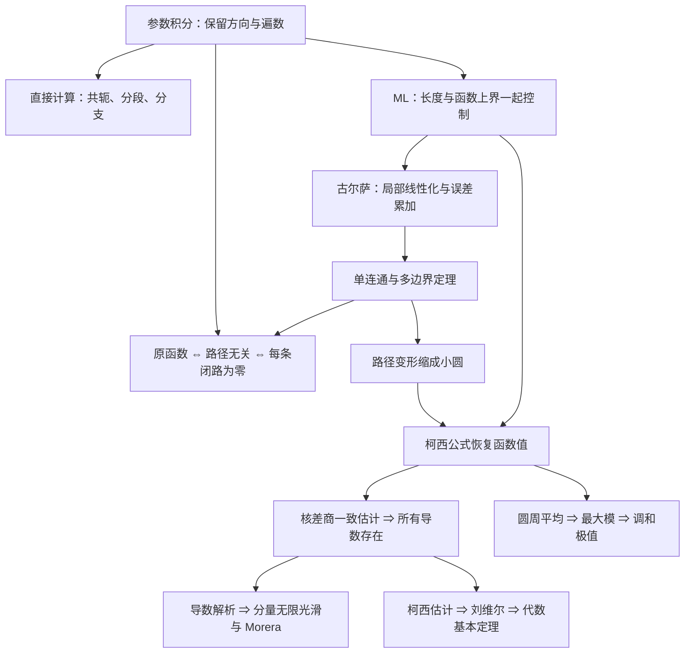

# C4 复积分学习指南

> [!abstract] 从“沿哪条路”走到“函数为何刚性”
> 先读 C4.1–C4.3 建立实参数与路径计算，再在 C4.4 学会控制误差。C4.5 把原函数、路径无关和闭路为零接起来；C4.6–C4.7 用解析性与区域条件保证闭路为零。C4.8 将边界变成函数值和导数，最后两篇再把导数上界转成整函数与极值的结论。

> [!info] 本次重写与课堂证据
> 2026-10-18 从 `pdfs/Chapter4.pdf` 重新阅读并重写，覆盖全部 64 页、印刷 pp.115–178、Sec.41–59。保留 C4.1–C4.10 原文件名及既有属性键，未用旧正文作底稿；覆盖前快照留在本次暂存工作目录。
> 每一页均提取文本并核对渲染图；PDF 注释对象为 0，肉眼检查手写区域为 0 处、涉及 0 页，无缺页和整页空白。没有 PPTX，也没有动画重复帧，未减少任何正文页的阅读。当前未发现第四章转写稿，实际课堂进度待确认，不能由原件内容推定已讲。
> 本次新增 17 张教材原图裁切，均为原件证据，不是板书、自绘或还原图。原有附件不删除；新版正文只引用本次已核查的裁图。64 道原编号习题连同全部子问已融入对应概念；没有另设篇末自测。

## 1. 阅读顺序与原件映射

| 笔记 | Section | PDF 物理页 | 印刷页 | 这篇解决的判断 |
|---|---|---|---|---|
| [[C4.1 实参数复值函数的微积分]] | 41–42 | 1–6 | 115–120 | 分量微积分哪些规则能保留，中值等式为什么失效？ |
| [[C4.2 围道与复积分的定义]] | 43–44 | 6–13 | 120–127 | 怎样记录方向和遍数，dz 为什么不能换成 ds？ |
| [[C4.3 参数积分、路径依赖与分支]] | 45–46 | 13–21 | 127–135 | 什么时候依赖路径，割线端点怎样积分？ |
| [[C4.4 积分估计与 ML 不等式]] | 47 | 21–26 | 135–140 | 函数变小是否足够，怎样估计完整路径贡献？ |
| [[C4.5 原函数与路径无关]] | 48–49 | 26–33 | 140–147 | 怎样用闭路积分为零构造原函数？ |
| [[C4.6 柯西-古尔萨定理及其证明]] | 50–51 | 34–40 | 148–154 | 不假设导数连续，怎样让局部误差累加仍趋零？ |
| [[C4.7 单连通、复连通与路径变形]] | 52–53 | 40–48 | 154–162 | 洞怎样影响积分，内外边界方向如何确定？ |
| [[C4.8 柯西积分公式与高阶导数]] | 54–56 | 48–54 | 162–168 | 边界怎样恢复内部值，核的求导为何合法？ |
| [[C4.9 解析性的推论、柯西估计与刘维尔定理]] | 57–58 | 54–59 | 168–173 | 统一上界怎样使整函数变成常数或多项式？ |
| [[C4.10 最大模原理与调和函数的极值]] | 59 | 59–64 | 173–178 | 最大模为何在边界，最小模的零点例外是什么？ |

PDF 物理页号从 1 开始；印刷页号 = 物理页号 + 114。本材料为教材电子页，没有独立幻灯片编号。相邻篇页码重叠表示同页上出现两个 Section，正文未重复抄写。沿用既有十篇边界，顺序与 Sec.41–59 一致，因此不牵动既有引用。

第一次阅读可先掌握 C4.6 定理条件，读完 C4.8 再回看长证明。需要复习先修时：参数圆与幅角见 [[C1.4 指数形式、幅角与乘幂]]；复可微与 CR 见 [[C2.4 导数与求导法则]]、[[C2.5 柯西-黎曼方程]]；分支见 [[C3.3 对数的分支、导数与恒等式]]、[[C3.4 复幂函数]]。当前推导所需的最小解释仍写在各篇本地。

## 2. 内容地图：每个工具接管哪个困难

C4.9 兑现 [[C2.8 调和函数]] 中提前使用的高阶偏导连续性；其代数基本定理又接回 [[C1.2 向量、模与三角不等式]] 的多项式远场估计。最大模的局部版本用到了 [[C2.9 唯一确定的解析函数与反射原理]] 的唯一性结果；全局最大值版本在 C4.10 以邻域链独立说明。

## 3. 计算时先选择方法

| 可观察到的结构 | 选用方法 | 必查条件 |
|---|---|---|
| 明确路径、共轭、分段函数 | 参数定义 | 参数区间、方向、dz、断点 |
| 找到全域单值原函数 | 终点减起点 | 原函数域覆盖整条路，分支一致 |
| 简单闭路内部及边界解析 | 柯西—古尔萨 | 不能只看路径本身 |
| 单连通域中解析的函数 | 所有闭路为零 | 域不能含被排除的洞 |
| 难路与易路的夹层解析 | 变形 | 两边同向，不跨奇点、割线 |
| 核为 (z−a) 的负整数幂 | 柯西公式 | a 在内、阶数差一、分子全闭域解析 |
| 只需证明趋零 | ML | 函数上界乘长度趋零，常数统一 |
| 整函数受全平面界约束 | 柯西估计或刘维尔 | 上界不能随半径任意增长 |

## 4. 公式、条件与推导位置

本章变量是复数与抽象参数，没有指定物理单位。R、ρ、L 均以同一 z 平面长度尺度计；若赋予物理单位，dz 的单位应计入积分。

| 名称 | 公式与条件 | 推导 |
|---|---|---|
| 参数定义 | $\int_Cf\,dz=\int_a^bf(z(t))z'(t)dt$，沿路分段连续 | [[C4.2 围道与复积分的定义]] |
| 圆周整数幂 | $\oint(z-a)^{n-1}dz=2\pi i$ 当 n=0，其余整数 n 为零，圆正向 | [[C4.3 参数积分、路径依赖与分支]] |
| ML | $\lvert \int_Cf\,dz\rvert \le ML$，M 是模的任意有效统一上界、L 为长度 | [[C4.4 积分估计与 ML 不等式]] |
| 端点法 | $\int_Cf=F(z_2)-F(z_1)$，F 在整条路所在域上单值且 F′=f | [[C4.5 原函数与路径无关]] |
| 多边界公式 | 外圈逆时针积分 + 各内圈顺时针积分 = 0，夹层及边界解析 | [[C4.7 单连通、复连通与路径变形]] |
| 面积 | $A=(2i)^{-1}\oint_C\bar z\,dz$，C 正向简单闭合 | [[C4.7 单连通、复连通与路径变形]] |
| 高阶柯西公式 | $\oint_Cf(z)/(z-a)^{n+1}dz=2\pi if^{(n)}(a)/n!$，n≥0；C 正向简单、a 在内、f 闭域解析 | [[C4.8 柯西积分公式与高阶导数]] |
| 柯西估计 | $\lvert f^{(n)}(a)\rvert \le n!M_R/R^n$，闭圆盘解析、M_R 为圆周最大模 | [[C4.9 解析性的推论、柯西估计与刘维尔定理]] |
| 平均值 | $f(a)=(2\pi)^{-1}\int_0^{2\pi}f(a+\rho e^{i\theta})d\theta$，闭圆盘解析 | [[C4.10 最大模原理与调和函数的极值]] |
| 最小模 | 无零点时对 1/f 用最大模；有内部零点时不可直接套用 | [[C4.10 最大模原理与调和函数的极值]] |

## 5. 原题归位

| 原题组 | 数量（按主编号） | 正文落点 |
|---|---|---|
| Sec.42 题 1–5 | 5 | C4.1 |
| Sec.43 题 1–6 | 6 | C4.2 |
| Sec.46 题 1–13 | 13 | 题 12 在 C4.2 换参证明；其余在 C4.3 |
| Sec.47 题 1–8 | 8 | C4.4 |
| Sec.49 题 1–5 | 5 | C4.5 |
| Sec.53 题 1–9 | 9 | 题 8–9 在 C4.6；题 1–7 在 C4.7 |
| Sec.57 题 1–10 | 10 | 题 1–9 在 C4.8；题 10 在 C4.9 |
| Sec.59 题 1–8 | 8 | 题 8 在 C4.9；题 1–7 在 C4.10 |

合计 64 道主编号题。全部保留数学条件与子问目标，没有原选择题需要保留选项；答案由独立运算与证明支持。

## 6. 材料问题与处理结果

| 原位置 | 问题与影响 | 处理及落点 | 状态 |
|---|---|---|---|
| PDF 19，p.133，Sec.46 题 3 | 文本提取漏掉 π exp(π z̄) 的共轭；漏横线会误算零 | 依原图恢复，C4.3 逐边算得 4(e^π−1) | 已核实 |
| PDF 20，p.134，Sec.46 题 10 | 文本提取漏 z̄ⁿ | C4.3 恢复频率 m−n+1，结果仅 n=m+1 时非零 | 已核实 |
| PDF 25，p.139，Sec.47 题 3 | 文本层主式漏 z̄，共轭影响能否用解析积分定理 | C4.4 保留 e^z−z̄，按 ML 给 60 | 已核实 |
| PDF 47，p.161，Sec.53 题 7 | 文本提取漏面积公式中的共轭 | C4.7 由 Green 独立推得 A=(2i)⁻¹∮z̄dz | 已核实 |
| PDF 10，p.124，Sec.43 题 2 | y 参数换元在端点导数发散，不能声称满足闭区间 C¹ 条件 | C4.2 说明单侧极限；C4.3 用 y 参数复算时按反常积分处理 | 已处理 |
| PDF 22，p.136，Sec.47 末段 | 分段连续保证有界，不保证最大值取得 | C4.4 给 g(t)=t（t<1）、g(1)=0 的反例，ML 仍成立 | 已纠正 |
| PDF 50，p.164，Sec.55 首段及末句 | 将柯西公式回指 Sec.50，实际在 Sec.54 | C4.8 按正确依赖连接，不跟随错误回指 | 已纠正 |
| PDF 48，p.162，Sec.53 题 9 提示 | 回指 Sec.49，嵌套方格实际用于 Sec.51 | 题 8–9 全证明归到 C4.6 覆盖引理 | 已纠正 |
| Sec.52 一般无限自交路径 | 有限分解法不能直接证明无限自交的一般命题 | C4.7 明确一般结果作背景，仅对原题特殊路径证明替换法 | 范围已说明 |

上述四处共轭问题是提取失真，不是印刷错误。计算没有发现需要改动的原答案。原件无手写，因此没有历史墨迹日期可用，也不能推定本学期讲授进度。教师与考核事实仍保留在 [[复变函数 MOC]]，本章不另造信息。

## 7. 阅读后的去向

完成 C4.8 后应能复现小圆误差估计、任意阶核差商以及常见柯西型积分；完成 C4.9 后应能说清刘维尔的统一界来自哪里；完成 C4.10 后应能区分模的最大值、非零最小值与实虚部极值。下一章关于幂级数的笔记尚未建立。

[[C3.7 反三角与反双曲函数|上一章末讲]] ｜ [[C4.1 实参数复值函数的微积分|开始第四章]] ｜ [[复变函数 MOC|返回课程索引]]
