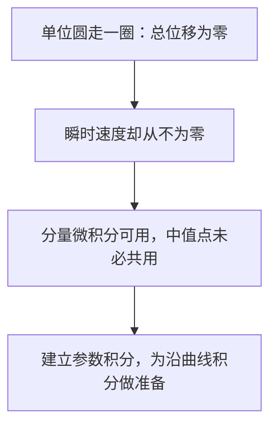

# C4.1 实参数复值函数的微积分

> [!abstract] 这一讲的任务
> 把复平面上的运动化成两个实函数的微积分；弄清为什么运算法则与微积分基本定理仍成立，而两个中值定理会失效。

> [!info] 阅读说明
> 依据教材 Sec.41–42，PDF 1–6、印刷 pp.115–120。当前没有第四章课堂记录，实际讲授范围待确认；正文中的补全推导是数学论证，不作为课堂发言。原题按概念归位，保留原节及题号。

## 0. 开场：回到起点，就一定停下来过吗？

你让一个点按 $w(t)=e^{it}$（$0\le t\le2\pi$）绕单位圆走一周。首尾都是 $1$。若直接照搬实函数的 Rolle 定理，似乎中途应该有 $w'(c)=0$；实际求导却得到 $w'(t)=ie^{it}$，其模恒为 $1$。点完全可以不停地回到起点。

这不是求导规则坏了，而是把一个实值结论放到了平面里。实轴上的函数从起点回到同一高度，需要转向；平面运动可以靠不断改变速度方向完成闭路。下面把仍然有效的部分与失效的部分分开建立。

## 41. 实参数复值函数的导数

写 $w(t)=u(t)+iv(t)$，其中 $t$ 是实数，$u,v$ 都取实值。它与复变函数 $f(z)$ 不同：这里增量只能沿实参数轴变化，不需要检验复平面中的任意增量方向。

> [!important] 定义：按实部、虚部分别求导
> 当 $u'(t),v'(t)$ 都存在时，定义
> $$w'(t)=u'(t)+iv'(t).$$

这个定义正是差商极限，因为
$$
\frac{w(t+h)-w(t)}h
=\frac{u(t+h)-u(t)}h+i\frac{v(t+h)-v(t)}h,\qquad h\in\mathbb R.
$$
复数收敛等价于两个分量分别收敛，所以右侧的极限确实是 $u'+iv'$。两分量都可导也是差商存在的必要条件。

### 41.1 运算法则为何仍成立

平方规则不能只凭外形相信。先展开 $w^2=u^2-v^2+2iuv$，再对实函数求导：
$$
(w^2)'=2uu'-2vv'+2i(u'v+uv')=2(u+iv)(u'+iv')=2ww'.
$$
同样，若 $z_0=x_0+iy_0$ 为常量，$z_0w=(x_0u-y_0v)+i(y_0u+x_0v)$，两分量求导后重新合并，得 $(z_0w)'=z_0w'$；将 $t$ 换成 $-t$，实链式法则给 $(w(-t))'=-w'(-t)$。这也完成 Sec.42 题 1(a)(b)。这里 $w'(-t)$ 是先求 $w$ 的导函数，再在 $-t$ 处取值。

对后面最常用的指数，不能混淆常量 $z_0$ 与实参数 $t$。由
$$
e^{z_0t}=e^{x_0t}(\cos y_0t+i\sin y_0t)
$$
得到实部导数 $e^{x_0t}(x_0\cos y_0t-y_0\sin y_0t)$，虚部导数 $e^{x_0t}(x_0\sin y_0t+y_0\cos y_0t)$。合并便是
$$\frac d{dt}e^{z_0t}=z_0e^{z_0t}.$$
一般乘积规则也可按分量展开验证；商规则要求分母非零。

### 41.2 失效的是“同一个中值点”

实部与虚部分别满足实中值定理，但得到的 $c_u,c_v$ 未必相同。因而不能推得
$$w(b)-w(a)=w'(c)(b-a).$$
开场的 $e^{it}$ 已给出完整反例：左边为零，右边的模却是 $2\pi$。后面需要估计差或积分时，我们将用模的不等式，而不寻找这样一个 $c$。

## 42. 复值函数的定积分

> [!important] 定义：分量积分
> 若两个实积分存在，定义
> $$\int_a^bw(t)\,dt=\int_a^bu(t)\,dt+i\int_a^bv(t)\,dt.$$
> 因而取实部、虚部与积分可以交换。反常积分也按两分量定义，要求两个实积分的相应极限都存在。两分量分段连续足以保证有限区间上的积分存在；“分段连续”允许有限个断点，但要求相应的有限单侧极限存在。

常数因子、和、上下限互换与区间可加性，全都由实积分的对应规则得到。例如先把 $\int_a^b$ 在 $c$ 处分开，再把实、虚部分别合并，便有 $\int_a^bw=\int_a^cw+\int_c^bw$。

如果 $W=U+iV$ 满足 $W'=w$，且在闭区间连续、在内部满足相应导数条件，那么实微积分基本定理给
$$
\int_a^bw(t)\,dt=[U(b)-U(a)]+i[V(b)-V(a)]=W(b)-W(a).
$$
这里的原函数仍然是实参数函数，尚未声称存在全复平面的复原函数。

> [!example] 同一个积分的两条计算路线
> 求 $\int_0^{\pi/4}e^{it}\,dt$。

按定义算，实部为 $[\sin t]_0^{\pi/4}=1/\sqrt2$，虚部为 $[-\cos t]_0^{\pi/4}=1-1/\sqrt2$。利用刚证明的指数求导法则，$e^{it}/i$ 是原函数，故
$$
\int_0^{\pi/4}e^{it}\,dt=\frac{e^{i\pi/4}-1}{i}
=\frac1{\sqrt2}+i\left(1-\frac1{\sqrt2}\right).
$$
两条路线相符，说明基本定理与分量定义兼容。

然而积分中值等式也不能照搬。$\int_0^{2\pi}e^{it}\,dt=0$，若它等于 $2\pi e^{ic}$，右边模就应为 $2\pi$，矛盾。平均的结果可以落在单位圆内部，而函数本身只在圆周上取值；这正是“平均值未必是某个函数值”的原因。

### 42.1 把原题用于检验运算规则

Sec.42 题 2 要计算以下四个积分。每次先识别最省力的形式，再计算，而不是对所有题都拆成三角函数。

(a) $\int_0^1(1+it)^2dt$：展开为 $1-t^2+2it$，所以结果为 $[t-t^3/3+it^2]_0^1=2/3+i$。

(b) $\int_1^2(1/t-i)^2dt$：展开为 $t^{-2}-1-2i/t$，故
$$[-t^{-1}-t-2i\ln t]_1^2=-\frac12-i\ln4.$$

(c) $\int_0^{\pi/6}e^{2it}dt=(e^{i\pi/3}-1)/(2i)=\sqrt3/4+i/4$。

(d) 在 $\operatorname{Re}z>0$ 时，求 $\int_0^\infty e^{-zt}dt$。先在 $[0,T]$ 积分，得到 $(1-e^{-zT})/z$；再用 $|e^{-zT}|=e^{-T\operatorname{Re}z}\to0$，得 $1/z$。收敛依据是实部正，而非 $z$ 的模大。若 $\operatorname{Re}z=0$，普通反常积分一般不收敛。

Sec.42 题 4 要同时求 $\int_0^\pi e^x\cos x\,dx$ 与 $\int_0^\pi e^x\sin x\,dx$。把它们合成
$$
\int_0^\pi e^{(1+i)x}dx=\frac{-e^\pi-1}{1+i}
=-\frac{1+e^\pi}2+i\frac{1+e^\pi}2.
$$
所以两实积分依次是 $-(1+e^\pi)/2$ 与 $(1+e^\pi)/2$。这里合成复函数反而减少了两轮分部积分。

### 42.2 整数频率正交与对称性

Sec.42 题 3 中 $m,n\in\mathbb Z$。乘积 $e^{im\theta}e^{-in\theta}=e^{i(m-n)\theta}$。当 $m=n$ 时，被积函数恒为 $1$，积分为 $2\pi$；否则
$$
\int_0^{2\pi}e^{i(m-n)\theta}d\theta
=\frac{e^{2\pi i(m-n)}-1}{i(m-n)}=0.
$$
整数条件使分子为零，$m\ne n$ 则保证分母可除。这将在圆周幂函数积分中再次出现。

Sec.42 题 5 假设 $w$ 在 $[-a,a]$ 连续。换元 $t=-s$ 得
$$\int_{-a}^0w(t)dt=\int_0^aw(-s)ds.$$
若 $w$ 为偶函数，两半相等，故全积分为 $2\int_0^aw$；若为奇函数，两半抵消，故全积分为零。复值奇偶性是整个函数的等式，因此两个分量都具有相同奇偶性。

## 这一讲的三句话

1. 实参数复值微积分可按分量定义，常见运算法则与基本定理由此得到。
2. 两个分量各有中值点，不代表存在一个共同的中值点。
3. 计算前先判断展开、指数原函数、对称性或整数频率中哪一种结构最有用。

| 名称 | 公式或判据 |
|---|---|
| 导数 | $w'=u'+iv'$ |
| 定积分 | $\int w=\int u+i\int v$ |
| 基本定理 | $W'=w\Rightarrow\int_a^bw=W(b)-W(a)$ |
| 指数导数 | $(e^{z_0t})'=z_0e^{z_0t}$ |
| 整数频率正交 | $\int_0^{2\pi}e^{i(m-n)t}dt=2\pi\delta_{mn}$ |

> [!tip] 下一讲预告
> 现在被积函数的值可以是复数了，但积分区间仍在实轴上。要沿复平面曲线积分，怎样把路径、方向与行进速度一起装进一个实参数积分？

---

[[C3.7 反三角与反双曲函数|上一讲]] ｜ [[C4.2 围道与复积分的定义|下一讲]] ｜ [[复变函数 MOC|返回课程索引]]
