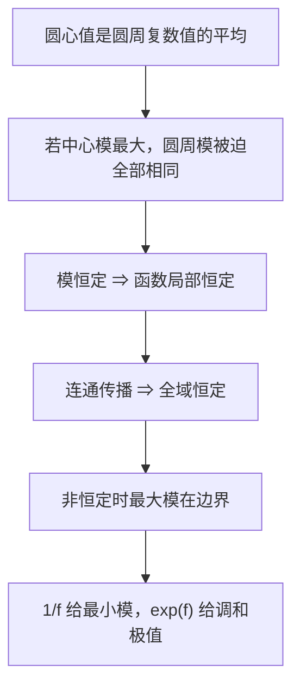

# C4.10 最大模原理与调和函数的极值

> [!abstract] 这一讲的任务
> 从圆周平均值理解解析函数的模为何不能在内部形成峰值；学会用边界定位最大模，区分最小模的零点例外，并将结论转给调和分量。

> [!info] 阅读说明
> 对应 Sec.59，PDF 59–64、印刷 pp.173–178，实际课堂覆盖待确认。题 1–7 就地解答；题 8 的因式分解已在 [[C4.9 解析性的推论、柯西估计与刘维尔定理]] 完整证明。局部常值向全域传播时区分本节的全局最大值证明与此前的解析唯一性结论。

## 0. 开场：是不是只要找边界就够了？

你想在顶点为 $0,2,i$ 的闭三角形上找 $f(z)=(z+1)^2$ 的最大模和最小模。若把 $z=x+iy$ 展开，再对两个变量求偏导，计算会变得繁琐；几何上却有 $|f(z)|=|z+1|^2$，只是在比较区域内各点到 $-1$ 的距离。

这一次最大、最小都落在边界。但如果换成单位圆盘内的 $f(z)=z$，最小模就在内部原点。最大与最小的规律究竟为何不对称？先从圆心与圆周的关系开始。

## 59. 平均值、最大模与调和极值

### 59.1 平均值是复数值的平均

对完全位于解析域内的闭圆盘 $|z-a|\le\rho$，柯西公式配上 $z=a+\rho e^{i\theta}$ 得
$$
f(a)=\frac1{2\pi i}\int_0^{2\pi}\frac{f(a+\rho e^{i\theta})}{\rho e^{i\theta}}
 i\rho e^{i\theta}d\theta
=\frac1{2\pi}\int_0^{2\pi}f(a+\rho e^{i\theta})d\theta.
$$
这称 Gauss 平均值定理。它平均的是向量值 $f$，取模后通常只能得到
$$|f(a)|\le\frac1{2\pi}\int_0^{2\pi}|f(a+\rho e^{i\theta})|d\theta.$$
例如 $f(z)=z$、$a=0$ 时，圆周向量平均为零，而模平均为 $\rho$；不能把模也写成等式。

### 59.2 中心模最大，会怎样逼出常值

假设 $f$ 在 $|z-a|<r$ 解析，且整个邻域内 $|f(z)|\le|f(a)|=M$。若 $M=0$，函数立即为零；若 $M>0$，任取 $0<\rho<r$，有
$$M\le\frac1{2\pi}\int_0^{2\pi}|f(a+\rho e^{i\theta})|d\theta\le M.$$
两端相等，所以连续非负函数 $M-|f(a+\rho e^{i\theta})|$ 的积分为零。若某一点严格大于零，连续性会使附近一小段仍为正，积分就大于零，矛盾；故它处处为零。每个半径都可如此选，$|f|$ 在整个邻域恒为 $M$。

还不能直接把“模恒定”写成“复数值恒定”，因为一般函数可以沿圆周旋转。解析性补上这一步：写 $f=u+iv$，由 $u^2+v^2=M^2$ 对 $x,y$ 求偏导，并用 CR，得
$$uu_x+vv_x=0,\qquad -uv_x+vu_x=0.$$
以 $u_x,v_x$ 为未知数，系数行列式为 $-(u^2+v^2)=-M^2\ne0$，故 $u_x=v_x=0$，也即 $f'=0$。在这个圆盘中 $f$ 恒等于 $f(a)$。

### 59.3 从一个局部到整个连通域

> [!important] 最大模原理 maximum modulus principle
> 非常数解析函数在域内不能取得全域最大模。若在某点邻域取得局部最大模，则先由上述引理局部恒定，再由解析唯一性得全域恒定；因此非常数解析函数也不能有内部局部最大模。

先按本节的全局最大值假设说明传播。若 $a\in D$ 是全域最大模点，从 $a$ 到任意 $P\in D$ 画一条域内折线 $L$。$L$ 紧且位于开域内，与补集有正距离，可选一个统一小半径 $d$，让沿线所有半径 $d$ 圆盘仍在域内。沿折线选有限多个相邻中心距离小于 $d$ 的点。

第一圆盘由引理恒为 $f(a)$；第二圆盘的中心在第一盘中，因此其模仍为全域最大值，引理再迫使第二盘恒为同一个值。有限次传到 $P$，得到 $f(P)=f(a)$。$P$ 任意，故 $f$ 全域恒定。这说明定理中的连通性为什么必要。

![[C4.10-原图-邻域链传播.png]]

若初始只知道局部最大，上述每一新圆盘的“全域上界”不能直接沿用；正确做法是先得到一个开圆盘上恒定，再用 [[C2.9 唯一确定的解析函数与反射原理]] 的唯一性结论。这是两个不同的传播依据，不把全局证明误用于局部情形。

### 59.4 闭有界区域的最大模在边界

> [!important] 边界推论
> 设 $R=\overline D$ 为闭有界区域，内部 $D$ 是域，$f$ 在 $R$ 连续、在 $D$ 解析且非常数。则 $|f|$ 在 $R$ 的最大值一定取得，且所有最大值点均在边界。

紧性与连续性保证“取得”，最大模原理排除内部，剩下边界。若没有闭有界性，可能只有上确界而从未取到；例如 $f(z)=z$ 在开单位圆盘中没有最大模点。

回到三角形的 $f=(z+1)^2$。$|f|=(x+1)^2+y^2$。底边 $y=0$、$0\le x\le2$，最大为 $9$、最小为 $1$；竖边 $x=0$、$0\le y\le1$，值从 $1$ 到 $2$；斜边 $y=1-x/2$，有
$$|f|=\frac54x^2+x+2,\qquad0\le x\le2,$$
导数 $5x/2+1>0$，从 $2$ 增到 $9$。故最大模为 $9$、在 $z=2$；最小模为 $1$、在 $z=0$。定理只负责缩小到边界，具体在哪一点仍需几何或单变量计算。

![[C4.10-原图-三角形模的极值.png]]

### 59.5 最小模为何要排除零点

Sec.59 题 2 假设 $f$ 在整个 $R$ 无零点。则 $g=1/f$ 在 $R$ 连续、在内部解析且非常数。由最大模边界结论，$|g|$ 的最大值在边界；因 $|f|=1/|g|$，$|f|$ 的正最小值也只在边界。

题 3 的 $f(z)=z$ 在闭单位圆盘的最小模为零，发生在内部 $z=0$。此时 $1/f$ 在原点有极点，不能使用上一段。因而没有一个无条件的“最小模也只能在边界”的结论。

Sec.59 题 4 给矩形 $0\le x\le\pi,0\le y\le1$，$f(z)=\sin z$。利用
$$|\sin(x+iy)|^2=\sin^2x+\sinh^2y,$$
第一项在 $x=\pi/2$ 达到 $1$，第二项在 $y=1$ 达到 $\sinh^21$。两条件可同时满足，故唯一最大模点是 $z=\pi/2+i$，最大模为 $\sqrt{1+\sinh^21}=\cosh1$。最大模原理预示了应在边界找，却不能替代这一定位计算。

![[C4.10-原图-正弦矩形极值.png]]

### 59.6 用指数把调和分量的极值转成模的极值

写 $f=u+iv$。函数 $g=e^f$ 满足 $|g|=e^u$。由于指数严格递增，$u$ 的最大值与 $|g|$ 的最大值出现在同一点。$g$ 也非常数：若 $g$ 恒定，则 $g'=e^ff'=0$，而 $e^f\ne0$，故 $f'=0$，与 $f$ 非常数矛盾。因此 $u$ 的最大值只在边界。

Sec.59 题 5 对 $-f$ 应用同样结论，$\operatorname{Re}(-f)=-u$ 的最大值对应 $u$ 的最小值，故 $u$ 的最小值也只在边界。这里不需要 $u$ 无零点，因为我们使用的是 $e^{-f}$，不是 $1/u$。

题 7 用 $-if=v-iu$，其实部为 $v$。对 $e^{-if}$ 与 $e^{if}$ 分别使用最大模结论，得到 $v$ 的最大、最小也只在边界。这证明的是解析函数实虚部分量的调和极值结论；一般调和函数可在局部用共轭调和函数作同样论证，不要求全域都有单值共轭。

题 6 令 $f=e^z$，$0\le x\le1,0\le y\le\pi$。$u=e^x\cos y$：正值最大需 $x=1,y=0$，值为 $e$；最负需 $x=1,y=\pi$，值为 $-e$。最大点为 $1$、最小点为 $1+\pi i$，都在边界。注意 $|f|=e^x$ 的最大值在整条右边界，而实部最大只在其中一个端点；模与实部不是同一目标。

### 59.7 整函数只限制实部，也能逼成常数

Sec.59 题 1 假设整函数 $f$ 的实部在全平面满足 $u(x,y)\le u_0$。这并没有直接限制 $|f|$，所以不能立即对 $f$ 使用刘维尔；构造 $g=e^f$ 后，$|g|=e^u\le e^{u_0}$，才得到一个有界整函数。刘维尔使 $g$ 恒定，又由 $g'=e^ff'$ 和 $e^f\ne0$ 得 $f'=0$。所以 $f$ 恒定，题目所求 $u$ 也恒定。

因式分解的 Sec.59 题 8 已在上一讲代数基本定理的“从至少一个根到 $n$ 个根”处给出全部两问证明。

## 这一讲的三句话

1. 圆心值是圆周复数值的平均；若中心模最大，等号条件会迫使函数恒定。
2. 闭有界区域的最大模在边界；最小模要另外检查内部零点。
3. $1/f$ 处理非零函数的最小模，$e^{\pm f}$ 与 $e^{\pm if}$ 处理实部、虚部的极值。

| 名称 | 公式或判据 |
|---|---|
| Gauss 平均值 | $f(a)=(2\pi)^{-1}\int_0^{2\pi}f(a+\rho e^{i\theta})d\theta$ |
| 最大模 | 非常数解析函数无内部最大模点 |
| 边界最大模 | $\max_R\lvert f\rvert =\max_{\partial R}\lvert f\rvert $，连续、闭有界、内部解析 |
| 最小模 | 无零点时 $\min_R\lvert f\rvert =\min_{\partial R}\lvert f\rvert $ |
| 分量变换 | $\lvert e^f\rvert =e^u$，$\lvert e^{-if}\rvert =e^v$ |

> [!tip] 下一章预告
> 边界已经决定内部的全部导数。下一章将问：把这些导数排成幂级数，能否真正重建函数？而 $1/z$ 留下的非零积分，将在奇点与留数理论中得到统一解释。第五章笔记尚未建立。

---

[[C4.9 解析性的推论、柯西估计与刘维尔定理|上一讲]] ｜ 第四章终点（第五章笔记尚未建立） ｜ [[复变函数 MOC|返回课程索引]]
