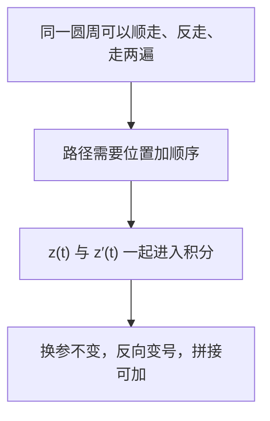

# C4.2 围道与复积分的定义

> [!abstract] 这一讲的任务
> 学会把曲线写成带方向的参数路径，建立围道积分的定义；说明换速度不改变积分，反向和重复绕行却会改变积分。

> [!info] 阅读说明
> 对应 Sec.43–44，PDF 6–13、印刷 pp.120–127。材料没有本章当期课堂记录，讲授范围待确认。本文沿用教材的 smooth arc 与 contour 约定，端点参数的特殊性另行指出。

## 0. 开场：只告诉你“沿单位圆”，够不够？

你准备计算沿单位圆的积分。三位同学分别写 $e^{it}$、$e^{-it}$、$e^{2it}$，参数都是 $0\le t\le2\pi$。三者画出的点集相同，但第一位逆时针一周，第二位顺时针一周，第三位逆时针两周。

若积分只记点集，就无法区分这些操作。我们需要的不仅是一张曲线图，还要知道从哪里出发、按什么顺序经过各点、走几遍。下面的参数表示正是为了保留这些信息。

## 43. 弧、光滑弧与围道

> [!important] 定义：弧与简单闭曲线
> 连续映射 $z(t)=x(t)+iy(t)$（$a\le t\le b$）确定一条有向弧 arc，顺序由参数增加确定。
> - 若 $t_1\ne t_2\Rightarrow z(t_1)\ne z(t_2)$，它是简单弧（Jordan arc）。
> - 若只允许首尾相等 $z(a)=z(b)$，其余不重复，它是简单闭曲线（Jordan curve）。
> - 简单闭曲线的正向是逆时针，此时内部在行进方向左侧。

例如折线 $0\to1+i\to2+i$ 可写成
$$z(x)=\begin{cases}x+ix,&0\le x\le1,\\x+i,&1\le x\le2.\end{cases}$$
这条弧连续且不自交。$z_0+Re^{i\theta}$（$0\le\theta\le2\pi$）是正向圆；$e^{2i\theta}$ 走两圈，因而不能当作简单闭曲线。

若 $z'$ 在闭区间连续，称为可微弧；若进一步在内部 $a<t<b$ 有 $z'(t)\ne0$，按本书约定称光滑弧 smooth arc。速度非零使单位切向量
$$T(t)=\frac{z'(t)}{|z'(t)|}$$
有定义，并随参数连续改变方向。端点允许速度为零；内部速度为零的某个参数表示失败，也不自动说明几何曲线不可重新参数化。

> [!important] 定义：围道 contour
> 有限条光滑弧首尾拼接形成围道，也称分段光滑弧。拐角允许存在，分段导数可有有限个跳变。长度为
> $$L=\int_a^b|z'(t)|dt,$$
> 分段时将各段长度相加。

这里长度计入走过的次数，所以单位圆走两遍长度是 $4\pi$。简单闭围道将平面分成有界内部与无界外部，这是 Jordan 曲线定理；本章使用这一背景事实，不在此给出完整拓扑证明。

### 43.1 换参：同一条路可以换速度

设 $t=\phi(\tau)$ 把 $[\alpha,\beta]$ 映到 $[a,b]$，$\phi$ 连续可微且 $\phi'>0$。令 $Z(\tau)=z(\phi(\tau))$。对实、虚部用实链式法则（Sec.43 题 4），得到
$$Z'(\tau)=z'(\phi(\tau))\phi'(\tau).$$
于是
$$
\int_\alpha^\beta|Z'(\tau)|d\tau
=\int_\alpha^\beta|z'(\phi(\tau))|\phi'(\tau)d\tau
=\int_a^b|z'(t)|dt.
$$
关键是 $\phi'>0$：它同时保证顺序不变，并使绝对值中的 $|\phi'|$ 可以写成 $\phi'$。

Sec.43 题 3 要从 $[\alpha,\beta]$ 线性换到 $[a,b]$。连接 $(\alpha,a)$ 与 $(\beta,b)$ 得
$$\phi(\tau)=a+\frac{b-a}{\beta-\alpha}(\tau-\alpha)
=\frac{b-a}{\beta-\alpha}\tau+\frac{a\beta-b\alpha}{\beta-\alpha}.$$
两区间长度均为正，故斜率为正。

Sec.43 题 1(a)(b) 所需的两条实参数积分换元式也由分量得到：
$$
\int_{-b}^{-a}w(-t)dt=\int_a^bw(t)dt,
\qquad
\int_a^bw(t)dt=\int_\alpha^\beta w(\phi(\tau))\phi'(\tau)d\tau.
$$
第一式令 $s=-t$ 并交换上下限；第二式对实部、虚部分别换元再合并。这些公式稍后保证积分不会取决于我们选哪一只“钟”。

> [!example] Sec.43 题 2：右半圆的两种参数
> 路径从 $-2i$ 沿右半圆逆时针到 $2i$：
> $$z(\theta)=2e^{i\theta},\quad-\pi/2\le\theta\le\pi/2;\qquad Z(y)=\sqrt{4-y^2}+iy,\quad-2\le y\le2.$$

在内部 $-2<y<2$，$\theta=\phi(y)=\arcsin(y/2)=\arctan(y/\sqrt{4-y^2})$，所以 $2\sin\phi=y$、$2\cos\phi=\sqrt{4-y^2}$，确有 $z(\phi(y))=Z(y)$。微分得 $\phi'(y)=1/\sqrt{4-y^2}>0$。

> [!warning] 端点不是普通的连续可微换参
> $y=\pm2$ 处 $\phi'$ 发散，反正切表达式也要以单侧极限解释。因此这组表示不能直接套“闭区间上连续导数”的换参假设。可先截去两端再取极限，或始终使用角参数。几何曲线是光滑半圆，不代表每一种参数都满足同一正规条件。

### 43.2 无穷次振荡也可以光滑

Sec.43 题 6 定义
$$y(x)=\begin{cases}x^3\sin(\pi/x),&0<x\le1,\\0,&x=0,\end{cases}
\qquad z(x)=x+iy(x).$$
它在 $x=1/n$ 与 $x=0$ 处碰到实轴；$x$ 坐标严格增加，故弧本身没有自交。零点向原点聚集并不妨碍光滑性：$|y(x)|\le x^3\to0$，且
$$
y'(0)=\lim_{h\downarrow0}h^2\sin(\pi/h)=0,
\qquad
y'(x)=3x^2\sin(\pi/x)-\pi x\cos(\pi/x)\to0.
$$
所以 $z'=1+iy'$ 连续，实部恒为 $1$，从不为零。后面闭合这条曲线时会出现无穷多个自交点，不能误把“有限光滑分段”理解为“有限交点”。

![[C4.2-原图-无穷振荡光滑弧.png]]

## 44. 围道积分：为什么有一个 $z'(t)$？

把路径切成小段，每段位移近似 $\Delta z\approx z'(t)\Delta t$。复积分将 $f$ 的值乘上有方向的复位移，再累加；这引出定义。

> [!important] 定义：沿围道的复积分
> 对围道 $z=z(t)$（$a\le t\le b$），若 $f(z(t))$ 分段连续，定义
> $$\int_Cf(z)dz=\int_a^bf(z(t))z'(t)dt.$$
> 右侧是上一讲已建立的实参数复值积分。分段围道分别计算再相加。

$dz$ 是有方向的位移，$ds=|z'|dt$ 才是弧长元。例如单位圆上 $dz=ie^{it}dt$，而 $ds=dt$；把两者混用会丢掉方向，甚至把零积分算成正实数。

### 44.1 换参、反向、拼接与线性

换参后
$$
\int_\alpha^\beta f(Z(\tau))Z'(\tau)d\tau
=\int_\alpha^\beta f(z(\phi(\tau)))z'(\phi(\tau))\phi'(\tau)d\tau
=\int_a^bf(z(t))z'(t)dt.
$$
这完成 Sec.46 题 12(a)。对有限光滑分段分别使用同一换元；遇到有限个不连续点，切开区间计算即可，得题 12(b)。换参不改值依赖方向不变。

反向路径可写为 $z(-t)$，参数区间 $[-b,-a]$。链式法则产生负号，换元后得
$$\int_{-C}f(z)dz=-\int_Cf(z)dz.$$
若 $C_1$ 终点等于 $C_2$ 起点，沿 $C_1$ 后沿 $C_2$ 记作 $C_1+C_2$；在接点参数处分开实积分，就有
$$\int_{C_1+C_2}f\,dz=\int_{C_1}f\,dz+\int_{C_2}f\,dz.$$
同理常量因子可提取，和可拆开。若两条路起终点相同，$C_1-C_2$ 表示先沿第一条、再沿第二条反走形成闭路。

最后补上后文端点法需要的链式法则（Sec.43 题 5）。当 $f$ 在 $z(t_0)$ 解析时，复可微意味着
$$f(z+\Delta z)=f(z)+f'(z)\Delta z+o(|\Delta z|).$$
代入 $\Delta z=z(t_0+h)-z(t_0)=z'(t_0)h+o(|h|)$，除以 $h$ 再取极限，得到
$$\frac d{dt}f(z(t))=f'(z(t))z'(t).$$
这条证明直接用可微定义，不提前依赖“偏导连续”这一稍后才建立的性质。

## 这一讲的三句话

1. 路径含方向与遍数，不能只看曲线点集。
2. 复积分必须连同 $dz=z'(t)dt$ 一起换元，弧长元不能代替它。
3. 换速度不改值，反向变号，首尾拼接使积分相加。

| 名称 | 公式或判据 |
|---|---|
| 光滑弧 | $z'\in C[a,b]$，内部 $z'\ne0$ |
| 围道长度 | $L=\int_a^b\lvert z'\rvert dt$ |
| 围道积分 | $\int_Cf\,dz=\int_a^bf(z(t))z'(t)dt$ |
| 反向 | $\int_{-C}f=-\int_Cf$ |
| 链式法则 | $(f\circ z)'=f'(z(t))z'(t)$ |

> [!tip] 下一讲预告
> 定义已经能计算任何给定路径。但同样的两个端点，换一条路后积分一定相同吗？$1/z$ 与 $z$ 会给出两种完全不同的回答。

---

[[C4.1 实参数复值函数的微积分|上一讲]] ｜ [[C4.3 参数积分、路径依赖与分支|下一讲]] ｜ [[复变函数 MOC|返回课程索引]]
