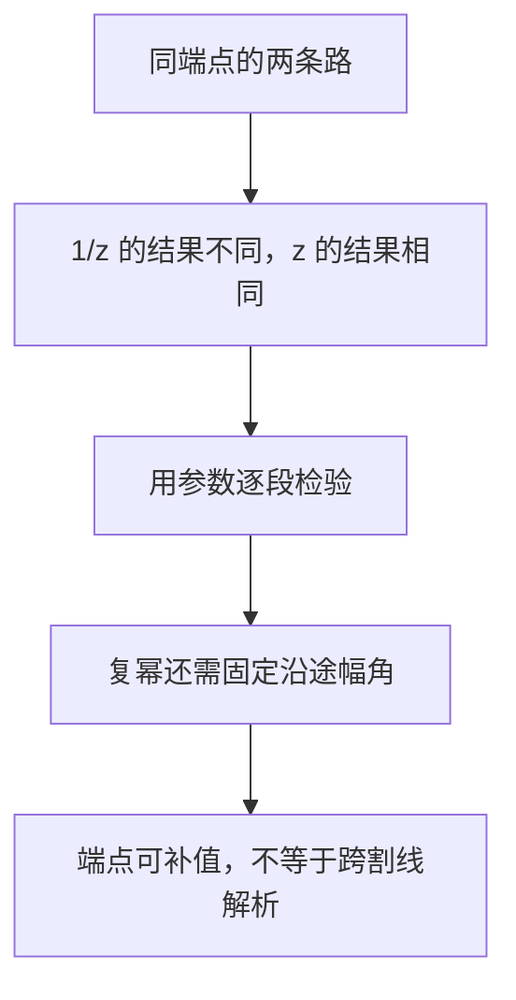

# C4.3 参数积分、路径依赖与分支

> [!abstract] 这一讲的任务
> 从参数定义算出路径依赖，并学会处理共轭、分段函数与复幂分支。区分“积分存在”与“能套用解析函数定理”。

> [!info] 阅读说明
> 对应 Sec.45–46，PDF 13–21、印刷 pp.127–135。实际课堂范围待确认；原题答案经过独立计算。Sec.46 题 3、10 的共轭横线已按页面原图恢复。

## 0. 开场：从 $1$ 到 $-1$，绕上面还是下面？

你要算 $\int dz/z$，一条路沿单位圆上半圆从 $1$ 到 $-1$，另一条沿下半圆到达同一点。若只对照端点，两次看起来应该相等；但 $1/z$ 在原点有奇点，能否绕过它，可能让结果留下区别。我们先不猜定理，直接把定义算完。

## 45. 参数积分与路径依赖

上半圆 $C_1$ 取 $z=e^{i\theta}$、$0\le\theta\le\pi$，于是
$$\int_{C_1}\frac{dz}z=\int_0^\pi\frac{ie^{i\theta}}{e^{i\theta}}d\theta=\pi i.$$
下半圆 $C_2$ 的方向仍是 $1\to-1$，可取 $-\pi\le\theta\le0$ 的反向，或直接让 $\theta$ 从 $0$ 减到 $-\pi$，结果为 $-\pi i$。闭路 $C_1-C_2$ 是正向一周，故
$$\oint_{C_1-C_2}\frac{dz}z=2\pi i.$$
这同时否定“只看端点”和“闭路必为零”。

![[C4.3-原图-上下半圆同端点.png]]

反过来看 $\int_Cz\,dz$。参数定义给 $\int_a^bz(t)z'(t)dt$，而 $[z(t)^2/2]'=z(t)z'(t)$，故任意光滑路都有
$$\int_Cz\,dz=\frac{z_2^2-z_1^2}2.$$
分段时每段各有这样的端点差，接点项一正一负消掉，结论仍成立。这不是“所有积分都路径无关”，而是 $z$ 有一个适用于所有路径的原函数；完整条件将在下一讲之后建立。

### 45.1 折线与直线，差别从哪里出现

> [!example] 比较 $f(z)=y-x-3ix^2$ 的两条路径
> $C_1$：$0\to i\to1+i$；$C_2$：直线 $0\to1+i$。求两积分及闭路 $C_1-C_2$ 的积分。

在竖段 $z=iy$、$0\le y\le1$，$x=0$、$dz=i\,dy$，积分为 $\int_0^1iy\,dy=i/2$。横段 $z=x+i$，$0\le x\le1$，积分为
$$\int_0^1(1-x-3ix^2)dx=\frac12-i.$$
所以 $I_1=(1-i)/2$。直线段令 $z=x+ix$，$dz=(1+i)dx$，于是
$$I_2=\int_0^1(-3ix^2)(1+i)dx=1-i.$$
因此闭路积分 $I_1-I_2=(-1+i)/2$。两条路上不仅 $dz$ 不同，$f$ 沿路取到的值也不同，不能只比较路径长度。

![[C4.3-原图-折线与直线.png]]

### 45.2 将定义用于分段与共轭的原题

Sec.46 题 1：$f=(z+2)/z$，圆半径为 $2$。代入 $z=2e^{i\theta}$，有 $f\,dz=(2ie^{i\theta}+2i)d\theta$，所以区间 $[\alpha,\beta]$ 上积分是
$$[2e^{i\theta}+2i\theta]_\alpha^\beta.$$
(a) $0\le\theta\le\pi$ 得 $-4+2\pi i$；(b) $\pi\le\theta\le2\pi$ 得 $4+2\pi i$；(c) 全周得 $4\pi i$。注意这里下半圆方向是 $-2\to2$，与前面的 $C_2$ 不同。

Sec.46 题 2：求 $f=z-1$ 沿 (a) $z=1+e^{i\theta}$、$\pi\le\theta\le2\pi$，(b) $z=x$、$0\le x\le2$ 的积分。前者是 $\int_\pi^{2\pi}ie^{2i\theta}d\theta=0$；后者是 $\int_0^2(x-1)dx=0$。两次相等只是这组函数与路径的结果，不能由此推广到所有 $f$。

Sec.46 题 3：沿顶点 $0,1,1+i,i$ 的正向正方形，积分 $\pi e^{\pi\bar z}$。共轭不能漏：四边依次为
$$
\begin{array}{c|c|c}
\text{边}&\text{参数与方向}&\text{积分}\\\hline
0\to1&z=x,\ 0\le x\le1&e^\pi-1\\
1\to1+i&z=1+iy,\ 0\le y\le1&2e^\pi\\
1+i\to i&z=x+i,\ 1\ge x\ge0&e^\pi-1\\
i\to0&z=iy,\ 1\ge y\ge0&-2
\end{array}
$$
例如第二边为 $\pi i e^\pi\int_0^1e^{-i\pi y}dy=2e^\pi$。总和 $4(e^\pi-1)$。若漏掉横线写成 $e^{\pi z}$，会误得零，变成另一道题。

Sec.46 题 4：$f=1$（$y<0$），$f=4y$（$y>0$），沿 $y=x^3$ 从 $-1-i$ 到 $1+i$。在 $x=0$ 处分段，$dz=(1+3ix^2)dx$：
$$
\int_{-1}^0(1+3ix^2)dx+\int_0^14x^3(1+3ix^2)dx
=(1+i)+(1+2i)=2+3i.
$$
原点处可任意补一个有限值，不影响积分。题 5 对任意路径 $z_1\to z_2$，$f=1$，则 $\int_Cdz=\int_a^bz'(t)dt=z_2-z_1$；它证明的是位移累加，而非弧长累加。

## 46. 分支沿途必须一致

复幂 $z^c=\exp(c\log z)$ 的积分先要说明 $\log$ 采用哪个幅角区间。仅写一个幂符号并没有指定函数。

> [!example] 半圆上的平方根
> 取 $z^{1/2}=\sqrt r e^{i\theta/2}$，其中 $0<\theta<2\pi$；沿 $z=3e^{i\theta}$、$0\le\theta\le\pi$ 从 $3$ 到 $-3$ 积分。

在内部，$z^{1/2}dz=3\sqrt3\,i e^{3i\theta/2}d\theta$，且 $\theta\downarrow0$ 时有有限单侧极限。因此虽在起点落到割线上，仍可补值后积分：
$$
\int_Cz^{1/2}dz
=3\sqrt3\,i\left[\frac{e^{3i\theta/2}}{3i/2}\right]_0^\pi
=-2\sqrt3(1+i).
$$
这不意味着该分支已在起点邻域解析，只说明参数积分存在。

> [!example] 一条闭圆周，为什么积分仍非零？
> 取主分支 $z^{-1+i}=\exp[(-1+i)\operatorname{Log}z]$，$-\pi<\operatorname{Arg}z<\pi$。沿单位圆 $z=e^{i\theta}$、$-\pi\le\theta\le\pi$ 正向积分。

有 $z^{-1+i}=e^{-i\theta-\theta}$，乘 $dz$ 后恰好只剩 $ie^{-\theta}d\theta$。故
$$\oint_Cz^{-1+i}dz=i\int_{-\pi}^{\pi}e^{-\theta}d\theta
=i(e^\pi-e^{-\pi})=2i\sinh\pi.$$
割线处的两个单侧极限不同，但各自有限；可分段积分。不能因为 $z$ 回到原点就写原函数首尾差为零：分支没有在整个圆周邻域统一解析。

### 46.1 用原题练习跟踪幅角

Sec.46 题 6 的主分支 $z^i$ 沿 $z=e^{i\theta}$、$0\le\theta\le\pi$ 积分：$z^idz=ie^{(-1+i)\theta}d\theta$，所以
$$\int_Cz^idz=\frac{i}{-1+i}\bigl(-e^{-\pi}-1\bigr)
=-\frac{1+e^{-\pi}}2(1-i).$$
题 7 是主分支 $z^{-1-2i}$，沿 $0\le\theta\le\pi/2$ 的单位圆弧。乘上 $dz$ 后为 $ie^{2\theta}d\theta$，故结果 $i(e^\pi-1)/2$。

题 8 给非零实数 $a$，主分支 $z^{a-1}$ 沿半径 $R$ 的正向全圆。取 $-\pi\le\theta\le\pi$，令 $R^a$ 为正实数，则
$$
z^{a-1}dz=iR^ae^{ia\theta}d\theta,
\qquad
\oint_Cz^{a-1}dz=\frac{R^a}{a}(e^{ia\pi}-e^{-ia\pi})
=\frac{2iR^a\sin(a\pi)}a.
$$
$a\ne0$ 不能省略；若 $a=0$，应单独计算 $1/z$，结果为 $2\pi i$，也与上式对 $a\to0$ 的极限相符。

题 9 把 $a=1/4,R=1$ 代入主分支，得 $4\sqrt2\,i$；若同一个 $z^{-3/4}$ 改取 $0<\arg z<2\pi$，须改积分区间为 $[0,2\pi]$，得到
$$i\int_0^{2\pi}e^{i\theta/4}d\theta=4(e^{i\pi/2}-1)=-4+4i.$$
同一几何路径、同一个形式的幂，换了分支就换了函数，积分当然可能变。

### 46.2 圆周上的共轭与整数幂

Sec.46 题 10 给 $m,n\in\mathbb Z$，求正向单位圆上 $\oint z^m\bar z^n dz$。圆上 $z=e^{i\theta}$，$\bar z=e^{-i\theta}$，因而
$$\oint_Cz^m\bar z^ndz=i\int_0^{2\pi}e^{i(m-n+1)\theta}d\theta
=\begin{cases}2\pi i,&n=m+1,\\0,&n\ne m+1.\end{cases}$$
多出来的 $+1$ 来自 $dz$，正是本题最容易漏掉的一项。

Sec.46 题 11 沿半径 $2$ 的右半圆从 $-2i$ 到 $2i$，积分 $\bar z$。角参数给
$$\bar z\,dz=(2e^{-i\theta})(2ie^{i\theta})d\theta=4i\,d\theta,
\qquad I=4\pi i.$$
题目还要求用 $y$ 参数复算。令 $x=\sqrt{4-y^2}$，$x'=-y/x$，则
$$\bar z\,dz=(x-iy)(x'+i)dy
=\left(xx'+y+i(x-yx')\right)dy=\frac{4i}{\sqrt{4-y^2}}dy.$$
所以 $I=4i[\arcsin(y/2)]_{-2}^2=4\pi i$。端点导数发散，按单侧反常积分解释；结果与正规角参数一致。

题 13 把圆心移到 $z_0$：$z=z_0+Re^{i\theta}$，$-\pi\le\theta\le\pi$。对整数 $n$，
$$
\oint_{|z-z_0|=R}(z-z_0)^{n-1}dz
=iR^n\int_{-\pi}^{\pi}e^{in\theta}d\theta
=\begin{cases}2\pi i,&n=0,\\0,&n\in\mathbb Z\setminus\{0\}.\end{cases}
$$
即使是负整数幂，也只有 $-1$ 次幂留下非零圆周积分。换参不变的题 12 已在 [[C4.2 围道与复积分的定义]] 完整证明。

## 这一讲的三句话

1. 先写路径参数、区间、$f(z(t))$ 与 $dz$，再做一元积分。
2. 解析分支覆盖全路径与分段积分存在，是两个不同条件。
3. 圆周上共轭可化成反向指数，$dz$ 还会额外增加一个频率。

| 名称 | 公式或判据 |
|---|---|
| 单位圆上、下同向端点路径 | $\int_{C_1}dz/z=\pi i$，$\int_{C_2}dz/z=-\pi i$ |
| 任意路径积分 $z$ | $\int_Cz\,dz=(z_2^2-z_1^2)/2$ |
| 圆周整数幂 | $\oint(z-z_0)^{n-1}dz=2\pi i$ 当且仅当 $n=0$，其余为零 |
| 单位圆共轭幂 | $\oint z^m\bar z^ndz=2\pi i$ 当 $n=m+1$，其余为零 |
| 实幂主分支全圆 | $\oint z^{a-1}dz=2iR^a\sin(a\pi)/a$，$a\in\mathbb R\setminus\{0\}$ |

> [!tip] 下一讲预告
> 有些路径积分算出精确值很费力，我们其实只想知道它会不会趋于零。怎样把函数大小和路径长度组合成可靠的上界？

---

[[C4.2 围道与复积分的定义|上一讲]] ｜ [[C4.4 积分估计与 ML 不等式|下一讲]] ｜ [[复变函数 MOC|返回课程索引]]
