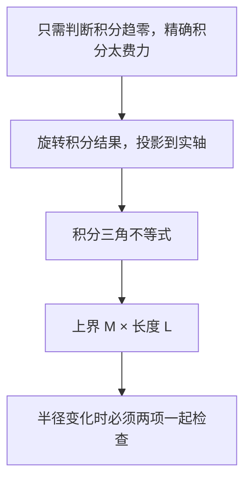

# C4.4 积分估计与 ML 不等式

> [!abstract] 这一讲的任务
> 证明积分的模不超过模的积分，再推出 ML 不等式；学会同时控制被积函数与路径长度，判断大圆、小圆和变化方框的积分是否消失。

> [!info] 阅读说明
> 对应 Sec.47，PDF 21–26、印刷 pp.135–140。当前课堂覆盖待确认。p.136 关于分段连续函数必取得最大值的说法已在正文修正；8 道原题均融入相应估计。

## 0. 开场：函数越来越小，积分就一定越来越小吗？

在半径 $R$ 的圆上，$|1/z|=1/R\to0$。如果因此断言圆周积分趋于零，就与上一讲的 $\oint dz/z=2\pi i$ 冲突。原因是圆周同时越来越长：单点贡献变小，累加的路程却变大。

所以我们需要估计“沿整条路累积后有多大”，而非仅比较函数在某一点有多大。

## 47. 从积分三角不等式到 ML

先设 $I=\int_a^bw(t)dt$。若 $I=0$，显然 $|I|\le\int|w|$；若 $I=re^{i\alpha}\ne0$，乘 $e^{-i\alpha}$ 将结果旋转到正实轴，得到
$$
|I|=\operatorname{Re}(e^{-i\alpha}I)
=\int_a^b\operatorname{Re}(e^{-i\alpha}w(t))dt
\le\int_a^b|e^{-i\alpha}w(t)|dt
=\int_a^b|w(t)|dt.
$$
这里用的是逐点不等式 $\operatorname{Re}\zeta\le|\zeta|$，而非复数之间没有意义的大小比较。

> [!important] ML 不等式（estimation lemma）
> 若 $C$ 长度为 $L$，$f$ 沿 $C$ 分段连续，且在定义处满足 $|f(z)|\le M$，则
> $$\left|\int_Cf(z)dz\right|\le\int_C|f(z)|ds\le ML.$$

证明只需代入 $w(t)=f(z(t))z'(t)$：
$$
\left|\int_a^bf(z(t))z'(t)dt\right|
\le\int_a^b|f(z(t))||z'(t)|dt
\le M\int_a^b|z'(t)|dt=ML.
$$
$M$ 可以是便于计算的上界，不必是最小上界。若路径长度为正，且沿各段的模上界处处严格小于 $M$，则相应的 ML 结论也可取严格小于；更一般地，出现一段正弧长的严格差距就足够。

> [!warning] 有界不等于取得最大值
> 连续函数在紧曲线上一定取到最大值；分段连续只保证有界。例如 $g(t)=t$（$0\le t<1$）、$g(1)=0$，它在 $[0,1]$ 分段连续，但上确界 $1$ 从未取到。p.136 最后一句由分段连续推最大值过强。ML 只需一个上界，因此定理仍成立。

### 47.1 固定路径：分子放大，分母缩小

> [!example] 第一象限四分之一圆弧
> $C$ 从 $2$ 沿 $|z|=2$ 到 $2i$，估计 $\int_C(z-2)/(z^4+1)\,dz$。

路径长 $L=2(\pi/2)=\pi$。分子用三角不等式 $|z-2|\le|z|+2=4$，分母用反三角不等式 $|z^4+1|\ge||z|^4-1|=15$，于是 $M=4/15$，积分模不超过 $4\pi/15$。不要求分子上界与分母下界在同一点取得，也不要求最终估计最紧。

Sec.47 题 1 沿同一圆弧，不计算积分证明：(a) $|\int_C(z+4)/(z^3-1)dz|\le6\pi/7$；(b) $|\int_Cdz/(z^2-1)|\le\pi/3$。分别取
$$|z+4|\le6,\quad |z^3-1|\ge7;\qquad |z^2-1|\ge3,$$
乘同一个 $L=\pi$ 即得。

题 2 沿 $i\to1$ 的线段估计 $\int_Cdz/z^4$。参数 $z=t+i(1-t)$，$0\le t\le1$，有
$$|z|^2=t^2+(1-t)^2=2(t-1/2)^2+1/2\ge1/2.$$
所以 $|z^{-4}|\le4$，而长度 $\sqrt2$，得上界 $4\sqrt2$。先找路径到奇点的最短距离，比盲目估计 $x,y$ 更直接。

![[C4.4-原图-线段离原点最近距离.png]]

题 3：$C$ 是 $0,3i,-4$ 为顶点的正向三角形边界，证明 $|\oint_C(e^z-\bar z)dz|\le60$。区域上 $x\le0$，故 $|e^z|=e^x\le1$；三边上 $|z|\le4$，因而 $|e^z-\bar z|\le5$。三边长为 $3,5,4$，总长 $12$，乘得 $60$。共轭的模仍是 $|z|$，但不能把它删掉后使用解析积分定理。

### 47.2 大圆弧：上界要衰减得比长度增长更快

> [!example] 上半圆 $C_R$，$R>3$
> 判断 $\int_{C_R}(z+1)/[(z^2+4)(z^2+9)]dz$ 在 $R\to\infty$ 时的极限。

分别有 $|z+1|\le R+1$、$|z^2+4|\ge R^2-4>0$、$|z^2+9|\ge R^2-9>0$。故
$$
|I_R|\le\frac{\pi R(R+1)}{(R^2-4)(R^2-9)}
=\frac{\pi(R^{-2}+R^{-3})}{(1-4/R^2)(1-9/R^2)}\longrightarrow0.
$$
必须先保证分母下界为正，才有有效的除法上界。一般大圆弧 $L=O(R)$，若 $M_R=O(R^{-p})$，则 $p>1$ 足以使 ML 趋零；$p=1$ 只得到有界，开场的 $1/z$ 就是反例。

Sec.47 题 4 取上半圆 $R>2$，被积函数为 $(2z^2-1)/(z^4+5z^2+4)$。先因式分解分母 $(z^2+1)(z^2+4)$，得
$$|I_R|\le\frac{\pi R(2R^2+1)}{(R^2-1)(R^2-4)}
=\frac{\pi(2/R+1/R^3)}{(1-1/R^2)(1-4/R^2)}\to0.$$

题 5 取正向全圆 $|z|=R>1$，求主值 $\operatorname{Log}z/z^2$ 的估计。割线处按有限单侧极限分段积分；由
$$|\operatorname{Log}z|=\sqrt{(\ln R)^2+(\operatorname{Arg}z)^2}<\ln R+\pi$$
得到
$$\left|\oint_{C_R}\frac{\operatorname{Log}z}{z^2}dz\right|<\frac{2\pi(\ln R+\pi)}R\to0.$$
最后一步可用洛必达：$(\ln R)/R$ 的极限等于 $1/R$ 的极限，即零。割线跳跃没有破坏分段积分，但妨碍直接使用闭域解析性。

### 47.3 小圆与变化方框：常数要统一

Sec.47 题 6 假设 $f$ 在闭单位圆盘解析，$C_\rho$ 是 $0<\rho<1$ 的正向圆，$z^{-1/2}$ 取任一固定分支，割线点按分段处理。连续性给一个与 $\rho$ 无关的 $M=\max_{|z|\le1}|f(z)|$；实指数 $-1/2$ 的各分支模均为 $\rho^{-1/2}$，所以
$$\left|\oint_{C_\rho}z^{-1/2}f(z)dz\right|\le\rho^{-1/2}M\cdot2\pi\rho
=2\pi M\sqrt\rho\to0.$$
若每个半径都另找一个可能暴涨的 $M_\rho$，就不能从式子推极限。一般小圆上 $|f|=O(\rho^{-p})$，$p<1$ 足以令 ML 消失。

题 8 是正向方框，四边 $x,y=\pm(N+1/2)\pi$，$N$ 为正整数。设 $a_N=(N+1/2)\pi$。利用
$$|\sin(x+iy)|^2=\sin^2x+\sinh^2y,$$
竖边 $|\sin x|=1$，故 $|\sin z|\ge1$；横边 $|\sin z|\ge\sinh a_N>\sinh(\pi/2)>1$。可统一取 $A=1$（或任意不超过两边下界的正数）。又 $|z|\ge a_N$、$L=8a_N$，于是
$$\left|\oint_{C_N}\frac{dz}{z^2\sin z}\right|
\le\frac{8a_N}{a_N^2A}=\frac{16}{(2N+1)\pi A}\to0.$$
函数在方框内部有奇点，并不妨碍沿边界做 ML 估计；不要为了取上界额外要求内部解析。

### 47.4 积分表示也能直接控制函数

Sec.47 题 7 定义勒让德多项式的积分表示
$$P_n(x)=\frac1\pi\int_0^\pi\left(x+i\sqrt{1-x^2}\cos\theta\right)^n d\theta,
\quad-1\le x\le1,\quad n=0,1,\ldots.$$
括号内的模平方为
$$x^2+(1-x^2)\cos^2\theta\le x^2+(1-x^2)=1.$$
故其 $n$ 次幂模不超过 $1$，积分三角不等式立即给 $|P_n(x)|\le\pi^{-1}\int_0^\pi1d\theta=1$。这一次连展开多项式都没有必要。

## 这一讲的三句话

1. 复积分上界来自取模与实投影，不能对复数直接比较大小。
2. ML 同时控制函数上界和路径长度，函数趋零本身不够。
3. 极限估计要检查常数是否与半径或序号无关，以及分母下界是否确实为正。

| 名称 | 公式或判据 |
|---|---|
| 积分三角不等式 | $\lvert \int w\rvert \le\int\lvert w\rvert $ |
| ML | $\lvert \int_Cf\,dz\rvert \le ML$ |
| 大圆充分衰减 | $L=O(R),\ M_R=O(R^{-p}),\ p>1$ |
| 小圆充分衰减 | $L=O(\rho),\ M_\rho=O(\rho^{-p}),\ p<1$ |
| 下界工具 | $\lvert a+b\rvert \ge\bigl\lvert \rvert a\lvert -\rvert b\lvert \bigr\rvert $ |

> [!tip] 下一讲预告
> ML 只给上界。什么时候能完全摆脱路径参数，直接用终点减起点？这需要把“有原函数”与“绕任何闭路都为零”严密接起来。

---

[[C4.3 参数积分、路径依赖与分支|上一讲]] ｜ [[C4.5 原函数与路径无关|下一讲]] ｜ [[复变函数 MOC|返回课程索引]]
