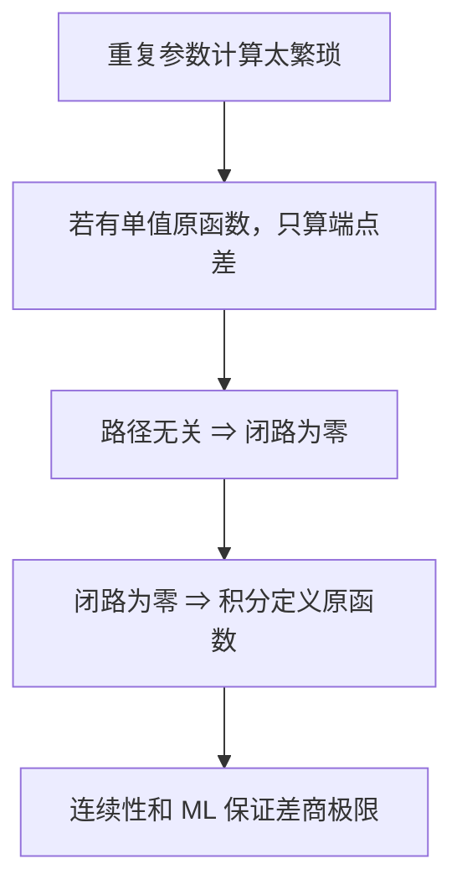

# C4.5 原函数与路径无关

> [!abstract] 这一讲的任务
> 建立“有原函数、路径无关、所有闭路积分为零”的等价关系。既要会用端点法，也要看懂怎样用积分反过来造出原函数。

> [!info] 阅读说明
> 对应 Sec.48–49，PDF 26–33、印刷 pp.140–147。当期讲授范围待确认。原有例题与 Sec.49 题 1–5 均在相应论证中处理；端点落割线时明确使用的连续延拓分支。

## 0. 开场：为什么 $1/z^2$ 可以，$1/z$ 不可以？

你面对单位圆上两个积分 $\oint dz/z^2$ 和 $\oint dz/z$。它们都在原点有奇点，直觉上似乎都不能用原函数；但 $-1/z$ 在整个去心平面是单值解析函数，导数正是 $1/z^2$，所以第一个积分为零。第二个的候选原函数 $\log z$ 却无法在整个去心平面统一取成单值分支。

问题不是“路径里面有没有洞”这么粗略，而是对这个具体的函数，能否在允许走路的整个域上找到一个单值原函数。

## 48. 原函数与端点法

> [!important] 定义：域上的原函数 antiderivative
> 对域 $D$ 上的连续函数 $f$，若单值函数 $F$ 在 $D$ 每点满足 $F'=f$，称 $F$ 为 $f$ 在 $D$ 上的原函数。它自然在 $D$ 解析。

若 $F,G$ 都是原函数，$(F-G)'=0$。沿域中连接两点的折线路径，各段用实参数链式法则可知差值恒定，因此 $F-G$ 在连通域上是常数。连通性保证不同点之间可比较；如果定义域不连通，每个分支可以有自己的常数。

> [!important] 原函数—路径无关—闭路为零定理
> 设 $f$ 在域 $D$ 连续，下列三项等价：
> 1. $f$ 在整个 $D$ 有原函数 $F$。
> 2. $D$ 内任意固定端点间的围道积分均相同，且 $\int_{z_1}^{z_2}f(z)dz=F(z_2)-F(z_1)$。
> 3. $D$ 内每一条闭围道的 $f$ 积分都为零。

“等价”并不声称任意 $f$ 都满足它们，也不允许把“每一条”偷换成“某一条”。$1/z$ 在去心平面三个条件都不成立，$1/z^2$ 三个都成立。

### 48.1 有原函数时，端点差怎样产生

沿光滑段 $z(t)$，链式法则给
$$\frac d{dt}F(z(t))=f(z(t))z'(t).$$
右边就是参数积分的被积函数，因此由实参数基本定理，$\int_Cf=F(z(b))-F(z(a))$。若有多段，求和时所有接点值相消，只剩起终点。特别是闭路首尾一致，积分为零。

> [!example] 直接用全域原函数
> 求任意路径上 $\int_i^{i/2}e^{\pi z}dz$，以及正向单位圆上的 $\oint dz/z^2$。

前者 $F=e^{\pi z}/\pi$ 在全平面可用，故结果 $(e^{\pi i/2}-e^{\pi i})/\pi=(1+i)/\pi$。后者 $F=-1/z$ 覆盖整条路径，端点差为零；不要求 $F$ 在圆内部的原点也有定义，因为端点法只需要路径处在同一个原函数域内。

### 48.2 为什么换两个对数分支仍能算出 $2\pi i$

把单位圆分成右半圆 $C_1:-i\to i$ 和左半圆 $C_2:i\to-i$，均按正向走。右半圆采用主对数，得
$$\int_{C_1}\frac{dz}z=\operatorname{Log}i-\operatorname{Log}(-i)=\pi i.$$
左半圆采用 $0<\arg z<2\pi$ 的对数分支，得
$$\int_{C_2}\frac{dz}z=\log(-i)-\log i=3\pi i/2-\pi i/2=\pi i.$$
所以全周为 $2\pi i$。两段分别有原函数，不等于两段共享一个全局原函数；接点处使用的对数值发生 $2\pi i$ 的差别，不能将两次端点差强行相消。

### 48.3 割线端点要用沿途的极限值

取平方根分支 $f(z)=\sqrt r e^{i\theta/2}$、$0<\theta<2\pi$，比较从 $-3$ 到 $3$、内部严格位于上半平面的 $C_1$ 与下半平面的 $C_2$。

对上路，可把分支区间移成 $-\pi/2<\theta<3\pi/2$，这不会改变上半平面的函数值，却让 $3$ 成为新分支域内的普通点。取 $F_1=(2/3)r^{3/2}e^{3i\theta/2}$，得
$$I_1=2\sqrt3(1-(-i))=2\sqrt3(1+i).$$
对下路，采用 $\pi/2<\theta<5\pi/2$。此时 $-3$ 的幅角为 $\pi$，$3$ 的连续到达幅角为 $2\pi$，所以（Sec.49 题 4）
$$I_2=2\sqrt3(e^{3\pi i}-e^{3\pi i/2})=2\sqrt3(-1+i).$$
闭路 $C_2-C_1$ 的积分为 $-4\sqrt3$。这里的分支在正实轴上不是解析函数，故不与后面的闭路定理冲突。

![[C4.5-原图-平方根上下路径.png]]

Sec.49 题 5 同样求主分支 $z^i$ 从 $-1$ 到 $1$ 的任意上路积分。用覆盖上半平面的扩展分支 $-\pi/2<\arg z<3\pi/2$，取
$$F(z)=\frac{\exp[(1+i)\log z]}{1+i}.$$
起点幅角 $\pi$ 时，分子为 $e^{(1+i)i\pi}=-e^{-\pi}$；终点幅角为 $0$ 时分子为 $1$。于是
$$\int_{-1}^1z^idz=\frac{1+e^{-\pi}}{1+i}=\frac{1+e^{-\pi}}2(1-i).$$
它正好与沿上半圆从 $1$ 到 $-1$ 的结果反号，方向检查通过。

## 49. 反过来用积分构造原函数

最重要的方向是“所有闭路为零 $\Rightarrow$ 有原函数”，因为很多函数根本写不出初等原函数。

先由闭路为零得到路径无关。若 $C_1,C_2$ 都从 $z_0$ 到 $z$，则 $C_1-C_2$ 闭合，故 $\int_{C_1}f-\int_{C_2}f=0$。于是可以固定基点 $z_0$，定义
$$F(z)=\int_{z_0}^zf(s)ds,$$
不必注明路径。域是开且连通的，任意两点之间可以用域内的折线连接，所以这个定义处处有意义。

### 49.1 差商为什么趋于 $f(z)$

固定 $z\in D$，取一个完全包含在 $D$ 的小圆盘。只要 $h$ 足够小，线段 $[z,z+h]$ 全在圆盘内。利用路径无关，可以把计算 $F(z+h)$ 的路径选成先到 $z$，再沿这条短线段，得到
$$F(z+h)-F(z)=\int_z^{z+h}f(s)ds.$$
又因 $\int_z^{z+h}ds=h$，
$$
\frac{F(z+h)-F(z)}h-f(z)
=\frac1h\int_z^{z+h}[f(s)-f(z)]ds.
$$
连续性保证：任给 $\varepsilon>0$，当短线段足够短，整段上 $|f(s)-f(z)|<\varepsilon$。线段长度恰是 $|h|$，所以 ML 给
$$\left|\frac{F(z+h)-F(z)}h-f(z)\right|\le\frac{\varepsilon|h|}{|h|}=\varepsilon.$$
这里 $h$ 可沿复平面任何方向趋零，因而确实证明了复导数 $F'=f$，而非某一个方向导数。

![[C4.5-原图-短线段构造原函数.png]]

路径无关 $\Rightarrow$ 闭路为零也可不用预先知道原函数：将闭路在两个点处分成同端点的 $C_1,C_2$，它等于 $C_1-C_2$，两积分相减即为零。三个方向现在全部闭合，没有循环使用尚未证明的结论。

### 49.2 原函数法的原题检验

Sec.49 题 1 给 $n=0,1,2,\ldots$，任意路径 $z_1\to z_2$。取 $F=z^{n+1}/(n+1)$，得
$$\int_Cz^ndz=\frac{z_2^{n+1}-z_1^{n+1}}{n+1}.$$
题 3 将整数指数推广到负数：对 $n=\pm1,\pm2,\ldots$，$F=(z-z_0)^n/n$ 在去掉 $z_0$ 的平面单值解析，所以任何不经过 $z_0$ 的闭路都有 $\oint_C(z-z_0)^{n-1}dz=0$。$n=0$ 不能代入此原函数式。

题 2 要沿任意连接相应端点的围道计算：(a) $\int_0^{1+i}z^2dz$；(b) $\int_0^{\pi+2i}\cos(z/2)dz$；(c) $\int_1^3(z-2)^3dz$。对应原函数分别是 $z^3/3$、$2\sin(z/2)$、$(z-2)^4/4$，所以
$$
\text{(a)}\ \frac{(1+i)^3}{3}=\frac23(-1+i),\quad
\text{(b)}\ 2\sin(\pi/2+i)=2\cosh1=e+e^{-1},\quad
\text{(c)}\ \frac{1^4-(-1)^4}{4}=0.
$$
这些原函数在全平面解析，任意连接端点的路径都被覆盖；这里才可以真正省略路径说明。

## 这一讲的三句话

1. 端点法要求整条路径处在同一个单值原函数域中。
2. 连续函数有原函数、路径无关、所有闭路为零，在同一域上等价。
3. 由积分构造原函数时，短线段、连续性与 ML 一起保证所有复方向的差商极限。

| 名称 | 公式或判据 |
|---|---|
| 原函数 | $F'=f$ 于整个域 |
| 端点法 | $\int_Cf\,dz=F(z_2)-F(z_1)$ |
| 等价条件 | 原函数 $\iff$ 路径无关 $\iff$ 每条闭路积分为零 |
| 积分造原函数 | $F(z)=\int_{z_0}^zf(s)ds$，先证明路径无关 |
| 整数幂原函数 | $(z-z_0)^n/n$，$n\in\mathbb Z\setminus\{0\}$ |

> [!tip] 下一讲预告
> 现在知道“闭路都为零”足以产生原函数，但怎样不用先找原函数就断定闭路为零？解析性将给出答案，而证明不能提前假设导数连续。

---

[[C4.4 积分估计与 ML 不等式|上一讲]] ｜ [[C4.6 柯西-古尔萨定理及其证明|下一讲]] ｜ [[复变函数 MOC|返回课程索引]]
