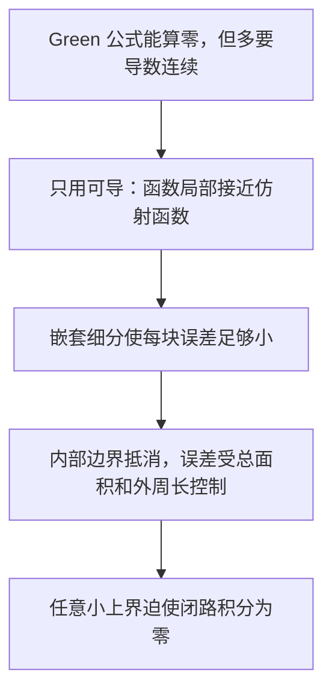

# C4.6 柯西-古尔萨定理及其证明

> [!abstract] 这一讲的任务
> 从实线积分和 Green 公式看见闭路积分为零的原因，再用局部线性化去掉“导数连续”的额外假设。重点理解小误差为什么在累加后仍可控。

> [!info] 阅读说明
> 对应 Sec.50–51，PDF 34–40、印刷 pp.148–154。未有当期课堂记录，讲授范围待确认。正文保留教材的方格、部分方格与嵌套细分证明；嵌套区间和方格原题 Sec.53 题 8–9 在使用处一并完成。Jordan 曲线等一般拓扑背景不在此重证。

## 0. 开场：已经解析，还要另加什么条件？

你要证明 $\oint_C\sin(z^2)dz=0$。找初等原函数并不方便，但把 $f=u+iv$ 与 $dz=dx+i\,dy$ 展开，再用 Green 公式，似乎两步就能解决。

问题在于 Green 公式要求相关偏导连续。此时我们只知道解析，即邻域中处处复可导；“导数也是解析的”恰恰要靠后面的积分公式证明。若在这里提前使用，就会循环论证。古尔萨的工作是直接从可导出发补上这一缺口。

## 50. 先看 Green 公式怎样给出零

乘开 $(u+iv)(dx+i\,dy)$，对任意围道有
$$\int_Cf(z)dz=\int_C(u\,dx-v\,dy)+i\int_C(v\,dx+u\,dy).$$
若 $C$ 为正向简单闭围道，内部和边界组成 $R$，且 $u,v$ 的一阶偏导在所需邻域连续，Green 公式
$$\oint_C(P\,dx+Q\,dy)=\iint_R(Q_x-P_y)dA$$
分别作用于两个积分，得到
$$\oint_Cf(z)dz
=\iint_R(-v_x-u_y)dA+i\iint_R(u_x-v_y)dA.$$
解析性提供 Cauchy–Riemann 方程 $u_x=v_y$、$u_y=-v_x$，故两个面积分都为零。$\sin(z^2)$ 及其导数 $2z\cos(z^2)$ 在全平面连续，所以这个例子用 Green 路线已足够。

然而一般定理要去掉导数连续的前提。

> [!important] 柯西—古尔萨定理 Cauchy–Goursat theorem
> 若 $f$ 在简单闭围道 $C$ 上及其内部的每一点解析，即存在覆盖该闭区域的解析邻域，则
> $$\oint_Cf(z)dz=0.$$
> 正向、反向均成立；无需另假设 $f'$ 连续。只在曲线上解析而内部有奇点，不能使用本定理。

## 51. 可导如何控制一整块积分

### 51.1 局部线性化，以及不能省略的误差

在一点 $z_j$ 可导，等价于
$$f(z)=f(z_j)+f'(z_j)(z-z_j)+(z-z_j)\delta_j(z),\qquad\delta_j(z)\to0\quad(z\to z_j).$$
前两项是仿射函数，有全平面原函数，沿任何闭路积分都为零。因此一小块边界 $C_j$ 上，只需估计
$$\oint_{C_j}f(z)dz=\oint_{C_j}(z-z_j)\delta_j(z)dz.$$
这比粗略估计 $\sup|f|$ 强，因为额外多了一个小距离 $|z-z_j|$。但可导性只在每点给一个自己的邻域，不能立刻宣布存在一个全域统一半径；下一步正是为解决这个问题。

### 51.2 覆盖引理：为什么细分在有限步后会成功

用水平、竖直网格覆盖紧区域 $R$，只保留与 $R$ 相交的有限个方格，边界格裁掉 $R$ 外的部分。给定 $\varepsilon>0$，目标是让每块中存在一个 $z_j$，使块上所有 $z\ne z_j$ 都满足
$$\left|\frac{f(z)-f(z_j)}{z-z_j}-f'(z_j)\right|<\varepsilon.$$
若某格不满足，就四等分；对仍不满足的子格继续细分。

假设某一初始方格无论怎样细分都不能在有限步结束。有限分支的细分树必可选出一条始终“不合格”的嵌套链 $\sigma_0\supset\sigma_1\supset\cdots$，其边长每次减半。下面证明这些格子有一个共同点，而不把这个关键存在性写成“显然”。

Sec.53 题 8：嵌套闭区间 $[a_k,b_k]$ 每次取前一个的一半。$a_k$ 单调递增且有上界，$b_k$ 单调递减且有下界；记极限 $A,B$。因为
$$b_k-a_k=2^{-k}(b_0-a_0)\to0,$$
有 $A=B=x_0$，且对每个 $k$，$a_k\le x_0\le b_k$。闭性保证端点极限仍在区间中。

Sec.53 题 9：对嵌套方格的横、纵坐标区间分别用上述结论，就得到唯一共同点 $z_*=x_*+iy_*$。每格都与 $R$ 相交，选 $r_k\in R\cap\sigma_k$，因格子直径趋零，$r_k\to z_*$；$R$ 闭，故 $z_*\in R$。

$f$ 在 $z_*$ 可导，因此有 $\delta>0$，使 $0<|z-z_*|<\delta$ 时差商误差小于 $\varepsilon$。当格子对角线短于 $\delta$，整个 $\sigma_k$ 都在该邻域；此时 $z_*$ 自己就能充当该块的 $z_j$。这与它始终不合格矛盾。因此每个初始格都能在有限步合格，有限个初始格最终给出有限覆盖。

![[C4.6-原图-方格细分与嵌套.png]]

### 51.3 内部边界为什么全部抵消

在每块上定义 $\delta_j(z_j)=0$，其余点用差商误差定义。由可导性，它在 $z_j$ 连续；其他点也连续，且整块上 $|\delta_j|<\varepsilon$。将仿射部分写成
$$f(z_j)-z_jf'(z_j)+f'(z_j)z,$$
每项分别乘 $dz$ 积分，利用 $\oint dz=\oint z\,dz=0$，便得前面的余项积分式。

让每块都按正向绕行，公共直线边在相邻两块中的方向相反，积分精确抵消；粗格对细格时，把公共边分成小段，仍逐段抵消。剩下的外边界恰是 $C$，所以
$$\oint_Cf(z)dz=\sum_j\oint_{C_j}(z-z_j)\delta_j(z)dz.$$

![[C4.6-原图-内部边界抵消.png]]

### 51.4 小误差为何不会被小块数量放大

设第 $j$ 块来自边长 $s_j$ 的完整方格，面积 $A_j=s_j^2$。同一方格中两点距离不超过对角线 $\sqrt2s_j$，所以余项模至多 $\sqrt2s_j\varepsilon$。

若它是完整方格，周长 $4s_j$，ML 给
$$\left|\oint_{C_j}(z-z_j)\delta_jdz\right|\le4\sqrt2A_j\varepsilon.$$
若是边界部分格，边界由格边及原曲线上的弧组成；设后者总长为 $L_j$，总长至多 $4s_j+L_j$。设一个大方格边长 $S$ 足以包含所有初始格，则 $s_j\le S$，于是
$$\left|\oint_{C_j}(z-z_j)\delta_jdz\right|
\le4\sqrt2A_j\varepsilon+\sqrt2SL_j\varepsilon.$$
所有完整底格的面积总和不超过 $S^2$，原曲线分到各边界块的弧长总和为 $L$。因此
$$\left|\oint_Cf(z)dz\right|\le(4\sqrt2S^2+\sqrt2SL)\varepsilon.$$
右侧前面的常数与 $\varepsilon$ 无关；左边是同一个固定积分。$\varepsilon$ 可任意小，故左边只能为零。

这里真正避免发散的是“小距离 × 小边长 = 小面积”。不能只说每块误差小，再忽略小块数量可能增加。对一般分段光滑 Jordan 边界，网格切分的边界技术采用通常的有限切分或极限处理；这不替代 Jordan 理论本身，也没有将画图直觉冒充全部拓扑细节。

## 这一讲的三句话

1. Green 公式解释 CR 方程为何使积分为零，但其正则性条件不能提前假定。
2. 可导使函数接近仿射函数，仿射项积分消失后只剩可控余项。
3. 嵌套细分解决局部半径不统一，面积与外周长估计解决误差累加。

| 名称 | 公式或判据 |
|---|---|
| 实线积分分解 | $\int fdz=\int(u\,dx-v\,dy)+i\int(v\,dx+u\,dy)$ |
| 局部展开 | $f(z)=f(z_j)+f'(z_j)(z-z_j)+(z-z_j)\delta_j(z)$ |
| 完整方格误差 | $\lvert \oint_{C_j}f\rvert \le4\sqrt2A_j\varepsilon$ |
| 柯西—古尔萨 | 闭区域上解析 $\Rightarrow\oint_Cf=0$，$C$ 简单闭合 |

> [!tip] 下一讲预告
> 一条简单闭路内部解析就能积分为零。但域里有洞、路径会自交时怎么办？下一讲把分析条件与区域的拓扑条件分开检查。

---

[[C4.5 原函数与路径无关|上一讲]] ｜ [[C4.7 单连通、复连通与路径变形|下一讲]] ｜ [[复变函数 MOC|返回课程索引]]
