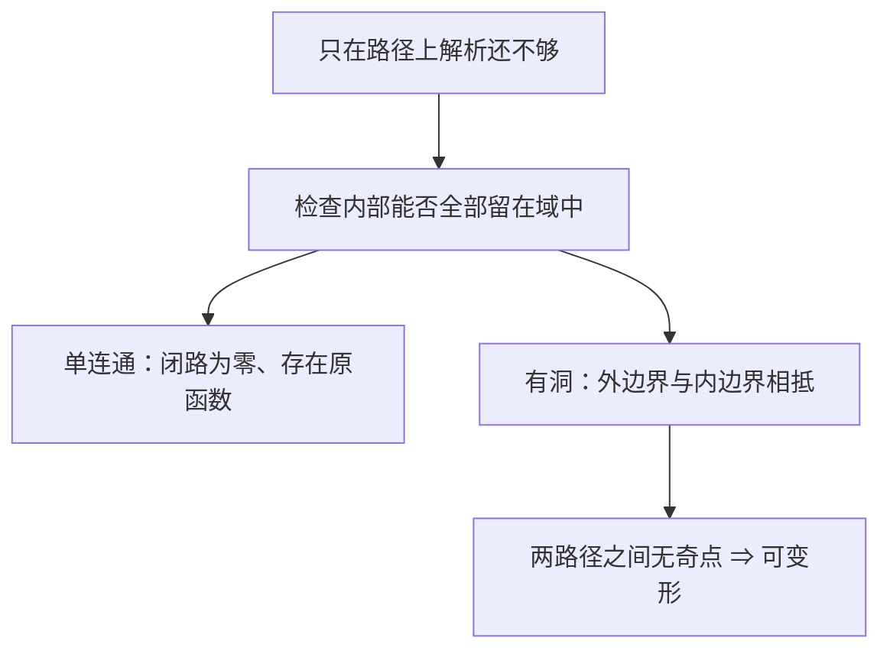

# C4.7 单连通、复连通与路径变形

> [!abstract] 这一讲的任务
> 区分域的洞与函数的奇点，建立单连通域上的积分定理；处理内外边界方向，并把难路径变形成容易计算的路径。

> [!info] 阅读说明
> 对应 Sec.52–53，PDF 40–48、印刷 pp.154–162，实际课堂覆盖待确认。Sec.53 题 8–9 的嵌套区间、方格已放在 [[C4.6 柯西-古尔萨定理及其证明]] 的证明中；本篇完成题 1–7。一般无限自交路径的完整拓扑证明仍作为背景，给出的特殊替换法只处理满足所列条件的路径。

## 0. 开场：圆周上没有奇点，为什么还不能算零？

沿单位圆积分 $1/z$ 时，函数在每个圆周点附近都解析，但结果是 $2\pi i$。错误发生在把“曲线上解析”当成“曲线及整个内部解析”。原点虽没有被脚步踩到，却在围出的内部，阻断了柯西—古尔萨定理的假设。

如果允许走路的域本身保证任何简单闭路围住的点也都在域中，那么只需检查函数在域中解析。这就是单连通性要完成的任务。

## 52. 单连通域 simply connected domain

> [!important] 定义与积分定理
> 域 $D$ 若满足：任意位于 $D$ 内的简单闭围道，其内部全包含在 $D$ 中，称 $D$ 单连通。圆盘、全平面是例子；圆环、去心平面不是。
> 若 $f$ 在单连通域 $D$ 解析，则 $D$ 内每一条闭围道 $C$ 都有 $\oint_Cf(z)dz=0$，并且 $f$ 在 $D$ 有原函数。

简单闭路直接用上一讲的定理。有限个交点的闭路可拆为有限条简单闭路，对每条分别得零，再利用可加性得总和零；方向不影响零结论。对一般无限交点情况，需要更一般的路径理论，不能把无限多条积分的相加未经证明当成有限可加性。

一旦“所有闭路为零”成立，[[C4.5 原函数与路径无关]] 的构造就给出全域原函数。因此整函数总有整原函数，即使原函数不属于初等函数。

例如任意闭路 $C\subset\{|z|<2\}$ 上，
$$\oint_C\frac{\sin z}{(z^2+9)^5}dz=0,$$
因为唯一可能的奇点 $\pm3i$ 都在圆盘外。路径可自交，不必计算 $\sin z$ 或分母的原函数。

单连通是对所有解析函数保证有原函数的充分条件，并非某个特定函数有原函数的必要条件；去心平面中的 $1/z^2$ 再次说明这一点。

### 52.1 原题检验：先列奇点，再判断域

Sec.53 题 1 的 $C$ 为单位圆，任一方向。以下六函数的积分全为零，理由要分别核查：

| 函数 | 闭单位圆盘的解析性检查 |
|---|---|
| (a) $z^2/(z+3)$ | 唯一极点 $-3$ 在外 |
| (b) $ze^{-z}$ | 整函数 |
| (c) $1/(z^2+2z+2)$ | 根 $-1\pm i$ 的模为 $\sqrt2>1$ |
| (d) $\operatorname{sech}z$ | $\cosh z$ 的零点 $i(\pi/2+k\pi)$ 均在外 |
| (e) $\tan z$ | $\cos z$ 的零点 $\pi/2+k\pi$ 均在外 |
| (f) $\operatorname{Log}(z+2)$ | 圆盘上 $\operatorname{Re}(z+2)\ge1$，避开主对数割线和零点 |

仅写“分母不为零”还不够处理最后一题，因为对数还需要核查分支解析域。

## 53. 复连通域与边界定向

有洞时，函数可以在“外边界以内、各内边界以外”的区域解析，却不在洞里解析。此时不是外圈单独等于零，而是区域的整条有向边界积分为零。

> [!important] 多边界柯西定理
> 外边界 $C$ 简单闭合且逆时针；内边界 $C_k$ 两两不交、内部不交，并全部顺时针。若 $f$ 在这些边界及它们夹出的区域解析，则
> $$\oint_Cf(z)dz+\sum_{k=1}^n\oint_{C_k}f(z)dz=0.$$
> 统一记法是：沿每条边界走，区域始终在左侧。

为什么内外方向相反？沿外圈逆时针走时区域在左；沿洞边逆时针走时左边却是洞，所以内圈必须反过来。证明时用有限条折线割线连接边界，将区域分成可用简单闭路定理的部分。各部分积分为零，相加后，割线被一正一反走过，互相抵消，只剩原有边界。

![[C4.7-原图-复连通边界与割线.png]]

若把内圈也改记成逆时针 $\Gamma_k$，公式应写成
$$\oint_Cf=\sum_k\oint_{\Gamma_k}f,$$
而非和为零。记号本身必须带上方向说明。

### 53.1 路径变形 principle of deformation of paths

两条正向简单闭路 $C_1,C_2$，$C_1$ 在 $C_2$ 内；若 $f$ 在两者及夹层解析，多边界定理给
$$\oint_{C_2}f+\oint_{-C_1}f=0\quad\Rightarrow\quad\oint_{C_2}f=\oint_{C_1}f.$$
内圈包住的洞里可以有奇点，因为并未对那里作解析假设。关键是两条路径之间不能跨过奇点或分支割线。

例如任意正向简单闭路 $C$ 围住原点，选一条完全在其内部的小圆 $C_0$，两者之间的 $1/z$ 解析，故
$$\oint_C\frac{dz}z=\oint_{C_0}\frac{dz}z=2\pi i.$$
这将不规则路径问题还原为圆周参数计算；大到包住原路径的圆也同样可用。

![[C4.7-原图-闭路变形成小圆.png]]

Sec.53 题 2 比较正向方框 $x,y=\pm1$ 的边界 $C_1$ 与正向圆 $|z|=4$ 的 $C_2$，要求证明两积分相同。三函数分别检查夹层：

(a) $1/(3z^2+1)$ 的极点 $\pm i/\sqrt3$ 都在内方框里。

(b) $(z+2)/\sin(z/2)$ 的分母零点为 $2k\pi$，只有 $0$ 在大圆内，且在内方框里；其他零点模至少 $2\pi>4$。

(c) $z/(1-e^z)$ 的潜在奇点为 $2k\pi i$；$0$ 处可去，且在内方框里，其余点在大圆外。三者的夹层及边界均无奇点，所以积分相同；不必计算各自的值。

题 3 的 $C$ 为矩形 $0\le x\le3,0\le y\le2$ 的正向边界，中心奇点 $z_0=2+i$ 在内。用小圆替换，再用整数幂圆周公式，得
$$\oint_C(z-2-i)^{n-1}dz=\begin{cases}2\pi i,&n=0,\\0,&n=\pm1,\pm2,\ldots.\end{cases}$$

### 53.2 一次矩形变形，求出高斯积分的余弦因子

> [!example] Sec.53 题 4
> 对 $b>0$，证明
> $$\int_0^\infty e^{-x^2}\cos(2bx)dx=\frac{\sqrt\pi}{2}e^{-b^2}.$$
> 允许使用高斯积分 $\int_0^\infty e^{-x^2}dx=\sqrt\pi/2$。

选择整函数 $e^{-z^2}$，沿顶点 $-a,a,a+bi,-a+bi$ 的正向矩形积分，总和为零。底边为 $2\int_0^ae^{-x^2}dx$。顶边从右向左，且
$$e^{-(x+bi)^2}=e^{-x^2+b^2}e^{-2ibx},$$
奇的正弦项在对称区间抵消，所以顶边为 $-2e^{b^2}\int_0^ae^{-x^2}\cos(2bx)dx$。右边与左边的和分别代入 $z=a+iy$、$z=-a+iy$，记住左边 $y$ 从 $b$ 降到 $0$，得
$$
ie^{-a^2}\int_0^be^{y^2}e^{-2iay}dy-ie^{-a^2}\int_0^be^{y^2}e^{2iay}dy
=2e^{-a^2}\int_0^be^{y^2}\sin(2ay)dy.
$$
四边和为零后整理：
$$
\int_0^ae^{-x^2}\cos(2bx)dx
=e^{-b^2}\int_0^ae^{-x^2}dx
+e^{-(a^2+b^2)}\int_0^be^{y^2}\sin(2ay)dy.
$$
最后一项模不超过 $e^{-(a^2+b^2)}\int_0^be^{y^2}dy\le b e^{-a^2}\to0$。固定 $b$ 后令 $a\to\infty$ 即得所求。

高斯积分本身可由平方后转极坐标得到：若 $J=\int_0^\infty e^{-x^2}dx$，则 $J^2=\int_0^{\pi/2}\int_0^\infty e^{-r^2}r\,drd\theta=\pi/4$，且 $J>0$，所以 $J=\sqrt\pi/2$。

![[C4.7-原图-高斯积分矩形.png]]

### 53.3 无穷自交的特殊替换法

Sec.53 题 5 用 [[C4.2 围道与复积分的定义]] 的 $C_1:z=x+ix^3\sin(\pi/x)$（$0\to1$）与实轴 $C_2:1\to0$，得到无限次自交的闭路。题目引入不自交的 $C_3:0\to1$，且只在端点与前两弧相交。对整函数 $f$，$C_1-C_3$ 与 $C_3+C_2$ 都是简单闭路，故
$$\int_{C_1}f=\int_{C_3}f,\qquad\int_{C_2}f=-\int_{C_3}f,$$
相加得 $\int_{C_1+C_2}f=0$。这避免了对无穷小环随意求和，但只证明这个满足辅助弧条件的例子。

![[C4.7-原图-无穷自交路径替换.png]]

### 53.4 积分为零不等于假设一定满足

Sec.53 题 6：在上半单位圆盘取 $f(0)=0$，非零点用 $-\pi/2<\theta<3\pi/2$ 的平方根 $\sqrt r e^{i\theta/2}$，求正向边界积分，并说明为什么不能直接用柯西—古尔萨。

正向边界依次为 $0\to1$、上半圆 $1\to-1$、$-1\to0$。三项分别为
$$
\int_0^1\sqrt x\,dx=\frac23,
\quad i\int_0^\pi e^{3i\theta/2}d\theta=-\frac23(1+i),
\quad\int_{-1}^0i\sqrt{-x}\,dx=\frac{2i}3.
$$
总和确为零。但原点处 $[f(x)-f(0)]/x=1/\sqrt x$ 发散，函数不在该边界点解析，所以定理假设不成立。这是充分条件，不是零积分的必要条件。

题 7 要用积分求正向简单闭围道围成的面积。展开
$$\bar z\,dz=(x-iy)(dx+i\,dy)=x\,dx+y\,dy+i(x\,dy-y\,dx).$$
实部是 $d[(x^2+y^2)/2]$，沿闭路积分为零；虚部由 Green 公式等于 $2i\iint_RdA$。所以
$$\operatorname{Area}(R)=\frac1{2i}\oint_C\bar z\,dz.$$
这里 $\bar z$ 处处不解析，但它的实分量偏导连续，Green 公式可以使用。解析积分定理与实线积分工具各有条件，不能混为一谈。

## 这一讲的三句话

1. 单连通性把“整个内部解析”的检查转移为“函数在域中解析”。
2. 多连通区域的正向边界是外圈逆时针、内圈顺时针。
3. 路径变形只要求夹层解析，不能跨奇点；积分为零本身不反推每个定理假设。

| 名称 | 公式或判据 |
|---|---|
| 单连通解析域 | 每条闭路 $\oint_Cf=0$，存在全域原函数 |
| 多边界定理 | $\oint_Cf+\sum\oint_{C_k\text{顺时针}}f=0$ |
| 变形 | 两同向嵌套闭路间解析 $\Rightarrow$ 积分相同 |
| 围住一奇点的基本核 | $\oint_Cdz/(z-z_0)=2\pi i$，$C$ 正向简单且包住 $z_0$ |
| 面积 | $A=(2i)^{-1}\oint_C\bar z\,dz$，正向简单闭路 |

> [!tip] 下一讲预告
> 普通解析函数的闭路积分为零，核 $1/(z-z_0)$ 的闭路积分却为 $2\pi i$。把两者相乘，能否从边界恢复内部点的函数值？

---

[[C4.6 柯西-古尔萨定理及其证明|上一讲]] ｜ [[C4.8 柯西积分公式与高阶导数|下一讲]] ｜ [[复变函数 MOC|返回课程索引]]
