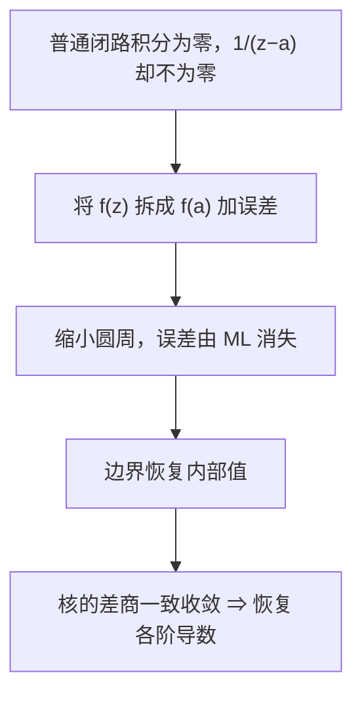

# C4.8 柯西积分公式与高阶导数

> [!abstract] 这一讲的任务
> 理解边界值怎样恢复内部函数值与任意阶导数；掌握柯西型积分的计算，并用一致的余项估计证明“积分号下求导”合法。

> [!info] 阅读说明
> 对应 Sec.54–56，PDF 48–54、印刷 pp.162–168。应用原题集中在 Sec.57 题 1–9，按工具出现的位置融入；题 10 的增长估计放在下一篇。实际课堂覆盖待确认。任意阶核的一致估计为补全证明，不作为已确认课堂内容。

## 0. 开场：只知道边界，还能知道里面吗？

你只测到了一个解析函数在闭曲线 $C$ 上的值，想求内部某点 $a$ 的值。普通的闭路积分 $\oint_Cf(z)dz$ 总是零，丢掉了需要的信息。上一讲却发现 $1/(z-a)$ 在包住 $a$ 的正向闭路上积分为 $2\pi i$，它能识别这个内部点。

我们尝试将 $f(z)$ 乘上这只核。如果靠近 $a$ 时 $f(z)$ 与 $f(a)$ 很接近，核的积分是否恰好会留下 $2\pi if(a)$？

## 54. 柯西积分公式 Cauchy integral formula

> [!important] 公式与全部条件
> $C$ 为正向简单闭围道，$f$ 在 $C$ 上及内部解析，$a$ 严格在内部，则
> $$f(a)=\frac1{2\pi i}\oint_C\frac{f(z)}{z-a}dz.$$
> 反向时积分变号。$a$ 在外且整体解析时积分为零；$a$ 在边界时不能使用本公式。

证明时，在内部围着 $a$ 取半径 $\rho$ 的小正向圆 $C_\rho$。$f(z)/(z-a)$ 在夹层解析，所以大路可缩成小圆。再拆开
$$
\oint_C\frac{f(z)}{z-a}dz
=f(a)\oint_{C_\rho}\frac{dz}{z-a}
+\oint_{C_\rho}\frac{f(z)-f(a)}{z-a}dz.
$$
第一项为 $2\pi if(a)$。任给 $\varepsilon>0$，连续性使足够小的小圆上 $|f(z)-f(a)|<\varepsilon$，于是第二项由 ML 控制为
$$\frac\varepsilon\rho\cdot2\pi\rho=2\pi\varepsilon.$$
左边减 $2\pi if(a)$ 是与 $\rho$ 无关的固定数，其模小于任意 $2\pi\varepsilon$，故只能为零。

![[C4.8-原图-柯西公式小圆.png]]

分母虽然发散为 $1/\rho$，但圆周长同时为 $2\pi\rho$；这两个因子相消后，剩下的是函数连续性提供的小量。这是公式成立的关键，不是未经说明地“令小圆缩成一点”。

> [!example] 单位圆上 $\oint_C\cos z/[z(z^2+9)]\,dz$
> 取 $F(z)=\cos z/(z^2+9)$。奇点 $\pm3i$ 在单位圆外，故 $F$ 在闭盘解析。$a=0$ 在内，结果为 $2\pi iF(0)=2\pi i/9$。

选择分子时要把其余因子一起吸收进去，再检查剩下的函数是否在整个内部解析。

## 55. 高阶公式：分母次数与导数阶数差一

> [!important] 广义柯西积分公式
> 在同样条件下，对任意整数 $n\ge0$，
> $$f^{(n)}(a)=\frac{n!}{2\pi i}\oint_C\frac{f(z)}{(z-a)^{n+1}}dz,$$
> 即 $\oint_Cf(z)/(z-a)^{n+1}dz=2\pi if^{(n)}(a)/n!$。约定 $f^{(0)}=f$、$0!=1$。

例如正向单位圆上 $\oint e^{2z}/z^4dz$，分母四次对应三阶导数，$f'''(0)=8$，所以结果 $2\pi i\cdot8/3!=8\pi i/3$。若漏掉阶乘，会多出六倍。

取 $f=1$，得到 $\oint_Cdz/(z-a)=2\pi i$，而 $n\ge1$ 时 $\oint_Cdz/(z-a)^{n+1}=0$。有奇点并不保证积分非零。

### 55.1 原题：先把式子整理到标准核

Sec.57 题 1 的 $C$ 为正向方框 $x,y=\pm2$。分别求以下五积分。

(a) $\oint_Ce^{-z}/(z-\pi i/2)dz$：$a=\pi i/2$ 在内，$e^{-a}=-i$，故结果为 $2\pi$。

(b) $\oint_C\cos z/[z(z^2+8)]dz$：把 $F(z)=\cos z/(z^2+8)$，其奇点 $\pm2\sqrt2i$ 在方框外，所以结果 $2\pi iF(0)=\pi i/4$。

(c) $\oint_Cz/(2z+1)dz$：写成 $(z/2)/(z+1/2)$，$a=-1/2$，结果 $2\pi i(-1/4)=-\pi i/2$。分母常数 $2$ 不能漏。

(d) $\oint_C\cosh z/z^4dz$：取三阶导数 $\sinh0=0$，结果为零。

(e) $\oint_C\tan(z/2)/(z-x_0)^2dz$，$-2<x_0<2$ 且为实数。$\tan(z/2)$ 的极点为 $z=(2k+1)\pi$，均在方框外；核对应一阶导数，故结果
$$2\pi i\cdot\tfrac12\sec^2(x_0/2)=\pi i\sec^2(x_0/2).$$

Sec.57 题 2 改用正向圆 $|z-i|=2$，求 (a) $\oint dz/(z^2+4)$，(b) $\oint dz/(z^2+4)^2$。点 $2i$ 到圆心距离 $1$，在内；$-2i$ 到圆心距离 $3$，在外。

(a) 写成 $F(z)/(z-2i)$，$F(z)=1/(z+2i)$，结果 $2\pi i/(4i)=\pi/2$。

(b) 写成 $F(z)/(z-2i)^2$，$F(z)=(z+2i)^{-2}$。其导数在 $2i$ 为 $-2/(4i)^3=1/(32i)$，所以结果 $2\pi i/(32i)=\pi/16$。

每题只围住一个奇点，另一个进入解析分子；不能因为二次式有两个根就同时代入两次。

### 55.2 将积分看作内部变量的函数

Sec.57 题 3 定义
$$g(z)=\oint_{|s|=3}\frac{2s^2-s-2}{s-z}ds,\quad|z|\ne3.$$
积分变量是 $s$，$z$ 是待求函数的自变量。$|z|<3$ 时，$g(z)=2\pi i(2z^2-z-2)$，故 $g(2)=8\pi i$；$|z|>3$ 时整个被积函数对 $s$ 在闭盘解析，故 $g(z)=0$。

题 4 定义任意正向简单闭路上的
$$g(z)=\oint_C\frac{s^3+2s}{(s-z)^3}ds.$$
内部时取二阶导数 $6z$，并除 $2!$，得 $g(z)=6\pi iz$；外部时为零。边界处原题未定义此普通积分，不能套入任一表达式。

题 5 要证 $z_0\notin C$ 时
$$\oint_C\frac{f'(z)}{z-z_0}dz=\oint_C\frac{f(z)}{(z-z_0)^2}dz,$$
其中 $f$ 在闭区域解析。若 $z_0$ 在内，两边都为 $2\pi if'(z_0)$；若在外，两边都为零。$f'$ 的解析性由本篇后面的求导论证得到，因此把它作为正式推论使用时要依靠完整公式，而非只凭“形式上求导”。

### 55.3 勒让德多项式的积分表示

对非负整数 $n$，Rodrigues 公式定义
$$P_n(z)=\frac1{2^nn!}\frac{d^n}{dz^n}(z^2-1)^n.$$
将高阶公式用于整函数 $(s^2-1)^n$，围道正向包住 $z$，便得
$$P_n(z)=\frac1{2^{n+1}\pi i}\oint_C\frac{(s^2-1)^n}{(s-z)^{n+1}}ds.$$
在 $z=1$，约去 $n$ 个 $(s-1)$，分子剩 $(s+1)^n$，于是 $P_n(1)=2^{-n}(1+1)^n=1$。Sec.57 题 8 在 $z=-1$ 同理约去 $(s+1)^n$，得到 $P_n(-1)=2^{-n}(-1-1)^n=(-1)^n$。$n=0$ 时两者都为 $1$。

Sec.57 题 7 要从 $\oint_{|z|=1}e^{az}dz/z=2\pi i$（$a\in\mathbb R$）导出实积分。取 $z=e^{i\theta}$、$-\pi\le\theta\le\pi$，有
$$\int_{-\pi}^{\pi}e^{a\cos\theta}e^{ia\sin\theta}d\theta=2\pi.$$
取实部，余弦因子是偶函数，将区间折半便得
$$\int_0^\pi e^{a\cos\theta}\cos(a\sin\theta)d\theta=\pi.$$
虚部的正弦项为奇函数，积分为零；这也验证结果确实是实数。

## 56. 为什么可以在积分号下求导

形式上 $\partial_z(s-z)^{-1}=(s-z)^{-2}$，再求导产生阶乘。但单写这个操作没有说明极限能否穿过积分。我们改用差商并估计余项。

### 56.1 一阶：边界与内点的正距离

固定内部点 $z$，令 $d=\min_{s\in C}|s-z|>0$，$M=\max_C|f|$，$L$ 为路径长。取 $0<|h|<d$，由普通公式相减得到
$$
\frac{f(z+h)-f(z)}h
=\frac1{2\pi i}\oint_C\frac{f(s)}{(s-z-h)(s-z)}ds.
$$
使用精确恒等式
$$\frac1{(s-z-h)(s-z)}-\frac1{(s-z)^2}
=\frac{h}{(s-z-h)(s-z)^2},$$
得到差商减目标导数积分的模至多
$$\frac{ML|h|}{2\pi(d-|h|)d^2}\longrightarrow0.$$
这里 $|s-z-h|\ge d-|h|>0$ 统一适用于所有边界点；正是统一界使积分后的误差仍趋零。于是
$$f'(z)=\frac1{2\pi i}\oint_C\frac{f(s)}{(s-z)^2}ds.$$

![[C4.8-原图-内点与边界距离.png]]

Sec.57 题 6 只假设边界上的 $f$ 连续，定义 $g(z)=(2\pi i)^{-1}\oint_Cf(s)/(s-z)ds$。上述差商论证只用到了边界的 $M$ 与正距离 $d$，所以仍证明 $g$ 在内部解析，导数为 $(2\pi i)^{-1}\oint_Cf(s)/(s-z)^2ds$。不过没有内部给定解析函数作比较时，不能进一步说 $g$ 就等于任意指定的内部值。

### 56.2 二阶：原题要求的精确余项

Sec.57 题 9(a) 从 $f'$ 的积分表示相减。令 $w=s-z$，代数通分得
$$
\frac{(w-h)^{-2}-w^{-2}}h-\frac2{w^3}
=\frac{3wh-2h^2}{(w-h)^2w^3}.
$$
所以
$$
\frac{f'(z+h)-f'(z)}h-\frac1{\pi i}\oint_C\frac{f(s)}{(s-z)^3}ds
=\frac1{2\pi i}\oint_C\frac{[3(s-z)h-2h^2]f(s)}{(s-z-h)^2(s-z)^3}ds.
$$
再令 $D=\max_C|s-z|$，积分号内整体的积分模不超过
$$\frac{(3D|h|+2|h|^2)ML}{(d-|h|)^2d^3},$$
加上外部系数后除以 $2\pi$。$h\to0$ 时归零，得 $f''(z)=(\pi i)^{-1}\oint_Cf(s)/(s-z)^3ds$，完成题 9(b)(c)。

### 56.3 任意阶：不把“类似”当作证明

定义 $J_k(z)=\oint_Cf(s)(s-z)^{-k}ds$，$k\ge1$。要证明 $J_k'=kJ_{k+1}$，只须证明核差商一致趋于 $k(s-z)^{-k-1}$。

仍令 $w=s-z$，取 $|h|<d/2$。把 $t\mapsto(w-th)^{-k}$ 看成实参数 $t\in[0,1]$ 的复值函数，对它用两次基本定理，可写成带积分余项的 Taylor 公式：
$$
(w-h)^{-k}=w^{-k}+khw^{-k-1}
+h^2k(k+1)\int_0^1(1-t)(w-th)^{-k-2}dt.
$$
因为 $|w-th|\ge d/2$，除以 $h$ 后余项模统一不超过
$$\frac{k(k+1)}2|h|\left(\frac2d\right)^{k+2}.$$
再乘 $ML$ 就是积分余项的统一上界，仍趋零。因此 $J_k'=kJ_{k+1}$。从 $f=(2\pi i)^{-1}J_1$ 归纳，逐次求导系数为 $1\cdot2\cdots n=n!$，任意阶公式成立；同时证明这些导数确实存在。

## 这一讲的三句话

1. 柯西核识别内部点，连续性与小圆 ML 估计恢复该点函数值。
2. 分母 $n+1$ 次对应 $n$ 阶导数，答案含 $1/n!$。
3. 积分号下求导需要统一误差界，内点到固定边界的正距离提供了它。

| 名称 | 公式或判据 |
|---|---|
| 柯西公式 | $f(a)=(2\pi i)^{-1}\oint_Cf(z)/(z-a)dz$ |
| 高阶公式 | $\oint_Cf(z)/(z-a)^{n+1}dz=2\pi if^{(n)}(a)/n!$ |
| 核导数 | $J_k'=kJ_{k+1}$，内点与边界保持正距离 |
| 勒让德积分式 | $P_n(z)=(2^{n+1}\pi i)^{-1}\oint_C(s^2-1)^n/(s-z)^{n+1}ds$ |

> [!tip] 下一讲预告
> 一次复可导竟然带来了任意阶导数。接下来让积分公式与 ML 再结合：函数在一个大圆上受到的上界，会怎样压低圆心的导数，甚至迫使整函数成为常数？

---

[[C4.7 单连通、复连通与路径变形|上一讲]] ｜ [[C4.9 解析性的推论、柯西估计与刘维尔定理|下一讲]] ｜ [[复变函数 MOC|返回课程索引]]
