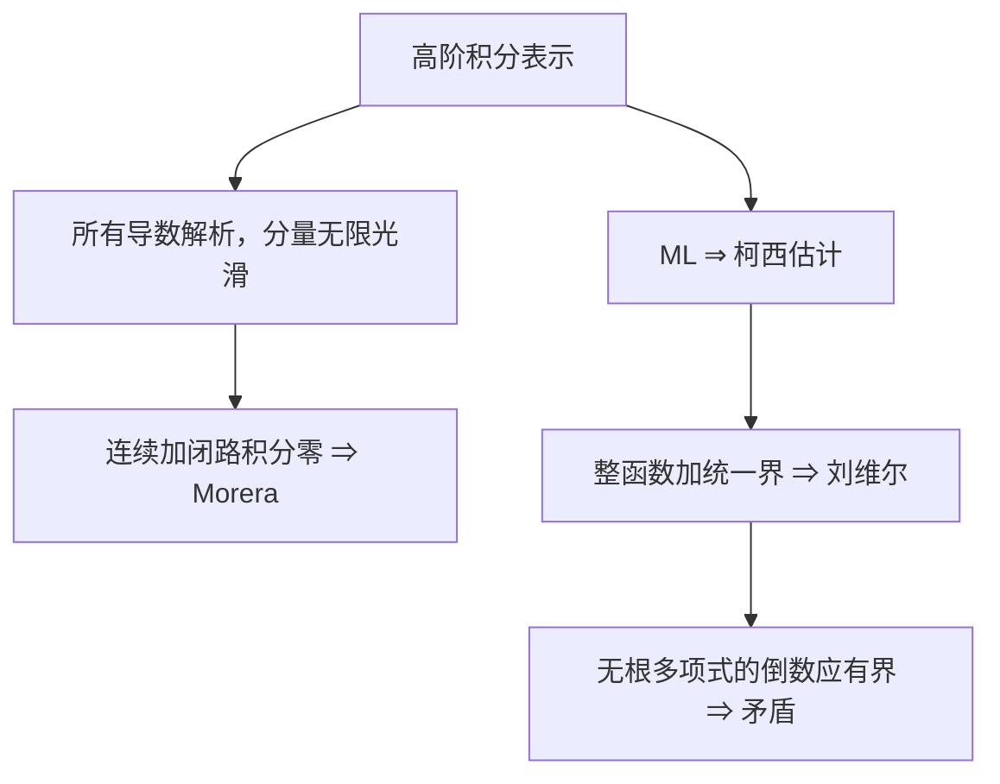

# C4.9 解析性的推论、柯西估计与刘维尔定理

> [!abstract] 这一讲的任务
> 从积分表示推出解析函数的无限光滑性、Morera 逆向判据与柯西估计；再用任意大圆逼出刘维尔定理，并证明复多项式一定有零点。

> [!info] 阅读说明
> 对应 Sec.57–58，PDF 54–59、印刷 pp.168–173。Sec.57 题 1–9 随柯西公式放在上一篇；本篇完成题 10，并把 Sec.59 题 8 的因式分解证明放回代数基本定理。实际课堂覆盖待确认。多项式增长推论为本章工具的教学延伸。

## 0. 开场：每个圆盘上有界，够不够推出常数？

你想证明一个整函数是常数，发现它在每个闭圆盘上连续，当然有界。如果这就能使用刘维尔定理，那么 $f(z)=z$ 也会被判成常数。

症结是每个圆盘的上界可以随半径增长。$f=z$ 在 $|z|\le R$ 的最大模是 $R$，并没有全平面通用的一个有限上界。要看清“统一上界”为什么如此有力，先把圆周上的大小与圆心导数联系起来。

## 57. 解析函数的强正则性

### 57.1 一次解析，为什么任意阶导数也解析

若 $f$ 在 $z_0$ 的邻域解析，选一个闭包仍在邻域里的小圆。上一讲在这个圆的每个内部点都构造出 $f',f'',\ldots$ 的积分表示。因此 $f'$ 在整个小圆盘处处可导，其导数为 $f''$，所以 $f'$ 解析；同理每阶导数都解析。这是关于一个开邻域的判断，不只是“在单个点存在高阶导数”。

写 $f=u+iv$。由 CR 方程，
$$f'=u_x+iv_x=v_y-iu_y.$$
$f'$ 连续，故一阶偏导都连续；继续对解析函数 $f'$ 应用相同结论，得到更高阶偏导。更系统地说，$\partial_xf=f'$、$\partial_yf=if'$，迭代可得
$$\partial_x^p\partial_y^qf=i^qf^{(p+q)}.$$
右侧连续，因此 $u,v$ 有任意阶连续偏导。尤其混合偏导可交换，将 CR 再微分得到
$$u_{xx}+u_{yy}=(v_y)_x-(v_x)_y=0,$$
$v$ 同样满足 Laplace 方程。第二章“解析函数的分量调和”所需的正则性，到这里得到了依据。

### 57.2 Morera 定理：从积分行为判定解析

> [!important] Morera 定理（本章全闭路版本）
> 若 $f$ 在域 $D$ 连续，且对 $D$ 内每条闭围道都有 $\oint_Cf(z)dz=0$，则 $f$ 在 $D$ 解析。

证明分两步：先由 [[C4.5 原函数与路径无关]] 建立解析原函数 $F$，满足 $F'=f$；再用刚证明的“解析函数的导数仍解析”，得到 $f$ 解析。若只说“有原函数，所以被积函数解析”，中间恰好漏了第二步。

这个版本不需要域单连通，因为假设已经直接要求所有闭路为零；在单连通域上，它与柯西积分定理形成正反向关系。更局部的三角形版本可在每个小圆盘构造原函数，但本章此处采用上述原命题。

### 57.3 柯西估计：边界大小限制内部导数

> [!important] Cauchy’s inequality
> 若 $f$ 在闭圆盘 $|z-a|\le R$ 的邻域解析，$M_R=\max_{|z-a|=R}|f(z)|$，则
> $$|f^{(n)}(a)|\le\frac{n!M_R}{R^n},\qquad n=1,2,\ldots.$$

将高阶公式取模：系数为 $n!/(2\pi)$，分母模为 $R^{n+1}$，圆周长为 $2\pi R$，所以
$$|f^{(n)}(a)|\le\frac{n!}{2\pi}\frac{M_R}{R^{n+1}}(2\pi R)=\frac{n!M_R}{R^n}.$$
圆盘必须在解析域内；不能为了让 $R$ 变大而让圆周跨过奇点。$M_R$ 可以随 $R$ 变化，是否能取极限要另外分析。

> [!example] Sec.57 题 10：至多线性增长的整函数
> 已知整函数在全平面满足 $|f(z)|\le A|z|$，$A>0$ 固定，证明 $f(z)=a_1z$。

固定任意中心 $a$，半径 $R$ 圆周上 $|z|\le|a|+R$，故 $M_R\le A(|a|+R)$。对二阶导数，
$$|f''(a)|\le\frac{2A(|a|+R)}{R^2}\to0\qquad(R\to\infty).$$
所以任意点 $f''=0$，$f'$ 为常数，再得 $f=a_1z+a_0$。原上界在 $z=0$ 迫使 $a_0=0$，故为所求形式。不能只证明“至多一次”就忘掉原点条件。

> [!note] 教学延伸：多项式增长
> 若整函数满足 $|f(z)|\le C(1+|z|^m)$，$m$ 为非负整数，固定任意中心并估计 $m+1$ 阶导数，得到
> $$|f^{(m+1)}(a)|\le\frac{(m+1)!C[1+(|a|+R)^m]}{R^{m+1}}\to0.$$
> 因而 $f^{(m+1)}\equiv0$。逐次从最高阶导数积分回去，$f$ 是次数至多 $m$ 的多项式。若没有统一的 $C$，这一论证不成立。

## 58. 刘维尔定理与代数基本定理

### 58.1 统一有界为什么逼出常数

> [!important] 刘维尔定理 Liouville’s theorem
> 若 $f$ 在全平面解析，且存在与 $z$ 无关的有限常数 $M$，使所有 $z$ 都有 $|f(z)|\le M$，则 $f$ 是常数。

固定任意 $a$，整性允许取任意 $R>0$，有界性使所有 $M_R\le M$。柯西一阶估计给
$$|f'(a)|\le\frac{M_R}{R}\le\frac MR.$$
令 $R\to\infty$ 得 $f'(a)=0$，因 $a$ 任意，$f'\equiv0$，全平面连通所以 $f$ 恒定。

三个条件各有作用：$\sin z$ 在实轴有界，却在虚轴按 $\sinh y$ 增长；$1/z$ 在 $|z|>1$ 有界，却不是整函数；$z$ 在每个有限圆盘有界，却没有统一界。都不构成反例，因为各自缺少定理的某个假设。

### 58.2 无零点的多项式倒数为何全平面有界

> [!important] 代数基本定理 Fundamental theorem of algebra
> 任意次数 $n\ge1$、首项系数 $a_n\ne0$ 的复多项式
> $$P(z)=a_0+a_1z+\cdots+a_nz^n$$
> 至少有一个复零点，并可按重数分解为 $P(z)=a_n\prod_{k=1}^n(z-z_k)$。

反证假设 $P$ 处处不为零，则 $1/P$ 是整函数。还差有界性：不能只说“最高次项支配”，需要给出可用的下界。

将其写成
$$P(z)=a_nz^n\left(1+\sum_{k=0}^{n-1}\frac{a_k}{a_nz^{n-k}}\right).$$
有限和中的每项在 $|z|\to\infty$ 时趋零，故可选 $R$，使 $|z|>R$ 时后面和的模小于 $1/2$。于是
$$|P(z)|\ge\tfrac12|a_n||z|^n,\qquad
\left|\frac1{P(z)}\right|\le\frac2{|a_n||z|^n}\le\frac2{|a_n|R^n}.$$
圆盘外已有统一界；闭盘 $|z|\le R$ 内，$1/P$ 连续且分母不为零，由紧性也取得一个有限上界。两界取较大者就是全平面统一界。

刘维尔使 $1/P$ 恒定，从而 $P$ 恒定，与 $n\ge1$ 矛盾。所以必有零点。这一证明需要把圆盘内、外两部分都控制住；只看无穷远处不能排除有限位置的爆炸。

### 58.3 从“至少一个根”走到“按重数恰有 $n$ 个根”

这里用到 Sec.59 题 8。若 $z_0$ 是 $P$ 的零点，对整数 $k\ge2$，
$$z^k-z_0^k=(z-z_0)(z^{k-1}+z^{k-2}z_0+\cdots+z_0^{k-1}).$$
验证方法是乘开右边：相邻的中间项正负抵消，留下首尾 $z^k-z_0^k$；$k=1$ 同样有 $z-z_0$。

所以
$$
P(z)-P(z_0)=\sum_{k=1}^na_k(z^k-z_0^k)
=(z-z_0)\sum_{k=1}^na_k\sum_{j=0}^{k-1}z^{k-1-j}z_0^j.
$$
最后的双重和就是次数 $n-1$、首项系数仍为 $a_n$ 的 $Q(z)$。因 $P(z_0)=0$，有 $P=(z-z_0)Q$。继续对 $Q$ 应用已证的至少一根结论，次数每次下降一，最终得到 $n$ 个一次因子。根可以重复，因此“按重数恰好 $n$ 个”不等于“恰有 $n$ 个不同根”；不同根至多 $n$ 个。

## 这一讲的三句话

1. 高阶积分公式既给导数的值，也证明导数存在、解析并使实虚部分量无限光滑。
2. 刘维尔要一个全平面统一界，不能只知道每个圆盘分别有界。
3. 多项式无根会使倒数成为有界整函数；首项估计与紧盘有界性共同造成矛盾。

| 名称 | 公式或判据 |
|---|---|
| 分量高阶偏导 | $\partial_x^p\partial_y^qf=i^qf^{(p+q)}$ |
| Morera | 连续且所有闭路积分零 $\Rightarrow$ 解析 |
| 柯西估计 | $\lvert f^{(n)}(a)\rvert \le n!M_R/R^n$ |
| 刘维尔 | 整函数且统一有界 $\Rightarrow$ 常数 |
| 多项式分解 | $P(z)=a_n\prod_{k=1}^n(z-z_k)$，重根重复计数 |

> [!tip] 下一讲预告
> 全平面有界会迫使函数恒定。那么只在一个小邻域内，让模在中心取得最大，是否已经足以限制函数？平均值公式将说明内部峰值为何不可能自由出现。

---

[[C4.8 柯西积分公式与高阶导数|上一讲]] ｜ [[C4.10 最大模原理与调和函数的极值|下一讲]] ｜ [[复变函数 MOC|返回课程索引]]
