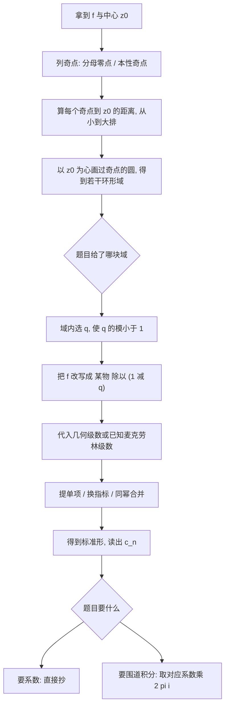

# C5.5 洛朗展开的算法与例题

> [!abstract] 这一讲的任务
> 上一讲（[[C5.4 洛朗定理的证明]]）把洛朗定理证完了：解析函数在环形域里**一定**能展成 $\sum c_n(z-z_0)^n$，而且**只有一种**展开法。定理给的是存在性与唯一性，可它给的系数公式是一个围道积分——真按那个公式做，你得为无穷多个系数各算一个积分。
> 这一讲把定理收起来，换成**算法**：拆成已知的麦克劳林级数、换元、乘除、部分分式，把级数"拼"出来；而展开的中心与环形域，在动笔之前就由**奇点的位置**定死了。
> 这一讲也是全书第一次大规模地**反向**使用系数公式：级数一旦拼出来，围道积分就跟着读出来了。这件事在第 6、7 章会变成主力工具。

> [!note] 授课进度说明
> 截至本次整理，课堂转写稿只覆盖到**第 3 讲**（第一章全部 + 第二章开头：聚点、函数与映射、极限、球极投影）。**第五章（级数）尚未在课堂讲授**，本篇内容全部来自教材（Brown & Churchill 9e, Chap.5 Sec.68, pp.202–208）与标准讲法整理；按本课约定**不逐条标「拓展」**，等后续转写稿到位再统一补标。

> [!info] 这一讲的路线
> ```mermaid
> flowchart TD
>     A["上一讲: 洛朗定理说存在且唯一"] --> B["但系数公式是围道积分, 没人真去积"]
>     B --> C["第一步不是算, 是定位: 找出全部奇点"]
>     C --> D["以 z0 为心画过每个奇点的圆"]
>     D --> E["圆与圆之间就是一格, 每格一个答案"]
>     E --> F["例 1: 奇点 0 与正负 i, 心在 0, 得 0 小于模 z 小于 1"]
>     F --> G["拆成 1 除以 z 乘 1 除以 (1 加 z 平方), 再用已知级数换元"]
>     G --> H["整理成标准形: 提单项, 再换指标"]
>     H --> I["例 2: 同一个函数两个域, 一个用 z 的幂, 一个用 1 除以 z 的幂"]
>     I --> J["例 3: e 的 1 除以 z 次幂, 读出 b1 等于 1, 于是围道积分等于 2 pi i"]
>     J --> K["例 4: 级数已经给好, 系数一眼读出, 不必积分"]
>     K --> L["习题: 十道, 全是换元 / 拆项 / 部分分式 / 平移"]
>     L --> M["z 变换, Bessel 函数, Fourier 级数: 把系数公式搬到圆周上"]
>     M --> N["下一讲: 拼出来就算数, 凭什么"]
> ```

---

## 0. 开场：那个积分，谁也没打算真去算

先把上一讲的结论原样摆出来。$f$ 在环形域 $R_1<|z-z_0|<R_2$ 内解析，则在这块域里

$$f(z)=\sum_{n=-\infty}^{\infty}c_n(z-z_0)^n,\qquad c_n=\frac{1}{2\pi i}\oint_C\frac{f(z)}{(z-z_0)^{n+1}}\,dz\tag{1}$$

其中 $C$ 是夹在 $R_1$ 与 $R_2$ 之间的任一绕 $z_0$ 的正向圆周。

定理说了两件事：**存在**（一定有这样一个级数）、**唯一**（这样的级数只有一个）。它没说**怎么算**。

而 (1) 那个系数公式，真用起来是很别扭的。你试着算一次就知道：例 1 的 $f(z)=\dfrac{1}{z(1+z^2)}$ 在 $0<|z|<1$ 里的 $c_5$，按公式是

$$c_5=\frac{1}{2\pi i}\oint_{|z|=1/2}\frac{dz}{z^{7}(1+z^2)} .$$

这个积分当然算得出来（柯西高阶导数公式、或者先部分分式再逐个套公式），但为了读出一个系数就调一次围道积分，本末倒置；而我们要的是**整条**级数——无穷多个系数。**用 $f$ 的积分去求 $f$ 的级数，逻辑上像是在绕圈，计算上是自找麻烦。**

所以这一讲要建立的是一套**算法**（洛朗级数的定义与负幂项见 [[C5.3 负幂项与洛朗级数]]），它的动作全部发生在"已知的级数"这一侧：把 $f$ 拆成几个已知的麦克劳林级数（$\frac{1}{1-z}$、$e^z$、$\sin z$ 之类），做换元与乘除，拼出未知的那一条。洛朗定理在这套算法里退到幕后，只保留两个用处：

1. **合法性**：它保证你拼出来的东西就是那个**唯一**的洛朗级数。所以你不必回头验算"这级数在域内是否真的收敛到 $f$"——只要每一步都在合法的域内做，答案自动正确（这个"凭什么"下一讲专门交代）。
2. **定位**：它告诉你收敛域长什么样。以 $z_0$ 为心、把 $z_0$ 与各个奇点**分开**的那些圆，就是全部分界线。分界线之间的每一格，对应一个不同的级数。

第二条比看上去重要得多。它意味着：**在动笔之前，你就知道这道题有几个答案、每个答案在哪块域上成立。** 下面四个例子里，有三个的"难点"其实都不在算，而在"选对域"。

这一讲还有另一半内容：把 (1) **反过来**用。级数既然给了、拼出来了，那 (1) 的右端那个积分就等于 $2\pi i$ 乘上对应的系数——于是"算围道积分"变成"读展开系数"。例 3、例 4 和习题 8、9、10 全在做这件事。

---

## 68. 例题 Examples

### 68.1 三步定位，四条动作

洛朗展开的题，做题顺序是固定的三步。

**第一步：定位。** 把 $f$ 的奇点全找出来：分母的零点、$\log$ 的支点、$e^{1/z}$ 那种本性奇点。然后在以 $z_0$（展开中心）为心的圆里，挑出**过奇点**的那几个半径。这些圆把平面切成若干块，每块是一个环形域，每块对应一个答案。

> [!important] 为什么"过奇点的圆"就是全部分界线
> 洛朗定理保证：在**最大的**不含奇点的环形域内可展开，且展开在域内处处有效。反过来，环形域的内边界 $|z-z_0|=R_1$ 上或外侧一旦有奇点，展开就过不去。所以分界线只能落在"奇点到 $z_0$ 的距离"这些数上。设奇点到 $z_0$ 的距离从小到大是 $r_1<r_2<\cdots<r_m$，那么可能的域就是
> $$0<|z-z_0|<r_1,\quad r_1<|z-z_0|<r_2,\ \dots,\ r_m<|z-z_0|<\infty .$$
> 最内那一格如果 $z_0$ 本身不是奇点，就写成 $|z-z_0|<r_1$（是圆盘，不是去心圆盘）。就这么多，不会再有别的。

**第二步：选引擎。** 全部算法的发动机只有一个几何级数

$$\frac{1}{1-q}=\sum_{n=0}^{\infty}q^n\qquad(|q|<1).$$

每一道题都在做同一件事：**把 $f$ 改写成 $\dfrac{\text{某个东西}}{1-q}$ 的形状，而 $q$ 要选得让它在这块域里满足 $|q|<1$。** $q$ 可以是 $z$、$z/2$、$-z^2$、$1/z$、$(z-1)/2$、$2/z$……选哪个，完全由"这块域上什么量的模小于 1"决定。这是本讲唯一需要动脑的地方。

**第三步：整理成标准形。** 把同幂次合并、把指标归一（$\sum_{n\ge1}z^n$ 写成 $\sum_{n\ge0}z^{n+1}$ 之类），让结果长得像 $\sum c_k(z-z_0)^k$。**不整理就无法读系数**，而读系数往往是题目真正的目的。

四条动作，反复用：

| 动作 | 什么时候用 | 典型写法 |
|---|---|---|
| 换元 | 域的中心不是 $0$ | $w=z-z_0$，或 $w=1/z$ |
| 乘除（提单项） | 分母上挂着 $z^k$ 或 $(z-z_0)^k$ | 提出 $\frac{1}{z^k}$，剩下的凑成 $\frac{1}{1-q}$ |
| 部分分式 | 有理函数有多个单极点 | 先拆成 $\frac{A}{z-a}+\frac{B}{z-b}$，每项单独选引擎 |
| 平移 | 展开中心不是原点 | 先把中心搬到原点，域也跟着搬 |

当积木用的六个麦克劳林级数（Sec.64 的 (1)–(6)；$e^z$ 见 [[C3.1 复指数函数]]，$\sin z$、$\cos z$ 见 [[C3.5 三角函数 sin z 与 cos z]]，$\sinh z$、$\cosh z$ 见 [[C3.6 双曲函数]]），必须做到"看见就写、顺手带出收敛域"：

$$\frac{1}{1-z}=\sum_{n=0}^{\infty}z^n\ (|z|<1),\qquad e^z=\sum_{n=0}^{\infty}\frac{z^n}{n!},\qquad \sin z=\sum_{n=0}^{\infty}\frac{(-1)^n z^{2n+1}}{(2n+1)!},$$
$$\cos z=\sum_{n=0}^{\infty}\frac{(-1)^n z^{2n}}{(2n)!},\qquad \sinh z=\sum_{n=0}^{\infty}\frac{z^{2n+1}}{(2n+1)!},\qquad \cosh z=\sum_{n=0}^{\infty}\frac{z^{2n}}{(2n)!}$$

后五个的收敛域都是 $|z|<\infty$（整函数），只有第一个卡在 $|z|<1$——**而恰恰是第一个用得最多**。$90\%$ 的错都出在"忘了第一个只在 $|z|<1$ 有效，却在 $|z|>1$ 的地方用了它"。

> [!warning] 三条最常见的错，先记住
> 1. **域用错**：在 $|z|>1$ 的地方拿 $\frac{1}{1+z}=\sum(-1)^nz^n$ 去算。那条级数在 $|z|>1$ 发散，答案毫无意义。正确做法是提出 $\frac1z$，用 $\frac{1}{1+1/z}$。
> 2. **指标漂移**：把 $\sum_{n\ge0}(-1)^nz^{2n-1}$ 改写成 $\sum_{n\ge1}(-1)^{n-1}z^{2n-1}$ 时，把 $n=0$ 那一项（也就是整个 $\frac1z$）顺手漏掉了。丢的不是小数点后的零头，是一个主部项。这一步一定要"把 $n=0$ 项单独写出来，再换指标"。
> 3. **正负号**：$(-1)^n$ 与 $(-1)^{n+1}$ 之间的翻转，来源只有一处——提出来或除进去的那个 $z$ 的负幂。每翻一次就检查一次。

---

### 68.2 例 1：去心圆盘 $0<|z|<1$

$$f(z)=\frac{1}{z(1+z^2)}=\frac1z\cdot\frac{1}{1+z^2}.$$

**定位。** 分母的零点是 $z=0$ 与 $z=\pm i$（$1+z^2=(z-i)(z+i)$）。以 $0$ 为心、过 $\pm i$ 的圆是 $|z|=1$。所以半径表只有 $r_1=1$ 一个数，域只有两格：含奇点 $0$ 的那格 $0<|z|<1$，与外面那格 $1<|z|<\infty$。题目要的是**含奇点 $0$、避开 $\pm i$ 的最大环形域**——那就是 $0<|z|<1$。

**选引擎。** 在这块域里 $|z|<1$，于是 $|-z^2|=|z|^2<1$。把 $-z^2$ 代进 $\frac{1}{1-q}=\sum q^n$：

$$\frac{1}{1+z^2}=\frac{1}{1-(-z^2)}=\sum_{n=0}^{\infty}(-z^2)^n=\sum_{n=0}^{\infty}(-1)^nz^{2n}\qquad(|z|<1).$$

**乘除。** 两边除以 $z$（$z\ne0$，域已经去心，所以合法）：

$$f(z)=\frac1z\sum_{n=0}^{\infty}(-1)^nz^{2n}=\sum_{n=0}^{\infty}(-1)^nz^{2n-1}\qquad(0<|z|<1).$$

到这里**已经算完了**，但还没整理。写开来看：$n=0$ 那项是 $z^{-1}$，$n=1$ 是 $-z$，$n=2$ 是 $z^3$，$n=3$ 是 $-z^5$……即

$$f(z)=\frac1z-z+z^3-z^5+\cdots$$

**整理成标准形。** 把 $n=0$ 项单独拎出来，剩下的 $\sum_{n\ge1}$ 再令 $n\to n+1$（这样指数从 $2n-1$ 变成 $2n+1$，跑的还是全体正奇数）：

$$f(z)=\frac1z+\sum_{n=1}^{\infty}(-1)^nz^{2n-1}=\frac1z+\sum_{n=0}^{\infty}(-1)^{n+1}z^{2n+1}.$$

> [!important] 标准形与系数
> $$\boxed{\,f(z)=\sum_{n=0}^{\infty}(-1)^{n+1}z^{2n+1}+\frac1z\qquad(0<|z|<1)\,}$$
> 对照 $\sum c_kz^k$ 读系数：$c_{-1}=1$；$c_{2n+1}=(-1)^{n+1}$（$n=0,1,2,\dots$，即 $c_1=-1$、$c_3=1$、$c_5=-1$……）；其余 $c_k=0$。
> 注意 $c_{-3}=c_{-5}=\cdots=0$：主部**只有** $\frac1z$ 一项（$z=0$ 是**单**极点，主部就该只有一项，这是一眼可查的自检）。

**数值核对（一）。** 取 $z=0.5$：直接算 $f=1/(0.5\times1.25)=1.6$。截断：只取 $\frac1z$ 与 $-z$ 得 $1.5$；加到 $z^3$ 得 $1.625$；加到 $z^5$ 得 $1.59375$；加到 $z^7$ 得 $1.6015625$；加到 $z^9$ 得 $1.5996094$。在 $1.6$ 两侧摆动收敛（$|z|=0.5$ 时被舍掉的项是 $O(0.5^{2N})$），与真值一致。

**这个例子最重要的一句在结尾。** 同一个 $f$，在 $1<|z|<\infty$ 里也解析（三个奇点全在 $|z|\le1$ 里），所以那里也有一个洛朗展开——而它长得完全不一样（习题 3 就是它）。两件事要一起记住：

- **同一个函数、不同环形域、不同洛朗级数**。级数不是函数的属性，是"函数 + 域"的属性。
- 例 1 这条级数在 $|z|>1$ 处**发散**。所以千万别拿它去算 $z=2$——那里要用习题 3 的那条。

---

### 68.3 例 2：同一个函数、两个域、两个级数

$$f(z)=\frac{z+1}{z-1}.$$

**定位。** 唯一的奇点是 $z=1$（分母零点）。以 $0$ 为心、过 $1$ 的圆是 $|z|=1$。半径表只有 $r_1=1$，于是两格：

$$D_1:\ |z|<1\qquad\text{与}\qquad D_2:\ 1<|z|<\infty .$$

（这里 $z_0=0$ 不是奇点，所以最内那格是**圆盘** $|z|<1$，不是去心圆盘。）

**$D_1$：用 $z$ 的幂（麦克劳林）。** 在 $|z|<1$ 里 $|z|<1$，引擎取 $q=z$：

$$f(z)=\frac{z+1}{z-1}=-\frac{z+1}{1-z}=-(z+1)\sum_{n=0}^{\infty}z^n=-\sum_{n=0}^{\infty}z^{n+1}-\sum_{n=0}^{\infty}z^n .$$

两个和都换成 $\sum_{n\ge1}$：第一个本来就是 $\sum_{n\ge1}z^n$；第二个提掉 $n=0$ 的 $1$，剩 $\sum_{n\ge1}z^n$。合并：

$$f(z)=-1-2\sum_{n=1}^{\infty}z^n\qquad(|z|<1).$$

写开：$-1-2z-2z^2-2z^3-\cdots$。自检：$f(0)=-1$ ✓（公式的常数项就是 $-1$）。

**$D_2$：用 $1/z$ 的幂。** 在 $|z|>1$ 里 $|1/z|<1$，引擎取 $q=1/z$。先把分子分母同除 $z$：

$$f(z)=\frac{1+\frac1z}{1-\frac1z}=\left(1+\frac1z\right)\sum_{n=0}^{\infty}\frac{1}{z^n}=\sum_{n=0}^{\infty}\frac{1}{z^n}+\sum_{n=0}^{\infty}\frac{1}{z^{n+1}} .$$

第二个和换成 $\sum_{n\ge1}z^{-n}$，与第一个合并：

$$f(z)=1+2\sum_{n=1}^{\infty}\frac{1}{z^n}\qquad(1<|z|<\infty).$$

写开：$1+\frac2z+\frac2{z^2}+\frac2{z^3}+\cdots$。自检：$z\to\infty$ 时 $f\to1$ ✓（公式常数项是 $1$，而 $\lim_{z\to\infty}\frac{z+1}{z-1}=1$）。这条自检很灵：**外域展开的常数项必须等于 $f(\infty)$**。

**两个结果摆在一起看。**

| | 域 | 收敛条件 | 级数 | 常数项 | 用到的引擎 |
|---|---|---|---|---|---|
| $D_1$ | $\lvert z\rvert<1$ | $\lvert z\rvert<1$ | $-1-2\sum_{n\ge1}z^n$ | $-1=f(0)$ | $q=z$ |
| $D_2$ | $1<\lvert z\rvert<\infty$ | $\lvert1/z\rvert<1$ | $1+2\sum_{n\ge1}z^{-n}$ | $1=f(\infty)$ | $q=1/z$ |

两个级数都是 $f$ 的洛朗级数，都正确，但**它们在不同域上有效，而且互相在对方的域上发散**。$D_1$ 那条在 $z=2$ 处发散（通项不趋于零），$D_2$ 那条在 $z=0.5$ 处发散。所以：

> [!important] 这类题的第一步不是算，是判域
> 拿到"求 $f$ 的洛朗展开"，先问：**题目给的是哪块域？** 没给域，就先定位、把所有可能的域列出来，然后一块一块给答案。域决定了引擎，引擎决定了答案。反过来，"这个函数有几个洛朗展开"这个问题，答案是"取决于你问的是哪块域"。

**数值核对（二）。** $z=0.5$：$f(0.5)=\frac{1.5}{-0.5}=-3$。$D_1$ 的级数取 10 项：$-1-2(0.5+0.25+\cdots+0.5^{10})=-2.9980469$，逼近 $-3$ ✓。（$D_2$ 那条在 $z=0.5$ 处通项 $2\cdot0.5^{-n}\to\infty$，发散。）$z=2$：$f(2)=3$。$D_2$ 的级数取 10 项：$1+2(0.5+0.25+\cdots+0.5^{10})=2.9980469$，逼近 $3$ ✓。（$D_1$ 那条在 $z=2$ 处通项 $2\cdot2^n\to\infty$，发散。）

![[C5-洛朗展开的收敛域.png]]

画出来就看清了：以展开中心为心、逐个过奇点画圆，圆与圆之间就是一格；每一格里级数的形状不同，但每一格里的都是**同一个函数**。

---

### 68.4 例 3：$e^{1/z}$，第一次"反向"使用

$$e^z=\sum_{n=0}^{\infty}\frac{z^n}{n!}=1+\frac z{1!}+\frac{z^2}{2!}+\frac{z^3}{3!}+\cdots\qquad(|z|<\infty).$$

**换元。** 这条级数对**一切** $z$ 收敛，所以把 $z$ 换成 $1/z$ 只需 $z\ne0$，没有任何收敛性障碍：

$$e^{1/z}=\sum_{n=0}^{\infty}\frac{1}{n!\,z^n}=1+\frac{1}{1!\,z}+\frac{1}{2!\,z^2}+\frac{1}{3!\,z^3}+\cdots\qquad(0<|z|<\infty).$$

域是**去心平面** $0<|z|<\infty$——因为 $z=0$ 是本性奇点，过不去；而 $\infty$ 那边没有别的奇点。

**读出两件事。**

第一，**正幂系数全为零**：$c_1=c_2=\cdots=0$。这条级数里只有 $z^0,z^{-1},z^{-2},\dots$，也就是说它是"关于 $1/z$ 的一个幂级数"。

> [!note] 为什么正幂项一个都没有（补充）
> 教材只写了一句"正幂的系数为零"。真正的原因藏在换元里：令 $g(w)=f(1/w)=e^{w}$，$g$ 在 $w=0$ 处解析，泰勒系数是 $1/m!$；而 $f$ 关于 $z=0$ 的洛朗系数满足 $c_{-m}=g$ 的第 $m$ 个泰勒系数。所以正幂系数为零与"$g$ 在 $w=0$ 解析"是同一件事。（顺带：$z\to\infty$ 时 $e^{1/z}\to1$，所以 $z=\infty$ 是 $f$ 的**可去**奇点，不是本性奇点——本性奇点在 $z=0$。这两句话别搞混，混了就会推出"正幂系数为零是因为 $\infty$ 是本性奇点"这种错话。）

第二，$b_1=c_{-1}=1$。而由 (1)，

$$b_1=\frac{1}{2\pi i}\oint_C e^{1/z}\,dz,$$

$C$ 是任一绕原点的正向简单闭围道。于是

$$\boxed{\oint_C e^{1/z}\,dz=2\pi i\cdot b_1=2\pi i .}$$

**这一行是这一讲的转折点。** 走到这里，"用洛朗系数算围道积分"这件事第一次露出真面目：围道积分的值，就是展开式里 $1/z$ 那一项的系数乘 $2\pi i$。**注意这个方向**——不是先去算积分再读系数（那是 (1)），而是先有级数、再读系数、顺手把积分写下来。教材在这里明确留了话：这套手法在第 6 章会展开成系统的方法，第 7 章会大规模使用（那就是**留数定理**：$\oint_C f\,dz=2\pi i\sum\operatorname{Res}$，而"$1/(z-z_0)$ 的系数"正是留数的定义）。

**数值核对（三）。** $z=0.5$：$e^{1/z}=e^{2}=7.3890561$；级数取 40 项给 $7.3890561$（一致到机器精度）。围道积分数值：沿 $|z|=1$ 取 $z=e^{i\theta}$，$\oint e^{1/z}dz=\int_{-\pi}^{\pi}e^{e^{-i\theta}}ie^{i\theta}d\theta=6.2831853\,i=2\pi i$（高精度求积，虚部 $6.283185307179586$，实部在 $10^{-48}$ 量级）。

---

### 68.5 例 4：级数已经给好时，系数一眼读出

$$f(z)=\frac{1}{(z-i)^2},\qquad z_0=i .$$

$f$ 在 $z_0=i$ 处是二阶极点，在其余处解析。所以环域只有一格（含奇点 $i$ 的那格）：$0<|z-i|<\infty$。

**这个函数本身就是一条洛朗级数。** 比较 $\sum_{n=-\infty}^{\infty}c_n(z-i)^n$ 与 $\frac{1}{(z-i)^2}$，不需要任何计算：

$$c_{-2}=1,\qquad c_n=0\ (n\ne-2).$$

**反过来读积分。** 由 (1)，$C$ 取任一绕 $i$ 的正向圆周 $|z-i|=R$：

$$c_n=\frac{1}{2\pi i}\oint_C\frac{f(z)}{(z-i)^{n+1}}\,dz=\frac{1}{2\pi i}\oint_C\frac{dz}{(z-i)^{n+3}}\qquad(n=0,\pm1,\pm2,\dots).$$

$c_{-2}=1$、其余为零，于是立刻读出

$$\oint_C\frac{dz}{(z-i)^{n+3}}=\begin{cases}0,& n\ne-2,\\ 2\pi i,& n=-2.\end{cases}$$

（这两个积分以前是**直接算**出来的——Sec.46 习题 13 就是干这个的；现在不用算了，读出来即可。）

> [!warning] 两行并排印，差一个 $2\pi i$，别对上错行
> 上面那个 `cases` 里写的是**积分值**，不是系数。两者的关系是"系数 = 积分值 $\div\,2\pi i$"：
> $$\oint_C\frac{dz}{(z-i)}=2\pi i\ \Longleftrightarrow\ c_{-2}=\frac{1}{2\pi i}\cdot2\pi i=1 .$$
> 也就是说 $c_n=\begin{cases}0,&n\ne-2\\ 1,&n=-2\end{cases}$，而积分值是它的 $2\pi i$ 倍。抄写时最容易把"$2\pi i$"安到 $c_{-2}$ 头上，算成 $c_{-2}=2\pi i$——那是把积分当成了系数。**每次写完都问一句：这个数是系数还是积分？**

**这一例在教什么。** 一道"求洛朗系数"的题，如果函数**已经**是 $(z-z_0)$ 的幂（或幂的组合）的形式，那它就是一个洛朗级数，系数是**看**出来的，不是算出来的。要做的事只有一件：把给定的表达式与 $\sum c_n(z-z_0)^n$ 的形状对上，逐项比对。**这一步没有任何积分。** 反过来说，凡是要你"用系数公式算积分"的题，第一步都应该是"先在奇点附近把被积函数展开"——积分是最后一步，不是第一步。

**数值核对（四）。** 沿 $|z-i|=1$（即 $z=i+e^{i\theta}$）：$n=-2$ 时积分数值 $6.2831853\,i=2\pi i$；$n=-3,-1,0,1$ 时数值 $<10^{-47}$，是零。

---

### 68.6 把四个例子压成一张图



四个例子的"域—引擎—形状"对照，一张表看完：

| 例 | $f(z)$ | 奇点 | 域 | 引擎 | 结果形状 |
|---|---|---|---|---|---|
| 1 | $\dfrac{1}{z(1+z^2)}$ | $0,\ \pm i$ | $0<\lvert z\rvert<1$ | $q=-z^2$ | $\frac1z+\sum_{n\ge0}(-1)^{n+1}z^{2n+1}$ |
| 2 | $\dfrac{z+1}{z-1}$ | $1$ | $\lvert z\rvert<1$ | $q=z$ | $-1-2\sum_{n\ge1}z^n$ |
| 2 | 同上 | $1$ | $1<\lvert z\rvert<\infty$ | $q=1/z$ | $1+2\sum_{n\ge1}z^{-n}$ |
| 3 | $e^{1/z}$ | $0$（本性） | $0<\lvert z\rvert<\infty$ | $q=1/z$（其实是代入整函数级数） | $\sum_{n\ge0}\frac{1}{n!z^n}$ |
| 4 | $\dfrac{1}{(z-i)^2}$ | $i$（二阶） | $0<\lvert z-i\rvert<\infty$ | 无需引擎 | $c_{-2}=1$，其余 $0$ |

> [!question] 停一下，自己回答
> 例 1 的 $f$ 在 $1<|z|<\infty$ 里也解析，为什么例 1 不给你那条级数？
> 因为**题目问的是"在去心圆盘 $0<|z|<1$ 上的展开"**。同一个函数在每一格上一次展开，题目指定哪格就答哪格。如果题目不指定，那就把每一格都写出来（习题 5 就是这种）。

---

## 习题清单（Sec.68, pp.205–208）

这 10 道题紧接在四个例题之后，题干按原文抄录并附中文简述；教材给了答案的照录，其余逐题给解析。全部答案都用 python3 复核过（见每题末尾的数值核对）。

**1. Find the Laurent series that represents the function $f(z)=z^2\sin\left(\dfrac{1}{z^2}\right)$ in the domain $0<|z|<\infty$.** 求 $f(z)=z^2\sin(1/z^2)$ 在 $0<|z|<\infty$ 的洛朗级数。
*Ans.* $1+\displaystyle\sum_{n=1}^{\infty}\frac{(-1)^n}{(2n+1)!}\cdot\frac{1}{z^{4n}}$。

*解析*：引擎是 $\sin$ 的麦克劳林级数，它对一切 $w$ 收敛，所以换元 $w=1/z^2$ 只需 $z\ne0$：
$$\sin\frac{1}{z^2}=\sum_{k=0}^{\infty}\frac{(-1)^k}{(2k+1)!}\left(\frac{1}{z^2}\right)^{2k+1}=\sum_{k=0}^{\infty}\frac{(-1)^k}{(2k+1)!}\,z^{-4k-2}\qquad(z\ne0).$$
两边乘 $z^2$（指数各加 2）：
$$z^2\sin\frac{1}{z^2}=\sum_{k=0}^{\infty}\frac{(-1)^k}{(2k+1)!}\,z^{-4k}.$$
把 $k=0$ 的项 $1$ 提出来、$k\ge1$ 的改记 $n$，就是答案。

**为什么指数是 $-4n$ 而不是 $-2n$**：$\sin$ 的级数只有奇次幂 $w^{2k+1}$，而 $w=z^{-2}$，所以每个 $z$ 的指数是 $-2(2k+1)=-4k-2$，再乘 $z^2$ 得 $-4k$。**最常见的错是漏乘 $z^2$**，写成 $\sum\frac{(-1)^n}{(2n+1)!}z^{-4n-2}$——那样的量级是 $z^{-2}$，而 $f(z)\to1$（$z\to\infty$），一眼不对。

**数值核对**：$z=2$ 时 $f=4\sin(0.25)=0.9896158$；级数取三项 $1-\frac{1}{3!\,16}+\frac{1}{5!\,256}=1-0.01041667+0.00003255=0.9896159$ ✓。级数只出现 $z^0,z^{-4},z^{-8},\dots$，所以 $f$ 在 $0<|z|<\infty$ 的洛朗系数是 $c_0=1$、$c_{-4n}=\frac{(-1)^n}{(2n+1)!}$，其余全零。

---

**2. Find a representation for the function $f(z)=\dfrac{1}{1+z}=\dfrac1z\cdot\dfrac{1}{1+(1/z)}$ in negative powers of $z$ that is valid when $1<|z|<\infty$.** 求 $\frac{1}{1+z}$ 在 $1<|z|<\infty$ 的负幂展开。
*Ans.* $\displaystyle\sum_{n=1}^{\infty}\frac{(-1)^{n+1}}{z^n}$。

*解析*：题目已经把提示写在等号右边了——**提出 $\frac1z$，是为了让括号里那个量在域内模小于 1**。在 $|z|>1$ 里，
$$\left|\frac1z\right|<1\ \Longrightarrow\ \frac{1}{1+1/z}=\sum_{n=0}^{\infty}\left(-\frac1z\right)^n=\sum_{n=0}^{\infty}\frac{(-1)^n}{z^n}.$$
再乘 $\frac1z$：
$$f(z)=\sum_{n=0}^{\infty}\frac{(-1)^n}{z^{n+1}}=\sum_{n=1}^{\infty}\frac{(-1)^{n-1}}{z^n}=\sum_{n=1}^{\infty}\frac{(-1)^{n+1}}{z^n}.$$
最后一步用了 $(-1)^{n-1}=(-1)^{n+1}$（差 $2$ 个负号，等价）。写开就是 $\frac1z-\frac1{z^2}+\frac1{z^3}-\cdots$。

**能读出什么**：没有常数项。这不可能错——$\lim_{z\to\infty}\frac{1}{1+z}=0$，外域展开的常数项必须等于 $f(\infty)=0$ ✓。

这里还有一个容易引起误会的地方：这条级数从 $\frac1z$ 起给了**无穷多**负幂项，可 $f$ 在 $z=0$ 明明只是**单**极点，怎么会有整串负幂？因为"主部项数 = 极点阶数"这条口诀只在**展开中心正好落在那个奇点上、且取的是去心圆盘**时成立。这里中心 $z_0=0$ 是 $f$ 的解析点，而域是 $(1,\infty)$ 这条外环带——它的内边界 $|z|=1$ 恰好擦过奇点 $z=-1$，函数在外域的全部"远场行为"只能靠 $\frac1{z^n}$ 这一族基函数来写，于是负幂无穷多。$z=0$ 附近的展开是另一条（$\frac{1}{1+z}=\sum(-1)^nz^n$，$|z|<1$），那里一项负幂也没有。**同一道题的两个域，一个给负幂、一个给正幂。**

**数值核对**：$z=2$ 时 $f=\frac13=0.3333333$；级数取 6 项 $0.5-0.25+0.125-0.0625+0.03125-0.015625=0.328125$，取 20 项得 $0.3333330$ ✓。

---

**3. Find the Laurent series that represents the function $f(z)$ in Example 1, Sec.68, when $1<|z|<\infty$.** 求例 1 那个函数在 $1<|z|<\infty$ 的洛朗级数。
*Ans.* $\displaystyle\sum_{n=1}^{\infty}\frac{(-1)^{n+1}}{z^{2n+1}}$。

*解析*：函数是 $f(z)=\frac{1}{z(1+z^2)}$。现在域是 $|z|>1$，于是 $\left|\frac{1}{z^2}\right|<1$，该用 $q=-\frac{1}{z^2}$；为了把 $\frac{1}{z^2}$ 凑出来，先提出 $\frac{1}{z^3}$：
$$f(z)=\frac{1}{z(1+z^2)}=\frac{1}{z^3}\cdot\frac{1}{1+\frac{1}{z^2}} .$$
域内 $|1/z^2|=1/|z|^2<1$，于是
$$\frac{1}{1+1/z^2}=\sum_{n=0}^{\infty}\left(-\frac{1}{z^2}\right)^n=\sum_{n=0}^{\infty}\frac{(-1)^n}{z^{2n}},$$
$$f(z)=\sum_{n=0}^{\infty}\frac{(-1)^n}{z^{2n+3}}=\sum_{n=1}^{\infty}\frac{(-1)^{n-1}}{z^{2n+1}}=\sum_{n=1}^{\infty}\frac{(-1)^{n+1}}{z^{2n+1}} .$$
写开：$\frac{1}{z^3}-\frac{1}{z^5}+\frac{1}{z^7}-\cdots$。

**和例 1 摆在一起**：例 1 那条是 $\frac1z+\sum(-1)^{n+1}z^{2n+1}$（$0<|z|<1$，含 $\frac1z$ 与正幂），这条是 $\sum(-1)^{n+1}z^{-(2n+1)}$（$|z|>1$，从 $z^{-3}$ 起）。**同一个函数、同一批奇点，两个域两条级数，连"从 $z$ 的几次幂开始"都不一样。** 另外注意这条里没有 $\frac1z$ 项——外域展开的 $\frac1z$ 项系数为零，等价于 $f(\infty)=\lim_{z\to\infty}\frac{1}{z+z^3}=0$ ✓。

**数值核对**：$z=2+0.5i$。直接算 $f=\frac{1}{z(1+z^2)}=0.0752941-0.0564706\,i$；级数取 400 项给 $0.0752941-0.0564706\,i$ ✓（$|z|=\sqrt{4.25}\approx2.06$，比 $1$ 大，收敛比约 $1/4.25$）。

---

**4. Give two Laurent series expansions in powers of $z$ for the function $f(z)=\dfrac{1}{z^2(1-z)}$, and specify the regions in which those expansions are valid.** 给 $f=\frac{1}{z^2(1-z)}$ 的两个展开并指出各自的域。
*Ans.* $\displaystyle\sum_{n=0}^{\infty}z^n+\frac1z+\frac1{z^2}$（$0<|z|<1$）；$\displaystyle-\sum_{n=3}^{\infty}\frac{1}{z^n}$（$1<|z|<\infty$）。

*解析*：奇点是 $z=0$（二阶极点）与 $z=1$（单极点）。以 $0$ 为心过 $1$ 的圆是 $|z|=1$，于是两格：$0<|z|<1$ 与 $1<|z|<\infty$。（$z=0$ 是奇点，所以内格是去心的。这正是"中心本身是奇点"的处理办法。）

**内格 $0<|z|<1$**：$|z|<1$，引擎取 $q=z$，用 $\frac{1}{1-z}=\sum z^n$，然后**除以** $z^2$（$z\ne0$）：
$$f(z)=\frac{1}{z^2}\cdot\frac{1}{1-z}=\frac{1}{z^2}\sum_{n=0}^{\infty}z^n=\sum_{n=0}^{\infty}z^{n-2}=z^{-2}+z^{-1}+1+z+z^2+\cdots$$
整理成标准形（负幂两项单列，其余合成 $\sum_{n\ge0}z^n$）：
$$f(z)=\sum_{n=0}^{\infty}z^n+\frac1z+\frac1{z^2}\qquad(0<|z|<1).$$
主部只有两项 $\frac{1}{z^2}+\frac1z$：$z=0$ 是**二阶**极点，主部就该有两项 ✓（这是最快的自检）。

**外格 $1<|z|<\infty$**：$|1/z|<1$。要消掉分母上的 $1-z$，提出 $z$：$\frac{1}{z^2(1-z)}=-\frac{1}{z^2(z-1)}=-\frac{1}{z^3}\cdot\frac{1}{1-\frac1z}$，于是
$$f(z)=-\frac{1}{z^3}\sum_{k=0}^{\infty}\frac{1}{z^k}=-\sum_{k=0}^{\infty}\frac{1}{z^{k+3}}=-\sum_{n=3}^{\infty}\frac{1}{z^n}\qquad(1<|z|<\infty).$$
写开：$-\frac1{z^3}-\frac1{z^4}-\frac1{z^5}-\cdots$。

**为什么外格从 $z^{-3}$ 起？** 因为 $z\to\infty$ 时 $f\sim-\frac{1}{z^3}$：令 $w=1/z$，$f(1/w)=\frac{w^2}{1-1/w}=\frac{w^3}{w-1}\sim-w^3$，所以 $z=\infty$ 是 $f$ 的**三阶零点**，外域展开就必然从 $z^{-3}$ 起。**"外格从几次负幂开始"由 $f$ 在 $\infty$ 的零点阶数决定；"内格有几次负幂"由极点的阶数决定。** 这两条一起查，几乎不会错。

**数值核对**：$z=0.5$ 时 $f=\frac{1}{0.25\cdot0.5}=8$，内格级数 $\sum z^n+\frac1z+\frac1{z^2}=2+2+4=8$ ✓（$\sum_{n\ge0}0.5^n=2$）。$z=3$ 时 $f=\frac{1}{9\cdot(-2)}=-0.0555556$，外格级数 $-\sum_{n\ge3}3^{-n}=-\frac{1/27}{1-1/3}=-\frac{1}{18}=-0.0555556$ ✓。

---

**5. The function $f(z)=\dfrac{-1}{(z-1)(z-2)}=\dfrac{1}{z-1}-\dfrac{1}{z-2}$, which has the two singular points $z=1$ and $z=2$, is analytic in the domains $D_1:|z|<1$, $D_2:1<|z|<2$, $D_3:2<|z|<\infty$. Find the series representation in powers of $z$ for $f(z)$ in each of those domains.** 在三个域里分别求 $f$ 关于 $z$ 的幂级数表示。
*Ans.* $D_1$ 中 $\displaystyle\sum_{n=0}^{\infty}\left(2^{-n-1}-1\right)z^n$；$D_2$ 中 $\displaystyle\sum_{n=0}^{\infty}\frac{z^n}{2^{n+1}}+\sum_{n=1}^{\infty}\frac{1}{z^n}$；$D_3$ 中 $\displaystyle\sum_{n=1}^{\infty}\frac{1-2^{n-1}}{z^n}$。

*解析*：**先部分分式**（题目已经拆好了），得到两个只有单极点的项，然后**每一项各自选引擎**。为什么是三个域：以 $0$ 为心、把奇点 $1$ 与 $2$ 分开的圆只有 $|z|=1$ 与 $|z|=2$；半径表是 $1<2$，于是从内到外恰好三格，一格一个答案。$D_1$ 含 $z_0=0$ 而 $0$ 不是奇点，所以是圆盘不是去心圆盘。

**$D_1:|z|<1$。** 第一项取 $q=z$，第二项取 $q=z/2$——在 $|z|<1$ 里 $|z/2|<1$ 当然也成立（而且 $q=z/2$ 的允许范围更宽，直到 $|z|<2$）：
$$\frac{1}{z-1}=-\frac{1}{1-z}=-\sum_{n=0}^{\infty}z^n,\qquad -\frac{1}{z-2}=\frac{1}{2}\cdot\frac{1}{1-\frac z2}=\sum_{n=0}^{\infty}\frac{z^n}{2^{n+1}} .$$
相加：
$$f(z)=\sum_{n=0}^{\infty}\left(\frac{1}{2^{n+1}}-1\right)z^n=\sum_{n=0}^{\infty}\left(2^{-n-1}-1\right)z^n\qquad(|z|<1).$$

> [!warning] 这一题答案最容易抄错的地方：$2^{-n-1}$ 的上标里有负号
> 抄成 $2^{n-1}$ 就整条错了，而且**$n=0$ 时看不出来**（$2^{-1}-1$ 与 $2^{1-1}-1$ 都等于 $-\frac12$，在这一点上分不出对错）。用 $n=1$ 一刀就判死：
> - 正确：$c_1=2^{-2}-1=-\frac34$；
> - 错版：$2^{1-1}-1=0$。
> 而 $c_1=f'(0)$：$f'(z)=-\frac{1}{(z-1)^2}+\frac{1}{(z-2)^2}$，$f'(0)=-1+\frac14=-\frac34$ ✓。**"$n=1$ 对不上"就是判据**，不用算整条级数。（顺带：$f(0)=-\frac12$ 这条自检只能管 $n=0$，管不到 $n=1$——所以必须再查一次 $f'(0)$。两个点都过，整条系数才算真正确认。）

**$D_2:1<|z|<2$。** 这是最见功夫的一格：**同一题里两项用不同的引擎**。因为 $z$ 在 $1$ 与 $2$ 之间，$|z|>1$ 而 $|z|<2$：
$$\frac{1}{z-1}=\frac1z\cdot\frac{1}{1-\frac1z}=\sum_{n=0}^{\infty}\frac{1}{z^{n+1}}=\sum_{n=1}^{\infty}\frac{1}{z^n}\qquad\left(\left|\frac1z\right|<1\right),$$
$$-\frac{1}{z-2}=+\sum_{n=0}^{\infty}\frac{z^n}{2^{n+1}}\qquad\left(\left|\frac z2\right|<1\right).$$
相加即答案。**这一格同时出现正幂与负幂**，是"环形域"这个名字最贴切的例子：两项各自在自己的半径限制下展开，拼起来才是整块域上的级数。

**$D_3:2<|z|<\infty$。** 两项都用 $q=1/z$ 或 $q=2/z$：
$$\frac{1}{z-1}=\sum_{n=1}^{\infty}\frac{1}{z^n},\qquad -\frac{1}{z-2}=-\frac1z\cdot\frac{1}{1-\frac2z}=-\sum_{n=0}^{\infty}\frac{2^n}{z^{n+1}}=-\sum_{n=1}^{\infty}\frac{2^{n-1}}{z^n}.$$
相加：
$$f(z)=\sum_{n=1}^{\infty}\frac{1-2^{n-1}}{z^n}\qquad(2<|z|<\infty).$$
注意 $n=1$ 项系数 $1-2^{0}=0$，所以 $\frac1z$ 项**恰好为零**。这不是巧合：$z\to\infty$ 时 $f\sim-\frac{1}{z^2}$，所以 $f(\infty)=0$、$\frac1z$ 项系数必为 $0$ ✓。这条自检在"中心是奇点"的题里每题都能用，一秒钟判掉一类错。

**数值核对**：$D_1$ 在 $z=0.5$：直接算 $f=-\frac{1}{(-0.5)(-1.5)}=-\frac43=-1.3333333$，级数同值 ✓；$D_1$ 在 $z=-0.4+0.3i$：$-0.2726704$，级数同值。$D_2$ 在 $z=1.5$：$f=-\frac{1}{(0.5)(-0.5)}=4$，级数同值 ✓。$D_3$ 在 $z=3$：$f=-\frac{1}{(2)(1)}=-0.5$，级数同值 ✓。三格都对上了。

![[C5-三个环形域.png]]

三个域就是这么来的：以 $0$ 为心、过两个奇点画两个圆，圆把平面切成三格，一格一条级数。**分几个域、每格用什么引擎，在算之前就已经定完了。**

---

**6. Show that when $0<|z-1|<2$, $\dfrac{z}{(z-1)(z-3)}=-3\displaystyle\sum_{n=0}^{\infty}\frac{(z-1)^n}{2^{n+2}}-\frac{1}{2(z-1)}$.** 证明该展开。

*解析*：**展开中心是 $1$，不是 $0$，所以第一步是平移**。令 $w=z-1$（即 $z=1+w$），域变成 $0<|w|<2$。这个 "$2$" 不是天上掉的：另一个奇点是 $z=3$，到中心的距离是 $|3-1|=2$ ✓。于是 $z-3=w-2$，
$$f=\frac{1+w}{w(w-2)}=-\frac{1+w}{w(2-w)} .$$
在 $|w|<2$ 里 $|w/2|<1$，取 $q=w/2$：
$$\frac{1}{2-w}=\frac12\cdot\frac{1}{1-\frac w2}=\sum_{n=0}^{\infty}\frac{w^n}{2^{n+1}} .$$
代进去，分成"乘 $\frac1w$"和"不乘"两块：
$$f=-\frac1w\sum_{n=0}^{\infty}\frac{w^n}{2^{n+1}}-\sum_{n=0}^{\infty}\frac{w^n}{2^{n+1}} .$$
第一块（把 $w$ 除下去，指数各减 1）：
$$-\frac1w\sum_{n=0}^{\infty}\frac{w^n}{2^{n+1}}=-\sum_{n=0}^{\infty}\frac{w^{n-1}}{2^{n+1}}=-\frac{1}{2w}-\sum_{m=0}^{\infty}\frac{w^m}{2^{m+2}}$$
（$n=0$ 那项是 $-\frac{1}{2w}$，正是主部；$n\ge1$ 改记 $n-1=m$）。第二块：
$$-\sum_{n=0}^{\infty}\frac{w^n}{2^{n+1}}=-\frac12-\sum_{n=1}^{\infty}\frac{w^n}{2^{n+1}} .$$
合并同类项。常数项：$-\frac14-\frac12=-\frac34=-\frac{3}{2^{0+2}}$ ✓。$w^n$（$n\ge1$）的系数：$-\frac{1}{2^{n+2}}-\frac{1}{2^{n+1}}=-\frac{1+2}{2^{n+2}}=-\frac{3}{2^{n+2}}$ ✓。所以
$$f=-\frac{1}{2w}-3\sum_{n=0}^{\infty}\frac{w^n}{2^{n+2}} .$$
换回 $w=z-1$ 即得所证。

**这个答案的两条自检**：(i) 主部只有 $-\frac{1}{2(z-1)}$ 一项——因为 $z=1$ 是**单**极点，主部就该只有一项 ✓；(ii) $f(\infty)$ 那边不用管，因为题目只问 $|z-1|<2$ 这一格。

**数值核对**：$z=1.5$（即 $w=0.5$）。直接算 $f=\frac{1.5}{0.5\times(-1.5)}=-2$。级数这边，先把非负幂那块算清：
$$\sum_{n=0}^{\infty}\frac{0.5^n}{2^{n+2}}=\frac14\sum_{n=0}^{\infty}0.25^n=\frac14\cdot\frac{4}{3}=\frac13,$$
所以级数 $=-3\cdot\frac13-\frac{1}{2\cdot0.5}=-1-1=-2$ ✓。再取一个复点 $w=-0.6+0.4i$（即 $z=0.4+0.4i$，$|w|=0.721<2$）：直接算 $f=0.0133393$，级数也给 $0.0133393$ ✓。

---

**7. (a) Let $a$ denote a real number, where $-1<a<1$, and derive the Laurent series representation $\dfrac{a}{z-a}=\displaystyle\sum_{n=1}^{\infty}\frac{a^n}{z^n}\quad(|a|<|z|<\infty)$. (b) After writing $z=e^{i\theta}$ in the equation obtained in part (a), equate real parts and then imaginary parts on each side of the result to derive the summation formulas $\displaystyle\sum_{n=1}^{\infty}a^n\cos n\theta=\frac{a\cos\theta-a^2}{1-2a\cos\theta+a^2}$ and $\displaystyle\sum_{n=1}^{\infty}a^n\sin n\theta=\frac{a\sin\theta}{1-2a\cos\theta+a^2}$, where $-1<a<1$. (Compare with Exercise 4, Sec.61.)**

*解析 (a)*：域是 $|z|>|a|$，所以 $|a/z|<1$，把分子凑成 $a/z$：
$$\frac{a}{z-a}=\frac{\frac az}{1-\frac az}=\sum_{k=0}^{\infty}\left(\frac az\right)^{k+1}=\sum_{n=1}^{\infty}\frac{a^n}{z^n}\qquad(|a|<|z|<\infty).$$
注意域的左端点是 $|a|$ 而不是 $1$——**这颗"半径"就是奇点 $z=a$ 到中心 $0$ 的距离**，和例 1 的 $|z|=1$ 是同一套定位规则，只不过半径可以是任意正数。

*解析 (b)*：在 (a) 里代 $z=e^{i\theta}$。合法性：$|z|=1>|a|$，因为题设 $-1<a<1$ ✓。左边按 $e^{-in\theta}=\cos n\theta-i\sin n\theta$ 拆开：
$$\sum_{n=1}^{\infty}a^n e^{-in\theta}=\sum_{n=1}^{\infty}a^n\cos n\theta-i\sum_{n=1}^{\infty}a^n\sin n\theta .$$
右边通分（把 $\frac{a}{e^{i\theta}-a}$ 的分子分母同乘 $\overline{e^{i\theta}-a}=e^{-i\theta}-a$），分母变成实数 $|e^{i\theta}-a|^2=1-2a\cos\theta+a^2$：
$$\frac{a}{e^{i\theta}-a}=\frac{a(\cos\theta-a-i\sin\theta)}{(\cos\theta-a)^2+\sin^2\theta}=\frac{a\cos\theta-a^2}{1-2a\cos\theta+a^2}-i\,\frac{a\sin\theta}{1-2a\cos\theta+a^2} .$$
实部对实部、虚部对虚部，就是两个求和公式。**注意虚部那个负号**：左边是 $-i\sum a^n\sin n\theta$，右边是 $-i\frac{a\sin\theta}{1-2a\cos\theta+a^2}$，两边同时约掉 $-i$，所以 $\sum a^n\sin n\theta$ 的右边是**正**的 $\frac{a\sin\theta}{\cdots}$。

**条件 $-1<a<1$ 不是装饰**：它保证 $|a|<1$，即 $z=e^{i\theta}$ 落在域 $|z|>|a|$ 里。若 $|a|>1$，左边 $\sum a^n\cos n\theta$ 直接发散，而右边依然给出一个有限数——**公式的两端就分家了**。

题末标注「对照 Sec.61 习题 4」，这一对照现在能说清了：那一题是把 $z=re^{i\theta}$（$0<r<1$）代进几何级数 $\sum_{n\ge1}z^n=\frac{z}{1-z}$，再分离实部虚部，得到的正是这两条式子（只把 $a$ 换成 $r$）；这一题是把 $z=e^{i\theta}$ 代进洛朗展开 $\sum a^nz^{-n}=\frac{a}{z-a}$，同样分离实部虚部。**同一手法的两次演练：一条从几何级数出发，一条从洛朗展开出发，落点完全相同。** 留意分母 $1-2a\cos\theta+a^2=|e^{i\theta}-a|^2$——这个形状就是 Poisson 核的分母，习题 10 会把它接上。

**数值核对**：$a=0.5$、$\theta=0.7$。$\sum_{n\ge1}a^n\cos n\theta=0.2729444$，公式 $\frac{0.5\cos0.7-0.25}{1-\cos0.7+0.25}=0.2729444$ ✓；$\sum a^n\sin n\theta=0.6639259$，公式给 $0.6639259$ ✓。反向核对：$\frac{a}{e^{i\theta}-a}=0.2729444-0.6639259\,i$，实部虚部正好是上面两个数。再取 $a=1.5$（违规）：右边仍有值（分母 $0.9555$），左边 200 项部分和已经到 $1.6\times10^{35}$——发散，公式作废。

---

**8. Suppose that a series $\displaystyle\sum_{n=-\infty}^{\infty}x[n]z^{-n}$ converges to an analytic function $X(z)$ in some annulus $R_1<|z|<R_2$. That sum $X(z)$ is called the $z$-transform of $x[n]$ $(n=0,\pm1,\pm2,\dots)$. Use expression (5), Sec.66, for the coefficients in a Laurent series to show that if the annulus contains the unit circle $|z|=1$, then the inverse $z$-transform of $X(z)$ can be written $x[n]=\dfrac{1}{2\pi}\displaystyle\int_{-\pi}^{\pi}X(e^{i\theta})e^{in\theta}\,d\theta\quad(n=0,\pm1,\pm2,\dots)$.**

*解析*：这是全节最值得完整写一遍的推导，共有四步，每一步都只做一件事。

**第一步：对齐两条级数。** $X(z)$ 的定义式本身就是一条关于 $z_0=0$ 的洛朗级数，只是幂次写成了 $z^{-n}$：
$$X(z)=\sum_{n=-\infty}^{\infty}x[n]z^{-n}=\sum_{k=-\infty}^{\infty}c_kz^k,\qquad c_k=x[-k]\ \text{（即 } c_{-n}=x[n]\text{）}.$$
把 $z^{-n}$ 的系数认成 $x[n]$，这句话就写成了 $c_k=x[-k]$。**这个"$-$"号是后面符号翻转的唯一来源，盯住它。**

**第二步：套系数公式。** 环域含单位圆，所以 $C$ 取 $|z|=1$ 合法（它整条落在 $R_1<|z|<R_2$ 内）：
$$c_k=\frac{1}{2\pi i}\oint_{|z|=1}\frac{X(z)}{z^{k+1}}\,dz\qquad(k=0,\pm1,\pm2,\dots).$$

**第三步：参数化。** 令 $z=e^{i\theta}$（$-\pi\le\theta\le\pi$），于是 $dz=ie^{i\theta}d\theta$、$z^{-(k+1)}=e^{-i(k+1)\theta}$：
$$c_k=\frac{1}{2\pi i}\int_{-\pi}^{\pi}\frac{X(e^{i\theta})}{e^{i(k+1)\theta}}\,ie^{i\theta}d\theta=\frac{1}{2\pi}\int_{-\pi}^{\pi}X(e^{i\theta})e^{-ik\theta}\,d\theta .$$
（$\frac{i}{2\pi i}=\frac{1}{2\pi}$，这一步别漏。）

**第四步：换回 $x$ 并翻符号。** 由第一步 $x[n]=c_{-n}$，所以
$$x[n]=c_{-n}=\frac{1}{2\pi}\int_{-\pi}^{\pi}X(e^{i\theta})e^{in\theta}\,d\theta .$$
（把 $k=-n$ 代进第三式，$e^{-ik\theta}$ 变成 $e^{in\theta}$。）也可以说成：对 $c_k$ 的结果把指标 $k\to-n$ 改名，指标名可以随便换。$\blacksquare$

> [!important] 符号为什么是 $e^{+in\theta}$
> 因为 $z^{-n}$ 与洛朗级数的 $z^{k}$ 是对**反**的：$c_{-n}=x[n]$。逆变换里的正号不是选的，是被这个倒置逼出来的。最典型的错是写成 $e^{-in\theta}$——那等于把 $x[n]$ 读成了 $x[-n]$，序列被时间反演了。**考场上如果只来得及验一件事，就验这个符号**：拿 $n=1$ 和一个已知的实序列代进去（比如 $x[n]=\delta[n]$，$X\equiv1$，逆变换给 $\frac{1}{2\pi}\int e^{in\theta}d\theta=\delta_{n0}$，$n=1$ 时必须是 $0$）。

**这就是离散时间 LTI 系统的语言。** $x[n]$ 是输入序列，$h[n]$ 是冲激响应，$X(z)$、$H(z)$ 是二者的 $z$ 变换（传递函数），输出 $Y(z)=H(z)X(z)$——**卷积在 $z$ 域变成乘法**，这正是"两个幂级数相乘"在工程里的名字（下一讲把它写成柯西积）。而收敛域（环形域 $R_1<|z|<R_2$）就是系统的稳定性判据：**单位圆落在环域内 $\Longleftrightarrow$ 系统稳定**（因为 $|z|=1$ 上 $X(z)$ 收敛，等于 $\sum|x[n]|$ 收敛，即绝对可和）。教材的脚注指向 Oppenheim、Schafer、Buck 那本信号处理教材，就是为了说明这条来路。

**数值核对**：取 $X(z)=\frac{1}{1-0.5z^{-1}}$，对应 $x[n]=0.5^n$（$n\ge0$）、$x[n]=0$（$n<0$），环域 $|z|>0.5$ 含单位圆。按上面的积分式逐点算：$n=0$ 得 $1.0000000$，$n=1$ 得 $0.5000000$，$n=3$ 得 $0.1250000$，$n=-1$ 得 $-1.1\times10^{-31}$（零）✓。**$n<0$ 那一点最见功力**：积分自动给出零，不用额外规定"因果性"，因果性已经藏在 $X$ 的环域里了。

---

**9. (a) Let $z$ be any complex number, and let $C$ denote the unit circle $w=e^{i\phi}$ $(-\pi\le\phi\le\pi)$ in the $w$ plane. Then use that contour in expression (5), Sec.66, for the coefficients in a Laurent series, adapted to such series about the origin in the $w$ plane, to show that $\exp\left[\dfrac z2\left(w-\dfrac1w\right)\right]=\displaystyle\sum_{n=-\infty}^{\infty}J_n(z)w^n\ (0<|w|<\infty)$, where $J_n(z)=\dfrac{1}{2\pi}\displaystyle\int_{-\pi}^{\pi}\exp[-i(n\phi-z\sin\phi)]\,d\phi$. (b) With the aid of Exercise 5, Sec.42, regarding certain definite integrals of even and odd complex-valued functions of a real variable, show that the coefficients in part (a) here can be written $J_n(z)=\dfrac1\pi\displaystyle\int_0^{\pi}\cos(n\phi-z\sin\phi)\,d\phi\quad(n=0,\pm1,\pm2,\dots)$.**

*解析 (a)*：**把 $z$ 当成常数，$w$ 当成变量。** 对固定的 $z$，$F(w)=\exp\left[\frac z2\left(w-\frac1w\right)\right]$ 在 $0<|w|<\infty$ 内解析（$w=0$ 是本性奇点，因为 $\frac1w$ 在指数上），所以它在 $w=0$ 附近有洛朗展开
$$F(w)=\sum_{n=-\infty}^{\infty}J_n(z)w^n\qquad(0<|w|<\infty),$$
系数由 Sec.66 (5)：
$$J_n(z)=\frac{1}{2\pi i}\oint_C\frac{F(w)}{w^{n+1}}\,dw .$$
在单位圆 $w=e^{i\phi}$ 上取值：$dw=ie^{i\phi}d\phi$，而
$$w-\frac1w=e^{i\phi}-e^{-i\phi}=2i\sin\phi\ \Longrightarrow\ \frac z2\left(w-\frac1w\right)=iz\sin\phi .$$
代进去：
$$J_n(z)=\frac{1}{2\pi i}\int_{-\pi}^{\pi}\frac{\exp[iz\sin\phi]}{e^{i(n+1)\phi}}\,ie^{i\phi}d\phi=\frac{1}{2\pi}\int_{-\pi}^{\pi}\exp[iz\sin\phi]\,e^{-in\phi}d\phi .$$
把两个指数并成一个：
$$J_n(z)=\frac{1}{2\pi}\int_{-\pi}^{\pi}\exp\left[-i(n\phi-z\sin\phi)\right]d\phi .\qquad\blacksquare$$

*解析 (b)*：被积函数 $g(\phi)=\exp[-i(n\phi-z\sin\phi)]$ 可以拆成实部与虚部：
$$g(\phi)=\cos(n\phi-z\sin\phi)-i\sin(n\phi-z\sin\phi).$$
记 $A(\phi)=n\phi-z\sin\phi$。则 $A(-\phi)=-A(\phi)$，所以 $\cos A(\phi)$ 是**偶**函数、$\sin A(\phi)$ 是**奇**函数。由 Sec.42 习题 5（实变量复值函数的积分：奇部的积分为零，见 [[C4.1 实参数复值函数的微积分]]），
$$\int_{-\pi}^{\pi}g(\phi)\,d\phi=\int_{-\pi}^{\pi}\cos(n\phi-z\sin\phi)\,d\phi .$$
右边被积函数是偶函数，故 $\int_{-\pi}^{\pi}=2\int_0^{\pi}$。于是
$$J_n(z)=\frac{1}{2\pi}\cdot2\int_0^{\pi}\cos(n\phi-z\sin\phi)\,d\phi=\frac1\pi\int_0^{\pi}\cos(n\phi-z\sin\phi)\,d\phi .\qquad\blacksquare$$

> [!note] 这两小问的价值，以及一个可用的副产品
> 它把"围道上的系数公式"搬到了**圆周**上：$w=e^{i\phi}$，$dw=ie^{i\phi}d\phi$，围道积分立刻变成一个 $\theta$ 型实积分。**洛朗系数于是有了积分表示。** 这条路第 7 章还会再走（留数定理的各种实积分公式，都是同一招）；而在应用上，$J_n(z)$ 就是第一类 $n$ 阶 **Bessel 函数**，上面那个指数式就是它的**生成函数**（母函数）。
> 顺带一个副产品：把生成函数按 $w$ 乘开，可得 $J_n(z)$ 的显式级数
> $$J_n(z)=\sum_{m=0}^{\infty}\frac{(-1)^m}{m!\,(n+m)!}\left(\frac z2\right)^{n+2m},$$
> 由此立刻看出 $J_{-n}(z)=(-1)^nJ_n(z)$：$n\to-n$ 时级数整体差 $(-1)^n$。

**数值核对**：$z=2.5$。积分式给 $J_0=-0.0483838$、$J_1=0.4970941$、$J_2=0.4460591$，与标准库函数逐位一致 ✓。生成函数按 $w$ 展开取 $w^1$ 系数（用围道积分数值算，沿 $|w|=1$）也给 $0.4970941$ ✓，可见"生成函数的系数 = 积分表示 = $J_n$"三者是同一个数。关于对称性：$J_{-1}=-0.4970941=-J_1$、$J_{-2}=+0.4460591=J_2$ ✓，正是 $J_{-n}=(-1)^nJ_n$。

---

**10. (a) Let $f(z)$ denote a function which is analytic in some annular domain about the origin that includes the unit circle $z=e^{i\phi}$ $(-\pi\le\phi\le\pi)$. By taking that circle as the path of integration in expressions (2) and (3), Sec.66, for the coefficients $a_n$ and $b_n$ in a Laurent series in powers of $z$, show that $f(z)=\dfrac{1}{2\pi}\displaystyle\int_{-\pi}^{\pi}f(e^{i\phi})\,d\phi+\dfrac{1}{2\pi}\sum_{n=1}^{\infty}\displaystyle\int_{-\pi}^{\pi}f(e^{i\phi})\left[\left(\frac{z}{e^{i\phi}}\right)^n+\left(\frac{e^{i\phi}}{z}\right)^n\right]d\phi$ when $z$ is any point in the annular domain. (b) Write $u(\theta)=\operatorname{Re}[f(e^{i\theta})]$ and show how it follows from the expansion in part (a) that $u(\theta)=\dfrac{1}{2\pi}\displaystyle\int_{-\pi}^{\pi}u(\phi)\,d\phi+\dfrac{1}{\pi}\sum_{n=1}^{\infty}\displaystyle\int_{-\pi}^{\pi}u(\phi)\cos n(\theta-\phi)\,d\phi$. This is one form of the Fourier series expansion of the real-valued function $u(\theta)$ on the interval $-\pi\le\theta\le\pi$. The restriction on $u(\theta)$ is more severe than is necessary in order for it to be represented by a Fourier series.**

*解析 (a)*：先用系数公式（$C$ 取单位圆 $z=e^{i\phi}$，$dz=ie^{i\phi}d\phi$）：
$$a_n=\frac{1}{2\pi i}\oint_C\frac{f(z)}{z^{n+1}}dz=\frac{1}{2\pi}\int_{-\pi}^{\pi}f(e^{i\phi})e^{-in\phi}d\phi\qquad(n\ge0),$$
$$b_n=\frac{1}{2\pi i}\oint_C f(z)z^{n-1}dz=\frac{1}{2\pi}\int_{-\pi}^{\pi}f(e^{i\phi})e^{in\phi}d\phi\qquad(n\ge1).$$
代进 $f(z)=\sum_{n\ge0}a_nz^n+\sum_{n\ge1}b_nz^{-n}$：
$$f(z)=\frac{1}{2\pi}\int_{-\pi}^{\pi}f(e^{i\phi})d\phi+\frac{1}{2\pi}\sum_{n=1}^{\infty}\int_{-\pi}^{\pi}f(e^{i\phi})\,e^{-in\phi}z^n\,d\phi+\frac{1}{2\pi}\sum_{n=1}^{\infty}\int_{-\pi}^{\pi}f(e^{i\phi})\,e^{in\phi}z^{-n}\,d\phi .$$
后两个和是**同一个指标 $n$ 的同一个积分**，只是被 $z^n$ 与 $z^{-n}$ 加权，合并成一个和：
$$f(z)=\frac{1}{2\pi}\int_{-\pi}^{\pi}f(e^{i\phi})d\phi+\frac{1}{2\pi}\sum_{n=1}^{\infty}\int_{-\pi}^{\pi}f(e^{i\phi})\left[\left(\frac{z}{e^{i\phi}}\right)^n+\left(\frac{e^{i\phi}}{z}\right)^n\right]d\phi .\qquad\blacksquare$$

**这个式子在说什么**：它是一个**积分表示**，不是幂级数。注意 $z$（环域内任一点）与 $e^{i\phi}$（单位圆上的点）是不同的点，所以 $\left|z/e^{i\phi}\right|$ 与 $\left|e^{i\phi}/z\right|$ 都不必小于 $1$——收敛性靠的是系数 $a_n,b_n$ 的几何衰减，不是靠公比。它其实是柯西积分公式的"把 $\frac{1}{\zeta-z}$ 展开再逐项积分"版本。

*解析 (b)*：在 (a) 中把 $z$ 取成 $z=e^{i\theta}$（单位圆在环域内，合法）。方括号里的两项变成
$$\left(\frac{e^{i\theta}}{e^{i\phi}}\right)^n+\left(\frac{e^{i\phi}}{e^{i\theta}}\right)^n=e^{in(\theta-\phi)}+e^{-in(\theta-\phi)}=2\cos n(\theta-\phi).$$
于是
$$f(e^{i\theta})=\frac{1}{2\pi}\int_{-\pi}^{\pi}f(e^{i\phi})d\phi+\frac{1}{\pi}\sum_{n=1}^{\infty}\int_{-\pi}^{\pi}f(e^{i\phi})\cos n(\theta-\phi)\,d\phi .$$
两边取实部。$\operatorname{Re}f(e^{i\theta})=u(\theta)$、$\operatorname{Re}f(e^{i\phi})=u(\phi)$，而 $\cos n(\theta-\phi)$ 本身就是实的，实部可以搬进积分号（积分是线性组合的极限，实部连续）：
$$u(\theta)=\frac{1}{2\pi}\int_{-\pi}^{\pi}u(\phi)d\phi+\frac{1}{\pi}\sum_{n=1}^{\infty}\int_{-\pi}^{\pi}u(\phi)\cos n(\theta-\phi)\,d\phi .\qquad\blacksquare$$

> [!important] 这就是 Fourier 级数
> 第一项是 $u$ 在圆周上的**均值**，后面的和是"逐次谐波"。把它写成熟悉的形状就明白了：令
> $$a_n=\frac{1}{\pi}\int_{-\pi}^{\pi}u(\phi)\cos n\phi\,d\phi,\qquad b_n=\frac{1}{\pi}\int_{-\pi}^{\pi}u(\phi)\sin n\phi\,d\phi,$$
> 则 $\frac{1}{\pi}\int u(\phi)\cos n(\theta-\phi)d\phi=a_n\cos n\theta+b_n\sin n\theta$，于是 $u(\theta)=\frac{a_0}{2}+\sum_{n\ge1}(a_n\cos n\theta+b_n\sin n\theta)$——标准 Fourier 级数。**把两项合成一项 $\cos n(\theta-\phi)$，是把它写成"核"的形式，方便下一步认出 Poisson 核。**
>
> 那个"限制更严"的说明也值得记：$u$ 是解析函数在单位圆上的实部（即**调和函数**的边值），条件比"能被 Fourier 级数表示"（比如分段光滑）强得多。所以这个结论不是 Fourier 理论的最强形式，只是它在解析函数这一小块上的漂亮特例。

> [!note] 往下一步就是 Poisson 核（补充）
> 若 $f$ 在整个圆盘 $|z|<R$（$R>1$）内解析，则负幂系数 $b_n\equiv0$，(a) 里第二个和的每一项都积成零，整块消失。再把 $z=re^{i\theta}$ 放到圆内（$r<1$）：
> $$f(re^{i\theta})=\frac{1}{2\pi}\int_{-\pi}^{\pi}f(e^{i\phi})d\phi+\frac{1}{2\pi}\sum_{n=1}^{\infty}r^n\int_{-\pi}^{\pi}f(e^{i\phi})e^{in(\theta-\phi)}d\phi .$$
> 因为 $r<1$，被积函数被 $M r^n$ 压住，求和与积分可以交换（绝对且一致收敛），方括号里就出现
> $$1+2\sum_{n=1}^{\infty}r^n\cos n(\theta-\phi)=\frac{1-r^2}{1-2r\cos(\theta-\phi)+r^2},$$
> 右边就是 **Poisson 核**。于是
> $$f(re^{i\theta})=\frac{1}{2\pi}\int_{-\pi}^{\pi}f(e^{i\phi})\frac{1-r^2}{1-2r\cos(\theta-\phi)+r^2}\,d\phi,$$
> 取实部即调和函数的 Poisson 积分公式；$r=0$ 时它退化成**平均值性质** $u(0)=\frac{1}{2\pi}\int u(\phi)d\phi$。习题 7(b) 那个分母 $1-2a\cos\theta+a^2$ 也是同一个核（$a$ 换成 $r$），两条题在这里会合。
> 注意这一版的推导**只用到了 $a_n$ 那一半**，所以它要求 $f$ 在整个圆盘内解析（$b_n\equiv0$）；(a) 的原始版本对环域里任何一点都成立，只是那时不能把方括号当作几何级数去求和。

**这一串式子的工程面貌**：$\frac{1}{2\pi}\int_{-\pi}^{\pi}u(\phi)v(\theta-\phi)d\phi$ 是圆周上的**卷积**；Fourier 级数把圆周卷积变成"逐个谐波相乘"，这正是 (a)(b) 的结构——$f$ 在圆内的值，就是边值 $u$ 与 Poisson 核的圆周卷积。图信号处理里，"圆周"被换成图（顶点集 + 拉普拉斯矩阵），$e^{in\theta}$ 被换成拉普拉斯矩阵的特征向量，卷积定理（图上卷积 = 谱域逐点相乘）与这里逐字同形；离散化之后 $\frac{1}{2\pi}\int$ 变成 $\frac1N\sum$。**所以这一题不是"又一个积分公式"，它是整套傅里叶方法在复分析里的出生地。**

**数值核对**：取 $f(z)=\frac{1}{2-z}$（在 $|z|<2$ 解析，单位圆在内），则 $u(\theta)=\operatorname{Re}f(e^{i\theta})=\frac{2-\cos\theta}{5-4\cos\theta}$。用 (b) 的积分式算 Fourier 系数：$a_1=0.25$、$a_2=0.125$、$a_3=0.0625$，恰好是 $2^{-(n+1)}$ ✓；$b_n$ 全为 $0$（到 $10^{-30}$）✓。用这些系数重建 $u$：$\theta=1$ 时公式给 $0.51419699761$，与 $u(1)=0.514196997609$ 一致 ✓。另外按 (a) 的积分式直接算 $f$ 的 $a_n$（$n=0,1,2,3$）得 $0.5,0.25,0.125,0.0625$，与 $2^{-(n+1)}$ 一致 ✓。

---

## 这一讲的三句话

1. **收敛域由奇点与展开中心共同决定，不是算出来的。** 以 $z_0$ 为心、过每个奇点画圆，圆与圆之间就是一格；$z_0$ 本身是奇点时最内那格是去心圆盘（例 1、习题 4），不是时是圆盘（例 2、习题 5 的 $D_1$）。有几个奇点、几条半径，就有几格、几个答案。
2. **算系数靠拼已知级数，判据只有一条 $|q|<1$。** 换元、提单项、部分分式、平移，四个动作反复用；每个动作之后都要检查"我用的那条麦克劳林级数在这块域上真的收敛吗"。整理成标准形是必须的——不整理就读不出系数。
3. **系数公式的真正用途是反过来的：把围道积分读成展开系数。** 例 3 读出 $\oint e^{1/z}dz=2\pi i$，例 4 读出 $\oint\frac{dz}{(z-i)^{n+3}}$ 的两种值，习题 8 读出逆 $z$ 变换，习题 9、10 把系数公式搬到圆周上、变成 Bessel 函数与 Fourier 级数的积分表示。第 6、7 章的留数定理就是这条路的系统化。

---

## 课堂实录

（待补：本节暂无转写稿。第 4 讲及以后的转写稿到位后补入课堂强调的内容与作业布置。）

---

> [!important] 速查表
> | 内容 | 公式 / 结论 |
> |---|---|
> | 定位规则 | 以 $z_0$ 为心过每个奇点画圆，圆之间一格一答案 |
> | 最内一格 | $z_0$ 是奇点 → $0<\lvert z-z_0\rvert<r_1$；否则 $\lvert z-z_0\rvert<r_1$ |
> | 引擎 | $\frac{1}{1-q}=\sum q^n$，用之前先确认 $\lvert q\rvert<1$ |
> | 六个积木 | $\frac{1}{1-z}$（$\lvert z\rvert<1$）、$e^z$、$\sin z$、$\cos z$、$\sinh z$、$\cosh z$（后五个全平面） |
> | 例 1 | $\frac{1}{z(1+z^2)}=\frac1z+\sum_{n\ge0}(-1)^{n+1}z^{2n+1}$（$0<\lvert z\rvert<1$） |
> | 例 2 | $\frac{z+1}{z-1}=-1-2\sum_{n\ge1}z^n$（$\lvert z\rvert<1$）；$=1+2\sum_{n\ge1}z^{-n}$（$\lvert z\rvert>1$） |
> | 例 3 | $e^{1/z}=\sum_{n\ge0}\frac{1}{n!z^n}$（$0<\lvert z\rvert<\infty$）；$b_1=1\Rightarrow\oint_C e^{1/z}dz=2\pi i$ |
> | 例 4 | $\frac{1}{(z-i)^2}$：$c_{-2}=1$，其余 $0$；$\oint\frac{dz}{(z-i)^{n+3}}=2\pi i\,[n=-2]$ |
> | 习题 2 | $\frac{1}{1+z}=\sum_{n\ge1}\frac{(-1)^{n+1}}{z^n}$（$\lvert z\rvert>1$） |
> | 习题 3 | 例 1 的函数在 $\lvert z\rvert>1$：$\sum_{n\ge1}\frac{(-1)^{n+1}}{z^{2n+1}}$ |
> | 习题 4 | $\frac{1}{z^2(1-z)}=\sum_{n\ge0}z^n+\frac1z+\frac1{z^2}$（$\lvert z\rvert<1$）；$=-\sum_{n\ge3}z^{-n}$（$\lvert z\rvert>1$） |
> | 习题 5 | $\sum(2^{-n-1}-1)z^n$；$\sum\frac{z^n}{2^{n+1}}+\sum\frac1{z^n}$；$\sum\frac{1-2^{n-1}}{z^n}$ |
> | 习题 6 | $\frac{z}{(z-1)(z-3)}=-3\sum_{n\ge0}\frac{(z-1)^n}{2^{n+2}}-\frac{1}{2(z-1)}$（$0<\lvert z-1\rvert<2$） |
> | 习题 7 | $\frac{a}{z-a}=\sum_{n\ge1}\frac{a^n}{z^n}$；$\sum a^n\cos n\theta=\frac{a\cos\theta-a^2}{1-2a\cos\theta+a^2}$，$\sum a^n\sin n\theta=\frac{a\sin\theta}{1-2a\cos\theta+a^2}$ |
> | 习题 8 | $x[n]=\frac{1}{2\pi}\int_{-\pi}^{\pi}X(e^{i\theta})e^{in\theta}d\theta$（符号来自 $c_{-n}=x[n]$） |
> | 习题 9 | 生成函数 $\exp[\frac z2(w-\frac1w)]=\sum J_n(z)w^n$；$J_n=\frac1\pi\int_0^\pi\cos(n\phi-z\sin\phi)d\phi$ |
> | 习题 10 | $u(\theta)=\frac{1}{2\pi}\int u+\frac1\pi\sum_{n\ge1}\int u(\phi)\cos n(\theta-\phi)d\phi$（Fourier 级数） |
> | 两条自检 | 主部项数 = 极点阶数（仅当展开中心正是该极点）；外格起始幂 = $\infty$ 处零点阶数（且常数项 $=f(\infty)$） |
> | 常用数值 | $2\pi=6.2831853$；$e^2=7.3890561$；$2^{-1}-1=-0.5$；$2^{-2}-1=-0.75$；$J_0(2.5)=-0.0483838$；$J_1(2.5)=0.4970941$；$4\sin0.25=0.9896158$ |

> [!abstract] 下一讲预告
> 这一讲从头到尾在做一件事：**拼**。把 $\frac{1}{1+z^2}$ 代换成级数、把 $\frac1z$ 乘进去、把 $n$ 换成 $n+1$——每一小步都合法，但合起来之后，你凭什么断定拼出来的这条级数就是**那个**洛朗级数？如果还有另一条，系数会不会不一样？
> 下一讲证明**唯一性**：同一个环形域上，洛朗展开只有一个。证明的第一句话会让人意外——它把两边都乘上 $(z-z_0)^{-m-1}$ 再逐项积一圈，用到的正是前几讲反复出现的正交性 $\oint(z-z_0)^k dz=0\ (k\ne-1)$。有了唯一性，"拼"才算真正合法。
> 同一讲还要补上两件**幂级数的算术**：两个幂级数怎么相乘（柯西积）、怎么相除（长除法），以及为什么相除之后收敛半径会缩到"商的奇点"为止。
> 下一讲：[[C5.7 展开的唯一性与幂级数的乘除]]。

---

**上一讲**：[[C5.4 洛朗定理的证明]] ｜ **下一讲**：[[C5.6 幂级数的收敛性、连续性与逐项运算]] ｜ **索引**：[[复变函数 MOC]]
