# 复变函数期中复习提纲 (Complex Variables Midterm Review Outline)

> **教材依据**：Brown & Churchill, *Complex Variables and Applications*, 9th Edition (Chapters 1–4, Sec. 1–59)  
> **覆盖范围**：全四章共 32 节完整知识点，穿插第 1–4 章全部作业高频易错点与避坑提示；每个专业术语均附英文对照，文末附全章公式速查、经典反例总表与完整中英术语表。

## 目录 (Table of Contents)

- **第一章 复数 (Complex Numbers)**：1.1 定义与代数运算 · 1.2 向量、模与三角不等式 · 1.3 共轭与模的性质 · 1.4 指数形式、幅角与乘幂 · 1.5 复数的方根 · 1.6 复平面上的区域
- **第二章 解析函数 (Analytic Functions)**：2.1 函数与映射 · 2.2 极限 · 2.3 无穷远点与连续性 · 2.4 导数与求导法则 · 2.5 柯西-黎曼方程 · 2.6 可微充分条件与极坐标形式 · 2.7 解析函数 · 2.8 调和函数 · 2.9 唯一性与反射原理
- **第三章 初等函数 (Elementary Functions)**：3.1 复指数函数 · 3.2 对数函数与主值 · 3.3 对数的分支、导数与恒等式 · 3.4 复幂函数 · 3.5 三角函数 · 3.6 双曲函数 · 3.7 反三角与反双曲函数
- **第四章 复积分 (Integrals)**：4.1 实参数复值函数微积分 · 4.2 围道与复积分定义 · 4.3 参数积分、路径依赖与分支 · 4.4 积分估计与 ML 不等式 · 4.5 原函数与路径无关 · 4.6 柯西-古尔萨定理 · 4.7 单/复连通与路径变形 · 4.8 柯西积分公式与高阶导数 · 4.9 解析性推论、柯西估计与刘维尔定理 · 4.10 最大模原理与调和函数极值
- **考前速查附录**：附录 A 核心公式速查表 · 附录 B 高频经典反例总表 · 附录 C 全提纲中英专业术语对照表

---

## 第一章 复数 (Complex Numbers)

### 1.1 复数的定义与代数运算 (Definition and Algebraic Properties)

#### 数系扩张与历史背景 (Number System Extension & Historical Context)
- **封闭性 (closure)** 驱动数系扩张：$\mathbb{N}\subset\mathbb{Z}\subset\mathbb{Q}\subset\mathbb{R}\subset\mathbb{C}$。在 $\mathbb{R}$ 中开方运算不封闭（$\sqrt{-1}$ 无定义），引入虚数单位 $i$ 后在 $\mathbb{C}$ 中开方封闭。
- **卡尔达诺公式 (Cardano's formula)**：求解缺项三次方程 (depressed cubic) $x^3=3px+2q$ 时出现 $x=\sqrt[3]{q+\sqrt{q^2-p^3}}+\sqrt[3]{q-\sqrt{q^2-p^3}}$。对于 $x^3=15x+4$，实根 $x=4$ 的推导在中间步骤必然出现 $\sqrt{-121}=11\sqrt{-1}$，邦贝利 (Bombelli) 通过 $(2\pm i)^3=2\pm 11i$ 算通了实根——说明复数即使只在中间步骤出现，也能解决实数域内的有效问题。

#### 有序对定义与代数形式 (Ordered Pair Definition & Algebraic Form)
- **复数 (complex number)** 定义为实数的**有序对 (ordered pair)** $z=(x,y)$，对应**复平面 (complex plane)** 上的点 $(x,y)$：
  - **实部 (real part)** $x=\operatorname{Re}z$，**虚部 (imaginary part)** $y=\operatorname{Im}z$（注意 $\operatorname{Im}z$ 是**实数**，不带 $i$）。
  - $(x,0)$ 落在**实轴 (real axis)** 上，通过嵌入 $x\leftrightarrow(x,0)$ 视 $\mathbb{R}\subset\mathbb{C}$。
  - $(0,y)$（$y\neq 0$）落在**虚轴 (imaginary axis)** 上，称为**纯虚数 (pure imaginary number)**。
  - **相等 (equality)**：$(x_1,y_1)=(x_2,y_2)\iff x_1=x_2\text{ 且 }y_1=y_2$（核心原则：**一个复数方程 = 两个实数方程**）。
- **加法与乘法定义**：
  $$(x_1,y_1)+(x_2,y_2)=(x_1+x_2,\;y_1+y_2),\qquad (x_1,y_1)(x_2,y_2)=(x_1x_2-y_1y_2,\;y_1x_2+x_1y_2)$$
- **代数记号 (algebraic notation)**：记**虚数单位 (imaginary unit)** $i=(0,1)$（电气工程与信号处理中常用 $j$ 代替 $i$），则 $(0,y)=(y,0)(0,1)=iy$，于是 $z=x+iy$，且直接验证得定理：
  $$i^2=(0,1)(0,1)=(-1,0)=-1$$
  （用有序对定义避免“先假设存在平方为负的数”的循环论证。）

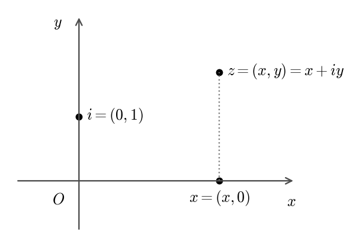

#### 域公理、逆元、除法与二项式定理 (Field Axioms, Inverses, Division & Binomial Formula)
- **域 (field)** 结构 $(\mathbb{C},+,\cdot)$：继承实数的**交换律 (commutative laws)**、**结合律 (associative laws)** 与**分配律 (distributive law)**；具有唯一的**加法单位元 (additive identity)** $0=(0,0)$ 和**乘法单位元 (multiplicative identity)** $1=(1,0)$。
- **加法逆元 (additive inverse)**：$-z=(-x,-y)=-x-iy$，满足 $z+(-z)=0$。
- **乘法逆元 (multiplicative inverse)**：对 $z=(x,y)\neq 0$，由线性方程组 $xu-yv=1,\;yu+xv=0$（系数行列式 $x^2+y^2>0$ 故解唯一）得：
  $$z^{-1}=\left(\frac{x}{x^2+y^2},\;\frac{-y}{x^2+y^2}\right)=\frac{\bar z}{|z|^2}\qquad(z\neq 0)$$
  （$z=0$ 时 $z^{-1}$ 无定义。）
- **无零因子 (no zero divisors)**：$z_1z_2=0\implies z_1=0\text{ 或 }z_2=0$（逆否命题：两非零复数之积非零）。该性质使 $\mathbb{C}$ 成为**整环 (integral domain)**，保证因式分解求根合法。
- **减法与除法 (subtraction and division)**：$z_1-z_2=z_1+(-z_2)$，$z_1/z_2=z_1z_2^{-1}\;(z_2\neq 0)$。实用计算通过分子分母同乘分母共轭实现**分母实数化 (rationalizing the denominator)**：
  $$\frac{z_1}{z_2}=\frac{(x_1+iy_1)(x_2-iy_2)}{x_2^2+y_2^2}$$
  满足 $\frac{z_1+z_2}{z_3}=\frac{z_1}{z_3}+\frac{z_2}{z_3}$、$\frac{1}{z_1}\frac{1}{z_2}=\frac{1}{z_1z_2}$、$\frac{z_1}{z_3}\frac{z_2}{z_4}=\frac{z_1z_2}{z_3z_4}$ 与消去律 $\frac{z_1z}{z_2z}=\frac{z_1}{z_2}$。
- **二项式定理 (binomial formula)**：因复数满足交换律、结合律与分配律，归纳法证明一字不改成立：
  $$(z_1+z_2)^n=\sum_{k=0}^{n}\binom{n}{k}z_1^k z_2^{n-k}\qquad(n=1,2,\dots)$$

---

### 1.2 向量、模与三角不等式 (Vectors, Moduli, and the Triangle Inequality)

#### 向量解释与模 (Vector Interpretation & Modulus)
- **径向量 (radius vector)**：复数 $z=x+iy$ 与从原点指向 $(x,y)$ 的平面**向量 (vector)** 一一对应。复数加法满足**平行四边形法则 (parallelogram law)**。
  - 注意：复数乘法既不是向量点积也不是叉积，而是平面上的“放缩 + 旋转”（见 1.4 节）。
- **模 / 绝对值 (modulus / absolute value)**：$|z|=\sqrt{x^2+y^2}\ge 0$，表示 $z$ 到原点的距离。基本不等式：
  $$|z|^2=(\operatorname{Re}z)^2+(\operatorname{Im}z)^2,\qquad \operatorname{Re}z\le|\operatorname{Re}z|\le|z|,\qquad \operatorname{Im}z\le|\operatorname{Im}z|\le|z|$$
  $$\sqrt{2}\,|z|\ge|\operatorname{Re}z|+|\operatorname{Im}z|\quad\bigl(\text{等价于 }(|x|-|y|)^2\ge 0\bigr)$$
- **无全序性 (no total order)**：$\mathbb{C}$ 上不存在与运算相容的全序关系，$z_1<z_2$ 仅在两者均为实数时有意义；$|z_1|<|z_2|$ 是实数比较，表示 $z_1$ 离原点更近。
- **两点间距离 (distance between two points)**：$|z_1-z_2|=\sqrt{(x_1-x_2)^2+(y_1-y_2)^2}$，向量 $z_1-z_2$ 从 $z_2$ 指向 $z_1$（“减法指向被减数”）。
  - **圆 (circle)**：$|z-z_0|=R$（先整理成减号标准形式再读圆心 $z_0$）。
  - **椭圆 (ellipse)**：$|z-F_1|+|z-F_2|=2a$（如 $|z-4i|+|z+4i|=10$ 为焦点 $\pm 4i$、半长轴 $a=5$ 的椭圆）。
  - **垂直平分线 (perpendicular bisector)**：$|z-z_1|=|z-z_2|$（如 $|z-1|=|z+i|$ 为直线 $y=-x$）。

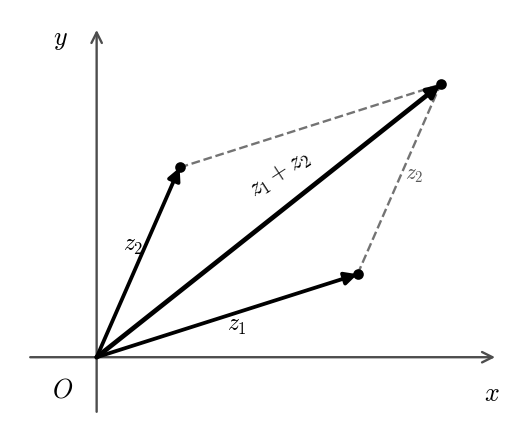

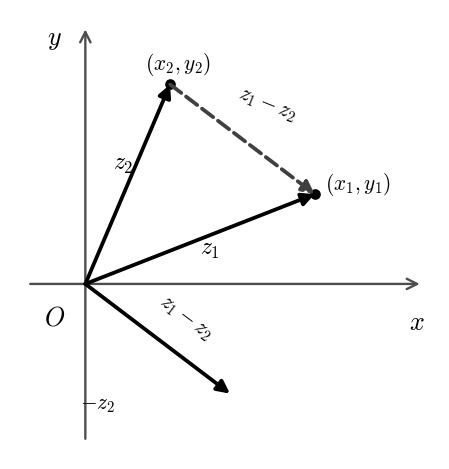

#### 三角不等式及其推广 (Triangle Inequality & Generalizations)
- **三角不等式 (triangle inequality)**：
  $$|z_1+z_2|\le|z_1|+|z_2|,\qquad |z_1-z_2|\le|z_1|+|z_2|$$
  - **取等条件**：$0,z_1,z_2$ **同向共线 (collinear and in the same direction)**（即 $z_2=tz_1,\;t\ge 0$ 或其一为 $0$）。
  - **代数证明骨架**：利用 $|z_1+z_2|^2=(z_1+z_2)(\bar z_1+\bar z_2)=|z_1|^2+2\operatorname{Re}(z_1\bar z_2)+|z_2|^2\le(|z_1|+|z_2|)^2$，再开方。
- **反向三角不等式 (reverse triangle inequality)**：由 $z_1=(z_1+z_2)+(-z_2)$ 推出
  $$|z_1+z_2|\ge\bigl||z_1|-|z_2|\bigr|,\qquad |z_1-z_2|\ge\bigl||z_1|-|z_2|\bigr|$$
- **$n$ 项推广**：由归纳法（把前 $m$ 项打包）得 $|z_1+z_2+\cdots+z_n|\le|z_1|+|z_2|+\cdots+|z_n|$。
- **多项式倒数的有界性 (boundedness of the reciprocal of a polynomial)**（为第 4 章刘维尔定理与代数基本定理铺垫）：
  设 $P(z)=a_0+a_1z+\cdots+a_nz^n\;(a_n\neq 0,\;n\ge 1)$，提取主项写作 $P(z)=(a_n+w)z^n$，其中 $w=\sum_{k=0}^{n-1}a_k/z^{n-k}$。取充分大的 $R>0$ 使 $|z|>R$ 时每项模小于 $\frac{|a_n|}{2n}$（$\varepsilon/n$ 技巧），则 $|w|<\frac{|a_n|}{2}$，由反向三角不等式得 $|a_n+w|>\frac{|a_n|}{2}$，从而：
  $$|P(z)|>\frac{|a_n|}{2}|z|^n>\frac{|a_n|}{2}R^n\implies \left|\frac{1}{P(z)}\right|<\frac{2}{|a_n|R^n}\qquad(|z|>R)$$
  同理可证 $R$ 充分大时 $|P(z)|<2|a_n||z|^n$。

---

### 1.3 共轭复数与模的性质 (Complex Conjugates and Properties of Moduli)

- **共轭复数 (complex conjugate)**：$\bar z=x-iy$，几何上是 $z$ 关于实轴的**反射 (reflection in the real axis)**，属于**保距变换 (isometry)**，满足 $\bar{\bar z}=z$ 与 $|\bar z|=|z|$。

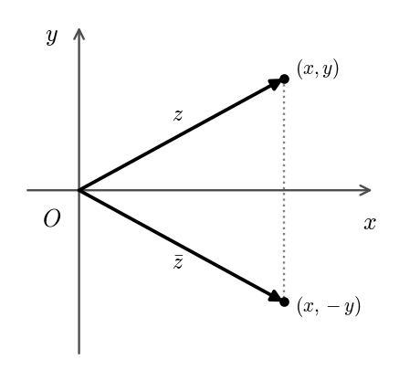

- **共轭保四则运算（域自同构, field automorphism）**：
  $$\overline{z_1\pm z_2}=\bar z_1\pm\bar z_2,\qquad \overline{z_1z_2}=\bar z_1\,\bar z_2,\qquad \overline{\left(\frac{z_1}{z_2}\right)}=\frac{\bar z_1}{\bar z_2}\;(z_2\neq 0)$$
  - **重要推论**：若多项式 $P(z)$ 为**实系数多项式 (polynomial with real coefficients)**，则 $\overline{P(z)}=P(\bar z)$，因此**复根必共轭成对出现**。
  - **实数/纯虚数判据**：$z\in\mathbb{R}\iff \bar z=z$；$z$ 为实数或纯虚数 $\iff \bar z^2=z^2$。
- **用共轭提取实虚部**：
  $$\operatorname{Re}z=\frac{z+\bar z}{2},\qquad \operatorname{Im}z=\frac{z-\bar z}{2i}$$
  （注意虚部分母是 $2i$ 而非 $2$。可用此式将几何方程改写为 $z,\bar z$ 方程，如双曲线 $x^2-y^2=1\iff z^2+\bar z^2=2$，圆 $|z-z_0|=R\iff |z|^2-2\operatorname{Re}(z\bar z_0)+|z_0|^2=R^2$。）
- **核心恒等式与模的乘除律**：
  $$z\bar z=|z|^2,\qquad |z_1z_2|=|z_1||z_2|,\qquad \left|\frac{z_1}{z_2}\right|=\frac{|z_1|}{|z_2|}\;(z_2\neq 0),\qquad |z^n|=|z|^n$$
  - $z\bar z=|z|^2$ 正是分母实数化 $\frac{z_1}{z_2}=\frac{z_1\bar z_2}{|z_2|^2}$ 的根本理由。
  - 证明 $|z_1z_2|=|z_1||z_2|$ 时由 $|z_1z_2|^2=(|z_1||z_2|)^2$ 开方，必须点明**模非负**才能取正号。
  - 结合因式分解与反向三角不等式可快速放缩分式上界（如 $|z|=2$ 时 $|z^4-4z^2+3|=|z^2-1||z^2-3|\ge 3\cdot 1=3$）。

> **【作业高频易错】**（C1 作业 Q2，Sec.6 Ex.7：证 $|z|\le 1$ 时 $|\operatorname{Re}(2+\bar z+z^3)|\le 4$）
> 1. **蕴含方向切勿写反**：不能从待证不等式出发写“$\implies$ 已知条件”，应从已知条件一路放缩到结论（或明确写等价符号 $\iff$）。
> 2. **放缩依据要点名**：从 $|w|\le 1$ 跳到 $-1\le\operatorname{Re}w\le 1$ 必须引用 $|\operatorname{Re}w|\le|w|$；最简路径是直接连用 $|\operatorname{Re}(2+\bar z+z^3)|\le|2+\bar z+z^3|\le 2+|\bar z|+|z|^3\le 4$。

---

### 1.4 指数形式、幅角与乘幂 (Exponential Form, Arguments, and Powers)

#### 极坐标与幅角 (Polar Form & Argument)
- **极坐标形式 (polar form)**：对 $z\neq 0$，取 $r=|z|>0$（复分析中 $r$ 恒非负），$\theta$ 为弧度制，有 $z=r(\cos\theta+i\sin\theta)$（$z=0$ 时幅角无定义）。
- **幅角 (argument)**：$\arg z$ 是所有可能倾角构成的**多值集合**，由 $\tan\theta=y/x$ 及**所在象限**共同确定（编程中对应 `atan2(y,x)` 而非 `arctan(y/x)`）。
- **幅角主值 (principal value of the argument)**：记作 $\Theta=\operatorname{Arg}z$，规定唯一落在**半开区间 (half-open interval)** $(-\pi,\pi]$ 内，于是：
  $$\arg z=\operatorname{Arg}z+2n\pi\qquad(n=0,\pm 1,\pm 2,\dots)$$
  - **关键约定**：负实数的 $\operatorname{Arg}z=\pi$（不是 $-\pi$）。因此 $\operatorname{Arg}z$ 在**负实轴上不连续**（从上方趋近 $\pi$，从下方趋近 $-\pi$，跳跃 $2\pi$），这是第 3 章支割线的源头。

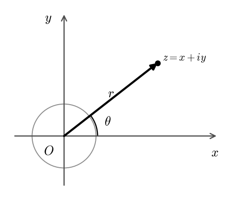

#### 欧拉公式、指数形式与圆的参数表示 (Euler's Formula, Exponential Form & Parametric Circle)
- **欧拉公式 (Euler's formula)** 与**指数形式 (exponential form)**：
  $$e^{i\theta}=\cos\theta+i\sin\theta,\qquad z=re^{i\theta},\qquad |e^{i\theta}|=1,\qquad \overline{e^{i\theta}}=e^{-i\theta}$$
- **圆的参数表示 (parametric representation of a circle)**：以 $z_0$ 为心、$R$ 为半径的圆逆时针 (counterclockwise) 绕行一周的参数方程为：
  $$z=z_0+Re^{i\theta}\qquad(0\le\theta\le 2\pi)$$
  （第 4 章围道积分的核心工具。）

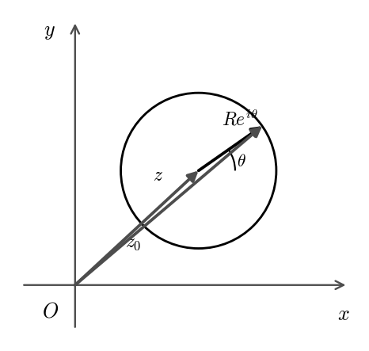

#### 指数形式的乘除、乘幂与棣莫弗公式 (Products, Powers & de Moivre's Formula)
- **加法性质**：$e^{i\theta_1}e^{i\theta_2}=e^{i(\theta_1+\theta_2)}$。
- **乘除与逆**：
  $$z_1z_2=(r_1r_2)e^{i(\theta_1+\theta_2)},\qquad \frac{z_1}{z_2}=\frac{r_1}{r_2}e^{i(\theta_1-\theta_2)},\qquad z^{-1}=\frac{1}{r}e^{-i\theta}$$
  - **几何本质**：乘法 = **模相乘、幅角相加**（相似变换：放缩 + 旋转；乘 $e^{i\alpha}$ 为逆时针旋转 $\alpha$，乘 $i$ 为逆时针旋转 $90^\circ$）。
- **整数次幂**：对一切整数 $n=0,\pm 1,\pm 2,\dots$，$z^n=r^ne^{in\theta}$（负整数次幂定义为 $z^n=(z^{-1})^{-n}=(z^{-n})^{-1}$）。
- **棣莫弗公式 (de Moivre's formula)**（取 $r=1$）：
  $$(\cos\theta+i\sin\theta)^n=\cos n\theta+i\sin n\theta\qquad(n\in\mathbb{Z})$$
  - 结合二项式定理取实部可得**切比雪夫多项式 (Chebyshev polynomials)** $T_n(\cos\theta)=\cos n\theta$；结合等比求和 $1+z+\cdots+z^n=\frac{1-z^{n+1}}{1-z}\;(z\neq 1)$ 令 $z=e^{i\theta}$ 取实部可得**拉格朗日三角恒等式 (Lagrange's trigonometric identity)**：
    $$1+\cos\theta+\cdots+\cos n\theta=\frac{1}{2}+\frac{\sin[(2n+1)\theta/2]}{2\sin(\theta/2)}\qquad(0<\theta<2\pi)$$

#### 乘积与商的幅角 (Arguments of Products and Quotients)
- **集合等式 (set equalities)**：
  $$\arg(z_1z_2)=\arg z_1+\arg z_2,\qquad \arg\left(\frac{z_1}{z_2}\right)=\arg z_1-\arg z_2,\qquad \arg(z^{-1})=-\arg z$$
  正确理解：指定三者中任意两个值，第三个**存在**一个合法值使等式成立（并非任取三值都相等）。
- **主值版本一般不成立**：$\operatorname{Arg}(z_1z_2)\neq\operatorname{Arg}z_1+\operatorname{Arg}z_2$。
  - **反例**：$z_1=-1,\;z_2=i$，则 $\operatorname{Arg}(z_1z_2)=\operatorname{Arg}(-i)=-\frac{\pi}{2}$，而 $\operatorname{Arg}z_1+\operatorname{Arg}z_2=\pi+\frac{\pi}{2}=\frac{3\pi}{2}$（差 $2\pi$）。
  - **安全充分条件**：当 $\operatorname{Re}z_1>0$ 且 $\operatorname{Re}z_2>0$（均在右半平面）时，两主值之和落在 $(-\pi,\pi)$ 内，此时 $\operatorname{Arg}(z_1z_2)=\operatorname{Arg}z_1+\operatorname{Arg}z_2$ 成立。
  - **求主值标准流程**：先用 $\arg$ 算出一个值，再加减 $2\pi$ 的整数倍拉回 $(-\pi,\pi]$（例如 $(\sqrt{3}-i)^6=-64$ 的主幅角是 $\pi$ 而非 $-\pi$）。

---

### 1.5 复数的方根 (Roots of Complex Numbers)

#### $n$ 次方根公式与几何分布 ($n$-th Roots Formula & Geometry)
- **相等判别**：$r_1e^{i\theta_1}=r_2e^{i\theta_2}\iff r_1=r_2\text{ 且 }\theta_1=\theta_2+2k\pi\;(k\in\mathbb{Z})$。幅角的 $2\pi$ 周期被除以 $n$ 后分裂出 $n$ 个互异值。
- **$n$ 次方根公式 ($n$-th roots)**：设 $z_0=r_0e^{i\theta_0}\neq 0$，方程 $z^n=z_0$ 恰有 $n$ 个互异根：
  $$c_k=\sqrt[n]{r_0}\exp\!\left[i\left(\frac{\theta_0}{n}+\frac{2k\pi}{n}\right)\right]\qquad(k=0,1,\dots,n-1)$$
  - 几何上，全部 $n$ 个根等间距 (equally spaced) 分布在圆 $|z|=\sqrt[n]{r_0}$ 上（$n=2$ 为直径两端，$n\ge 3$ 为内接**正 $n$ 边形 (regular $n$-gon)** 的顶点）。
- **符号严格区分与主根 (principal root)**：
  - $\sqrt[n]{r_0}$（$r_0>0$）：唯一的正实数 $n$ 次根。
  - $z_0^{1/n}$：全部 $n$ 个根构成的**集合**。
  - **主根 (principal root)**：在公式中取 $\theta_0=\operatorname{Arg}z_0\in(-\pi,\pi]$ 时对应的 $c_0=\sqrt[n]{r_0}\exp\!\left(i\frac{\operatorname{Arg}z_0}{n}\right)$，**唯一存在**。

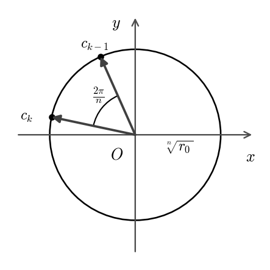

#### 单位根与旋转生成 (Roots of Unity & Rotational Generation)
- **$n$ 次单位根 (n-th roots of unity)**：$1$ 的 $n$ 个方根为 $1,\omega_n,\omega_n^2,\dots,\omega_n^{n-1}$，其中 $\omega_n=\exp\!\left(i\frac{2\pi}{n}\right)$。
  - 性质：$\omega_n^n=1$；若 $c\neq 1$ 为任一 $n$ 次单位根，则 $1+c+c^2+\cdots+c^{n-1}=0$（几何上正 $n$ 边形顶点向量和为零）。
- **由一得全**：$c_k=c_0\omega_n^k\;(k=0,\dots,n-1)$，求出任意一个根后反复乘 $\omega_n$（每次逆时针旋转 $2\pi/n$）即可得全部根。

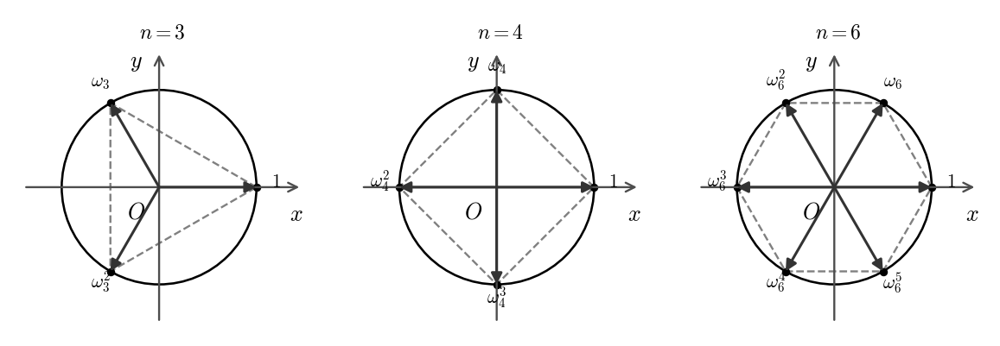

#### 常用计算技巧与推论
- **形式分数指数助记**：把 $z_0=r_0e^{i(\theta_0+2k\pi)}$ 形式地取 $1/n$ 次幂便于记忆公式，但分数指数律在复数中不无条件成立，证明不可直接引用。
- **半角公式化代数形式**：对 $a+i\;(a>0)$，记 $A=\sqrt{a^2+1}$，因 $\alpha=\operatorname{Arg}(a+i)\in(0,\pi)$ 故 $\alpha/2\in(0,\pi/2)$，开方取正号得 $(a+i)^{1/2}=\pm\frac{1}{\sqrt{2}}(\sqrt{A+a}+i\sqrt{A-a})$。
- **复系数二次方程求根公式**：$az^2+bz+c=0\;(a\neq 0)$ 的解为 $z=\dfrac{-b+(b^2-4ac)^{1/2}}{2a}$（不写 $\pm$，因 $(b^2-4ac)^{1/2}$ 本身包含两个平方根）。
- **实系数分解**：先求全部复根再共轭配对相乘（如 $z^4+4=(z^2+2z+2)(z^2-2z+2)$）。
- 负整数次根：$z^{1/n}=(z^{-1})^{1/m}=(z^{1/m})^{-1}\;(m=-n>0)$。

> **【作业高频易错】**（C1 作业 Q5，Sec.11 Ex.3：求 $(-8-8\sqrt{3}i)^{1/4}$ 并指出主根）
> **切勿把全部 4 个根统称为 principal roots**：全部根有 4 个，而**主根 (principal root) 按定义只有一个**，即由 $\operatorname{Arg}z_0=-\frac{2\pi}{3}$ 除以 $4$ 得到的 $c_0=2e^{-i\pi/6}=\sqrt{3}-i$。

---

### 1.6 复平面上的区域 (Regions in the Complex Plane)

#### 邻域与点集分类 (Neighborhoods & Point Classification)
- **$\varepsilon$ 邻域 ($\varepsilon$-neighborhood / open disk)**：$|z-z_0|<\varepsilon$（不含边界圆周）。
- **去心邻域 / 挖点圆盘 (deleted neighborhood / punctured disk)**：$0<|z-z_0|<\varepsilon$（极限、聚点与孤立奇点的技术核心）。
- 对集合 $S$ 与点 $z_0$ 的三分法：
  - **内点 (interior point)**：存在邻域完全含于 $S$。
  - **外点 (exterior point)**：存在邻域完全不含 $S$ 的点。
  - **边界点 (boundary point)**：每个邻域都同时含 $S$ 中的点和不在 $S$ 中的点；全体构成**边界 (boundary)** $\partial S$。

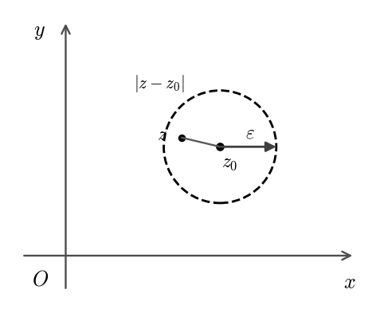

#### 开集、闭集、连通、域与区域 (Open, Closed, Connected, Domain & Region)
- **开集 (open set)**：不含任何边界点（等价于每个点都是内点）。
- **闭集 (closed set)**：包含全部边界点（$\partial S\subset S$）。
- **闭包 (closure)**：$\overline{S}=S\cup\partial S$（包含 $S$ 的最小闭集）。
- **开与闭既不互斥也不穷尽**：
  - **既不开也不闭**：$0<\lvert z\rvert\le 1$；$0\le\arg z\le\pi/4\;(z\neq 0)$（含射线边界点故不开，缺原点故不闭）。
  - **既开又闭**：$\mathbb{C}$ 与 $\varnothing$（无边界点，两条件均空洞成立）。
- **连通 (connected)**：开集 $S$ 中任两点可用完全落在 $S$ 内的有限条首尾相接线段构成的**折线 (polygonal line)** 相连。
  - 环域 (annulus) $1<|z|<2$ 是连通的；两外切开圆盘 $\{|z|<1\}\cup\{|z-2|<1\}$ 因缺切点 $z=1$ 而不连通。
- **域 (domain)** 与 **区域 (region)** 的核心区别：
  - **域 (domain)** = **非空连通开集**（三要素：非空、开、连通，不含任何边界点）。
  - **区域 (region)** = 域加上部分、全部或不加边界点。
- **有界 (bounded)** / **无界 (unbounded)**：存在 $R>0$ 使 $S$ 含于 $|z|\le R$ 内则为有界，否则无界。
- **不等式化几何区域示范**：$\operatorname{Im}(1/z)>1\iff \frac{-y}{x^2+y^2}>1\iff x^2+(y+\frac{1}{2})^2<\frac{1}{4}$（利用 $x^2+y^2>0$ 去分母不变号），为以 $-i/2$ 为心、半径 $1/2$ 的开圆盘（有界域）。

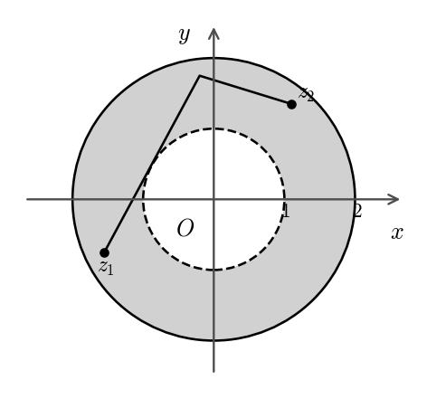

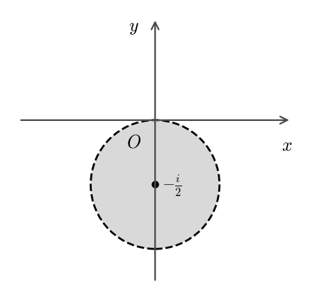

#### 聚点与闭集的等价刻画 (Accumulation Points & Closed Set Characterization)
- **聚点 / 极限点 (accumulation point / limit point)**：$z_0$ 的**每一个去心邻域**都至少含 $S$ 的一个点（与 $z_0\in S$ 无关）。
- **孤立点 (isolated point)**：$z_0\in S$，但存在一个去心邻域与 $S$ 无交。
- **核心辨析（内点、孤立点、边界点 vs 聚点）**：
  - 内点 $\implies$ 必为聚点；
  - 孤立点 $\implies$ 必不为聚点；
  - **边界点不一定是聚点**：反例单点集 $S=\{0\}$，$0$ 是边界点（非去心邻域含 $0$），但任意去心邻域与 $S$ 无交，故不是聚点。根因在于边界点用非去心邻域，聚点用去心邻域。
- **等价定理**：$S$ 是闭集 $\iff S$ 包含其全部聚点；且闭包有两种等价写法 $\overline{S}=S\cup\partial S=S\cup S'$（对 $z_0\notin S$，聚点与边界点完全等价）。
- **常见结论**：域中每一点都是该域的聚点；**有限点集没有聚点**（如 $z_n=i^n$ 只取 4 个值，无聚点）。
- **唯一聚点证明模板**（以 $S=\{i/n:n\ge 1\}$ 为例）：
  1. 证 $0$ 是聚点：任给 $\varepsilon>0$ 取 $n>1/\varepsilon$，则 $0<|i/n-0|<\varepsilon$。
  2. 证 $z_0\neq 0$ 非聚点：将点集一分为二——取 $N$ 使 $1/N<|z_0|/2$，用反向三角不等式将 $n>N$ 的无穷多个点整体推到距离 $>|z_0|/2$ 之外；剩余 $n\le N$ 中剔除可能等于 $z_0$ 的点后，有限个正距离取最小值 $d>0$；取 $0<\varepsilon<\min\{|z_0|/2,\;d\}$ 即可得空去心邻域。

> **【作业高频易错】**（C1 作业 Q7，Sec.12 Ex.7：求 $z_n=i^n/n$ 与 $z_n=(-1)^n(1+i)\frac{n-1}{n}$ 的聚点）
> 1. **必须证唯一性**：对 $i^n/n$，只证 $z_n\to 0$ 只能说明 $0$ 是聚点，必须补充任意 $w\neq 0$ 均非聚点的论证才完整。
> 2. **区分极限 (limit) 与子列极限 (subsequential limit)**：对 $(-1)^n(1+i)\frac{n-1}{n}$，数列本身**极限不存在**，严禁写成 $\lim_{n\to\infty} z_n=\pm(1+i)$！正确写法是分奇偶子列 $z_{2m}\to 1+i$、$z_{2m+1}\to -(1+i)$，再说明无其他聚点。

---

## 第二章 解析函数 (Analytic Functions)

### 2.1 函数与映射 (Functions and Mappings)

#### 基本定义与分量分解 (Definitions & Component Decomposition)
- **复变函数 (function of a complex variable)**：由**定义域 (domain of definition)** $S$ 和对应**规则 (rule)** 两部分共同决定，缺一不可（同一规则配不同定义域是不同函数；未声明时默认取最大定义域）。
  - **术语辨析**：函数的“定义域 (domain of definition)”可以是任意点集（闭集、线段均可），而 1.6 节的拓扑“域 (domain)”必须是**非空连通开集**。
  - **陪域 (codomain)** $T$ 与**值域 (range)** $f(S)$：严格写 $f:S\to T$ 且 $f(S)\subseteq T$（教材常宽松写 $T=\mathbb{C}$）。
- **分量分解 (component decomposition)**：将复函数拆为一对二元实函数（**实部函数**与**虚部函数**，合称**分量函数 component functions**）：
  - 直角坐标形式：$f(z)=u(x,y)+iv(x,y)$。
  - 极坐标形式：$f(z)=u(r,\theta)+iv(r,\theta)$（注意 $u(x,y)$ 与 $u(r,\theta)$ 接受不同自变量，偏导 $u_x$ 与 $u_r$ 完全不同）。
- **基本初等类别**：**多项式 (polynomial)** $P(z)=\sum_{k=0}^{n}a_kz^k$（有限项，定义于全平面）；**有理函数 (rational function)** $P(z)/Q(z)$（定义于 $Q(z)\neq 0$）；**实值复变函数 (real-valued function of a complex variable)** 如 $f(z)=|z|^2=x^2+y^2+i0$。
- **多值函数 (multiple-valued function)** 与**取分支 (branch)**：一个 $z$ 对应多个值时，系统地每点挑一个值构成单值函数。例如 $z^{1/2}$ 的**主分支 (principal branch)**：
  $$f(z)=\sqrt{r}\exp\!\left(i\frac{\Theta}{2}\right)\qquad(r>0,\;-\pi<\Theta\le\pi),\quad f(0)=0$$
  因 $\Theta=\operatorname{Arg}z$ 在负实轴跳跃 $2\pi$，该分支在负实轴不连续（上方趋于 $+i$，下方趋于 $-i$），该断裂射线称为**支割线 (branch cut)**。

#### 映射观点与典型映射 (Mapping Viewpoint & Key Mappings)
- **映射 / 变换 (mapping / transformation)**：因复函数图像在四维空间无法画出，故将 $z$ 平面与 $w$ 平面分开绘制，追踪点、曲线与区域的对应关系。
  - **像 (image)** $w=f(z)$；集合 $T$ 的像 $f(T)$；**原像 (inverse image)** $f^{-1}(\{w\})$ 是一个**集合**（可以为空、单点或多点，一般不是函数，例如 $w=z^2$ 时 $w=1$ 的原像为 $\{1,-1\}$）。
  - 另一种几何解释是**向量场 (vector field)**：在每点 $z$ 处附着向量 $(u,v)$。
- **三种基本刚体/相似映射**：
  - **平移 (translation)**：$w=z+b$；
  - **旋转 (rotation)**：$w=iz$（逆时针转 $90^\circ$），一般线性变换 $w=az+b\;(a\neq 0)$ 为放缩 $|a|$ + 旋转 $\arg a$ + 平移 $b$；
  - **反射 (reflection)**：$w=\bar z$（关于实轴翻折，**反转定向 orientation-reversing**，这是其处处不可导的几何根源）。
- **完整范例：$w=z^2$**：
  - **笛卡尔视角**：$u=x^2-y^2,\;v=2xy$。双曲线 $x^2-y^2=c_1\;(c_1>0)$ 的每一支一对一映成竖直线 $u=c_1$（右支向上对应像向上，**左支向下**才对应像向上，**定向反转**；且像点沿直线**不匀速**）；双曲线 $2xy=c_2\;(c_2>0)$ 的每一支映成水平线 $v=c_2$。区域 $x>0,y>0,xy<1$（注意 $v=2xy<2$）映成水平带 $0<v<2$，闭区域映成闭带 $0\le v\le 2$。
  - **极坐标视角**：$\rho=r^2,\;\phi=2\theta$（模平方、幅角加倍）。第一象限 $r\ge 0,0\le\theta\le\pi/2$ **一对一**映成上半平面 $\rho\ge 0,0\le\phi\le\pi$（正实轴 $\to$ 正实轴，正虚轴 $\to$ 负实轴）；但上半平面 $0\le\theta\le\pi$ 映成全平面时**非一对一**（正负实轴均映到正实轴）。
- **推广 $w=z^n\;(n>2)$**：全平面到全平面的 $n$ 对一映射（每个非零 $w$ 恰有 $n$ 个原像，即 $n$ 次方根）；圆 $r=r_0\mapsto$ 圆 $\rho=r_0^n$；扇形 $r\le r_0,0\le\theta\le 2\pi/n$ 映成圆盘 $\rho\le r_0^n$ 但边界处非一对一。
- **儒可夫斯基变换 (Joukowski transformation)**：$f(z)=z+1/z=(r+\frac{1}{r})\cos\theta+i(r-\frac{1}{r})\sin\theta\;(z\neq 0)$。

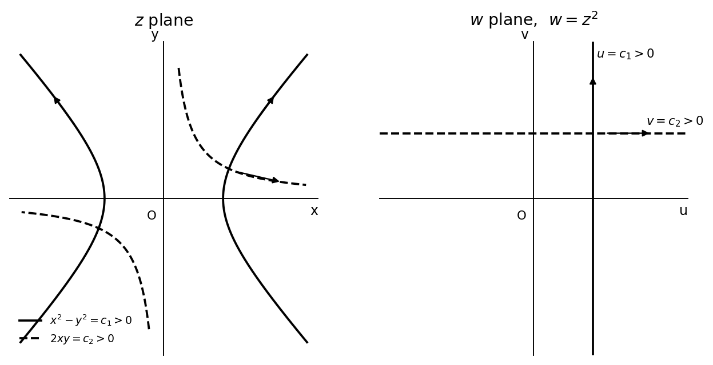

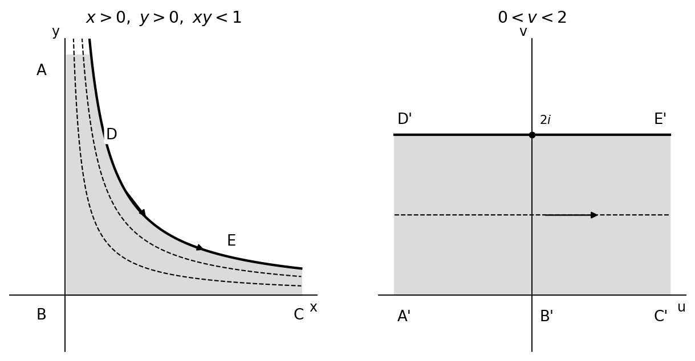

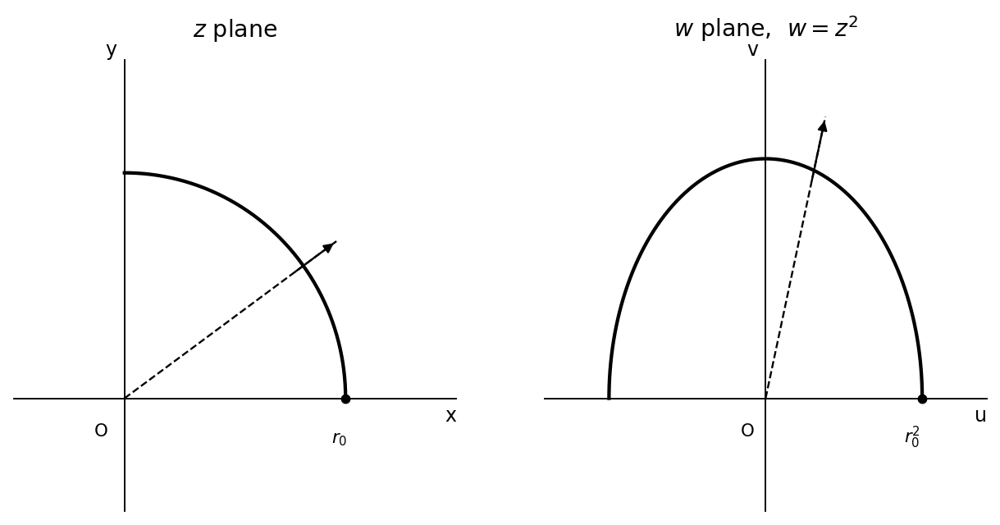

---

### 2.2 极限 (Limits)

#### $\varepsilon$–$\delta$ 定义、唯一性与路径任意性 ($\varepsilon$–$\delta$ Definition, Uniqueness & Path Independence)
- **极限 (limit)**：设 $f$ 在 $z_0$ 的某**去心邻域 (deleted neighborhood)** 内有定义。$\lim_{z\to z_0}f(z)=w_0$ 指：
  $$\forall\,\varepsilon>0,\;\exists\,\delta>0:\quad 0<|z-z_0|<\delta\implies|f(z)-w_0|<\varepsilon$$
  - 与 $f(z_0)$ 是否有定义、取何值完全无关；$\delta$ 可依赖 $\varepsilon$ 与 $z_0$，但不能依赖 $z$。
  - **边界点约定**：若 $f$ 仅定义在区域 $R$ 上且 $z_0\in\partial R$，则只要求同时落在 $R$ 与去心邻域内的 $z$ 满足不等式（例：$f(z)=\frac{i\bar z}{2}$ 在 $|z|<1$ 上，$\lim_{z\to 1}f(z)=\frac{i}{2}$，取 $\delta=2\varepsilon$）。
- **极限唯一性 (uniqueness of limits)**：若极限存在必唯一（证明：对两极限 $w_0,w_1$ 取 $\delta=\min(\delta_0,\delta_1)$，由三角不等式得 $|w_1-w_0|\le|f(z)-w_0|+|f(z)-w_1|<2\varepsilon$，因左端为非负定值故 $w_1=w_0$）。
- **路径任意性 (path independence)**：$z\to z_0$ 必须沿**一切路径与方向**得到同一极限。
  - **证伪利器（两条路径不同值 $\implies$ 极限不存在）**：
    - $f(z)=\dfrac{z}{\bar z}=e^{i2\theta}$（或 $\dfrac{\bar z}{z}$）在 $z\to 0$ 时沿实轴得 $+1$、沿虚轴得 $-1$，故极限不存在。
    - **陷阱反例**：$f(z)=\left(\dfrac{z}{\bar z}\right)^2=e^{i4\theta}$ 沿实轴与虚轴均得 $+1$，但沿 $y=x$ 得 $-1$，故极限仍不存在（有限条路一致不能证明极限存在！）。
    - **对比**：$\lim_{z\to 0}\dfrac{\bar z^2}{z}=0$，因 $\left|\dfrac{\bar z^2}{z}\right|=|z|\to 0$。

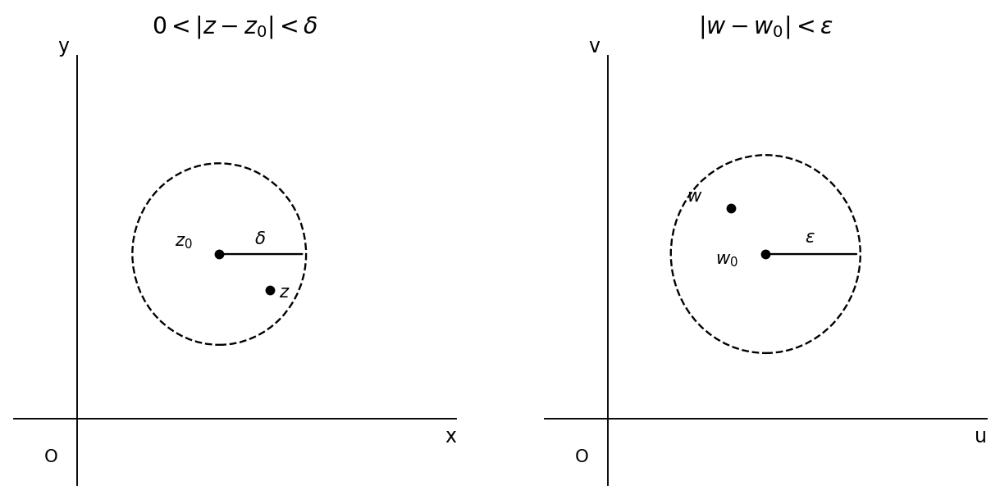

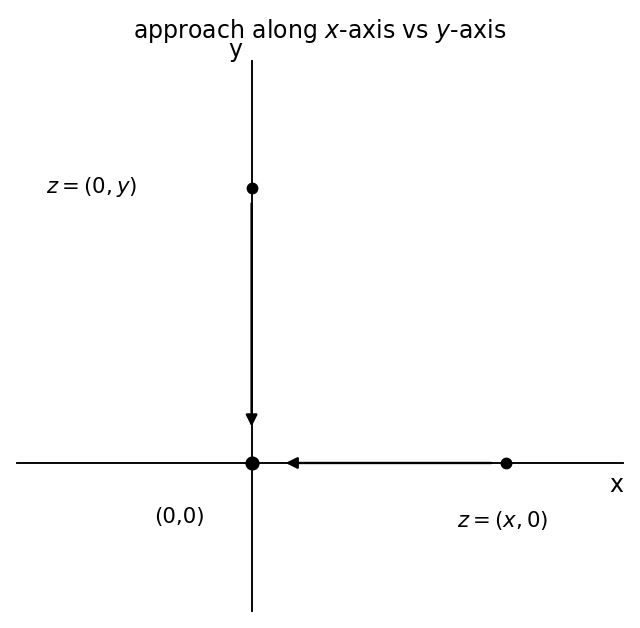

#### 极限定理 (Theorems on Limits)
- **定理 1（分量分解定理）**：设 $f=u+iv,\;z_0=x_0+iy_0,\;w_0=u_0+iv_0$，则
  $$\lim_{z\to z_0}f(z)=w_0\iff \lim_{(x,y)\to(x_0,y_0)}u(x,y)=u_0\;\text{ 且 }\;\lim_{(x,y)\to(x_0,y_0)}v(x,y)=v_0$$
  （把复极限完全归约到二元实极限。）
- **定理 2（四则运算）**：若 $\lim f=w_0,\;\lim F=W_0$，则和、积的极限分别为 $w_0+W_0$、$w_0W_0$；当 $W_0\neq 0$ 时商的极限为 $w_0/W_0$。
- **常用结论**：
  - $\lim c=c$，$\lim z=z_0$，$\lim z^n=z_0^n$，**多项式** $\lim_{z\to z_0}P(z)=P(z_0)$，有理函数在 $Q(z_0)\neq 0$ 时直接代入；可去因子先约分（如 $\lim_{z\to i}\frac{z^2+1}{z-i}=\lim_{z\to i}(z+i)=2i$）。
  - $\lim f=w_0\implies\lim|f|=|w_0|$（由反向三角不等式）。
  - 变量替换：$\lim_{z\to z_0}f(z)=w_0\iff\lim_{\Delta z\to 0}f(z_0+\Delta z)=w_0$。
  - **无穷小 $\times$ 有界 = 无穷小**：若 $\lim_{z\to z_0}f(z)=0$ 且在某邻域内 $|g(z)|\le M$，则 $\lim_{z\to z_0}f(z)g(z)=0$（不要求 $g$ 有极限）。

> **【作业高频易错】**（C2 作业 HW3，Sec.20 Ex.9：证明无穷小 $\times$ 有界 $=0$）
> $\varepsilon$–$\delta$ 证明的**量词顺序不能反**：必须先任给 $\varepsilon>0$，再由给定的 $\varepsilon$ 定出 $\varepsilon_1=\varepsilon/M$ 来找 $\delta_1$（使 $|f|<\varepsilon/M$），取 $\delta=\min(\delta_1,\delta_2)$，从而 $|fg|\le M\cdot\frac{\varepsilon}{M}=\varepsilon$。

---

### 2.3 无穷远点与连续性 (Limits Involving the Point at Infinity & Continuity)

#### 扩充复平面与黎曼球 (Extended Complex Plane & Riemann Sphere)
- **扩充复平面 (extended complex plane)** $\mathbb{C}\cup\{\infty\}$：添加**唯一一个无穷远点 (point at infinity)** $\infty$（不是按方向分出的多个点）。
- **黎曼球 (Riemann sphere)** 与**球极投影 (stereographic projection)**：单位球赤道与复平面单位圆重合，北极 $N=(0,0,1)$ 对应 $\infty$；过 $N$ 与 $z$ 的直线交球面于唯一点 $P$（$|z|<1$ 对应下半球，$|z|=1$ 对应赤道，$|z|>1$ 对应上半球）。球极投影保角，且将平面上的圆与直线统一映为球面上的圆（直线即过北极的圆）。
- **$\infty$ 的 $\varepsilon$ 邻域**：$\{z:|z|>1/\varepsilon\}$（取倒数使 $\varepsilon$ 越小邻域越小）。集合 $S$ 无界 $\iff$ $\infty$ 的每个邻域都含 $S$ 的点（$\infty$ 是无界集的聚点）。
- **三条换算定理**（严禁直接做 $\infty/\infty$ 等四则运算，一律代换 $z\mapsto 1/z$）：
  $$\lim_{z\to z_0}f(z)=\infty\iff\lim_{z\to z_0}\frac{1}{f(z)}=0$$
  $$\lim_{z\to\infty}f(z)=w_0\iff\lim_{z\to 0}f\!\left(\frac{1}{z}\right)=w_0$$
  $$\lim_{z\to\infty}f(z)=\infty\iff\lim_{z\to 0}\frac{1}{f(1/z)}=0$$
  - **分式线性变换 / 莫比乌斯变换 (linear fractional / Möbius transformation)** $T(z)=\frac{az+b}{cz+d}\;(ad-bc\neq 0)$：$c=0$ 时 $\lim_{z\to\infty}T=\infty$；$c\neq 0$ 时 $\lim_{z\to\infty}T=a/c$ 且 $\lim_{z\to -d/c}T=\infty$。

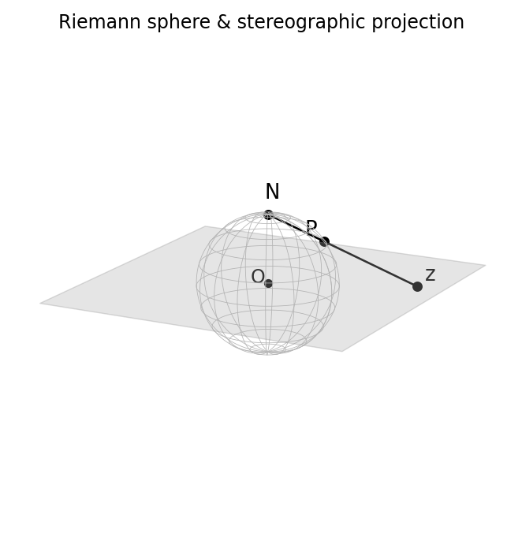

#### 连续性 (Continuity)
- **连续 (continuous)**：$f$ 在 $z_0$ 连续 $\iff \lim_{z\to z_0}f(z)=f(z_0)$（隐含极限存在、$f(z_0)$ 存在且相等）。$\varepsilon$–$\delta$ 形式为 $|z-z_0|<\delta\implies|f(z)-f(z_0)|<\varepsilon$（**无 $0<$**）。
- 连续函数的和、积、商（分母非零）连续；多项式全平面连续。
- **四条核心连续性定理**：
  1. **复合连续**：连续函数的复合仍连续（$\varepsilon\to\gamma\to\delta$ 倒推）。
  2. **保号/局部非零性**：$f$ 在 $z_0$ 连续且 $f(z_0)\neq 0\implies$ 存在 $z_0$ 的邻域，其内处处 $|f(z)|>\frac{|f(z_0)|}{2}>0$（取 $\varepsilon=|f(z_0)|/2$ 证）。
  3. **分量等价**：$f=u+iv$ 在 $z_0$ 连续 $\iff u,v$ 在 $(x_0,y_0)$ 连续。
  4. **有界性与最大模可达性（极值定理）**：若 $f$ 在**闭且有界 (closed and bounded)** 的区域 $R$ 上连续，则存在 $M\ge 0$ 使 $|f(z)|\le M$ 对所有 $z\in R$ 成立，且至少在一点取到等号（**闭、有界、连续三条件缺一不可**；为第 4 章 ML 不等式与最大模原理奠基）。

---

### 2.4 导数与求导法则 (Derivatives and Differentiation Formulas)

#### 复导数定义与三个反直觉事实 (Definition & Counterintuitive Facts)
- **导数 (derivative)** 与**可导 / 可微 (differentiable)**：设 $f$ 在 $z_0$ 的**整个邻域**内有定义，若下列极限存在，称 $f$ 在 $z_0$ 可导：
  $$f'(z_0)=\lim_{z\to z_0}\frac{f(z)-f(z_0)}{z-z_0}=\lim_{\Delta z\to 0}\frac{f(z_0+\Delta z)-f(z_0)}{\Delta z}=\frac{dw}{dz}$$
  - **方向敏感因子 (direction-sensitive factor)**：$\dfrac{\overline{\Delta z}}{\Delta z}=e^{-i2\varphi}$，随趋近方向 $\varphi$ 绕单位圆转动，是判定不可导的照妖镜。
- **必背经典反例**：
  - $f(z)=\bar z$：**处处不可导**（水平趋近 $\Delta y=0$ 得 $+1$，竖直趋近 $\Delta x=0$ 得 $-1$）。
  - $f(z)=\operatorname{Re}z$、$f(z)=\operatorname{Im}z$：**处处不可导**。
  - $f(z)=|z|^2$：差商 $\bar z+\overline{\Delta z}+z\frac{\overline{\Delta z}}{\Delta z}$，水平与竖直趋近分别得 $\bar z+z$ 与 $\bar z-z$，故**仅在 $z=0$ 一点可导且 $f'(0)=0$**。
  - $f(z)=\bar z^2/z\;(z\neq 0),\;f(0)=0$：原点差商 $e^{-i4\varphi}$，沿实轴、虚轴均得 $+1$，沿对角线 $\Delta y=\Delta x$ 得 $-1$，故 $f'(0)$ 不存在。
- **三个核心结论**：
  1. 函数可以仅在孤立一点可导、周围处处不可导（$|z|^2$）。
  2. 分量 $u,v$ 无穷光滑（实可微）**不能**推出复可导（复可导要求局部线性逼近必须是复数乘法即旋转+放缩）。
  3. 连续 $\not\Rightarrow$ 可导，但**可导 $\implies$ 连续**（证明：$\lim[f(z)-f(z_0)]=\lim\frac{f(z)-f(z_0)}{z-z_0}\cdot\lim(z-z_0)=f'(z_0)\cdot 0=0$）。

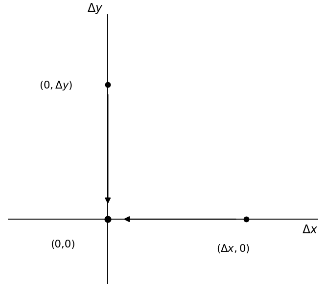

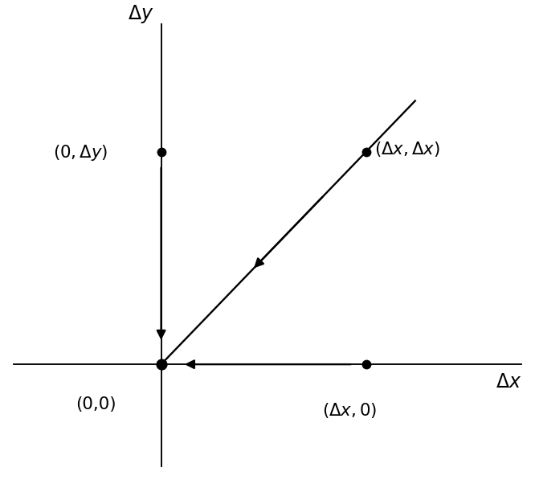

#### 求导法则与推论 (Differentiation Rules)
- **基本法则**（与实微积分形式完全相同，证明仅用极限四则运算与代数变形）：
  - $(c)'=0$，$(z)'=1$，$(cf)'=cf'$，$(z^n)'=nz^{n-1}$（$n\in\mathbb{Z}$，负整数需 $z\neq 0$）；
  - 和、积 $(fg)'=fg'+f'g$、商 $(f/g)'=(gf'-fg')/g^2\;(g\neq 0)$。
- **链式法则 (chain rule)**：$(g\circ f)'(z_0)=g'[f(z_0)]f'(z_0)$。
  - **证明关键（Carathéodory 改写）**：构造在 $w_0=f(z_0)$ 处连续的辅助函数 $\Phi(w)=\frac{g(w)-g(w_0)}{w-w_0}-g'(w_0)\;(w\neq w_0),\;\Phi(w_0)=0$，写成乘积恒等式 $g(w)-g(w_0)=[g'(w_0)+\Phi(w)](w-w_0)$，绕开 $f(z)-f(z_0)$ 可能为零的除零风险。
- **多项式系数与勒让德多项式 (Legendre polynomials)**：$n$ 次多项式 $P(z)$ 系数满足 $a_k=P^{(k)}(0)/k!$；$P_n(z)=\frac{1}{n!2^n}\frac{d^n}{dz^n}(z^2-1)^n$ 是 $n$ 次多项式（Rodrigues 公式）。
- **复洛必达法则特例 (L'Hôpital's rule, simple case)**：若 $f(z_0)=g(z_0)=0$，$f'(z_0),g'(z_0)$ 存在且 $g'(z_0)\neq 0$，则 $\lim_{z\to z_0}\frac{f(z)}{g(z)}=\frac{f'(z_0)}{g'(z_0)}$。

> **【作业高频易错】**（C2 作业 HW3，Sec.19–20）
> 1. **洛必达法则证明勿偷步**（Sec.20 Ex.4）：不能只写两个导数极限就跳到结论，必须写出关键恒等变形 $\frac{f(z)}{g(z)}=\frac{f(z)/(z-z_0)}{g(z)/(z-z_0)}$，并明确点出因 $g'(z_0)\neq 0$ 才可对商逐项取极限。
> 2. **区分点位置与增量方向**（Sec.19 Ex.8）：证不可导时应写“沿 $\Delta y=0$ / $\Delta x=0$”，不要写成“$y=0$ / $x=0$”。
> 3. **商法则提公因式防漏幂次**（Sec.20 Ex.2d）：$\frac{d}{dz}\frac{(1+z^2)^4}{z^2}=\frac{(1+z^2)^3[8z^2-2(1+z^2)]}{z^3}=\frac{2(1+z^2)^3(3z^2-1)}{z^3}$，提取公因式时切勿把 $8z^2$ 漏写成 $8z$。

---

### 2.5 柯西-黎曼方程 (Cauchy–Riemann Equations)

- **推导（水平路径 = 竖直路径）**：若 $f'(z_0)$ 存在，则：
  - 沿水平路径 $\Delta y=0$：$f'(z_0)=u_x(x_0,y_0)+iv_x(x_0,y_0)$；
  - 沿竖直路径 $\Delta x=0$（利用 $1/i=-i$）：$f'(z_0)=v_y(x_0,y_0)-iu_y(x_0,y_0)=-i(u_y+iv_y)$。
  比较实虚部即得**柯西-黎曼方程 (Cauchy–Riemann equations, CR equations)**：
  $$u_x=v_y,\qquad u_y=-v_x$$
- **必要条件定理 (necessary condition)**：若 $f'(z_0)$ 存在，则 $u,v$ 在 $(x_0,y_0)$ 的一阶偏导必存在、必满足 CR 方程，且 $f'(z_0)=u_x+iv_x=v_y-iu_y$。
- **两种等价视角**：
  - **梯度形式**：$\nabla v=(-u_y,u_x)$ 是 $\nabla u$ 逆时针旋转 $90^\circ$，故 $\nabla u\cdot\nabla v=0$。
  - **复形式 / 维廷格导数 (Wirtinger derivative)**：定义 $\dfrac{\partial}{\partial\bar z}=\dfrac{1}{2}\left(\dfrac{\partial}{\partial x}+i\dfrac{\partial}{\partial y}\right)$，则 CR 方程等价于 $\dfrac{\partial f}{\partial\bar z}=0$（即“解析 $\iff$ 不显含 $\bar z$”）。
- **战术用途与必要非充分铁证**：
  - **证伪利器**：CR 方程不成立处必不可导（如 $\bar z$、$z-\bar z$、$2x+ixy^2$、$e^xe^{-iy}=\overline{e^z}$ 均无公共解，处处不可导；$|z|^2$ 仅在原点满足 CR，故非零点全不可导）。
  - **反例（满足 CR 却不可导）**：$f(z)=\bar z^2/z\;(z\neq 0),\;f(0)=0$。在原点按定义算得 $u_x=v_y=1,\;u_y=v_x=0$，满足 CR 方程，但沿对角线差商为 $-1\neq 1$，故 $f'(0)$ 不存在（根因：CR 方程只检查了两条坐标轴方向）。

---

### 2.6 可微的充分条件与极坐标形式 (Sufficient Conditions & Polar Coordinates)

#### 直角坐标充分条件定理 (Sufficient Conditions in Cartesian Coordinates)
- **定理**：设 $f=u+iv$ 在 $z_0=(x_0,y_0)$ 的某 $\varepsilon$ 邻域内有定义，若：
  1. $u,v$ 的一阶偏导数在**该邻域内处处存在**；
  2. 这些偏导数在**点 $(x_0,y_0)$ 处连续**；
  3. 在 $(x_0,y_0)$ 处满足 **CR 方程** $u_x=v_y,\;u_y=-v_x$；
  则 $f'(z_0)$ 存在，且 $f'(z_0)=u_x(x_0,y_0)+iv_x(x_0,y_0)$。
- **证明核心**：偏导数连续 $\implies$ 存在对所有方向一致成立的一阶增量展开 $\Delta u=u_x\Delta x+u_y\Delta y+\varepsilon_1\Delta x+\varepsilon_2\Delta y$（$\Delta v$ 同理，$\varepsilon_k\to 0$）；代入 CR 方程将主部合并为 $(u_x+iv_x)\Delta z$，而 $|\Delta x/\Delta z|\le 1,\;|\Delta y/\Delta z|\le 1$ 压制余项趋零。
- **经典例子与操作顺序警告**：
  - $f(z)=e^xe^{iy}=e^x\cos y+ie^x\sin y$ 处处满足条件，故处处可导且 $f'(z)=f(z)$（即 $e^z$）。
  - **先验条件、后用公式**：$f(z)=x^3+i(1-y)^3$，由 $u_x=v_y$ 得 $3x^2=-3(1-y)^2\iff x^2+(1-y)^2=0$，故**仅在 $z=i$ 可导且 $f'(i)=0$**（切勿直接套 $f'=3x^2$ 误判为处处可导）。
  - $f(z)=x^2+iy^2$ 仅在直线 $y=x$ 上可导，导数 $f'(x+ix)=2x$。

> **【作业高频易错】**（C2 作业 HW3，Sec.21–23）
> 1. **切勿漏答导数值**（Sec.22 Ex.3c，$f(z)=z\operatorname{Im}z$）：题问“determine where $f'(z)$ exists and find its value”，算出仅在 $z=0$ 可导后，必须补答 $f'(0)=0$（且不要把 $f'(z)$ 漏撇号写成 $f(z)$）。
> 2. **用充分条件证可导必须写明“一阶偏导连续”**（Sec.23 Ex.1a），并把联立 CR 方程的矛盾明确收口为“无公共解”。

#### 极坐标形式 (Cauchy–Riemann Equations in Polar Coordinates)
- 对 $z_0=r_0e^{i\theta_0}\neq 0$，由链式法则 $x=r\cos\theta,\;y=r\sin\theta$ 得等价的**极坐标 CR 方程 (polar form of CR equations)**（注意 $r$ 总是陪着 $r$-偏导，且排除原点 $r=0$）：
  $$r\,u_r=v_\theta,\qquad u_\theta=-r\,v_r$$
- **极坐标充分条件定理**：若 $u,v$ 关于 $r,\theta$ 的一阶偏导在 $z_0\neq 0$ 的某邻域内存在、在 $(r_0,\theta_0)$ 连续且满足极坐标 CR 方程，则 $f'(z_0)$ 存在，且
  $$f'(z_0)=e^{-i\theta}(u_r+iv_r)=\frac{-i}{z_0}(u_\theta+iv_\theta)$$
- **核心应用**：
  - $f(z)=1/z^2=r^{-2}e^{-i2\theta}\implies f'(z)=-2/z^3\;(z\neq 0)$。
  - **平方根分支可导性**：$f(z)=\sqrt{r}e^{i\theta/2}$ 在开扇形 $r>0,\;\alpha<\theta<\alpha+2\pi$（挖去**支点 branch point** $0$ 与**支割线 branch cut** $\theta=\alpha$）内处处可导，且 $f'(z)=\dfrac{1}{2f(z)}$。
  - 复幂雏形 $f(z)=e^{-\theta}[\cos(\ln r)+i\sin(\ln r)]\;(r>0,0<\theta<2\pi)$ 可导，且 $f'(z)=if(z)/z$。

---

### 2.7 解析函数 (Analytic Functions)

#### 定义、运算封闭性与奇点 (Definitions, Closure & Singularities)
- **解析 / 全纯 / 正则 (analytic / holomorphic / regular)**：
  - 在**开集** $S$ 上解析：$f$ 在 $S$ 内每一点可导。
  - 在**点 $z_0$ 处解析**：$f$ 在 $z_0$ 的**某个邻域内处处可导**（严格强于“在 $z_0$ 可导”！$|z|^2$、$x^2+iy^2$、$xy+iy$、$2xy+i(x^2-y^2)$ 均**处处不解析**）。
  - 在非开集 $S$ 上解析：在某个包含 $S$ 的开集上解析。
- **整函数 (entire function)**：在**整个复平面**上解析的函数（如多项式、$e^z$、$\sin z$、$\cos z$、$\sinh z$、$\cosh z$）。
- **运算封闭性**：在域 $D$ 内解析的函数的和、差、积、商（分母在 $D$ 内处处非零）、复常数线性组合与复合仍解析。
  - **有理函数 $P(z)/Q(z)$**：分子分母均为整函数，由商法则在分母非零的开集上处处解析（即只需排除 $Q(z)=0$ 的点）。
  - **对数分支雏形**：$g(z)=\ln r+i\theta\;(r>0,\;0<\theta<2\pi)$ 在其定义域内解析且 $g'(z)=1/z$；复合 $g(z^2+1)$ 在第一象限解析（因 $\operatorname{Im}(z^2+1)=2xy>0$ 避开正实轴割线）。
- **奇点 (singular point / singularity)**：$f$ 在 $z_0$ 不解析，但在 $z_0$ 的**每个邻域内都存在使 $f$ 解析的点**。
  - 注意：**不解析 $\neq$ 奇点**——$|z|^2$ 处处不解析，故**没有任何奇点**。有理函数 $\frac{z^2+3}{(z+1)(z^2+5)}$ 的奇点为 $z=-1,\pm i\sqrt{5}$。

#### 常数定理与解析函数的刚性 (Constant Theorem & Rigidity)
- **核心定理（导数恒零 $\implies$ 常数）**：若 $f'(z)=0$ 在**域** $D$ 内处处成立，则 $f(z)$ 在整个 $D$ 上恒为常数。
  - **证明骨架**（无复中值定理）：由 $f'=0$ 及 CR 方程得 $u_x=u_y=v_x=v_y\equiv 0$；沿 $D$ 内任意线段 $L$，方向导数 $\frac{du}{ds}=\nabla u\cdot\mathbf{U}=0$ 故 $u$ 在每条线段上为常数；再利用**域的连通性**（任意两点可用完全落在 $D$ 内的折线相连）逐段传递至全域（若 $D$ 不连通则不成立！）。

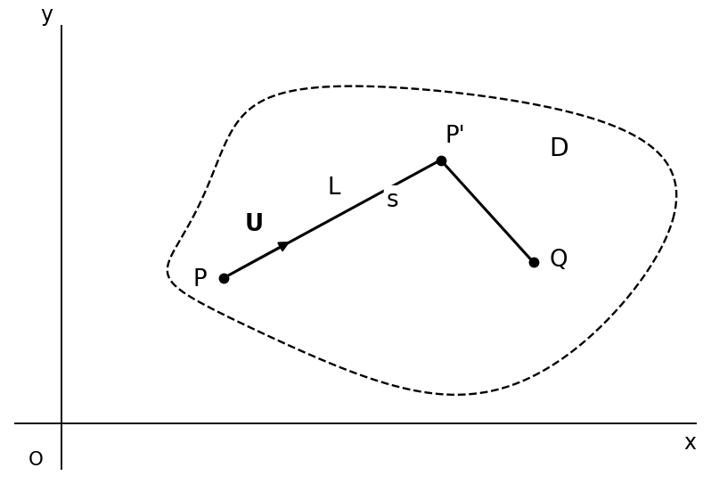

- **三大刚性推论（域 $D$ 内 $f$ 解析）**：
  1. **$f$ 与 $\bar f$ 同时解析 $\implies f$ 为常数**（两组 CR 方程联立得 $u_x=v_x=0\implies f'\equiv 0$）。
  2. **$|f(z)|$ 为常数 $\implies f$ 为常数**（若 $c=0$ 显然；若 $c\neq 0$，则 $\overline{f(z)}=c^2/f(z)$ 解析，化归为推论 1；第 4 章最大模原理的关键引理）。
  3. **$f(z)$ 恒取实值 $\implies f$ 为常数**（$v\equiv 0\implies v_x=v_y=0\implies u_x=u_y=0\implies f'\equiv 0$）。

> **【作业高频易错】**（C2 作业 HW3 & HW4）
> 1. **复常数线性组合勿当实常数算**（HW3 Sec.23 Ex.3）：证 $c_1f_1+c_2f_2$ 是整函数时，$c_j=a_j+ib_j$ 为复常数会混合实虚部（或直接用求导法则 $(c_1f_1+c_2f_2)'=c_1f_1'+c_2f_2'$ 更简洁），且勿漏答“复合仍为整函数”。
> 2. **局部常数到全域常数必须引用“连通性”**（HW4 Ex.7）：证域 $D$ 内实值解析函数为常数时，仅用开性 + 小矩形中值定理只能得**局部常数 (locally constant)**，必须以 **$D$ 连通 (connected)** 收尾（或直接由 $f'\equiv 0$ 引用常数定理）。

---

### 2.8 调和函数 (Harmonic Functions)

- **调和函数 (harmonic function)**：二元实函数 $H(x,y)$ 在域 $D$ 内具有**连续的一阶与二阶偏导数**，且满足**拉普拉斯方程 (Laplace's equation)**：
  $$H_{xx}+H_{yy}=0\qquad(\text{极坐标形式：}r^2u_{rr}+ru_r+u_{\theta\theta}=0,\;r\neq 0)$$
  - 物理背景：无源稳态温度分布（如半无限带 $0<x<\pi,y>0$ 上 $T(x,y)=e^{-y}\sin x=\operatorname{Re}(-ie^{iz})$）、无电荷区静电势、无旋不可压流体势。
- **核心定理（解析 $\implies$ 分量调和）**：若 $f=u+iv$ 在域 $D$ 内解析，则 $u,v$ 在 $D$ 内均为调和函数。
  - **证明要点**：预支第 4 章 Sec.57（解析 $\implies u,v$ 有任意阶连续偏导），对 CR 方程分别对 $x,y$ 求偏导，利用混合偏导相等 $v_{yx}=v_{xy},\;u_{yx}=u_{xy}$ 消去另一分量即得（拉普拉斯方程的加号本质上源于 CR 方程 $u_y=-v_x$ 的负号）。
  - 例：$1/z^2=\frac{x^2-y^2}{(x^2+y^2)^2}-i\frac{2xy}{(x^2+y^2)^2}$ 在不含原点的任意域内给出两个调和函数。
- **共轭调和函数 (harmonic conjugate)**：若 $u,v$ 在域 $D$ 调和且满足 CR 方程（即 $u+iv$ 解析），称 $v$ 为 $u$ 的共轭调和函数。
  - **顺序不可颠倒**：若 $v$ 是 $u$ 的共轭调和函数，则 **$-u$** 是 $v$ 的共轭调和函数。
  - **求法**：已知 $u$ 时，由 $v_y=u_x$ 对 $y$ 积分得 $v=\int u_x\,dy+\phi(x)$，再代入 $v_x=-u_y$ 解出 $\phi'(x)$，确定 $v$ 至多差一实常数（单连通域必存在；有洞域如 $0<|z|<1$ 上的 $\ln|z|$ 无单值共轭调和函数）。
- **等值线族正交性 (orthogonality of level curves)**：若 $f=u+iv$ 在 $D$ 内解析，则在 $f'(z_0)\neq 0$ 处，等值线 $u(x,y)=c_1$ 与 $v(x,y)=c_2$ 的切线互相垂直（由 $\nabla u\cdot\nabla v=0$ 或斜率乘积 $-1$）。
  - **例外点**：$f'(z_0)=0$ 处不保角（例如 $w=z^2$ 在原点 $f'(0)=0$，$u=0$ 即 $y=\pm x$ 与 $v=0$ 即坐标轴夹角 $45^\circ$ 而非 $90^\circ$）。

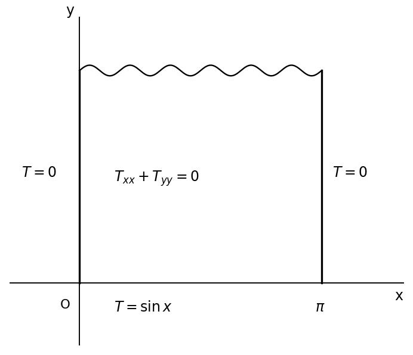

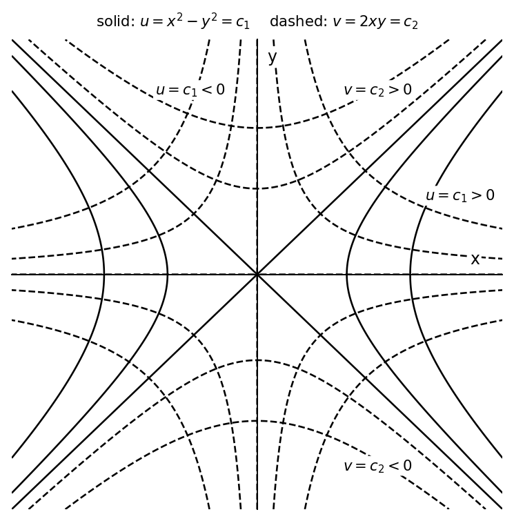

---

### 2.9 唯一确定的解析函数与反射原理 (Uniquely Determined Analytic Functions & Reflection Principle)

- **唯一性引理 (uniqueness lemma)**：若 $f$ 在域 $D$ 内解析，且在 $D$ 内所含某个**子域或线段**上恒为零，则 $f(z)\equiv 0$ 于整个 $D$。
  - **证明机制**：用域的连通性在起点 $z_0$ 与任意点 $P$ 间连折线 $L$，取 $L$ 到 $\partial D$ 的最短距离 $d>0$，沿 $L$ 构造一串步长 $<d$、半径为 $d$ 的重叠圆盘 $N_0,\dots,N_n$，结合第 6 章 Sec.82 逐盘将“$f\equiv 0$”传染至全域。
- **唯一性定理 (uniqueness theorem)**：域 $D$ 内解析的函数由其在 $D$ 内某子域或线段上的值唯一确定（令 $h=f-g$ 应用引理）。
- **重合原理 (coincidence principle)**（更强形式）：若 $f,g$ 在域 $D$ 内解析，且在 $D$ 内某个**在 $D$ 中有聚点/极限点**的子集 $S$ 上相等，则 $f\equiv g$ 于 $D$。
  - **极限点必须在域内（反例）**：$f(z)=\sin(\pi/z)$ 在 $z=1/n$ 处全为零但不恒为零，因为极限点 $0$ 是奇点，不在定义域 $\mathbb{C}\setminus\{0\}$ 内。
  - 推论：非常数解析函数不可能在域内任何邻域上取常值。
- **解析延拓 (analytic continuation)**：若 $D_1\cap D_2\neq\varnothing$，$f_1$ 在 $D_1$ 解析，$f_2$ 在 $D_2$ 解析且在 $D_1\cap D_2$ 上 $f_2=f_1$，称 $f_2$ 为 $f_1$ 到 $D_2$ 的解析延拓；并集函数 $F$ 在 $D_1\cup D_2$ 上解析，$f_1,f_2$ 称为 $F$ 的**元素 (elements)**。
  - **唯一但依赖路径**：每一步解析延拓若存在必唯一；但沿不同路径绕行一圈回到原域交集 $D_1\cap D_3$ 时，结果可能不同（例：平方根从 $f_1\;(0<\theta<\pi)$ 经 $f_2\;(\frac{\pi}{2}<\theta<2\pi)$ 延拓到 $f_3\;(\pi<\theta<\frac{5\pi}{2})$，在 $D_1\cap D_3$ 上 $f_3=-f_1$）。

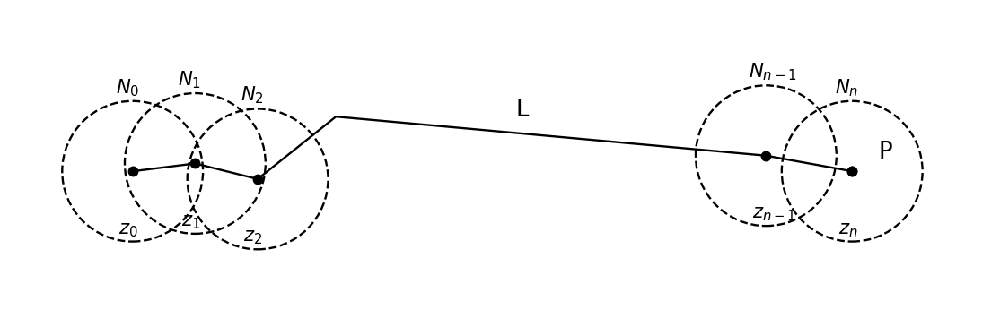

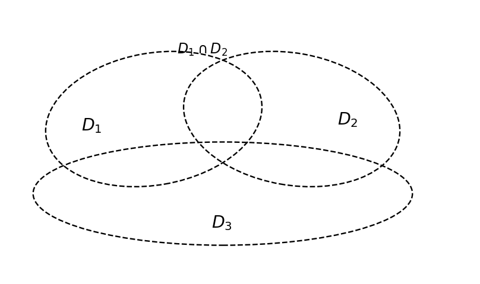

- **反射原理 (reflection principle)**：设域 $D$ 关于实轴对称（下半为上半关于实轴的镜像）且含有一段实轴，$f$ 在 $D$ 内解析，则：
  $$\overline{f(z)}=f(\bar z)\quad(\forall z\in D)\iff f(x)\text{ 在该段实轴上恒取实值}$$
  - **充分性证明要点**：构造 $F(z)=\overline{f(\bar z)}=u(x,-y)-iv(x,-y)$，由链式法则验得 $F$ 满足 CR 方程且偏导连续故在 $D$ 内解析；在实轴段上 $v(x,0)=0\implies F(x)=f(x)$；由唯一性定理得 $F\equiv f$ 于 $D$。
  - **纯虚变体**：若 $f(x)$ 在该段实轴上恒取纯虚值，则 $\overline{f(z)}=-f(\bar z)$。
  - 例：$z+1,\;z^2,\;e^z$ 满足 $\overline{f(z)}=f(\bar z)$；$z+i,\;iz^2$ 不满足。

---

## 第三章 初等函数 (Elementary Functions)

> **全章主线**：复变初等函数全部由两根支柱搭成——**复指数函数 $e^z$**（整函数、永不为零、周期 $2\pi i$）与**复对数函数 $\log z$**（多值性总源头、靠支割线变单值解析）。

### 3.1 复指数函数 (The Exponential Function)

- **定义**：对 $z=x+iy$（$y$ 取**弧度 radians**），
  $$e^z=\exp z=e^xe^{iy}=e^x(\cos y+i\sin y)=e^x\cos y+ie^x\sin y$$
  - 限制在实轴（$y=0$）时退化为实指数 $e^x$。
  - **记号例外**：$e^{1/n}$ 在本章特指 $e$ 的唯一正实 $n$ 次根 $\sqrt[n]{e}$（单值函数 $e^z$ 在 $1/n$ 处的值），而不再指 $e$ 的 $n$ 个方根集合。
- **核心性质**：
  - **模与幅角**：$|e^z|=e^x>0$，$\arg(e^z)=y+2n\pi\;(n\in\mathbb{Z})$，且对一切 $z\in\mathbb{C}$ 恒有 **$e^z\neq 0$**（值域为去心平面 $\mathbb{C}\setminus\{0\}$）。
  - **加法定理与运算法则**：$e^{z_1}e^{z_2}=e^{z_1+z_2}$，$\dfrac{e^{z_1}}{e^{z_2}}=e^{z_1-z_2}$，$\dfrac{1}{e^z}=e^{-z}$，$(e^z)^n=e^{nz}\;(n\in\mathbb{Z})$。
  - **整函数与导数**：$e^z$ 是**整函数 (entire function)**，且 $\dfrac{d}{dz}e^z=e^z$。对比：$\exp\bar z=\overline{e^z}$ **处处不解析**。
  - **纯虚周期 (pure imaginary period)**：$e^{z+2\pi i}=e^z$，全体周期为 $\{2n\pi i:n\in\mathbb{Z}\}$；半周期 $e^{z+\pi i}=-e^z$。
  - **基本横带映射**：$e^z$ 将宽 $2\pi$ 的开横带 $0<y<2\pi$ 一对一映为去心平面 $\mathbb{C}\setminus\{0\}$（上下边界 $y=0,2\pi$ 均映到正实轴）。
  - **可取负值与任意非零值**：$e^{i(2n+1)\pi}=-1$；解方程 $e^z=w=\rho e^{i\phi}\;(\rho>0)$ 得 $z=\ln\rho+i(\phi+2n\pi)$（无穷多解，沿竖直线等距 $2\pi$ 排列）。
  - **实值/纯虚判据与不等式**：$e^z\in\mathbb{R}\iff y=n\pi$；$e^z\in i\mathbb{R}\iff y=\frac{\pi}{2}+n\pi$；$\overline{\exp(iz)}=\exp(i\bar z)\iff z=n\pi$；$|e^{z^2}|=e^{x^2-y^2}\le e^{|z|^2}$；$|e^{-2z}|<1\iff\operatorname{Re}z>0$。
  - **调和性**：$F(z)=e^{1/z}$ 在 $z\neq 0$ 处解析，故 $\operatorname{Re}(e^{1/z})=e^{x/(x^2+y^2)}\cos\frac{y}{x^2+y^2}$ 在任意不含原点的域内调和。

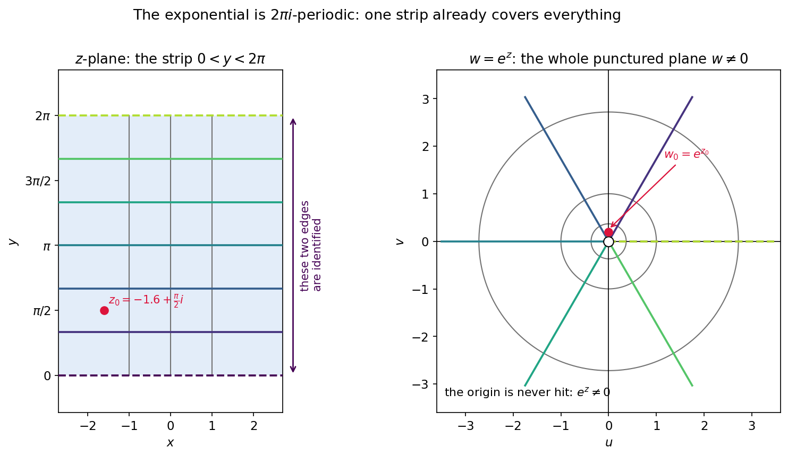

> **【作业高频易错】**（C3 作业 HW4，复指数 Ex.8c & Ex.12）
> 1. **切勿对复指数直接套实对数 $\ln$**（Ex.8c，解 $\exp(2z-1)=1$）：应写 $e^w=1\iff w=2n\pi i\implies 2z-1=2n\pi i\implies z=\frac{1}{2}+n\pi i$，不可写 $\ln(\exp(2z-1))=\ln 1=0$。
> 2. **切勿把解析函数的实部误当成解析函数**（Ex.12，证 $\operatorname{Re}(e^{1/z})$ 调和）：应说明 **$F(z)=e^{1/z}$** 在 $z\neq 0$ 解析，故其实部 $u(x,y)$ 调和；实值非常数函数 $u$ 本身**不解析**。

---

### 3.2 对数函数与主值 (The Logarithmic Function and Principal Value)

- **定义（多值对数 logarithmic function）**：对 $z=re^{i\Theta}\neq 0\;(-\pi<\Theta\le\pi)$，解方程 $e^w=z$ 得 $e^u=r,\;v=\Theta+2n\pi$，定义：
  $$\log z=\ln r+i(\Theta+2n\pi)=\ln|z|+i\arg z\qquad(n=0,\pm 1,\pm 2,\dots)$$
  - **严格区分 $\ln$ 与 $\log$**：$\ln$ 专指正实数的自然对数（单值实数）；$\log$ 指复对数（多值集合，相邻值差 $2\pi i$，多值性全部来自 $\arg z$）。
- **正向成立、反向不成立**：
  - $e^{\log z}=z\;(z\neq 0)$ 对任取一个 $\log z$ 的值均成立；
  - $\log(e^z)=z+2n\pi i\neq z$（因指数折叠了虚方向信息，对数展回时丢失层号）。
- **主值 (principal value)**：取 $n=0$ 的单值函数
  $$\operatorname{Log}z=\ln r+i\Theta\qquad(-\pi<\Theta\le\pi),\qquad \log z=\operatorname{Log}z+2n\pi i$$
  - 正实数上 $\operatorname{Log}x=\ln x$（但 $\log x=\ln x+2n\pi i$）；在负实轴上 $\operatorname{Log}$ 跳跃 $2\pi i$。
  - **高频基础值**：$\log 1=2n\pi i\;(\operatorname{Log}1=0)$；$\log(-1)=(2n+1)\pi i\;(\operatorname{Log}(-1)=\pi i)$；$\log i=(2n+\frac{1}{2})\pi i$；$\log e=1+2n\pi i\;(\operatorname{Log}e=1)$。
- **对数恒等式失效陷阱**：
  - 主值幂法则依赖是否越出 $(-\pi,\pi]$：$\operatorname{Log}[(1+i)^2]=2\operatorname{Log}(1+i)$ 成立，但 $\operatorname{Log}[(-1+i)^2]=\ln 2-\frac{\pi}{2}i\neq\ln 2+\frac{3\pi}{2}i=2\operatorname{Log}(-1+i)$，$\operatorname{Log}(i^3)=-\frac{\pi}{2}i\neq\frac{3\pi}{2}i=3\operatorname{Log}i$（均差 $2\pi i$）。
  - 集合层面：$\log(i^{1/2})=\frac{1}{2}\log i=\{(n+\frac{1}{4})\pi i\}$ 成立，但 $\log(i^2)=\{(2n+1)\pi i\}\neq\{(4n+1)\pi i\}=2\log i$（连集合也不相等！）。

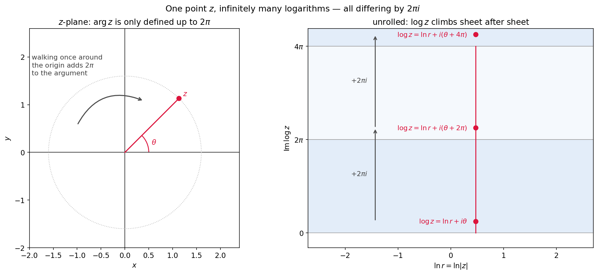

---

### 3.3 对数的分支、导数与恒等式 (Branches, Derivatives, and Identities of Logarithms)

#### 分支、支割线、支点与主分支 (Branch, Branch Cut, Branch Point & Principal Branch)
- **分支构造**：任取实数 $\alpha$，限定严格开区间 $\alpha<\theta<\alpha+2\pi$，得单值连续函数
  $$\log z=\ln r+i\theta\qquad(r>0,\;\alpha<\theta<\alpha+2\pi)$$
  - 定义域 $D=\mathbb{C}\setminus\{0\}\setminus\{\theta=\alpha\}$ 是**域 (domain)**（非空、开、连通）。
  - 必须用严格不等号：若包含射线 $\theta=\alpha$，射线两侧 $v$ 分别趋于 $\alpha$ 与 $\alpha+2\pi$，恒跳跃 $2\pi$，必然不连续。
- **四个核心术语**：
  - **分支 (branch)**：在某域 $D$ 上处处解析的单值函数 $F$，且每点取值均为多值函数 $f(z)$ 的值之一。
  - **主分支 (principal branch)**：取 $\alpha=-\pi$ 的分支 $\operatorname{Log}z=\ln r+i\Theta\;(r>0,\;-\pi<\Theta<\pi)$。
  - **支割线 (branch cut)**：为定义分支而剪去的射线或曲线（主分支的支割线是负实轴连同原点）；**支割线上的点均为该分支的奇点 (singular points)**。
  - **支点 (branch point)**：多值函数所有支割线的公共点（对数函数的支点是原点 $z=0$，绕其一周函数值增加 $2\pi i$ 回不到原层）。

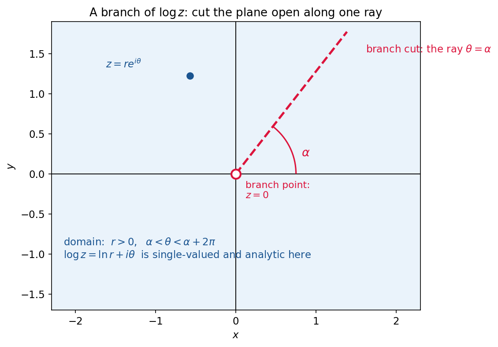

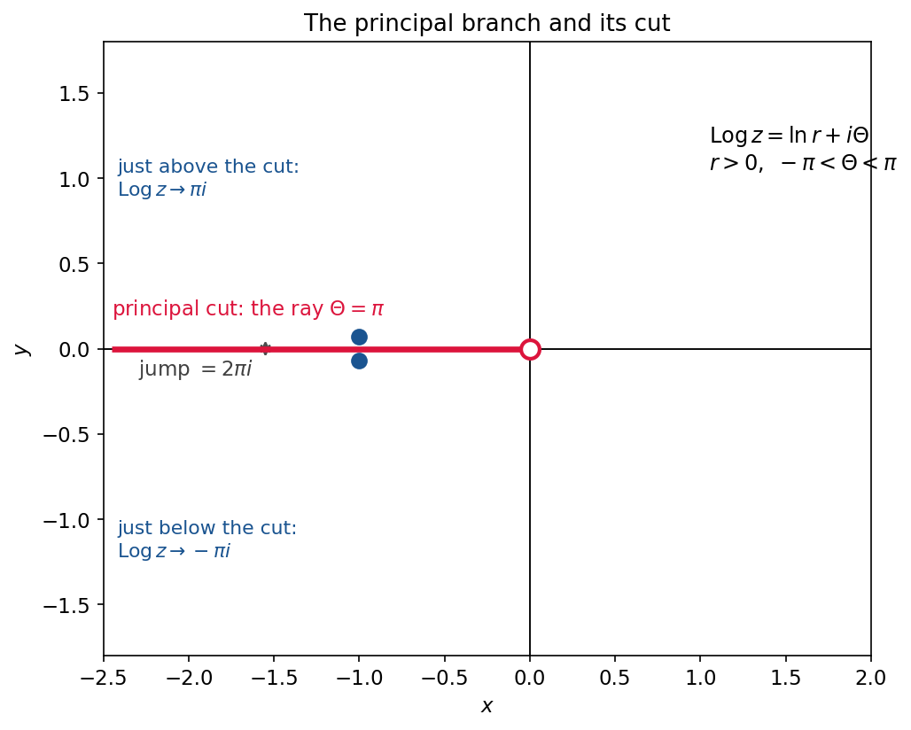

#### 分支的解析性与导数 (Analyticity & Derivative of a Branch)
- **极坐标 CR 验证**：$u=\ln r,\;v=\theta\implies u_r=1/r,\;u_\theta=0,\;v_r=0,\;v_\theta=1$，处处满足 $ru_r=v_\theta,\;u_\theta=-rv_r$ 且连续，故每支在其开定义域内解析，且**导数与所选分支 $\alpha$ 无关**：
  $$\frac{d}{dz}\log z=\frac{1}{z}\qquad(|z|>0,\;\alpha<\arg z<\alpha+2\pi),\qquad \frac{d}{dz}\operatorname{Log}z=\frac{1}{z}\qquad(|z|>0,\;-\pi<\operatorname{Arg}z<\pi)$$
  - 亦可由 $e^{\log z}=z$ 两边链式求导验证，或直角坐标 $u=\frac{1}{2}\ln(x^2+y^2),\;v=\tan^{-1}(y/x)$ 验证（注意 $\tan^{-1}(y/x)$ 仅在右半平面 $x>0$ 与主幅角逐值一致，左半平面需补 $\pm\pi$）。
- **复合对数的解析域排查法**：解析域 $=$ 全平面减去（内层落入支割线的点集 $\cup$ 分母零点）。例：$\operatorname{Log}(z-i)$ 坏集为 $y=1,x\le 0$；$\frac{\operatorname{Log}(z+4)}{z^2+i}$ 坏集为 $x\le -4,y=0$ 及 $z=\pm\frac{1-i}{\sqrt{2}}$。
- **调和性局部化**：$\ln(x^2+y^2)=2\operatorname{Re}(\log z)$ 与 $\operatorname{Re}[\log(z-1)]=\frac{1}{2}\ln[(x-1)^2+y^2]$ 在任意不含支点（$0$ 或 $1$）的域内调和（对每点 $z_0$ 选一条避开 $z_0$ 的支割线即可局部化为解析函数实部）。
- **$\log(e^z)=z$ 成立的精确条件**：当且仅当 $z=x+iy$ 落在水平横带 $\alpha<y<\alpha+2\pi$ 内且选用同一 $\alpha$ 的分支。

> **【作业高频易错】**（C3 作业 HW4，对数分支 Ex.4 & Ex.9）
> 1. **务必把幅角落进指定分支区间**（Log Ex.4，分支 $\frac{3\pi}{4}<\theta<\frac{11\pi}{4}$ 证 $\log(i^2)\neq 2\log i$）：在该区间内 $\arg(-1)=\pi$，而 $i$ 的幅角既不是 $0$ 也不是 $\frac{\pi}{2}$，必须加 $2\pi$ 取 $\frac{5\pi}{2}$，得 $\log(i^2)=\pi i\neq 5\pi i=2\log i$。
> 2. **区分实对数 $\ln$ 与分支复对数 $\log$**（Log Ex.9，证 $\alpha<y<\alpha+2\pi$ 时 $\log(e^z)=z$）：应写 $\log(e^z)=\ln|e^z|+iy=\ln(e^x)+iy=x+iy=z$，不要把 $\ln(e^x)$ 错写成 $\log(e^x)$。

#### 对数的恒等式 (Identities Involving Logarithms)
- **多值集合等式**（指定三者中任两个的值，第三个存在合法值使等式成立）：
  $$\log(z_1z_2)=\log z_1+\log z_2,\qquad \log\!\left(\frac{z_1}{z_2}\right)=\log z_1-\log z_2,\qquad \log\!\left(\frac{1}{z}\right)=-\log z\;(z\neq 0)$$
- **主值版本的修正与安全区**：
  $$\operatorname{Log}(z_1z_2)=\operatorname{Log}z_1+\operatorname{Log}z_2+2N\pi i\qquad(N\in\{0,\pm 1\})$$
  - 反例：$z_1=z_2=-1$ 时 $\operatorname{Log}(z_1z_2)=0\neq 2\pi i=\operatorname{Log}z_1+\operatorname{Log}z_2$；商的反例：$z_1=-1,z_2=-i$ 时 $\operatorname{Log}(z_1/z_2)=-\frac{\pi}{2}i\neq\frac{3\pi}{2}i=\operatorname{Log}z_1-\operatorname{Log}z_2$。
  - **右半平面安全条件**：若 $\operatorname{Re}z_1>0$ 且 $\operatorname{Re}z_2>0$，则 $\Theta_1+\Theta_2\in(-\pi,\pi)$ 不跨割线，$N=0$，$\operatorname{Log}(z_1z_2)=\operatorname{Log}z_1+\operatorname{Log}z_2$ 逐值成立。
- **幂与方根的对数表达**：
  - $z^n=e^{n\log z}\;(n\in\mathbb{Z},\;z\neq 0)$ 对任取一个 $\log z$ 值均成立（$e^{2nk\pi i}=1$ 消去多值）。
  - $z^{1/n}=\exp\!\left(\frac{1}{n}\log z\right)\;(n\in\mathbb{Z}\setminus\{0\})$ 恰有 $|n|$ 个互异值，与 1.5 节 $n$ 次方根完全一致。
  - 集合恒等式 $\log(z^{1/n})=\frac{1}{n}\log z\;(n\in\mathbb{Z}^+)$ 恒成立（利用带余除法 $q=pn+k$ 遍历 $\mathbb{Z}$）。

---

### 3.4 复幂函数 (Complex Exponents / Power Function)

- **定义**：对 $z\neq 0$ 及任意复常数 $c$，
  $$z^c=e^{c\log z}=e^{c\ln r}e^{ic\theta}e^{2nc\pi i}\qquad(n\in\mathbb{Z})$$
  - **值数分类**（完全取决于 $c$）：$c$ 为整数 $\implies 1$ 个值（单值）；$c=p/q$（既约分数）$\implies$ 恰 $q$ 个值；$c$ 为无理实数或非实数 $\implies$ 无穷多值。
  - **倒数律**：$1/z^c=z^{-c}$（值集相等，无需选分支）。
  - **实指数模不变**：若 $a\in\mathbb{R}$，则 $|z^a|=e^{a\ln|z|}=|z|^a$ 与分支无关；非整数 $c$ 使 $|i^c|$ 全分支同模 $\iff c\in\mathbb{R}$。
- **分支导数与主值 (Branch Derivative & Principal Value)**：
  - 取定对数分支 $\alpha<\arg z<\alpha+2\pi$ 后，$z^c$ 在同域内单值解析，利用 $1/z=e^{-\log z}$ 得：
    $$\frac{d}{dz}z^c=cz^{c-1}\qquad(|z|>0,\;\alpha<\arg z<\alpha+2\pi)$$
  - **主值 (principal value)**：$\operatorname{P.V.}z^c=e^{c\operatorname{Log}z}$（在 $|z|>0,\;-\pi<\operatorname{Arg}z<\pi$ 解析）。$\operatorname{P.V.}z^{1/n}$ 即 1.5 节的主 $n$ 次方根；注意单值的 $\operatorname{P.V.}z^{2/3}=\sqrt[3]{r^2}e^{i2\Theta/3}$ 是三值集合 $(z^2)^{1/3}$ 中的一个元素。
- **以 $c$ 为底的指数函数 (exponential function with base $c$)**：对 $c\neq 0$，定义 $c^z=e^{z\log c}$。
  - 一旦固定 $\log c$ 的一个值，$c^z$ 即为 $z$ 的**整函数**，且 $\dfrac{d}{dz}c^z=c^z\log c$，$\dfrac{d}{dz}c^{f(z)}=c^{f(z)}(\log c)f'(z)$（取 $c=e$ 且 $\operatorname{Log}e=1$ 退回 3.1 节的 $e^z$）。
- **经典例子与指数律边界**：
  - $i^i=e^{-(2n+\frac{1}{2})\pi}\;(n\in\mathbb{Z})$：**全部为正实数**，主值 $\operatorname{P.V.}i^i=e^{-\pi/2}\approx 0.2079$。
  - $(-1)^{1/\pi}=e^{(2n+1)i}$：全部落在单位圆上且互异、稠密。
  - **同底主值指数律恒成立**：$z^{c_1}z^{c_2}=z^{c_1+c_2}$，$\frac{z^{c_1}}{z^{c_2}}=z^{c_1-c_2}$，$(z^c)^n=z^{cn}\;(n\in\mathbb{Z}^+)$。
  - **异底主值指数律可能失效**：$(z_1z_2)^c=z_1^cz_2^c e^{2N\pi ic}\;(N\in\{0,\pm 1\})$。例：$z_2=1-i,\;z_3=-1-i$ 时 $(z_2z_3)^i=(-2)^i=z_2^iz_3^i e^{-2\pi}$。

> **【作业高频易错】**（C3 作业 HW4，复幂 Ex.3：求 $(-1+\sqrt{3}i)^{3/2}$）
> **指数 $c$ 必须乘整个 $\log z$ 括号**，严禁把 $e^{\frac{3}{2}\log z}$ 拆成 $e^{3/2}\cdot e^{\log z}$！正确展开：$\exp\left\{\frac{3}{2}\left[\ln 2+i(\frac{2\pi}{3}+2n\pi)\right]\right\}=2\sqrt{2}e^{i(\pi+3n\pi)}=2\sqrt{2}(-1)^{n+1}=\pm 2\sqrt{2}$。

---

### 3.5 三角函数 $\sin z$ 与 $\cos z$ (Trigonometric Functions)

- **定义与基本性质**：由欧拉公式反解并解析延拓至全平面：
  $$\sin z=\frac{e^{iz}-e^{-iz}}{2i},\qquad \cos z=\frac{e^{iz}+e^{-iz}}{2},\qquad e^{iz}=\cos z+i\sin z$$
  - 均为**整函数 (entire functions)**；导数 $(\sin z)'=\cos z$，$(\cos z)'=-\sin z$；奇偶性 $\sin(-z)=-\sin z$，$\cos(-z)=\cos z$。
  - **恒等式全部保留**（可由指数硬推，或由唯一性定理从实轴直接延拓）：加法公式、倍角公式、$\sin(z\pm\frac{\pi}{2})=\pm\cos z$、$\sin^2z+\cos^2z=1$；实周期 $2\pi$，半周期 $\sin(z+\pi)=-\sin z,\;\cos(z+\pi)=-\cos z$。
  - **虚轴取值**：$\sin(iy)=i\sinh y$，$\cos(iy)=\cosh y$。
- **实虚部展开、模公式与无界性 (Real/Imaginary Parts, Moduli & Unboundedness)**：
  $$\sin z=\sin x\cosh y+i\cos x\sinh y,\qquad \cos z=\cos x\cosh y-i\sin x\sinh y$$
  $$|\sin z|^2=\sin^2x+\sinh^2y,\qquad |\cos z|^2=\cos^2x+\sinh^2y$$
  - **无界性 (unbounded)**：当 $y\to\pm\infty$ 时 $|\sin z|,|\cos z|\to\infty$，实轴上的 $|\sin x|\le 1$ 彻底失效。
  - **重要夹逼不等式**（第 4 章积分估计常用）：$|\sin z|\ge|\sin x|$，$|\cos z|\ge|\cos x|$，以及
    $$|\sinh y|\le|\sin z|\le\cosh y,\qquad |\sinh y|\le|\cos z|\le\cosh y$$

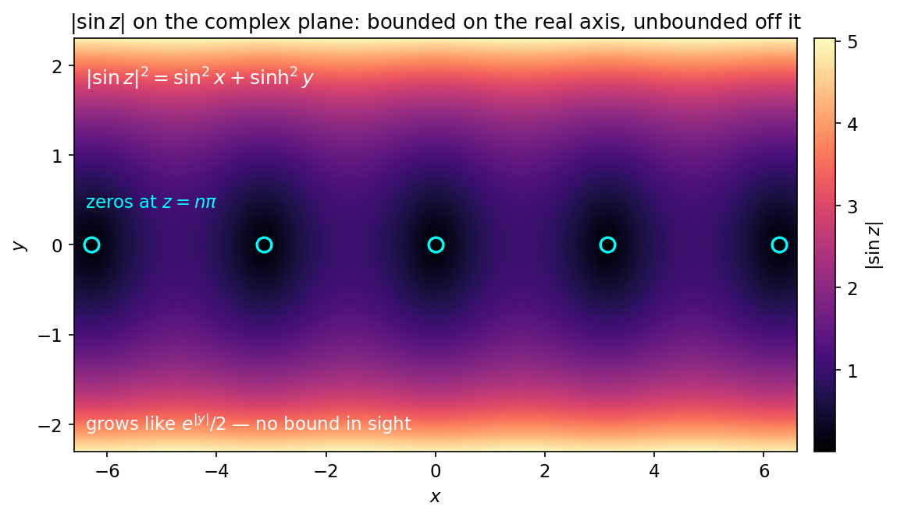

- **零点定理 (Zeros Theorem)**（用模平方 $=$ 两非负项之和 $=0$ 证）：复平面上**没有新增零点**：
  $$\sin z=0\iff z=n\pi,\qquad \cos z=0\iff z=\frac{\pi}{2}+n\pi\qquad(n\in\mathbb{Z})$$
  - 推论：$\cos z_1=\cos z_2\iff z_1+z_2=2n\pi\text{ 或 }z_1-z_2=2m\pi$。
- **其余四个三角函数**：$\tan z=\frac{\sin z}{\cos z}$，$\cot z=\frac{\cos z}{\sin z}$，$\sec z=\frac{1}{\cos z}$，$\csc z=\frac{1}{\sin z}$。
  - **奇点**：$\tan,\sec$ 的奇点在 $z=\frac{\pi}{2}+n\pi$；$\cot,\csc$ 的奇点在 $z=n\pi$（其余处解析）。
  - **导数与周期**：$\tan'=\sec^2$，$\cot'=-\csc^2$，$\sec'=\sec\tan$，$\csc'=-\csc\cot$；$1+\tan^2z=\sec^2z$，$1+\cot^2z=\csc^2z$；$\tan(z+\pi)=\tan z$（周期 $\pi$），$\sec,\csc$ 周期 $2\pi$。
- **共轭与解析性辨析**：由反射原理 $\overline{\sin z}=\sin\bar z$、$\overline{\cos z}=\cos\bar z$、$\overline{\cos(iz)}=\cos(i\bar z)$（而 $\overline{\sin(iz)}=\sin(i\bar z)\iff z=n\pi i$）；但 **$\overline{\sin z}$ 与 $\overline{\cos z}$ 处处不解析**（CR 方程只在竖直线上成立）。
- **解复三角方程范例**：$\sin z=\cosh 4\implies z=(\frac{\pi}{2}+2n\pi)\pm 4i$；$\cos z=2\implies z=2n\pi\pm i\ln(2+\sqrt{3})$。

---

### 3.6 双曲函数 (Hyperbolic Functions)

- **定义与求导**：
  $$\sinh z=\frac{e^z-e^{-z}}{2},\qquad \cosh z=\frac{e^z+e^{-z}}{2}$$
  - 均为**整函数**；导数 $(\sinh z)'=\cosh z$，$(\cosh z)'=\sinh z$；奇偶性 $\sinh(-z)=-\sinh z$，$\cosh(-z)=\cosh z$；$\sinh z+\cosh z=e^z$。
- **与三角函数的互化桥 ($z\mapsto iz$)**（可将全部三角恒等式批量翻译为双曲恒等式）：
  $$-i\sinh(iz)=\sin z,\qquad \cosh(iz)=\cos z,\qquad -i\sin(iz)=\sinh z,\qquad \cos(iz)=\cosh z,\qquad \tanh z=-i\tan(iz)$$
- **周期性（实双曲函数无周期，复双曲函数有纯虚周期）**：
  - $\sinh,\cosh$ 以 **$2\pi i$** 为周期；半周期 $\sinh(z+\pi i)=-\sinh z$，$\cosh(z+\pi i)=-\cosh z$；
  - $\tanh(z+\pi i)=\tanh z$，周期为 **$\pi i$**。
- **恒等式、实虚部与模公式**：
  $$\cosh^2z-\sinh^2z=1,\qquad \sinh 2z=2\sinh z\cosh z$$
  $$\sinh(z_1+z_2)=\sinh z_1\cosh z_2+\cosh z_1\sinh z_2,\qquad \cosh(z_1+z_2)=\cosh z_1\cosh z_2+\sinh z_1\sinh z_2$$
  $$\sinh z=\sinh x\cos y+i\cosh x\sin y,\qquad \cosh z=\cosh x\cos y+i\sinh x\sin y$$
  $$|\sinh z|^2=\sinh^2x+\sin^2y,\qquad |\cosh z|^2=\sinh^2x+\cos^2y,\qquad |\sinh x|\le|\cosh z|\le\cosh x$$
- **零点定理（全部落在虚轴上，交错排列）**：
  $$\sinh z=0\iff z=n\pi i,\qquad \cosh z=0\iff z=\left(\frac{\pi}{2}+n\pi\right)i\qquad(n\in\mathbb{Z})$$
  （实轴上 $\cosh x\ge 1$ 无零点，但在复平面虚轴上有无穷多零点！）

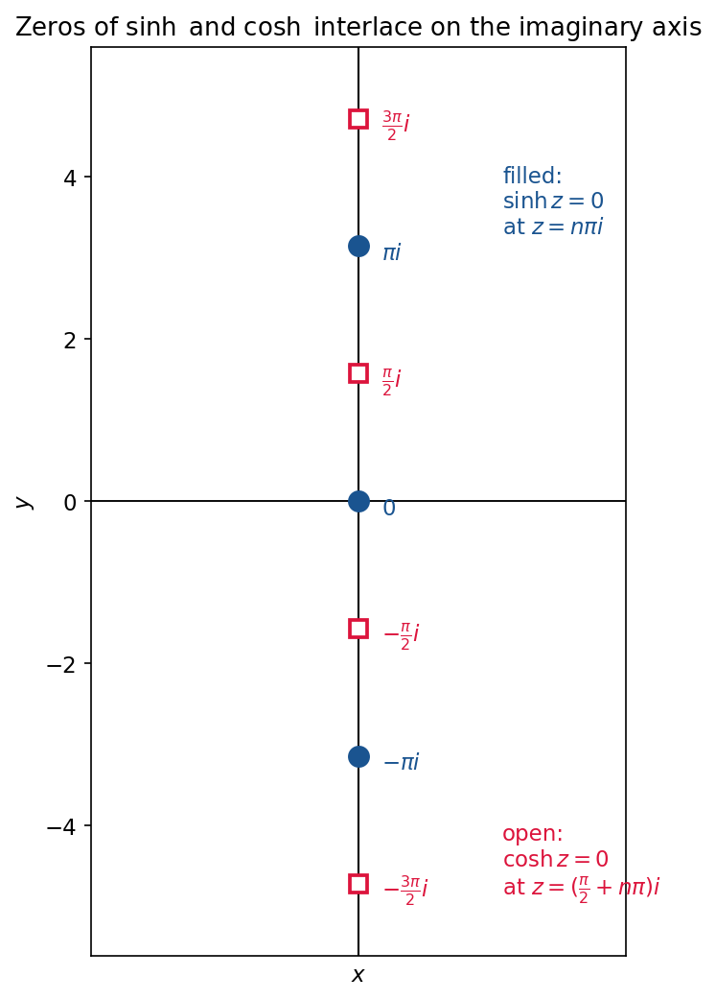

- **其余四个双曲函数**：$\tanh z=\frac{\sinh z}{\cosh z}$，$\coth z=\frac{\cosh z}{\sinh z}$，$\operatorname{sech} z=\frac{1}{\cosh z}$，$\operatorname{csch} z=\frac{1}{\sinh z}$。
  - $\tanh z$ 的零点为 $n\pi i$，奇点（一阶极点）为 $(\frac{\pi}{2}+n\pi)i$；$\coth,\operatorname{csch}$ 奇点为 $n\pi i$。
  - 导数：$\tanh'=\operatorname{sech}^2$，$\coth'=-\operatorname{csch}^2$，$\operatorname{sech}'=-\operatorname{sech}\tanh$，$\operatorname{csch}'=-\operatorname{csch}\coth$。
- **反射与复合**：由反射原理 $\overline{\sinh z}=\sinh\bar z$，$\overline{\cosh z}=\cosh\bar z$，$\overline{\tanh z}=\tanh\bar z\;(\cosh z\neq 0)$；$\sinh(e^z)$ 为整函数，其实部 $\sinh(e^x\cos y)\cos(e^x\sin y)$ 处处调和。
- **典型方程解**：$\sinh z=i\implies (2n+\frac{1}{2})\pi i$；$\cosh z=\frac{1}{2}\implies (2n\pm\frac{1}{3})\pi i$；$\cosh z=-2\implies \pm\ln(2+\sqrt{3})+(2n+1)\pi i$。

---

### 3.7 反三角与反双曲函数 (Inverse Trigonometric and Hyperbolic Functions)

- **定义方式**：复平面上无法简单截出“主值区间”，反函数直接定义为方程的**多值解集**（$w=\sin^{-1}z\iff\sin w=z$，亦记作 $\arcsin z$ 等；注意 $-1$ 指反函数而非倒数）。将正弦/余弦/正切写成 $e^{iw}$ 的二次方程或分式线性方程求解再取对数即得：
  $$\sin^{-1}z=-i\log\!\left[iz+(1-z^2)^{1/2}\right],\qquad \cos^{-1}z=-i\log\!\left[z+i(1-z^2)^{1/2}\right]=\frac{\pi}{2}-\sin^{-1}z$$
  $$\tan^{-1}z=\frac{i}{2}\log\frac{i+z}{i-z}\qquad(z\neq\pm i)$$
  $$\sinh^{-1}z=\log\!\left[z+(z^2+1)^{1/2}\right],\qquad \cosh^{-1}z=\log\!\left[z+(z^2-1)^{1/2}\right],\qquad \tanh^{-1}z=\frac{1}{2}\log\frac{1+z}{1-z}\qquad(z\neq\pm 1)$$
  - **反三角与反双曲互化**：$\sin^{-1}z=-i\sinh^{-1}(iz)$，$\cos^{-1}z=-i\cosh^{-1}z$，$\tan^{-1}z=-i\tanh^{-1}(iz)$（集合意义）。
- **多值性来源与步长**：
  - $\sin^{-1},\cos^{-1},\sinh^{-1},\cosh^{-1}$ 有**两个多值来源**（平方根双值 $+$ 对数无穷多值）；$\tan^{-1},\tanh^{-1}$ **只有对数一个多值来源**（因原函数是 $u^2$ 的分式线性函数，无根号）。
  - 多值步长 $=$ 原函数周期（$\sin^{-1},\cos^{-1}$ 步长 $2\pi$；$\tan^{-1}$ 步长 $\pi$；$\sinh^{-1},\cosh^{-1}$ 步长 $2\pi i$；$\tanh^{-1}$ 步长 $\pi i$）。
  - 平方根型支点为临界点 $f'(w)=0$ 的像（$\sin^{-1},\cos^{-1},\cosh^{-1}$ 为 $\pm 1$；$\sinh^{-1}$ 为 $\pm i$）；$\tan^{-1}$ 仅有对数型支点 $\pm i$（$\tan w$ 永不取 $\pm i$）。
- **分支解析性与导数**：选定平方根与对数的具体分支后，各反函数成为解析函数的复合从而单值解析：
  $$\frac{d}{dz}\sin^{-1}z=\frac{1}{(1-z^2)^{1/2}},\qquad \frac{d}{dz}\cos^{-1}z=\frac{-1}{(1-z^2)^{1/2}},\qquad \frac{d}{dz}\tan^{-1}z=\frac{1}{1+z^2}$$
  - **关键辨析**：$(\sin^{-1}z)'$ 与 $(\cos^{-1}z)'$ **依赖所选平方根分支**（换支差一负号）；而 $(\tan^{-1}z)'$ **与分支选择无关**（因 $\tan^{-1}$ 不同分支仅差实常数 $n\pi$，求导归零）。
- **高频代表例题**：
  - $\sin^{-1}(-i)=-i\log(1\pm\sqrt{2})=n\pi+i(-1)^{n+1}\ln(1+\sqrt{2})$（注意负数 $1-\sqrt{2}$ 的对数模为 $\sqrt{2}-1=\frac{1}{1+\sqrt{2}}$、幅角为 $(2n+1)\pi$！）；
  - $\sin z=2\implies z=(2n+\frac{1}{2})\pi\pm i\ln(2+\sqrt{3})$；$\cos z=\sqrt{2}\implies z=2n\pi\pm i\ln(1+\sqrt{2})$；$\tan^{-1}(2i)=(n+\frac{1}{2})\pi+\frac{i}{2}\ln 3$；$\cosh^{-1}(-1)=(2n+1)\pi i$；$\tanh^{-1}0=n\pi i$。

---

## 第四章 复积分 (Integrals)

### 4.1 实参数复值函数的微积分 (Derivatives and Definite Integrals of Functions $w(t)$)

- **定义**：对实参数 $t\in[a,b]$ 的复值函数 $w(t)=u(t)+iv(t)$，按实部、虚部分别求导与积分：
  $$w'(t)=u'(t)+iv'(t),\qquad \int_a^b w(t)\,dt=\int_a^b u(t)\,dt+i\int_a^b v(t)\,dt$$
  - 反常积分 (improper integral) 同样按实虚部分别取极限定义（例：$\int_0^\infty e^{-zt}dt=\frac{1}{z}$ 当且仅当 **$\operatorname{Re}z>0$**）。
  - 常见运算法则（线性、乘积、商、$(w^2)'=2ww'$、$(z_0w)'=z_0w'$、$(w(-t))'=-w'(-t)$、$\frac{d}{dt}e^{z_0t}=z_0e^{z_0t}$）及**微积分基本定理 (Fundamental Theorem of Calculus)**（$W'=w\implies\int_a^b w(t)dt=W(b)-W(a)$）均成立。
- **失效的定理（两个中值定理均不成立！）**：
  - **微分中值定理 / 罗尔定理 (Mean Value / Rolle's Theorem) 失效**：反例 $w(t)=e^{it}\;(0\le t\le 2\pi)$，首尾相等 $w(2\pi)-w(0)=0$，但 $|w'(t)|=|ie^{it}|\equiv 1\neq 0$（两分量各有中值点 $c_u,c_v$，但未必重合）。
  - **积分中值定理 (Mean Value Theorem for Integrals) 失效**：$\int_0^{2\pi}e^{it}dt=0$，而 $|2\pi e^{ic}|=2\pi\neq 0$。
- **常用计算工具**：
  - **整数频率正交性 (orthogonality of integer frequencies)**：对 $m,n\in\mathbb{Z}$，
    $$\int_0^{2\pi}e^{i(m-n)\theta}d\theta=\begin{cases}2\pi,&m=n,\\ 0,&m\neq n.\end{cases}$$
  - **对称性**：在 $[-a,a]$ 上，偶函数积分 $=2\int_0^a w$，奇函数积分 $=0$；实积分可合成为复指数一次算完（如 $\int_0^\pi e^{(1+i)x}dx$ 同时得 $\int_0^\pi e^x\cos x\,dx$ 与 $\int_0^\pi e^x\sin x\,dx$）。

---

### 4.2 围道与复积分的定义 (Contours and Contour Integrals)

- **曲线与围道分类**：
  - **有向弧 (directed arc)**：$z(t)=x(t)+iy(t)\;(a\le t\le b)$ 连续，方向由 $t$ 增大决定。
  - **简单弧 / 若尔当弧 (simple arc / Jordan arc)**：不自交（$t_1\neq t_2\implies z(t_1)\neq z(t_2)$）。
  - **简单闭曲线 / 若尔当曲线 (simple closed curve / Jordan curve)**：仅首尾重合 $z(a)=z(b)$，其余不自交；**正向 (positive orientation)** 为逆时针（行进方向左侧为有界内部，若尔当曲线定理 Jordan curve theorem 保证其将平面分为有界内部与无界外部）。
  - **光滑弧 (smooth arc)**：$z'(t)$ 在 $[a,b]$ 连续且在内部 $(a,b)$ 上 $z'(t)\neq 0$（单位切向量 $T(t)=z'(t)/|z'(t)|$ 连续；注：无穷次振荡曲线如 $y(x)=x^3\sin(\pi/x)$ 仍可以是光滑弧！）。
  - **围道 / 分段光滑弧 (contour / piecewise smooth arc)**：有限条光滑弧首尾拼接而成；**弧长 (arc length)** $L=\int_a^b|z'(t)|dt$（计入重复绕行次数）。
- **围道积分定义 (contour integral)**：设 $f(z(t))$ 沿围道 $C:z=z(t)\;(a\le t\le b)$ 分段连续，定义
  $$\int_C f(z)\,dz=\int_a^b f(z(t))z'(t)\,dt$$
  - **核心辨析**：$dz=z'(t)dt$ 是带方向的复位移元，$ds=|dz|=|z'(t)|dt$ 才是弧长元，严禁混用！
- **基本性质**：
  - **换参不变性 (invariance under reparameterization)**：若 $t=\phi(\tau)$ 连续可微且 **$\phi'(\tau)>0$**（保定向），则弧长与围道积分均不变（注意如右半圆用 $y$ 参数化时端点导数发散，须按单侧极限处理）。
  - **反向变号**：$\int_{-C}f(z)\,dz=-\int_C f(z)\,dz$。
  - **分段可加与线性**：$\int_{C_1+C_2}f=\int_{C_1}f+\int_{C_2}f$，$\int_C(c_1f+c_2g)=c_1\int_Cf+c_2\int_Cg$。
  - **复合链式法则**：若 $f$ 在 $z(t_0)$ 解析，则 $\dfrac{d}{dt}f(z(t))=f'(z(t))z'(t)$。

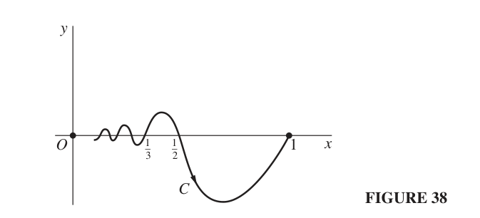

---

### 4.3 参数积分、路径依赖与分支 (Parametric Integrals, Path Dependence, and Branches)

- **路径依赖 (path dependence) 经典范例**：
  - 沿单位圆上半圆 $C_1\;(1\to -1)$：$\int_{C_1}\frac{dz}{z}=\pi i$；沿下半圆 $C_2\;(1\to -1)$：$\int_{C_2}\frac{dz}{z}=-\pi i$；闭路 $\oint_{|z|=1}\frac{dz}{z}=2\pi i\neq 0$。
  - 对比：$\int_C z\,dz=\frac{z_2^2-z_1^2}{2}$ 与路径无关（因存在全平面原函数 $z^2/2$）；$\int_C dz=z_2-z_1$（位移差，非弧长）。
  - 非解析函数依赖路径：$f(z)=y-x-3ix^2$ 沿折线 $0\to i\to 1+i$ 得 $\frac{1-i}{2}$，沿直线 $0\to 1+i$ 得 $1-i$；沿单位正方形积分 $\pi e^{\pi\bar z}$ 得 $4(e^\pi-1)$（切勿漏掉共轭横线！）。
- **圆周幂积分与共轭幂积分（必背公式）**：
  - **整数幂圆周积分**（$C:|z-z_0|=R$ 正向，$n\in\mathbb{Z}$）：
    $$\oint_{|z-z_0|=R}(z-z_0)^{n-1}\,dz=\begin{cases}2\pi i,&n=0,\\ 0,&n\in\mathbb{Z}\setminus\{0\}.\end{cases}$$
  - **单位圆共轭幂积分**（$m,n\in\mathbb{Z}$，$dz$ 贡献额外 $+1$ 频率）：
    $$\oint_{|z|=1}z^m\bar z^n\,dz=\begin{cases}2\pi i,&n=m+1,\\ 0,&n\neq m+1.\end{cases}$$
- **复幂分支积分要点**：
  - 必须先固定 $\log z$ 的幅角区间；即使端点落在支割线上，只要单侧极限有限，参数积分仍存在（但不等于函数在割线解析，不能套用闭路定理！）。
  - 例：主分支 $z^{-1+i}$ 沿单位圆 $-\pi\le\theta\le\pi$ 正向积分为 $2i\sinh\pi\neq 0$；主分支 $z^{a-1}\;(a\in\mathbb{R}\setminus\{0\})$ 沿 $|z|=R$ 正向积分为 $\dfrac{2iR^a\sin(a\pi)}{a}$；同一曲线换分支会改变积分值（如 $z^{-3/4}$ 取主分支得 $4\sqrt{2}\,i$，取 $(0,2\pi)$ 分支得 $-4+4i$）。

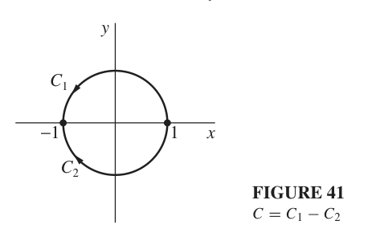

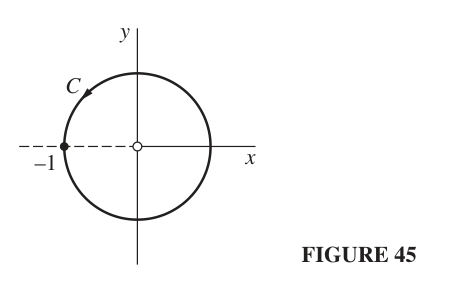

---

### 4.4 积分估计与 ML 不等式 (Upper Bounds and the ML Inequality)

- **积分三角不等式 (integral triangle inequality / integral-modulus lemma)**：对实参数复值函数 $w(t)$，
  $$\left|\int_a^b w(t)\,dt\right|\le\int_a^b|w(t)|\,dt\qquad(a\le b)$$
  - **证明要点**：设 $I=re^{i\alpha}\neq 0$，乘 $e^{-i\alpha}$ 旋转到正实轴后取实部，利用 $\operatorname{Re}\zeta\le|\zeta|$ 得 $|I|=\int_a^b\operatorname{Re}(e^{-i\alpha}w)dt\le\int_a^b|w|dt$。
- **ML 不等式 / 估计引理 (ML inequality / estimation lemma)**：设围道 $C$ 长度为 $L$，$f$ 沿 $C$ 分段连续且 $|f(z)|\le M$，则
  $$\left|\int_C f(z)\,dz\right|\le\int_C|f(z)|\,|dz|\le ML$$
  - 注意：分段连续仅保证**有界**（存在上界 $M$），不保证必能取得最大值（连续函数在紧集上才必取最大值）。
- **四类核心估计技巧**：
  1. **固定路径**：分子用三角不等式放大，分母用反向三角不等式缩小（先确认分母下界严格为正！）；若为线段（如 $i\to 1$ 积 $dz/z^4$），先求线段到奇点（原点）的最短距离（$\frac{\sqrt{2}}{2}$）。
  2. **大圆弧 $R\to\infty$**：弧长 $L=O(R)$，若 $M_R=O(R^{-p})$，需 **$p>1$** 才保证 $ML\to 0$（如 $\oint_{|z|=R}\frac{\operatorname{Log}z}{z^2}dz$ 中 $|\operatorname{Log}z|<\ln R+\pi\implies ML<\frac{2\pi(\ln R+\pi)}{R}\to 0$）。
  3. **小圆弧 $\rho\to 0^+$**：弧长 $L=O(\rho)$，需 $M_\rho=O(\rho^{-p})$ 且 **$p<1$**，同时解析因子需取与 $\rho$ 无关的**统一上界 $M$**（如 $\oint_{|z|=\rho}z^{-1/2}f(z)dz$ 模 $\le 2\pi M\sqrt{\rho}\to 0$）。
  4. **变化方框**：$x,y=\pm(N+\frac{1}{2})\pi$ 上利用 $|\sin z|^2=\sin^2x+\sinh^2y$ 得统一正下界 $|\sin z|\ge 1$，从而 $\oint\frac{dz}{z^2\sin z}\to 0$；以及勒让德多项式积分表示直接得 $|P_n(x)|\le 1$。

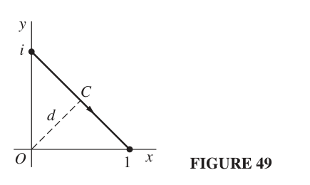

> **【作业高频易错】**（C4 作业 HW7，积分估计 Ex.2 & Ex.4）
> 1. **严禁把弧长微元 $|dz|$ 写成 $dz$**：$\int_C|dz|=L$ 才是路径长度，而 $\int_C dz=z_{\text{终}}-z_{\text{起}}$！必须写 $\left|\int_C f\,dz\right|\le\int_C|f|\,|dz|\le ML$。
> 2. **切勿漏答极限步骤**（Ex.4）：用 ML 得到 $\frac{\pi R(2R^2+1)}{(R^2-1)(R^2-4)}$ 后，必须显式化简并论证 $R\to\infty$ 时该上界趋于 $0$。

---

### 4.5 原函数与路径无关 (Antiderivatives and Independence of Path)

- **原函数 (antiderivative)**：连续函数 $f$ 在域 $D$ 上存在单值函数 $F$ 满足 $F'(z)=f(z)\;(\forall z\in D)$（必在 $D$ 上解析；在连通域上两原函数仅差一常数）。
- **三条件等价定理 (Antiderivative–Path Independence–Closed Contour Theorem)**：设 $f$ 在域 $D$ 上连续，下列三条等价：
  1. $f$ 在整个 $D$ 上存在单值原函数 $F$；
  2. $D$ 内连接任意固定起终点 $z_1\to z_2$ 的围道积分与路径无关，且 $\int_{z_1}^{z_2}f(z)\,dz=F(z_2)-F(z_1)$；
  3. $D$ 内**每一条**闭围道 $C$ 均满足 $\oint_C f(z)\,dz=0$。
- **核心证明要点（3 $\implies$ 1，积分构造原函数）**：由闭路为零得路径无关，固定基点 $z_0\in D$ 定义 $F(z)=\int_{z_0}^z f(s)\,ds$。对 $z\in D$ 取小圆盘内短线段 $[z,z+h]$，得
  $$\left|\frac{F(z+h)-F(z)}{h}-f(z)\right|=\left|\frac{1}{h}\int_z^{z+h}[f(s)-f(z)]\,ds\right|\le\frac{\varepsilon|h|}{|h|}=\varepsilon$$
  因 $h$ 沿任意复方向趋零，故复导数 $F'(z)=f(z)$。
- **分支端点延拓技巧**：
  - 求单位圆 $\oint dz/z$ 可拆为右半圆（主对数 $\operatorname{Log}$）与左半圆（$0<\arg z<2\pi$ 分支）分别用端点法，结果各得 $\pi i$、合得 $2\pi i$（两段不共享全局原函数，接点不能相消）。
  - 路径端点落在支割线上时，只要路径内部避开割线，可更换旋转后的新解析分支（在路径内部与原分支一致）使端点成为新分支的内点再套端点法（如 $z^{1/2}$ 沿上下半圆从 $-3$ 到 $3$ 分别得 $2\sqrt{3}(1+i)$ 与 $2\sqrt{3}(-1+i)$）。
  - 对一切非零整数 $n$，$(z-z_0)^{n-1}$ 在 $\mathbb{C}\setminus\{z_0\}$ 上有单值原函数 $(z-z_0)^n/n$，故任意避开 $z_0$ 的闭路积分为 $0$（即使域不是单连通的！）。

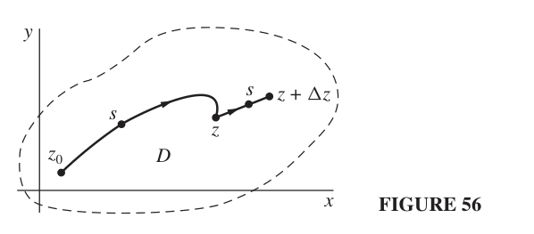

---

### 4.6 柯西-古尔萨定理及其证明 (Cauchy–Goursat Theorem and Proof)

- **格林公式动机 (Green's theorem motivation)**：展开 $\int_C f\,dz=\int_C(u\,dx-v\,dy)+i\int_C(v\,dx+u\,dy)$。若额外假设 $f'$ 连续（即 $u,v$ 一阶偏导连续），由格林公式与 CR 方程立得 $\oint_C f\,dz=\iint_R(-v_x-u_y)dA+i\iint_R(u_x-v_y)dA=0$。但此时尚未证明“解析 $\implies f'$ 连续”，直接用格林公式会循环论证。
- **柯西-古尔萨定理 (Cauchy–Goursat theorem)**：若 $f$ 在简单闭围道 $C$ 上及其内部每一点都解析（**无需假设 $f'$ 连续**），则
  $$\oint_C f(z)\,dz=0$$
- **古尔萨证明的四大核心步骤**：
  1. **局部线性化 (local linearization)**：可导性给出 $f(z)=f(z_j)+f'(z_j)(z-z_j)+(z-z_j)\delta_j(z)$（$\delta_j\to 0$）。前两项为仿射函数，闭路积分为 $0$，仅剩余项积分 $\oint_{C_j}(z-z_j)\delta_j(z)\,dz$。
  2. **网格细分与嵌套方格引理 (nested squares lemma)**：反证若某初始方格无法在有限步四等分内使全格满足 $|\delta_j|<\varepsilon$，则选出边长减半的嵌套闭方格链 $\sigma_0\supset\sigma_1\supset\cdots$，由嵌套闭区间定理存在唯一公共点 $z_*\in R$；$f$ 在 $z_*$ 可导使充分小的 $\sigma_k$ 必合格，矛盾！故有限步内覆盖整个闭区域 $R$。
  3. **内部边界抵消 (cancellation of interior boundaries)**：所有子块均取正向（逆时针），相邻公共边方向相反精确抵消，总和还原为 $\oint_C f\,dz$。
  4. **小误差累积控制**（关键：“小距离 $\times$ 小边长 $=$ 小面积”）：完整方格边长 $s_j$、面积 $A_j=s_j^2$，模上界 $\sqrt{2}s_j\varepsilon$、周长 $4s_j\implies$ 误差 $\le 4\sqrt{2}A_j\varepsilon$；边界部分格总误差受总面积 $S^2$ 与外周长 $L$ 统一控制：
     $$\left|\oint_C f(z)\,dz\right|\le\left(4\sqrt{2}S^2+\sqrt{2}SL\right)\varepsilon\xrightarrow{\varepsilon\to 0^+}0$$

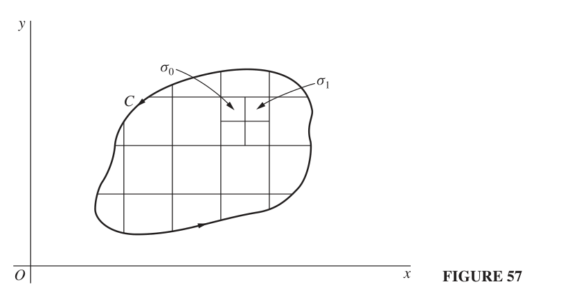

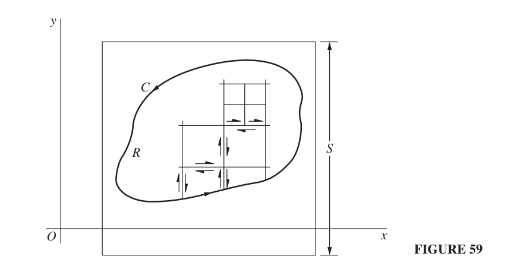

---

### 4.7 单连通、复连通与路径变形 (Simply/Multiply Connected Domains & Deformation of Paths)

- **单连通域 (simply connected domain)**：域 $D$ 中任意简单闭围道的内部均完全含于 $D$（如圆盘、全平面；圆环与去心平面不是）。
  - **单连通域定理**：若 $f$ 在单连通域 $D$ 解析，则 $D$ 内**任意闭围道**（允许自交）满足 $\oint_C f(z)\,dz=0$，且 $f$ 在 $D$ 上必有全域原函数（如整函数必有整原函数）。
  - 注意：单连通是保证“所有解析函数有原函数”的充分条件，而非某个特定函数有原函数的必要条件（反例：$1/z^2$ 在去心平面）。
- **复连通域 (multiply connected domain) 与多边界定理**：
  - 设外边界 $C$ 简单闭合且**逆时针**，内边界 $C_1,\dots,C_n$ 两两不交且**顺时针**（统一口诀：**沿边界行进时，解析区域始终在左侧**）。若 $f$ 在边界及夹出的区域解析，则（通过辅助割线将区域剖分为简单闭路，割线一正一反抵消）：
    $$\oint_C f(z)\,dz+\sum_{k=1}^{n}\oint_{C_k}f(z)\,dz=0\qquad\left(\text{若内边界也改取逆时针 }\Gamma_k\text{，则 }\oint_C f=\sum_{k=1}^{n}\oint_{\Gamma_k}f\right)$$
- **路径变形原理 (principle of deformation of paths)**：若 $C_1,C_2$ 为同向嵌套简单闭围道，且 $f$ 在两者及所夹区域解析（允许 $C_1$ 内部有奇点），则 $\oint_{C_1}f(z)\,dz=\oint_{C_2}f(z)\,dz$。
  - **直接推论**：任意包住 $z_0$ 的正向简单闭围道均可变形为以 $z_0$ 为心的小圆，故 $\oint_C\frac{dz}{z-z_0}=2\pi i$，而 $\oint_C(z-z_0)^{n-1}dz=0\;(n\in\mathbb{Z}\setminus\{0\})$。

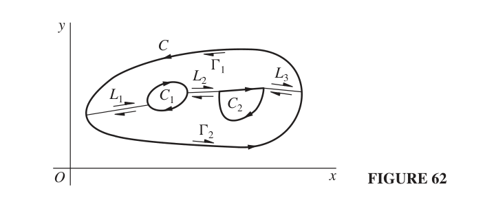

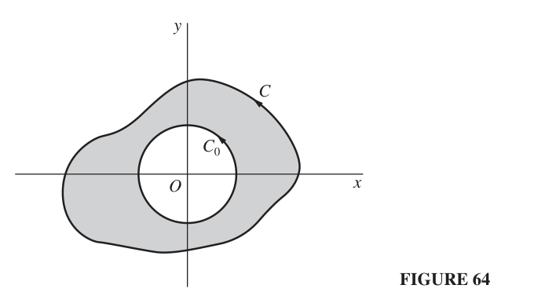

- **经典应用与辨析**：
  - **高斯余弦积分 (Gaussian cosine integral)**：对整函数 $e^{-z^2}$ 沿矩形 $-a,a,a+bi,-a+bi$ 正向积分得 $0$，左右竖边模 $\le be^{-a^2}\to 0$，令 $a\to\infty$ 得：
    $$\int_0^\infty e^{-x^2}\cos(2bx)\,dx=\frac{\sqrt{\pi}}{2}e^{-b^2}\qquad(b>0)$$
  - **面积公式 (area formula)**（用格林公式而非柯西定理，因 $\bar z$ 处处不解析）：对正向简单闭围道 $C$，
    $$\operatorname{Area}(R)=\frac{1}{2i}\oint_C\bar z\,dz$$
  - **充分非必要辨析**：积分 $=0$ 不能反推满足柯西-古尔萨假设（例：$z^{1/2}$ 在上半单位圆盘正向边界积分为 $0$，但在原点不可导）。无穷自交闭路可借助不自交辅助弧 $C_3$ 拆成两条简单闭路处理。

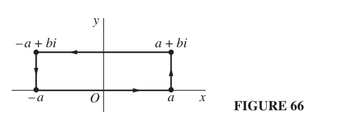

> **【作业高频易错】**（C4 作业 HW7，高斯积分 Ex.4a）
> 计算矩形上边 $z=x+ib\;(x:a\to -a)$ 时注意两个符号：
> 1. **指数展开**：$-(x+ib)^2=-x^2+b^2-2ibx$，是 **$+b^2$** 而非 $-b^2$！
> 2. **积分方向**：从 $a$ 到 $-a$ 翻转上下限为 $\int_{-a}^a$ 时必须加**负号**，得 $H=2\int_0^a e^{-x^2}dx-2e^{b^2}\int_0^a e^{-x^2}\cos(2bx)dx$。

---

### 4.8 柯西积分公式与高阶导数 (Cauchy Integral Formula & Higher Derivatives)

- **柯西积分公式 (Cauchy integral formula)**：设 $C$ 为正向简单闭围道，$f$ 在 $C$ 上及其内部解析，$a$ 严格在 $C$ 内部，则
  $$f(a)=\frac{1}{2\pi i}\oint_C\frac{f(z)}{z-a}\,dz\qquad\Longleftrightarrow\qquad \oint_C\frac{f(z)}{z-a}\,dz=2\pi i\,f(a)$$
  - **证明要点**：变形到小圆 $C_\rho$，拆出 $f(a)\oint_{C_\rho}\frac{dz}{z-a}+\oint_{C_\rho}\frac{f(z)-f(a)}{z-a}dz$；连续性给出 $|f(z)-f(a)|<\varepsilon$，ML 得第二项 $\le\frac{\varepsilon}{\rho}\cdot 2\pi\rho=2\pi\varepsilon\to 0$。
  - 若 $a$ 在 $C$ 外部且整体解析，则积分为 $0$；$a$ 在 $C$ 上不可套用。
- **广义柯西积分公式 / 高阶导数公式 (extended Cauchy integral formula)**：同条件下，对任意整数 $n\ge 0$，
  $$f^{(n)}(a)=\frac{n!}{2\pi i}\oint_C\frac{f(z)}{(z-a)^{n+1}}\,dz\qquad\Longleftrightarrow\qquad \oint_C\frac{f(z)}{(z-a)^{n+1}}\,dz=\frac{2\pi i}{n!}f^{(n)}(a)$$
  - **高频计算口诀**：先把非标准分母化出首一因子（如 $2z+1=2(z+\frac{1}{2})$，切勿漏常数 $2$）；将围道**外部**的奇点因子吸收进分子 $F(z)$ 并确认 $F$ 在闭区域解析；分母次数 $n+1$ 对应 $n$ 阶导数，**千万别漏除 $n!$**。
- **积分号下求导的严格证明 (differentiation under the integral sign)**：
  - 即使 $f$ 仅在 $C$ 上连续，柯西型积分 $g(z)=\frac{1}{2\pi i}\oint_C\frac{f(s)}{s-z}ds$ 在 $C$ 内部仍处处解析，且 $J_k(z)=\oint_C\frac{f(s)}{(s-z)^k}ds$ 满足 $J_k'(z)=kJ_{k+1}(z)$。
  - 证明核心：内点 $z$ 到紧边界 $C$ 有**统一正距离** $d=\min_{s\in C}|s-z|>0$，取 $|h|<d/2$ 时由核的精确差商余项（一般阶可用实参数带积分余项的泰勒公式）与 ML 得到一致趋零的上界。
- **重要衍生结果**：
  - 身份式：若 $f$ 在闭区域解析且 $z_0\notin C$，则 $\oint_C\frac{f'(z)}{z-z_0}dz=\oint_C\frac{f(z)}{(z-z_0)^2}dz$。
  - **勒让德多项式积分表示 (Legendre polynomial integral representation)**：$P_n(z)=\frac{1}{2^{n+1}\pi i}\oint_C\frac{(s^2-1)^n}{(s-z)^{n+1}}ds$，由此直接得 $P_n(1)=1,\;P_n(-1)=(-1)^n$。
  - 实积分导出：由 $\oint_{|z|=1}\frac{e^{az}}{z}dz=2\pi i\;(a\in\mathbb{R})$ 取实部得 $\int_0^\pi e^{a\cos\theta}\cos(a\sin\theta)d\theta=\pi$。

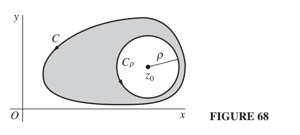

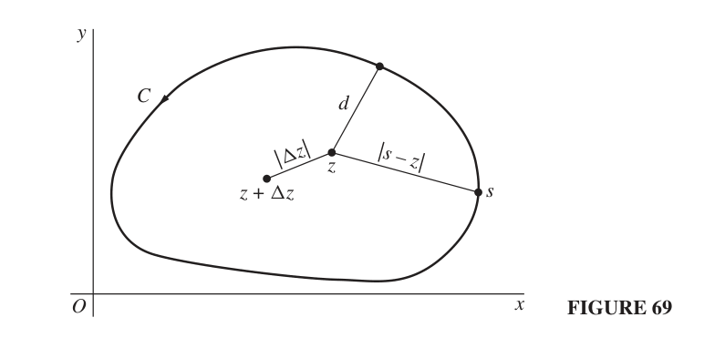

---

### 4.9 解析性的推论、柯西估计与刘维尔定理 (Consequences of Analyticity, Cauchy's Inequality & Liouville's Theorem)

- **无穷次解析性与分量光滑性 (Infinite Differentiability)**：
  - 若 $f$ 在 $z_0$ 解析，则 $f',f'',\dots,f^{(n)},\dots$ 在 $z_0$ 的邻域内均存在且**全部解析**。
  - $f=u+iv$ 的实虚部具有任意阶连续偏导数（$\partial_x^p\partial_y^q f=i^q f^{(p+q)}$），从而混合偏导可交换，彻底补全第 2 章“解析 $\implies$ 分量调和”的正则性依据。
- **莫雷拉定理 (Morera's theorem)**（柯西积分定理的逆定理）：若 $f$ 在域 $D$ 内连续，且对 $D$ 内每一条闭围道 $C$ 均有 $\oint_C f(z)\,dz=0$，则 $f$ 在 $D$ 内解析。
  - **证明两步缺一不可**：(1) 由 4.5 节得解析原函数 $F$ 满足 $F'=f$；(2) 由“解析函数的导数仍解析”得 $f=F'$ 解析。
- **柯西不等式 / 柯西估计 (Cauchy's inequality / Cauchy estimates)**：若 $f$ 在闭圆盘 $|z-a|\le R$ 的邻域解析且 $M_R=\max_{|z-a|=R}|f(z)|$，则
  $$|f^{(n)}(a)|\le\frac{n!\,M_R}{R^n}\qquad(n=1,2,\dots)$$
  - **多项式增长推论**：若整函数满足 $|f(z)|\le A|z|$，取 $n=2$ 得 $|f''(a)|\le\frac{2A(|a|+R)}{R^2}\to 0\implies f(z)=a_1z+a_0$，再由 $f(0)=0$ 得 $f(z)=a_1z$；更一般地，$|f(z)|\le C(1+|z|^m)$ 的整函数必为次数 $\le m$ 的多项式。
- **刘维尔定理 (Liouville's theorem)**：若 $f$ 是**整函数**且在**整个复平面上统一有界**（存在与 $z$ 无关的常数 $M$ 使 $|f(z)|\le M$），则 $f$ 必为常数。
  - 证明：对任意 $a$ 与任意 $R>0$，由柯西一阶估计 $|f'(a)|\le M/R\to 0\;(R\to\infty)\implies f'\equiv 0\implies f$ 恒为常数。
  - 缺一条件即失效：$\sin z$ 仅实轴有界、$1/z$ 非整函数、$z$ 仅在每个有限圆盘有界而无统一界。
- **代数基本定理 (Fundamental Theorem of Algebra)**：任意次数 $n\ge 1$ 的复系数多项式 $P(z)=a_0+a_1z+\cdots+a_nz^n\;(a_n\neq 0)$ 至少有一个复零点，且可按重数分解为 $P(z)=a_n\prod_{k=1}^n(z-z_k)$。
  - **证明骨架**：反设 $P$ 无零点 $\implies 1/P$ 是整函数；由 1.2 节多项式倒数有界性，在 $|z|>R$ 外 $|1/P|\le\frac{2}{|a_n|R^n}$；在紧盘 $|z|\le R$ 上由连续性亦有界 $\implies 1/P$ 全平面统一有界 $\implies$ 由刘维尔定理 $P$ 为常数，矛盾！再由 $z^k-z_0^k$ 提公因式 $(z-z_0)$ 递归降次即得 $n$ 个一次因子分解。

---

### 4.10 最大模原理与调和函数的极值 (Maximum Modulus Principle & Harmonic Extrema)

- **高斯平均值定理 (Gauss's mean value theorem)**：若 $f$ 在闭圆盘 $|z-a|\le\rho$ 内解析，则圆心值是圆周上复数值的平均：
  $$f(a)=\frac{1}{2\pi}\int_0^{2\pi}f(a+\rho e^{i\theta})\,d\theta,\qquad |f(a)|\le\frac{1}{2\pi}\int_0^{2\pi}|f(a+\rho e^{i\theta})|\,d\theta$$
  （注意：取模后一般只是 $\le$，不是等号！）
- **最大模原理 (Maximum Modulus Principle)**：非常数解析函数 $f$ 在域 $D$ 内**不能在任何内点取得全域或局部最大模**。
  - **证明链条**：若内点 $a$ 处 $|f(z)|\le|f(a)|=M>0$，由平均值不等式夹逼得连续非负函数 $M-|f(a+\rho e^{i\theta})|$ 积分为 $0\implies |f|\equiv M$ 在小圆盘上 $\implies$ 由 CR 方程得 $f'\equiv 0$ 故 $f$ 局部恒定；对于全域最大模，沿折线铺设重叠圆盘链传遍连通域 $D$（对于局部最大模，直接由 2.9 节唯一性定理得全域恒定）。
- **闭有界区域边界推论**：设 $f$ 在闭有界区域 $R=\overline{D}$ 上连续、在域 $D$ 内解析且非常数，则 $|f|$ 的最大值必在 $R$ 上取到，且**全部最大值点均落在边界 $\partial R$ 上**。
- **最小模原理 (Minimum Modulus Principle)**：若 $f$ 在上述闭有界区域 $R$ 上**处处无零点**，对 $g=1/f$ 应用最大模原理，得 $|f|$ 的最小值也必落在边界 $\partial R$ 上。
  - **零点例外反例**：$f(z)=z$ 在闭单位圆盘 $|z|\le 1$ 上，最小模 $0$ 取在内点 $z=0$（此时 $1/f$ 在 $0$ 有极点）。
- **调和分量的极值原理 (Extrema of Harmonic Components)**：设 $f=u+iv$ 在闭有界 $R$ 连续、在 $D$ 解析且非常数：
  - 构造 $g=e^f$（$|g|=e^u$）与 $e^{-f}$（$|e^{-f}|=e^{-u}$），因指数严格单调且 $e^f\neq 0$，得 **$u$ 的最大值与最小值均只在边界 $\partial R$ 上取到**（无需假设 $u\neq 0$！）。
  - 同理构造 $e^{-if}$（模 $e^v$）与 $e^{if}$（模 $e^{-v}$），得 **$v$ 的最大值与最小值均只在边界 $\partial R$ 上取到**。
  - **推论（单边有界实部的整函数）**：若整函数 $f=u+iv$ 满足 $u(x,y)\le u_0$（全平面实部有上界），则 $|e^f|=e^u\le e^{u_0}$，由刘维尔定理 $e^f$ 恒定 $\implies f'\equiv 0\implies f$ 与 $u$ 均为常数。

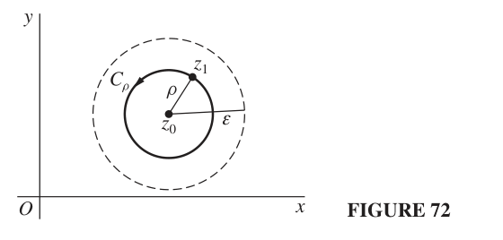

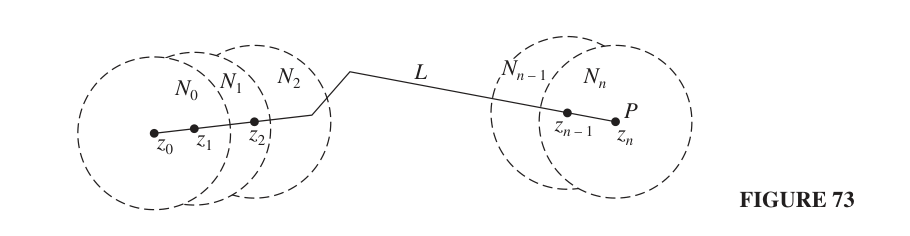

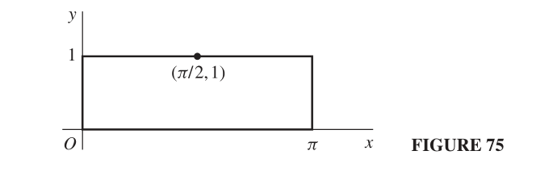

---

## 附录 A：核心公式速查表 (Master Formula Reference)

### 第一章 复数 (Complex Numbers)
$$i^2=-1,\qquad z\bar z=|z|^2,\qquad z^{-1}=\frac{\bar z}{|z|^2},\qquad \operatorname{Re}z=\frac{z+\bar z}{2},\qquad \operatorname{Im}z=\frac{z-\bar z}{2i}$$
$$\bigl||z_1|-|z_2|\bigr|\le|z_1\pm z_2|\le|z_1|+|z_2|,\qquad \sqrt{2}|z|\ge|\operatorname{Re}z|+|\operatorname{Im}z|$$
$$e^{i\theta}=\cos\theta+i\sin\theta,\qquad z=re^{i\theta},\qquad z^n=r^ne^{in\theta},\qquad (\cos\theta+i\sin\theta)^n=\cos n\theta+i\sin n\theta$$
$$c_k=\sqrt[n]{r_0}\exp\!\left[i\left(\frac{\theta_0}{n}+\frac{2k\pi}{n}\right)\right]\;(k=0,\dots,n-1),\qquad \omega_n=e^{i2\pi/n},\qquad 1+\omega_n+\cdots+\omega_n^{n-1}=0$$

### 第二章 解析函数 (Analytic Functions)
$$f(z)=u(x,y)+iv(x,y)=u(r,\theta)+iv(r,\theta),\qquad f'(z_0)=\lim_{\Delta z\to 0}\frac{f(z_0+\Delta z)-f(z_0)}{\Delta z}$$
$$\text{直角 CR：}u_x=v_y,\;u_y=-v_x,\quad f'=u_x+iv_x=v_y-iu_y;\qquad \text{复形式：}\frac{\partial f}{\partial\bar z}=\frac{1}{2}\left(\frac{\partial}{\partial x}+i\frac{\partial}{\partial y}\right)f=0$$
$$\text{极坐标 CR：}ru_r=v_\theta,\;u_\theta=-rv_r,\quad f'(z_0)=e^{-i\theta}(u_r+iv_r)=\frac{-i}{z_0}(u_\theta+iv_\theta)\quad(r\neq 0)$$
$$\text{拉普拉斯方程：}u_{xx}+u_{yy}=0,\qquad r^2u_{rr}+ru_r+u_{\theta\theta}=0;\qquad \text{反射原理：}\overline{f(z)}=f(\bar z)\iff f(x)\in\mathbb{R}$$

### 第三章 初等函数 (Elementary Functions)
$$e^z=e^xe^{iy},\quad |e^z|=e^x,\quad e^{z+2\pi i}=e^z;\qquad \log z=\ln|z|+i\arg z,\quad \operatorname{Log}z=\ln r+i\Theta\;(-\pi<\Theta\le\pi)$$
$$\frac{d}{dz}\log z=\frac{1}{z},\qquad z^c=e^{c\log z},\qquad \frac{d}{dz}z^c=cz^{c-1},\qquad c^z=e^{z\log c},\qquad \frac{d}{dz}c^z=c^z\log c$$
$$\sin z=\frac{e^{iz}-e^{-iz}}{2i}=\sin x\cosh y+i\cos x\sinh y,\qquad |\sin z|^2=\sin^2x+\sinh^2y,\qquad |\sinh y|\le|\sin z|\le\cosh y$$
$$\cos z=\frac{e^{iz}+e^{-iz}}{2}=\cos x\cosh y-i\sin x\sinh y,\qquad |\cos z|^2=\cos^2x+\sinh^2y,\qquad |\sinh y|\le|\cos z|\le\cosh y$$
$$\sinh z=\frac{e^z-e^{-z}}{2}=-i\sin(iz),\qquad \cosh z=\frac{e^z+e^{-z}}{2}=\cos(iz),\qquad \cosh^2z-\sinh^2z=1$$
$$|\sinh z|^2=\sinh^2x+\sin^2y,\qquad |\cosh z|^2=\sinh^2x+\cos^2y,\qquad |\sinh x|\le|\cosh z|\le\cosh x$$
$$\sin^{-1}z=-i\log\!\left[iz+(1-z^2)^{1/2}\right],\quad \cos^{-1}z=-i\log\!\left[z+i(1-z^2)^{1/2}\right],\quad \tan^{-1}z=\frac{i}{2}\log\frac{i+z}{i-z}$$
$$\sinh^{-1}z=\log\!\left[z+(z^2+1)^{1/2}\right],\quad \cosh^{-1}z=\log\!\left[z+(z^2-1)^{1/2}\right],\quad \tanh^{-1}z=\frac{1}{2}\log\frac{1+z}{1-z}$$

### 第四章 复积分 (Integrals)
$$\int_C f(z)\,dz=\int_a^b f(z(t))z'(t)\,dt,\qquad \left|\int_C f(z)\,dz\right|\le\int_C|f(z)|\,|dz|\le ML,\qquad \operatorname{Area}(R)=\frac{1}{2i}\oint_C\bar z\,dz$$
$$\oint_{|z-z_0|=R}(z-z_0)^{n-1}\,dz=\begin{cases}2\pi i,&n=0\\ 0,&n\neq 0\end{cases},\qquad \oint_{|z|=1}z^m\bar z^n\,dz=\begin{cases}2\pi i,&n=m+1\\ 0,&n\neq m+1\end{cases}$$
$$f^{(n)}(a)=\frac{n!}{2\pi i}\oint_C\frac{f(z)}{(z-a)^{n+1}}\,dz,\qquad |f^{(n)}(a)|\le\frac{n!\,M_R}{R^n},\qquad f(a)=\frac{1}{2\pi}\int_0^{2\pi}f(a+\rho e^{i\theta})\,d\theta$$

---

## 附录 B：高频经典反例与失效条件总表 (Classic Counterexamples & Failure Conditions)

| 对象 / 函数 | 现象 / 打破的直觉 | 所属章节 |
|---|---|---|
| $z_1=-1,\;z_2=i$ | $\operatorname{Arg}(z_1z_2)=-\frac{\pi}{2}\neq\frac{3\pi}{2}=\operatorname{Arg}z_1+\operatorname{Arg}z_2$（主幅角加法越界） | 1.4 |
| $0<\lvert z\rvert\le 1$；$0\le\arg z\le\frac{\pi}{4}\;(z\neq 0)$ | 既不开也不闭的集合 | 1.6 |
| $S=\{0\}$ | $0$ 是边界点，但**不是**聚点（边界点用非去心邻域，聚点用去心邻域） | 1.6 |
| $z_n=i^n$ | 有限点集（只取 4 值），无聚点 | 1.6 |
| $z/\bar z$ 与 $(z/\bar z)^2$ | 原点极限不存在；后者沿实、虚轴均得 $1$，沿 $y=x$ 得 $-1$ | 2.2 |
| $\bar z$、$\operatorname{Re}z$、$\operatorname{Im}z$ | 处处连续光滑，却**处处不可导** | 2.4 |
| $\lvert z\rvert^2$ | 仅在 $z=0$ 可导（$f'(0)=0$），**处处不解析**，且**没有奇点** | 2.4 / 2.7 |
| $\bar z^2/z\;(z\neq 0),\;0\;(z=0)$ | 原点满足 CR 方程却**不可导**（CR 方程必要非充分） | 2.5 |
| $x^3+i(1-y)^3$；$x^2+iy^2$ | 分别仅在单点 $z=i$、直线 $y=x$ 可导，均**处处不解析** | 2.6 / 2.7 |
| $\sin(\pi/z)$ | 在 $z=1/n$ 全为零却不恒零（极限点 $0$ 不在定义域内） | 2.9 |
| $e^z$ | 可取负值（$e^{i\pi}=-1$）；有纯虚周期 $2\pi i$；$\log(e^z)=z+2n\pi i\neq z$ | 3.1 / 3.2 |
| $\operatorname{Log}[(-1+i)^2]$ 与 $\operatorname{Log}(-1\cdot(-1))$ | 主值对数乘法/幂法则失效，差 $2\pi i$ | 3.2 / 3.3 |
| $\log(i^2)\neq 2\log i$ | 连多值集合也不相等；在分支 $(\frac{3\pi}{4},\frac{11\pi}{4})$ 上差 $-4\pi i$ | 3.2 / 3.3 |
| $i^i=e^{-(2n+\frac{1}{2})\pi}$ | 无穷多值且**全部是正实数** | 3.4 |
| $(z_2z_3)^i=z_2^iz_3^i e^{-2\pi}$ | 异底主值复幂指数律跨割线多出因子 $e^{-2\pi}$ | 3.4 |
| $\sin z,\;\cos z$ | 复平面上**无界**（$y\to\pm\infty$ 指数爆炸） | 3.5 |
| $\overline{\sin z},\;\overline{\cos z},\;\exp\bar z$ | 一见共轭，解析性即死（**处处不解析**） | 3.1 / 3.5 |
| $\cosh z=0$ | 实轴无解，复平面虚轴有无穷多解 $z=(\frac{\pi}{2}+n\pi)i$ | 3.6 |
| $w(t)=e^{it}\;(0\le t\le 2\pi)$ | 复值微分中值定理（罗尔定理）与积分中值定理同时失效 | 4.1 |
| $\oint_{\lvert z\rvert=1}\frac{dz}{z}=2\pi i$ | 曲线上处处解析但内部有奇点，闭路积分不为零；$\lvert 1/z\rvert\to 0$ 不足以令积分趋零 | 4.3 / 4.4 |
| $f(z)=z$ 于 $\lvert z\rvert\le 1$ | 最小模 $0$ 取在内点 $z=0$（最小模原理必须排除零点） | 4.10 |

---

## 附录 C：全提纲中英专业术语对照表 (Complete Chinese–English Terminology Glossary)

### 第一章 复数 (Complex Numbers)
| 中文术语 | English Term | 所属小节 |
|---|---|---|
| 复数 / 复平面 | complex number / complex plane | 1.1 |
| 有序对 / 封闭性 | ordered pair / closure | 1.1 |
| 实部 / 虚部 / 实轴 / 虚轴 | real part / imaginary part / real axis / imaginary axis | 1.1 |
| 纯虚数 / 虚数单位 | pure imaginary number / imaginary unit | 1.1 |
| 域 / 整环 / 无零因子 | field / integral domain / no zero divisors | 1.1 |
| 交换律 / 结合律 / 分配律 | commutative / associative / distributive laws | 1.1 |
| 加法逆元 / 乘法逆元 / 单位元 | additive inverse / multiplicative inverse / identity | 1.1 |
| 分母实数化 / 二项式定理 | rationalizing the denominator / binomial formula | 1.1 |
| 向量 / 径向量 / 平行四边形法则 | vector / radius vector / parallelogram law | 1.2 |
| 模 / 绝对值 / 三角不等式 | modulus / absolute value / triangle inequality | 1.2 |
| 反向三角不等式 / 垂直平分线 | reverse triangle inequality / perpendicular bisector | 1.2 |
| 共轭复数 / 反射 / 保距变换 / 自同构 | complex conjugate / reflection / isometry / automorphism | 1.3 |
| 极坐标形式 / 指数形式 / 欧拉公式 | polar form / exponential form / Euler's formula | 1.4 |
| 幅角 / 幅角主值 | argument ($\arg z$) / principal value of the argument ($\operatorname{Arg}z$) | 1.4 |
| 棣莫弗公式 / 切比雪夫多项式 | de Moivre's formula / Chebyshev polynomials | 1.4 |
| 拉格朗日三角恒等式 | Lagrange's trigonometric identity | 1.4 |
| $n$ 次方根 / 主根 / $n$ 次单位根 | $n$-th roots / principal root / $n$-th roots of unity | 1.5 |
| $\varepsilon$ 邻域 / 去心邻域（挖点圆盘） | $\varepsilon$-neighborhood / deleted neighborhood (punctured disk) | 1.6 |
| 内点 / 外点 / 边界点 / 边界 | interior point / exterior point / boundary point / boundary | 1.6 |
| 开集 / 闭集 / 闭包 | open set / closed set / closure | 1.6 |
| 连通 / 折线 / 环域 | connected / polygonal line / annulus | 1.6 |
| 域 / 区域 / 有界 / 无界 | domain / region / bounded / unbounded | 1.6 |
| 聚点（极限点）/ 孤立点 | accumulation point (limit point) / isolated point | 1.6 |

### 第二章 解析函数 (Analytic Functions)
| 中文术语 | English Term | 所属小节 |
|---|---|---|
| 定义域 / 陪域 / 值域 | domain of definition / codomain / range | 2.1 |
| 分量函数 / 多项式 / 有理函数 | component functions / polynomial / rational function | 2.1 |
| 多值函数 / 主分支 | multiple-valued function / principal branch | 2.1 |
| 映射（变换）/ 像 / 原像 / 向量场 | mapping (transformation) / image / inverse image / vector field | 2.1 |
| 平移 / 旋转 / 反射 / 儒可夫斯基变换 | translation / rotation / reflection / Joukowski transformation | 2.1 |
| 极限 / 唯一性 / 路径无关 | limit / uniqueness / path independence | 2.2 |
| 无穷远点 / 扩充复平面 | point at infinity / extended complex plane | 2.3 |
| 黎曼球 / 球极投影 | Riemann sphere / stereographic projection | 2.3 |
| 分式线性变换（莫比乌斯变换） | linear fractional transformation (Möbius transformation) | 2.3 |
| 连续性 / 复合函数 / 紧致 | continuity / composition / compact (closed and bounded) | 2.3 |
| 导数 / 可导（可微）/ 链式法则 | derivative / differentiable / chain rule | 2.4 |
| 勒让德多项式 / 洛必达法则 | Legendre polynomials / L'Hôpital's rule | 2.4 |
| 柯西-黎曼方程 / 维廷格导数 | Cauchy–Riemann equations / Wirtinger derivative | 2.5 |
| 充分条件 / 必要条件 | sufficient condition / necessary condition | 2.5 / 2.6 |
| 解析（全纯、正则）/ 整函数 | analytic (holomorphic, regular) / entire function | 2.7 |
| 奇点 / 常数定理 | singular point (singularity) / constant theorem | 2.7 |
| 调和函数 / 拉普拉斯方程 / 拉普拉斯算子 | harmonic function / Laplace's equation / Laplacian | 2.8 |
| 共轭调和函数 / 等值线 / 正交族 | harmonic conjugate / level curves / orthogonal families | 2.8 |
| 唯一性定理 / 重合原理 | uniqueness theorem / coincidence principle | 2.9 |
| 解析延拓 / 元素 / 反射原理 | analytic continuation / elements / reflection principle | 2.9 |

### 第三章 初等函数 (Elementary Functions)
| 中文术语 | English Term | 所属小节 |
|---|---|---|
| 复指数函数 / 纯虚周期 / 基本域 | complex exponential function / pure imaginary period / fundamental region | 3.1 |
| 复对数函数 / 主值 / 黎曼面 | logarithmic function / principal value / Riemann surface | 3.2 |
| 分支 / 主分支 / 支割线 / 支点 | branch / principal branch / branch cut / branch point | 3.3 |
| 复幂函数 / 复指数幂 | power function / complex exponents | 3.4 |
| 复三角函数 / 零点 / 无界性 | trigonometric functions / zeros / unboundedness | 3.5 |
| 双曲函数（双曲正弦、余弦、正切等） | hyperbolic functions ($\sinh, \cosh, \tanh, \coth, \operatorname{sech}, \operatorname{csch}$) | 3.6 |
| 反三角函数 / 反双曲函数 / 临界点 | inverse trigonometric / inverse hyperbolic functions / critical point | 3.7 |

### 第四章 复积分 (Integrals)
| 中文术语 | English Term | 所属小节 |
|---|---|---|
| 实参数复值函数 / 反常积分 | complex-valued function of a real variable / improper integral | 4.1 |
| 微积分基本定理 / 中值定理 / 罗尔定理 | Fundamental Theorem of Calculus / Mean Value / Rolle's Theorem | 4.1 |
| 有向弧 / 简单弧（若尔当弧） | directed arc / simple arc (Jordan arc) | 4.2 |
| 简单闭曲线（若尔当曲线）/ 正向 | simple closed curve (Jordan curve) / positive orientation | 4.2 |
| 光滑弧 / 围道（分段光滑弧）/ 换参 | smooth arc / contour (piecewise smooth arc) / reparameterization | 4.2 |
| 围道积分 / 路径依赖 | contour integral / path dependence | 4.2 / 4.3 |
| 积分三角不等式 / ML 不等式（估计引理） | integral triangle inequality / ML inequality (estimation lemma) | 4.4 |
| 原函数 / 路径无关 | antiderivative / independence of path | 4.5 |
| 格林公式 / 柯西-古尔萨定理 | Green's theorem / Cauchy–Goursat theorem | 4.6 |
| 嵌套方格引理 / 局部线性化 | nested squares lemma / local linearization | 4.6 |
| 单连通域 / 复连通域 | simply connected domain / multiply connected domain | 4.7 |
| 路径变形原理 / 辅助割线 | principle of deformation of paths / auxiliary crosscuts | 4.7 |
| 柯西积分公式 / 广义柯西积分公式 | Cauchy integral formula / extended Cauchy integral formula | 4.8 |
| 莫雷拉定理 / 柯西不等式（柯西估计） | Morera's theorem / Cauchy's inequality (Cauchy estimates) | 4.9 |
| 刘维尔定理 / 代数基本定理 | Liouville's theorem / Fundamental Theorem of Algebra | 4.9 |
| 高斯平均值定理 | Gauss's mean value theorem | 4.10 |
| 最大模原理 / 最小模原理 | maximum modulus principle / minimum modulus principle | 4.10 |
