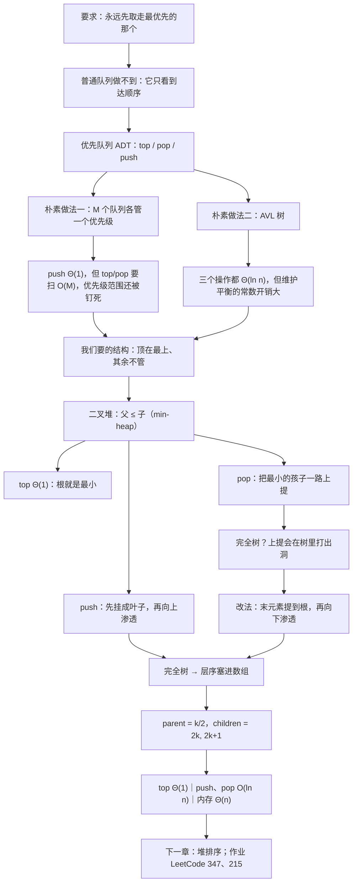

# C7.1 堆与优先队列

> [!abstract] 这一讲的任务
> 前面几章的顺序都是**显式**给定的：谁在谁前面，由程序员排好（数组、链表），或者由到达时间决定（栈、队列、双端队列）。搜索树第一次把顺序变成**隐式**的——顺序由数据本身的大小决定，中序遍历出来自然有序。
> 这一讲换个方向：我们**只**保留"能立刻拿到最大的那个"这一条需求，把其余的顺序要求全部丢掉。丢掉之后换来了什么？换来了 $O(1)$ 的取最大值和 $O(\ln n)$ 的插入删除，换来了一个能塞进数组里、不需要任何指针的树——**堆 heap**。
> 这一讲真正要讲透的只有一句话：**堆只保证父结点与子结点之间的大小关系，此外什么都不保证。** 理解这句话的人和没理解的人，写出来的代码会差得很远。

> [!info] 怎么读这份讲义
> **全章只用这一个文件**，首次学习按目录顺读；复习时先看「十二、这一讲的三句话」与两张速查表。
> 第四、五、六节是本讲的主干（三个操作 → 完全树 → 数组实现），第七节把代价收口；**第五、六节交界处是本讲最容易卡住的地方**——「为什么完全树不能沿用提升最小孩子的删法」，不要跳。
> 正文里标 **（补充）** 的小节是原稿没有展开、按教材与通行讲法补出来的（例如 C++ 参考实现、建堆为什么是 $\Theta(n)$、STL 的 `priority_queue`），推理性的判断会明说是推测。
> 已知的原稿笔误集中在第十一节，涉及图与数组的地方我在正文里当场点出，不留到最后。

> [!info] 标注说明与授课进度
> 标有 **（补充）** 的内容，是**材料里没有展开、由教材与通行讲法延伸补充**的部分；复习时先掌握未标注的主干。
> **授课进度**：老师刚讲完树（第 6 章）。本篇对应材料的内部编号是 **7.1–7.2.6**，紧接搜索树之后，是下一讲的内容；**本篇尚无课堂转写稿**，因此不逐条区分「课堂讲过」与「拓展补充」——请按「整篇尚未授课」理解。拿到本讲转写稿后，再按与前几章相同的规则做合并、补标与标记退役。

> [!info] 课程信息与来源
> **Ya-Hui Jia（贾雅慧）｜SFT SCUT｜jiayahui@scut.edu.cn｜课程群 309044012**。考核方式、教材、考勤等全课程信息见 [[C1.0 课程信息与C++预备]] 与 [[数据结构 MOC]]。
> 材料的内部编号为 **7.x**（接在搜索树的 6.x 之后），本库记为**第 7 章**。文件名 C7.1 表示本章唯一的全章讲义，不表示只整理了 7.1 一节。



## 目录与页码对应

| 阅读入口 | 页码 | 内容 |
| --- | --- | --- |
| [[#零、开场：分诊台前没有队伍]]、[[#一、优先队列 ADT]] | 1–6 | 背景、定义、三个操作、字典序优先级 |
| [[#二、两种朴素实现：都能用，都不够好]] | 7–14 | Θ(1) 目标、M 个队列数组、AVL 树 |
| [[#三、二叉堆：只要求父不大于子]] | 15–19 | min-heap 定义、两棵子树无关、例子 |
| [[#四、三个操作（先不管形状）]] | 20–36 | top、pop 提升最小孩子、push 与上滤 percolation |
| [[#五、形状问题：用完全二叉树维持平衡]] | 37–54 | 平衡的动机、完全树、完全树上的 push 与 pop |
| [[#六、数组表示：整棵树塞进一个数组]] | 55–67 | 层序填数组、父子下标公式、数组上的 push |
| [[#七、数组上的 pop：末元素提到根再下沉]] | 68–85 | 三次出队的完整轨迹、下标过程 |
| [[#八、代价收口：为什么是 O(ln n)]] | 86–87 | top/push/pop 的运行时间 |
| [[#九、最大堆：换个不等号就换名字]] | 88 | max-heap 与对称性 |
| [[#十、优先队列都用在哪里（补充）]] | — | 堆排序、Top-K、Dijkstra/Prim、Huffman、调度、双堆中位数、STL |
| [[#十一、章节作业与解题路线]] | 89 | LeetCode 347、215 |
| [[#十二、原稿勘误与阅读边界]]、[[#十三、这一讲的三句话]] | 全章 | 校正口径、速查表与复习 |

---

## 零、开场：分诊台前没有队伍

夜里十一点，急诊分诊台。护士面前坐着五个刚到的病人：一个捂着胸口、脸色发白，一个骨折了疼得直叫，还有三个是轻微的划伤。如果按"先来后到"办事，第一个进诊室的应该是那个划伤的人——因为他来得最早。

但护士不会这么做。她扫了一眼，把那个捂胸口的直接推进抢救室。

你刚才看到了两件事：**「排队」这件事本身没变，变的只有"谁先被服务"的规则**——不再是到达时间，而是**病情（优先级）**。你已经很熟悉的队列（[[C4.1 队列 Queue]]）在这里完全失效：它唯一的规则就是 FIFO。

再看一个你更可能亲手遇到的版本：实验室那台只有四张 GPU 的服务器。要跑的任务上百个，教授要的那张对比图必须今晚出，学生自己的探索性实验可以等。你写了一个 `std::queue` 把任务按提交顺序排起来，然后发现——**没有任何一行代码可以让"教授的图"插到前面去**。你能做的只有等，或者手动改提交顺序（下一批任务又乱了）。

> [!question] 停一下，先自己想想
> 不许改队列的代码，只允许在入队时多带一个信息。你能想到什么办法，让这台服务器"永远先跑最重要的任务"？

最朴素的办法是：**给每个任务贴一个数字**，数字越小越紧急；入队时按这个数字插到合适的位置，出队时永远取那个数字最小的。你刚刚描述的这个东西，就是这一讲的抽象数据类型——**优先队列 Priority Queue**。

## 一、优先队列 ADT

### 1.1 把规则从"到达时间"换成"优先级"（p.4）

复习一句：队列的次序可以总结为**先进先出 first in, first out**。换成优先队列：

> [!important] 优先队列的定义
> **如果每个对象都关联一个优先级，我们想要弹出的就是优先级最高的那个对象。**
> 每个入队的对象携带一个**非负整数**（$0,1,2,\dots$），其中：
> - **数值 $0$ 的优先级最高**；
> - **数值越大，优先级越低**。

注意这个方向：**小数字 = 高优先级**。这不是随便定的——它和第 3、4 章里"最小值更重要"的习惯一致，也和第 6 章 BST 的"左小右大"一致。第一次看到"优先级 0 最高"的人常在代码里写成 `max`，然后被自己的数据打败。**看到 `priority` 这个词，先确认数字的方向，再动手。**

### 1.2 三个操作，以及一件反直觉的事（p.5）

优先队列对外只有三个操作：

| 操作 | 含义 | 与队列的对照 |
| --- | --- | --- |
| `top` | 读**当前优先级最高**的对象（不删除） | 相当于队列的 `front`，但取的不是队首而是"最优先者" |
| `pop` | 删除**当前优先级最高**的对象 | 相当于队列的 `pop` |
| `push` | 把一个新对象放进队列 | 相当于队列的 `push`，但**落点由优先级决定** |

> [!important] 优先级队列的 top 在哪里？
> 队列的队首永远在端点：新元素只能接在队尾。**优先队列不是这样**——`push` 把新对象**放进它该在的位置**（in the appropriate place），而 `top` 指的是**优先级最高的那个对象所在的位置**。
> 换句话说：**队列的操作发生在两端，优先队列的操作可以发生在中间。** 这正是实现它的代价来源。

![[C7-优先队列的三个操作.png]]

上面这张图把三件事画在了一起：`top` 指向当前最优先的对象；`pop` 把它取走；`push` 则把新对象**插进序列中它该在的位置**——而不是尾部。请盯住中间那张：`pop` 之后那个位置会空出来，后面的元素要怎么处理？这就是后面所有实现的战场。

### 1.3 队列的"别名"，在这里变成了"二维优先级"（p.6）

优先队列还有一种常见变体：**优先级本身由多个变量决定**。

> [!important] 字典序优先级 Lexicographical Priority
> 用两个值 $(a,b)$ 表示一个优先级时，$(a,b)$ 比 $(c,d)$ **更优先**，当且仅当：
> $$a<c \quad\text{或者}\quad \bigl(a=c\ \text{且}\ b<d\bigr)$$
> 也就是先比第一个分量，第一个分量相同再比第二个——**字典序**。

例子：$(5,19)$、$(13,1)$、$(13,24)$、$(15,0)$ 四个优先级**都高于** $(15,7)$。

逐条核对一遍（这一步手算过就不会记错）：

| 优先级对 | 比较过程 | 是否高于 $(15,7)$ |
| --- | --- | --- |
| $(5,19)$ | $5<15$ | 是 |
| $(13,1)$ | $13<15$ | 是 |
| $(13,24)$ | $13<15$ | 是（第二个分量 $24>7$ 也没用，第一关就定了） |
| $(15,0)$ | $15=15$ 且 $0<7$ | 是 |
| $(16,0)$ | $16>15$ | 否 |

> [!note] 这三行就是"优先级"三个字最实用的形态（补充）
> 现实里的优先级几乎从来不是一个数字：
> - **操作系统的进程调度**：先比优先级（nice 值），再比已等待时间；
> - **GPU 任务队列**：先比用户等级，再比提交时间——$(等级, 提交时间)$ 正是上面这个字典序；
> - **数据库的 ORDER BY a, b**、Python 的元组比较、C++ 的 `std::pair` 的 `operator<`：**全是同一个定义**。
> 所以"优先级"不必是一个整数，**只要它是一个"能比较大小"的东西**就够了。这也是后面 `std::priority_queue` 能接收任意自定义比较器的原因。

## 二、两种朴素实现：都能用，都不够好

### 2.1 先定一条工程指标（p.7）

> 我们的目标：**让每个操作的运行时间尽可能接近 $\Theta(1)$。**

这条指标是整个第 7 章的驱动力。请注意它出现的位置——在讲任何实现之前。这就是数据结构设计的正常顺序：**先说清要什么代价，再去想用什么结构。**（对照 [[C1.2 抽象数据类型与容器操作]]：ADT 定接口，实现定代价。）

手边已有的东西里，能拿来当优先队列的有两个：**多个队列**，和**AVL 树**。下一页就分别看它们为什么会卡住。

### 2.2 朴素做法一：M 个队列，一个优先级一条（p.8–11）

想法非常直白：

- 假设优先级只有固定的 $M$ 种；
- 开一个长度为 $M$ 的数组，**每个元素是一条队列**；
- `push`：按对象的优先级，把它放到对应的那条队列里；
- `top` / `pop`：从优先级 0 开始，找到**第一条非空的队列**，取它的队首。

```cpp
template <typename Type, int M>
class Multiqueue {
    private:
        queue<Type> queue_array[M];
        int queue_size;
    public:
        Multiqueue();
        bool empty() const;
        Type top() const;
        void push( Type const &, int );
        Type pop();
};

template <typename Type, int M>
Multiqueue<Type>::Multiqueue(): queue_size( 0 ) {
    // 编译器为 M 条队列分配内存，并在每条上调用构造函数
}

template <typename Type, int M>
bool Multiqueue<Type>::empty() const {
    return ( queue_size == 0 );
}

template <typename Type, int M>
void Multiqueue<Type>::push( Type const &obj, int pri ) {
    if ( pri < 0 || pri >= M ) {
        throw illegal_argument();
    }
    queue_array[pri].push( obj );
    ++queue_size;
}

template <typename Type, int M>
Type Multiqueue<Type>::top() const {
    for ( int pri = 0; pri < M; ++pri ) {
        if ( !queue_array[pri].empty() ) {
            return queue_array[pri].front();
        }
    }
    // 优先队列为空
    throw underflow();
}

template <typename Type, int M>
Type Multiqueue<Type>::pop() {
    for ( int pri = 0; pri < M; ++pri ) {
        if ( !queue_array[pri].empty() ) {
            --queue_size;
            return queue_array[pri].pop();
        }
    }
    // 优先队列为空
    throw underflow();
}
```

代价一算就清楚了：

| 操作 | 代价 | 为什么 |
| --- | --- | --- |
| `push` | $\Theta(1)$ | 直接往 `queue_array[pri]` 里塞，一步到位 |
| `top` / `pop` | $O(M)$ | 从 0 号开始线性扫描，最坏要走过全部 $M$ 条队列 |
| 内存 | $\Theta(M+n)$ | $M$ 条队列本身的开销，加上 $n$ 个元素 |

它还有两个硬伤（原稿点得很直接）：

1. **把优先级的取值范围钉死了**：优先级必须是 $0..M-1$ 的整数，`push` 里那一行 `pri < 0 || pri >= M` 就是这条限制的代码化；
2. **内存开销与 $M$ 挂钩**：$\Theta(M+n)$——$M$ 很大时（比如优先级是 64 位整数）这套做法直接出局。

> [!question] 停一下，先自己想想
> 明明已经知道"当前最小优先级是几"这件事很重要，为什么不能额外维护一个变量记住它？

因为**最小值会变大**。想象当前最优先的那条队列被掏空了：下一个"最优先"是谁？你只知道它一定在更大的编号里，但**具体是几要靠扫描才能知道**。要维护这个变量，就得在每次 `push` 时更新最小值、每次 `pop` 后重新计算——后者又回到 $O(M)$。**这是典型的"没有免费午餐"：不扫描就得维护，维护本身也要扫描。**

### 2.3 朴素做法二：AVL 树（p.12）

第二个念头是拿第 6 章的成果直接用：**把对象按优先级插进一棵 AVL 树**，`front` 返回最小值（最左结点），`remove` 删掉它。

> 插入是 $\Theta(\ln n)$；`front` 是 $\Theta(\ln n)$；删除是 $\Theta(\ln n)$。
> 但**维护树的结构与平衡有相当大的额外开销**（significant overhead）。

它的接口大致长这样（原稿给的三行）：

```cpp
void insert( Type const & );   //    Θ(ln n)
Type front();                  //    Θ(ln n)
bool remove( front() );        //    Θ(ln n)
```

它的问题不是"不够快"，而是**"用错了工具"**：

| 维度 | AVL 树 | 我们真正需要的 |
| --- | --- | --- |
| 能力 | 全序，中序遍历有序，支持任意查找、前驱后继 | 只要"最小的那个" |
| 代价 | 每次插入删除都要维护平衡（旋转、高度更新） | 越少越好 |
| 内存 | 每结点两个指针 + 平衡信息 | 尽量紧凑 |

> [!important] 停一下，我们刚才干了什么
> 我们连着否掉了两个方案，但**否掉的理由不一样**：
> - **M 个队列**：能力不够（优先级范围被钉死、内存 $\Theta(M+n)$）；
> - **AVL 树**：能力过剩——它提供了远多于我们需要的功能，每个多余的能力都要用运行时间或内存来付账。
>
> 这条思路在整门课里反复出现：**先砍需求，再选结构。** 我们只保留"最优先者可见"这一条，其余一概不要。下一页开始，砍出来的就是堆。

### 2.4 补一张完整对照表（补充）

把这一节和后面要给的答案放在一起，五种实现一眼看清（堆的一行是后文结论，先记住位置）：

| 实现 | `push` | `top` | `pop` | 额外内存 | 优先级范围 |
| --- | --- | --- | --- | --- | --- |
| 无序数组 | $\Theta(1)$ | $\Theta(n)$ | $\Theta(n)$ | $\Theta(n)$ | 任意 |
| 有序数组（升序） | $\Theta(n)$ | $\Theta(1)$ | $\Theta(n)$ | $\Theta(n)$ | 任意 |
| 有序链表 | $\Theta(n)$ | $\Theta(1)$ | $\Theta(1)$ | $\Theta(n)$ | 任意 |
| M 个队列 | $\Theta(1)$ | $O(M)$ | $O(M)$ | $\Theta(M+n)$ | 只有 $M$ 档 |
| AVL 树 | $\Theta(\ln n)$ | $\Theta(\ln n)$ | $\Theta(\ln n)$ | $\Theta(n)$ | 任意 |
| **二叉堆** | $O(\ln n)$ | $\Theta(1)$ | $O(\ln n)$ | $\Theta(n)$，**无指针** | 任意 |

**结论**：二叉树把它变成了 $O(\ln n)$ 的插入删除；堆进一步把"取最值"压到 $\Theta(1)$，同时把内存压到最紧。这就是它值得单独讲一章的理由。

## 三、二叉堆：只要求父不大于子

### 3.1 min-heap 的定义（p.16）

> [!important] 最小堆 Binary Min-Heap 的定义
> 一棵**非空**二叉树是一棵**最小堆**，如果：
> 1. **根结点的键小于或等于两棵子树（如果存在）中任一结点的键**；
> 2. **两棵子树（如果存在）本身也是最小堆**。
>
> 由这个定义可以直接读出两条：
> - **单个结点是一棵最小堆**（这给了递归的底）；
> - **任一子树中的所有键都大于根键**。

第 2 条是这个定义的精髓：**递归**。它把"整棵树是最小堆"这件事，化成了"每个局部都是最小堆"——这正是后面 `push`/`pop` 只需要顺着**一条路径**走的原因。

> [!warning] 定义里的 $\le$ 与推论里的 greater（口径）
> 定义写的是"根**小于或等于**子树的键"，而紧接着的推论写成"子树中所有键都**大于**根键"。两句只在**键互不相同**时才等价。
> **允不允许重复键？** 允许的话，父子相等不违反定义，但推论那句就写错了。写代码时一律用 $\le$（判断写成 `if (parent <= child) stop;`），别照抄那句 greater。考试里如果题目给了重复元素，**按定义判，不按推论判**。

### 3.2 最大的坑：两棵子树之间毫无关系（p.17、p.19）

翻开下一页，整页只有一句话，还是红色的：

> **重要：两棵子树里的元素之间不存在任何其他关系。**
> **不理解这一点，是学生犯的最大的错误。**

这句话的分量值得停下来单独说清楚。堆的定义只约束了**父与子**，没有约束**左与右**：

- **它不是二叉搜索树**。BST 保证"左子树全部小于根 < 右子树全部"；堆只保证"根 ≤ 自己的两个孩子"，**左子树和右子树之间可以任意交错**。在 [[C6.6 二叉搜索树]] 里，中序遍历能读出有序序列；**在这里，中序遍历什么也读不出来。**
- **第二小的元素有两个候选**：根的两个孩子中的较小者。
- **第三小的元素就已经说不清了**：它可能是某个孩子剩下的那个，也可能是更深处某个结点的孩子。想在堆里找第 $k$ 小，没有比"反复 pop"更好的通用办法。

![[C7-二叉堆示例.png]]

上面这棵就是一棵合法的二叉堆。用它的左子树来验证 3.2 节那句话：根是 $3$，左子树的根是 $7$；而**左子树里同时住着整棵树最小的元素 $7$ 和最大的元素 $89$**。它们一个是这棵子树的根，一个在很深的叶子位置，中间隔着 $9\to19$ 一条路径——**"它们在同一个子树里"这件事，对大小没有任何约束。**

> [!question] 停一下，先自己想想
> 在这棵树里，$15$ 和 $41$ 有什么关系？$33$ 和 $19$ 呢？

$15$ 是 $41$ 的父亲，所以 $15<41$。而 $33$ 和 $19$ 是**兄弟**：它们同属 $9$ 的孩子，堆的定义**完全没有**规定兄弟之间谁大谁小。这里 $33>19$，换成 $19>33$ 同样合法。**记住"只看父子、不看兄弟"这七个字，这个坑就填上了。**

### 3.3 三个操作摆上台面（p.20）

接下来看三个操作，注意：**这一节先不管树的形状**（形状问题到第五节才解决）。先把"在任意一棵二叉树堆上，这三个操作各自怎么做"讲清楚。

| 操作 | 一句话 | 代价 |
| --- | --- | --- |
| `top` | 读根 | $\Theta(1)$ |
| `pop` | 删根，再把堆补回去 | 与树高同阶 |
| `push` | 先放进去，再调整到合法位置 | 与树高同阶 |

## 四、三个操作（先不管形状）

### 4.1 top：$\Theta(1)$ 是白送的（p.21）

上面那棵树里，`top` 直接是**根**：$3$。

$$\texttt{top} = \text{根的值} = 3,\qquad \Theta(1)$$

这是"把最优先者放在根上"这个设计选择的全部红利：**不需要查找，取最值这件事被定义到了根的位置上。**

### 4.2 pop：把最小的孩子一路上提（p.22–29）

删掉根之后，根的位置空了。原稿给的规则是：

> **把"值最小的那棵子树"的根结点提升上来，然后从这个被提升的子树里递归地做同样的事。**

先别急着质疑这个做法，跟着它走一遍**删掉 $3$** 的全过程：

| 步骤 | 动作 | 结果 |
| --- | --- | --- |
| 1 | 删除根 $3$，根的位置空出来 | 空根 |
| 2 | 根的两个孩子是 $7$ 和 $12$，**较小的是 $7$** → 把 $7$ 提上来 | 根 $=7$，空的坑落到原来 $7$ 的位置 |
| 3 | 那个坑的两个孩子是 $9$ 和 $31$，较小的是 $9$ → 把 $9$ 提上来 | 坑落到 $9$ 原来的位置 |
| 4 | 坑的两个孩子是 $33$ 和 $19$，较小的是 $19$ → 把 $19$ 提上来 | 坑落到 $19$ 原来的位置 |
| 5 | 坑的两个孩子是 $88$ 和 $55$，较小的是 $55$ → 把 $55$ 提上来；$55$ 是叶子 | 把叶子删掉，坑消失 |

![[C7-pop-提升最小孩子.png]]

图里飘在最上方的 $3$ 就是被取走的那个值；整棵树仍然是合法的最小堆。

> [!question] 停一下，先自己想想
> 为什么每一步都只能提"较小的那个孩子"？如果第一步把 $12$ 提上来会怎样？

因为**提到空位上的结点，要同时满足两条约束**：它不能大于自己的新父亲（这里没有新父亲，它是根），而且**它必须不大于自己原来那两个孩子留下的所有后代**。$12$ 一上来，它的左孩子 $7$ 立刻违约——$12>7$，堆就坏了。**提较小的那个孩子，恰好是唯一能保住"父 ≤ 子"的选择。**

**再删一次。** 现在根是 $7$，把它删掉：根的两个孩子是 $9$ 和 $12$，提 $9$；坑的两个孩子是 $19$ 和 $31$，提 $19$；坑的两个孩子是 $33$ 和 $55$，提 $33$；$33$ 的孩子是 $36$，提 $36$；$36$ 是叶子，删掉。堆依旧合法。

**第三次就不一样了。** 现在根是 $9$，删掉它：它的两个孩子是 $19$ 和 $12$——**较小的那个在右边**。于是提升必须发生在**右子树**里，一路向下：$12$ 提到根，$15$ 提到 $12$ 的位置，$41$ 提到 $15$ 的位置，$42$ 提到 $41$ 的位置（$42$ 是叶子），最后删掉那个叶子。

![[C7-pop-改从右子树提升.png]]

> [!important] 这个例子必须看懂，因为它推翻了三个直觉
> 1. **"最小的一定在左边"是错的**：第 2 步比较的就是 $7$ 与 $12$ 两个孩子，谁小提谁，与左右无关；
> 2. **"坑只会往下走"是对的，但"只会沿着原来那条路走"是错的**：每一步都可能换边（上面第三次删除就从左子树换到了右子树）；
> 3. **"一次 pop 只动一个结点"是错的**：这里一次 pop 连锁动了 $12\to15\to41\to42$ 四个结点，路径长度就是**树高**。
>
> 第 3 条直接决定了代价：**pop 的代价与树高成正比**，不是常数。这句话在第八节会变成 $O(\ln n)$。

> [!note] 这种"提升最小孩子"的删法，和后面数组版的删法是两种流派（补充）
> 本节这种做法的特点是：**沿着最小孩子的路径把结点整体上提，坑一路下沉到一个叶子，然后删掉那个叶子**。它的优点是思维直观、不需要额外规则；缺点是**它改变的是树形**——坑走到哪个叶子，就删哪个叶子，**删掉的不一定是"最后一个结点"**。
> 在"树随便什么形状都行"的抽象堆里这没关系。可是到了第五节，我们必须让树的形状严格保持**完全树**——那时"删掉哪个叶子"就不自由了，于是不得不换成另一种做法（末元素提到根 + 向下渗透）。**这两节的差别，是本讲最值得记的一次"约束逼出算法"。**

### 4.3 push：先挂成叶子，再往上渗（p.30–36）

插入有两条路可走：

> - **在叶子处插入**（如果它比父亲小，就把它往上挪）；
> - **在根处插入**（把较大的那个对象往某棵子树里塞）。
>
> **二叉堆用第一种**；其他堆（例如左偏堆、斜堆一类）可能用第二种。

二叉堆选择"先挂叶子、再上移"是有道理的：**新结点从叶子开始向上爬，最多爬树高那么多步，而且一路上的比较都是"我和我父亲"**——每一步只需要一次比较、一次交换。

跟着走一遍**插入 $17$**：

| 步骤 | 动作 | 结果 |
| --- | --- | --- |
| 1 | 选一个位置，把 $17$ 挂成一个新叶子 | $17$ 挂在 $32$ 下面 |
| 2 | $17<32$ → 交换 | $17$ 上移到 $32$ 的位置 |
| 3 | $17<31$ → 交换 | $17$ 继续上移 |
| 4 | $17<19$ → 交换 | $17$ 再上移 |
| 5 | $17>12$ → **停止** | 到位 |

![[C7-push-先挂成叶子.png]]

![[C7-push-上滤终态.png]]

比一比前后两张图：$17$ 从最底下爬到了根的左孩子位置，而它经过的每一个位置上的结点都依次往下让了一格。**整棵树仍然是最小堆。**

> [!important] 为什么爬到"比父亲大"就可以收手（这是全讲最漂亮的一步）
> 停下来的时候，$17$ 已经满足"$\ge$ 父亲"了。可是它的**两个新孩子**（原来是 $19$ 的孩子：$31$ 和 $58$）凭什么还 $\ge 17$？
> 看第 5 步之前的状态：$19$ 当时是 $31$ 和（原来的）$58$ 的父亲，所以 $19\le31$、$19\le58$。而 $17$ 是在 $19<17$ 之前才继续上移的——也就是说 $17<19$。把两条链起来：
> $$17<19\le 31,\qquad 17<19\le58$$
> **所以 $17$ 一定小于它接手的这两个孩子，不需要再往下比较一次。** 这就是原稿那句观察的意思："$19$ 的左右两棵子树都大于 $19$，因此我们保证不需要把新结点往下送。"
> 换句话说：**一路上移的过程中，被让位的每个结点都已经替我们"看住"了它下面的整棵子树。** 这就是为什么 push 只需要沿着一条路径走，而不用四处检查。

这个过程有个专门的名字：

> [!important] 渗透 Percolation
> **percolation（渗透）**：较轻（较小）的对象从最小堆的底部**向上移动**的过程。
> 反向的那一半——让过大的对象从根**向下移动**——通常叫下滤（percolate down）。**上滤与下滤，是堆的两条腿**，后面数组实现里它们会以 `posn /= 2` 和 `posn = 最小的孩子` 两个式子出现。

## 五、形状问题：用完全二叉树维持平衡

### 5.1 这个问题我们见过：平衡（p.37）

在二叉搜索树那一章，我们花了一整节讨论这件事：**同样的操作是 $O(h)$ 的，所以 $h$ 决定一切**。为了避免树退化成链，我们引入了"平衡"的概念，并看了 AVL 树、B 树、红黑树（红黑树不属本课范围）。

现在轮到堆了。问题原样重现：

> **我们怎么决定插在哪里，才能保持平衡？**

区别在于：BST 的插入位置是被键的大小**唯一确定**的（你必须插在查找失败的那个空位），平衡只能靠事后旋转找回来；而**堆的插入位置几乎不受键的约束**（只要满足父 ≤ 子），这给了我们更大的自由。用第 6 章的经验来看，这是一次"把约束放松换自由"的机会。

### 5.2 用完全二叉树来定形状（p.38–40）

> 保持二叉堆平衡有多种办法：**完全二叉树**、**左偏堆 leftist heaps**、**斜堆 skew heaps**。
> **我们采用完全二叉树**：它有着**最优的内存特性**，但**运行时间特性是次优的**。

为什么说"内存最优"？看下一页的两步推理：

1. **完全树可以用最小的力气维持形状**：完全树的定义是"逐层从左到右填满"，所以插入永远只发生在**最后一个叶子的右边**（或新的一层），删除永远从**最后一个叶子**开始——**位置不需要搜索，只需要数数**；
2. **完全树可以直接放进数组**：这是我们在 [[C6.5 完美二叉树·完全二叉树与N叉树]] 里已经算过的事——完全树按层序填进数组，**每个结点占据一个格，没有指针**。

> 如果能把大小为 $n$ 的堆存进大小为 $\Theta(n)$ 的数组里，那就太好了。

代价也在同一页写着：**次优的运行时间**。完全树是"矮胖"的——它的高度是 $\Theta(\ln n)$，这已经不错；但它对形状的严格要求，让上一节那套"提升最小孩子"的删法不能直接用了（5.4 节会看到为什么）。

![[C7-完全树层序填进数组.png]]

上面这张图把两件事对齐了：左边是一棵完全树的形态，下面是它按**层序（广度优先）**填出来的数组——**树和数组是同一份数据**，只是视角不同。

### 5.3 完全树上的 push：还是上滤（p.41–43）

**插入到完全树里，只需要把新结点放到"下一个叶子该在的位置"，然后上滤。**

插入位置是**唯一确定**的：数组的下一格、或者新一层的第一个位置。跟着走一遍**插入 $25$**：

- $25$ 被放到最下层左边第二个空位（$36$ 的左边？不——按完全树的规则，它落在**最左边那个空缺**，也就是 $33$ 下面）；
- $25<33$ → 与 $33$ 交换；
- $25<17$ → 与 $17$ 交换；
- 现在 $25$ 的父亲是 $12$，$25>12$ → 停止。

> [!note] 完全树上的 push 与抽象堆上的 push，是同一件事
> 唯一的差别是**落点不再自由**：抽象堆里"选一个位置挂叶子"是任意的，完全树里必须是**下一个该填的位置**。上滤的逻辑一字不改。**"形状规则收紧了，但算法没变"——这是选用完全树付出的很小代价。**

### 5.4 完全树上的 pop：为什么不能提升最小孩子（p.44–54）

现在来看问题的另一半。假设要弹出当前根 $12$。

如果**沿用第四节的删法**（提升最小孩子）：$12$ 被删掉，$15$ 被提上来，$32$ 再被提上来，$36$ 再提上来……坑一路往下走，最后**删掉路径尽头的那个叶子**。

问题来了：

> **向上提升会在树里打出一个洞，让这棵树不再是完全树。**

![[C7-完全树提升会打洞.png]]

上面这张图就是「提升」留下的伤口：沿着最小孩子的路径把 $15\to32\to39$ 依次上提，被删掉的是路径尽头那个叶子，**它原来的位置变成一个补不上的洞**（问号处）。注意这个洞的位置：右边还挂着 $53$，下面还有更深的一层——这一层从此不可能"从左到右连续填满"了。

理由不难想：完全树要求"最后一层从左到右连续填满"。而"提升最小孩子"删掉的是**路径尽头的叶子**——它在最下层的哪个位置，取决于数据的大小关系。**删掉中间的某个叶子，最后一层就断了**；而中间空出来的位置又没法补，形状立刻作废。**形状一旦作废，数组表示就整个垮掉**（下一节就会知道，数组表示完全依赖"层序 = 下标"这条对应）。

所以必须换一个**总是删掉"最后一个叶子"**的删法：

> [!important] 完全树上的 pop（正确做法）
> 1. **把堆里最后一个元素复制到根上**（根被覆盖 = 原来的最小值被删掉了）；
> 2. **删掉最后一个元素的结点**（形状：仍然是一棵完全树）；
> 3. **把这个"过大的新根"向下渗透**（percolate down）：每次和**较小的那个孩子**交换，直到两个孩子都比它大，或者没有孩子为止。

跟着走一遍 **pop $12$**（这棵堆有 $17$ 个结点）：

| 步骤 | 动作 | 说明 |
| --- | --- | --- |
| 1 | 取走根 $12$ | |
| 2 | 把最后一个元素 $36$ 复制到根 | 根变 $36$，同时删掉原来 $36$ 的叶子 |
| 3 | $36$ 的孩子是 $17$、$15$，较小者 $15$ → **与 $15$ 交换** | $36$ 落到 $15$ 原来的位置 |
| 4 | $36$ 的孩子是 $41$、$32$，较小者 $32$ → **与 $32$ 交换** | $36$ 落到 $32$ 原来的位置 |
| 5 | $36$ 的孩子是 $39$、$53$，$36<39$ 且 $36<53$ → **停止** | 两个都比它大 |

![[C7-pop-提升最小孩子.png]]

结果：根是 $15$，形状**仍然是完全树**，堆序也保住了。原稿接着又连续弹了几次，把这条规律巩固了一遍（下面这张"两棵树对照"就是连着 pop 三次之后的形态，见第七节）：

再核对原稿的后续三次（我已逐帧复算，路径与图中一致）：

| 弹出 | 谁被提到根 | 向下渗透的路径 | 最终停在哪 |
| --- | --- | --- | --- |
| $15$ | $88$（当时最后一个元素） | $88\to$ 与 $17$ 换 $\to$ 与 $19$ 换 $\to$ 与 $31$ 换 | 沉到**最深一层**（没有孩子了） |
| $17$ | $53$ | $53\to$ 与 $19$ 换 $\to$ 与 $25$ 换 $\to$ 与 $33$ 换 | 沉到**最深一层** |
| $19$ | $39$ | $39\to$ 与 $25$ 换 $\to$ 与 $31$ 换 | 停在**次深一层**（孩子 $53$、$55$ 都比它大） |

> [!important] 停一下，我们刚才干了什么
> 到这里，堆的全部机制已经齐了：
> - **形状**：完全树（由"下一个空位"唯一决定）；
> - **push**：放到下一个空位 → **上滤**；
> - **pop**：末元素提到根 → 删末位 → **下滤**；
> - **top**：读根。
>
> 请注意这两条路径的共同点：**都只走"根到叶"的一条路，长度不超过树高。** 这就是第七节 $O(\ln n)$ 的全部来源。也请注意：**从"提升最小孩子"到"末元素提到根"，这一步换法的唯一原因就是保形状**——这是本讲最该记住的一次取舍。

## 六、数组表示：整棵树塞进一个数组

### 6.1 层序填进去，父子关系用下标算（p.55–57）

> 完全树按**广度优先遍历的顺序**填满；数组就按广度优先遍历的顺序填。

于是"树上的父子关系"变成了"数组里下标的算术关系"：

> [!important] 堆的下标公式（数组从下标 1 开始）
> 对下标为 $k$ 的元素：
> $$\text{parent}(k)=\left\lfloor \frac k2\right\rfloor \qquad \text{left}(k)=2k \qquad \text{right}(k)=2k+1$$
> 写成位运算：`parent = k >> 1;`、`left_child = k << 1;`、`right_child = left_child | 1;`

![[C7-数组里的父子下标.png]]

上面这张图把 $k=2$ 与 $k=3$ 两个孩子、以及 $k=4,5$ 与父亲的对应关系都标了出来。逐条验证几个（这是最值得手算一遍的地方）：

| 结点 | 值 | 它的孩子 | 数组里的位置 | 核对 |
| --- | --- | --- | --- | --- |
| $k=1$ | $15$ | $17,\ 32$ | $2,3$ | $\checkmark$ |
| $k=2$ | $17$ | $25,\ 19$ | $4,5$ | $\checkmark$ |
| $k=3$ | $32$ | $41,\ 36$ | $6,7$ | $\checkmark$ |
| $k=4$ | $25$ | $33,\ 55$ | $8,9$ | $\checkmark$ |

> [!question] 停一下，先自己想想
> 为什么数组要从**下标 1** 开始？白白浪费第 0 格，值得吗？

因为"$k$ 的父亲是 $\lfloor k/2\rfloor$"这条公式**只在 1 起始时成立**。如果从 0 开始，父子关系会变成 $\text{parent}=\lfloor(k-1)/2\rfloor$、$\text{left}=2k+1$、$\text{right}=2k+2$——**两个加号/减号**，每次访问父子都要多算一次加减，而且位运算的简洁形式（`>>1`、`<<1`）就用不上了。
原稿对这个代价的评价是"**trivial（微不足道）**"：浪费一个格子，换掉每次访问的一次减法。**这是一次典型的用空间换常数时间的取舍，而且换得非常划算。**

> [!warning] 与第 6 章的下标公式对照（易错点）
> [[C6.5 完美二叉树·完全二叉树与N叉树]] 里讲"完全树的数组存储"时，也出现过父子下标公式。两处**约定必须一致**，做题前先看清数组从 0 还是从 1 开始：
>
> | 约定 | parent | left | right |
> | --- | --- | --- | --- |
> | **本讲（从 1 起）** | $\lfloor k/2\rfloor$ | $2k$ | $2k+1$ |
> | 从 0 起 | $\lfloor (k-1)/2\rfloor$ | $2k+1$ | $2k+2$ |
>
> 同一道题里混用两套，结果会差一层。**看到 `2k+1` 就先找"从 0 起"的声明。**

### 6.2 数组上的 push：`posn = count + 1`，然后 `posn /= 2`（p.62、64–67）

把上滤翻译成下标语言，只有四行：

> 如果堆数组里有 `count` 个元素，那么对应完全树里**下一个空结点**的位置是
> $$\texttt{posn}=\texttt{count}+1$$
> 把 `posn` 处的元素与 `posn/2` 处的元素比较：**如果顺序不对，就交换，令 `posn /= 2`，重复。**

![[C7-数组堆初始状态.png]]

以上面这棵堆为起点，插入两个元素：

**插入 $26$（不需要任何改动）**：$26$ 落到下标 12，父亲是下标 6 的 $23$，$26>23$，一步都不用换。

**插入 $8$（要渗几步）**：

| 步骤 | `posn` | 比较 | 动作 | 数组（下标 1 起） |
| --- | --- | --- | --- | --- |
| 0 | 13 | — | $8$ 先写到下标 13 | `3 6 12 9 14 23 29 10 25 19 15 26 8` |
| 1 | 13 | $8<23$（父亲在下标 6） | **交换 $8$ 与 $23$** | `3 6 12 9 14 8 29 10 25 19 15 26 23` |
| 2 | 6 | $8<12$（父亲在下标 3） | **交换 $8$ 与 $12$** | `3 6 8 9 14 12 29 10 25 19 15 26 23` |
| 3 | 3 | $8>6$（父亲在下标 1） | **停止** | 同上 |

![[C7-数组push-8的终态.png]]

> [!important] 上滤的下标版本只有一个循环变量
> ```cpp
> int posn = ++count;              // 新元素先写到最后一格
> while ( posn > 1 && array[posn] < array[posn / 2] ) {
>     swap( array[posn], array[posn / 2] );
>     posn /= 2;                   // 顺着父亲往上走
> }
> ```
> **`posn /= 2` 就是"向上走一层"**——没有指针、没有 `parent` 字段，一次整数除法就完成了树上的爬升。这正是 6.1 节那条公式换来的东西。

### 6.3 数组上的 pop：末元素提到根，再逐层下沉（p.68–85）

把 5.4 节的做法翻成下标：

> **把最后一个元素复制到根上**（根被覆盖 = 最小值被删掉），**元素个数减一**，然后**向下渗透**：每次和**较小的那个孩子**比较，若孩子更小就交换，直到两个孩子都更大、或者已经没有孩子。

![[C7-数组三次pop前后.png]]

上面这张图左右两侧分别是"起点"和"连着弹出三次之后"的形态。**把三次的每一步都算一遍**（下面这张表是我用代码独立复算的，与原稿的每一帧一致）：

**第一次 pop（取走 $3$）**

| 步骤 | 动作 | 数组（下标 1 起，长度 13→12） |
| --- | --- | --- |
| 0 | 起点 | `3 6 12 9 14 8 29 10 25 19 15 26 23` |
| 1 | 末元素 $23$ 提到根，删掉末位 | `23 6 12 9 14 8 29 10 25 19 15 26` |
| 2 | 下标 1 的孩子是 $6,12$，较小者 $6$ → 交换 | `6 23 12 9 14 8 29 10 25 19 15 26` |
| 3 | 下标 2 的孩子是 $9,14$，较小者 $9$ → 交换 | `6 9 12 10 14 8 29 23 25 19 15 26` |
| 4 | 下标 4 的孩子是 $10,25$，较小者 $10$ → 交换 | `6 9 12 10 14 8 29 23 25 19 15 26`（值已在下标 8） |
| 5 | 下标 8 的孩子（16、17）**超出数组末尾** → 停止 | 最终 `6 9 12 10 14 8 29 23 25 19 15 26` |

> [!warning] 数组版"停止"的判断，就是"孩子下标越界"
> 树上说"没有孩子了"，数组里写成 `if (2*posn > count) break;`。**注意判断的是 `2*posn`，不是 `posn`**——这是这一段最常见的写错处：漏掉这个判断，程序会安静地读到数组外面的内存。

**第二次 pop（取走 $6$）**

| 步骤 | 动作 | 数组（长度 12→11） |
| --- | --- | --- |
| 1 | 末元素 $26$ 提到根 | `26 9 12 10 14 8 29 23 25 19 15` |
| 2 | 孩子 $9,12$ → 与 $9$ 交换 | `9 26 12 10 14 8 29 23 25 19 15` |
| 3 | 孩子 $10,14$ → 与 $10$ 交换 | `9 10 12 26 14 8 29 23 25 19 15` |
| 4 | 此时 `count == 11`，下标 8 的孩子（16、17）超出末尾 → 停止 | 最终 `9 10 12 26 14 8 29 23 25 19 15` |

原稿在这一页专门标了一句 `count == 11`——**这就是"越界判断"的具体依据**。

**第三次 pop（取走 $8$）**

| 步骤 | 动作 | 数组（长度 11→10） |
| --- | --- | --- |
| 1 | 末元素 $15$ 提到根 | `15 10 12 26 14 8 29 23 25 19` |
| 2 | 孩子 $10,12$ → 与 $10$ 交换 | `10 15 12 26 14 8 29 23 25 19` |
| 3 | 孩子 $26,14$ → 与 $14$ 交换 | `10 14 12 26 15 8 29 23 25 19` |
| 4 | 下标 8、9 是 $23,25$，$15<23$ 且 $15<25$ → **停止** | 最终 `10 14 12 26 15 8 29 23 25 19` |

> [!important] 下滤的下标版本：`posn` 每次跳到"较小的那个孩子"
> ```cpp
> array[1] = array[count--];        // 末元素提到根
> int posn = 1;
> while ( 2 * posn <= count ) {
>     int child = 2 * posn;
>     if ( child + 1 <= count && array[child + 1] < array[child] ) {
>         ++child;                  // 挑较小的那个孩子
>     }
>     if ( array[posn] <= array[child] ) break;   // 两个孩子都不更小，停
>     swap( array[posn], array[child] );
>     posn = child;                 // 顺着较小的孩子往下走
> }
> ```
> **`posn = child` 就是"向下走一层"。** 请注意它与上滤的对称性：上滤每次除以 2，下滤每次乘 2（再决定加不加 1）。**堆的全部实现，就是这两个循环。**

> [!note] 用一次"手算 + 代码复算"检验你的理解（补充）
> 拿第一次 pop 的中间态自己算一遍：数组是 `23 6 12 9 14 8 29 10 25 19 15 26`，`count = 12`。
> - 下标 1 的两个孩子是下标 2（$6$）、下标 3（$12$）→ 较小是 $6$；
> - $23>6$ → 交换，`posn` 变成 2；
> - 下标 2 的孩子是下标 4（$9$）、下标 5（$14$）→ 较小是 $9$；
> - $23>9$ → 交换，`posn` 变成 4；
> - 下标 4 的孩子是下标 8（$10$）、下标 9（$25$）→ 较小是 $10$；
> - $23>10$ → 交换，`posn` 变成 8；
> - $2\times8=16>12$ → **越界，停止**。
>
> 走完这条路径，`23` 一共下沉了 3 层——**恰好等于这棵树的高度**（$n=12$，$\lfloor\lg12\rfloor=3$）。**"最坏情况下沉多少层"这个问题的答案，就是树高。**


习题：
```cpp
void insert(vector<int> &heap ,int e){
heap.push_back(e);
int i = heap.size()-1;

while(i>0&&heap[i]<heap[i/2]){
	swap(heap[i],heap[i/2]);
	i = i/2;
}
}


int pop(vector<int> &heap){
int op = heap[1];
heap[1] = heap[heap.size()-1];
heap.pop_back();

int i = 1;
while(1){

int n = heap.size()
int left = 2*i;
int right = 2*i + 1;
int which = -1;

if(left<=n&&heap[left]<heap[i]){
which = left;
}
if(right<=n&&heap[right]<heap[i]&&heap[right]<heap[left]){

}


if(2*i>heap.size()){
break;}
if(heap[i]>heap[2*i]){
which = 2*i;}

else if(heap[i]>heap[2*i+1]){
which = 2*i + 1;}

else{
break;
}

swap(heap[i],heap[which]);
i = which;


}


return op;
}
```

## 七、代价收口：为什么是 $O(\ln n)$

### 7.1 三个操作的代价（p.86–87）

> - 访问堆顶对象是 $\Theta(1)$；
> - **弹出堆顶对象是 $O(\ln n)$**——我们把一个来自最低层的对象复制到根上，它很可能又要被挪回最低层去；
> - 那么 push 呢？

原稿接着把 push 拆成三种情形：

| 情形 | 上滤走的步数 | 代价 |
| --- | --- | --- |
| 新元素**比根还小**（相当于插到最前面） | 一路爬到根，约 $h$ 步 | $\Theta(\ln n)$ |
| 新元素**比所有元素都大**（相当于插到最后面） | 一步都不走 | $\Theta(1)$ |
| **任意**插入 | 最坏爬到根 | $O(\ln n)$ |

### 7.2 把 $\ln n$ 从哪来补上（补充）

上面的结论有一个前提没写出来：**树高是 $\Theta(\ln n)$**。这条结论我们在 [[C6.5 完美二叉树·完全二叉树与N叉树]] 里已经证过——**有 $n$ 个结点的完全二叉树，高度是 $\lfloor\lg n\rfloor$**。于是：

$$h=\lfloor\lg n\rfloor \quad\Longrightarrow\quad \text{上滤 / 下滤最多走 }h\text{ 步} \quad\Longrightarrow\quad O(\lg n)=O(\ln n)$$

几个具体的数（用代码算过）：

| $n$（结点数） | 树高 $\lfloor\lg n\rfloor$ | 一次 push/pop 最坏走几层 |
| --- | --- | --- |
| $10$ | $3$ | $3$ |
| $16$ | $4$ | $4$ |
| $10^6$ | $19$ | $19$ |
| $10^9$ | $29$ | $29$ |

**一百万个元素，最坏只要走 19 步。** 这就是"矮胖的完全树 + 只走一条路径"两件事合起来的结果。

### 7.3 为什么写 $O$ 而不是 $\Theta$（易错点）

- `top` **永远是** $\Theta(1)$——不管数据长什么样，读一个格子。
- `pop` **永远是**那条路径走到底吗？不是。如果末元素恰好很大，它可能一步都不下沉；如果它很小，才会一路到底。所以**最坏是 $\Theta(\ln n)$，最好是 $\Theta(1)$**，整体写 $O(\ln n)$。
- `push` 同理：比根还小才会爬满全程。

> [!warning] 别把 $O(\ln n)$ 当成"每次都要 $\ln n$"
> 原稿在两处都用了 $O$ 而不是 $\Theta$，这个选择是**故意**的。考试里如果问"堆的 push 时间复杂度"，标准答法是 $O(\ln n)$ 或 $O(\log n)$；**如果题目明确问"最好情况"，答 $\Theta(1)$。** 把最坏当平均、或者把 $O$ 当 $\Theta$，都是这门课反复强调的口径问题（对照 [[C1.5 算法与渐进分析]]）。

### 7.4 内存：为什么这里没有指针（补充）

数组实现的堆，内存账目非常干净：

- 数据本身：$n$ 个元素，$\Theta(n)$；
- **额外空间**：只有一个 `count`（和一个容量变量），$\Theta(1)$——如果按倍增策略扩容，容量变量最多到 $2n$，仍然是 $\Theta(n)$；
- **没有任何指针**：对照 [[C2.7 两种实现的比较]] 里的存储密度，链式结构存一个 `int` 要额外花 8 字节指针（密度约 $1/3$），**数组堆的存储密度是 1**。

> 这正是 5.2 节"完全二叉树有最优的内存特性"那句话的账目化。**顺序存储 + 完全树 = 没有指针的树**，这是这一章最实用的一条工程结论。

## 八、最大堆：换个不等号就换名字

> **二叉最大堆 binary max-heap 与最小堆完全相同，只是"父结点总是大于它的两个孩子"。**

同一批数据换成最大堆，形态如下：

![[C7-最大堆示例.png]]

一切结论**对称地**成立：

| | 最小堆 min-heap | 最大堆 max-heap |
| --- | --- | --- |
| 约束 | 父 $\le$ 子 | 父 $\ge$ 子 |
| `top` | **最小值** | **最大值** |
| 上滤条件 | 比父亲**小**就交换 | 比父亲**大**就交换 |
| 下滤时挑 | **较小**的孩子 | **较大**的孩子 |
| 典型用途 | 取最早/最紧急的任务 | 取最大的 $k$ 个、优先级数值越大越优先 |

> [!warning] 原稿这页的图与数组不是合法的最大堆（勘误，已复算）
> 我把这一页的树和它下面的数组逐项核对过：**数组是 `29 23 26 14 25 9 15 12 6 19 10 3 8`，其中下标 5 的 $25$ 挂在下标 2 的 $23$ 下面**——$25>23$，**违反了最大堆的定义**。图中画出的正是这个错误的位置。
> **合法的最小修正**：把 $23$ 与 $25$ **对调**（下标 2 与下标 5），得到 `29 25 26 14 23 9 15 12 6 19 10 3 8`，这样每个父亲都不小于两个孩子，是一棵合法的最大堆。**做这道题时以修正后的形态为准。**
> 顺带说明：这页的**数据集合**（$13$ 个键）与前面数组演示的那批数据完全相同（$3,6,8,9,10,12,14,15,19,23,25,26,29$），这一部分是自洽的。

> [!note] 为什么工程上都用最大堆（补充）
> 想一下 2.4 节那张表里"取最大的 $k$ 个"这类问题：如果用最小堆，堆顶是"当前 $k$ 个里最小的那个"——**它恰好就是下一个该被淘汰的**。所以 Top-K 用**最小堆**；而"每次取最大的任务"用**最大堆**。
> **同一个结构，选择哪种，取决于"你想让堆顶代表谁"。** 这句话在做题时比背定义管用。

## 九、优先队列都用在哪里（补充）

堆本身没什么可炫耀的——它只做四件事：看顶、弹顶、压入、数高度。**但它出现的场合，几乎全是"要反复取最值"的地方**：

| 场景 | 堆顶代表什么 | 备注 |
| --- | --- | --- |
| **堆排序 heap sort** | 当前最大值/最小值 | **下一章（排序）的主角之一**，本讲的每个操作都会用上 |
| **Top-K（取最大的 $k$ 个）** | $k$ 个候选里最小的那个 | 见第十一节 LeetCode 347、215 |
| **Dijkstra 最短路** | 当前距离最小的未确定顶点 | 第 11 章（图）会用到 |
| **Prim 最小生成树** | 当前代价最小的跨切边 | 课程材料里就有 `prim.cpp` |
| **Huffman 编码** | 当前频率最小的两棵树 | [[C6.4 二叉树]] 里已经用过 |
| **任务 / 进程调度** | 最紧急的任务 | 本讲开场那个场景 |
| **定时器与事件驱动仿真** | 最早到期的事件 | 只关心"下一个时间点"，正好是堆的用法 |
| **双堆求中位数** | 一个最大堆 + 一个最小堆 | 各存一半数据，堆顶就是中位数 |
| **A* 搜索 / 优先队列式搜索** | $f=g+h$ 最小的结点 | 游戏寻路、规划算法 |

> [!important] 与二叉树搜索树的对照（这一讲的定位）
> | | 二叉搜索树（第 6 章） | 堆（第 7 章） |
> | --- | --- | --- |
> | 保证什么 | 左 $<$ 根 $<$ 右，**全序** | 父 $\le$ 子，**只有局部偏序** |
> | 中序遍历 | 得到有序序列 | **什么也得不到** |
> | 查找任意键 | $O(h)$ | $O(n)$（只能逐个扫） |
> | 取最小/最大 | $O(h)$ | **$\Theta(1)$** |
> | 删除最小/最大 | $O(h)$ | $O(\ln n)$ |
> | 内存 | 每结点两个指针 | **无指针，密度 1** |
> | 形状 | 需要平衡措施 | **完全树，天然平衡** |
>
> **一句话**：BST 拿"有序"换来了查找能力，堆拿"有序"换来了取最值和内存。**两者不是替代关系，而是两种不同的取舍。**

### 9.1 STL 的 `priority_queue`（补充）

C++ 标准库把它做成了一个现成的容器适配器：

```cpp
#include <queue>
#include <vector>
#include <functional>

std::priority_queue<int> max_heap;                       // 默认是【最大堆】
std::priority_queue<int, std::vector<int>, std::greater<int>> min_heap;  // 最小堆

max_heap.push( 5 );
max_heap.push( 1 );
max_heap.push( 9 );
int x = max_heap.top();     // 9 —— top 只读不弹
max_heap.pop();             // 弹掉 9，pop() 没有返回值（与 std::queue 同一个设计）
```

几个必须知道的口径：

- **默认是最大堆**。这和本讲的 min-heap 定义**方向相反**——先把这件事记住，写题时想"我要最大还是最小"，再决定要不要 `greater`。
- 底层默认容器是 `std::vector`，第二个模板参数可以换成 `std::deque`；**第三个是比较器**。
- **不支持遍历、不支持按下标访问、不支持删除任意元素**。要改中间的元素，只能"弹出到看见它"——这正是 ADT"只暴露必要操作"的体现（对照 [[C1.2 抽象数据类型与容器操作]]）。
- **对空堆调用 `top()` 或 `pop()` 是未定义行为**，标准库不替你抛异常，**判空是调用者的责任**。
- 想**从小到大取中位数**这类双堆问题，就同时开一个最大堆和一个最小堆，靠"两边元素数差值 ≤ 1"维持平衡。

### 9.2 从 $n$ 个元素建堆，为什么只要 $\Theta(n)$（补充）

这一条**下一章会用到**，先记结论与理由：

- 朴素做法是"一个一个 `push`"，$n$ 次 `push`，最坏 $n\lg n$；
- 更好的做法是 `heapify`：**从最后一个非叶结点开始，依次对每个结点做一次下滤**，建堆过程 $\Theta(n)$。

为什么不是 $n\lg n$？关键在于**大多数结点都在底层，而底层的结点几乎没有下沉空间**：高度为 $h$ 的结点约有 $\lceil n/2^{h+1}\rceil$ 个，每个最多下沉 $h$ 层，于是

$$\sum_{h=0}^{\lfloor\lg n\rfloor}\frac{n}{2^{h+1}}\cdot h \;<\; n\sum_{h=0}^{\infty}\frac{h}{2^{h+1}} \;=\; n\cdot 1 \;=\;\Theta(n)$$

那个级数收敛到 $1$（不是发散），所以总代价是 $\Theta(n)$。**"看起来是两层循环，实际上是级数收敛"**——这是本课里"不能靠数嵌套循环判断复杂度"的最好例子（对照 [[C1.6 代码复杂度的计算方法]]）。

### 9.3 一份可编译的 C++ 参考实现（补充）

原稿把操作讲成了下标的推演，但没有给出完整的类。下面这份是按本讲口径写的参考实现（数组从下标 1 开始，最小值优先）：

```cpp
#include <vector>
#include <stdexcept>
#include <algorithm>

template <typename Type>
class Min_heap {
    private:
        std::vector<Type> array;     // array[0] 空着不用，array[1] 是堆顶

    public:
        Min_heap() { array.push_back( Type() ); }   // 占位，让下标从 1 开始

        bool empty() const { return array.size() <= 1; }
        int  size()  const { return static_cast<int>(array.size()) - 1; }

        const Type & top() const {
            if ( empty() ) throw std::underflow_error( "empty heap" );
            return array[1];
        }

        void push( const Type &obj ) {
            array.push_back( obj );                  // 先挂成最后一个叶子
            int posn = size();
            while ( posn > 1 && array[posn] < array[posn / 2] ) {
                std::swap( array[posn], array[posn / 2] );   // 上滤
                posn /= 2;
            }
        }

        Type pop() {
            if ( empty() ) throw std::underflow_error( "empty heap" );
            Type top_obj = array[1];
            array[1] = array.back();                 // 末元素提到根
            array.pop_back();                        // 删掉末位
            int count = size(), posn = 1;
            while ( 2 * posn <= count ) {
                int child = 2 * posn;
                if ( child + 1 <= count && array[child + 1] < array[child] ) {
                    ++child;                         // 挑较小的孩子
                }
                if ( array[posn] <= array[child] ) break;
                std::swap( array[posn], array[child] );      // 下滤
                posn = child;
            }
            return top_obj;
        }
};
```

几点说明：

- **`array[0]` 是牺牲掉的那一格**（6.1 节的代价），换来下标的干净；
- 用 `std::vector` 而不是裸数组，是为了自动处理"扩容"；**`push_back` 的摊还代价是 $\Theta(1)$**（倍增策略，见 [[C3.1 栈 Stack]] 的摊还分析），所以不影响 `push` 的 $O(\ln n)$；
- 比较用 `<`，所以这是**最小堆**；想要最大堆，把两处 `<` 换成 `>` 即可（或传入比较器）。

> [!note] 顺手验算一下（答案在下面）
> 把 `3 6 12 9 14 23 29 10 25 19 15` 依次 `push` 进一个空的最小堆，最后堆顶是谁？树高是多少？
>
> 这串数据本身就是一棵合法的堆，**每个新元素都比它的父亲大，所以一步都不用上滤**，堆顶一直是第一个被压入的 $3$。结点数 $n=11$，树高 $\lfloor\lg 11\rfloor=3$。**这恰好说明：`push` 的最坏 $O(\ln n)$ 并不是常态。**

## 十、章节作业与解题路线

原稿最后一页（7.2.6）是小结与作业：

> [!todo] 作业（第 7 章）
> **LeetCode 347、215。**
> *原稿未注明提交方式与截止日期，以群通知为准（第 1 章作业是交到 QQ 群文件的指定子文件夹，文件名为学号）。*

### 10.1 LeetCode 347：前 K 个高频元素（补充）

**题意**：给一个整数数组和整数 $k$，返回出现频率**最高的 $k$ 个**元素（顺序不限）。

**为什么是堆题**：这是"从 $n$ 个候选里挑 $k$ 个最大"的原型。**注意用的是最小堆，不是最大堆**——这就是 8.2 节那条"堆顶代表谁"的实战。

**思路（哈希计数 + 最小堆，$O(n\lg k)$）**：

1. 用哈希表数出每个元素的频率（哈希表在第 9 章，这里先按"字典"理解）；
2. 维护一个**大小为 $k$ 的最小堆**，堆里存 `(频率, 元素)`；
3. 逐个把元素压进堆：**堆超过 $k$ 个就把堆顶弹掉**——弹掉的正是"当前这 $k$ 个里频率最低的那个"；
4. 走完全部数据，堆里剩下的就是频率最高的 $k$ 个。

```cpp
// 只写第 3 步的核心：为什么这里必须是最小堆
for ( auto &[value, freq] : count ) {
    min_heap.push( { freq, value } );
    if ( (int)min_heap.size() > k ) {
        min_heap.pop();          // 淘汰当前 k 个里频率最低的
    }
}
```

> [!question] 停一下，先自己想想
> 如果这里换成**最大堆**，会出什么问题？

最大堆的堆顶是"频率最高的那个"。那你要淘汰谁？**堆顶不能淘汰**（它正是我们要留下的）；而被淘汰的应该是频率最低的——**它藏在堆底，拿不出来。** 所以 Top-K 的定式是：**保留 $k$ 个候选，用"与保留标准相反"的堆顶做淘汰。**

**为什么复杂度是 $O(n\lg k)$ 而不是 $O(n\lg n)$**：堆的大小被钉在 $k$，每次操作只 $O(\lg k)$。**这是"堆不必装下全部数据"带来的好处。**

### 10.2 LeetCode 215：数组中的第 K 个最大元素（补充）

**题意**：给定整数数组和整数 $k$，返回**从大到小排序后第 $k$ 个**元素（不是第 $k$ 个不同的元素）。

**思路一（最小堆，$O(n\lg k)$）**：和 347 同样的套路——维护大小为 $k$ 的**最小堆**，遍历数组，堆满 $k$ 个后每次把堆顶（当前 $k$ 个里最小的）与新元素比较/替换。走完之后**堆顶就是第 $k$ 大**。

```cpp
std::priority_queue<int, std::vector<int>, std::greater<int>> pq;   // 最小堆
for ( int x : nums ) {
    pq.push( x );
    if ( (int)pq.size() > k ) pq.pop();
}
return pq.top();        // 第 k 大
```

**思路二（快速选择，平均 $O(n)$）**：借用快排的划分（partition）：每轮选定 pivot 把数组分成"比它大的"和"比它小的"，只要看第 $k$ 大落在哪一边，**只递归那一边**。平均 $O(n)$，最坏 $O(n^2)$（下一章讲快速排序时会补上完整推导）。

> [!note] 两道题的共同点（值得记住的一句）
> **347 和 215 都是"Top-K"问题的两种包装。** 定式只有一句：**要保留 $k$ 个"最好的"，就用一个大小为 $k$ 的、"最差者浮在堆顶"的堆。** 想清楚"堆顶代表谁"，剩下的都是循环。

> [!todo] 与后续章节的接口
> - 第 8 章**排序**里，`heap sort` 就是"把数组建成堆 → 反复 `pop` 到末尾"；本讲的 `heapify`、下滤循环会原样复现；
> - 第 11 章**图**里，Dijkstra 与 Prim 都用优先队列维护"当前最小"的候选集合，其中 Prim 就对应课程材料里的 `prim.cpp`；
> - 第 9 章**哈希**会和本讲的"优先级/键"概念合流：哈希表提供 $O(1)$ 的"按键取值"，正好补上 347 里计数那一步。

## 十一、原稿勘误与阅读边界

| 位置 | 原稿写的 | 实际情况 |
| --- | --- | --- |
| p.88（最大堆示例） | 树与数组为 `29 23 26 14 25 9 15 12 6 19 10 3 8` | **不是合法的最大堆**：下标 5 的 $25$ 挂在下标 2 的 $23$ 之下（$25>23$）。**把 $23$ 与 $25$ 对调**（下标 2、5）即合法：`29 25 26 14 23 9 15 12 6 19 10 3 8`。数据集合本身与前面演示的 13 个键一致 |
| p.40（"上一棵树"） | "the previous heap may be represented as the following (non-unique!) complete tree"，给出 **16** 个键、根为 $15$ 的完全树 | 上面的抽象堆有 **17** 个键、根为 $12$。这一页的数组其实是**"弹出根 $12$"之后**的形态——与 p.44–48 那次删除的推演结果**逐项一致**（已用代码复算）。两棵树都是合法的最小堆，但"上一棵树"这个说法与数据不符 |
| p.16 推论 | "All keys in either sub-tree are **greater** than the root key" | 定义用的是 $\le$。**两句只在键不重复时等价**；允许重复键时必须按定义（$\le$）判断（见 3.1 节） |
| p.57 | "The parent of node is a **k/2**" | 措辞不完整，含义是 $\text{parent}(k)=\lfloor k/2\rfloor$（**向下取整**，代码写作 `k >> 1`） |
| p.38 | "**In** has optimal memory characteristics but sub-optimal run-time characteristics" | 应为 "**It** has …"。内容按"内存最优、运行时间次优"理解 |
| p.8、p.14 | 正文整块丢失（转出的渲染图上是空白页，只剩编号） | **导出丢失，不是原稿缺失**：XML 文本层完好。p.8 是"多个队列"的四行做法（固定 $M$ 种优先级、数组套 $M$ 条队列、按优先级入队、`top`/`pop` 扫描第一条非空队列）；p.14 是 7.1 的小结（优先队列、两种朴素实现、以及"某棵树的变体能做得更好"）。本篇按 XML 文本写 |
| p.7、p.13 | "Numerous other heaps **exists**" | 语法笔误（应为 exist），不影响内容 |

**阅读边界**：

- 原稿是 `heap.pptx`，共 **89 页**；本次用 LibreOffice 转出 PDF 并逐页 300 dpi 渲染，**89 页全部过了一遍**，其中 **46 页逐张读图**（所有结构页、公式页、示例页、随堂演示的首末帧）。
- **跳读了 43 页**，全部是下列三类之一，依据是先用 XML 文本层确认它们与相邻页属于同一组分步动画或纯文字页：①分步动画的中间帧（如 pop 的逐级提升帧 p.24–26、push 的逐级交换帧 p.32–34、数组 pop 的逐帧 p.70–73 / 75–78 / 80–84）；②纯文字页（如 p.15 提纲、p.36 渗透的定义）；③只在箭头高亮上与前帧不同的帧。**正文页没有跳。**
- **跳读的代价已经用另一种方式补上**：所有数值（堆形态、数组内容、每次交换、每次 pop 的路径、树高与对数的对应）都用 python **独立复算**过，与本篇各表一一对应；发现的两处不一致（p.40、p.88）已列入上表。
- **本讲材料 0 处内置手写墨迹**（`pptx_ink.py check` 与 PDF Ink 注释双向确认），也没有"整页手写"的空白页；本篇 13 张插图**全部是印刷图示的裁切**，没有一张是板书。
- 尚无本讲转写稿，**这一讲在课堂上是否已讲、讲到哪里，无法从材料判断**。

### 配图清单

| 图 | 取自 | 说明 |
| --- | --- | --- |
| `C7-优先队列的三个操作.png` | p.5 | top / pop / push 三张示意（含 push 插到中间） |
| `C7-二叉堆示例.png` | p.18 | 18 个结点的最小堆示例（3.2 节用它说明子树内无序） |
| `C7-pop-提升最小孩子.png` | p.27 | 删除根之后、提升链走完的形态 |
| `C7-pop-改从右子树提升.png` | p.29 | 第三例：较小的孩子在右子树，提升路径换边 |
| `C7-完全树提升会打洞.png` | p.45 | 在完全树上沿用「提升最小孩子」会留下补不上的洞（问号处） |
| `C7-push-先挂成叶子.png` | p.31 | 插入 17：先挂成叶子 |
| `C7-push-上滤终态.png` | p.35 | 插入 17：上滤完成 |
| `C7-完全树层序填进数组.png` | p.56 | 完全树的层序与数组一一对应 |
| `C7-数组里的父子下标.png` | p.57 | 下标 1–16 与父子箭头 |
| `C7-数组堆初始状态.png` | p.63 | 数组演示的起点（11 个元素，树与数组并排） |
| `C7-数组push-8的终态.png` | p.67 | 插入 8 上滤完成（下标 1→3→6） |
| `C7-数组三次pop前后.png` | p.85 | 连续 pop 三次的前后对照 |
| `C7-最大堆示例.png` | p.88 | 最大堆示例（**该图含 8.2 节指出的笔误**） |

**没有自绘图的说明**：本篇的图全部是"某个结构长什么样"的类型（树形与数组的对应关系、下标标注、箭头指向的交换路径），**用坐标和文字重述会失真**，所以一律裁切原图；可以重述的关系（下标公式、代价对照、操作轨迹）都已写成表格。全篇没有为配图而配图的装饰图。

## 十二、这一讲的三句话

1. **优先队列把"谁先走"从到达时间换成了优先级**：ADT 只有 `top`/`push`/`pop` 三个操作，`push` 的落点在中间——这一条决定了所有实现的难度。
2. **堆只保证"父不大于子"，此外一概不保证**：不是 BST、中序遍历无序、兄弟之间无约束。正因为约束这么少，它才能塞进数组、没有指针、取最值 $\Theta(1)$。
3. **矮 + 只走一条路径 = $O(\ln n)$**：用完全树把高度钉在 $\lfloor\lg n\rfloor$，push 上滤、pop 下滤都只沿一条根到叶的路径走；换形状的代价是"删法必须改成末元素提到根"。

> [!important] 复杂度速查
> | 操作 | 链式二叉堆 | **数组二叉堆（本讲）** | M 个队列 | AVL 树 |
> | --- | --- | --- | --- | --- |
> | `top` | $\Theta(1)$ | $\Theta(1)$ | $O(M)$ | $\Theta(\ln n)$ |
> | `push` 最坏 | $O(\ln n)$ | $O(\ln n)$ | $\Theta(1)$ | $\Theta(\ln n)$ |
> | `push` 最好 | $\Theta(1)$ | $\Theta(1)$ | $\Theta(1)$ | $\Theta(\ln n)$ |
> | `pop` 最坏 | $O(\ln n)$ | $O(\ln n)$ | $O(M)$ | $\Theta(\ln n)$ |
> | 建堆（$n$ 个元素） | — | **$\Theta(n)$**（heapify） | $\Theta(n)$ | $\Theta(n\ln n)$ |
> | 内存 | $\Theta(n)$，每结点两只指针 | **$\Theta(n)$，零指针** | $\Theta(M+n)$ | $\Theta(n)$，两只指针 + 平衡信息 |

> [!important] 下标速查（数组从 1 开始）
> | 想要 | 公式 | 代码 |
> | --- | --- | --- |
> | $k$ 的父亲 | $\lfloor k/2\rfloor$ | `k >> 1` |
> | $k$ 的左孩子 | $2k$ | `k << 1` |
> | $k$ 的右孩子 | $2k+1$ | `(k << 1) \| 1` |
> | 下一个空位 | `count + 1` | 上滤的起点 |
> | 有没有孩子 | $2k \le \texttt{count}$ | 下滤的循环条件 |
> | 上滤的走法 | $k \leftarrow \lfloor k/2\rfloor$ | `posn /= 2` |
> | 下滤的走法 | $k \leftarrow$ 较小的孩子 | `posn = child` |

> [!important] 关键数值核对（全部用 python 复算过）
> | 内容 | 数值 | 出处 |
> | --- | --- | --- |
> | 示例堆的结点数（3.2 节的图） | $18$（最小键 $3$，最大键 $89$，两者同在根的左子树里） | p.18/p.19 |
> | 完全树版示例 | $16$ 个键，层序为 `15 17 32 25 19 41 36 33 55 31 58 42 89 39 53 88`，是合法最小堆 | p.40/p.56 |
> | 抽象堆的结点数（5.4 节的删除演示） | $17$（层序 `12 17 15 25 19 41 32 33 55 31 58 42 89 39 53 88 36`） | p.44 |
> | pop 12 的结果 | `15 17 32 25 19 41 36 33 55 31 58 42 89 39 53 88`（与 p.40 的数组逐项一致） | p.44–48 |
> | 后续三次 pop | $15\to88$、$17\to53$、$19\to39$ 提到根；$\lg$ 相关的下沉层数分别为 $3,3,2$ | p.49–54 |
> | 数组演示起点 | $11$ 个元素：`3 6 12 9 14 23 29 10 25 19 15` | p.63 |
> | push 26 / push 8 | $26$ 不动；$8$ 交换两次（$8\leftrightarrow23$、$8\leftrightarrow12$） | p.64–67 |
> | 连续三次 pop 的终态 | `6 9 12 10 14 8 29 23 25 19 15 26` → `9 10 12 26 14 8 29 23 25 19 15` → `9 10 12 15 14 26 29 23 25 19` | p.74/p.79/p.85 |
> | 完全二叉树高度 | $n=11\Rightarrow3$，$n=16\Rightarrow4$，$n=10^6\Rightarrow19$，$n=10^9\Rightarrow29$ | 推论，见 7.2 节 |
> | 最大堆示例的合法修正 | 对调下标 2、5 的 $23$ 与 $25$ | p.88（勘误） |

**下一讲预告**：堆已经能"反复取最值"了，可它取出来的东西**并不有序**——想在堆里找第 $k$ 小，只能反复 pop。下一章换一个目标：**把整个数组排成有序**。届时你会发现，最简单的一个排序算法就是"建堆 + 反复 pop"，而这一讲的 `heapify` 与下滤循环会一字不改地复现；同时我们也会第一次遇到"$n\lg n$ 是所有基于比较的排序都无法突破的下界"——这是下一章（排序，源编号 8.x）的主线。

---

上一讲：[[C6.10 B+树]] ｜ 下一讲：[[C6.1 树的概念与术语|第 6 章回顾]]、排序（待整理） ｜ 前置：[[C6.5 完美二叉树·完全二叉树与N叉树]]、[[C6.7 平衡与AVL树]]、[[C4.1 队列 Queue]] ｜ 返回：[[数据结构 MOC]]
