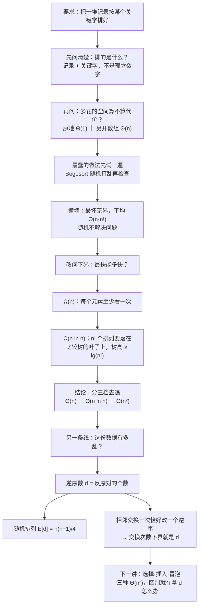

# C8.1 排序基础与逆序数

> [!abstract] 这一讲的任务
> 这一讲**没有教任何一个能用的排序算法**。它做的是更靠前的一件事：把"排序"这件事问清楚。
> 要回答三问：排序到底在排什么？"不许多占内存"这个要求怎么量化？以及最要紧的——**再聪明的排序也快不过哪里**。第三问的答案是 $\Omega(n\ln n)$，靠的只是"一次比较只能分成两支"这个朴素观察。
> 最后我们拿到一把量尺：**逆序数**（inversion）。它把"这份数据有多乱"变成一个数字，也替下一讲的三种 $\Theta(n^2)$ 算法备好了慢的理由——它们慢，慢在只能一次一次地消掉逆序。

> [!info] 怎么读这份讲义
> 全章六个主题、分 C8.1–C8.6 六篇，本篇是总纲。第一到四节一次讲完定义、前提、成本口径、五种基本手法；第五、六节是「下界」这条线；第七节是「逆序数」这条线。**两把尺子要到第八节才合成一张图**，读的时候别急着背结论，先跟着把那个 56 元的例子复算一遍——那里原稿印的数字对不上。
> 标 **（补充）** 的地方是原稿没有展开、按教材与通行讲法补出来的；标 **（存疑）** 的地方是我复算后仍不能确定的口径。

> [!info] 课程信息与来源
> **Ya-Hui Jia（贾雅慧）｜SFT SCUT｜jiayahui@scut.edu.cn｜课程群 309044012**。考核方式、教材、考勤等全课程信息见 [[C1.0 课程信息与C++预备]] 与 [[数据结构 MOC]]。
> 本讲接在 [[C7.1 堆与优先队列]] 之后：源材料里排序主题的内部编号是 **8.x**，紧接堆的 7.x，本库仍记为第 8 章。**本讲无课堂转写稿**，因此不逐条区分"课上讲过"与"补充"，整篇按整理版理解。
> 全章源材料 401 页，本篇对应 p.1–31，含 6 张裁切图。

## 目录

| 小节 | 内容 |
| --- | --- |
| [[#零、开场：一张要被排两遍的表]] | 一个真实诉求，三个约束 |
| [[#一、排序是什么：把抽象列表变成有序抽象列表]] | 定义、记录与关键字、三条前提 |
| [[#二、原地：多占的内存也算代价]] | $\Theta(1)$ 与 $\Theta(n)$ 两种口径 |
| [[#三、五种基本手法：排序算法的动作只有五种]] | 插入/交换/选择/归并/分配 |
| [[#四、三档运行时间]] | $\Theta(n)$、$\Theta(n\ln n)$、$O(n^2)$ |
| [[#五、下界：最快能多快]] | $\Omega(n)$、比较树与 $\Omega(n\ln n)$、下界的前提 |
| [[#六、最蠢的做法：Bogosort 与 Bozosort]] | 反例教给我们的两件事 |
| [[#七、乱到什么程度：逆序数]] | 定义、手算、相邻交换、期望值 |
| [[#八、把两把尺子合起来]] | 下界与逆序数各管什么 |
| [[#九、原稿勘误与阅读边界]] | 复算不符的一处、跳读与推测的边界 |

---

## 零、开场：一张要被排两遍的表

教务处的老师抱来一份学生记录表，每条记录四栏：学号、姓、名、住址。她提了两个要求：

1. 按学号从小到大排一份，点名用；
2. 按"先姓、后名"的字典序排一份，发通知用。

同一张表，同一个"排序"动作，出来两份完全不同的顺序。第一份里 Carol Ann 排在第 2 行（学号 19981932），第二份里她排在第 1 行——因为 Carol 的姓在字母表里最靠前。**数字有大小的天然次序，名字没有**；名字的次序是我们约定的（字典序）。所以"排序"从来不是把数从小到大摞起来，而是**围着某一个字段，把整条记录一起搬**。

紧接着她又加了三个约束，这三个约束正好构成本讲的三条线：

- **"机器上只剩几 MB 内存，别给我另开一张表。"** → 什么叫"不多占内存"？这是第二节的**原地排序**。
- **"这份表有四十万条，明天早上要出结果。"** → 能慢到什么程度、又最快能多快？这是第四、五节的**运行时间与下界**。
- **"如果这些数本来就基本有序，能不能更快？"** → 这是第七节**逆序数**要回答的问题。

> [!question] 停一下，先自己想想
> 如果只允许你做一件事——**交换数组里相邻的两个元素**——把 `1 3 5 4 2 6` 排好，最少要交换几次？
> 先别急着数。数完先记住你的答案，第七节会给你一个不用试就能算出来的公式。

## 一、排序是什么：把抽象列表变成有序抽象列表

### 1.1 定义

> [!important] 定义：排序 Sorting
> 排序是这样一个过程：取一个可以按线性次序存放的对象列表 $a_0,a_1,\dots,a_{n-1}$，返回它的一个重排 $a'_0,a'_1,\dots,a'_{n-1}$，使得
> $$a'_0 \le a'_1 \le \cdots \le a'_{n-1}.$$
> 一句话：**把一个抽象列表 Abstract List 变成一个抽象有序列表 Abstract Sorted List。**

这里有三处细节，值得停下来看一眼。

**第一，输入和输出是同一个列表的不同排列**——不是"从中挑出最小的几个"，也不是"生成一个排好序的副本"。元素的集合完全不变，变的只有它们的位置。

**第二，用的是 $\le$ 而不是 $<$。** 这不是笔误。真实数据里重复键到处都是（同姓、同分、同日期），定义必须允许相等，否则"所有元素互不相同"就成了一个隐含前提，一遇到重复数据整个理论就悬空。后面讲稳定性时我们还会回到这个不等号——正因为允许相等，"相等的两个元素谁在前"才成为一个需要额外规定的问题。

**第三，只有"有序"是被要求的，别的都不要求。** 排完之后原来在哪个位置、用什么算法搬过来的，一概不管。

### 1.2 排的是记录，不是数字

一句话说得很直白：**我们很少去排序孤立的值。**

真实场景里排的是**记录**（record）：一条记录由若干**字段**（field）组成，排序时我们指定其中一个（或几个）字段作为**关键字**（key），按关键字决定次序，搬动的时候整条记录一起搬。

同一个记录集合，换一个关键字，就是另一个序列：

![[C8-排序-同一条记录两种关键字顺序.png]]

左边按学号排（数值序），右边按"姓，然后名"排（字典序）。注意两边的 Carol Ann 都在，位置不同；也注意右边 Redpath 出现了两次（Ruth 和 David）——**同姓的记录在右边是相邻的，但它们之间谁在前？** 按"姓、然后名"的规则，David 在 Ruth 之前；如果规则只写"按姓排"，那 Ruth 和 David 的先后就没有规定。

> [!note]（补充）这个"没规定"就是稳定性
> 如果两条记录的键相等，排序之后它们的相对次序是否保持原样，这个性质叫**稳定性**（stability）：
> - **稳定**：相等的键，原来谁在前，排完还在前；
> - **不稳定**：相等键的相对次序可能被打乱。
>
> 单次排序时这不值一提。但现实里常常**排好几趟**：先按学号排一遍，再按姓名排一遍，要求"同姓的人内部仍按学号先后"。这时第二趟必须稳定，否则第一趟的成果就白费了。
> 本课程的主线不展开稳定性，但每讲到一种算法时，我会顺手标一句"这次实现稳不稳"，因为考试常拿它做选择题。判据很简单：**只在"严格大于"时才移动元素，一般就稳定**；反过来，只要出现"跨距离的直接交换"（选择排序、快速排序）或者"相等时先取右边"（某些归并写法），稳定就被破坏。

### 1.3 三条前提

> [!important] 这一讲对数据的三条假设
> 1. **输入与输出都用数组**（不用链表，不用树）。这条决定了后面所有的下标推演和"原地"讨论都发生在数组上。
> 2. **我们排的是"对象"**，记录含多个字段这种更一般的情形，当成实现细节处理——即"排序时带一个比较器/比较函数，只在比较那一刻才看关键字"。
> 3. **元素之间只靠比较定序**（这一条在第五节之前是隐含的，讲下界时必须显式说）。

第 2 条是工程上最有用的抽象：算法本身不认识"学号"或"姓"，它只认识"$a$ 与 $b$ 谁小"。C++ 里这就是传一个 `operator<` 或者比较函数对象进去，`std::sort` 的第三参数就是干这个的。

## 二、原地：多占的内存也算代价

### 2.1 两种口径

> [!important] 定义：原地排序 in-place
> 一个排序算法若能只在**至多 $\Theta(1)$ 的额外内存**（比如固定个数的局部变量）下完成，就称为**原地排序**。
> 与之相对：需要另开一个与原数组等长的数组来完成排序的，额外内存是 $\Theta(n)$。

这里有一个容易忽略的差别：定义写的是 $\Theta(1)$，而**有些书把"$o(n)$ 的额外内存"也叫原地**。两者不同：$o(n)$ 允许"用比 $n$ 低阶但仍在增长"的空间，比如 $\Theta(\ln n)$ 的递归栈——快速排序的栈就正好是这一类。所以你在不同教材上看到"快排是原地的"和"快排不是原地的"，很多时候并不是谁错了，而是**两本书用了不同的口径**。

本课程采用严口径：$\Theta(1)$ 才算原地。按这个口径，**递归用的栈也要算进去**——这一点在 C8.5 讲快速排序时会派上用场。

### 2.2 为什么值得在意

回到开场那个场景：四十万条记录，每条记录假设 100 字节，光是数据就是 40 MB。如果算法要求再开一个等长数组，就再要 40 MB。

- 在内存充裕的机器上，这 40 MB 无所谓，换来代码简单，很值；
- 在**嵌入式设备、手机、数据库的缓冲区、操作系统的页缓存**里，这 40 MB 就可能是"能跑"和"跑不起来"的分界。数据库排序之所以反复优化"能不能原地"，原因就在这里。

课程给出的取舍是明确的：**优先选原地算法**。这不是说原地一定更快，而是说"内存是硬约束、时间是软约束"的场合太多，而原地算法在所有场合都不吃亏。

> [!question] 课堂追问：另开一个数组就一定更慢吗？
> 不一定。多一次"整份数据搬过去"的读写，在缓存友好的场景下可能被更少的比较次数抵消掉。所以这里的取舍永远是"空间换时间"，不是"多占空间必然更糟"。判断依据是**这两样东西哪一个先见底**。

## 三、五种基本手法：排序算法的动作只有五种

看懂一个排序算法，先别管它怎么循环嵌套，先问一句：**它主要靠什么动作在动数据？** 所有排序算法折腾来折腾去，动作只有五种：

![[C8-排序-五种基本手法.png]]

| 手法 | 动作 | 后面的代表算法 |
| --- | --- | --- |
| **插入** Insertion | 把当前元素放到已有序部分中它该在的位置，已有序部分变长 | 插入排序（C8.2）、归并的收尾、快速排序的小区间收尾 |
| **交换** Exchanging | 把两个元素的位置对调 | 冒泡排序（C8.2）、快速排序的划分 |
| **选择** Selection | 在未排序部分里挑出最小（或最大）的那个，放到已排序部分末尾 | 选择排序（C8.2）、堆排序（C8.3） |
| **归并** Merging | 把两段各自有序的数据并成一段有序的 | 归并排序（C8.4） |
| **分配** Distribution | 按值把元素扔进不同的桶/队列里，再按桶的次序收回来 | 桶排序、基数排序（C8.6） |

这张表的价值在于**它是一张地图**。后面五种算法不是五个互不相干的发明，而是这五种动作各自的展开：

- 只会"交换"的极端版本，就是**冒泡**——每次只换相邻的一对；
- "选择"配上"堆"这个能 $O(\ln n)$ 找到最大值的结构，就是**堆排序**；
- "归并"配上分治，就是**归并排序**；
- "分配"配上"键落在已知范围"这个额外假设，就跳出了比较排序的下界，做到 $\Theta(n+m)$。

## 四、三档运行时间

### 4.1 三档

这一章要看的算法，运行时间落在三档里：

$$\Theta(n) \qquad \Theta(n\ln n) \qquad O(n^2)$$

分别对应：

| 档位 | 代表 | 前提 |
| --- | --- | --- |
| $O(n^2)$ | 选择、插入、冒泡 | 无额外假设 |
| $\Theta(n\ln n)$ | 堆排序、归并排序、快速排序 | 无额外假设（快排是平均） |
| $\Theta(n)$ | 桶排序、基数排序 | **必须对数据本身作假设** |

而且同一个算法，最好、平均、最坏三种情况下可以差很远——这一章会为每个算法单独给这三个数，还会点明"最坏情况长什么样"。**"最坏情况是一张已排好序的表"这种反直觉的例子，后面出现了不止一次**（快速排序就是典型受害者，见 C8.5）。

### 4.2 Θ 与 O 的混用

原稿在这一页把三者写成 $\Theta(n)$、$\Theta(n\ln n)$、$\mathbf{O}(n^2)$，混用了 $\Theta$ 与 $O$。这个混用在课程的语境里不影响结论（常数因子与大 $O$ 定义的差别），但你自己写答案时要统一：

- $\Theta$ 是"上下都卡住"，$O$ 只是"上界"；
- 说"选择排序是 $\Theta(n^2)$"比"是 $O(n^2)$"信息更强，也更准确；
- 只有在只关心"不超过"的时候才用 $O$，比如"快速排序最坏是 $O(n^2)$"。

## 五、下界：最快能多快

前面都在比"谁更快"，现在换个问法：**有没有一条线，不管怎么设计算法都跨不过去？**

### 5.1 平凡下界：$\Omega(n)$

最朴素的一条：**任何一个排序算法，都必须把数组里每个元素至少看一次。**

理由很干脆——如果某个元素从头到尾没被看过，我怎么知道它不该待在别的位置？把它的值改成任何东西，算法都察觉不到，而输出却必须跟着变。

既然至少看 $n$ 次，每个元素至少 $\Omega(1)$ 的代价，总代价就是 $\Omega(n)$。这是一条**平凡下界**（trivial lower bound）：正确，但几乎没有指导意义——它只告诉我们"不可能比线性更快"，而线性恰恰是三档里最好的那一档。

于是自然冒出下一个问题：**$\Theta(n)$ 到底能不能达到？** 答案是：**在只靠比较的前提下不能**；放弃"只靠比较"，能（C8.6 的桶排序）。

### 5.2 比较树：$\Omega(n\ln n)$ 是从 $n!$ 里长出来的

这条论证是本讲最值得记住的一段推理。它的出发点是：**排序算法做的事，本质上是一串"谁大谁小"的提问。**

把算法执行过程画成一棵树：

- 每个内部结点是一次比较，两个分支对应"是"和"否"；
- 每个叶子是算法结束时给出的那个排列；
- 根到叶的路径长度，就是这次执行做了多少次比较。

**关键观察一：叶子至少要有 $n!$ 个。** 因为 $n$ 个互不相同的元素一共有 $n!$ 种排列，每一种都可能就是正确答案（输入可以是其中任意一个），而算法对不同的答案必须走到不同的叶子——如果两种输入走到同一个叶子，算法给出的输出序列就只能是同一个，那对其中一种输入必然排错。

**关键观察二：深度为 $h$ 的二叉树，叶子最多 $2^h$ 个。** 所以

$$2^h \ge n! \quad\Longrightarrow\quad h \ge \lg(n!).$$

**关键观察三：$\lg(n!) = \Theta(n\lg n)$。** 这一步常被跳过，补上：

$$\lg(n!)=\sum_{k=1}^{n}\lg k .$$

**下界**：$\lg$ 单调增，求和可以用积分压住，

$$\sum_{k=1}^{n}\lg k \;\ge\; \int_{1}^{n}\lg x\,dx=\frac{n\ln n-n+1}{\ln 2}=n\lg n-\frac{n-1}{\ln 2}\;\approx\;n\lg n-1.44n .$$

**上界**：每一项都不超过 $\lg n$，共 $n$ 项，

$$\sum_{k=1}^{n}\lg k \;\le\; n\lg n .$$

两头一夹，$\lg(n!)=\Theta(n\lg n)$，也就是 $\Omega(n\lg n)$。

> [!note]（补充）两种写法为什么都对，以及斯特林公式
> 原稿写的是 $\Omega(n\ln(n))$；我上面写的是 $\lg$。两者只差一个常数因子 $\ln 2\approx 0.693$，同阶，所以都对——但在**同一段推导里**必须统一，否则 "$h\ge\lg(n!)$" 和 "$\lg(n!)=\Theta(n\ln n)$" 摆在一起会让人以为差了个 $\ln 2$ 的错误。
> 教材里另一个常用工具是斯特林公式：$n!\approx\sqrt{2\pi n}\,(n/e)^n$，取对数立刻得 $\ln(n!)\approx n\ln n-n+\tfrac12\ln(2\pi n)$，首项就是 $n\ln n$。这个版本还能顺便看出**次项是 $-n$**，对精细分析有用。

于是结论：

> [!important] 结论：比较排序的下界
> 任何**只通过比较元素来确定次序**的排序算法，最坏情况下至少要
> $$\Omega(n\lg n)$$
> 次比较。
> 这个证明出自 Knuth 的 *The Art of Computer Programming* Vol. 3 §5.3.1（p.180），课程把它作为经典引用保留。

这个结论的分量在于**它是"所有算法"的下界，不是"某个算法"的界**。前面那三种 $\Theta(n^2)$ 算法慢，不是因为我们还没想出来更好的写法；是**在这个模型里**根本不可能更快。

### 5.3 这个下界的前提，和它放过的东西

下界是"有条件"的，条件不成立，结论也就不成立。这里有两个前提必须自己说清楚：

**前提一：只靠比较。** 如果算法还能做别的事——比如"数的范围已知是 $0\sim31$，那我直接开 32 个桶"——比较树模型就不适用了，下界也管不住它。这正是 C8.6 桶排序能做到 $\Theta(n+m)$ 的原因。**它不是打败了下界，它是换了一个游戏。**

**前提二：最坏情况。** 树高是"最坏情况下走最长的那条路"，所以给出的下界是最坏情况的。平均情况的下界是另一套论证（也成立，值同为 $\Theta(n\lg n)$，只是常数不同）。

顺带一句：这个下界对**互不相同的键**成立；有大量重复键时，不同排列的输出相同，叶子数不再是 $n!$，下界会变松（极端情形是全部相等，看一遍就完事，$\Theta(n)$）。

### 5.4 没有"最好的排序"

一个常见的误解：既然下界是 $\Theta(n\lg n)$，那把所有算法都做到 $\Theta(n\lg n)$ 不就行了，为什么还要学六种？

> [!important] 结论
> **不存在在所有场合都最优的排序算法。** 不同的场合（数据规模、内存限制、数据是否基本有序、键是否在已知范围内、是否要求稳定）需要不同的算法，才能同时满足"时间"与"内存"两项要求。

这就是为什么这一章要讲那么多种：**它们各自在不同的维度上最优。** 到 C8.6 我会给一张完整的选型表（哪一档、什么前提、稳不稳、要不要额外空间），复习时就靠那张表做选择题。

## 六、最蠢的做法：Bogosort 与 Bozosort

在正式学算法之前，先看两个"反面教材"。它们不是用来用的，是用来**逼出"为什么需要算法"这个问题**的。

### 6.1 Bogosort

> [!example] Bogosort 算法
> 1. 随机地把所有对象打乱；
> 2. 检查是否已排好序；没排好就回到第 1 步。

运行时间：

| 情况 | 代价 | 为什么 |
| --- | --- | --- |
| 最好 | $\Theta(n)$ | 第一次打乱恰好就排好了，只需要一次 $n$ 步的检查 |
| 平均 | $\Theta(n\cdot n!)$ | 共有 $n!$ 种排列，只有 1 种是对的；期望试 $n!$ 次，每次打乱 + 检查是 $\Theta(n)$ |
| 最坏 | 无界 | 随机一直不给对的排列，就一直跑下去 |

**数字感一下。** $n=10$ 时 $10!=3\,628\,800$，平均约 $3.6\times10^7$ 步；在每秒十亿次操作的机器上是一眨眼的事。$n=20$ 时 $20!=2.43\times10^{18}$，乘上 $n$ 是 $4.9\times10^{19}$ 步——按每秒十亿次算要 **1500 年以上**。$n$ 只从 10 涨到 20，代价涨了十二个数量级。

### 6.2 Bozosort

> [!example] Bozosort 算法
> 1. 检查是否已排好序；
> 2. 如果没排好，随机交换两个元素，回到第 1 步。

它比 Bogosort 稍微"聪明"一点——不再把已经放对的部分全部推倒，只是瞎换两个。但代价反而**更难算**（每一步的进展取决于换到了哪两个，随机游走式的分析），课程的原话是"see references and wikipedia"，然后补了一句大实话：**Hopefully we can do better.**

### 6.3 这两页到底想说什么

两个结论，都很硬：

**第一，随机化不解决根本问题。** Bogosort 的平均代价里那个 $n!$ 不是"运气不好"，是**排列总数**——它和第五节的比较树里那个 $n!$ 是同一个东西。随机乱撞的期望代价，正好是"在所有可能答案里瞎猜"的代价。想快，只能**利用数据里的结构**，让每一步比较都排除掉一大批可能。

**第二，最坏情况可以说"无界"。** 一个算法如果存在一条永远不结束的执行路径，"最坏情况"这个词就失去意义了。这是后面所有算法分析里都默认排除的情形，也是为什么我们讲每个算法时都要单独问一句"最坏长什么样"。

## 七、乱到什么程度：逆序数

现在转到第二条线。前面讲的是"算法最快能多快"，这一节问的是另一个问题：**输入本身有多难排？** 这两个问题不一样——同一个算法，排"基本有序"的表和排"完全乱"的表，代价可以差一个数量级。

### 7.1 三张表，同样是"乱"，乱法不同

![[C8-逆序数-第一张表只需少数交换.png]]

第一张表：`1 16 12 26 25 35 33 58 45 42 56 67 83 75 74 86 81 88 99 95`。看着几乎是从小到大，只是**每隔几个就有两个数挨反了**：16 和 12、26 和 25、35 和 33、58 和 45、83 和 75……把每一对反过来，整张表就排好了。

第二张表：`1 17 21 42 24 27 32 35 45 47 57 23 66 69 70 76 87 85 95 99`。这张不太一样：42 跑到最前面去了一大截，23 落到很后面，其余 13 个数字都在原位。

第三张表：

![[C8-逆序数-第三张表乱成一团.png]]

`22 20 81 38 95 84 99 12 79 44 26 87 96 10 48 80 1 31 16 92`。这张是真的乱：几乎每个数都跟后面好几个数反着，连线在图上织成一张网。

三张表都是 20 个数。**怎么用一句话说清"第一张比第三张整齐"？** 靠眼睛看不行，靠"有几对反了"就行。

### 7.2 先把配对数清出来

$n$ 个元素里，任取两个就组成一对，一共有

$$\binom{n}{2}=\frac{n(n-1)}{2}$$

对。$n=6$ 时是 15 对；$n=20$ 时是 $\frac{20\times19}{2}=190$ 对。

每一对只有两种命运：**顺序正确**（小的在前），或者**反序**（大的在前）。这两种命运互斥且穷尽，所以

$$\text{顺序正确的对数}+\text{反序的对数}=\binom{n}{2}.$$

这个等式后面会反复用到——它是一个**守恒量**，任何排序算法做的事，本质上就是把这些"反序对"一对一对地消灭掉。

### 7.3 逆序的定义

> [!important] 定义：逆序 Inversion
> 给定 $n$ 个元素的一个排列 $a_0,a_1,\dots,a_{n-1}$，如果存在一对下标 $j<k$ 使得
> $$a_j>a_k,$$
> 就称 $(a_j,a_k)$ 构成一个**逆序**（反序对）。
> 一个排列的**逆序数** $d$，就是这种对的个数。

注意两点。**第一，比较的是"值"，判断的是"下标"**：$j<k$ 是位置关系，$a_j>a_k$ 是大小关系，两者同时成立才叫逆序。**第二，等号不算**：$a_j=a_k$ 时不构成逆序（这又是 $1.1$ 节那个 $\le$ 的余韵）。

### 7.4 手算：`1, 3, 5, 4, 2, 6` 的四对

先把 15 对全列出来，按"第一个元素"分组：

$$\begin{array}{cccc}(1,3)&(1,5)&(1,4)&(1,2)&(1,6)\\(3,5)&(3,4)&(3,2)&(3,6)\\&(5,4)&(5,2)&(5,6)\\&&(4,2)&(4,6)\\&&&(2,6)\end{array}$$

逐个判断：**11 对是顺序正确的**（1 比谁都小，所以以 1 开头的 5 对全对；其余依次检查）。剩下 4 对是反的：

![[C8-逆序数-十五对里四对是反的.png]]

$$(3,2)\quad(5,4)\quad(5,2)\quad(4,2)$$

所以这个排列的逆序数 $d=4$。$11+4=15=\binom{6}{2}$ ✓。

> [!tip] 手算的省力办法
> 别去列 15 对。**从左到右扫一遍，每个数只要数"它右边有几个比它小"**，然后加起来：
> 1 右边比它小的：0 个；3 右边：1 个（2）；5 右边：2 个（4、2）；4 右边：1 个（2）；2 右边：0 个；6 右边：0 个。
> 合计 $0+1+2+1+0+0=4$ ✓。这个方法一眼就能推广到 20 个数、56 个数，也是"用归并排序数逆序数"（C8.4 的一个经典应用）的出发点。

### 7.5 相邻交换一次恰好改一个逆序

现在回到开场那个问题：只允许交换相邻两个元素，最少几次？

**先说结论：恰好等于逆序数 $d$。**

**为什么一次相邻交换只改变一个逆序？** 设数组是 $\dots,a,b,\dots$，把相邻的 $a,b$ 换过来变成 $\dots,b,a,\dots$。看所有元素对：

- 除了 $a$ 与 $b$ 这一对，其他任意一对元素的**相对先后都没有变**（$a$ 和 $b$ 与第三个元素 $c$ 的相对位置：$c$ 要么在两个的左边，要么在右边，换不换都是同一个方向）；
- 唯一变的是 $a,b$ 自己的先后：如果原来 $a>b$（构成一个逆序），换完就不再是逆序，**逆序数 $-1$**；如果原来 $a<b$（不是逆序），换完就成了逆序，**逆序数 $+1$**。

下面两个例子正好一正一反：

| 交换 | 结果 | 逆序数变化 |
| --- | --- | --- |
| `1 3 5 4 2 6` → 换 4 和 2 两个相邻的 | `1 3 5 2 4 6` | 消掉了 $(4,2)$，$-1$ |
| `1 3 5 4 2 6` → 换 3 和 5 两个相邻的 | `1 5 3 4 2 6` | 新造出 $(5,3)$，$+1$ |

**于是下界就出来了**：要把 $d$ 个逆序全部消掉（排好序时 $d=0$），每次相邻交换最多消掉 1 个，所以**至少需要 $d$ 次交换**。

**而 $d$ 次是能做到的**：随便找一个逆序，把它内部的元素一步步往左挪就行（这正是插入排序在做的事）。所以最少交换次数**恰好是 $d$**。

> [!important] 推论：相邻交换类算法的代价
> 任何只靠相邻交换的排序算法，交换次数**下界是 $d$，且 $d$ 可达**。所以插入排序、冒泡排序的交换（移动）代价是 $\Theta(n+d)$——它同时依赖于 $n$ 和 $d$。
> 这就解释了两件事：①为什么这两种算法**对基本有序的数据特别快**（$d$ 小，代价退化成 $\Theta(n)$）；②为什么它们**对随机数据退化成 $\Theta(n^2)$**（随机排列的 $d$ 是 $\Theta(n^2)$，见 7.6）。

### 7.6 随机排列的期望逆序数

随机排列里，$d$ 平均有多大？

用期望的线性性，一对一对地算。随便取一对元素，它们的大小关系是定的，但**在排列里谁在前面是等概率的**——所以这一对是逆序的概率恰好是 $\frac12$。$\binom{n}{2}$ 对相加：

$$E[d]=\frac12\binom{n}{2}=\frac{n(n-1)}{4}.$$

于是随机排列的期望逆序数是 $\Theta(n^2)$ 量级：

| $n$ | 配对数 $\binom{n}{2}$ | 期望逆序数 $n(n-1)/4$ |
| --- | --- | --- |
| 6 | 15 | 7.5 |
| 20 | 190 | 95 |
| 56 | 1540 | 770 |

顺手得到一条经验法则：**一张表如果是随机的，逆序数应该大约等于配对数的一半；远低于一半说明它已经接近有序，远高于一半说明它比随机还乱。**

### 7.7 三个 20 元例子：13、13、100

三张表都是 20 个数，配对数 190，期望逆序数 95。实际是：

| 表 | 逆序数 | 与期望 95 的关系 | 结论 |
| --- | --- | --- | --- |
| 第一张 | **13** | 远低于 95 | 不是随机表，已经接近有序 |
| 第二张 | **13** | 远低于 95 | 也不是随机表——只有 42、23 两个数跑偏了 |
| 第三张 | **100** | 略高于 95 | 比随机还乱一点点 |

第二张表最值得琢磨：它的逆序数竟然和第一张一样，都是 13，可肉眼看它比第一张"乱"得多。原因在 7.1 已经点过——**它只有一个 42 冲到了前面、一个 23 落到了后面**，其余 13 个元素都在原位。而一个跑偏的元素会一次性制造很多个逆序：42 冲在前面，它跟后面每一个比它小的数都构成逆序，一共 5 个；23 落在后面，前面每一个比它大的数都跟它构成逆序。

> [!warning] 易错点：逆序数不衡量"视觉上的乱"
> 逆序数只数"反序的对数"，对**距离不敏感**。把最小的元素从末尾挪到开头，和把两个相邻元素对调，后者只改 1 个逆序，前者可能一次改出 $n-1$ 个。所以"看起来乱"和"逆序数大"不是一回事，这恰恰是选择排序能"一次交换消掉很多逆序"的原因（C8.2）。

### 7.8 一个 56 元的例子，数字对不上

![[C8-逆序数-五十六个数的例子.png]]

56 个数的表，配对数 $\binom{56}{2}=\frac{56\times55}{2}=1540$，按 7.6 的公式期望逆序数是 $\frac{56\times55}{4}=770$。原稿印的是：

> has **655 inversions** and **885 ordered pairs**
> The formula predicts … $=\mathbf{770}$ inversions

我按这 56 个数字复算了一遍（逐对比较，程序枚举），得到的是：

$$\textbf{646 个逆序},\qquad \textbf{894 对顺序}.$$

$646+894=1540$ ✓，$655+885=1540$ ✓——**两边的和都对得上**，这说明"配对数 1540"和"期望 770"都没问题，**出错的只是"逆序 / 顺序"这一刀切在了哪里**：原稿把 9 对顺序正确的当成了逆序。这一处不影响任何结论（655 和 646 都远小于期望 770，都说明这张表比随机整齐），但数字是数字，记住复算值。

> [!bug] 原稿笔误（已复算）
> 该页印的"655 inversions / 885 ordered pairs"与同一页列出的 56 个数字不符；实际为 **646 / 894**（差 9 对）。期望值 770 与总对数 1540 均正确。详见 [[#九、原稿勘误与阅读边界]]。

## 八、把两把尺子合起来

这一讲其实只造了两样东西，它们管的是两类完全不同的问题：

| 问的问题 | 用什么回答 | 答案 | 谁管它 |
| --- | --- | --- | --- |
| 算法最快能多快？ | 比较树的叶子数 | $\Omega(n\lg n)$（只靠比较时） | 算法设计的天花板 |
| 这份数据有多难排？ | 逆序数 $d$ | 随机表 $E[d]=\frac{n(n-1)}{4}$，最好 $0$，最坏 $\binom{n}{2}$ | 输入本身的难度 |

两者相乘，就给出了"什么算法适合什么输入"的判断框架：

- $d$ 很小（基本有序）→ 相邻交换类的算法能做到 $\Theta(n+d)\approx\Theta(n)$，比 $\Theta(n\lg n)$ 的通用算法还快；
- $d$ 很大（完全反序，$d=\binom{n}{2}$）→ 相邻交换类退化成 $\Theta(n^2)$，这时应该换用 $\Theta(n\lg n)$ 的算法；
- 但**不管怎么换，比较排序都跨不过 $\Omega(n\lg n)$**。想再快，只有放弃"只靠比较"这条路（C8.6）。

还有一个更细的伏笔：既然"一次相邻交换只消一个逆序"，那么一个算法如果一次能消掉**很多**逆序，它就可能比 $\Theta(n+d)$ 快。选择排序一次交换可以消掉一串逆序，快速排序一次划分可以把逆序数直接砍掉一大块——**这就是后面几种算法"快"的真正原因**，而不是"循环写得少"。

## 九、原稿勘误与阅读边界

| 位置 | 原稿 | 复算/更正 | 性质 |
| --- | --- | --- | --- |
| p.26，56 元例子 | 655 inversions / 885 ordered pairs | **646 / 894**（和为 1540，与配对数一致） | 原始笔误（结论不受影响） |
| p.8、p.31 | 三档写成 $\Theta(n)$、$\Theta(n\ln n)$、$\mathbf{O}(n^2)$ | 建议统一为 $\Theta$，只在"只是上界"处用 $O$ | 记号混用，非错误 |
| p.11 | $\lg(n!)=\Theta(n\ln n)$ | 同阶（差常数 $\ln 2$），但同一段推导里 $\lg$ 与 $\ln$ 应统一 | 记号混用，非错误 |

**复算说明**：三张 20 元表的逆序数（13 / 13 / 100）、56 元表的总对数 1540、期望值 770、$\binom{20}{2}=190$ 及其一半 95，均已用 Python 逐对枚举复核，与原稿一致（除上表第一行）。

**阅读边界**：

- 本篇的"记录 + 关键字 + 稳定性"和"Bogosort 的年份与出处"属于我按教材与通行讲法补的（标 **（补充）**），原稿只给了定义式与两个反例算法。
- 原稿第 12 页只说了"不存在对所有场合都最优的算法"，没有给选型表；完整的选型表我放在 C8.6 末节，跨篇引用。
- **本讲没有随堂测、没有作业页**（本章的作业题在快速排序之后的材料里，见 C8.5）。

**配图清单**（6 张，均为 p.1–31 的印刷图示裁切，无手写痕迹）：

| 图 | 源页 | 说明 |
| --- | --- | --- |
| `C8-排序-同一条记录两种关键字顺序.png` | p.4 | 同六条记录，按学号（左）与按姓名字典序（右）两套顺序 |
| `C8-排序-五种基本手法.png` | p.7 | 插入/交换/选择/归并/分配 五种动作的示意 |
| `C8-逆序数-第一张表只需少数交换.png` | p.16 | 第一张 20 元表：只把相邻反序的对调，整表即有序 |
| `C8-逆序数-第三张表乱成一团.png` | p.18 | 第三张 20 元表：连线交织，100 个逆序 |
| `C8-逆序数-十五对里四对是反的.png` | p.21 | `1,3,5,4,2,6` 的 15 对，其中 4 对（红）是逆序 |
| `C8-逆序数-五十六个数的例子.png` | p.26 | 56 元表与「655 / 885」那处待复算的数字 |

## 这一讲的三句话

1. **排序是把一个抽象列表变成有序抽象列表，搬的是整条记录，次序由关键字决定**；定义里写 $\le$ 不写 $<$，因为重复键是常态，而"相等的键谁在前"就是稳定性。
2. **额外内存也算代价**：$\Theta(1)$ 才叫原地，另开等长数组是 $\Theta(n)$；递归栈也要算进去，所以快排的"原地"是有争议的。
3. **只靠比较的排序跨不过 $\Omega(n\lg n)$**（$n!$ 个排列要落在比较树的叶子上，树高至少 $\lg(n!)$）；而"这份数据有多乱"可以量成逆序数 $d$，相邻交换一次恰好消掉一个逆序，所以插入/冒泡的代价是 $\Theta(n+d)$。

> [!tip] 速查
> | 量 | 公式 | 用途 |
> | --- | --- | --- |
> | 配对数 | $\binom{n}{2}=\frac{n(n-1)}{2}$ | 顺序对 + 逆序对 = 它 |
> | 期望逆序数 | $E[d]=n(n-1)/4$ | 判断表是否随机 |
> | 逆序数上下界 | $0\le d\le\binom{n}{2}$ | $d=0$ 已有序；$d=\binom{n}{2}$ 完全反序 |
> | 比较排序下界 | $h\ge\lg(n!)=\Theta(n\lg n)$ | 最坏情况至少这么多次比较 |
> | 相邻交换次数 | 恰好 $=d$ | 插入/冒泡的代价来源 |

## 下一讲预告

下三篇是这一讲的两把尺子的直接应用。**选择、插入、冒泡**三种 $\Theta(n^2)$ 算法，其实是在同一张表上做三件不同的事：选择排序**一次交换消掉一堆逆序**，所以交换次数少但比较次数恒为 $\frac{n(n-1)}{2}$；插入排序**一次只挪一格**，所以代价精确地是 $\Theta(n+d)$，对基本有序的表快到 $\Theta(n)$；冒泡排序也是相邻交换，却被自己"每趟只把最大的顶到末尾"的规矩绑住了手脚——**它的比较次数下不去**。

三种都慢，但慢得不一样。下一讲就来拆开看它们各自慢在哪里。

---

## 相关笔记 Related Notes

上一讲：[[C7.1 堆与优先队列]]
下一讲：[[C8.2 选择、插入与冒泡排序]]
返回：[[数据结构 MOC]]
