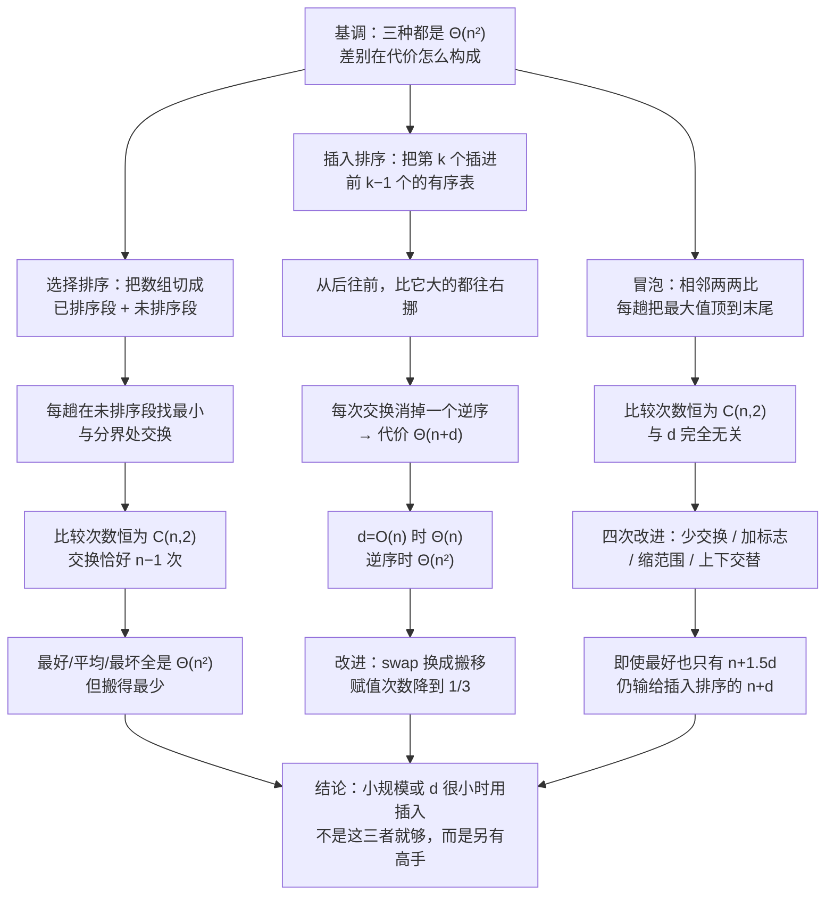

# C8.2 选择、插入与冒泡排序

> [!abstract] 这一讲的任务
> 上一讲定下了两条线：**只靠比较就跨不过 $\Omega(n\lg n)$**，而"这份数据有多乱"可以量成逆序数 $d$。这一讲把最简单的三种算法摆上桌：选择、插入、冒泡。
> 三个都是 $\Theta(n^2)$。**如果只看这个结论，这一讲就白学了**——它们的差别全在"$\Theta(n^2)$ 是怎么来的"：选择排序的比较次数恒定、交换次数最少；插入排序的代价精确地是 $\Theta(n+d)$，对基本有序的表快到 $\Theta(n)$；冒泡排序也是相邻交换，却被"每趟把最大的顶到末尾"的规矩绑住，比较次数怎么改都下不去。
> 一句话：**三个算法算的是同一个 $\Theta(n^2)$，但一个在比、一个在搬、一个在白比。**

> [!info] 怎么读这份讲义
> 三小节各管一个算法，每节的结构都是「想法 → 手算 → 代码 → 代价 → 稳定性」。第三小节后半（3.5 起）是冒泡的四次改进和一张实测曲线图，**那张图是这一篇的落点**：它把"插入排序的 $n+d$ 比冒泡的所有改法都强"画成了一条谁都在上面的线。
> 标 **（补充）** 的是原稿没展开、按教材与通行讲法补的。若只想快速复习，直接看第四节的三算法对照表 + 篇末速查。

> [!info] 课程信息与来源
> **Ya-Hui Jia（贾雅慧）｜SFT SCUT｜jiayahui@scut.edu.cn｜课程群 309044012**。全课程信息见 [[C1.0 课程信息与C++预备]] 与 [[数据结构 MOC]]。
> 本讲接在 [[C8.1 排序基础与逆序数]] 之后。原材料的这两个主题共用编号 8.2（选择与插入各有一个 Outline 页），冒泡是 8.3；本库把三段合为一篇，因为它们的对照关系比各自的细节更值得讲。
> **本讲无课堂转写稿**，整篇按整理版理解。



## 目录

| 小节 | 内容 |
| --- | --- |
| [[#零、开场：一叠试卷怎么排]] | 三个土办法，三种代价 |
| [[#一、选择排序：比较恒定，搬动最少]] | 两段划分、找最小、代价、稳定性 |
| [[#二、插入排序：抓住"已经有序"这一点]] | 手算、逐句代价、$\Theta(n+d)$、搬移改进 |
| [[#三、冒泡排序：名字最好记，性能最差]] | 基本版、手算、四次改进、实测曲线 |
| [[#四、三种算法摆在一起看]] | 对照表与选型 |
| [[#五、原稿勘误与阅读边界]] | 两段印刷代码的越界错误 |

---

## 零、开场：一叠试卷怎么排

期中考完，五十份卷子摊在桌上，要按分数从低到高排好。不许用电脑，你手上有三个办法：

**办法一（选择）**：从还没排的那堆里翻出分数最低的一份，放到左边；再从剩下的里翻出最低的，摞在它后面……翻五十遍，桌子就排好了。
**办法二（插入）**：左手先捏好一份（就一份，天然有序），然后每次从右边那堆里拿一份，跟左手里的比一比，插到该去的位置。
**办法三（冒泡）**：从左到右挨着比相邻的两份，左边比右边高就换一下；走完一趟，最高的那份一定被"冒"到了最右边。然后再走一趟。

三个办法都笨，但笨的地方不一样。第一种**每次都要把剩下的一堆从头翻一遍**（比得多、搬得少）；第二种**只在左手里挪一挪**（比得少、挪得多）；第三种**连已经排好的部分也要重新比**（比得最多）。

这一篇就是把这三个"笨"分别算清。算清之后你会看到一件挺意外的事：**看起来最优雅的冒泡，是三者里最差的**，而且差了不止一点。

> [!question] 停一下，先自己想想
> 如果这叠卷子**本来就是按分数排好的**，三个办法各要走多少步？
> 先别算精确值，只判断：哪一个能立刻发现"已经不用排了"？哪一个完全发现不了？

## 一、选择排序：比较恒定，搬动最少

### 1.1 两段划分

选择排序的全部想法，来自一个几乎不用证明的观察：

> [!important] 观察
> 一个有序表里的**所有**元素，都小于另一个无序表里的任何元素。那么把无序表里最小的那个挑出来、接到有序表末尾、再从无序表里删掉它——**有序表仍然有序，而且长了 1**。

这就是办法一。于是问题只剩两个：怎么找最小、怎么"删掉它"。

![[C8-选择排序-有序段与无序段的分界.png]]

看图：左边 8 个数（`5 7 12 19 21 26 33 40`）已经排好，右边 5 个数（`55 41 84 50 94`）还是乱的。箭头指的是**分界处**——下一个该放元素的位置，也就是下标 8。

> [!tip] 关键：这个算法根本不需要"两个表"
> "有序表"和"无序表"是**同一段数组的两个区间**，不是两块内存。有序段是 $[0,i)$，无序段是 $[i,n)$，`i` 就是那条分界线。这就是它在 C8.1 那个"原地"口径下合格的原因：额外只用了一个下标 `i`、一个下标 `lowindex`、一个临时变量。

### 1.2 在无序段里找最小值

![[C8-选择排序-在无序段里找最小值.png]]

这五帧是同一个动作的连续快照：拿一个游标（红箭头）从右往左扫，另一个游标（绿箭头）记住"目前为止最小的那个在哪"。

第一帧：绿箭头在 55（先假设它最小、红箭头在 94）。94 > 55，不更新。第二帧：红箭头移到 50，50 < 55，**绿箭头跳到 50**。第三帧：84 > 50，不更新。第四帧：41 < 50，**绿箭头跳到 41**。第五帧：41 一路赢到底。

结论：无序段 `55 41 84 50 94` 的最小值是 **41**，位置在下标 9。

### 1.3 把最小值换到分界处

![[C8-选择排序-把最小值换到分界处.png]]

现在要把 41 放到下标 8 的位置。**"删掉它"这件事怎么实现？** 答案是**交换**：

$$55\leftrightarrow41:\qquad 5\ 7\ 12\ 19\ 21\ 26\ 33\ 40\ |\ \mathbf{41}\ |\ 55\ 84\ 50\ 94$$

41 进了有序段，55 被"扔回"无序段。**无序段并没有变短，只是分界线右移了一格**——这就是"删除"的全部含义。这个动作的妙处在于：它只用了 1 次交换（3 次赋值），不需要真的把数组往前挪一格（那要 $O(n)$ 次搬动）。

> [!warning] 易错点：交换的是"分界处的元素"，不是"删掉最小值"
> 初学者常写成"把最小值之后的元素全部前移一格"。那样每次要搬 $O(n)$，总共 $\Theta(n^2)$ 次搬动，而且完全没有必要——反正无序段里谁在哪个位置都无所谓，用分界处的元素跟它换个位置就行。**这一换，是选择排序唯一省下来的地方。**

### 1.4 代码

```cpp
template <typename Type>
void selection_sort( Type *const array, int const n ) {
    for ( int i = 0; i < n - 1; i++ ) {          // 分界线 i：0 … n-2
        int lowindex = i;                        // 先假设分界处最小
        for ( int j = n - 1; j > i; j-- ) {      // 从尾部往前扫无序段
            if ( array[j] < array[lowindex] ) {
                lowindex = j;                    // 记住更小的位置
            }
        }
        Type temp = array[i];                    // 与分界处交换
        array[i] = array[lowindex];
        array[lowindex] = temp;
    }
}
```

三处细节值得停下来看：

1. **外层只到 `n-1`**（`i < n - 1`）。因为最后一个元素不用挑——整个数组只剩它一个的时候，它必然在正确位置。
2. **内层从尾部往前扫**（`j = n-1; j > i`）。方向不影响结果，但从后往前有个好处：`array[lowindex]` 一直在变，比较的两个元素里有一个是"移动的"，缓存表现好一点。教材的写法就是这么来的。
3. **交换用的是临时变量**，没有用 `std::swap`。两者等价；这里只是让你看清"一次交换 = 三次赋值"。

### 1.5 代价：一个恒定，一个最少

> [!important] 分析：选择排序的比较与交换
> - **比较次数**：第 $i$ 趟要比较 $n-1-i$ 次。求和
>   $$\sum_{i=0}^{n-2}(n-1-i)=(n-1)+(n-2)+\cdots+1=\frac{n(n-1)}{2}=\Theta(n^2).$$
> - **交换次数**：每趟恰好 1 次（哪怕 `lowindex == i`，代码里也照换不误），共 $n-1$ 次 $=\Theta(n)$。
> - **额外空间**：$\Theta(1)$，**原地**。

这两个数字的性质截然不同，这是选择排序的**全部特点**：

- 比较次数**与输入完全无关**。有序、逆序、随机，都是 $\frac{n(n-1)}{2}$ 次——它根本不去问"是不是已经有序了"。
- 交换次数是 $n-1$，这是所有排序算法里**搬动最少**的（每个元素平均只被搬一次）。

于是它适合什么场合？**当"搬动一个元素"比"比较两个元素"贵得多的时候**。例如元素是很大的记录（每搬一次要拷几百字节），比较却只是比一个整数键。

> [!example] 手算：这个 13 元数组要比较多少次
> 数组是 `5 7 12 19 21 26 33 40 | 55 41 84 50 94`，$n=13$：
> $$\frac{13\times12}{2}=78\ \text{次比较},\qquad 12\ \text{次交换}.$$
> 已经排好的前 8 个元素，一个也没被"跳过"——内层照样每一次都扫到，只是 `lowindex` 没有更新而已。

### 1.6 三种情况表

| 情况 | 运行时间 | 说明 |
| --- | --- | --- |
| 最坏 | $\Theta(n^2)$ | 与具体输入无关 |
| 平均 | $\Theta(n^2)$ | 同上 |
| 最好 | $\Theta(n^2)$ | **哪怕已经排好序也是 $\Theta(n^2)$** |

最好情况也是 $\Theta(n^2)$——这是三种算法里最"固执"的一个。对比一下：插入排序在有序输入上退化成 $\Theta(n)$。

### 1.7 稳定性：不稳定

看这个例子：`[2₁, 2₂, 1]`（下标 1、2 是两条键相等的记录，用下标区分身份）。

第一趟找最小值：最小是 1（下标 2），与分界处（下标 0）交换，数组变成 `[1, 2₂, 2₁]`。

**2₁ 和 2₂ 的相对次序被交换了**——原本 2₁ 在前，现在是 2₂ 在前。所以选择排序**不稳定**。

原因很直白：它的交换是**跨越整段距离**的，一次交换就可能把一个元素甩到很远的地方，越过一堆与它键相等的元素。

> [!note]（补充）一句话判稳定性
> **"只交换相邻元素、且只在严格逆序时交换"→ 稳定；"远距离交换"→ 一般不稳定**。选择排序属于后者，快速排序也是；插入排序和冒泡排序属于前者。

## 二、插入排序：抓住"已经有序"这一点

### 2.1 想法

> [!important] 观察
> - 只有一个元素的表，**天然有序**。
> - 如果手上已经有一个 $k$ 个元素的有序表，把第 $k+1$ 个元素插到它该去的位置，就得到一个 $k+1$ 个元素的有序表。

于是算法从 $k=1$ 开始，一路插到 $k=n-1$。这就是办法二。

它属于 C8.1 那张手法表里的第一类：**插入**。

### 2.2 手算：把 14 插进去

![[C8-插入排序-从后往前腾出位置.png]]

数组是 `5 7 12 19 21 26 33 40 | 14 9 18 21 2`，前 8 个已经有序，现在要把下标 8 的 **14** 插进去。

**从后往前**比：14 比 40 小 → 40 往右挪一格；14 比 33 小 → 33 右移；26 右移；21 右移；19 右移。挪到这里，14 前面是 12，**12 < 14**——停，把 14 放进空出来的位置。

结果：`5 7 12 14 19 21 26 33 40 | 9 18 21 2`。

这里有两个设计决定，都值得问一句"为什么"：

**为什么从后往前比，不从前往后？** 因为要从后往前**腾位置**。从前往后找插入点当然也能找到，但找到之后还是要把后面的元素整体右移一格——同一个动作得做两遍。从后往前一次搞定：边比边挪，比到不该挪的地方，空位正好在那儿。

**为什么 14 只在和 12 比完之后才停？** 因为前 8 个**已经有序**。一旦遇到一个不大于 14 的元素，它前面的所有元素只会更小，**没有比较的必要了**。这个"提前停"是插入排序省时间的关键，下一节会把它算成 $\Theta(n+d)$。

### 2.3 代码

最初版本用交换实现：

```cpp
template <typename Type>
void insertion_sort( Type *const array, int const n ) {
    for ( int k = 1; k < n; ++k ) {              // 第 k 个待插入
        for ( int j = k; j > 0; --j ) {          // 从后往前
            if ( array[j - 1] > array[j] ) {
                std::swap( array[j - 1], array[j] );
            } else {
                // 一旦不用换，(k+1) 个元素的有序表已经建好
                break;
            }
        }
    }
}
```

`break` 那一句是灵魂。没有它，算法照样正确（会一路换到下标 0），但会在已经有序的地方白干活。

> [!warning] 易错点：`break` 的位置
> 写成 `if (array[j-1] > array[j]) swap(...); else break;` 是对的；写成"先把整段比完再决定"就丢掉了全部优势。**插入排序比选择排序快，靠的就是这个 `break`**——它是唯一一个"能感知到数据已经有序"的地方。

### 2.4 最坏情况：逐句推一遍

不要背结论，跟着数一遍：

- 外层的 `k = 1` 初始化执行 **1** 次（$\Theta(1)$）；
- 外层的条件判断 $k<n$ 一共检查 **$n$ 次**（第 $n$ 次失败退出）；
- 外层每轮体执行一次内层，共 **$n-1$** 次；
- 最坏情况下（输入完全逆序），第 $k$ 轮内层要跑 **$k$ 次**；
- 内层体是 $\Theta(1)$（一次比较 + 可能一次交换）。

于是

$$T_{\text{worst}}(n)=\sum_{k=1}^{n-1}k=\frac{n(n-1)}{2}=O(n^2).$$

这正是**逆序输入**：每个新元素都要一路挪到最前面。此时交换次数也是 $\frac{n(n-1)}{2}$，正好等于逆序数 $d$ 的最大值 $\binom{n}{2}$。

### 2.5 "更快"从哪来：交换次数恰好等于逆序数

上一讲留了一个伏笔：**相邻交换一次恰好消掉一个逆序**。插入排序的内层做的正是相邻交换，所以：

> [!important] 分析：插入排序的精确代价
> 内层体执行的次数 = 实际发生的交换次数 = **逆序数 $d$**（每个交换消掉一个，且插入排序从不制造新逆序）。
> 再加上每轮一次"比完就停"的比较与外层开销，总代价
> $$T(n)=\Theta(n+d).$$

这一条把上一讲的两条线接上了：

| 输入 | $d$ | 代价 |
| --- | --- | --- |
| 已经有序 | 0 | $\Theta(n)$ |
| 基本有序（少数元素错位） | $O(n)$ | $\Theta(n)$ |
| 随机排列 | $\Theta(n^2)$ | $\Theta(n^2)$ |
| 完全逆序 | $\binom{n}{2}$ | $\Theta(n^2)$ |

**这就是为什么"数据基本有序"是一个值得专门利用的性质**：插入排序对它的响应不是"快一点"，而是整整降了一阶。

### 2.6 实测：小数据很快，大数据灾难

原稿给了一组实测（随机数组，单位 ns）：

| 规模 $n$ | 近似耗时 | 相对上一行 |
| --- | --- | --- |
| 8 | 175 ns | — |
| 16 | 750 ns | ×4.3 |
| 32 | 2700 ns | ×3.6 |
| 64 | 8000 ns | ×2.96 |

原稿的评论是"大约每条逆序 10 条指令"，并给了一句关键的换算：**随机排 2^23 ≈ 8 000 000 个数大约要一天**，而"优化过的快速排序在同样规模上不到 4 秒"。

> [!warning] 注意这张表的倍率
> 规模翻倍，时间是 **3–4.3 倍**，不是精确的 4 倍。这在小规模上很正常：常数项、缓存、指令流水都在起作用。**要看的是趋势**——二十万倍的规模差，换来四个数量级以上的时间差，这才是 $\Theta(n^2)$ 与 $\Theta(n\lg n)$ 的真实差距。别把这张表当成"精确的二次函数"来用。

### 2.7 三种情况表

| 情况 | 运行时间 | 说明 |
| --- | --- | --- |
| 最坏 | $\Theta(n^2)$ | 完全逆序 |
| 平均 | $\Theta(n+d)$ | $d=\omega(n)$ 时退化得厉害 |
| 最好 | $\Theta(n)$ | 逆序数 $d=O(n)$，比如已经有序 |

### 2.8 改进：把交换换成搬移

交换一次是 **3 次赋值**（`temp`、`array[i]`、`array[j]`）。但插入排序的移动方向是固定的——一直往右挪。那就没必要交换，只要**把待插入的元素先存起来，让大的元素依次右移，最后把存起来的元素放进空位**：

![[C8-插入排序-搬移代替交换.png]]

上图就是改进后的过程：先把 14 存进 `tmp`，然后 40、33、26、21、19 依次右移一格（每移一格只有 **1 次赋值**），空位留给 14，最后把 `tmp` 填进去。

```cpp
template <typename Type>
void insertion( Type *const array, int const n ) {
    for ( int k = 1; k < n; ++k ) {
        Type tmp = array[k];                      // 先把待插入的存起来
        for ( int j = k; j > 0; --j ) {
            if ( array[j - 1] > tmp ) {
                array[j] = array[j - 1];          // 大的右移一格
            } else {
                array[j] = tmp;                   // 找到位置，落座
                break;
            }
        }
        if ( array[0] > tmp ) {
            array[0] = tmp;                       // 一路挪到头，落在下标 0
        }
    }
}
```

原稿的说明是：**赋值次数降到原来的三分之一，算法速度约快一倍**。

> [!warning] 易错点：`if ( array[0] > tmp )` 这一句为什么必须有
> 内层的 `else` 分支负责"落座"，可如果 `tmp` 比数组里所有元素都小，循环会一直跑到 `j == 0` 才退出，**从来没进过 `else`**——`tmp` 就没被放过。所以循环之后要补一次判断：如果 `tmp` 比 `array[0]` 还小，就把它放到 0 号位。
> 更干净的写法是把条件并进循环，让 `j` 递减到自然结束；但那样就多了一次越界判断。这里的选择是"用一次循环后的判断，换掉每次迭代的一次判断"。

### 2.9 稳定性：稳定

内层只在 `array[j-1] > tmp`（**严格大于**）时才移动。遇到与 `tmp` 相等的元素就 `break` 落座，所以**相等的元素不会被越过**，相对次序保持。

**这个 `>` 里的等于号，就是稳定性的全部来源。** 写成 `>=` 就会不稳定——一个很典型的、改一个字符就改变性质的例子。

## 三、冒泡排序：名字最好记，性能最差

### 3.1 想法

> [!important] 观察
> 从数组头上开始，把相邻的两个比一比，左边大就换——一路比到末尾，**最大的那个一定被"冒"到了最后一格**。然后对前 $n-1$ 个重复。

于是走 $n-1$ 趟，每趟把当前范围的最大值送到该去的位置。它用的动作是 C8.1 那张表里的**交换**，而且是**最保守的交换**：每次只换相邻的。

明显差于插入排序。

我们来看它的自述。原稿用了一页讲它的"名声"：

> [!quote] 三段评价
> - *The Jargon File* 说冒泡排序是 **"the generic bad algorithm"**（泛用型烂算法）。
> - Donald Knuth 说：**"the bubble sort seems to have nothing to recommend it, except a catchy name and the fact that it leads to some interesting theoretical problems."**（除了名字朗朗上口、外加引出了一些有趣的理论问题，它似乎一无是处。）
> - 还有一页是奥巴马回答"排一百万个 32 位整数最快的方法"，答案是 **"冒泡排序不行"**。

这三段出现在教材的一节里，本身就是一种信号：**这个算法是要你学会之后扔掉它的**。但扔掉之前，它是最好的教学标本——它的每一次改进都清楚地暴露了"相邻交换"这种做法的天花板。

### 3.2 代码

```cpp
template <typename Type>
void bubble( Type *const array, int const n ) {
    for ( int i = n - 1; i > 0; --i ) {          // i 是"本轮终点"
        for ( int j = 0; j < i; ++j ) {
            if ( array[j] > array[j + 1] ) {
                std::swap( array[j], array[j + 1] );
            }
        }
    }
}


//另一种写法
for(int i = 0;i<n-1;i++){
	for(int j = 0;j<n-i-1;j++){
	……
	//第一次内层循环的终点是j=n-2
}
}
```

注意 `i` 的含义和前两个算法不同：这里是**右边界**，从 $n-1$ 一路缩到 1；每轮结束，==位置 $i$ 上的元素就永久定位了。==

### 3.3 代价

$$T(n)=\sum_{i=1}^{n-1} i=\frac{n(n-1)}{2}=\Theta(n^2).$$
如果考虑比较的那一下，应该是n+n(n-1)/2，但结果依然是θ(n^2)。
最严谨的情况下还需要考虑那些θ(1)的操作。
**关键的性质**：这个比较次数与输入**完全无关**。输入已经有序，它照样比 $\frac{n(n-1)}{2}$ 次——因为它没有任何办法知道"这一趟一次都没换"。

### 3.4 手算：`7 14 12 33 5 19`

![[C8-冒泡排序-第一趟的六帧.png]]

第一趟走完，33 被冒到了末尾：

| 趟 | 比较了什么 | 数组状态 |
| --- | --- | --- |
| 起始 | — | `7 14 12 33 5 19` |
| 第 1 趟 | 7·14 不换；14·12 **换**；14·33 不换；33·5 **换**；33·19 **换** | `7 12 14 5 19 33` |
| 第 2 趟 | 7·12、12·14 不换；14·5 **换**；14·19 不换 | `7 12 5 14 19 33` |
| 第 3 趟 | 7·12 不换；12·5 **换**；12·14 不换 | `7 5 12 14 19 33` |
| 第 4 趟 | 7·5 **换**；7·12 不换 | `5 7 12 14 19 33` |
| 第 5 趟 | 5·7 不换 | `5 7 12 14 19 33`（有序） |

三个数字对得上：比较 $5+4+3+2+1=15=\binom{6}{2}$；交换 $3+1+1+1+0=6$，正好等于初始数组的逆序数 $d=6$；而且**第 5 趟一次都没换**，它却还是老老实实跑完了。

> [!tip] 这里埋着第一次改进
> 第 5 趟什么都没干。**如果能"发现"这件事，就可以提前收工。** 这就是下面 3.5.2 的旗标。

### 3.5 四次改进

#### 3.5.1 第一次改进：少交换，把最大值"带着走"

交换是贵的（3 次赋值）。但每一趟的目的只是把最大值送到末尾——那就不必一路交换，可以**把当前最大值揣在手里，谁比它小就往前挪一格**，最后再放到末尾：

```cpp
template <typename Type>
void bubble( Type *const array, int const n ) {
    for ( int i = n - 1; i > 0; --i ) {
        Type max = array[0];                     // 先假设 a[0] 最大
        for ( int j = 1; j <= i; ++j ) {         // 注意是 <= i
            if ( array[j] < max ) {
                array[j - 1] = array[j];         // 小的往前挪
            } else {
                array[j - 1] = max;              // 把旧的最大值放下
                max = array[j];                  // 换一个新的最大值
            }
        }
        array[i] = max;                          // 最大的落在末尾
    }
}
```

这一版每趟只交换了 $\Theta(n)$ 次赋值变成 $\Theta(n)$ 次赋值？准确地说：**每次移动 1 次赋值，取代了原来的 3 次**。

#### 3.5.2 第二次改进：加一个旗标，一趟没换就收工

![[C8-冒泡排序-第五趟没有交换说明已有序.png]]

上图就是这个改进的例子：数组 `3 9 5 1 0 2 6 8 4 7`，走到第 4 趟结束已经全序，**第 5 趟一次交换都没有**——这时候可以直接停。

做法是加一个布尔变量，每趟开始时置 `true`，只要发生过一次移动就置 `false`，一趟结束若仍为 `true` 就 `break`：

```cpp
template <typename Type>
void bubble( Type *const array, int const n ) {
    for ( int i = n - 1; i > 0; --i ) {
        Type max = array[0];
        bool sorted = true;
        for ( int j = 1; j <= i; ++j ) {         // 教材此处印作 j < i，见勘误
            if ( array[j] < max ) {
                array[j - 1] = array[j];
                sorted = false;
            } else {
                array[j - 1] = max;
                max = array[j];
            }
        }
        array[i] = max;
        if ( sorted ) {
            break;
        }
    }
}
```

最好情况立刻变成了 $\Theta(n)$：有序输入只需一趟（$n-1$ 次比较，零次移动）。

#### 3.5.3 第三次改进：把范围缩到最后一次交换的位置

每趟里，**最后一次发生移动的位置**之后的所有元素，一定已经有序。那就把下一趟的终点直接挪到那里：

```cpp
template <typename Type>
void bubble( Type *const array, int const n ) {
    for ( int i = n - 1; i > 0; ) {              // 注意：i 在体内更新
        Type max = array[0];
        int k = 0;
        for ( int j = 1; j <= i; ++j ) {         // 教材此处印作 j < i，见勘误
            if ( array[j] < max ) {
                array[j - 1] = array[j];
                k = j - 1;                       // 记下最后一次移动
            } else {
                array[j - 1] = max;
                max = array[j];
            }
        }
        array[i] = max;
        i = k;
    }
}
```

![[C8-冒泡排序-限定本次范围.png]]

听起来应该快很多——上图里每趟的弧线确实一趟比一趟短。**实测结论却是：几乎没用。**

> [!warning] "直觉上该快"不等于"实际快"
> 原稿的实测结论很直接：*in practice, this does little to affect the number of comparisons.* 原因是这条缩小范围的技巧只对"尾部已经排好一大段"的输入有效，而比较次数的**主体**在数组前部——那里每趟都在比。**改进作用于小头，主体不动。**

#### 3.5.4 第四次改进：上下交替

这次真的有效。做法是：一趟把最大值往上冒，下一趟把最小值往下沉，两头同时推进：

![[C8-冒泡排序-交替冒泡与下沉.png]]

上面这张图就是它跑起来的样子：第一趟向右（把 9 冒到末尾），第二趟向左（把 0 沉到开头），两头各长出一段灰底。代码是：

```cpp
template <typename Type>
void bubble( Type *const array, int n ) {
    int lower = 0;
    int upper = n - 1;
    while ( true ) {
        int new_upper = lower;
        for ( int i = lower; i < upper; ++i ) {      // 向上冒最大值
            if ( array[i] > array[i + 1] ) {
                Type tmp = array[i];
                array[i] = array[i + 1];
                array[i + 1] = tmp;
                new_upper = i;
            }
        }
        upper = new_upper;
        if ( lower == upper ) break;

        int new_lower = upper;
        for ( int i = upper; i > lower; --i ) {      // 向下沉最小值
            if ( array[i - 1] > array[i] ) {
                Type tmp = array[i];
                array[i] = array[i - 1];
                array[i - 1] = tmp;
                new_lower = i;
            }
        }
        lower = new_lower;
        if ( lower == upper ) break;
    }
}
```

为什么它有效？因为"乌龟问题"：一个很小的元素如果在数组末尾，相邻交换每趟只能让它往前走一格，要 $n$ 趟才走到头。**上下交替之后，下沉的那一趟会把它一路带到前面**，快了一倍左右。

### 3.6 为什么改来改去还是 $n+3d$ / $n+1.5d$

冒泡排序也是相邻交换，它按理也该"交换次数 = $d$"，那为什么代价不是 $\Theta(n+d)$？

**因为它多做了一堆没有意义的比较。** 插入排序的比较紧紧围绕"每个元素要跨过多少人"；冒泡排序却每趟都要把整个未排序段**重新扫一遍**，即使这一段里早就没有逆序了。

原稿用实验把这件事量化了（数组长度固定 1024，逆序数 $d$ 从 10000 扫到 523776，共 32768 组数据）：

![[C8-冒泡排序-四种改法的比较次数.png]]

四条曲线读法如下：

| 曲线 | 形状 | 比较次数 |
| --- | --- | --- |
| 基本版（洋红，水平线） | 与 $d$ 完全无关 | 恒为 $\binom{1024}{2}=523\,776$ |
| 旗标版 / 缩范围版（红） | 起初沿直线爬升，到顶后压平 | 起初约 $n+3d$ |
| 交替版（黑） | 斜率更小，到顶更晚 | 起初约 $n+1.5d$ |

那条水平线值得多看一眼：**它的高度正好等于 $d$ 的最大值 $523\,776$**。也就是说，不管输入有多整齐，基本版冒泡都要付"最乱输入"那么多比较——这就是"它没有能力感知有序"的图形化表达。

### 3.7 最后一张图：插入排序一直在下面

![[C8-冒泡排序-插入排序始终更少.png]]

再加上插入排序（青色直线）就一目了然了：

- 插入排序是 $n+d$，一条**过原点附近、斜率为 1 的直线**；
- 冒泡最好的改法（交替）是 $n+1.5d$，斜率 1.5；
- 其他改法更差。

**除非 $d=0$（已有序）或 $d=\binom{n}{2}$（完全逆序）这两种极端，插入排序的比较次数在所有情况下都比冒泡的任何改法少。** 原稿的结论是 "Unfortunately, the comparisons for insertion sort is $n+d$ which is better in all cases except when the list is sorted or reverse sorted"——注意"except"这两个极端：在两端它们打平，在中间插入排序全胜。

于是四种冒泡版的汇总表：

| 情况 | 运行时间 | 说明 |
| --- | --- | --- |
| 最坏 | $\Theta(n^2)$ | 逆序数 $\Theta(n^2)$ |
| 平均 | $\Theta(n+d)$ | $d=\omega(n)$ 时退化严重 |
| 最好 | $\Theta(n)$ | $d=O(n)$ |

而原稿自己的评价毫不客气：**这四个版本在实践中全都比插入排序差**。

### 3.8 那冒泡到底还有什么用

三句实话：

1. **教学价值**：它把"比较次数"与"交换次数"两笔账分得最清楚——前者恒定、后者等于 $d$。拿它当标本，能看懂几乎所有排序的代价结构。
2. **几乎为零的工程价值**：从算法课本到 STL，没有哪个正经库用冒泡排序。
3. **"好写"是个假象**：原稿说它 *much more difficult to code* than insertion sort，指的是**带改进的**版本。上面前后四段代码，一段比一段难看，而正确的插入排序只有八行。

## 四、三种算法摆在一起看

| 维度 | 选择排序 | 插入排序 | 冒泡排序（基本版） |
| --- | --- | --- | --- |
| 主要动作 | 选择（挑最小） | 插入（挪位） | 交换（相邻） |
| 比较次数 | 恒 $\frac{n(n-1)}{2}$ | $n+d$ 左右 | 恒 $\frac{n(n-1)}{2}$ |
| 交换/移动次数 | 恰好 $n-1$ | 恰好 $d$ | 最多 $\frac{n(n-1)}{2}$ |
| 最坏 | $\Theta(n^2)$ | $\Theta(n^2)$ | $\Theta(n^2)$ |
| 平均 | $\Theta(n^2)$ | $\Theta(n+d)$ | $\Theta(n^2)$ |
| 最好 | $\Theta(n^2)$ | $\Theta(n)$ | $\Theta(n^2)$（加旗标才 $\Theta(n)$） |
| 额外空间 | $\Theta(1)$ | $\Theta(1)$ | $\Theta(1)$ |
| 稳定 | 否 | **是** | **是** |
| 什么时候用 | 搬动极贵、比较便宜 | 数据基本有序；小规模收尾 | 只在教学里 |

> [!important] 这一篇真正要记住的判断
> 1. **$\Theta(n^2)$ 不等于"都一样"**：选择排序是"比得多、搬得少"，插入排序是"比得少、搬得多"，冒泡是"比得多、也搬得多"。
> 2. **能不能感知有序**，决定了最好情况是 $\Theta(n^2)$ 还是 $\Theta(n)$。三个算法里只有插入排序（和加了旗标的冒泡）有这个能力。
> 3. **这三个都不该用来排大规模数据**。它们真正的用处是：小数组（很多库在子数组小于 16 时切到插入排序）、数据基本有序、或者作为理解 $\Theta(n\lg n)$ 算法的对照。

> [!question] 课堂追问：既然插入排序这么好，为什么还要学后面三种
> 因为插入排序的 $\Theta(n+d)$ 有个天花板：$d$ 是 $\Theta(n^2)$ 时它就是 $\Theta(n^2)$。而随机输入的 $d$ 恰恰好是 $\Theta(n^2)$（上一讲的 $E[d]=n(n-1)/4$ 说的就是这个）。
> 所以真正的问题不是"怎么把 $d$ 消得更快"，而是**能不能让每一步消掉不止一个逆序**。下一讲的堆排序一次交换可以让一个元素跨过 $\lg n$ 层，归并排序一次比较就能把一整段确定下来——**它们快，不是因为循环少，是因为每步动的信息量大**。

## 五、原稿勘误与阅读边界

| 位置 | 原稿 | 更正 | 性质 |
| --- | --- | --- | --- |
| p.84（8.3.2.2 旗标版） | 内层 `for ( int j = 1; j < i; ++j )` | 应为 `j <= i` | **原始笔误（会丢元素）** |
| p.86（8.3.2.3 缩范围版） | 内层 `for ( int j = 1; j < i; ++j )` | 应为 `j <= i` | **原始笔误（会丢元素）** |
| p.82/84/86 | `array[j – 1] = max;`（用的是短横 `–`） | 应为 `array[j - 1]` | 排版笔误，复制粘贴时才会踩到 |
| p.63、p.95 | 平均一栏写 `O(d + n)` / `Θ(n + d)` | 同一页两种记号，按 $\Theta(n+d)$ 理解 | 记号混用 |
| p.80 | "Finally, we swap the last two entries to order them" | **该趟没有发生任何交换**：进入这一趟时数组已是 `5 7 12 14 19 33`，最后一趟只比较了前两个元素 5 与 7，不换 | 文字与图不符 |
| p.61 | 纳秒表 175 / 750 / 2700 / 8000 | 前三行约合每次逆序 12.5 ns，末行只合 7.9 ns；按 12.5 ns 推算 n=64 应约 12 600 ns | 实测值不自洽（趋势仍成立） |
| p.56、p.75、p.63 | 同一个量分别写 `O(n²)`、`Θ(n²)`、`O(d+n)` | 精确求和应当用 $\Theta$ | 记号混用 |
| p.47 | "Insert the kth item … **into it into** the sorted list" | 衍字 "into it" | 排版笔误 |

> [!bug] 为什么 `j < i` 会让排序失败（已用程序验证）
> 这两版的内层职责是"扫过 $0 \sim i$ 这 $i+1$ 个元素，把最大的挑出来放到 $i$"。但循环写成 `j < i` 只扫到 $i-1$，**下标 $i$ 上的元素从未参与比较，却在循环结束后被 `array[i] = max` 覆盖掉**——它就这么被弄丢了，数组里会凭空多出一个别的值。
>
> 最小反例：`[3, 1, 2]`。按印刷代码跑：$i=2$ 时 `max=3`，只比 `array[1]=1`，`1<3` 于是 `array[0]=1`；循环结束 `array[2]=3`，得到 **`[1, 1, 3]`**——原来的 2 不见了。改成 `j <= i` 得到 `[1, 2, 3]`，正确。
>
> 用 2000–3000 组随机数组测试：印刷版（`j < i`）在旗标版上失败 **1812/2000**，在缩范围版上失败 **2857/3000**；改成 `j <= i` 后两版都 **0 失败**。同节的 p.82（`j <= i`）是对的——**同一节三个版本，只有第一个版本的上界写对了。**

**其他代码都验证过**：p.38（选择）、p.49/p.50（插入·交换版）、p.65（插入·搬移版）、p.74（冒泡基本版）、p.89（上下交替版），按印刷内容用 Python 等价重写并跑 3000–4000 组随机数据，全部 0 失败。

**阅读边界**：

- p.92–94 的实测曲线是原稿自带的实验结论，我按图读出的斜率（$n+3d$、$n+1.5d$）与原稿标注一致；**没有重跑这组实验**。
- p.61 的纳秒表只作趋势参考（见 2.6 的警告），不同机器上数值会完全不同。
- 稳定性一节（1.7、2.9）是我按通行定义补的（标 **（补充）**），原稿这三个算法都没有讨论稳定性。
- **本讲没有随堂测、没有作业页**。

**配图清单**（11 张，均为 p.32–96 的印刷图示裁切）：

| 图 | 源页 | 说明 |
| --- | --- | --- |
| `C8-选择排序-有序段与无序段的分界.png` | p.35 | 13 元数组，左 8 个有序、右 5 个无序，箭头指分界处 |
| `C8-选择排序-在无序段里找最小值.png` | p.36 | 游标从右往左扫，绿色箭头记住最小值位置的五帧 |
| `C8-选择排序-把最小值换到分界处.png` | p.37 | 41 与 55 交换，分界线右移一格 |
| `C8-插入排序-从后往前腾出位置.png` | p.46 | 14 一路左移、40 到 19 依次右移的六帧 |
| `C8-插入排序-搬移代替交换.png` | p.64 | `tmp = 14` 后逐格右移，最后落座的七帧 |
| `C8-冒泡排序-第一趟的六帧.png` | p.76 | `7 14 12 33 5 19` 第一趟的全过程 |
| `C8-冒泡排序-第五趟没有交换说明已有序.png` | p.83 | `3 9 5 1 0 2 6 8 4 7` 五趟的推进，第 5 趟零交换 |
| `C8-冒泡排序-限定本次范围.png` | p.85 | `4 3 9 1 2 0 5 6 7 8`，每趟的弧线标出实际比较区间，逐趟变短 |
| `C8-冒泡排序-交替冒泡与下沉.png` | p.88 | `3 9 5 1 0 2 6 8 4 7`，上冒与下沉交替，两端灰块同时增长 |
| `C8-冒泡排序-四种改法的比较次数.png` | p.93 | 四种实现的比较次数随 $d$ 变化，标注 $n+3d$ 与 $n+1.5d$ |
| `C8-冒泡排序-插入排序始终更少.png` | p.94 | 加上插入排序的 $n+d$ 直线，插入排序全程在下方 |

## 这一讲的三句话

1. **选择排序把"比较"和"搬动"拆成两笔独立的账**：比较恒定 $\frac{n(n-1)}{2}$，交换恒定 $n-1$。它适合"搬一个元素比比一次贵得多"的场合，最好情况也是 $\Theta(n^2)$，而且**不稳定**。
2. **插入排序的代价精确地是 $\Theta(n+d)$**：每次相邻交换恰好消掉一个逆序，那个 `break` 让它能感知"这里已经有序"。所以基本有序时降到 $\Theta(n)$，逆序时退到 $\Theta(n^2)$；把 exchange 换成搬移还能再快约一倍。它**稳定**，因为只在严格大于时才移动。
3. **冒泡排序的比较次数与 $d$ 无关，恒为 $\binom{n}{2}$**——这就是它改四遍仍然输给插入排序的根本原因。加旗标能救最好情况，上下交替能把常数从 3 压到 1.5，但**没有一次改进动到"每趟重扫一遍"这个根本**。

> [!tip] 速查
> | 量 | 选择 | 插入 | 冒泡 |
> | --- | --- | --- | --- |
> | 比较 | $\frac{n(n-1)}{2}$ | $\approx n+d$ | $\frac{n(n-1)}{2}$ |
> | 搬动 | $n-1$ 次交换 | $d$ 次交换（或 $d$ 次搬移） | 最多 $\frac{n(n-1)}{2}$ |
> | 最好情况 | $\Theta(n^2)$ | $\Theta(n)$ | $\Theta(n^2)$ |
> | 稳定 | 否 | 是 | 是 |
> | 改进后最好 | — | 搬移版，快约 2 倍 | 旗标 $\Theta(n)$、交替 $n+1.5d$ |

## 下一讲预告

三种 $\Theta(n^2)$ 的账算完了，结论是**再怎么改都跨不过"每步只消一个逆序"这条线**。想跨过去，只有两条路：

- **换一种结构**，让一步就能找到最值——第七章的堆已经准备好了，它能让"取最大"从 $\Theta(n)$ 变成 $\Theta(\lg n)$，于是"反复取最大"从 $\Theta(n^2)$ 变成 $\Theta(n\lg n)$。下一讲就用它做**堆排序**，而且全程原地，不需要另开数组。
- **换一种分法**，把问题劈成两半分别解决再合起来——那是归并排序。

下一讲先看堆排序：它会把你已经会的 `heapify` 和下沉循环**一字不改**地用一遍，但会多出一个新问题——**从 0 开始编号的数组，父子下标公式要改**，而改错了整棵树都会错位。

---

## 相关笔记 Related Notes

上一讲：[[C8.1 排序基础与逆序数]]
下一讲：[[C8.3 堆排序]]
返回：[[数据结构 MOC]]
